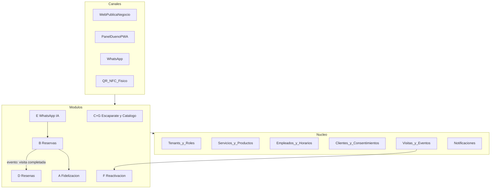
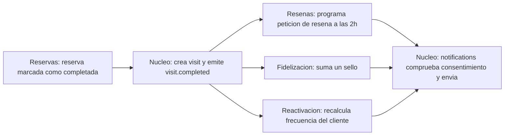
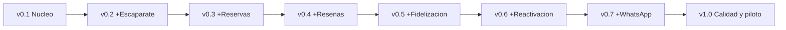

---

name: Nuevo proyecto portfolio 2026

overview: Plataforma modular multi-negocio (núcleo común + 7 módulos) para pequeños negocios en España, con piloto en restaurantes, construida desde cero en unas 14-16 semanas bajo estándares de ingeniería oficiales y trazable en GitHub desde el primer commit.

todos:

  - id: m0-research

    content: "M0: investigación del sector restaurantes (TheFork, CoverManager, cartas QR, entrevistas a 3-5 restaurantes), marco legal (RGPD/LOPDGDD, LSSI, alérgenos UE 1169/2011, API de WhatsApp) y tech radar"

    status: pending

  - id: m0-spec

    content: "M0: SRS (ISO 29148), atributos ISO 25010 medibles, personas, historias Gherkin, alcance 'fino pero completo' de cada módulo congelado"

    status: pending

  - id: m0-design

    content: "M0: arquitectura C4 + ADRs, modelo de datos multi-tenant, threat model STRIDE, prototipo Figma y design system"

    status: pending

  - id: m1-foundation

    content: "M1: monorepo, CI/CD (lint, typecheck, Vitest, Playwright, Lighthouse, axe), preview deploys, convenciones GitHub"

    status: pending

  - id: m1-core

    content: "M1: núcleo (tenants, RLS, auth y roles, perfil del negocio, catálogo, recursos reservables genéricos, horarios, clientes y consentimientos, visitas, i18n)"

    status: pending

  - id: m2-storefront

    content: "M2: módulo Escaparate + Carta QR (C+G): carta multilingüe con alérgenos, ofertas del día y web pública del restaurante"

    status: pending

  - id: m3-booking

    content: "M3: módulo Reservas de mesa (B): turnos, comensales y capacidad, recordatorios, lista de espera, depósito o garantía Stripe"

    status: pending

  - id: m4-reviews

    content: "M4: módulo Reseñas (D) con feedback post-visita, redirección a Google, alertas y respuestas asistidas por IA"

    status: pending

  - id: m5-loyalty

    content: "M5: módulo Fidelización (A) con sellos/puntos por QR, recompensas y pase de Wallet"

    status: pending

  - id: m6-reactivation

    content: "M6: módulo Reactivación (F) con detección de frecuencia por cliente y campañas automáticas con consentimiento"

    status: pending

  - id: m7-whatsapp

    content: "M7: módulo WhatsApp inteligente (E) con agente IA con herramientas (servicios, disponibilidad, reservas) y traspaso al dueño"

    status: pending

  - id: m8-quality-launch

    content: "M8: testing profundo (automático y manual ISTQB), auditorías, piloto real, v1.0 y caso de estudio"

    status: pending

isProject: false

---

# Plataforma modular para pequeños negocios (piloto: restaurantes en España)

## Decisiones tomadas

- **Producto:** una sola plataforma con un **núcleo común** y **7 módulos** que cada negocio activa según lo que necesite. No son 7 apps separadas.
- **Alcance:** los 7 módulos entran en v1.0. Cada uno será **fino pero completo**: pocas funciones, pero terminadas, testeadas y documentadas.
- **Mercado:** España.
- **Sector piloto: restaurantes** (elección del usuario). El foco está en restaurantes de barrio, casuales y cafeterías con clientela local que repite, porque es donde Fidelización y Reactivación tienen sentido.
- **Qué cambia al elegir restaurantes:**
  - **Catálogo = carta digital.** Categorías, platos, variantes y extras, fotos, precio, ofertas del día y "agotado" en tiempo real.
    - Los **14 alérgenos** son obligatorios por el Reglamento UE 1169/2011.
    - Carta **multilingüe** para turistas (ES/EN/FR/DE, preparada para AR con RTL).
  - **Reservas = reservas de mesa**, no de citas con empleados.
    - Número de comensales, turnos y franjas, capacidad por mesas y zonas (terraza o interior), duración media por tamaño del grupo, lista de espera y política de no-show con depósito o garantía de tarjeta.
    - Por eso el núcleo modela un **"recurso reservable"** genérico, que puede ser una mesa, un empleado o una cabina. Así el sistema sirve después para barberías, estética o clínicas sin rehacerlo.
  - **Reseñas:** es el sector donde más pesan Google Maps y TripAdvisor. Se añade un análisis por IA de temas recurrentes (servicio, espera, precio, comida).
  - **WhatsApp:** preguntas típicas sobre horario, ubicación, carta, alérgenos y reservar mesa.
  - **Fuera del alcance de v1.0:** pedidos en mesa, delivery, take-away, TPV y facturación (Verifactu). Van al backlog, porque cada uno es un producto en sí mismo.
- **Competidores a analizar en M0:** TheFork, CoverManager, Google Reserve y las cartas QR genéricas (Bakarta, NordQR y similares). La diferenciación es **todo integrado en un solo sitio**: carta, reservas, reseñas, fidelización y WhatsApp, con precio para restaurantes pequeños y sin comisión por comensal.
- **Cambiar de sector** después (barbería, estética, fisio...) será sobre todo configuración del núcleo y de los recursos reservables, no código nuevo.

## Arquitectura: monolito modular multi-tenant

- **Monolito modular:** un solo despliegue, con cada módulo en su propio paquete y límites claros. Los módulos se comunican mediante eventos de dominio (por ejemplo, `visit.completed` dispara la petición de reseña y suma un sello). No se usan microservicios, porque no se justifican a este tamaño; esto quedará documentado en un ADR.
- **Multi-tenancy:** una base de datos Postgres compartida con `tenant_id` en cada tabla y Row Level Security (RLS) de Supabase. Cada tenant tiene *feature flags* por módulo.
- **Stack propuesto** (se valida en M0 con ADRs):
  - Next.js 16, React 19, TypeScript estricto, Tailwind 4, Framer Motion.
  - Supabase (Postgres, Auth, Storage, RLS) con Drizzle.
  - Stripe para los depósitos, Resend para el email.
  - WhatsApp Cloud API de Meta, Vercel AI SDK para la IA, y [Trigger.dev](http://Trigger.dev) o Supabase Cron para los trabajos programados.
  - Vercel y Sentry.
- **Monorepo:** `apps/web` (web pública y panel), `packages/core`, `packages/modules/`*, `packages/ui` (design system) y `packages/db`.

## El núcleo en detalle

El núcleo contiene los datos y servicios que **todos los módulos necesitan y que no pertenecen a ninguno en concreto**. Si un concepto lo usan dos módulos o más, va al núcleo.

**Entidades del núcleo:**

- `tenants`: el restaurante. Guarda el nombre, el `slug` de su web pública, la zona horaria, los idiomas, el plan y los módulos activos (*feature flags*).
- `members`: los usuarios del panel con su rol (dueño, encargado, camarero). Aquí se definen los permisos.
- `opening_hours` y `closures`: el horario semanal, los festivos y los cierres puntuales. Lo usan el escaparate, las reservas y WhatsApp.
- `catalog_categories`, `catalog_items`, `item_variants` y `item_translations`: los platos (o servicios en otros sectores), con precio, fotos, alérgenos y traducciones. Lo usan el escaparate, WhatsApp y las ofertas de fidelización.
- `bookable_resources`: lo que se puede reservar. En restaurantes, las mesas (capacidad, zona); en otros sectores, un empleado o una cabina.
- `customers` y `consents`: el cliente del restaurante (nombre, teléfono, email, idioma) y sus consentimientos por canal (email, WhatsApp, marketing). Todos los módulos que contactan a un cliente pasan por aquí.
- `visits`: el registro de que un cliente vino, venga de una reserva completada, de un escaneo de QR o de un registro manual. Es el dato del que viven las reseñas, la fidelización y la reactivación.
- `notifications`: un único servicio de envío (email, WhatsApp, SMS) con plantillas, respeto de los consentimientos y registro de todo lo que se envía.
- `domain_events` y `audit_log`: el bus interno de eventos y el registro de quién cambió qué.

**Reglas de dependencia**, comprobadas en CI con una regla de lint `eslint-plugin-boundaries` o `dependency-cruiser`):

1. Los módulos dependen del núcleo; el núcleo **nunca** depende de un módulo.
2. Un módulo **no importa código de otro módulo**. Se comunican por eventos del núcleo.
3. Cada módulo es dueño de sus propias tablas. Por ejemplo, `booking_*`, `loyalty_cards` o `review_requests` son del módulo, pero todas llevan `tenant_id` y apuntan a entidades del núcleo.

**Multi-tenancy:**

- Hay una sola aplicación y una sola base de datos, y todas las tablas llevan `tenant_id`.
- Las políticas RLS de Postgres garantizan, **en la propia base de datos**, que un usuario solo ve las filas de su restaurante, aunque haya un bug en el código.
- Habrá tests automáticos específicos que intentan leer datos de otro tenant y deben fallar.

**Estructura de carpetas:**

- `packages/core/`: entidades, servicios del núcleo, eventos y permisos.
- `packages/modules/storefront`, `booking`, `reviews`, `loyalty`, `reactivation` y `whatsapp`: cada uno con su `schema`, sus `services`, sus `events` y su `ui`.
- `packages/db/`: el esquema Drizzle, las migraciones y las políticas RLS.
- `apps/web/`: solo las rutas (la web pública del restaurante y el panel del dueño) que componen los módulos.

## Riesgos conocidos

- **WhatsApp:** Meta exige verificación del negocio, plantillas aprobadas y un coste por conversación. En desarrollo se usa el número de prueba; en todos los módulos se deja email o un enlace `wa.me` como alternativa.
- **Legal en España:**
  - Los mensajes promocionales (Reactivación, Fidelización) requieren consentimiento explícito según la LSSI y el RGPD.
  - Consentimientos granulares, registro de tratamiento, política de privacidad, y derechos de acceso y borrado implementados.
- **Competencia:** TheFork (cobra comisión por comensal y el cliente pasa a ser de TheFork), CoverManager (orientado a restaurantes medianos y grandes) y las cartas QR sueltas. La diferenciación es **todo integrado, sin comisión por comensal, con los datos del cliente en manos del restaurante y centrado en WhatsApp y los no-shows**.
- **Alcance:** 7 módulos es mucho. La regla es que cada módulo tiene su alcance congelado en M0, y todo lo extra va al backlog v1.1.

## Cómo funcionan los hitos

Cada hito **añade un módulo, pero entrega la app completa**: al cerrarlo hay una release versionada, desplegada y usable de toda la plataforma con los módulos que ya existen. No se construyen módulos sueltos para integrarlos al final.

- M1 cierra con `v0.1` (núcleo + panel), M2 con `v0.2` (+ escaparate), M3 con `v0.3` (+ reservas)... y M8 con `v1.0`.
- **Dentro de cada hito**, el módulo recorre su propio ciclo corto:
  1. Detalle de sus historias y criterios de aceptación.
  2. Diseño de pantallas y flujos.
  3. Tablas y eventos.
  4. Implementación.
  5. Tests unitarios, de integración y E2E.
  6. Documentación y demo.
- **Además, en cada hito:**
  - Tests E2E de regresión de la app entera, para que el módulo nuevo no rompa los anteriores.
  - Integración con los módulos ya existentes (por ejemplo, en M4 las reseñas se enganchan al evento de visita de M3).
  - Changelog y nota de release.
- **M8 no es "el momento de testear".** Los tests se escriben en cada hito. M8 es para las pruebas transversales de la app completa: manuales según ISTQB, usabilidad con usuarios reales, auditorías de seguridad, rendimiento y accesibilidad, el piloto real y el pulido final.

## Hitos (unas 14-16 semanas)

- **M0 (semanas 1-2): investigación, especificación y diseño**
  - `docs/research/`: competidores (TheFork, CoverManager, cartas QR), entrevistas a 3-5 restaurantes reales y marco legal (RGPD, LSSI, alérgenos UE 1169/2011).
  - `docs/srs.md` (ISO/IEC/IEEE 29148) y atributos de calidad ISO/IEC 25010 medibles: LCP menor de 2,5 s, WCAG 2.2 AA, OWASP ASVS nivel 2.
  - `docs/architecture/`: diagramas C4 y ADRs, modelo de datos y threat model STRIDE.
  - Prototipo en Figma y design system.
- **M1 (semanas 3-4): fundación y núcleo**
  - Repositorio, CI/CD y convenciones.
  - Tenants, auth y roles, perfil del negocio, servicios, empleados y horarios, clientes y visitas.
  - i18n en español e inglés, dejando FR/AR (con RTL) preparados.
- **M2 (semana 5): Escaparate + Carta QR (C+G).** Web pública del restaurante con carta multilingüe, alérgenos, fotos, ofertas del día, horario, ubicación, botón de WhatsApp, reseñas destacadas y QR de mesa imprimible.
- **M3 (semanas 6-7): Reservas de mesa (B).** Disponibilidad por turnos, comensales y capacidad, confirmación, recordatorio, cancelación y cambio por enlace, lista de espera y depósito o garantía con Stripe para grupos o fechas señaladas.
- **M4 (semana 8): Reseñas (D).** Feedback tras la visita. Se invita a reseñar en Google a todos los clientes (el filtrado previo o *review gating* incumple las políticas de Google). El feedback privado negativo genera una alerta al dueño. La IA sugiere respuestas y resume los temas recurrentes.
- **M5 (semana 9): Fidelización (A).** Sellos o puntos al escanear un QR, recompensas y pase de Apple/Google Wallet si da tiempo.
- **M6 (semana 10): Reactivación (F).** Frecuencia media por cliente, detección de retraso y campaña con consentimiento; mide cuántas reservas se recuperan.
- **M7 (semanas 11-12): WhatsApp inteligente (E).** Agente IA que usa como herramientas los servicios, la disponibilidad y las reservas del núcleo; el dueño puede tomar el control en cualquier momento.
- **M8 (semanas 13-16): calidad y lanzamiento**
  - Pirámide de tests completa.
  - Plan de pruebas manuales según ISTQB.
  - Usabilidad con dueños y clientes reales, y auditorías de accesibilidad, rendimiento y seguridad (OWASP ZAP).
  - Piloto con 1-2 restaurantes reales.
  - v1.0, vídeo demo y caso de estudio para Upwork, Malt y LinkedIn.

## Método de trabajo (en todos los hitos)

- GitHub Projects con milestones M0-M8, un issue por historia de usuario y un PR por feature con tests y *preview deploy*.
- Conventional Commits, changelog y releases versionadas por hito.
- Definition of Done: tests en verde, cobertura mínima, accesibilidad sin errores con axe, documentación actualizada y demo desplegada.

