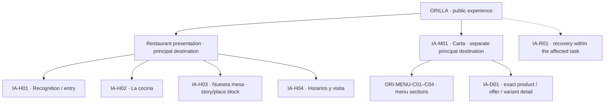
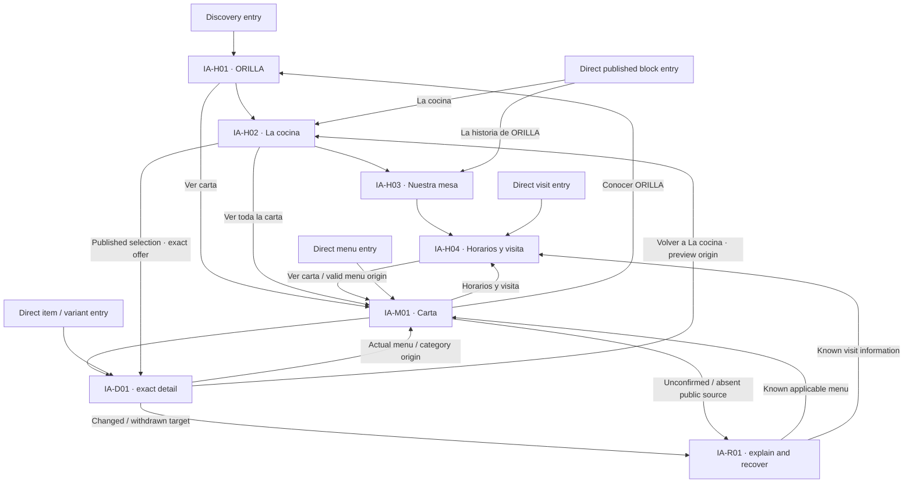

# ORILLA — Storefront architecture with adopted content

4 October 2026 · G2.02 · **IA v0.4** · Refs [M1 #5](https://github.com/yaboula/valiris-restaurants/issues/5).

**Ready for representative composition; application and affected-ID SEO re-reading remain pending.** This scoped continuation adopts ORI-CASE-1.1 and ORI-COPY-1.1 together. It retains v0.3's two principal destinations, seven destination/six journey IDs and architectural XR02 outcomes; no cause for restructuring was found. [1.1 adoption and UI effects](../../research-evidence/g2-02-storefront/content-1-1-adoption.md), [request resolution](../../research-evidence/g2-02-storefront/content-requests.md), [targeted contrasts](../../research-evidence/g2-02-storefront/content-1-1-contrasts.md) and [handoff/evidence](../../research-evidence/g2-02-storefront/README.md) identify current decisions and limits. The [1.0 adoption](../../research-evidence/g2-02-storefront/adoption.md) is preserved historical evidence.

| Source role | Frozen version | Authority / effect |
| --- | --- | --- |
| Operating baseline | `56306793d54bb8df74305134ec6284c6d647eebf`, [#41](https://github.com/yaboula/valiris-restaurants/pull/41) | Published G1 joint handoff; new isolated continuation, not main. |
| Case + situated copy | `4b382bebe5d5c6cad21a7edcaffab053c433a0e9`, [#39](https://github.com/yaboula/valiris-restaurants/pull/39): [ORI-CASE-1.1](orilla-case.md) + [ORI-COPY-1.1](m1-storefront-content-and-copy.md) | Both explicitly adopted together. G2.04 remains sole case/copy consolidator. Their exact blobs persist at the operating baseline; the 1.0 pair at 5bd3184 is historical. |
| Applied discovery review | `0c17480bdc2b6ff8037022228ebc4599a704e702`, [#37](https://github.com/yaboula/valiris-restaurants/pull/37): [XR02/Q01–Q05 and R/T register](m1-storefront-discovery-content.md) | Received and resolved within architecture in the adoption record; copy/technical/application decisions stay with their owners. |
| Previous architecture | v0.3 `ba44c6809516d8d078d192f5f6a423b12cd8b673`, [#40](https://github.com/yaboula/valiris-restaurants/pull/40); v0.2 `ff8fc061dfb4e63461ee2b77b5a18f02108edb6b`, [#33](https://github.com/yaboula/valiris-restaurants/pull/33) | Both source branches/PRs frozen. Prior evidence describes its exact source version, not a new review of 1.1. |

All restaurant people, room, dishes, amounts, times and conditions are authored fiction. Food declarations are unverified examples. The case is the sole factual fixture; amounts and hours quoted below are labelled documentary renderings of it, not new maintained copy or claims about a real business. No image, live target, reviewed translation or UI is supplied by architecture.

## 1. Recommendation and visitor situations

Retain a connected expressive presentation and a separate calm menu. The supplied content makes this proportionate structure recognisable as ORILLA: Inés's oven-first cooking, Dani's repaired six-seat table, sharing alongside individual plates, and time for conversation within actual stated local hours. Four internal presentation blocks are sufficient; the source provides no independent task requiring separate biography, cuisine, hours or category pages.

| Situation / task hypothesis | Information priority and entry | Intended consequence / limit |
| --- | --- | --- |
| Choosing a restaurant or occasion | H01 identity/location/fiction; H02 cooking and representative prices; H03 people/room/occasion; H04 schedules/conditions. **Ver carta** remains immediate. | Understand sharing and individual choice, not a compulsory communal meal. Audible conversation and table-confirmation limits matter to the occasion. No researched personas or observed demand. |
| Seated and consulting | Direct M01 or exact D01: one general dining-room menu, categories, full option/format/amount/condition, example food limits and return. | No presentation, account, promotion, compulsory search or context-selection gate. QR alone does not prove seat/service/stock. |
| Recipient of a link or future visitor | Reach the actual block/item with restaurant identity, fiction, applicable context/date/language and a relevant exit. | A past override or shared preview is not a current availability guarantee. No forced narrative tour. |

The presentation sequence is recognition → kitchen through actual choices → human origin/place → practical visit. It expresses a relationship, not a forced scroll order. Kitchen before story gives visitors concrete food/price meaning early; the story then explains the portion and seating choices instead of functioning as an unrelated biography. Practical information has its own direct entry from either experience. UI can adjust composition order against these questions and return the affected IDs.

| Alternative | Benefit / cost | Decision |
| --- | --- | --- |
| Two principal destinations with addressable presentation blocks | Connected narrative plus direct consultation/visit; one maintained offer and visit source. A longer presentation needs clear jumps and returns. | Retain; supplied content supports each block. |
| Separate kitchen/story/visit pages | Useful for substantial independent tasks, but fragments this short connected origin and adds maintenance/navigation. | Do not add now. A later proposal needs actual content/task evidence and G1 review. |
| One menu-led surface with a short introduction | Efficient at the table but weakens ORILLA's expressive discovery and human/place explanation. | Keep the efficient direct menu entry inside the retained two-destination structure. |

For diners, complete conditions support an informed reading task. For the restaurant, the same offer/visit records feed all placements. For Valiris, composition can carry personality while everyday content remains maintainable. These are design intentions, not measured comprehension, savings or superiority. Rampstack remains the [adapted primary method](../../research-evidence/g2-02-storefront/rampstack-adaptation.md); no navigation/category quota or three-click acceptance rule applies. Mermaid is the current review medium; FigJam is optional.

## 2. Destinations, labels and navigation

### Structural map

Solid arrows mean containment, not required click order. Categories are sections, D01 is a contextual destination and R01 is recovery within the task. Addressability does not prescribe a page/panel/overlay or another primary page.

### Entry and return overlay

Arrows are available paths, not forced reading. Every presentation block preserves **Ver carta** access. Return/recovery arrows apply only to known valid destinations; they never authorize guessing a replacement product or current offer.

| Destination | Entry / adopted architectural label | Exit / existing behaviour |
| --- | --- | --- |
| IA-H01 — recognition | Presentation entry or **Conocer ORILLA**. Name, Mediterranean kitchen in Alcoy, oven/table proposition and visible fiction. | Direct **Ver carta**; jumps H02/H03/H04. [PV-P01](m1-public-presence-and-discovery.md#pv-p01-recognise-the-venue-and-choose-the-task). |
| IA-H02 — kitchen | **La cocina** in navigation and block. Explain roasting/dressing and sharing/individual choices through the actual menu. | **Ver toda la carta** or exact selected offer to D01; D01 returns to this preview when it was the origin. [PV-P07](m1-public-presence-and-discovery.md#pv-p07-venue-selected-highlights). |
| IA-H03 — story/place | **La historia de ORILLA** for an isolated navigation/direct-link label; **Nuestra mesa** as the block heading with “Inés, Dani y una mesa reparada a mano.” | Full common story available, including on phone; **Horarios y visita** or **Ver carta**. Hide jump if this optional block is absent. PV-P01/PV-O02; G2.03 owns any expansion. |
| IA-H04 — visit | **Horarios y visita**, consistently in presentation, menu and detail. Direct entry supplies identity/fiction without requiring H01 first. | **Volver a la carta** for actual valid menu origin; **Ver carta** for direct entry. Missing external targets have an explanation, not fake actions. [PV-P02](m1-public-presence-and-discovery.md#pv-p02-visit-information-and-declared-attributes)/PV-P03. |
| IA-M01 — menu | **Ver carta** or direct link/QR; **Carta de ORILLA**, descriptive **Carta general · Sala**. One applicable menu, four category sections; no compulsory context chooser. | D01; **Horarios y visita**; secondary **Conocer ORILLA**. Preserve category/query/filter when composed. [PV-P04](m1-public-presence-and-discovery.md#pv-p04-direct-menu-and-context-entry)/PV-P05. |
| IA-D01 — detail | Exact published product/placement, portion/variant and actual language. Full changed variant name, amount/unit/condition and food limits. | **Volver a la carta** to valid category/origin; **Volver a La cocina** for H02 origin. A direct item entry offers its applicable menu/category. [PV-P06](m1-public-presence-and-discovery.md#pv-p06-detail-and-return-to-the-choice). |
| IA-R01 — recovery | Specific known withdrawal/change or uncertainty in the affected task. Temporary unavailable remains in M01/D01, not a withdrawal page. | Known menu/section/visit or retry as source permits; no compulsory Home redirect, similar-name substitution or old price as current. [PV-P11](m1-public-presence-and-discovery.md#pv-p11-unavailable-changed-or-unconfirmed-public-target). |

**Presentation navigation:** ORILLA identity → H01, **La cocina**, **La historia de ORILLA**, **Horarios y visita**, primary **Ver carta**. The long isolated story label may wrap or sit in secondary navigation; UI must not silently shorten it to an ambiguous “Mesa” to fit. Both story labels refer to H03, not different content or pages. This is an architectural adoption of XR01/R04; G2.04 retains final copy consolidation.

**Menu navigation:** identity, the following same-ID jumps, language and practical visit/presentation access. Search/filters/comparison remain contextual capabilities under the existing PV/J contracts. This small menu does not require search, category pages, a tag inventory or advanced context setup; omitting a control here does not defer its launch capability.

| Shared category ID | Full section heading from CASE/COPY | Adopted compact jump | Meaning to preserve |
| --- | --- | --- | --- |
| ORI-MENU-C01 | Para el centro | Para compartir | D01/D02; portion choice is explicit, not a minimum for every sharing dish. |
| ORI-MENU-C02 | Del horno y la cuchara | Platos | D03–D06, including rice with minimum two. Do not rename Individuales or move rice to C01 merely to simplify the label. |
| ORI-MENU-C03 | Un final y sobremesa | Postres | D07/D08. Espresso remains C04; sobremesa is bounded by local hours and implies no included coffee. |
| ORI-MENU-C04 | Para beber | Bebidas | D09–D11. Wine copa/botella retain 125/750 ml and their distinct offers/amounts. |

Full heading and compact jump are views of the same category identity, not separate editable classifications. Reordering/renaming/translation preserves a valid target and actual reading origin, or explains its loss under PV-P06/P11. Whole-string locale equivalents and user comprehension remain pending.

**Return intent and secondary access:** retain restaurant, applicable menu/offer/variant/format, service/date/context, actual language and valid category/query/filter/origin. Detail/visit restores the valid opening origin; lost anchors explain change and offer a known relevant section. G2.03 decides history/focus/expansion transitions. Repeated menu/visit access at the end of a block may support the next task; no comprehensive footer with empty pages, breadcrumb quota, storage mechanism or sticky UI pattern is imposed. Account is secondary, with public reading anonymous and private personalisation authenticated.

**Candidate addressability, still unresolved technically:** retain the v0.2 illustrative restaurant-relative `/`, `/#cocina`, `/#personas-y-lugar`, `/#visita`, `/carta`, `/carta/productos/[stable-readable-key]`. A new story label does not automatically rename the prior candidate fragment. These are not live URLs, chosen tenant/host/locale routes or canonical targets. SEO-T01–T04/T08 in the received review carry the unresolved identity/delivery questions for M2/#4. Blocks stay directly addressable for reading without an independent indexation claim. Public external/share actions require configured destinations; ORI-VISIT-02 supplies none. A prepared internal navigation contract is not a shareable public URL.

## 3. Content and maintenance by block

All case/copy IDs below consume the adopted `4b382be…` pair. Known means authored fiction available for composition, not published restaurant facts. A later source return records old/new SHA, IDs, affected uses, decision and residual review; never take case and copy silently from different versions.

| Block / visitor question | Available shared source and situated copy | Conditions, unknowns and appearance | Restaurant maintenance / studio boundary / behaviour |
| --- | --- | --- | --- |
| H01 — What is ORILLA; why consider it? | ORI-IDENTITY, ORI-LOCATION, ORI-CONCEPT, ORI-FICTION; ORI-COPY-H01-01–06. Oven vegetables, shared rice and individual choices explain the proposition. | Name/descriptor/fiction/action readable independently of art. No opening/stock claim from “Del horno al centro de la mesa.” Direct block/menu/detail entry retains identity and fiction. | Permitted restaurant narrative input; studio composes hierarchy. No duplicate schedule or raster navigation. PV-P01/PV-O02. |
| H02 — What does this cooking mean; what could I choose? | ORI-PEOPLE-01, ORI-DISH-02–06, ORI-MENU-H01; ORI-COPY-H02-01–07. Selected D02/P02/P03, D04/P05, D08/P09. | Full names, exact variant/portion/amount/conditions/state remain together. Selection is authored, not popularity. Unavailable flan stays labelled; withdrawn flan loses current preview link. | Restaurant maintains explanation/selected IDs, source provides offer values. Studio controls expression, not another price list or stock source. PV-P07/PV-O03; ADR-0011. |
| H03 — Who shaped this restaurant; does the occasion suit me? | ORI-STORY-01, ORI-PEOPLE-01/02, ORI-EXPERIENCE-01–04; ORI-COPY-H03-01–09, E01. Siblings, repaired table, individual/shared meals, audible conversation. | Substantive source exists: block/jump can be composed without portraits. H03-09 supplies the isolated link; Nuestra mesa retains its introduction. All people/room remain fiction. Text-only/no-story branch omits only optional block/jump. | Restaurant maintains shared narrative; studio sequence/space. Short phone opening links to the same full story. PV-P01/PV-O02; G2.03 expansion return pending. |
| H04 — When can I visit/use the kitchen; what remains uncertain? | ORI-VISIT-01–03, ORI-LOCATION, ORI-SCENARIO-04/06/09; ORI-COPY-H04-01–11, S01–S12. | Monday closed; Tue–Thu/Sun local 12:30–17:00, kitchen 13:00–15:30; Fri/Sat add local 19:30–23:00, kitchen 20:00–22:00. Europe/Madrid. Exceptions need full date/scope. Address/contact absent; step known, measurements/animal policy pending. | Same visit records feed optional H01/menu summary. No blanket open badge, map pin, call/booking action or table confirmation. Restaurant facts versus studio arrangement remain separate. PV-P02/P03/PV-O01. |
| M01 — Which options/formats apply to this reading? | ORI-MENU-01/C01–C04/P01–P13, ORI-DISH-01–11, ORI-SCENARIO-00–10; ORI-COPY-M01-01–10. | One general room menu: no terrace or daily offer. Portions/recipe variants differ from context selection. Kitchen closed permits reference reading; availability is service-scoped. Essential unit/minimum/condition in summary before optional detail. | Restaurant maintains common product and exact offers, urgent availability separate from drafts. Studio composes categories/reading. PV-P04/P05/P11; ADR-0011. |
| D01 — What includes this option; what is known about its food? | Relevant ORI-DISH/P/variant and ORI-FOOD record; ORI-FOOD-NOTICE, ORI-FOOD-DIET-01; ORI-COPY-D01-01–11, S21–S25. | D02/V02 changes full name/description/food source; same valid P02/P03 amounts. Yogurt omission does not prove milk absence or vegan safety. Positive declarations and pending fields coexist; nutrition pending. | Food/name/variant/language revisions invalidate matching dependent uses. Example notice visible near food entry/results/detail. No ingredients inferred from media/category. PV-P06/P10; existing J11 and food criteria. |
| R01 and contextual utilities — Can I continue without a false conclusion? | ORI-SCENARIO-01–09, ORI-COPY-S06–S26; existing J10/J11/J15 contracts and S29/S30. | Temporary unavailable, restored, unknown next service, withdrawal, load failure, missing hours and Spanish fallback stay distinct. S27/S28 operator-only never enter public content. Video/nutrition/private inputs/resources not received. | Existing comparison/save/media/nutrition/offline/account capabilities retain contextual access and source/identity limits; no order total, anonymous private profile or fabricated cache. PV-P09/P11, J10/J11/J15. |

H04's schedule renderings above are documentary references, not a second schedule source. H01 may repeat selected visit facts only from H04's compatible source with local/kitchen labels. No live opening or availability is calculated from the reader's current date/time.

**Content relations:** one restaurant anchors both destinations; narrative explains actual culinary choices; MENU contains category placements; DISH is common product identity; each P offer binds portion/unit/amount/condition; V recipe variant binds current name/description/FOOD; SCENARIO adds explicit applicable publication/availability/time branches; ASSET binds an optional concept/use. The fields remain editorial source needs, not a database/API schema. Amounts, facts and translations are never separately editable in Home and menu. A future dish in multiple offers retains identity; category and translated display label are not identity keys.

Existing authored pairings retain [PV-P08](m1-public-presence-and-discovery.md#pv-p08-directed-pairings-with-current-contextual-targets); this ORILLA version supplies no pairing, so do not infer one from a wine bottle or flan/coffee scene. Comparison/saving retains exact offer/variant/context and is not an order. Reviewed media/nutrition and loaded-public-content recovery use their existing detail/consultation access rather than new primary navigation; private account/preferences remain voluntary and authenticated under J10/J11/J15.

## 4. Representative paths on the adopted source

Every row is a source-based documentary walkthrough, not executed UI. Reset the cited scenario before each branch; clocks are frozen Europe/Madrid fixture clocks. [Targeted 1.1 contrasts](../../research-evidence/g2-02-storefront/content-1-1-contrasts.md) cover affected entries/date/metadata uses; the [preserved 1.0 contrasts](../../research-evidence/g2-02-storefront/content-adoption-contrasts.md) retain their historical scope without transposing C1–C3 values into ORILLA.

| Path | Start / source | Actions and information that must survive | Recovery / readiness |
| --- | --- | --- | --- |
| IA-J01 — discover ORILLA | H01; ORI-CONCEPT/STORY-01 and ORI-MENU-H01, scenario 00. | Identity/fiction → direct **Ver carta**, or La cocina → D02/V01: Media ración 9,50 €, Ración 15,00 €, named variant and example food limits → detail → actual H02 preview origin. Story explains both sharing and eating individually. | Actual narrative/menu available. No portrait or mandatory story before action; composed comprehension/return still pending. |
| IA-J02 — plan a visit | Direct H04 or M01 → H04; scenario 04 at Sunday 4 October 12:45, then separate 15:30 reset. | Local open/kitchen opens 13:00; at 15:30 local open/kitchen closed. General menu remains readable. Distinct schedules/fiction, location and absent contact reason → valid menu return. | Scenario 06 revision 2 at 13:15 uses S10: Horario especial de cocina · domingo 4 de octubre de 2026, 13:30–15:30. Keep date/kitchen scope at every entry; ordinary 13:00 and local hours remain separate. Scenario 09 is unknown, not closed. No live exit. |
| IA-J03 — consult directly | Direct M01; ORI-MENU-01, scenario 00. | C02 via **Platos** → D04/P05: Arroz al horno de verduras y garbanzos, 16,00 € / persona, Mínimo 2 personas → food pending/notice → detail → same category/reading origin. C04 wine: Copa 125 ml 3,50 € versus Botella 750 ml 17,50 €. | No single-context chooser, sign-in, daily menu or combined order total. Category jump is not a serving rule. Actual applied reading pending. |
| IA-J04 — receive an item link | Exact D02/P02/V02 target in the general menu; scenario 00/08, then separate 07 withdrawn D08 reset. | V02 full name uses aceite de limón, sin yogur; media remains 9,50 €. Hazelnut positive retained, milk absence unconfirmed. Direct entry supplies identity/fiction/food notice and applicable C01/menu exit. | Requested EN has explicit compatible Spanish fallback, not an EN menu. Withdrawn D08 explains exact target, no current withdrawn amount or similar-name substitution. Encoding/delivery unresolved. |
| IA-J05 — unavailable and restored product | D08/P09, scenario 00 → 01 at 14:15 → 02 at 14:30; reset independently for 03/07. | Flan de café, Ración 6,00 €, milk/egg examples plus pending fields; 01 says No disponible en este servicio across H02/M01/D01. Confirmed 02 restoration affects only that lunch and exact offer. | Tuesday 6 October stock unconfirmed, not silent restock. Withdrawal 07 omits current preview link/current amount; unknown refresh is neither withdrawal nor zero results. Actual lifecycle pending. |
| IA-J06 — variant/language change | D02/P02/V01 → V02; compatible Spanish revision 1, scenario 08. Separate private FOOD-CHANGE-01 reset. | Same valid portion/amount, changed full name/description/food relationship. Retain relevant positives/unknowns and origin; actual language identified. Unconfirmed variant requires explicit applicable choice. | Private sesame V01 revision is excluded publicly and does not alter V02, price or stock. Later coherent publication needs affected language/media review; G2.03/G3 enforcement pending. |

Preserve [J1/J2 criteria](../product/m0-journeys-and-criteria.md#j1--diner-before-the-visit), [PV](m1-public-presence-and-discovery.md) and [extended J10/J11/J15](m1-extended-journeys.md). All 72 capability parents remain 36 Included / 30 Configurable / 6 Connection-dependent; S1 excluded builder/S2 accepted personalisation remain separate. Only standalone audio and product 3D are deferred. Orders/payments/TPV/delivery remain outside this module; booking is a supplied connection, not a completed reservation or visit.

## 5. Updated package for UI — PC then deliberate phone

Compose PC first at 1440 px, then deliberately adapt at 390 px. These samples expose simultaneous wide reading versus a narrow column, not final breakpoints/support guarantees. Use 1280 PC or 360/430 phone and enlarged/translated text if actual stresses warrant them; phone findings may revise PC. No composition is received here.

The four-language interface obligations (ES/EN/FR/DE) and Arabic/RTL preparation remain in the existing launch/design contract. This ORILLA pair supplies Spanish author proposals only. Pending reviewed translations do not authorize postponing interface capabilities or calling a Spanish factual fallback a translated menu.

| UI package / source | PC priority and freedom | Phone invariants / deliberate adaptation | Remaining input / owner |
| --- | --- | --- | --- |
| H01: COPY-H01-01–06 | Readable ORILLA, descriptor, oven/table headline, substantive opening, visible fiction and direct action; luminous expressive field independent of artwork. | Same identity/fiction/action, optional shorter source opening. **Ver carta** outside collapsed secondary navigation; long story jump can wrap. | Optional ASSET-01 absent; G2.07 layout, G2.08 construction, G2.06 direction. |
| H02: COPY-H02-01–07, MENU-H01 | Cooking explanation plus authored D02/D04/D08 selection. Offer names/variants/amounts/conditions/state are live text. Avoid a second full menu or inferred bestseller framing. | Stack complete offers; long aubergine name wraps. V02 changes actual wording/food/media; minimum remains with rice amount. Detail returns to preview. | ASSET-02/04 are concepts only; no visual milk/stock implication. G2.03 applied return pending. |
| H03: COPY-H03-01–09, E01 | Nuestra mesa with supplied introduction/full story; both siblings' specific contribution, room/occasion and audible-conversation limit. H03-09 supplies La historia de ORILLA for isolated navigation. | Shorter supplied opening may lead to the same full story. No second narrative. G2.03/UI define expansion/focus, if used. | ASSET-03 absent; copy 1.1 supplies both label uses, adopted here; applied reading still pending. |
| H04: COPY-H04-01–11, S01–S12 | Two complete schedules, Monday closure and Fri/Sat dinner, dated exceptions/unknowns, contact boundary and known/pending visit conditions. | Stack each day group's local/kitchen facts; retain every day/service. Direct entry reveals H04 with identity/fiction and actual menu return. | No address/contact/map/call/booking target; access measurements/animal policy pending by source, not UI error. |
| M01/D01: COPY-M01/D01, S06–S26 | Quiet consultation; full heading plus same-ID compact jumps, exact offer/variant meaning, visible food/demo notices. Existing utilities stay contextual. | Same facts, text order/context/return; no clipped name, bare price pair, hidden positive+pending or lost actual language. | Actual UI/linguistic/accessibility and target delivery pending; no global block on exploration. |
| Direct entries and recovery: COPY-E01–E03, H02-07, S10/S11/S14/S18 | E01 supplies identity/fiction at the actual H02/H03/H04 block; E02 menu scope/notices; E03 exact known product/variant/offer and menu exit. Isolated product link identifies its actual name. S10 carries the full exception date; recovery uses Horarios y visita only if valid. | Same facts and complete notices/date. A compact control can wrap; it cannot replace an unconfirmed V02 with V01, hide essential conditions or make H01 a prerequisite. Restore a real valid origin; direct entry offers its known pertinent destination. | G2.07 hierarchy and G2.03 focus/history/compatibility; new source strings do not establish rendered accessibility or preview freshness. |
| Six SEO R10 checkpoints | Entry/discovery, offer reading, story/visit, food/state, language/recovery and resource independence against the same IDs. | Each checkpoint returns PC and phone version + source + finding + affected block + proposed correction. | G2.07/G2.03/G2.05 and independent G4 applied review; none supplied. |

**Situated resource contract:** adopt ORI-ASSET-01–04 as needs, not assets received. ASSET-01 supports the shared-table headline; ASSET-02 represents D02/V01/P02/FOOD-02 revision 1; ASSET-03 is the fictional repaired-table scene; ASSET-04 explains flan/sobremesa without implying coffee inclusion or stock. Actual brief names source ID/revision, message, text relationship, PC/phone use and provenance; UI supplies dimensions/crops/layers, G2.08 construction, G2.06 direction and G2.04 source/alt relation. V02 needs faithful oil/no-yogurt imagery or no image. Alternative text follows the delivered inspected resource. Missing imagery never prevents representative text composition.

Preserve the [selected luminous direction](valiris-restaurants-brand-refinement.md) and original ORILLA. No dark mode, brand reselection, fixed culinary character biographies, production typeface/licence or final resource is selected here. This is an architecture handoff, not UI, illustration, implementation or final copy.

## 6. Resolution, pending returns and completion boundary

**1.1 entry and metadata relations:** E01 maps to existing H02/H03/H04; E02 to M01; E03 to D01 or its truthful R01 recovery. META-01 maps to H01, META-02 to M01, META-03 to published D01 (including temporary nonavailability), META-04 to present H03, META-05 to H04 with known schedules, and META-06/07 to confirmed-withdrawn/unconfirmed exact-target recovery. They are source-owned editorial candidates, not seven new pages. Each title/summary identifies fiction independently, while visible destination fiction/food/date context remains required. Default summaries carry no current price/stock promise. Unknown target identity omits product metadata; unknown hours use S11/S12 rather than an incompatible known-hours candidate. Actual origin/language/state govern all exits. No private sesame draft/operator text may feed public entry/metadata. G2.04 owns literal strings; G2.07 visible composition, SEO affected-ID re-reading, and G3 T01–T08 delivery/locale/preview decisions remain pending. See the [conditional relation table](../../research-evidence/g2-02-storefront/content-1-1-adoption.md#2-entry-and-metadata-relations).

CR01–CR04 remain accepted for preliminary architecture; CR05–CR07 remain partial with explicit operational/food/language/resource gaps. XR01's labels are now adopted from the consolidated 1.1 pair. XR02 remains received at 0c17480, with structural implications adopted in v0.3; SEO has not supplied a new re-reading of 1.1. XR03/XR04 remain pending. The [historical adoption register](../../research-evidence/g2-02-storefront/adoption.md) preserves all twelve prior SEO outcomes; the [scoped 1.1 register](../../research-evidence/g2-02-storefront/content-1-1-adoption.md) updates affected uses and owners. T01–T08 remain M2 questions without another backlog or final technical acceptance.

G2.04 consolidates future CASE/COPY changes; only affected labels/metadata/food/offer/visit uses are reread on its new identified SHA. G2.03 checks applied origin, variant/format, missing-block, language and recovery behaviour. G2.07 can compose this source now and return PC/phone findings. G2.05, productive assets/rights and G4 application/participant evidence remain pending. Source content and SEO review are received via Git; no direct cross-chat messages, new specialist activations or joint approvals are implied.

This resolves adoption and supplies representative content for composition; it does not close the broad architecture/application contract. Document checks and [historical C1–C3 contrasts](../../research-evidence/g2-02-storefront/documentary-contrasts.md) remain author evidence. Understanding, interaction, rendered accessibility, routing/indexation, food verification and independent G4 review have not been demonstrated. G1 is sole PM and coordinates integration. M1/#5, M2/#4 and #15 remain open; no merge, configuration or site publication is performed.
