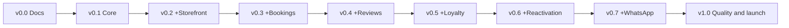

# Roadmap

Historical roadmap: M0 is documentation-only and does not deliver a usable application. The software-release expectation applies to construction milestones in this earlier plan. The owner-adopted first-product roadmap in the planning migration supersedes this module sequence and timetable.

| Milestone | Weeks (approx.) | Release | Scope |
| --- | --- | --- | --- |
| M0 Discovery, specification and design | 1–3 | `v0.0.0-docs` | Research, SRS, architecture, UX/UI, design system |
| M1 Foundation and platform core | 4–5 | `v0.1.0` | Monorepo, CI/CD, tenants, auth and roles, catalog, bookable resources, hours, customers and consents, visits, notifications, i18n |
| M2 Storefront and QR menu | 6 | `v0.2.0` | Public restaurant page, multilingual menu with allergens, daily offers, table QR |
| M3 Table bookings | 7–8 | `v0.3.0` | Availability by shift, party size and capacity; reminders; waitlist; deposit or card guarantee |
| M4 Reviews | 9 | `v0.4.0` | Post-visit feedback, Google review invitation (no gating), alerts, AI-assisted replies and topics |
| M5 Loyalty | 10 | `v0.5.0` | Stamps or points via QR, rewards, Wallet pass |
| M6 Reactivation | 11 | `v0.6.0` | Visit frequency, lapse detection, consented campaigns, recovered-visit metric |
| M7 WhatsApp assistant | 12–13 | `v0.7.0` | AI assistant grounded on menu, hours and availability, with human handover |
| M8 Quality and launch | 14–17 | `v1.0.0` | Cross-cutting manual and automated testing, audits, demo restaurant, usability tests, case study |

**Every milestone also includes:**
- the module's own cycle: stories, design, data and events, implementation, tests, docs and demo;
- regression E2E tests of the whole app;
- integration with the existing modules;
- the changelog and release notes.

## M0 in detail

M0 specifies **the platform core in depth** and **the scope of the seven modules** (epics, key stories, MoSCoW). Detailed stories, screens and tables of each module are produced in that module's milestone.

| Phase | Days | Deliverables | Gate |
| --- | --- | --- | --- |
| M0.1 Kick-off | 1 | Repository, conventions, templates, labels, milestones, ADR 0001–0005, glossary, charter, roadmap | |
| M0.2 Discovery | 2–5 | `docs/research/`: market, competitors, review mining (≥ 50 public reviews), simulated interviews, legal, synthesis | **Gate 1: problem validated** |
| M0.3 Product definition | 6–9 | Vision, personas, story map, SRS (ISO/IEC/IEEE 29148), NFRs (ISO/IEC 25010), MoSCoW scope | **Gate 2: scope frozen** |
| M0.4 Technical design | 10–13 | Tech radar and ADRs, C4, data model and RLS, domain event catalog, STRIDE and ASVS selection, test strategy | |
| M0.5 UX/UI design | 10–14 | Information architecture, critical flows, wireframes, art direction, design system, high-fidelity screens for the core, M2 and M3 | |
| M0.6 Close | 15 | Cross-review, M1/M2 issues ready, `v0.0.0-docs`, retrospective | M0 release gate |
