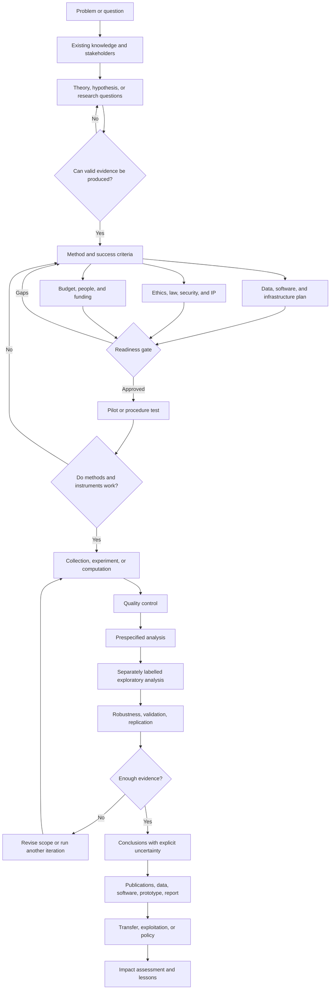
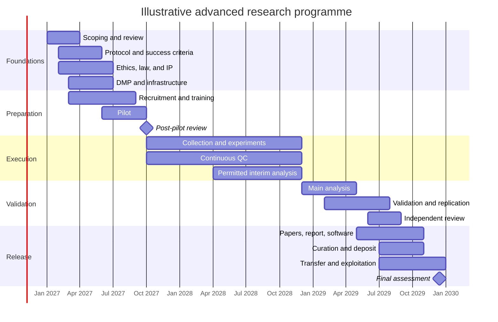

# Advanced research: an integrated framework for designing, funding, conducting, and evaluating complex research

**Reference date:** 29 September 2026.
**Scope:** Multidisciplinary. Adapt every recommendation to the field, especially work involving people, health data, animals, critical infrastructure, hazardous materials, regulated AI systems, or laboratories.
**Evidence basis:** Official rules and funder guidance, research standards, and primary scientific work take priority. The [OECD Frascati Manual][frascati] anchors the definition of R&D; the EU and Spanish legal sources listed below frame the regulatory discussion.

This English edition translates and edits a Spanish research report supplied for the project. It is a **methodological reference**, not a Valiris product decision or a substitute for discipline-specific legal, ethical, or funding review. The source report used conversation-specific citation markers without resolvable URLs. This edition replaces those markers with a readable reference list and direct links for the principal sources. Specific programme amounts, dates, and case-study figures should be checked against the linked primary source before being used in a proposal or decision.

## Executive summary

“Advanced research” is not a universal legal or statistical category alongside basic research, applied research, and experimental development in the [Frascati Manual][frascati]. Here it is an operational term for work that combines a difficult or uncertain question with rigorous methods, appropriate specialist capacity, explicit management of data and risks, and sufficient validation to yield knowledge, technology, policy evidence, or reusable capability. It need not involve expensive technology: a longitudinal qualitative study, a complex social intervention, or distributed archival research may qualify when its design and evidential demands justify it.

The test of sophistication is the fit between the question, design, evidence, and conclusion. AI models, supercomputers, and automated laboratories cannot rescue a poor counterfactual, biased sample, ill-defined measures, missing controls, or a hypothesis rewritten after observing the results. In confirmatory studies, prespecification and, where suitable, preregistration help distinguish prior decisions from later exploration; [OSF][osf] provides registration infrastructure.

Data, software, and governance are part of the method. [Horizon Europe open-science guidance][he-open] requires a living data management plan (DMP) for generated or collected research data and FAIR practices—findable, accessible, interoperable, reusable—while following “as open as possible, as closed as necessary.” Reproducibility does not mean publishing every dataset. Privacy, commercial secrets, security, confidentiality, and intellectual property can justify controlled access; the restriction, metadata, and feasible alternatives should be documented.

There is no single funding route. Spain's [AEI][aei] supports knowledge generation, talent, networks, and collaboration; [CDTI][cdti] serves business R&D; and European routes include [Horizon Europe][he-work], [ERC][erc], [MSCA][msca], and [EIC][eic]. ERC primarily funds frontier research, MSCA focuses on researcher development and mobility, and EIC focuses on high-potential technology and innovation. Funding should follow the uncertainty being investigated, not determine the question in advance.

Research is not exempt from ethics or law. The [GDPR][gdpr] still requires a lawful basis, proportionality, minimisation, and appropriate safeguards; Article 89 provides research-specific safeguards rather than a blanket exemption. Spain's [Biomedical Research Act][biomed] adds field-specific requirements, and the current [Declaration of Helsinki][helsinki] is the 2024 revision. The [EU AI Act][ai-act] contains narrowly framed research exclusions; they do not erase privacy or other legal duties. Assessment should combine qualitative judgement and responsible indicators, as advocated by [CoARA][coara] and [DORA][dora].

| Dimension | Academia | Industrial R&D | Public sector |
|---|---|---|---|
| Main aim | New knowledge, theory, methods, training, and scientific resources | Technical advantage, reduced uncertainty, IP, products, and processes | Policy evidence, public services, strategic capability, and infrastructure |
| Timescale | Usually multiple years; decades for some large facilities | Months through multi-year programmes | Often shaped by budgets, procurement, and long missions |
| Funding | Grants, institutional funding, shared infrastructure | Corporate budgets, grants, loans, capital, partnerships | Public budgets, grants, procurement, agencies, international programmes |
| Team | Principal investigator, researchers, postdocs, doctoral students, technicians, data specialists | Scientists, engineers, product, regulation, manufacturing, IP, business | Scientists, analysts, technicians, programme, legal and procurement specialists |
| Infrastructure | Laboratories, libraries, repositories, HPC, facilities | Private laboratories, pilots, cloud/HPC, prototypes, test plants | National facilities, missions, data platforms, observatories |
| Data governance | FAIR, repositories, preservation, citation | FAIR where useful, balanced with trade secrets and IP | Interoperability, traceability, security, archiving, justified reuse |
| Outputs | Papers, data, methods, software, theses | Prototypes, patents, know-how, products, processes | Reports, standards, data, services, decisions, infrastructure |
| Main risks | Irreproducibility, incentives, funding gaps | Technical failure, market, IP, regulation, timing | Political cycles, procurement, interoperability, acceptance |
| Useful indicators | Rigour, validation, reuse, training, impact | Performance, milestones, adoption, transfer, portfolio return | Mission delivery, evidence quality, reach, cost effectiveness, public impact |

These are archetypes; a university patent, ESA mission, or public-private consortium may span several columns.

## Scope and operational definition

The [Frascati Manual][frascati] distinguishes basic research, applied research, and experimental development and guides R&D measurement. “Advanced” is not a fourth formal category. For this report, the term is useful when several of the following conditions hold:

| Property | Practical meaning | Risk when absent |
|---|---|---|
| Genuine novelty | Uncertainty about the answer, mechanism, or feasibility | Routine work mislabelled as research |
| Explicit, testable question | The team knows what evidence would change its conclusion | Selective evidence and moving targets |
| Traceable design | Hypotheses, population, variables, sources, exclusions, and analysis are recorded | Results cannot be audited |
| Suitable specialist methods | Qualitative, statistical, experimental, or computational methods fit the question | Instrumental complexity without validity |
| Sound data management | Provenance, quality, metadata, permissions, security, preservation | Lost traceability or non-compliance |
| Validation | Controls, triangulation, replication, or external checks suit the discipline | Overfitting and fragile claims |
| Governance | Ownership, decisions, conflicts, ethics, IP, and risks are explicit | Problems emerge too late |
| Reuse | Data, code, protocols, or transferable knowledge remain accessible where lawful | Work must be repeated |
| Multidimensional assessment | Scientific quality, outputs, outcomes, impact, and capacity | Superficial metric optimisation |

This definition covers experimental physics, social science, digital humanities, clinical research, economics, materials science, AI, public policy, and product research. The project's [Storefront + QR Menu module report](result-research/storefront-qr-menu.md) illustrates its product-research application: stratified sampling, item-by-item verification, stable identifiers, evidence states, source records, and a strict distinction between observation and inference. That report is a research input, not validated market evidence.

The central unit is the **evidence chain**:

> Problem → claim to support → evidence required → design that can produce it → data → analysis → robustness checks → bounded conclusion → reusable artefacts.

| Purpose | Core question | Example |
|---|---|---|
| Exploration | What might be happening? | Find an unexpected pattern |
| Description | What happens and how often? | Estimate prevalence |
| Explanation and causality | What causes what, under which conditions? | Trial or natural experiment |
| Prediction | What will happen in new cases? | Model with external validation |

A strong predictor need not explain causes, and a credible causal estimate need not be the best predictor of individual outcomes. Choose the method from the proposed claim.

## Methods and workflow

No general hierarchy makes computational research superior to qualitative work, or experiments superior to observation. The right combination depends on the question, data access, ability to intervene, ethical risks, and intended inference.

| Family | Typical use | Designs | Strength | Principal risks | Quality signals |
|---|---|---|---|---|---|
| Qualitative | Meaning, social mechanisms, experience, process, context | Interviews, focus groups, ethnography, observation, document analysis, cases | Context and mechanism discovery | Selection bias, opaque interpretation, weak reflexivity | Reasoned sampling, coding trail, triangulation, negative cases |
| Observational quantitative | Prevalence, association, trends, prediction | Surveys, panels, registers, administrative data, time series | Scale and formal uncertainty estimates | Confounding, measurement error, selection, multiplicity | Prior design, power where relevant, sensitivity, validation |
| Experimental or quasi-experimental | Causal effects, intervention comparison | Randomised trials, factorial and A/B designs, field/lab experiments, discontinuities, difference-in-differences | Stronger identification when assumptions hold | Contamination, non-compliance, external validity, ethics | Controls, sound allocation, protocol, intention-to-treat where suitable |
| Computational | Simulation, AI/ML, mathematical models, large data, bioinformatics | Pipelines, models, optimisation, NLP, vision | Scale and system exploration | Leakage, overfitting, drift, data debt | Train/test separation, benchmarks, error analysis, versioning, external checks |
| Mixed methods | Sociotechnical and layered questions | Sequential or concurrent integration | Connects magnitude, mechanism, context | Parallel studies without real integration | Explicit integration question and reconciliation rules |

Reporting guides improve transparency rather than replace design: [CONSORT 2025][consort] for randomised trials, [PRISMA 2020][prisma] for systematic reviews, and [COREQ][coreq] for interview and focus-group studies.

Separating confirmatory from exploratory analysis prevents post-data decisions being presented as prior hypotheses. Preregistration helps appropriate confirmatory studies but is not necessary for all exploratory work; [OSF][osf] supports registrations.

| Gate | Question before proceeding | Minimum artefact |
|---|---|---|
| Problem | Which specific uncertainty will be reduced? | Research brief |
| Evidence | What observation could support or weaken the hypothesis? | Evidence map |
| Design | Why does this design answer the question? | Protocol |
| Data | Who controls data and how will they be validated? | DMP and dictionary/schema |
| Ethics | Who could be harmed and what approval is needed? | Ethics and legal assessment |
| Resources | Are people, compute, facilities, and time sufficient? | Resource and budget plan |
| Pilot | Does the procedure work before scaling? | Pilot report |
| Quality | Can errors be detected before contaminating the dataset? | Quality-control plan |
| Analysis | Which analyses are confirmatory and which exploratory? | Analysis plan |
| Validation | How will results generalise or be reproduced? | Validation plan |
| Release | What should survive beyond the report? | Repository and release plan |

A pilot needs exit criteria, not just a smaller version of the main study: recruitment rate, instrument accuracy, coder agreement, missing-data rate, latency, or pipeline stability can drive a scale/redesign/stop decision. Plan negative controls and failure tests too: out-of-distribution sets or ablations for models; placebos and sensitivity checks for causal analysis; blanks and controls in laboratories; and actively sought contradictory cases in qualitative work.

## Tools, infrastructure, data, and open science

Size infrastructure from the question and workload. Buying a platform before understanding data volume, sensitivity, and reproducibility needs creates avoidable cost and dependency.

| Layer | Examples | Value | Risks to manage |
|---|---|---|---|
| Capture | Instruments, sensors, surveys, acquisition systems, lab notebooks | Primary evidence | Calibration, drift, missing metadata |
| Qualitative analysis | CAQDAS, controlled transcription, document repositories | Large interview or document corpora | Confidentiality, loss of context |
| Quantitative analysis | Statistical environments and notebooks | Repeatable inference and modelling | Versions, dependencies, multiple testing |
| Compute | Local CPU/GPU, HPC, cloud | Simulation, AI, bioinformatics | Cost, availability, security, operational footprint |
| Workflow | Reproducible pipelines and orchestrators | Multi-stage data processing | Complexity, vendor lock-in |
| Data | Structured stores, object storage, appropriate warehouses | Integration and scale | Governance, uncontrolled copies |
| Reproducibility | Containers, version control, lockfiles, snapshots | Stable software environments | Old images and vulnerabilities |
| Collaboration | Repositories, OSF, ELN/LIMS, issue tracking | Distributed teams | Access rights, fragmented knowledge |
| Publication | Institutional or disciplinary repositories, Zenodo | Preservation and citation | Unsuitable licences or restricted data |
| Security | MFA, encryption, secrets management, segmented networks | Sensitive data and IP | Leaks, credentials, stale access |

For computation, [Jupyter][jupyter] combines code, outputs, and narrative; [Nextflow][nextflow] supports portable, reproducible pipelines on containers, HPC, and cloud. Spain's [Supercomputing Network][res] and the [European Open Science Cloud][eosc] offer alternatives to dedicated infrastructure; compare workload, transfer costs, data sensitivity, accelerators, and rerun needs. A physical laboratory has no universal equipment list. Budget for installation, consumables, calibration, certification, maintenance, technicians, downtime, and replacement as well as purchase.

A useful DMP is a living document covering at least the following:

| Area | Minimum question |
|---|---|
| Provenance | Who created the data, with which process or instrument? |
| Schema | How are units, variables, codes, and relationships defined? |
| Quality | Which checks and validation rules exist? |
| Identity | Which persistent identifiers will be used? |
| Versioning | Can the exact dataset behind a result be rebuilt? |
| Privacy | Are personal or special-category data involved? |
| Security | Who has access, under which controls? |
| Retention | How long are data and logs kept? |
| Sharing | What is open, restricted, or controlled-access? |
| Licence | Which forms of reuse are allowed? |
| Preservation | Where is the final version stored? |
| Accountability | Who owns and stewards the data? |

[Horizon Europe][he-open] calls for updated DMPs, trusted repositories, and FAIR data, while permitting justified restrictions for privacy, confidentiality, security, trade secrets, exploitation, and IP. [Zenodo][zenodo] is a general-purpose fallback when no suitable specialist or institutional repository exists. A minimal computational reproducibility package should contain, where lawful, the exact dataset/version or identifier, code, dependencies, configuration, relevant seeds and compute resources, instructions, logs, generated outputs, and tests. Containers and workflow managers reduce environment variation but cannot make flawed reasoning valid.

Non-computational research may instead need protocols, instrument specifications, reagent batches, calibration logs, stimuli, questionnaires, interview guides, coding decisions, and documented protocol changes. The [NIH reproducibility guidance][nih-rigor] places rigour within unbiased design. Spain's [Open Science Strategy 2023–2027][spain-open] addresses interoperable infrastructure, FAIR data, openness, transparency, and reproducibility.

| Maturity | Practice |
|---|---|
| Fragile | Only final documents survive; data and code remain personal |
| Traceable | Versions are archived and methods documented |
| Re-runnable | Data, code, and environment regenerate outputs |
| Reproducible | A third party can run the analysis with sufficient instructions |
| Replicable | An independent study or dataset yields compatible evidence |
| Reusable | Artefacts carry suitable metadata, licences, and interfaces |

Definitions of reproducibility and replicability vary by discipline. State the promised standard explicitly.

## Funding, capacity, and collaboration

Choose funding after identifying the uncertainty to resolve. Artificially reshaping a scientific question around a call often yields heterogeneous, overambitious objectives. The following map describes programme *fit* as of the reference date; eligibility, ceilings, deadlines, and terms must be confirmed against the current call.

| Scope | Instrument | Typical fit |
|---|---|---|
| Spain | [AEI Knowledge Generation][aei] | Competitive academic and scientific-technical research |
| Spain | [AEI Proof of Concept][aei] | Valorisation of prior findings |
| Spain | [AEI Networks][aei] | Coordination and complementarity between groups |
| Spain | [Torres Quevedo][aei] | Hiring doctoral researchers for industrial R&D |
| Spain | [Industrial Doctorates][aei-din] | Company-linked doctoral research; the 2026 call was published on 24 September |
| Spain | [CDTI][cdti] | Business R&D through programme-specific grants or repayable support |
| EU | [Horizon Europe][he-work] | Collaborative R&D, missions, and infrastructures |
| EU | [ERC Starting, Consolidator, Advanced, Synergy][erc] | PI-led frontier research at different career and team stages |
| EU | [MSCA][msca] | Doctoral networks, postdoctoral mobility, staff exchanges, cofunding |
| EU | [EIC Pathfinder][eic] | Early, high-risk breakthrough technology research |
| EU | [EIC Accelerator][eic] | Scaling high-potential innovation by eligible start-ups and SMEs |
| US | [NIH R01][nih-r01] | Investigator-initiated biomedical research |
| US | [NSF][nsf] | Discipline-specific science and engineering calls |
| International | [Wellcome Discovery Awards][wellcome] | Eligible established health and life-science teams |

The source report lists particular 2026 grant ceilings, allocations, and programme totals. Those are **call-specific snapshots, not recommended budgets**; the official call controls. The same applies to the AEI calendar, CDTI decisions, and MSCA budgets.

Build a bottom-up budget before translating costs into funder categories:

| Block | Commonly missed drivers |
|---|---|
| People | Recruitment, employer contributions, salary changes, overlapping appointments |
| Instruments | Installation, calibration, consumables, maintenance, failure |
| Data | Acquisition, licences, annotation, storage, transfer, backups |
| Compute | GPU/HPC/cloud, failed runs, inference, retention |
| Participants | Recruitment, compensation, travel, translation |
| Security | Controlled environments, audits, penetration tests, certification |
| Regulation | Ethics committees, monitoring, documentation, quality |
| Open science | Curation, repository, documentation, identifiers, preservation |
| Collaboration | Travel, integration, workshops, consortium management |
| Transfer | Validation, IP, exploitation studies, standards |
| Contingency | Only where the funder explicitly permits it |

Distinguish the cost of producing an observation from the cost of making it reliable evidence. Quality control, documentation, data engineering, and validation can consume substantial resources without producing an immediately visible finding.

| Capacity | Critical responsibility |
|---|---|
| Scientific lead / PI | Question, scientific decisions, coherence |
| Domain specialist | Content validity |
| Methodologist or statistician | Design and inference |
| Data steward | Governance, FAIR, metadata, DMP |
| Research software engineer | Reliable, maintainable software |
| Data engineer | Pipelines, quality, integration |
| Laboratory technician | Instruments, procedures, calibration |
| Project or programme manager | Dependencies, milestones, budget |
| Ethics, DPO, legal | Rights, consent, compliance |
| Security | Threats, controls, incident response |
| IP and transfer | Ownership, exploitation, licensing |
| Communication and participation | Stakeholders and responsible dissemination |

Spain's AEI supports technical personnel and researcher development as well as PI-led projects; [MSCA][msca] structures international and intersectoral mobility. Interdisciplinary partners should agree on a shared question and discipline-specific subquestions, a minimum common ontology and variable dictionary, change authority for protocols and data, authorship and IP rules, exchange formats, conflict resolution, and regular integration. A final meeting cannot substitute for continuous integration of evidence.

## Ethics, regulation, and assessment

Ethics, law, security, and impact should be **design gates**. A method later found incompatible with consent, data minimisation, or participants' rights may force an entire project to be repeated.

For EU personal-data research, identify the controller and any joint controllers, purposes, lawful basis, data categories, transfers, retention, access, rights, technical measures, and research safeguards from the start. The [GDPR][gdpr] applies; Article 89 specifies safeguards for scientific or historical research and statistics. Technical ability to collect a variable does not establish necessity, and “anonymised” does not automatically mean risk-free when datasets can be linked. High-risk processing may require a data protection impact assessment; the [Spanish data protection authority][aepd] provides guidance, but use of its tools alone does not prove compliance.

In Spain, [Law 14/2007 on Biomedical Research][biomed] regulates human biological samples, consent, and ethics committees, including conditions for exceptional use of certain samples without new consent. For medical research involving human participants, the [World Medical Association's 2024 Declaration of Helsinki][helsinki] is the current version.

The [EU AI Act][ai-act] must be assessed by intended use and lifecycle, not simply by the use of AI. Article 2 excludes systems or models developed and put into service specifically for the sole purpose of scientific R&D and certain pre-market research, testing, and development activities. This does not remove other EU legal duties or ethical and professional standards. The Act's obligations apply in phases; assess the rules expected **at deployment**, particularly for a multi-year project. [UNESCO's Recommendation on the Ethics of AI][unesco] is a complementary rights-based framework, not a replacement for law.

The [ALLEA European Code of Conduct for Research Integrity][allea] was revised in 2023. Practical controls include:

| Integrity risk | Control |
|---|---|
| Fabrication or falsification | Immutable original data, audit trail, separated duties |
| Selective reporting | Prespecified protocol and inclusion rules |
| Post-hoc hypotheses presented as prior | Label later hypotheses exploratory |
| P-hacking and multiplicity | Analysis plan and appropriate corrections |
| Manipulated images or data | Provenance and versioning |
| Improper authorship | Agreed contribution criteria |
| Conflicts of interest | Declaration and management |
| Generative AI use | Confidential-data policy, human review, traceability |
| Hidden null findings | Reporting rules independent of result direction |
| Reliance on one analyst | Code review, documentation, independent rerun |

Optimising for paper count, patent count, or journal impact factor risks rewarding activity over quality. [CoARA][coara] supports qualitative judgement and peer review, with responsible quantitative support; [DORA][dora] rejects journal metrics as a proxy for an individual work's merit. A balanced scorecard could include:

| Dimension | Possible indicator | Misreading to avoid |
|---|---|---|
| Rigour | Protocol adherence, sample quality, control coverage | “More data means better research” |
| Data quality | Completeness, error, agreement, traceability | Quantity confused with representativeness |
| Execution | Milestones, spend, experimental lead time, uptime | Speed rewarded at quality's expense |
| Reproducibility | Rerunnable pipelines, versioned datasets, independent reruns | Code publication mistaken for reproduction |
| Validity | External validation, sensitivity, calibration, replication | Choosing only a favourable benchmark |
| Outputs | Papers, software, data, patents, protocols, standards | Counting without assessing usefulness |
| Open science | Persistent IDs, FAIR metadata, validation material | Forced disclosure despite privacy or IP |
| Transfer | Licences, pilots, adoption, standards contributions | Patent equated with impact |
| Scientific impact | Independent use, replication, changed understanding | Journal rank substituted for quality |
| Industrial impact | Technical risk retired, performance, adoption, economics | Demo confused with viable product |
| Public impact | Policy/service change, coverage, cost effectiveness, equity | Causality claimed without a counterfactual |
| Capacity | Training, cross-training, documentation, continuity | Team size rewarded by itself |
| Ethics and security | Incidents, deviations, resolution time, audits | “Zero incidents” when reporting is suppressed |

Technology readiness level can describe transition in technology projects but is **not a measure of scientific quality**. [EIC Pathfinder][eic] specifically backs early-stage technologies. The [OECD Oslo Manual][oslo] complements Frascati by addressing innovation measurement: a discovery and an adopted innovation are different outcomes.

## Case studies, timeline, and checklist

These four cases show different configurations; they are not rankings. Quantitative details in the supplied report are historical snapshots and should be checked in the linked primary materials before reuse.

| Case | Aim and approach | Outputs and lesson |
|---|---|---|
| [LIGO][ligo] (academic, long-term) | Detect gravitational waves with kilometre-scale interferometers, international collaboration, precision instrumentation, and distributed computation | Signals, catalogues, publications, and [open data][gwosc]. The decisive observation required building and validating a sensitive instrument first. |
| [AlphaFold][alphafold] (industrial research) | Predict protein structures by combining large biological datasets, model development, accelerated computation, and community benchmarks | Published method and [AlphaFold DB][alphafold-db]. Predictive confidence, generalisation, and experimental limitations remain essential to interpretation; the original report did not establish a reliable project-specific budget. |
| [ESA Euclid][euclid] (public mission) | Map large-scale cosmic structure using a space telescope, industrial procurement, survey operations, and large-scale data processing | Astronomical images, catalogues, and scientific releases. Instrument calibration, operation, processing, and international coordination are part of the method. |
| [Human Genome Project][hgp] (interdisciplinary) | Build a human reference sequence through sequencing, instrumentation, computing, international coordination, and ethical/social work | Reference data, techniques, model-organism work, and an ELSI programme. The result depended on governance as much as any single experiment. |

An illustrative three-year project may overlap scoping, protocol, ethics/IP, DMP, recruitment, pilot, collection, quality control, analysis, independent validation, publication, preservation, and transfer. It is **not** a recommended universal duration. Data management continues throughout, even if planning and deposit appear as discrete milestones.

**Design and risk checklist**

| Area | Audit question | Ready when |
|---|---|---|
| Problem | Is the unanswered question specific? | Gap documented |
| Prior work | Does the review include contrary evidence? | Literature and counterevidence recorded |
| Claim | Are permitted conclusions bounded? | Claims defined in advance |
| Method | Does the design match the intended inference? | Rationale explicit |
| Sample | Does it represent the intended population? | Bias and limits documented |
| Size | Is power or saturation justified? | Prior reproducible criterion |
| Variables | Are units and operational definitions clear? | Versioned dictionary |
| Instruments | Are calibration, validity, and precision controlled? | Procedures and records |
| Data | Are provenance, security, and preservation planned? | DMP approved |
| Privacy | Are lawful basis and minimisation determined? | Legal/DPO review where needed |
| Ethics | Are participant risks proportionate? | Necessary approval before start |
| AI | Is regulatory role and deployment date understood? | Classification and compliance plan |
| Security | Have critical assets been assessed? | Controls and response plan |
| IP | Are background and foreground rights clear? | Signed agreement |
| Collaboration | Are responsibilities and decisions assigned? | Governance and RACI |
| Software | Are code and environment versioned? | Reproducible build |
| Analysis | Are confirmatory and exploratory analyses distinct? | Analysis plan |
| Leakage | Are validation data genuinely independent? | Audit trail |
| Quality | Are errors detectable during execution? | Automated/manual QC |
| Pilot | Are go/no-go criteria explicit? | Recorded gate |
| Robustness | Will alternative explanations be tested? | Sensitivity plan |
| Validation | Is independent evaluation feasible? | External data/team where possible |
| Reproducibility | Can another team regenerate key outputs? | Rerun test |
| Open science | Is every restriction justified? | Open/closed matrix |
| Budget | Are quality, compliance, and maintenance costed? | Bottom-up budget |
| Dependencies | Are critical suppliers, people, instruments covered? | Mitigation and contingency |
| Timeline | Are approvals and hiring on the critical path? | Critical-path review |
| Indicators | Do they assess quality and learning? | Balanced scorecard |
| Termination | Can a line be stopped without administrative failure? | Stop rules |
| Communication | Will uncertainty and null results be reported? | Communication plan |
| Closeout | Will data, code, and decisions survive? | Archive package |

**Risk register starter**

| Risk | Early signal | Preferred mitigation |
|---|---|---|
| Question too broad | Work packages answer different questions | Narrow claims and rank hypotheses |
| Weak recruitment | Rate below pilot target | Broaden channels or revise scope |
| Unrepresentative data | Demographic or contextual drift | Targeted sampling and subgroup checks |
| Poor data quality | Missingness or errors increase | QC at collection, not only late cleaning |
| Protocol drift | Many manual exceptions | Formal versions and impact review |
| Overfitting | Excellent benchmark, weak external result | True holdout and external validation |
| Instrument failure | Repeated drift or recalibration | Redundancy and preventive maintenance |
| Supplier dependency | Closed formats or rising costs | Exportability and exit terms |
| Compute cost | Spend exceeds forecast | Profiling, quotas, staged experiments |
| Regulatory change | Intended use changes | Review at each gate |
| AI scope change | Deployment no longer solely research | Reassess AI Act applicability |
| Knowledge concentration | One person owns pipeline/data | Pairing, review, documentation |
| Consortium conflict | Delay over IP or authorship | Prior agreement and resolution body |
| Irreproducibility | Works only on one machine | CI, containers, independent rerun |
| Perverse incentives | Paper or patent count dominates | Balanced assessment |
| Null result suppressed | Pressure to change outcomes | Protocol and reporting commitment |
| Data incident | Anomalous access or local copies | Least privilege, logs, response |

The practical standard is that each claim traces to auditable data and decisions; each resource serves a methodological purpose; ethical and legal risks are addressed before they materialise; others can examine or repeat the work at the appropriate level; and success is judged by quality, learning, reuse, and demonstrable impact.

## References and source checks

These links identify the principal sources behind the framework. They do **not** reconstruct a one-to-one mapping from the Spanish report's inaccessible citation tokens. Verify any high-stakes, numerical, or time-sensitive assertion in the current primary source before relying on it. Programme calls and legal rules may change after the reference date.

[frascati]: https://www.oecd.org/en/publications/2015/10/frascati-manual-2015_g1g57dcb.html "OECD, Frascati Manual 2015"
[oslo]: https://www.oecd.org/en/publications/oslo-manual-2018_9789264304604-en.html "OECD, Oslo Manual 2018"
[osf]: https://www.cos.io/initiatives/prereg "Center for Open Science, preregistration"
[he-open]: https://rea.ec.europa.eu/open-science_en "European Research Executive Agency, open science"
[he-work]: https://research-and-innovation.ec.europa.eu/funding/funding-opportunities/funding-programmes-and-open-calls/horizon-europe/horizon-europe-work-programmes_en "European Commission, Horizon Europe work programmes"
[aei]: https://www.aei.gob.es/convocatorias/calendario-previsto-convocatorias-agencia-estatal-investigacion "Spanish State Research Agency, call calendar"
[aei-din]: https://www.aei.gob.es/convocatorias/buscador-convocatorias/ayudas-contratos-formacion-doctores-doctoras-empresas-otras-17 "AEI, Industrial Doctorates 2026"
[cdti]: https://www.cdti.es/ayudas "CDTI, funding instruments"
[erc]: https://erc.europa.eu/apply-grant "European Research Council, grant schemes"
[msca]: https://marie-sklodowska-curie-actions.ec.europa.eu/actions "Marie Skłodowska-Curie Actions"
[eic]: https://eic.ec.europa.eu/eic-funding-opportunities/eic-2026-work-programme_en "European Innovation Council, 2026 work programme"
[gdpr]: https://eur-lex.europa.eu/eli/reg/2016/679/oj/eng "Regulation (EU) 2016/679, GDPR"
[biomed]: https://www.boe.es/eli/es/l/2007/07/03/14/con "Spain, Biomedical Research Act 14/2007"
[helsinki]: https://www.wma.net/policies-post/wma-declaration-of-helsinki/ "World Medical Association, Declaration of Helsinki 2024"
[ai-act]: https://eur-lex.europa.eu/eli/reg/2024/1689/oj/eng "Regulation (EU) 2024/1689, AI Act"
[unesco]: https://www.unesco.org/en/artificial-intelligence/recommendation-ethics "UNESCO, Recommendation on the Ethics of Artificial Intelligence"
[allea]: https://allea.org/code-of-conduct/ "ALLEA, European Code of Conduct for Research Integrity 2023"
[coara]: https://coara.eu/agreement/the-agreement-full-text/ "CoARA, Agreement on Reforming Research Assessment"
[dora]: https://sfdora.org/read/ "DORA, declaration"
[consort]: https://www.consort-spirit.org/published-statements "CONSORT 2025 statement"
[prisma]: https://www.prisma-statement.org/prisma-2020 "PRISMA 2020"
[coreq]: https://academic.oup.com/intqhc/article/19/6/349/1791966 "COREQ reporting checklist"
[jupyter]: https://jupyter.org/ "Project Jupyter"
[nextflow]: https://www.nextflow.io/ "Nextflow"
[res]: https://www.res.es/ "Spanish Supercomputing Network"
[eosc]: https://eosc.eu/ "European Open Science Cloud"
[zenodo]: https://zenodo.org/ "Zenodo repository"
[nih-rigor]: https://grants.nih.gov/policy-and-compliance/policy-topics/reproducibility/guidance "NIH, rigour and reproducibility"
[spain-open]: https://www.ciencia.gob.es/Estrategias-y-Planes/Estrategias/ENCA.html "Spanish Open Science Strategy 2023–2027"
[nih-r01]: https://grants.nih.gov/funding/activity-codes/R01 "NIH Research Project Grant (R01)"
[nsf]: https://www.nsf.gov/funding "NSF funding"
[wellcome]: https://wellcome.org/grant-funding/schemes/discovery-awards "Wellcome Discovery Awards"
[aepd]: https://www.aepd.es/guias-y-herramientas/herramientas "Spanish Data Protection Agency tools"
[ligo]: https://www.ligo.caltech.edu/ "LIGO Laboratory"
[gwosc]: https://gwosc.org/ "Gravitational Wave Open Science Center"
[alphafold]: https://www.nature.com/articles/s41586-021-03819-2 "Jumper et al., AlphaFold 2, Nature 2021"
[alphafold-db]: https://alphafold.ebi.ac.uk/ "AlphaFold Protein Structure Database"
[euclid]: https://www.esa.int/Science_Exploration/Space_Science/Euclid "European Space Agency, Euclid"
[hgp]: https://www.genome.gov/human-genome-project "National Human Genome Research Institute, Human Genome Project"
