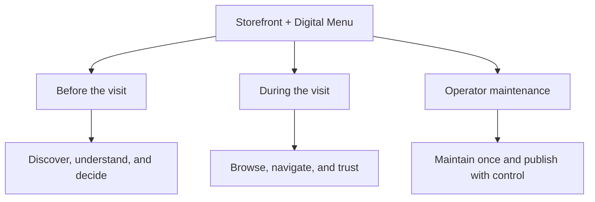
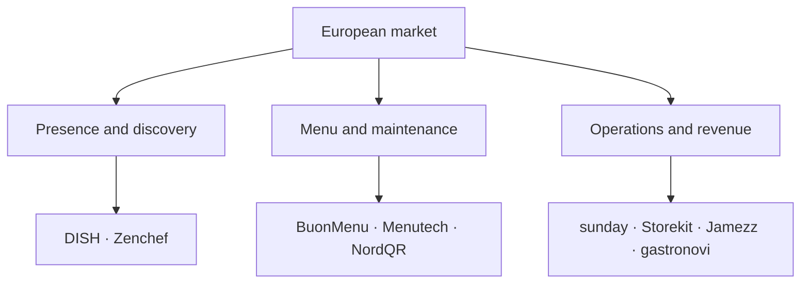

# Valiris Restaurants — Storefront + Digital Menu

## Master competitive research, product analysis, and decision log

> **Status:** living research document. Integrates phases 2A Spain, 2B Europe excluding Spain, and 2C United States/Canada. Main source cut-off: 29 September 2026; the Canadian source was retrieved and verified on 30 September 2026.
>
> **Framing conclusion:** the module is **Storefront + Digital Menu**. QR is an access channel, not the product or the module.

## 0. Purpose of this document

This file preserves the research, analysis, and reasoning behind the current conclusions. Its purpose is neither to finalise the product nor to turn the benchmark automatically into a feature list. It should enable us to:

- return to the evidence without relying on memory or the conversation;
- distinguish observed facts, vendor claims, inferences, and hypotheses;
- compare markets without mixing distinct economic categories;
- record counter-signals that keep us from becoming attached to a technology or solution;
- make traceable scope and prioritisation decisions;
- add interviews, proofs of concept, and product decisions later without redoing the work.

This document covers **59 products**, their sources, published prices where available, observed capabilities, limitations, market patterns, and unresolved questions. The sample is purposive and selected for informative examples; it is not an exhaustive census.

### Reading map

| If you need to… | Read… |
| --- | --- |
| Understand the current thesis | Sections 1–4 |
| Review Spain | Sections 5–7 and Appendix A |
| Review Europe | Sections 8–10 and Appendix B |
| Review the US/Canada | Sections 11–15 and Appendix C |
| Make product decisions | Sections 16–23 |
| Audit data and sources | Appendices A–E |

## 1. Problem definition and module boundaries

### 1.1 What we are designing

A restaurant-owned public presence that enables it to **be found, understood, and chosen before a visit**, together with a living digital menu that enables diners to **browse the offering quickly and confidently during a visit**. The same content must be reasonably easy to maintain for an independent business with little time and limited operational capacity.

### 1.2 The role of QR

QR is a **contextual entry point**, useful on a table, shop window, counter, sign, or printed material. It serves a similar role to a direct link, Google, social media, messaging, an embedded widget, or a connection from bookings. Therefore:

- it must not be the only entry point;
- it must not require ordering, paying, downloading an app, or creating an account;
- it does not, by itself, justify the product's price;
- it needs a fallback when the phone, connection, battery, vision, or trust in the code is an issue.

### 1.3 Outside the initial scope

Ordering, payments, POS, delivery, and invoicing are outside this module. Bookings belong to another module, although the public experience must connect to them coherently. For now, a native app for each restaurant, enterprise CRM, full loyalty functionality, marketplaces, and advanced multi-location personalisation are also excluded.

## 2. Research question

The research did not seek to answer “What features do QR menus have?” but a more useful question:
> What complete jobs do market products address around public presence, digital menus, maintenance, and distribution; what value do they create for diners, operators, and vendors; and where is there a defensible opportunity for an independent Spanish restaurant without building an unnecessary suite?

### 2.1 The three stakeholders who must benefit

| Stakeholder | Desired value | Risk to avoid |
| --- | --- | --- |
| Diner | Find, understand, and trust the offering with little effort | Digital friction, loss of human interaction, incomplete or inaccessible information |
| Operator / buyer | Publish accurately with little effort and without duplicating systems | Another dashboard to maintain that introduces errors or does not justify its cost |
| Valiris | A clear, modular, sustainable commercial proposition | Competing on price with free utilities or on breadth with operational suites |

## 3. Method and interpretation rules

### 3.1 Coverage

| Phase | Market | Products | Objective |
| --- | --- | --- | --- |
| 2A | Spain | 20 | Understand the local baseline for price, functionality, and categories |
| 2B | Europe excluding Spain | 19 | Identify standards that raise the bar for presence, maintenance, and operations |
| 2C | US and Canada | 20 | Examine acquisition, distribution, accessibility, direct relationships, and QR counter-signals |
| Total | Three regions | 59 | Build a taxonomy and prepare decisions, rather than declare a winner |

### 3.2 Evidence types

| Label | Meaning | What it supports |
| --- | --- | --- |
| Observed | A primary source publishes a feature, price, condition, or process | That the offering or claim exists publicly |
| Vendor claim | A metric or benefit stated by the seller | The commercial promise, not an independently verified outcome |
| Inference | A reasoned interpretation of several indications | A plausible direction that still needs testing |
| Counter-signal | Evidence that weakens an intuition or limits a conclusion | What we should not assume or copy automatically |
| Hypothesis | A value or behavioural proposition not yet validated | What to investigate with operators and diners |
| Unknown | Insufficient evidence was found | Nothing about whether the capability actually exists |

### 3.3 Matrix codes

- **V:** explicitly verified in a primary source.
- **L:** limited, plan-dependent, adjacent, or only partially covered.
- **I:** insufficient indication to make a confident statement.
- **NV:** not verified in the sources reviewed; this does not mean the feature does not exist.

A different scale was used for North America: **C** = central to the proposition; **P** = partial, add-on, or integration; **N** = not observed.

### 3.4 Methodological limitations

- Official pages, support documentation, and pricing pages predominate. They are suitable for observing published offerings, but not for demonstrating usage, satisfaction, or returns.
- Prices change and may exclude taxes, hardware, fees, onboarding, or modules. Currencies and conditions were not normalised because doing so would create misleading precision.
- Feature frequency does not demonstrate value. It may reflect competitive parity, ease of implementation, or marketing copy.
- The samples are purposive. They help identify patterns and boundaries, not estimate market shares.
- Community anecdotes are used only to identify failure modes, never to estimate prevalence.
- No overall score was assigned and no winner declared. Comparing a €4/month utility with a POS suite as if they were equivalent would distort the analysis.

## 4. Executive synthesis across the three markets

### 4.1 Verdict

> Valiris should not sell “a better-designed QR menu.” The most coherent opportunity is a **public presence and living menu for the independent restaurant**, easy to maintain, reliable before and during a visit, and accessible through QR without relying exclusively on it.
This remains a **product hypothesis**, not a demonstrated need or willingness to pay.

### 4.2 Ten lessons that hold across all three markets

1. **Basic digital menus are infrastructure.** Categories, prices, photos, allergens, languages, branding, and QR appear too often to differentiate on their own.
2. **The market contains distinct categories.** Standalone menus, storefronts, POS, ordering, bookings, and enterprise products sometimes compete for the same entry point but sell different outcomes.
3. **Maintenance is part of the product.** Importing, initial content entry, mobile editing, synchronisation, support, and controlled publication appear as part of the value, rather than an afterthought.
4. **The menu is maturing into a shared source.** More advanced products maintain content once and distribute it to websites, QR, POS, kiosks, print, marketplaces, or other channels.
5. **The storefront extends value before the visit.** Identity, practical information, menus, SEO, availability, and bookings turn the menu into an acquisition and decision tool.
6. **Operational context matters.** Time, area, table, terrace, consumption mode, availability, and channel can change what is shown and at what price; every rule, however, adds complexity.
7. **Trust is not the same as icons.** Allergens, accessibility, translations, and availability require governance, provenance, review, and fallback options.
8. **QR is not universally preferred.** It can be useful in particular contexts, but the evidence found argues against imposing it as the only format.
9. **Prices rise when the product reduces work or generates revenue.** Suites justify higher prices through operations, ordering, payments, data, and repeat business; an informational module must demonstrate another return.
10. **Simplicity wins only when it completes an entire job.** Fewer features are not automatically an advantage; they must genuinely reduce effort and cover the necessary journey.

### 4.3 Interpretation by layer

| Layer | What it addresses | Competitive state | Implication for Valiris |
| --- | --- | --- | --- |
| Public presence | Identity, practical information, discovery, and decisions | Fragmented in Spain; more mature in Europe and North America | Relevant territory with serious direct competition |
| Structured menu | Understanding offerings, prices, variants, diets, and availability | Basic version is commoditised | Mandatory baseline, not the central proposition |
| Maintenance and governance | Importing, editing, reviewing, and publishing without errors | Often addressed through service or synchronisation | Potential commercial focus if pain and frequency are validated |
| Contextual distribution | Publishing one source across different access points and situations | Advanced in suites; uneven in simple products | Design the principle from the start without building every integration |
| Transactions and relationships | Ordering, paying, loyalty, and data capture | Where many products monetise | Adjacent; do not enter merely to justify the module artificially |

# Part I — Phase 2A: the Spanish market

## 5. The market we found in Spain

The main conclusion is that “QR menus” are not a single market.
| Observed market | What it actually sells | Risk for Valiris |
| --- | --- | --- |
| Standalone menu | Inexpensive, self-managed digitisation | Price competition and strong commoditisation |
| POS / operational suite | A catalogue connected to front-of-house, kitchen, and availability | Greater operational value, cost, and dependency |
| Ordering / payments / CRM | Shorter waits, data, and repeat business | The menu is only the entry point |

### 5.1 Pricing and competitive structure

The sample includes ten standalone menus and ten suites or operational solutions. The range extends from free products and a few euros per month to suites starting at approximately €40/month or quoted individually. This breadth does not mean they are all substitutes.

- CartaMóvil starts at €29/year for 1–10 tables.
- MenúsOnline starts at €79.90/year and includes initial content entry.
- BuenaCarta combines a free plan with an Advanced plan at €8.95/month.
- AppCarta rises to €29.95/month plus VAT, with AI, images, and related services.
- Camarero10 advertises its suite from €39.90/month.

The useful question is not “Who is cheapest?” but **what additional job enables a higher price**.

### 5.2 Observed capability coverage

| Area | Capability | V | L | I | NV | V+L coverage |
| --- | --- | --- | --- | --- | --- | --- |
| Core | Public storefront | 6 | 14 | 0 | 0 | 100% |
| Core | Web access without account/app | 19 | 1 | 0 | 0 | 100% |
| Core | Editable structured menu | 20 | 0 | 0 | 0 | 100% |
| Core | Categories and navigation | 20 | 0 | 0 | 0 | 100% |
| Core | Search or filters | 2 | 0 | 1 | 17 | 10% |
| Core | Photos | 13 | 2 | 5 | 0 | 75% |
| Trust | Allergens | 12 | 0 | 8 | 0 | 60% |
| Access | Languages | 9 | 2 | 9 | 0 | 55% |
| Operations | Availability | 13 | 4 | 3 | 0 | 85% |
| Catalogue | Formats or variants | 7 | 1 | 6 | 6 | 40% |
| Operations | Scheduling or context | 4 | 3 | 11 | 2 | 35% |
| Access | QR by table or area | 19 | 0 | 0 | 1 | 95% |
| Fallback | Print or PDF | 4 | 2 | 1 | 13 | 30% |
| Brand | Visual identity | 10 | 5 | 5 | 0 | 75% |
| Business | Analytics | 9 | 1 | 3 | 7 | 50% |
| Adjacent | Ordering or payments | 12 | 1 | 0 | 7 | 65% |
| Adjacent | POS/Core integration | 10 | 2 | 1 | 7 | 60% |
Coverage confirms that web access, editable menus, categories, and QR are already minimum expectations. Search, printing, variants, and scheduling are less uniform; this makes them worth investigating, but not automatically valuable.

## 6. Findings from Spain

### 6.1 The basic menu no longer differentiates

Account-free access, editable structure, categories, permanent QR codes, photographs, visual identity, allergens, and some level of language support recur as expectations. Proper implementation is necessary, but unlikely to sell as the main advantage.

### 6.2 Content maintenance is part of the product

MenúsOnline includes initial structure entry and 50 or 100 dishes. BuenaCarta sells manual entry or includes it in Premium. This signal does not show that every operator has the same problem, but it does show that vendors monetise the removal of setup work.

### 6.3 Storefront and menu are not always connected

Many solutions optimise browsing inside the venue. Few position the menu as a public presence before the visit. QrCarta emphasises an indexable page, business information, and access from Google, Instagram, or WhatsApp. This opens a hypothesis, not a proven advantage.

### 6.4 Operational context is not highly standardised

PlaceIn supports different menus, products, or prices by table, bar, dining room, or terrace. menu.es schedules availability by day and time. CartaMóvil updates availability and generates table-specific QR codes. The pattern suggests possible operational value without entering ordering or POS, but every condition must correspond to a real scenario.

### 6.5 Allergens: displaying is not governing

Royal Decree 126/2015 allows certain information to be provided orally if an accessible written or electronic record exists and a visible notice explains how to obtain it. Therefore, ticking fourteen boxes or displaying icons may help, but does not by itself guarantee process compliance. The interface should support accountability, review, and access to information, rather than promise automatic compliance.
Legal source: [BOE — Royal Decree 126/2015, Article 6.5](https://www.boe.es/buscar/act.php?id=BOE-A-2015-2293).

### 6.6 Hypotheses left open by Spain

| Hypothesis | Rationale | What remains to be demonstrated |
| --- | --- | --- |
| Public presence + menu | Unifying pre-visit decisions and table-side browsing could outperform a pure QR utility | Whether diners use that continuity and operators value it |
| Minimal maintenance | Initial entry, mobile editing, and quick changes may sell better than new features | Current time spent, change frequency, errors, and willingness to pay |
| Operational context | Time, area, and availability add value without POS | Which scenarios are frequent and which would be overengineering |
| Trust and fallback | Legibility, languages, allergens, and a printable alternative reduce rejection | Actual effect on understanding, inclusion, and purchasing |
| Modular product | An affordable entry point could expand into bookings, reviews, or loyalty | Which commercial sequence makes sense and avoids fragmentation |

### 6.7 Phase-closing decision

The decision was to proceed to Europe, retain all five hypotheses, and keep the markets separate. Features were not selected, and Spain was not assumed to represent the highest standard.

## 7. Competitive inventory — Spain

| Product | Archetype | Focus | Customer | Price / unit | Free option or trial | Evidence | Finding or limitation | Sources |
| --- | --- | --- | --- | --- | --- | --- | --- | --- |
| CartaMóvil | Standalone menu | Dynamic QR menu | Independents; table-based pricing | €29/year (1–10 tables) · Per tables/year | PDF €19.99/year; 7-day refund | A | Tiered table-based pricing. ES/EN is not included in the lowest tier. | [1](https://www.cartamovil.es/tarifas/) |
| MenúsOnline | Standalone menu | Managed QR menu | Bars, restaurants, and hotels | €79.90/year · Per venue/year | 2-week trial | A | Includes initial structure and 50/100 dishes: content-entry service is part of the proposition. | [1](https://menusonline.es/precios) |
| BuenaCarta | Standalone menu | Freemium QR menu | Small businesses | €0; €8.95/month Advanced · Per venue/month | Permanently free; 7-day guarantee | A | Photos, custom URL, translation, and schedules depend on the plan. Manual entry: €79 + VAT or included in Premium. | [1](https://www.buenacarta.com/tarifas.html) [2](https://www.buenacarta.com/) |
| menu.es | Standalone menu | Storefront + QR menu | Bars and restaurants | €9/month · Per venue/month | Trial; no published free plan | A | Highlights day/time scheduling, section-specific QR, and GA4. Ordering, payments, and delivery are adjacent modules. | [1](https://menu.es/) |
| TuCartaDigital | Standalone menu | Ad-supported freemium | Restaurants and other services | €0; €95.40/year without ads · Per venue/month or year | Permanently free | A | The free plan retains features with advertising. The paid plan removes ads. | [1](https://tucartadigital.com/carta-digital-precio/) [2](https://tucartadigital.com/) |
| QrCarta | Standalone menu | Freemium + local SEO | Visibility-focused independents | €0; €3.95/month Premium · Per venue/month | Permanently free without ads | A | Positions the menu as an indexable presence. Analytics, printing, and advanced customisation require Premium. | [1](https://www.qrcarta.com/precios.php) [2](https://www.qrcarta.com/en/) |
| QrCartaDigital | Standalone menu | QR menu SaaS | Restaurants; multi-location in Premium | €90/year + €30 setup · Per venue/year | 15-day trial | A | The public pricing page gives little functional detail. Premium targets more than 3 venues. | [1](https://www.qrcartadigital.com/Cliente/Home/Precios) |
| CartaDigitalQR.es | Standalone menu | Freemium + ordering | Bars and restaurants | €0; advertised from €7.90/year · Per venue/year | 15-day trial | A | The published annual price is unusually low: revalidate it before using it in commercial decisions. | [1](https://cartadigitalqr.es/tarifas) |
| AppCarta | Standalone menu | QR menu + content AI | Bars and restaurants | €29.95/month + VAT · Per venue/month | 14 days; no minimum term | A | Includes AI photo generation/retouching and an optional chatbot. Very recent product: independent evidence is lacking. | [1](https://etersystem.es/servicios/carta-digital-restaurante-menu-qr) |
| TeleCarta | Standalone menu | Menu and discovery in an app | Hospitality and food service | Not published · Not verified | Public app | B | The visible listing dates from 2020 and shows only 2 ratings. Current commercial activity should be checked. | [1](https://apps.apple.com/es/app/telecarta-carta-digital-qr/id1512929585) |
| PlaceIn | Hospitality suite | Contextual menu by table/area | Restaurants with different spaces and prices | Not published · Quote-based | Demo/contact | B | Differentiates products and prices by terrace, bar, dining room, or table. Exports QR codes in CSV and PDF. | [1](https://placein-support.freshdesk.com/support/solutions/articles/103000233081-11-codigos-qr-y-descarga-en-carta-digital) |
| OfiMenú | Hospitality suite | Web/app menu + ordering | Bars, cafés, restaurants, and hotels | Not published · Quote-based | Free trial advertised | A | Web access without an app; the app adds nutrition, offers, and recommendations. Orders can be validated before submission. | [1](https://www.ofi.es/software/app-carta-electronica-restaurantes/) |
| Camarero10 | POS suite | POS-integrated menu | Digitally operated hospitality businesses | From €39.90/month (suite) · Suite/month | Not verified | A | The price is for the suite, not a standalone menu. Includes POS, ordering, kitchen, and analytics. | [1](https://www.camarero10.com/) |
| Glop | POS suite | Multilingual menu + order/pay | Hospitality and retail | Not published · Licence/quote | Free trial advertised | A | The menu is a module within a broad platform. No comparable standalone-module price is available. | [1](https://www.glop.es/) |
| Revo SOLO | POS suite | Menu, ordering, and payments | Restaurants using Revo XEF | Not published · Licence/quote | Not verified | B | Supports profiles and QR codes by venue/table. Main value depends on integration with Revo XEF/XPress. | [1](https://support.revo.works/es/articles/725) [2](https://revo.works/) |
| Last.app QR | POS suite | Shared ordering from the table | Restaurants with integrated workflows | Not published · Quote-based | Demo/contact | A | QR identifies the table, synchronises the cart, and submits to POS/kitchen. An operational experience, not just a menu. | [1](https://www.last.app/producto/qr-pedir-y-pagar) |
| Sipos (formerly Pikotea) | POS suite | Menu, search, ordering, and payments | Independent and mobile hospitality | Not published · Quote-based | Trial advertised | B | Includes allergen search/filtering and stock management. Rebranding requires attention to source continuity. | [1](https://pikotea.zohodesk.eu/portal/es/kb/articles/primeros-pasos) [2](https://play.google.com/store/apps/details?id=com.outondev.pikoteoadmin) |
| Honei | Ordering/payments/CRM | Menu as entry to ordering and payment | Restaurants with POS and volume | Quote-based · Quote-based | No minimum term | A | Metrics on higher spend, table turnover, and tips are vendor claims, not independently verified outcomes. | [1](https://honei.app/servicios/pedir-y-pagar) |
| Cheerfy Pay | Ordering/payments/CRM | Ordering, payment, and loyalty | Restaurants with CRM/loyalty | Not published · Quote-based | Demo/contact | A | The proposition rests on self-service payment, split bills, and CRM. The menu is not the central product. | [1](https://www.es.cheerfy.com/producto/pide-paga-restaurantes) |
| Yumminn | Ordering/payments/CRM | Payment, ordering, reviews, and loyalty | Restaurants with POS integration | Not published · Quote-based | Not verified | B | Available public sources focus on order/pay, reviews, and loyalty; menu detail is limited. | [1](https://www.linkedin.com/company/yumminn/) [2](https://www.yumminn.com/) |

# Part II — Phase 2B: Europe excluding Spain

## 8. What changes when expanding to Europe

Europe raises the bar. Serious competitors address public presence, maintenance, ordering/payments, and operations. Our opportunity would not be to do everything better, but to choose a narrow combination that cheap products do not address well and suites address with excessive complexity for many independents.
| Dimension | Spain | Europe | Implication for Valiris |
| --- | --- | --- | --- |
| Basic menu | Abundant and inexpensive | Also abundant and inexpensive | Not a defensible commercial proposition |
| Storefront + menu | Fragmented | DISH and Zenchef are serious reference points | Genuine direct competition exists |
| Maintenance | Often manual or provided as a service | Importing, automation, and a single catalogue | Must be central to the experience |
| Operational context | Underdeveloped | Schedules, areas, channels, and availability | Do not reduce availability to visible/hidden |
| Trust and accessibility | Uneven | Some strong examples, but no general standard | Potential space if validated and executed rigorously |
| Business model | Low price points | Free through enterprise | Prices rise when work is reduced or revenue generated |

### 8.1 Three competitive positions

Valiris should not try to win in all three at once. The most coherent initial intersection is **public presence + living menu + lightweight maintenance + trust**, for small independents.

### 8.2 Observed capability coverage

| Area | Capability | V | L | I | NV | V+L coverage |
| --- | --- | --- | --- | --- | --- | --- |
| Public presence | Storefront / public website | 9 | 10 | 0 | 0 | 100% |
| Access | Web without account or app | 19 | 0 | 0 | 0 | 100% |
| Content | Editable structured menu | 19 | 0 | 0 | 0 | 100% |
| Discovery | Categories and navigation | 19 | 0 | 0 | 0 | 100% |
| Discovery | Search or filters | 3 | 13 | 0 | 3 | 84% |
| Content | Prices and variants | 17 | 2 | 0 | 0 | 100% |
| Operations | Availability or context | 14 | 5 | 0 | 0 | 100% |
| Trust | Allergens or diets | 8 | 11 | 0 | 0 | 100% |
| Access | Multiple languages | 11 | 8 | 0 | 0 | 100% |
| Brand | Customisation or domain | 19 | 0 | 0 | 0 | 100% |
| Maintenance | Assisted import | 10 | 7 | 0 | 2 | 89% |
| Maintenance | Digital and print from one source | 2 | 2 | 0 | 15 | 21% |
| Conversion | Bookings | 6 | 4 | 0 | 9 | 53% |
| Conversion | Ordering or payments | 14 | 4 | 0 | 1 | 95% |
| Relationships | Feedback or reviews | 11 | 6 | 0 | 2 | 89% |
| Relationships | CRM or loyalty | 13 | 3 | 0 | 3 | 84% |
| Scale | Multi-location or roles | 15 | 4 | 0 | 0 | 100% |
| Integration | POS or operational integrations | 14 | 3 | 0 | 2 | 89% |
| Management | Analytics | 16 | 3 | 0 | 0 | 100% |

## 9. Findings from Europe

### 9.1 A single source is the strongest conceptual standard

gastronovi, Vita Mojo, Jamezz, and Deliverect demonstrate a principle more important than any screen: maintain a product or dish once and distribute it across multiple channels. Valiris does not need to build all those integrations now, but should avoid an information model that prevents expansion into them.

### 9.2 Public presence can be the product

DISH and Zenchef connect identity, websites, menus, discovery, and bookings. This confirms that storefront + menu is a real category, while also dispelling the illusion of an empty market.

### 9.3 Importing and automation raise the onboarding standard

BuonMenu imports menus using AI; Menutech handles translations, allergens, and digital/printed formats; several suites synchronise with POS. Automation reduces work, but BuonMenu warns that imports can contain errors and require human review. For Valiris, the value would not be “having AI,” but accelerating work without losing control.

### 9.4 Accessibility and trust remain poorly standardised

Menutech documents text sizing, filters, and a cookie-free experience, whereas many rivals publish little explicit information. This may represent a quality and trust opportunity, but competitive research does not demonstrate that it drives software purchases.

### 9.5 Breadth can work against independents

FineDine and operational suites cover extensive functionality. That breadth is competitive on paper, but can create configuration, learning, and maintenance burdens. Simplicity is valuable only if it completes an important job.

### 9.6 QR monetises better when it drives revenue or data

sunday, Storekit, Obypay, and Flipdish justify the channel through ordering, payments, loyalty, and CRM. Since Valiris excludes those functions from this module, it must demonstrate value through presence, maintenance, trust, or modular connections.

### 9.7 Counter-signals that temper optimism

- **DISH** pressures basic subscriptions with a website/menu/bookings bundle offered for a stated one-off payment without monthly fees.
- **BuonMenu** already combines design, accessible pricing, and AI importing; automated onboarding is not enough as an advantage.
- **FineDine** offers an enormous feature set at low promotional prices; competing on quantity would be a difficult race.
- **Flipdish** acknowledges that a proprietary app does not always make sense when repeat usage is low or the experience is dine-in. More channels do not always mean more value.

### 9.8 What Europe does not demonstrate

Europe does not prove that small Spanish restaurants will pay for this combination, that maintenance is their main pain point, that diners value a unified experience, that accessibility or allergens drive purchasing, or that better visual identity increases visits or repeat business.

### 9.9 Phase-closing decision

The provisional thesis of **public presence and a living menu that are easy to maintain and reliable before and during a visit** was retained. North America was selected for further research into acquisition, accessibility, distribution, and resistance to QR.

## 10. Competitive inventory — Europe excluding Spain

| Product | Archetype | Base | Focus | Customer | Price / trial | Scale or condition | Limitation or counter-signal | Sources |
| --- | --- | --- | --- | --- | --- | --- | --- | --- |
| BuonMenu | Menu / storefront | Italy | Branded QR menu with AI import | Independent restaurants | €25/month billed annually; €30/month monthly · 14 days | Public price. The company warns that AI import requires human review. | AI accelerates setup but does not remove responsibility for prices, ingredients, or allergens. | [Source 1](https://buonmenu.com/en/) · [Source 2](https://buonmenu.com/en/pricing/) |
| Menutech | Menu / storefront | Europe | Multi-format management with allergens and translation | Independent restaurants and groups | From €15/month; higher tiers published · Public plans | Plans and scope vary by tier. | Strong reference for accessibility, allergens, languages, and digital/printed output. | [Source 1](https://menutech.com/) · [Source 2](https://menutech.com/en/digital-menu) |
| NordQR | Menu / storefront | Europe | Visual QR menu with reviews and bookings | Independents and small groups | Public plans; amount not captured · Lite and Pro | Plans limit visits, dishes, languages, and users. | Competitive presentation; the model limits usage and content by plan. | [Source 1](https://www.nordqr.com/) · [Source 2](https://www.nordqr.com/pricing) |
| DISH Starter | Menu / storefront | Germany / Europe | Restaurant website, menu, visibility, and bookings | Independent restaurants | Fixed one-off price; amount not visible in source · No stated monthly fee or commission | Part of a broader METRO ecosystem. | Direct public-presence + menu competitor; pressures any basic subscription. | [Source 1](https://www.dish.co/) · [Source 2](https://www.dish.co/ES/es/products/dish-website/) |
| FineDine | Menu / storefront | Türkiye / Europe | QR, tablet, web, and AI menus with CRM | Restaurants and hotels | Annual promotion from US$15/month; Growth US$35 · 14 days | Promotional pricing and plan-dependent scope. | Very broad functionality; complexity risk for a small independent. | [Source 1](https://www.finedinemenu.com/) · [Source 2](https://www.finedinemenu.com/pricing) |
| TastyCloud | Menu / storefront | France | QR/tablet menu with optional ordering and payment | Restaurants and hotels | Quote-based · Demo and assistance | Unpublished price; assisted implementation. | Combines visual content and operations, with more human service than self-service SaaS. | [Source 1](https://www.tastycloud.fr/) · [Source 2](https://www.tastycloud.fr/menu-digital-restaurant/) |
| Zenchef | Menu / storefront | France / Benelux | Website, menu, bookings, and discovery | Booking-oriented restaurants | By country and plan; base price not captured · Demo / contact | 36,000 restaurants claimed by the company. | Links the pre-visit experience with bookings; the menu is not its sole source of value. | [Source 1](https://www.zenchef.com/solution/website-design) · [Source 2](https://www.zenchef.com/solution/digital-menu-qr-code-restaurant) |
| sunday | Ordering / payments / growth | France / UK | Ordering, payments, tips, reputation, and loyalty | Table-service restaurants | £149/month Standard; £199 Premium · Demo | Published add-ons; commercial figures are vendor statements. | QR is a revenue and data channel, not a standalone menu product. | [Source 1](https://sundayapp.com/) · [Source 2](https://sundayapp.com/pricing/) |
| Obypay | Ordering / payments / growth | France | Omnichannel ordering, payments, and loyalty | Independents, chains, and groups | Quote-based · Demo | 2,000 points of sale claimed by the company. | Value centres on operations and loyalty connected to POS. | [Source 1](https://obypay.com/) · [Source 2](https://obypay.com/en/) |
| Storekit | Ordering / payments / growth | UK | Branded ordering: table, pickup, delivery, and catering | Independents and groups | £99/month Grow; £199 Pro; Enterprise from £995 · Demo; fast setup claimed | High price relative to a pure menu; broad operational scope. | Demonstrates the value of a branded experience when it drives transactions. | [Source 1](https://storekit.com/) · [Source 2](https://storekit.com/pricing) |
| Flipdish | Ordering / payments / growth | Ireland / Europe | Proprietary ordering website and app, retention, and analytics | Takeaway/delivery restaurants and groups | Website from €49/month annually; website+app from €79 · Demo | The company acknowledges an app may not pay off for dine-in or low repeat usage. | Useful counter-signal: more channels do not always create value; repeat usage and service model matter. | [Source 1](https://www.flipdish.com/) · [Source 2](https://www.flipdish.com/pricing) |
| GloriaFood | Ordering / payments / growth | Romania / Europe | Free online ordering with paid extras | Small restaurants | Free core; payments US$29/month; POS US$49/month · Permanently free | Some capabilities require paid modules or commitments. | Free offerings erode willingness to pay for basic functions. | [Source 1](https://www.gloriafood.com/) · [Source 2](https://www.gloriafood.com/pricing) |
| QikServe | Ordering / payments / growth | UK | Enterprise ordering and payments via web, QR, and NFC | Multi-location hospitality | Quote-based · Demo | Strong dependence on integrations and deployment. | Reference for continuous journeys, restricted schedules, and multi-station experiences. | [Source 1](https://qikserve.com/) · [Source 2](https://qikserve.com/solutions/order-and-pay/) |
| Innovorder | Operational platform | France | POS, kiosks, QR, kitchen, and food courts | Restaurants and institutional food service | Quote-based · Demo | 3,000 restaurateurs claimed by the company. | The menu is managed as part of the restaurant's operating system. | [Source 1](https://www.innovorder.com/) · [Source 2](https://www.innovorder.com/solutions/order-and-pay) |
| Vita Mojo | Operational platform | UK | Single source for POS, kiosks, web, kitchen, and loyalty | QSR and multi-location groups | Quote-based · Demo | Normally targets groups with multiple locations. | Cross-channel catalogue consistency is the principal competitive benchmark. | [Source 1](https://www.vitamojo.com/) · [Source 2](https://www.vitamojo.com/digital-ordering) |
| Jamezz | Operational platform | Netherlands | QR, kiosks, tablets, and webshop connected to POS | Independents and groups | Monthly venue subscription; tailored price · Demo | 2,000+ locations and 25+ countries claimed by the company. | Strong menus and pricing by area, schedule, and consumption mode. | [Source 1](https://www.jamezz.com/) · [Source 2](https://www.jamezz.com/qr-ordering) |
| gastronovi | Operational platform | Germany / DACH | Integrated suite with one catalogue for web, POS, and ordering | DACH restaurants and groups | Modules / quote-based · Demo | 20,000 active licences claimed by the company. | Strong promise: update once and propagate to every touchpoint. | [Source 1](https://www.gastronovi.com/) · [Source 2](https://www.gastronovi.com/en/solutions/digital-ordering/) |
| Deliverect | Operational platform | Belgium / global | Centralised management of orders, menus, and channels | Multichannel restaurants and chains | Quote-based · Demo | 50,000 venues and 52 countries claimed by the company. | Indirect maintenance competitor: controls the catalogue feeding other channels. | [Source 1](https://www.deliverect.com/en) · [Source 2](https://www.deliverect.com/en/deliverect-restaurants) |
| qnips | Operational platform | Germany | Menus, app, signage, preordering, and subsidies | Corporate catering and institutional food service | Quote-based · Demo | Not central to independent restaurants; included as an adjacent boundary. | Shows contextualisation and integration standards in institutional food service. | [Source 1](https://www.qnips.io/) · [Source 2](https://www.qnips.io/en/) |

# Part III — Phase 2C: United States and Canada

## 11. The North American step change

In North America, the menu is more than a browsing interface. It becomes indexable content, an acquisition channel, a distributed catalogue, a transactional asset, and a data source. However, the behavioural evidence found argues against making QR compulsory.

### 11.1 Four observed arenas

| Arena | Representative products | What it actually sells | Relevance to Valiris |
| --- | --- | --- | --- |
| Owned presence + growth | Popmenu, BentoBox, Owner.com, ChowNow, DoorDash Commerce, Sociavore | Website, SEO, content, ordering, and direct relationships | Raises the standard for discovery, storytelling, and monetising owned channels |
| POS ecosystem | Toast, Square, Clover, SpotOn, TouchBistro, Lightspeed | Catalogue connected to sales, service, stock, and payments | Shows the power of an operational source, but is not comparable to a standalone module |
| Enterprise commerce and data | GoTab, Olo, Lunchbox, UEAT | Multichannel distribution, personalisation, and data at scale | Defines the boundary of overengineering |
| Menu, distribution, and discovery | MustHaveMenus, OpenTable, Tock, Resy | Multi-format publishing, availability, profiles, and demand | Offers useful patterns without making bookings part of the module |

## 12. What raises the bar

### 12.1 The menu contributes to acquisition

Popmenu, BentoBox, and ChowNow turn dishes, categories, and images into indexable, distributable content. The menu is not a PDF hidden behind a code: it contributes to local SEO, search, social media, and conversion.

### 12.2 One edit feeds multiple channels

Square, Olo, DoorDash, and MustHaveMenus synchronise parts of the catalogue across websites, POS, marketplaces, QR, print, or displays. MustHaveMenus is particularly relevant for connecting print + digital, reminding us that physical fallback can also be part of the system.

### 12.3 Human service is part of the product

Design, menu import, photography, onboarding, support, and managed marketing reduce the work that pure software leaves to the operator. This has a commercial consequence: the product may be more than a licence; it may include assisted setup and maintenance services.

### 12.4 Serious products sell direct relationships

The dominant commercial promise is ownership of the channel and customer data instead of dependence on a marketplace. Valiris does not need to build CRM in this module, but should avoid making the storefront a dead end with no future connections.

### 12.5 Accessibility faces commercial and legal pressure

Popmenu and BentoBox explicitly promote accessibility and challenge PDF as an access and SEO format. Public discussion remains limited, so we cannot conclude that quality is universal; we can conclude that accessibility may be part of both the sales proposition and the risk.

## 13. Counter-signal: familiarity with QR does not mean preference for QR

### 13.1 Toast survey

Toast publishes a survey of 850 adults: 81% said they preferred physical menus, and only 1% chose QR as their favourite format. It also reports friction such as small text, compulsory phone use, and reliability problems. As Toast is a vendor, these data should be read as indicative evidence, not universal truth.
Source: [Toast — QR code menu insights](https://pos.toasttab.com/blog/on-the-line/qr-code-menu-insights).

### 13.2 Canadian experiment

Impact Canada recruited an online sample of 2,540 people, representative of the Canadian population by region, age, and gender. While 90% reported familiarity with QR codes, only 22% said they scanned them always or frequently. The study examines product labels rather than restaurants, so it demonstrates the difference between awareness and use, not menu preference.
Source: [Impact Canada — Testing QR Code Designs](https://impact.canada.ca/en/behavioural-science/reports/testing-qr-code-designs).

### 13.3 Product implication

QR can add value in food halls, terraces, counters, fast casual, or self-service contexts. Imposing it as the sole access route in a hospitality experience can degrade that experience. We should design a hybrid experience in which the digital channel is excellent and alternative access remains available.

## 14. North American decision

> **Consolidated provisional hypothesis:** Valiris can be the independent restaurant's public presence and living menu, maintained once, ready to be found before the visit, and accessible during it without forcing diners to depend on QR.
| Stakeholder | Retain | Reject | Investigate before deciding |
| --- | --- | --- | --- |
| Diner | Fast, legible menu with prices, availability, and trust | Mobile PDF, mandatory account, and QR as the sole entry point | When physical, digital, or both are preferred; which information determines the visit |
| Operator | One update, controlled publishing, and setup assistance | Another dashboard that duplicates work | Actual change frequency, existing sources, and cost of errors |
| Valiris | Narrow, modular, marketable proposition | Parity with POS, ordering, apps, and enterprise CRM | Willingness to pay for presence + maintenance + trust |

### 14.1 Do not copy yet

- a proprietary restaurant mobile app;
- AI that publishes without review;
- gamification or dish-level reviews;
- ordering and payments added merely to justify QR;
- enterprise personalisation by location;
- a dashboard full of metrics without associated decisions.

## 15. Competitive inventory — United States and Canada

| Product | Arena | Price | What it sells | What it improves | Limitation for Valiris | Sources |
| --- | --- | --- | --- | --- | --- | --- |
| Popmenu | Owned presence + growth · US | From US$159/month annually | SEO website, interactive menu, dish-level reviews, and marketing automation. | Makes every dish indexable, social, measurable content; does not treat the menu as a document. | Depends on marketing and growth; does not show that small Spanish restaurants would pay that price. | [Pricing](https://get.popmenu.com/pricing) · [Interactive menus](https://get.popmenu.com/solutions/interactive-menus) |
| BentoBox | Owned presence + growth · US | Quote-based · now linked to Clover | Assisted website design, centralised menus, SEO, accessibility, and commerce. | Combines software with onboarding, maintenance, and support; one edit updates all online menus. | Currently offered to new customers only within the Clover ecosystem. | [Restaurant Websites](https://www.getbento.com/restaurant-websites-paid/) · [Accessibility](https://www.getbento.com/blog/digital-accessibility-features/) |
| Owner.com | Owned presence + growth · US/Canada | US$249/month + 5% or US$499/month | Website, ordering, app, loyalty, and marketing aimed at increasing direct sales. | Extremely clear proposition: give independents a digital experience comparable to a chain's. | Its value depends on online ordering; outside Valiris's initial scope. | [Product](https://www.owner.com/) · [Pricing](https://www.owner.com/pricing) |
| ChowNow | Owned presence + growth · US | Launch Lite US$99/month | Direct ordering, website, app, marketing, aggregation, and search distribution. | Optimises websites for rankings, conversion, and structured content also visible to AI search engines. | The menu serves primarily as a transaction entry point. | [Product](https://get.chownow.com/) · [Pricing](https://get.chownow.com/pricing/) |
| DoorDash Commerce | Owned presence + growth · US/Canada | 2.9% + US$0.30 processing for Online Ordering | Branded website and app, direct ordering, loyalty, and catalogue synchronised with Marketplace. | Leverages mass distribution and enables menu, hours, and prices to be edited once. | Increases dependence on a platform that also controls the marketplace. | [Commerce Platform](https://merchants.doordash.com/en-us/products/commerce-platform) · [Online Ordering](https://merchants.doordash.com/en-us/products/online-ordering) |
| Sociavore | Owned presence + growth · Canada | Month-to-month · 14-day trial | Website, menu, ordering, QR/NFC, bookings, gift cards, and Square sync. | Closest reference for Canadian independents with one console for their owned channels. | Breadth and transactional focus may exceed the Storefront + Menu module. | [Product](https://www.sociavore.co/) · [Pricing](https://sociavore.co/pricing) |
| Toast | POS ecosystem · US/Canada | By plan, hardware, and payments | POS, catalogue, website, QR order/pay, bookings, loyalty, and marketing. | Connects the menu directly to service, kitchen, stock, and sales. | Not comparable as a standalone product; requires its operational ecosystem. | [Digital menus](https://support.toasttab.com/en/article/Setting-up-mobile-payments-and-digital-menus) · [QR insights](https://pos.toasttab.com/blog/on-the-line/qr-code-menu-insights) |
| Square for Restaurants | POS ecosystem · US/Canada | Free plan and paid tiers | POS, website, multichannel menu, QR ordering, loyalty, and marketing. | Channel-specific visibility and one menu for POS, web, kiosks, and delivery. | Advantage depends on Square being the restaurant's operational source. | [Restaurants](https://squareup.com/us/en/restaurants) · [Menu management](https://squareup.com/help/us/en/article/6424-create-menus-with-square-for-restaurants) |
| Clover | POS ecosystem · US/Canada | Hardware + software plan | POS, menu page, ordering, and QR order/pay. | One menu for transactions on and off premises, reinforced by hardware and payments. | Public experience is subordinate to the acquiring provider's ecosystem. | [Restaurants](https://www.clover.com/pricing/restaurant) · [Scan to Order](https://www.clover.com/pos-systems/scan-to-order) |
| SpotOn | POS ecosystem · US | SpotOn Order US$55/month + US$200 setup | Website, ordering, QR, app, POS, loyalty, and marketing. | Combines menu construction and training with bidirectional POS synchronisation. | Full proposition includes implementation and multiple operational modules. | [Websites](https://www.spoton.com/solutions/websites/) · [Online ordering](https://www.spoton.com/solutions/online-ordering/) |
| TouchBistro | POS ecosystem · Canada | POS from US$69/month; add-ons | POS, menu management, ordering, bookings, loyalty, and CRM. | Connects menus, table service, and customer relationships for independents and groups. | Storefront is not central and several modules cost extra. | [Product](https://www.touchbistro.com/) · [Pricing](https://restaurantsuccess.touchbistro.com/pricing/) |
| Lightspeed | POS ecosystem · Canada/global | By plan · Order Anywhere add-on | POS and menu profiles for browsing, pickup, or table access via URL and QR. | Explicitly distinguishes context, schedules, and pricing profiles; also generates PDFs. | Configuration may require back office, POS, and specific devices. | [Order Anywhere](https://www.lightspeedhq.com/pos/restaurant/order-anywhere/) · [Profiles](https://resto-support.lightspeedhq.com/hc/en-us/articles/4411456512155-Creating-and-managing-profiles) |
| GoTab | Enterprise commerce and data · US | Public module and processing prices | QR/NFC order-pay, tabs, food halls, POS, loyalty, and kiosks. | The same menu works on mobile, kiosks, and in the kitchen; handles tables and multiple vendors. | Commerce platform, not an independent public-presence product. | [Mobile Order & Pay](https://gotab.com/products/mobile-ordering-payment) · [Pricing](https://gotab.com/pricing) |
| Olo | Enterprise commerce and data · US | Enterprise quote | Ordering, payments, delivery, guest data, and distributed catalogue. | Synchronises prices, availability, and location almost in real time and builds customer profiles. | Designed for brands and chains; much of its scope would overengineer Valiris. | [Ordering](https://www.olo.com/ordering) · [Rails](https://www.olo.com/rails) |
| Lunchbox | Enterprise commerce and data · US | Enterprise quote | Web/app ordering, loyalty, marketing, catering, and aggregation. | Branding, reordering, availability, and menu personalisation form a growth experience. | Focuses on recurring digital sales and multi-location operations. | [Products](https://lunchbox.io/product) · [Ordering](https://lunchbox.io/product/online-ordering) |
| UEAT | Enterprise commerce and data · Canada | Quote-based | White-label ordering, kiosks, app, loyalty, table ordering, and POS integrations. | Canadian example of consistency across app, web, kiosks, and operations. | Public evidence for informational storefronts and accessibility is weak. | [Product](https://ueat.io/) · [White-label app](https://ueat.io/en/white-label-mobile-app/) |
| MustHaveMenus | Menu, distribution, and discovery · US | US$24/month annually or US$59/month monthly | Menu design, printing, QR, web, displays, listings, and Toast/Square sync. | Strongest competitor in “maintain once, publish in print + digital.” | Public experience is more publishing tool than a complete narrative storefront. | [Pricing](https://www.musthavemenus.com/menu/pricing.do) · [QR menus](https://www.musthavemenus.com/feature/menu-qr-code.html) |
| OpenTable | Menu, distribution, and discovery · US/Canada | Plan + possible cover fees | Public listing, menu, photos, availability, bookings, reputation, and guestbook. | Shows the value of public presence when it includes demand and real-time availability. | Relationships reside in an external marketplace and belong to the booking module. | [Solutions](https://www.opentable.com/restaurant-solutions/our-solutions/) · [Plans](https://www.opentable.com/restaurant-solutions/plans/) |
| Tock | Menu, distribution, and discovery · US/Canada | By plan / contact | Public page with bookings, experiences, events, and takeout. | Models the restaurant offering as experiences with time, price, and availability. | Everyday menus are not its central product. | [Bookings](https://www.exploretock.com/join/reservations/) · [Pricing](https://www.exploretock.com/join/plans-pricing/) |
| Resy | Menu, distribution, and discovery · US/Canada | By plan / demo | Editorial discovery, profiles, bookings, events, and guest management. | Distribution extends to AI search engines and makes availability discoverable content. | Reference for discovery and bookings, not a direct QR Menu competitor. | [Join Resy](https://resy.com/join/) · [AI discovery](https://resy.com/join/resources/ai-restaurant-search/) |

# Part IV — Global strategic synthesis

## 16. What is baseline, what could differentiate, and what remains adjacent

| Level | Capabilities | Provisional decision |
| --- | --- | --- |
| Mandatory baseline | Account-free access, categories, products, prices, basic variants, optional photos, identity, basic languages, allergens, responsive design, URL, and QR | Build well, but do not sell as innovation |
| Potential differentiation | Useful pre-visit storefront, assisted setup, mobile editing, controlled publishing, contextual availability, accessibility, fallback, and one living source | Validate the problem and outcome before selecting features |
| Modular connectors | Bookings, reviews, Google, social media, messaging, widgets, printing | Design continuity; implement only when it completes a valuable journey |
| Adjacent / outside module | Ordering, payments, POS, delivery, invoicing, loyalty, and CRM | Keep out of the core; preserve future integration options |
| Overengineering boundary | Native apps, enterprise personalisation, complex multi-location rules, autonomous AI, analytics without action | Reject for now |

## 17. Consolidated capability taxonomy

This taxonomy is not a backlog. It is a map to avoid losing sight of problems or confusing layers.

### 17.1 Public presence and discovery

Identity, venue proposition, description, photographs, address, map, contact, opening hours, services, price range, atmosphere, events, social links, local SEO, structured data, domain, sharing, booking connections, and exceptional states.

### 17.2 Menu and understanding

Categories, dishes, descriptions, prices, variants, supplements, photos, ingredients, fourteen allergens, diets, spice level, sizes, search, filters, highlights, new items, recommendations, pairings, availability, and multilingual content.

### 17.3 Access and continuity

Public URL, stable QR, contextual QR, access from Google and social media, deep links, widgets, print/PDF, support without an account, fast loading, responsive design, accessibility, legibility, recovery from poor connectivity, and physical alternatives.

### 17.4 Maintenance and governance

Importing from PDFs, photos, spreadsheets, or systems; assisted content entry; mobile editing; bulk changes; duplication; drafts; previews; review; publishing; scheduling; channel visibility; history; roles; archiving; translation status; allergen traceability; incomplete-content alerts.

### 17.5 Distribution and context

One source for web, QR, print, displays, and future integrations; rules by time, area, consumption mode, venue, and channel; sold-out, temporary, and seasonal states; safe propagation of prices and translations.

### 17.6 Measurement and commercialisation

Visits, traffic sources, searches, dishes viewed, call/map/booking clicks, scans by location, incomplete content, and actionable alerts. Every metric needs an associated decision; otherwise it is decoration.

### 17.7 Adjacent integrations

Bookings, POS, ordering, payments, delivery, reputation, CRM, loyalty, and invoicing. These should be architectural boundaries and part of the commercial narrative, not excuses to expand this module.

## 18. Three opportunity territories

These are not three products to build at once. They are ways to focus the next validation phase.
| Territory | Promise | Diner benefit | Operator benefit | Valiris benefit | Principal risk |
| --- | --- | --- | --- | --- | --- |
| A. A presence that helps people choose | All decisive information in an owned, credible space | Decide before travelling | Turn interest into a visit or booking | Visible, demonstrable commercial message | Competition from Google, social media, DISH, and Zenchef |
| B. A living menu without painful maintenance | Change once and publish safely | Current, consistent information | Save time and reduce errors | Recurring value and retention | Pain may be smaller or less frequent than assumed |
| C. A reliable hybrid experience | Excellent digital access without forcing phone use | Choose a format, read, and trust | Fewer service incidents | Differentiation through quality and trust | Hard to monetise if seen as a minor detail |
The most promising direction appears to be a controlled combination: **A as the commercial face, B as the engine of recurring value, and C as the quality standard**. Prioritising that combination before primary research would nevertheless be premature.

## 19. Derived product principles

1. **Maintain once, publish safely.** A system principle, even with few channels initially.
2. **Diners do not need an account.** Browsing should be immediate and non-transactional.
3. **QR is access, not dependency.** URLs, search, social media, bookings, and physical formats should coexist.
4. **Critical information shows status and accountability.** Especially allergens, availability, and translations.
5. **Automation with review.** Imports and translation may accelerate work; publication requires explicit human control.
6. **Context only when it addresses a real scenario.** Avoid premature rule engines.
7. **Design with personality, rather than decoration disconnected from utility.** Identity should improve understanding and trust.
8. **Analytics should lead to action.** Correct content, understand demand, or improve discovery.
9. **Modularity must not fragment the experience.** Bookings may be technically separate while connected for users.
10. **Onboarding is part of the proposition.** A simple interface does not eliminate collecting and verifying content.

## 20. Evidence, inference, and unknowns register

| Topic | What was observed | Our inference | What remains unknown |
| --- | --- | --- | --- |
| Commoditisation | Free and low-cost basic offerings in Spain and Europe | Functional parity cannot sustain an advantage | Which specific combination increases willingness to pay |
| Maintenance | Vendors sell content entry, import, synchronisation, and support | Reducing work may be central value | Actual time, frequency, owners, and error costs among Spanish independents |
| Storefront | DISH, Zenchef, Popmenu, BentoBox, and others integrate presence and menu | Pre-visit experience is a real territory | Which information changes decisions and which channel drives visits |
| Single catalogue | Suites propagate data across channels | A canonical source is worth designing | How many channels the initial segment actually needs |
| QR | Broad contextual use, but strong physical preference in Toast and low frequent usage in the Canadian study | It should be optional, not compulsory | Spanish diners' preferences and behaviour by context |
| Accessibility | Few competitors explicitly document it | It may strengthen trust and quality | Whether it drives software purchases or merely reduces risk |
| Allergens | Information and process obligations exist; icons are insufficient | Valiris should help govern data | Actual accountability workflow within restaurants |
| Pricing | Prices rise with operations or revenue generation | Informational modules must demonstrate savings, acquisition, or reduced risk | Payment threshold and acceptable business model |

## 21. Decision log

| Status | Decision | Rationale |
| --- | --- | --- |
| Approved | Name the module Storefront + Digital Menu | QR is a channel; naming the module after it artificially narrows the problem |
| Approved | Research before implementing | Needs and willingness to pay remain unproven |
| Approved | Balance diner, operator, and Valiris | An attractive experience without maintenance and a business model is not viable |
| Approved | Keep ordering, payments, POS, delivery, and invoicing outside | Their value, operations, and complexity belong to other modules |
| Approved | Connect bookings without absorbing them | The experience can be continuous while the capability remains modular |
| Approved | Do not score competitors or select a winner | Categories, currencies, and sold outcomes are not linearly comparable |
| Provisional | Explore public presence + living menu + lightweight maintenance | Most coherent intersection across the three markets |
| Provisional | Design around a single-source principle | Prevents duplication and prepares growth without building integrations now |
| Provisional | Offer a hybrid experience | QR is not universally preferred and cannot be the only fallback |
| Rejected for now | Native app per restaurant | Cost, repeat usage, and friction are not justified |
| Rejected for now | AI that publishes without review | Prices, ingredients, allergens, and translations require human accountability |
| Rejected for now | Enterprise parity | Would overengineer the independent's product and dilute the proposition |
| Pending | Primary segment within independents | Restaurants, cafés, bars, and hybrid concepts have different rhythms and needs |
| Pending | Pricing model and threshold | Published offerings do not demonstrate willingness to pay |
| Pending | Principal outcome to promise | Decide between acquisition, operational savings, trust, or a measurable combination |

## 22. Product and commercialisation risks

| Risk | How it could arise | Warning signal | Research response |
| --- | --- | --- | --- |
| Attractive but undifferentiated product | Investing in UI over a commoditised baseline | Attractive demo without a purchasing argument | Test proposition and outcome before advanced visual prototypes |
| Another system to maintain | Failure to import or synchronise the real source | Operator lets Valiris become outdated | Map current sources, owners, and recent changes |
| Contextual overengineering | Adding rules for every observed market | Configuration more complex than the original work | Prioritise frequent scenarios and simple manual overrides |
| Excessive legal promise | Selling icons as compliance | Data without provenance, review, or an owner | Investigate the process and write cautious claims |
| QR dependency | Designing only for tables and phones | Battery, connectivity, vision, or preference failures | Test hybrid access and fallbacks |
| Weak business model | Charging for functions others give away | Immediate price comparisons | Tie plans to savings, presence, or a concrete service |
| Scope creep | Copying POS, ordering, CRM, and bookings | Backlog grows before the core is validated | Apply module boundaries and entry criteria |

## 23. Recommended next step

The competitive collection is **sufficient to close broad scouting**. Adding more competitors would bring diminishing returns. It is not sufficient to select the final product, because it still describes supply rather than behaviour or purchasing.

### Phase 2D — Global synthesis and primary-research decision

Before interviewing, turn this document into a small decision framework:

1. choose 2–3 plausible initial segments among independent restaurants;
2. define the diner's job, the operator's job, and the reason to pay for each;
3. select the 6–8 highest-risk hypotheses;
4. write concrete pre-visit, in-visit, and maintenance scenarios;
5. prepare interviews and tests without presenting a fixed solution yet.

### 2D exit criterion

Move to primary research when we can explain on one page: **for whom**, **which problem**, **in which situation**, **which outcome**, **why Valiris**, **what is excluded**, and **what evidence could refute the thesis**.

### What not to do now

Do not design the entire dashboard, prioritise 50 features, estimate architecture, select a stack, or build a high-fidelity prototype. A small no-code prototype may later help test understanding, trust, or a specific maintenance workflow.

# Appendix A — Complete capability matrix for Spain

The columns reproduce the benchmark coding. NV means not verified, not absent.
| Product | Public storefront | Web access without account/app | Editable structured menu | Categories and navigation | Search or filters | Photos | Allergens | Languages | Availability | Formats or variants | Scheduling or context | QR by table or area | Print or PDF | Visual identity | Analytics | Adjacent ordering or payments | POS/Core integration |
| --- | --- | --- | --- | --- | --- | --- | --- | --- | --- | --- | --- | --- | --- | --- | --- | --- | --- |
| CartaMóvil | L | V | V | V | NV | V | V | L | V | NV | NV | V | L | L | NV | L | NV |
| MenúsOnline | L | V | V | V | NV | V | V | V | L | V | L | NV | NV | V | NV | NV | NV |
| BuenaCarta | L | V | V | V | NV | L | V | L | V | V | L | V | V | V | NV | NV | NV |
| menu.es | V | V | V | V | I | V | V | V | V | L | V | V | V | V | V | V | L |
| TuCartaDigital | L | V | V | V | NV | V | V | V | V | NV | NV | V | V | V | NV | NV | NV |
| QrCarta | V | V | V | V | NV | L | V | I | V | NV | L | V | L | L | L | NV | NV |
| QrCartaDigital | L | V | V | V | NV | I | I | I | I | I | I | V | I | I | NV | NV | NV |
| CartaDigitalQR.es | V | V | V | V | NV | V | V | V | V | V | V | V | NV | V | NV | V | I |
| AppCarta | L | V | V | V | NV | V | V | V | V | NV | I | V | NV | V | I | NV | L |
| TeleCarta | V | L | V | V | V | V | V | V | V | NV | V | V | NV | I | NV | NV | NV |
| PlaceIn | V | V | V | V | NV | V | I | I | V | V | V | V | V | V | I | V | V |
| OfiMenú | L | V | V | V | NV | V | V | I | I | NV | I | V | NV | I | I | V | V |
| Camarero10 | L | V | V | V | NV | I | I | I | L | I | I | V | NV | I | V | V | V |
| Glop | L | V | V | V | NV | I | I | V | L | I | I | V | NV | I | V | V | V |
| Revo SOLO | L | V | V | V | NV | V | V | I | V | V | I | V | NV | V | V | V | V |
| Last.app QR | L | V | V | V | NV | V | I | I | V | V | I | V | NV | L | V | V | V |
| Sipos (formerly Pikotea) | V | V | V | V | V | V | V | V | V | V | I | V | NV | L | V | V | V |
| Honei | L | V | V | V | NV | V | I | V | V | I | I | V | NV | V | V | V | V |
| Cheerfy Pay | L | V | V | V | NV | I | I | I | I | I | I | V | NV | V | V | V | V |
| Yumminn | L | V | V | V | NV | I | I | I | L | I | I | V | NV | L | V | V | V |

# Appendix B — Complete capability matrix for Europe

| Product | Public storefront | Web access without account/app | Editable structured menu | Categories and navigation | Search / filters | Prices / variants | Availability / context | Allergens / diets | Multiple languages | Brand / domain | Assisted import | Digital + print | Bookings | Ordering / payments | Feedback / reviews | CRM / loyalty | Multi-location / roles | POS / integrations | Analytics | Explicit accessibility |
| --- | --- | --- | --- | --- | --- | --- | --- | --- | --- | --- | --- | --- | --- | --- | --- | --- | --- | --- | --- | --- |
| BuonMenu | V | V | V | V | NV | V | L | V | V | V | V | NV | NV | NV | NV | NV | L | NV | L | NV |
| Menutech | L | V | V | V | L | V | L | V | V | V | V | V | NV | L | NV | NV | L | L | L | V |
| NordQR | V | V | V | V | V | V | L | V | V | V | NV | NV | V | L | V | NV | L | NV | V | NV |
| DISH Starter | V | V | V | V | NV | L | L | L | V | V | NV | NV | V | L | L | L | L | L | L | NV |
| FineDine | V | V | V | V | V | V | V | V | V | V | V | NV | V | V | V | V | V | L | V | NV |
| TastyCloud | L | V | V | V | L | V | V | V | V | V | V | NV | L | V | L | L | V | V | V | NV |
| Zenchef | V | V | V | V | NV | L | L | L | V | V | L | L | V | L | V | V | V | V | V | NV |
| sunday | L | V | V | V | L | V | V | L | L | V | V | NV | NV | V | V | V | V | V | V | NV |
| Obypay | L | V | V | V | L | V | V | L | L | V | L | NV | L | V | V | V | V | V | V | NV |
| Storekit | L | V | V | V | L | V | V | L | L | V | L | NV | NV | V | L | V | V | V | V | NV |
| Flipdish | V | V | V | V | L | V | V | L | L | V | L | NV | L | V | V | V | V | V | V | NV |
| GloriaFood | V | V | V | V | L | V | V | L | L | V | L | NV | V | V | L | V | V | V | V | NV |
| QikServe | V | V | V | V | L | V | V | L | L | V | L | NV | NV | V | V | V | V | V | V | L |
| Innovorder | L | V | V | V | L | V | V | L | L | V | L | NV | NV | V | L | V | V | V | V | NV |
| Vita Mojo | L | V | V | V | V | V | V | V | L | V | V | NV | NV | V | V | V | V | V | V | L |
| Jamezz | L | V | V | V | L | V | V | L | V | V | V | NV | NV | V | V | V | V | V | V | NV |
| gastronovi | V | V | V | V | L | V | V | V | V | V | V | L | V | V | V | V | V | V | V | NV |
| Deliverect | L | V | V | V | L | V | V | L | V | V | V | NV | NV | V | L | L | V | V | V | NV |
| qnips | L | V | V | V | L | V | V | V | V | V | V | V | L | V | V | V | V | V | V | L |

# Appendix C — Complete capability matrix for the United States and Canada

| Product | Web | Menu | SEO / discovery | QR | Print + digital | Catalogue / POS | Ordering / payments | Bookings | CRM / loyalty | Multi-location | Accessibility |
| --- | --- | --- | --- | --- | --- | --- | --- | --- | --- | --- | --- |
| Popmenu | C | C | C | P | C | P | P | P | C | P | C |
| BentoBox | C | C | C | P | P | P | C | C | C | C | C |
| Owner.com | C | C | C | P | N | P | C | P | C | P | N |
| ChowNow | C | C | C | P | N | C | C | N | C | C | N |
| DoorDash Commerce | C | C | C | P | N | C | C | N | C | C | N |
| Sociavore | C | C | C | C | N | C | C | C | C | P | N |
| Toast | P | C | P | C | N | C | C | C | C | C | P |
| Square | C | C | C | C | N | C | C | P | C | C | N |
| Clover | P | C | P | C | N | C | C | P | P | C | N |
| SpotOn | C | C | C | C | N | C | C | P | C | C | N |
| TouchBistro | P | C | P | P | N | C | C | C | C | C | N |
| Lightspeed | P | C | P | C | P | C | C | P | P | C | N |
| GoTab | P | C | P | C | P | C | C | N | C | C | N |
| Olo | P | C | C | P | N | C | C | N | C | C | N |
| Lunchbox | C | C | P | P | N | C | C | P | C | C | N |
| UEAT | P | C | P | P | N | C | C | N | C | C | N |
| MustHaveMenus | P | C | C | C | C | C | N | N | P | C | N |
| OpenTable | C | P | C | N | N | P | N | C | C | C | P |
| Tock | C | P | C | N | N | P | P | C | C | C | N |
| Resy | C | P | C | N | N | P | N | C | C | C | N |

# Appendix D — Consolidated source index

Sources are retained for traceability. Their inclusion establishes that they were used; it does not turn vendor claims into independently verified outcomes.
| Market | Product or evidence | Source |
| --- | --- | --- |
| Spain | CartaMóvil | [Open](https://www.cartamovil.es/tarifas/) |
| Spain | MenúsOnline | [Open](https://menusonline.es/precios) |
| Spain | BuenaCarta | [Open](https://www.buenacarta.com/tarifas.html) |
| Spain | BuenaCarta | [Open](https://www.buenacarta.com/) |
| Spain | menu.es | [Open](https://menu.es/) |
| Spain | TuCartaDigital | [Open](https://tucartadigital.com/carta-digital-precio/) |
| Spain | TuCartaDigital | [Open](https://tucartadigital.com/) |
| Spain | QrCarta | [Open](https://www.qrcarta.com/precios.php) |
| Spain | QrCarta | [Open](https://www.qrcarta.com/en/) |
| Spain | QrCartaDigital | [Open](https://www.qrcartadigital.com/Cliente/Home/Precios) |
| Spain | CartaDigitalQR.es | [Open](https://cartadigitalqr.es/tarifas) |
| Spain | AppCarta | [Open](https://etersystem.es/servicios/carta-digital-restaurante-menu-qr) |
| Spain | TeleCarta | [Open](https://apps.apple.com/es/app/telecarta-carta-digital-qr/id1512929585) |
| Spain | PlaceIn | [Open](https://placein-support.freshdesk.com/support/solutions/articles/103000233081-11-codigos-qr-y-descarga-en-carta-digital) |
| Spain | OfiMenú | [Open](https://www.ofi.es/software/app-carta-electronica-restaurantes/) |
| Spain | Camarero10 | [Open](https://www.camarero10.com/) |
| Spain | Glop | [Open](https://www.glop.es/) |
| Spain | Revo SOLO | [Open](https://support.revo.works/es/articles/725) |
| Spain | Revo SOLO | [Open](https://revo.works/) |
| Spain | Last.app QR | [Open](https://www.last.app/producto/qr-pedir-y-pagar) |
| Spain | Sipos (formerly Pikotea) | [Open](https://pikotea.zohodesk.eu/portal/es/kb/articles/primeros-pasos) |
| Spain | Sipos (formerly Pikotea) | [Open](https://play.google.com/store/apps/details?id=com.outondev.pikoteoadmin) |
| Spain | Honei | [Open](https://honei.app/servicios/pedir-y-pagar) |
| Spain | Cheerfy Pay | [Open](https://www.es.cheerfy.com/producto/pide-paga-restaurantes) |
| Spain | Yumminn | [Open](https://www.linkedin.com/company/yumminn/) |
| Spain | Yumminn | [Open](https://www.yumminn.com/) |
| Europe | BuonMenu | [Open](https://buonmenu.com/en/) |
| Europe | BuonMenu | [Open](https://buonmenu.com/en/pricing/) |
| Europe | Menutech | [Open](https://menutech.com/) |
| Europe | Menutech | [Open](https://menutech.com/en/digital-menu) |
| Europe | NordQR | [Open](https://www.nordqr.com/) |
| Europe | NordQR | [Open](https://www.nordqr.com/pricing) |
| Europe | DISH Starter | [Open](https://www.dish.co/) |
| Europe | DISH Starter | [Open](https://www.dish.co/ES/es/products/dish-website/) |
| Europe | FineDine | [Open](https://www.finedinemenu.com/) |
| Europe | FineDine | [Open](https://www.finedinemenu.com/pricing) |
| Europe | TastyCloud | [Open](https://www.tastycloud.fr/) |
| Europe | TastyCloud | [Open](https://www.tastycloud.fr/menu-digital-restaurant/) |
| Europe | Zenchef | [Open](https://www.zenchef.com/solution/website-design) |
| Europe | Zenchef | [Open](https://www.zenchef.com/solution/digital-menu-qr-code-restaurant) |
| Europe | sunday | [Open](https://sundayapp.com/) |
| Europe | sunday | [Open](https://sundayapp.com/pricing/) |
| Europe | Obypay | [Open](https://obypay.com/) |
| Europe | Obypay | [Open](https://obypay.com/en/) |
| Europe | Storekit | [Open](https://storekit.com/) |
| Europe | Storekit | [Open](https://storekit.com/pricing) |
| Europe | Flipdish | [Open](https://www.flipdish.com/) |
| Europe | Flipdish | [Open](https://www.flipdish.com/pricing) |
| Europe | GloriaFood | [Open](https://www.gloriafood.com/) |
| Europe | GloriaFood | [Open](https://www.gloriafood.com/pricing) |
| Europe | QikServe | [Open](https://qikserve.com/) |
| Europe | QikServe | [Open](https://qikserve.com/solutions/order-and-pay/) |
| Europe | Innovorder | [Open](https://www.innovorder.com/) |
| Europe | Innovorder | [Open](https://www.innovorder.com/solutions/order-and-pay) |
| Europe | Vita Mojo | [Open](https://www.vitamojo.com/) |
| Europe | Vita Mojo | [Open](https://www.vitamojo.com/digital-ordering) |
| Europe | Jamezz | [Open](https://www.jamezz.com/) |
| Europe | Jamezz | [Open](https://www.jamezz.com/qr-ordering) |
| Europe | gastronovi | [Open](https://www.gastronovi.com/) |
| Europe | gastronovi | [Open](https://www.gastronovi.com/en/solutions/digital-ordering/) |
| Europe | Deliverect | [Open](https://www.deliverect.com/en) |
| Europe | Deliverect | [Open](https://www.deliverect.com/en/deliverect-restaurants) |
| Europe | qnips | [Open](https://www.qnips.io/) |
| Europe | qnips | [Open](https://www.qnips.io/en/) |
| US/Canada | Popmenu — Pricing | [Open](https://get.popmenu.com/pricing) |
| US/Canada | Popmenu — Interactive menus | [Open](https://get.popmenu.com/solutions/interactive-menus) |
| US/Canada | BentoBox — Restaurant Websites | [Open](https://www.getbento.com/restaurant-websites-paid/) |
| US/Canada | BentoBox — Accessibility | [Open](https://www.getbento.com/blog/digital-accessibility-features/) |
| US/Canada | Owner.com — Product | [Open](https://www.owner.com/) |
| US/Canada | Owner.com — Pricing | [Open](https://www.owner.com/pricing) |
| US/Canada | ChowNow — Product | [Open](https://get.chownow.com/) |
| US/Canada | ChowNow — Pricing | [Open](https://get.chownow.com/pricing/) |
| US/Canada | DoorDash Commerce — Commerce Platform | [Open](https://merchants.doordash.com/en-us/products/commerce-platform) |
| US/Canada | DoorDash Commerce — Online Ordering | [Open](https://merchants.doordash.com/en-us/products/online-ordering) |
| US/Canada | Sociavore — Product | [Open](https://www.sociavore.co/) |
| US/Canada | Sociavore — Pricing | [Open](https://sociavore.co/pricing) |
| US/Canada | Toast — Digital menus | [Open](https://support.toasttab.com/en/article/Setting-up-mobile-payments-and-digital-menus) |
| US/Canada | Toast — QR insights | [Open](https://pos.toasttab.com/blog/on-the-line/qr-code-menu-insights) |
| US/Canada | Square for Restaurants — Restaurants | [Open](https://squareup.com/us/en/restaurants) |
| US/Canada | Square for Restaurants — Menu management | [Open](https://squareup.com/help/us/en/article/6424-create-menus-with-square-for-restaurants) |
| US/Canada | Clover — Restaurants | [Open](https://www.clover.com/pricing/restaurant) |
| US/Canada | Clover — Scan to Order | [Open](https://www.clover.com/pos-systems/scan-to-order) |
| US/Canada | SpotOn — Websites | [Open](https://www.spoton.com/solutions/websites/) |
| US/Canada | SpotOn — Online ordering | [Open](https://www.spoton.com/solutions/online-ordering/) |
| US/Canada | TouchBistro — Product | [Open](https://www.touchbistro.com/) |
| US/Canada | TouchBistro — Pricing | [Open](https://restaurantsuccess.touchbistro.com/pricing/) |
| US/Canada | Lightspeed — Order Anywhere | [Open](https://www.lightspeedhq.com/pos/restaurant/order-anywhere/) |
| US/Canada | Lightspeed — Profiles | [Open](https://resto-support.lightspeedhq.com/hc/en-us/articles/4411456512155-Creating-and-managing-profiles) |
| US/Canada | GoTab — Mobile Order & Pay | [Open](https://gotab.com/products/mobile-ordering-payment) |
| US/Canada | GoTab — Pricing | [Open](https://gotab.com/pricing) |
| US/Canada | Olo — Ordering | [Open](https://www.olo.com/ordering) |
| US/Canada | Olo — Rails | [Open](https://www.olo.com/rails) |
| US/Canada | Lunchbox — Products | [Open](https://lunchbox.io/product) |
| US/Canada | Lunchbox — Ordering | [Open](https://lunchbox.io/product/online-ordering) |
| US/Canada | UEAT — Product | [Open](https://ueat.io/) |
| US/Canada | UEAT — White-label app | [Open](https://ueat.io/en/white-label-mobile-app/) |
| US/Canada | MustHaveMenus — Pricing | [Open](https://www.musthavemenus.com/menu/pricing.do) |
| US/Canada | MustHaveMenus — QR menus | [Open](https://www.musthavemenus.com/feature/menu-qr-code.html) |
| US/Canada | OpenTable — Solutions | [Open](https://www.opentable.com/restaurant-solutions/our-solutions/) |
| US/Canada | OpenTable — Plans | [Open](https://www.opentable.com/restaurant-solutions/plans/) |
| US/Canada | Tock — Bookings | [Open](https://www.exploretock.com/join/reservations/) |
| US/Canada | Tock — Pricing | [Open](https://www.exploretock.com/join/plans-pricing/) |
| US/Canada | Resy — Join Resy | [Open](https://resy.com/join/) |
| US/Canada | Resy — AI discovery | [Open](https://resy.com/join/resources/ai-restaurant-search/) |
| Spain | Allergen regulations — BOE | [Open](https://www.boe.es/buscar/act.php?id=BOE-A-2015-2293) |
| Canada | Impact Canada — Testing QR Code Designs | [Open](https://impact.canada.ca/en/behavioural-science/reports/testing-qr-code-designs) |

# Appendix E — Operational glossary

| Term | Use in this project |
| --- | --- |
| Storefront | The restaurant’s owned public presence: identity, practical information, discovery, trust, and connections |
| Digital Menu | A structured, maintainable representation of the offering; not a PDF or a simple image |
| QR | Contextual access to a URL or experience; not the module |
| Living menu | Up-to-date, contextual, governed content with publication and availability states |
| Single source | A canonical model from which content is published to multiple touchpoints |
| Fallback | An alternative when the main channel fails or is unsuitable |
| Context | A time, area, table, consumption-mode, channel, or venue condition that changes the visible offering |
| Governance | Accountability, review, status, history, and information control |
| Baseline | A market-expected capability whose absence is detrimental but whose presence rarely differentiates |
| Adjacent | A connected capability belonging to another module or product category |
---
**Document maintenance note:** every new piece of evidence must include its date, source, evidence type, implication, and whether it changes a decision. Do not replace a hypothesis with certainty without sufficient primary evidence.
