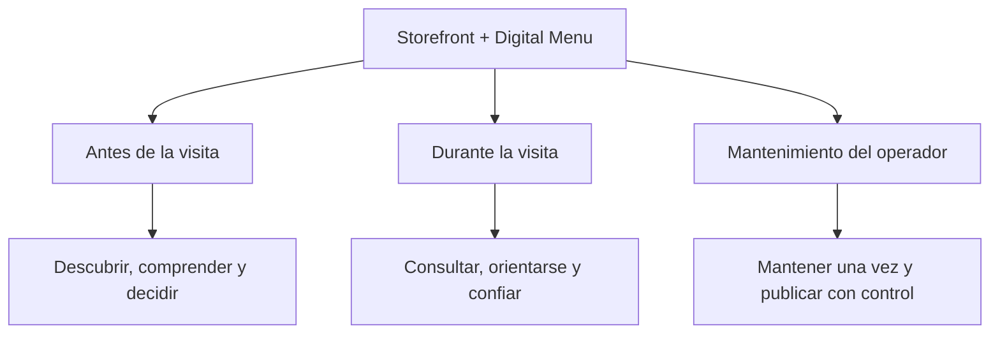
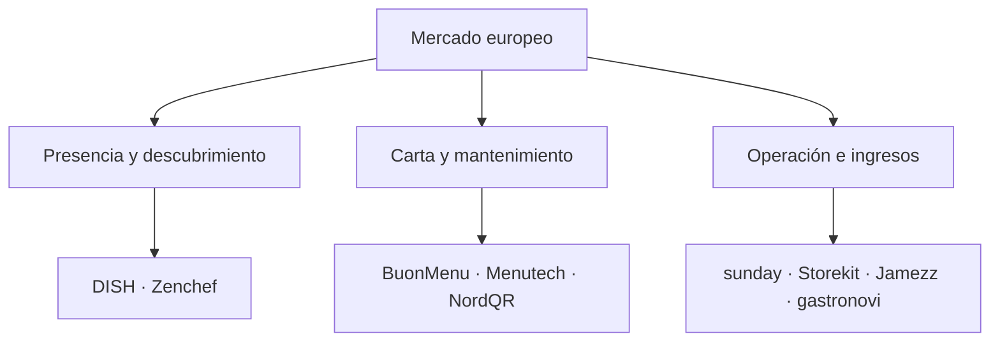

# Valiris Restaurants — Storefront + Digital Menu

## Investigación competitiva maestra, análisis de producto y registro de decisiones

> **Estado:** documento vivo de investigación. Integra las fases 2A España, 2B Europa sin España y 2C Estados Unidos/Canadá. Corte principal de fuentes: 29 de septiembre de 2026; fuente canadiense recuperada y verificada el 30 de septiembre de 2026.
>
> **Conclusión de encuadre:** el módulo es **Storefront + Digital Menu**. El QR es una vía de acceso, no el producto ni el módulo.

## 0. Propósito del documento

Este archivo conserva la investigación, el análisis y el razonamiento que llevaron a las conclusiones actuales. Su función no es cerrar el producto ni convertir el benchmark en una lista automática de features. Debe permitirnos:

- volver a la evidencia sin depender de memoria o de la conversación;
- distinguir hechos observados, claims de proveedores, inferencias e hipótesis;
- comparar mercados sin mezclar categorías económicas distintas;
- registrar contraseñales que eviten enamorarnos de la tecnología o de una solución;
- tomar decisiones de alcance y priorización con trazabilidad;
- añadir más adelante entrevistas, pruebas de concepto y decisiones de producto sin rehacer el trabajo.

Este documento contiene **59 productos**, sus fuentes, precios publicados cuando estaban disponibles, capacidades observadas, limitaciones, patrones de mercado y preguntas aún abiertas. La muestra es intencional y de alta señal; no es un censo exhaustivo.

### Mapa de lectura

| Si necesitas… | Lee… |
| --- | --- |
| Entender la tesis actual | Secciones 1–4 |
| Revisar España | Secciones 5–7 y Anexo A |
| Revisar Europa | Secciones 8–10 y Anexo B |
| Revisar EE. UU./Canadá | Secciones 11–15 y Anexo C |
| Tomar decisiones de producto | Secciones 16–23 |
| Auditar datos y fuentes | Anexos A–E |

## 1. Definición del problema y límites del módulo

### 1.1 Qué estamos diseñando

Una presencia pública propia del restaurante que permita **ser encontrado, entendido y elegido antes de la visita**, y una carta digital viva que permita **consultar la oferta con rapidez y confianza durante la visita**. El mismo contenido debe ser razonablemente fácil de mantener por un negocio independiente con poco tiempo y capacidad operativa limitada.

### 1.2 Qué papel tiene el QR

El QR es un **punto de entrada contextual**, útil sobre una mesa, escaparate, mostrador, cartel o pieza impresa. Comparte función con el enlace directo, Google, redes sociales, mensajería, un widget embebido y una conexión desde reservas. Por tanto:

- no debe ser la única puerta;
- no debe obligar a pedir, pagar, descargar una app o crear una cuenta;
- no justifica por sí solo el precio del producto;
- debe tener fallback cuando falla el móvil, la cobertura, la batería, la visión o la confianza en el código.

### 1.3 Fuera de alcance inicial

Pedidos, pagos, TPV, reparto y facturación no forman parte de este módulo. Reservas pertenecen a otro módulo, aunque la experiencia pública debe poder conectarlas de forma coherente. También quedan fuera, por ahora, una app nativa por restaurante, CRM enterprise, loyalty completo, marketplaces y personalización avanzada multi-local.

## 2. Pregunta de investigación

La investigación no buscó responder «¿qué features tienen las cartas QR?», sino una pregunta más útil:
> ¿Qué trabajos completos resuelven los productos del mercado alrededor de la presencia pública, la carta digital, su mantenimiento y su distribución; qué valor generan para comensal, operador y proveedor; y dónde queda una oportunidad defendible para un restaurante independiente español sin construir una suite innecesaria?

### 2.1 Los tres actores que deben ganar

| Actor | Valor buscado | Riesgo a evitar |
| --- | --- | --- |
| Comensal | Encontrar, comprender y confiar en la oferta con poco esfuerzo | Fricción digital, deshumanización, información incompleta o inaccesible |
| Operador / comprador | Publicar correctamente con poco trabajo y sin duplicar sistemas | Otro panel que exige mantenimiento, introduce errores o no justifica su coste |
| Valiris | Propuesta comercial clara, modular y sostenible | Competir por precio con utilidades gratuitas o por amplitud con suites operativas |

## 3. Método y reglas de lectura

### 3.1 Cobertura

| Fase | Mercado | Productos | Objetivo |
| --- | --- | --- | --- |
| 2A | España | 20 | Entender el suelo local de precio, funciones y categorías |
| 2B | Europa sin España | 19 | Comprobar qué estándares elevan el listón en presencia, mantenimiento y operación |
| 2C | EE. UU. y Canadá | 20 | Observar adquisición, distribución, accesibilidad, relación directa y contraseñales del QR |
| Total | Tres regiones | 59 | Construir una taxonomía y preparar decisiones, no declarar un ganador |

### 3.2 Tipos de evidencia

| Etiqueta | Significado | Qué permite afirmar |
| --- | --- | --- |
| Observado | Una fuente primaria publica una función, precio, condición o proceso | Que la oferta o claim existe públicamente |
| Claim de proveedor | Métrica o beneficio declarado por quien vende el producto | La promesa comercial; no su resultado independiente |
| Inferencia | Lectura razonada a partir de varios indicios | Una dirección plausible que aún necesita contraste |
| Contraseñal | Evidencia que debilita una intuición o limita una conclusión | Qué no debemos asumir o copiar automáticamente |
| Hipótesis | Proposición de valor o comportamiento aún no validado | Qué investigar con operadores y comensales |
| Desconocido | No se encontró evidencia suficiente | Nada sobre presencia o ausencia real de la capacidad |

### 3.3 Código de las matrices

- **V:** verificado explícitamente en una fuente primaria.
- **L:** limitado, dependiente del plan, adyacente o cubierto sólo en parte.
- **I:** indicio insuficiente para afirmarlo con seguridad.
- **NV:** no verificado en las fuentes revisadas; no significa que la función no exista.

En Norteamérica se usó una escala distinta: **C** = central en la propuesta; **P** = parcial, add-on o integración; **N** = no observada.

### 3.4 Límites metodológicos

- Predominan páginas oficiales, documentación de soporte y páginas de precios. Son adecuadas para observar oferta publicada, pero no para demostrar uso, satisfacción o retorno.
- Los precios cambian, pueden excluir impuestos, hardware, comisiones, onboarding o módulos. No se normalizaron monedas ni condiciones porque eso produciría una precisión engañosa.
- La frecuencia de una feature no demuestra que sea valiosa. Puede reflejar paridad competitiva, facilidad de construcción o copy comercial.
- Las muestras son intencionales. Sirven para descubrir patrones y fronteras, no para estimar cuotas de mercado.
- Las anécdotas de comunidades se usan sólo para identificar modos de fallo, nunca para estimar prevalencia.
- No se asignó puntuación global ni se declaró un ganador. Mezclar una utilidad de 4 €/mes con una suite TPV falsearía la comparación.

## 4. Síntesis ejecutiva de los tres mercados

### 4.1 Veredicto

> Valiris no debería vender «una carta QR mejor diseñada». La oportunidad más coherente es una **presencia pública y carta viva para el restaurante independiente**, fácil de mantener, fiable antes y durante la visita, y accesible por QR sin depender exclusivamente de él.
Esta sigue siendo una **hipótesis de producto**, no una necesidad ni una disposición a pagar demostradas.

### 4.2 Diez aprendizajes que sobreviven a los tres mercados

1. **Carta digital básica es infraestructura.** Categorías, precios, fotos, alérgenos, idiomas, marca y QR aparecen demasiado a menudo para diferenciar por sí solos.
2. **El mercado contiene categorías distintas.** Menú independiente, storefront, TPV, ordering, reservas y enterprise compiten a veces por el mismo punto de entrada, pero venden resultados diferentes.
3. **El mantenimiento es producto.** Importación, carga inicial, edición móvil, sincronización, soporte y publicación controlada aparecen como parte del valor, no como tarea posterior.
4. **La carta madura como fuente compartida.** Los productos más avanzados mantienen una vez y distribuyen a web, QR, TPV, kiosk, impresión, marketplace u otros canales.
5. **Storefront amplía el valor antes de la visita.** La combinación de identidad, información práctica, menú, SEO, disponibilidad y reservas convierte la carta en adquisición y decisión.
6. **El contexto operativo importa.** Hora, zona, mesa, terraza, consumo, disponibilidad y canal pueden cambiar qué se muestra y a qué precio; pero cada regla añade complejidad.
7. **Confianza no equivale a iconos.** Alérgenos, accesibilidad, traducción y disponibilidad requieren gobernanza, origen, revisión y fallback.
8. **QR no es una preferencia universal.** Puede ser útil en ciertos contextos, pero la evidencia encontrada contradice su imposición como único formato.
9. **El precio sube cuando el producto reduce trabajo o genera ingresos.** Las suites justifican mayor ticket mediante operación, pedidos, pagos, datos y recurrencia; un módulo informativo debe demostrar otro retorno.
10. **La simplicidad sólo gana si resuelve un trabajo completo.** Tener menos features no es una ventaja automática; debe reducir de verdad el esfuerzo y cubrir el recorrido necesario.

### 4.3 Lectura por capas

| Capa | Qué resuelve | Estado competitivo | Lectura para Valiris |
| --- | --- | --- | --- |
| Presencia pública | Identidad, información práctica, descubrimiento y decisión | Fragmentada en España; más madura en Europa y Norteamérica | Territorio relevante, con competencia directa seria |
| Carta estructurada | Comprender oferta, precios, variantes, dietas y disponibilidad | Comoditizada en su versión básica | Baseline obligatorio, no propuesta central |
| Mantenimiento y gobernanza | Importar, editar, revisar y publicar sin errores | Frecuentemente resuelto con servicio o sincronización | Posible eje comercial si el dolor y la frecuencia se validan |
| Distribución contextual | Publicar una fuente en varios accesos y situaciones | Avanzada en suites; irregular en productos simples | Diseñar el principio desde el inicio sin construir todas las integraciones |
| Transacción y relación | Pedir, pagar, fidelizar y capturar datos | Es donde muchos productos monetizan | Adyacente; no entrar para justificar artificialmente el módulo |

# Parte I — Fase 2A: mercado español

## 5. Qué mercado encontramos en España

La conclusión principal es que «carta QR» no constituye un mercado único.
| Mercado observado | Qué vende realmente | Riesgo para Valiris |
| --- | --- | --- |
| Carta independiente | Digitalización barata y autogestionable | Competencia por precio y fuerte comoditización |
| Suite TPV / operativa | Un catálogo conectado con sala, cocina y disponibilidad | Más valor operativo, mayor coste y dependencia |
| Pedir / pagar / CRM | Reducción de esperas, datos y recurrencia | La carta es sólo la puerta de entrada |

### 5.1 Precio y estructura competitiva

La muestra contiene diez cartas independientes y diez suites o soluciones operativas. El suelo va desde productos gratuitos y ofertas de pocos euros al mes hasta suites desde aproximadamente 40 €/mes o bajo presupuesto. Esa amplitud no significa que todos sean sustitutos.

- CartaMóvil parte de 29 €/año para 1–10 mesas.
- MenúsOnline parte de 79,90 €/año e incluye carga inicial.
- BuenaCarta combina plan gratuito y plan Avanzado de 8,95 €/mes.
- AppCarta sube a 29,95 €/mes más IVA con IA, imágenes y servicios relacionados.
- Camarero10 anuncia la suite desde 39,90 €/mes.

La lectura útil no es «quién es más barato», sino **qué trabajo adicional permite cobrar más**.

### 5.2 Cobertura observada de capacidades

| Área | Capacidad | V | L | I | NV | Cobertura V+L |
| --- | --- | --- | --- | --- | --- | --- |
| Núcleo | Storefront público | 6 | 14 | 0 | 0 | 100% |
| Núcleo | Acceso web sin cuenta/app | 19 | 1 | 0 | 0 | 100% |
| Núcleo | Carta estructurada editable | 20 | 0 | 0 | 0 | 100% |
| Núcleo | Categorías y navegación | 20 | 0 | 0 | 0 | 100% |
| Núcleo | Búsqueda o filtros | 2 | 0 | 1 | 17 | 10% |
| Núcleo | Fotos | 13 | 2 | 5 | 0 | 75% |
| Confianza | Alérgenos | 12 | 0 | 8 | 0 | 60% |
| Acceso | Idiomas | 9 | 2 | 9 | 0 | 55% |
| Operación | Disponibilidad | 13 | 4 | 3 | 0 | 85% |
| Catálogo | Formatos o variantes | 7 | 1 | 6 | 6 | 40% |
| Operación | Programación o contexto | 4 | 3 | 11 | 2 | 35% |
| Acceso | QR por mesa o zona | 19 | 0 | 0 | 1 | 95% |
| Fallback | Impresión o PDF | 4 | 2 | 1 | 13 | 30% |
| Marca | Identidad visual | 10 | 5 | 5 | 0 | 75% |
| Negocio | Analítica | 9 | 1 | 3 | 7 | 50% |
| Adyacente | Pedido o pago | 12 | 1 | 0 | 7 | 65% |
| Adyacente | Integración TPV/Core | 10 | 2 | 1 | 7 | 60% |
La cobertura confirma que acceso web, carta editable, categorías y QR ya son mínimos. Búsqueda, impresión, variantes y programación son menos uniformes; eso las hace dignas de estudio, pero no automáticamente valiosas.

## 6. Hallazgos de España

### 6.1 La carta básica ya no diferencia

Acceso sin cuenta, estructura editable, categorías, QR permanente, fotografías, identidad visual, alérgenos y algún nivel de idiomas aparecen como expectativas recurrentes. Una implementación correcta es necesaria, pero difícilmente vendible como ventaja principal.

### 6.2 El mantenimiento del contenido es parte del producto

MenúsOnline incluye la carga inicial de estructura y 50 o 100 platos. BuenaCarta vende la inserción manual o la incluye en Premium. La señal no demuestra que todos los operadores sufran el mismo problema, pero sí demuestra que proveedores monetizan la eliminación del trabajo de alta.

### 6.3 Storefront y menú no siempre están unidos

Muchas soluciones optimizan la consulta dentro del local. Pocas plantean la carta como presencia pública antes de la visita. QrCarta destaca página indexable, información del negocio y acceso desde Google, Instagram o WhatsApp. Esto abre una hipótesis, no una ventaja demostrada.

### 6.4 El contexto operativo está poco estandarizado

PlaceIn permite cartas, productos o precios distintos según mesa, barra, salón o terraza. menu.es programa disponibilidad por días y horas. CartaMóvil actualiza disponibilidad y genera QR por mesa. El patrón sugiere valor operativo posible sin entrar en pedidos o TPV, pero cada condición debe responder a un escenario real.

### 6.5 Alérgenos: mostrar no equivale a gobernar

El Real Decreto 126/2015 permite facilitar cierta información oralmente si existe un registro escrito o electrónico accesible y un aviso visible sobre cómo obtenerla. Por ello, marcar catorce casillas o mostrar iconos puede ayudar, pero no garantiza por sí solo el cumplimiento del proceso. La interfaz debería apoyar responsabilidad, revisión y acceso a la información; no prometer cumplimiento automático.
Fuente legal: [BOE — Real Decreto 126/2015, artículo 6.5](https://www.boe.es/buscar/act.php?id=BOE-A-2015-2293).

### 6.6 Hipótesis que España dejó abiertas

| Hipótesis | Razonamiento | Qué falta demostrar |
| --- | --- | --- |
| Presencia pública + carta | Unificar decisión antes de la visita y consulta en mesa puede superar a una utilidad QR pura | Que el comensal use esa continuidad y el operador la valore |
| Mantenimiento mínimo | Carga inicial, edición móvil y cambios rápidos pueden vender más que nuevas funciones | Tiempo actual, frecuencia de cambios, errores y disposición a pagar |
| Contexto operativo | Hora, zona y disponibilidad aportan valor sin TPV | Qué escenarios son frecuentes y cuáles serían sobreingeniería |
| Confianza y fallback | Legibilidad, idiomas, alérgenos y alternativa imprimible reducen rechazo | Impacto real en comprensión, inclusión y compra |
| Producto modular | Una entrada asequible podría crecer hacia reservas, reseñas o fidelización | Qué secuencia comercial tiene sentido y evita un producto fragmentado |

### 6.7 Decisión de cierre de fase

Se decidió avanzar a Europa conservando las cinco hipótesis y manteniendo separados los mercados. No se seleccionaron features ni se asumió que España representara el estándar máximo.

## 7. Inventario competitivo — España

| Producto | Arquetipo | Foco | Cliente | Precio / unidad | Gratis o prueba | Evidencia | Hallazgo o límite | Fuentes |
| --- | --- | --- | --- | --- | --- | --- | --- | --- |
| CartaMóvil | Menú independiente | Carta QR dinámica | Independientes; precio por mesas | 29 €/año (1–10 mesas) · Por mesas/año | PDF 19,99 €/año; devolución 7 días | A | Precio escalonado por mesas. ES/EN no incluido en el tramo más bajo. | [1](https://www.cartamovil.es/tarifas/) |
| MenúsOnline | Menú independiente | Carta QR gestionada | Bares, restaurantes y hoteles | 79,90 €/año · Por local/año | 2 semanas de prueba | A | Incluye alta inicial de estructura y 50/100 platos: el servicio de carga es parte de la propuesta. | [1](https://menusonline.es/precios) |
| BuenaCarta | Menú independiente | Freemium de carta QR | Pequeños negocios | 0 €; 8,95 €/mes Avanzado · Por local/mes | Gratis permanente; garantía 7 días | A | Fotos, URL propia, traducción y horarios dependen del plan. Inserción manual: 79 € + IVA o incluida en Premium. | [1](https://www.buenacarta.com/tarifas.html) [2](https://www.buenacarta.com/) |
| menu.es | Menú independiente | Storefront + carta QR | Bares y restaurantes | 9 €/mes · Por local/mes | Prueba; sin plan gratis publicado | A | Destaca programación por día/hora, QR por sección y GA4. Pedidos, pago y reparto son módulos adyacentes. | [1](https://menu.es/) |
| TuCartaDigital | Menú independiente | Freemium con publicidad | Restaurantes y otros servicios | 0 €; 95,40 €/año sin anuncios · Por local/mes o año | Gratis permanente | A | El plan gratuito conserva funciones con publicidad. El plan de pago elimina anuncios. | [1](https://tucartadigital.com/carta-digital-precio/) [2](https://tucartadigital.com/) |
| QrCarta | Menú independiente | Freemium + SEO local | Independientes orientados a visibilidad | 0 €; 3,95 €/mes Premium · Por local/mes | Gratis permanente sin anuncios | A | Posiciona la carta como presencia indexable. Analítica, impresión y personalización avanzada son Premium. | [1](https://www.qrcarta.com/precios.php) [2](https://www.qrcarta.com/en/) |
| QrCartaDigital | Menú independiente | Carta QR SaaS | Restaurantes; multi-local en Premium | 90 €/año + 30 € alta · Por local/año | 15 días de prueba | A | La página pública de precios detalla poco el alcance funcional. Premium se dirige a más de 3 locales. | [1](https://www.qrcartadigital.com/Cliente/Home/Precios) |
| CartaDigitalQR.es | Menú independiente | Freemium + pedidos | Bares y restaurantes | 0 €; desde 7,90 €/año anunciado · Por local/año | 15 días de prueba | A | El precio anual publicado es atípicamente bajo: debe revalidarse antes de usarlo en decisiones comerciales. | [1](https://cartadigitalqr.es/tarifas) |
| AppCarta | Menú independiente | Carta QR + IA de contenido | Bares y restaurantes | 29,95 €/mes + IVA · Por local/mes | 14 días; sin permanencia | A | Incluye generación/retoque de fotos con IA y chatbot opcional. Producto muy reciente: falta evidencia independiente. | [1](https://etersystem.es/servicios/carta-digital-restaurante-menu-qr) |
| TeleCarta | Menú independiente | Carta y descubrimiento en app | Hostelería y restauración | No publicado · No verificado | App pública | B | La ficha visible data de 2020 y solo muestra 2 valoraciones. Conviene comprobar actividad comercial actual. | [1](https://apps.apple.com/es/app/telecarta-carta-digital-qr/id1512929585) |
| PlaceIn | Suite hostelera | Carta contextual por mesa/zona | Restaurantes con espacios y precios distintos | No publicado · Presupuesto | Demo/contacto | B | Diferencia productos y precios por terraza, barra, salón o mesa. Exporta QR en CSV y PDF. | [1](https://placein-support.freshdesk.com/support/solutions/articles/103000233081-11-codigos-qr-y-descarga-en-carta-digital) |
| OfiMenú | Suite hostelera | Carta web/app + pedidos | Bares, cafeterías, restaurantes y hoteles | No publicado · Presupuesto | Prueba gratis anunciada | A | Acceso web sin app; la app añade nutrición, ofertas y recomendaciones. Puede validar pedidos antes de enviarlos. | [1](https://www.ofi.es/software/app-carta-electronica-restaurantes/) |
| Camarero10 | Suite TPV | Carta integrada con TPV | Hostelería con operación digital | Desde 39,90 €/mes (suite) · Suite/mes | No verificado | A | El precio corresponde a la suite, no a una carta aislada. Incluye TPV, pedidos, cocina y analítica. | [1](https://www.camarero10.com/) |
| Glop | Suite TPV | Carta multidioma + pedir/pagar | Hostelería y retail | No publicado · Licencia/presupuesto | Prueba gratis anunciada | A | La carta es un módulo dentro de una plataforma amplia. No hay precio comparable del módulo aislado. | [1](https://www.glop.es/) |
| Revo SOLO | Suite TPV | Carta, pedido y pago | Restaurantes que usan Revo XEF | No publicado · Licencia/presupuesto | No verificado | B | Permite perfiles y QR por establecimiento/mesa. El valor principal depende de integración con Revo XEF/XPress. | [1](https://support.revo.works/es/articles/725) [2](https://revo.works/) |
| Last.app QR | Suite TPV | Pedido compartido desde mesa | Restaurantes con flujo integrado | No publicado · Presupuesto | Demo/contacto | A | El QR identifica la mesa, sincroniza carrito y envía al TPV/cocina. Es una experiencia operativa, no solo una carta. | [1](https://www.last.app/producto/qr-pedir-y-pagar) |
| Sipos (antes Pikotea) | Suite TPV | Carta, búsqueda, pedido y pago | Hostelería independiente y móvil | No publicado · Presupuesto | Prueba anunciada | B | Cuenta con búsqueda/filtro de alérgenos y gestión de stock. El cambio de marca obliga a vigilar continuidad de fuentes. | [1](https://pikotea.zohodesk.eu/portal/es/kb/articles/primeros-pasos) [2](https://play.google.com/store/apps/details?id=com.outondev.pikoteoadmin) |
| Honei | Pedido/pago/CRM | Carta como entrada a pedido y pago | Restaurantes con TPV y volumen | Presupuesto · Presupuesto | Sin permanencia | A | Las métricas de aumento de ticket, rotación y propinas son afirmaciones del proveedor, no resultados independientes. | [1](https://honei.app/servicios/pedir-y-pagar) |
| Cheerfy Pay | Pedido/pago/CRM | Pedir, pagar y fidelizar | Restaurantes con CRM/loyalty | No publicado · Presupuesto | Demo/contacto | A | La propuesta se apoya en pago autónomo, cuenta dividida y CRM. La carta no es el producto central. | [1](https://www.es.cheerfy.com/producto/pide-paga-restaurantes) |
| Yumminn | Pedido/pago/CRM | Pago, pedido, reviews y loyalty | Restaurantes con integración TPV | No publicado · Presupuesto | No verificado | B | La fuente pública disponible se centra en order/pay, reseñas y fidelización; el detalle de carta es limitado. | [1](https://www.linkedin.com/company/yumminn/) [2](https://www.yumminn.com/) |

# Parte II — Fase 2B: Europa sin España

## 8. Qué cambia al ampliar a Europa

Europa eleva el listón. Hay competidores serios en presencia pública, mantenimiento, pedidos/pagos y operación. Nuestra oportunidad no sería hacer todo mejor, sino seleccionar una combinación estrecha que los productos baratos no resuelven bien y que las suites resuelven con demasiada complejidad para muchos independientes.
| Dimensión | España | Europa | Lectura para Valiris |
| --- | --- | --- | --- |
| Carta básica | Abundante y barata | También abundante y barata | No es propuesta comercial defendible |
| Storefront + carta | Fragmentado | DISH y Zenchef son referencias serias | Hay competencia directa real |
| Mantenimiento | Frecuentemente manual o servicio | Importación, automatización y catálogo único | Debe ser parte central de la experiencia |
| Contexto operativo | Poco desarrollado | Horarios, zonas, canales y disponibilidad | No reducir disponibilidad a visible/no visible |
| Confianza y accesibilidad | Irregular | Algunos referentes fuertes, no una norma | Posible espacio si se valida y ejecuta con rigor |
| Modelo comercial | Bajo ticket | Desde gratuito hasta enterprise | El precio aumenta al reducir trabajo o generar ingresos |

### 8.1 Tres posiciones competitivas

Valiris no debería intentar ganar simultáneamente en las tres. La intersección inicial con mayor coherencia es **presencia pública + carta viva + mantenimiento ligero + confianza**, para el independiente pequeño.

### 8.2 Cobertura observada de capacidades

| Área | Capacidad | V | L | I | NV | Cobertura V+L |
| --- | --- | --- | --- | --- | --- | --- |
| Presencia pública | Storefront / web pública | 9 | 10 | 0 | 0 | 100% |
| Acceso | Web sin cuenta ni app | 19 | 0 | 0 | 0 | 100% |
| Contenido | Carta estructurada editable | 19 | 0 | 0 | 0 | 100% |
| Descubrimiento | Categorías y navegación | 19 | 0 | 0 | 0 | 100% |
| Descubrimiento | Búsqueda o filtros | 3 | 13 | 0 | 3 | 84% |
| Contenido | Precios y variantes | 17 | 2 | 0 | 0 | 100% |
| Operación | Disponibilidad o contexto | 14 | 5 | 0 | 0 | 100% |
| Confianza | Alérgenos o dietas | 8 | 11 | 0 | 0 | 100% |
| Acceso | Varios idiomas | 11 | 8 | 0 | 0 | 100% |
| Marca | Personalización o dominio | 19 | 0 | 0 | 0 | 100% |
| Mantenimiento | Importación asistida | 10 | 7 | 0 | 2 | 89% |
| Mantenimiento | Digital e impreso desde una fuente | 2 | 2 | 0 | 15 | 21% |
| Conversión | Reservas | 6 | 4 | 0 | 9 | 53% |
| Conversión | Pedido o pago | 14 | 4 | 0 | 1 | 95% |
| Relación | Feedback o reseñas | 11 | 6 | 0 | 2 | 89% |
| Relación | CRM o fidelización | 13 | 3 | 0 | 3 | 84% |
| Escala | Multi-local o roles | 15 | 4 | 0 | 0 | 100% |
| Integración | TPV o integraciones operativas | 14 | 3 | 0 | 2 | 89% |
| Gestión | Analítica | 16 | 3 | 0 | 0 | 100% |

## 9. Hallazgos de Europa

### 9.1 La fuente única es el estándar conceptual fuerte

gastronovi, Vita Mojo, Jamezz y Deliverect muestran un principio más importante que cualquier pantalla: un producto o plato se mantiene una vez y se distribuye a varios canales. Valiris no necesita construir ahora todas esas integraciones, pero sí evitar un modelo de información que impida crecer hacia ellas.

### 9.2 La presencia pública puede ser el producto

DISH y Zenchef conectan identidad, web, menú, descubrimiento y reservas. Esto valida que storefront + menú constituye una categoría real, pero también elimina la ilusión de un espacio vacío.

### 9.3 Importación y automatización suben el estándar de alta

BuonMenu importa cartas mediante IA; Menutech trabaja traducciones, alérgenos y formatos digitales e impresos; varias suites sincronizan el TPV. La automatización reduce trabajo, pero BuonMenu advierte que su importación puede equivocarse y requiere revisión humana. Para Valiris, el valor no sería «tener IA», sino acelerar sin perder control.

### 9.4 Accesibilidad y confianza siguen poco estandarizadas

Menutech documenta tamaño de texto, filtros y una experiencia sin cookies, mientras muchos rivales apenas publican información explícita. Esto puede ser oportunidad de calidad y confianza, pero la investigación competitiva no demuestra que impulse la compra del software.

### 9.5 La amplitud puede perjudicar al independiente

FineDine y las suites operativas cubren grandes superficies funcionales. Esa amplitud es competitiva en papel, pero puede crear carga de configuración, aprendizaje y mantenimiento. La simplicidad es valiosa sólo si completa un trabajo importante.

### 9.6 El QR monetiza mejor cuando mueve ingresos o datos

sunday, Storekit, Obypay y Flipdish justifican el canal con pedido, pago, loyalty y CRM. Como Valiris excluye esas funciones del módulo, deberá demostrar valor mediante presencia, mantenimiento, confianza o conexión modular.

### 9.7 Contraseñales que moderan el optimismo

- **DISH** presiona la suscripción básica con una combinación de web, menú y reservas bajo pago fijo declarado y sin mensualidad.
- **BuonMenu** ya combina diseño, precio accesible e importación por IA; automatizar el alta no basta como ventaja.
- **FineDine** ofrece una superficie enorme a precios promocionales bajos; competir por cantidad sería una carrera difícil.
- **Flipdish** reconoce que una app propia no siempre tiene sentido cuando la recurrencia es baja o la experiencia es presencial. Más canales no siempre equivalen a más valor.

### 9.8 Lo que Europa no demuestra

Europa no prueba que los restaurantes españoles pequeños paguen por esta combinación, que el mantenimiento sea su dolor principal, que los comensales valoren una experiencia unificada, que accesibilidad o alérgenos impulsen la compra, ni que una identidad visual mejor aumente visitas o recurrencia.

### 9.9 Decisión de cierre de fase

Se conservó la tesis provisional de **presencia pública y carta viva, fáciles de mantener y fiables antes y durante la visita**, y se decidió investigar Norteamérica para observar adquisición, accesibilidad, distribución y rechazo al QR.

## 10. Inventario competitivo — Europa sin España

| Producto | Arquetipo | Base | Foco | Cliente | Precio / prueba | Escala o condición | Límite o contraseñal | Fuentes |
| --- | --- | --- | --- | --- | --- | --- | --- | --- |
| BuonMenu | Menú / storefront | Italia | Carta QR de marca con importación por IA | Restaurantes independientes | 25 €/mes con anual; 30 €/mes mensual · 14 días | Precio público. La empresa avisa de que la importación por IA requiere revisión humana. | IA acelera el alta, pero no elimina la responsabilidad sobre precios, ingredientes o alérgenos. | [Fuente 1](https://buonmenu.com/en/) · [Fuente 2](https://buonmenu.com/en/pricing/) |
| Menutech | Menú / storefront | Europa | Gestión multiformato con alérgenos y traducción | Restauración independiente y grupos | Desde 15 €/mes; niveles superiores publicados · Planes públicos | Planes y alcance varían por nivel. | Referencia fuerte en accesibilidad, alérgenos, idiomas y salida digital/impresa. | [Fuente 1](https://menutech.com/) · [Fuente 2](https://menutech.com/en/digital-menu) |
| NordQR | Menú / storefront | Europa | Carta QR visual con reseñas y reservas | Independientes y pequeños grupos | Planes públicos; importe no capturado · Lite y Pro | El plan limita visitas, platos, idiomas y usuarios. | La presentación es competitiva; el modelo limita uso y contenido por plan. | [Fuente 1](https://www.nordqr.com/) · [Fuente 2](https://www.nordqr.com/pricing) |
| DISH Starter | Menú / storefront | Alemania / Europa | Web del restaurante, menú, visibilidad y reservas | Restaurantes independientes | Precio fijo único; importe no visible en la fuente · Sin mensualidad ni comisión declarada | Parte de un ecosistema METRO más amplio. | Competidor directo de presencia pública + menú; presiona cualquier suscripción básica. | [Fuente 1](https://www.dish.co/) · [Fuente 2](https://www.dish.co/ES/es/products/dish-website/) |
| FineDine | Menú / storefront | Turquía / Europa | Menús QR, tablet, web e IA con CRM | Restaurantes y hoteles | Promo anual desde US$15/mes; Growth US$35 · 14 días | Precios promocionales y alcance por plan. | Amplitud muy alta; riesgo de complejidad para un independiente pequeño. | [Fuente 1](https://www.finedinemenu.com/) · [Fuente 2](https://www.finedinemenu.com/pricing) |
| TastyCloud | Menú / storefront | Francia | Menú QR/tablet con pedido y pago opcional | Restaurantes y hoteles | Presupuesto · Demo y acompañamiento | Precio no publicado; implantación asistida. | Combina contenido visual y operación, con más servicio humano que un SaaS autoservicio. | [Fuente 1](https://www.tastycloud.fr/) · [Fuente 2](https://www.tastycloud.fr/menu-digital-restaurant/) |
| Zenchef | Menú / storefront | Francia / Benelux | Web, menú, reservas y descubrimiento | Restaurantes orientados a reservas | Por país y plan; base no capturada · Demo / contacto | 36.000 restaurantes declarados por la empresa. | Une la experiencia antes de la visita con reservas; el menú no es su único centro de valor. | [Fuente 1](https://www.zenchef.com/solution/website-design) · [Fuente 2](https://www.zenchef.com/solution/digital-menu-qr-code-restaurant) |
| sunday | Pedido / pago / crecimiento | Francia / Reino Unido | Pedido, pago, propinas, reputación y fidelización | Restaurantes con servicio en mesa | £149/mes Standard; £199 Premium · Demo | Add-ons publicados; cifras comerciales son declaraciones del proveedor. | El QR es un canal de ingresos y datos, no un producto de carta aislado. | [Fuente 1](https://sundayapp.com/) · [Fuente 2](https://sundayapp.com/pricing/) |
| Obypay | Pedido / pago / crecimiento | Francia | Pedido, pago y fidelización omnicanal | Independientes, cadenas y grupos | Presupuesto · Demo | 2.000 puntos de venta declarados por la empresa. | Su valor se concentra en operación y fidelización conectadas al TPV. | [Fuente 1](https://obypay.com/) · [Fuente 2](https://obypay.com/en/) |
| Storekit | Pedido / pago / crecimiento | Reino Unido | Ordering de marca: mesa, recogida, entrega y catering | Independientes y grupos | £99/mes Grow; £199 Pro; Enterprise desde £995 · Demo; alta rápida declarada | Precio alto frente a carta pura; alcance operativo amplio. | Demuestra cuánto puede valer una experiencia de marca cuando mueve transacciones. | [Fuente 1](https://storekit.com/) · [Fuente 2](https://storekit.com/pricing) |
| Flipdish | Pedido / pago / crecimiento | Irlanda / Europa | Web y app propias para pedidos, retención y analítica | Restaurantes de takeaway, delivery y grupos | Web desde €49/mes anual; web+app desde €79 · Demo | La empresa reconoce que una app no siempre compensa en dine-in o baja recurrencia. | Contraseñal útil: más canales no siempre crean valor; depende de recurrencia y modelo de servicio. | [Fuente 1](https://www.flipdish.com/) · [Fuente 2](https://www.flipdish.com/pricing) |
| GloriaFood | Pedido / pago / crecimiento | Rumanía / Europa | Pedido online gratuito con extras de pago | Pequeños restaurantes | Núcleo gratis; pagos US$29/mes; POS US$49/mes · Gratis permanente | Algunas capacidades requieren módulos de pago o compromiso. | El gratis erosiona la disposición a pagar por funciones básicas. | [Fuente 1](https://www.gloriafood.com/) · [Fuente 2](https://www.gloriafood.com/pricing) |
| QikServe | Pedido / pago / crecimiento | Reino Unido | Pedido y pago enterprise en web, QR y NFC | Hospitality multi-local | Presupuesto · Demo | Fuerte dependencia de integraciones y despliegue. | Referencia de flujos continuos, horarios restringidos y experiencia multi-estación. | [Fuente 1](https://qikserve.com/) · [Fuente 2](https://qikserve.com/solutions/order-and-pay/) |
| Innovorder | Plataforma operativa | Francia | TPV, kiosco, QR, cocina y food court | Restaurantes y restauración colectiva | Presupuesto · Demo | 3.000 restauradores declarados por la empresa. | El menú se gestiona como parte de un sistema operativo del restaurante. | [Fuente 1](https://www.innovorder.com/) · [Fuente 2](https://www.innovorder.com/solutions/order-and-pay) |
| Vita Mojo | Plataforma operativa | Reino Unido | Fuente única para POS, kiosco, web, cocina y loyalty | QSR y grupos multi-local | Presupuesto · Demo | Orientado normalmente a grupos con varias ubicaciones. | La coherencia del catálogo entre canales es el principal listón competitivo. | [Fuente 1](https://www.vitamojo.com/) · [Fuente 2](https://www.vitamojo.com/digital-ordering) |
| Jamezz | Plataforma operativa | Países Bajos | QR, kiosk, tablet y webshop conectados al TPV | Independientes y grupos | Suscripción mensual por local; precio a medida · Demo | 2.000+ ubicaciones y 25+ países declarados por la empresa. | Destaca por menús y precios según zona, horario y modalidad de consumo. | [Fuente 1](https://www.jamezz.com/) · [Fuente 2](https://www.jamezz.com/qr-ordering) |
| gastronovi | Plataforma operativa | Alemania / DACH | Suite integral con catálogo único para web, POS y pedidos | Restaurantes y grupos DACH | Módulos / presupuesto · Demo | 20.000 licencias activas declaradas por la empresa. | La promesa fuerte es actualizar una vez y propagar a todos los puntos de contacto. | [Fuente 1](https://www.gastronovi.com/) · [Fuente 2](https://www.gastronovi.com/en/solutions/digital-ordering/) |
| Deliverect | Plataforma operativa | Bélgica / global | Gestión centralizada de pedidos, menús y canales | Restaurantes y cadenas multicanal | Presupuesto · Demo | 50.000 establecimientos y 52 países declarados por la empresa. | Es un competidor indirecto en mantenimiento: controla el catálogo que alimenta otros canales. | [Fuente 1](https://www.deliverect.com/en) · [Fuente 2](https://www.deliverect.com/en/deliverect-restaurants) |
| qnips | Plataforma operativa | Alemania | Menú, app, señalización, prepedido y subsidios | Catering corporativo y restauración colectiva | Presupuesto · Demo | No es núcleo de restaurante independiente; se incluye como frontera adyacente. | Muestra el nivel de contextualización e integración del mercado colectivo. | [Fuente 1](https://www.qnips.io/) · [Fuente 2](https://www.qnips.io/en/) |

# Parte III — Fase 2C: Estados Unidos y Canadá

## 11. El salto norteamericano

En Norteamérica el menú deja de ser sólo una interfaz de consulta. Se convierte en contenido indexable, canal de adquisición, catálogo distribuido, activo transaccional y fuente de datos. Sin embargo, la evidencia de comportamiento encontrada desaconseja convertir el QR en obligación.

### 11.1 Cuatro arenas observadas

| Arena | Productos representativos | Qué vende realmente | Relevancia para Valiris |
| --- | --- | --- | --- |
| Presencia propia + crecimiento | Popmenu, BentoBox, Owner.com, ChowNow, DoorDash Commerce, Sociavore | Website, SEO, contenido, ordering y relación directa | Eleva discovery, narrativa y comercialización del canal propio |
| Ecosistema TPV | Toast, Square, Clover, SpotOn, TouchBistro, Lightspeed | Catálogo conectado con venta, servicio, stock y pagos | Demuestra el poder de una fuente operativa, pero no es comparable como módulo aislado |
| Comercio y datos enterprise | GoTab, Olo, Lunchbox, UEAT | Distribución multicanal, personalización y datos a escala | Marca la frontera del overengineering |
| Menú, distribución y descubrimiento | MustHaveMenus, OpenTable, Tock, Resy | Publicación multiformato, disponibilidad, perfiles y demanda | Aporta patrones útiles sin convertir reservas en parte del módulo |

## 12. Qué eleva el listón

### 12.1 La carta participa en la adquisición

Popmenu, BentoBox y ChowNow convierten platos, categorías e imágenes en contenido indexable y distribuible. La carta no es un PDF escondido detrás de un código: participa en SEO local, buscadores, redes y conversión.

### 12.2 Una edición alimenta varios canales

Square, Olo, DoorDash y MustHaveMenus sincronizan parte del catálogo entre web, TPV, marketplaces, QR, impresión o pantallas. MustHaveMenus es especialmente relevante por conectar print + digital, recordándonos que el fallback físico también puede formar parte del sistema.

### 12.3 El servicio humano forma parte del producto

Diseño, importación de carta, fotografía, onboarding, soporte y marketing gestionado reducen el trabajo que el software puro deja al operador. Esto tiene una consecuencia comercial: quizá el producto no sea sólo una licencia; puede incluir una operación de alta y mantenimiento asistido.

### 12.4 Los productos serios venden relación directa

La promesa comercial dominante es poseer el canal y los datos del cliente, en lugar de depender del marketplace. Valiris no necesita construir CRM en este módulo, pero sí debe evitar que el storefront sea un callejón sin conexión futura.

### 12.5 Accesibilidad tiene presión comercial y legal

Popmenu y BentoBox la presentan explícitamente y cuestionan el PDF como formato de acceso y SEO. La frecuencia de comunicación pública sigue siendo limitada, por lo que no podemos concluir calidad universal; sí podemos concluir que accesibilidad puede ser parte de la venta y del riesgo.

## 13. Contraseñal: QR conocido no significa QR preferido

### 13.1 Encuesta de Toast

Toast publica una encuesta a 850 adultos: 81% declaró preferir menú físico y sólo 1% eligió QR como formato favorito. También informa de fricciones como texto pequeño, uso obligado del teléfono y problemas de fiabilidad. Como Toast es proveedor, estos datos deben leerse como evidencia orientativa, no como verdad universal.
Fuente: [Toast — QR code menu insights](https://pos.toasttab.com/blog/on-the-line/qr-code-menu-insights).

### 13.2 Experimento canadiense

Impact Canada reclutó una muestra online de 2.540 personas, representativa de la población canadiense por región, edad y género. El 90% declaró familiaridad con los QR, pero sólo el 22% afirmó escanearlos siempre o con frecuencia. El estudio analiza etiquetas de producto y no restaurantes, así que sirve para demostrar la diferencia entre conocimiento y uso, no para estimar preferencia de menú.
Fuente: [Impact Canada — Testing QR Code Designs](https://impact.canada.ca/en/behavioural-science/reports/testing-qr-code-designs).

### 13.3 Implicación de producto

El QR puede aportar valor en food halls, terrazas, mostradores, fast casual o contextos de autoservicio. Imponerlo como única vía en una experiencia de hospitalidad puede degradarla. Debemos diseñar una experiencia híbrida donde el canal digital sea excelente y el acceso alternativo siga existiendo.

## 14. Decisión de Norteamérica

> **Hipótesis provisional consolidada:** Valiris puede ser la presencia y carta viva del restaurante independiente, mantenida una vez, preparada para ser encontrada antes de la visita y accesible durante ella sin obligar al comensal a depender del QR.
| Actor | Conservar | Rechazar | Investigar antes de decidir |
| --- | --- | --- | --- |
| Comensal | Menú rápido, legible, con precios, disponibilidad y confianza | PDF móvil, cuenta obligatoria y QR como única puerta | Cuándo prefiere físico, digital o ambos; qué información decide la visita |
| Operador | Una actualización, publicación controlada y ayuda en el alta | Otro panel que duplica trabajo | Frecuencia real de cambios, fuentes actuales y coste de errores |
| Valiris | Propuesta estrecha, modular y vendible | Paridad con TPV, pedidos, apps y CRM enterprise | Disposición a pagar por presencia + mantenimiento + confianza |

### 14.1 No copiar todavía

- app móvil propia del restaurante;
- IA que publique sin revisión;
- gamificación o reseñas por plato;
- pedidos y pagos añadidos sólo para justificar el QR;
- personalización enterprise por ubicación;
- dashboard lleno de métricas sin decisiones asociadas.

## 15. Inventario competitivo — Estados Unidos y Canadá

| Producto | Arena | Precio | Qué vende | Qué eleva | Límite para Valiris | Fuentes |
| --- | --- | --- | --- | --- | --- | --- |
| Popmenu | Presencia propia + crecimiento · EE. UU. | Desde US$159/mes anual | Website SEO, menú interactivo, reseñas por plato y automatización de marketing. | Convierte cada plato en contenido indexable, social y medible; no trata la carta como documento. | La propuesta depende de marketing y crecimiento; no demuestra que el pequeño restaurante español pague ese precio. | [Precios](https://get.popmenu.com/pricing) · [Menús interactivos](https://get.popmenu.com/solutions/interactive-menus) |
| BentoBox | Presencia propia + crecimiento · EE. UU. | Presupuesto · ahora ligado a Clover | Web de diseño asistido, menú centralizado, SEO, accesibilidad y comercio. | Combina software con onboarding, mantenimiento y soporte; una edición actualiza todos los menús online. | Actualmente sólo se ofrece a nuevos clientes dentro del ecosistema Clover. | [Restaurant Websites](https://www.getbento.com/restaurant-websites-paid/) · [Accesibilidad](https://www.getbento.com/blog/digital-accessibility-features/) |
| Owner.com | Presencia propia + crecimiento · EE. UU./Canadá | US$249/mes + 5% o US$499/mes | Website, ordering, app, loyalty y marketing orientados a aumentar ventas directas. | Propuesta comercial extremadamente clara: dar al independiente una experiencia digital comparable a una cadena. | Su valor depende de pedidos online; queda fuera del alcance inicial de Valiris. | [Producto](https://www.owner.com/) · [Precios](https://www.owner.com/pricing) |
| ChowNow | Presencia propia + crecimiento · EE. UU. | Launch Lite US$99/mes | Ordering directo, website, app, marketing, agregación y distribución en buscadores. | Optimiza el website para posicionamiento, conversión y contenido estructurado visible también para buscadores de IA. | La carta funciona principalmente como entrada a la transacción. | [Producto](https://get.chownow.com/) · [Precios](https://get.chownow.com/pricing/) |
| DoorDash Commerce | Presencia propia + crecimiento · EE. UU./Canadá | 2,9% + US$0,30 de procesamiento en Online Ordering | Website y app de marca, ordering directo, loyalty y catálogo sincronizado con Marketplace. | Aprovecha distribución masiva y permite editar menú, horarios y precios una vez. | Aumenta dependencia de una plataforma que también controla el marketplace. | [Commerce Platform](https://merchants.doordash.com/en-us/products/commerce-platform) · [Online Ordering](https://merchants.doordash.com/en-us/products/online-ordering) |
| Sociavore | Presencia propia + crecimiento · Canadá | Mes a mes · 14 días de prueba | Website, menú, ordering, QR/NFC, reservas, gift cards y Square sync. | Es la referencia más cercana al independiente canadiense con una sola consola para sus canales propios. | La amplitud y el foco transaccional pueden sobrepasar el módulo Storefront + Menu. | [Producto](https://www.sociavore.co/) · [Precios](https://sociavore.co/pricing) |
| Toast | Ecosistema TPV · EE. UU./Canadá | Por plan, hardware y pagos | TPV, catálogo, website, QR order/pay, reservas, loyalty y marketing. | La carta está conectada directamente con servicio, cocina, stock y venta. | No es comparable como producto aislado; exige adoptar su ecosistema operativo. | [Digital menus](https://support.toasttab.com/en/article/Setting-up-mobile-payments-and-digital-menus) · [QR insights](https://pos.toasttab.com/blog/on-the-line/qr-code-menu-insights) |
| Square for Restaurants | Ecosistema TPV · EE. UU./Canadá | Plan gratuito y niveles de pago | TPV, website, menú multicanal, QR ordering, loyalty y marketing. | Permite decidir visibilidad por canal y mantener POS, web, kiosk y delivery desde un menú. | Su ventaja depende de que Square sea la fuente operativa del restaurante. | [Restaurantes](https://squareup.com/us/en/restaurants) · [Gestión de menús](https://squareup.com/help/us/en/article/6424-create-menus-with-square-for-restaurants) |
| Clover | Ecosistema TPV · EE. UU./Canadá | Hardware + plan de software | TPV, página de menú, ordering y QR order/pay. | Un solo menú para transacciones dentro y fuera del local, reforzado por hardware y pagos. | La experiencia pública queda subordinada al ecosistema del adquirente. | [Restaurantes](https://www.clover.com/pricing/restaurant) · [Scan to Order](https://www.clover.com/pos-systems/scan-to-order) |
| SpotOn | Ecosistema TPV · EE. UU. | SpotOn Order US$55/mes + US$200 alta | Website, ordering, QR, app, POS, loyalty y marketing. | Combina construcción de menú y entrenamiento con sincronización bidireccional del POS. | La propuesta completa incluye implantación y múltiples módulos operativos. | [Websites](https://www.spoton.com/solutions/websites/) · [Online ordering](https://www.spoton.com/solutions/online-ordering/) |
| TouchBistro | Ecosistema TPV · Canadá | POS desde US$69/mes; add-ons | TPV, gestión de menú, ordering, reservas, loyalty y CRM. | Conecta menú, servicio en mesa y relación del cliente para independientes y grupos. | El storefront no es la propuesta central y varios módulos tienen coste adicional. | [Producto](https://www.touchbistro.com/) · [Pricing](https://restaurantsuccess.touchbistro.com/pricing/) |
| Lightspeed | Ecosistema TPV · Canadá/global | Por plan · Order Anywhere complementario | POS y perfiles de menú para browsing, pickup o mesa mediante URL y QR. | Distingue explícitamente perfiles según contexto, horario y precios; también genera PDF. | La configuración puede requerir back office, POS y dispositivos específicos. | [Order Anywhere](https://www.lightspeedhq.com/pos/restaurant/order-anywhere/) · [Perfiles](https://resto-support.lightspeedhq.com/hc/en-us/articles/4411456512155-Creating-and-managing-profiles) |
| GoTab | Comercio y datos enterprise · EE. UU. | Precios públicos por módulos y procesamiento | QR/NFC order-pay, tabs, food halls, POS, loyalty y kiosks. | La misma carta opera en móvil, kiosk y cocina; resuelve mesas y múltiples vendedores. | Es una plataforma de comercio, no un producto de presencia pública independiente. | [Mobile Order & Pay](https://gotab.com/products/mobile-ordering-payment) · [Pricing](https://gotab.com/pricing) |
| Olo | Comercio y datos enterprise · EE. UU. | Presupuesto enterprise | Ordering, pagos, delivery, guest data y catálogo distribuido. | Sincroniza precios, disponibilidad y ubicación casi en tiempo real y construye perfiles de cliente. | Diseñado para marcas y cadenas; gran parte del alcance sería overengineering para Valiris. | [Ordering](https://www.olo.com/ordering) · [Rails](https://www.olo.com/rails) |
| Lunchbox | Comercio y datos enterprise · EE. UU. | Presupuesto enterprise | Web/app ordering, loyalty, marketing, catering y agregación. | Marca, reordenación, disponibilidad y personalización del menú se gestionan como una experiencia de crecimiento. | Su foco es venta digital recurrente y operación multi-local. | [Productos](https://lunchbox.io/product) · [Ordering](https://lunchbox.io/product/online-ordering) |
| UEAT | Comercio y datos enterprise · Canadá | Presupuesto | Ordering white-label, kiosks, app, loyalty, table ordering y POS integrations. | Ejemplo canadiense de experiencia consistente entre app, web, kiosk y operación. | La evidencia pública de storefront informativo y accesibilidad es débil. | [Producto](https://ueat.io/) · [White-label app](https://ueat.io/en/white-label-mobile-app/) |
| MustHaveMenus | Menú, distribución y descubrimiento · EE. UU. | US$24/mes anual o US$59/mes mensual | Diseño de menú, impresión, QR, web, pantallas, listings y sincronización Toast/Square. | Es el competidor más fuerte en “mantener una vez y publicar en print + digital”. | Su experiencia pública es más herramienta de publicación que storefront narrativo completo. | [Pricing](https://www.musthavemenus.com/menu/pricing.do) · [QR menus](https://www.musthavemenus.com/feature/menu-qr-code.html) |
| OpenTable | Menú, distribución y descubrimiento · EE. UU./Canadá | Plan + posibles cover fees | Ficha pública, menú, fotos, disponibilidad, reservas, reputación y guestbook. | Demuestra que la presencia pública tiene valor cuando incluye demanda y disponibilidad en tiempo real. | La relación vive en un marketplace ajeno y pertenece al módulo de reservas. | [Soluciones](https://www.opentable.com/restaurant-solutions/our-solutions/) · [Plans](https://www.opentable.com/restaurant-solutions/plans/) |
| Tock | Menú, distribución y descubrimiento · EE. UU./Canadá | Por plan / contacto | Página pública con reservas, experiencias, eventos y takeout. | Modela la oferta del restaurante como experiencias con tiempo, precio y disponibilidad. | No resuelve la carta cotidiana como su centro de producto. | [Reservas](https://www.exploretock.com/join/reservations/) · [Pricing](https://www.exploretock.com/join/plans-pricing/) |
| Resy | Menú, distribución y descubrimiento · EE. UU./Canadá | Por plan / demo | Descubrimiento editorial, perfiles, reservas, eventos y guest management. | La distribución ya se extiende a buscadores de IA y convierte disponibilidad en contenido descubrible. | Es referencia de descubrimiento y reservas, no competidor directo de QR Menu. | [Join Resy](https://resy.com/join/) · [AI discovery](https://resy.com/join/resources/ai-restaurant-search/) |

# Parte IV — Síntesis estratégica global

## 16. Qué es baseline, qué puede diferenciar y qué queda adyacente

| Nivel | Capacidades | Decisión provisional |
| --- | --- | --- |
| Baseline obligatorio | Acceso sin cuenta, categorías, productos, precios, variantes básicas, fotos opcionales, identidad, idiomas básicos, alérgenos, responsive, URL y QR | Construir bien, pero no vender como innovación |
| Posible diferenciación | Storefront útil antes de la visita, alta asistida, edición móvil, publicación controlada, disponibilidad contextual, accesibilidad, fallback y una fuente viva | Validar problema y resultado antes de seleccionar features |
| Conectores modulares | Reservas, reseñas, Google, redes, mensajería, widgets, impresión | Diseñar continuidad; implementar sólo si completa un recorrido valioso |
| Adyacente / fuera del módulo | Pedidos, pagos, TPV, reparto, facturación, loyalty y CRM | No incluir en el núcleo; conservar posibilidades de integración futura |
| Frontera de overengineering | Apps nativas, personalización enterprise, reglas complejas multi-local, IA autónoma, analítica sin acción | Rechazar por ahora |

## 17. Taxonomía consolidada de capacidades

Esta taxonomía no es un backlog. Es un mapa para no perder problemas ni confundir capas.

### 17.1 Presencia pública y descubrimiento

Identidad, propuesta del local, descripción, fotografías, dirección, mapa, contacto, horarios, servicios, rango de precio, ambiente, eventos, enlaces sociales, SEO local, datos estructurados, dominio, compartir, conexión con reservas y estados excepcionales.

### 17.2 Carta y comprensión

Categorías, platos, descripciones, precios, variantes, suplementos, fotos, ingredientes, catorce alérgenos, dietas, nivel de picante, tamaños, búsqueda, filtros, destacados, novedades, recomendaciones, maridaje, disponibilidad y contenido multilingüe.

### 17.3 Acceso y continuidad

URL pública, QR estable, QR por contexto, acceso desde Google y redes, enlaces profundos, widget, impresión/PDF, soporte sin cuenta, carga rápida, diseño responsive, accesibilidad, legibilidad, recuperación ante mala cobertura y alternativa física.

### 17.4 Mantenimiento y gobernanza

Importación desde PDF, foto, hoja o sistema; carga asistida; edición móvil; cambios masivos; duplicación; borradores; previsualización; revisión; publicación; programación; visibilidad por canal; historial; roles; archivo; estado de traducciones; trazabilidad de alérgenos; alertas de contenido incompleto.

### 17.5 Distribución y contexto

Una fuente para web, QR, impresión, pantallas y futuras integraciones; reglas por horario, zona, modalidad, local y canal; estados de agotado, temporal y estacional; propagación segura de precios y traducciones.

### 17.6 Medición y comercialización

Visitas, fuentes, búsquedas, platos consultados, clicks a llamada/mapa/reserva, escaneos por ubicación, contenido incompleto y alertas accionables. Cada métrica necesita una decisión asociada; de lo contrario es decoración.

### 17.7 Integraciones adyacentes

Reservas, TPV, pedidos, pagos, delivery, reputación, CRM, loyalty y facturación. Deben existir como frontera arquitectónica y narrativa comercial, no como excusa para ampliar este módulo.

## 18. Tres territorios de oportunidad

Estos territorios no son tres productos para construir a la vez. Son formas de enfocar la siguiente validación.
| Territorio | Promesa | Beneficio comensal | Beneficio operador | Beneficio Valiris | Riesgo principal |
| --- | --- | --- | --- | --- | --- |
| A. Presencia que ayuda a elegir | Toda la información decisiva en un espacio propio y creíble | Decidir antes de desplazarse | Convertir interés en visita o reserva | Mensaje comercial visible y demostrable | Competencia de Google, redes, DISH y Zenchef |
| B. Carta viva sin mantenimiento doloroso | Cambiar una vez y publicar con seguridad | Información actual y coherente | Ahorrar tiempo y reducir errores | Valor recurrente y retención | El dolor podría ser menor o menos frecuente de lo supuesto |
| C. Experiencia híbrida fiable | Digital excelente sin imponer el móvil | Elegir formato, leer y confiar | Menos incidencias durante servicio | Diferenciación por calidad y confianza | Difícil de monetizar si se percibe como detalle |
La dirección más prometedora parece ser una combinación controlada: **A como cara comercial, B como motor de valor recurrente y C como estándar de calidad**. Pero priorizar esa combinación antes de investigación primaria sería prematuro.

## 19. Principios de producto derivados

1. **Mantener una vez, publicar con seguridad.** Principio del sistema, aunque al inicio existan pocos canales.
2. **El comensal no necesita cuenta.** La consulta debe ser inmediata y no transaccional.
3. **QR es acceso, no dependencia.** URL, búsqueda, social, reservas y físico deben convivir.
4. **La información crítica muestra estado y responsabilidad.** Especialmente alérgenos, disponibilidad y traducciones.
5. **Automatización con revisión.** Importar o traducir puede acelerar; publicar requiere control humano explícito.
6. **Contexto sólo cuando resuelve un escenario real.** Evitar motores de reglas prematuros.
7. **Diseño con personalidad, no decoración separada de la utilidad.** La identidad debe mejorar comprensión y confianza.
8. **La analítica debe conducir a una acción.** Corregir contenido, entender demanda o mejorar descubrimiento.
9. **La modularidad no debe fragmentar la experiencia.** Reservas pueden estar separadas técnicamente y conectadas para el usuario.
10. **El onboarding forma parte de la propuesta.** Una interfaz sencilla no elimina el trabajo de recopilar y verificar contenido.

## 20. Registro de evidencia, inferencias y desconocidos

| Tema | Lo observado | Nuestra inferencia | Qué sigue desconocido |
| --- | --- | --- | --- |
| Comoditización | Oferta gratuita y de bajo coste con funciones básicas en España y Europa | No podemos sostener una ventaja con paridad funcional | Qué combinación concreta sí aumenta disposición a pagar |
| Mantenimiento | Proveedores venden carga, importación, sincronización y soporte | Reducir trabajo puede ser valor central | Tiempo real, frecuencia, responsables y coste de errores en independientes españoles |
| Storefront | DISH, Zenchef, Popmenu, BentoBox y otros integran presencia y menú | El antes de la visita es un territorio real | Qué información cambia la decisión y qué canal origina la visita |
| Catálogo único | Suites propagan datos a varios canales | Conviene diseñar una fuente canónica | Cuántos canales necesita realmente el segmento inicial |
| QR | Uso contextual amplio, pero preferencia física fuerte en Toast y uso frecuente bajo en estudio canadiense | Debe ser opción y no obligación | Preferencias y comportamientos de comensales en España por contexto |
| Accesibilidad | Pocos competidores la documentan explícitamente | Puede reforzar confianza y calidad | Si mueve compra del software o sólo reduce riesgo |
| Alérgenos | Existe obligación de información y proceso; iconos son insuficientes | Valiris debe ayudar a gobernar datos | Flujo real de responsabilidad dentro del restaurante |
| Precio | Ticket aumenta con operación o generación de ingresos | El módulo informativo necesita demostrar ahorro, adquisición o reducción de riesgo | Umbral de pago y modelo comercial aceptable |

## 21. Registro de decisiones

| Estado | Decisión | Razonamiento |
| --- | --- | --- |
| Aprobada | Nombrar el módulo Storefront + Digital Menu | QR es un canal y reducir el módulo a él estrecha artificialmente el problema |
| Aprobada | Investigar antes de implementar | Las necesidades y la disposición a pagar aún no están demostradas |
| Aprobada | Equilibrar comensal, operador y Valiris | Una experiencia atractiva sin mantenimiento ni modelo comercial no es producto viable |
| Aprobada | Mantener pedidos, pagos, TPV, reparto y facturación fuera | Su lógica de valor, operación y complejidad pertenece a otros módulos |
| Aprobada | Conectar reservas sin absorberlas | La experiencia puede ser continua aunque la capacidad sea modular |
| Aprobada | No puntuar competidores ni elegir ganador | Las categorías, monedas y resultados vendidos no son comparables de forma lineal |
| Provisional | Explorar presencia pública + carta viva + mantenimiento ligero | Es la intersección más coherente entre los tres mercados |
| Provisional | Diseñar el principio de fuente única | Evita duplicación y prepara crecimiento sin construir integraciones ahora |
| Provisional | Ofrecer una experiencia híbrida | El QR no es preferencia universal ni puede ser único fallback |
| Rechazada por ahora | App nativa por restaurante | Coste, recurrencia y fricción no están justificados |
| Rechazada por ahora | IA que publique sin revisión | Precios, ingredientes, alérgenos y traducciones requieren responsabilidad humana |
| Rechazada por ahora | Paridad enterprise | Sería overengineering para el independiente y diluiría la propuesta |
| Pendiente | Segmento primario dentro de independientes | Restaurante, cafetería, bar y concepto híbrido tienen ritmos y necesidades distintas |
| Pendiente | Modelo y umbral de precio | La oferta publicada no demuestra disposición a pagar |
| Pendiente | Resultado principal a prometer | Debe decidirse entre adquisición, ahorro operativo, confianza o combinación medible |

## 22. Riesgos de producto y comercialización

| Riesgo | Cómo podría ocurrir | Señal de alerta | Respuesta de investigación |
| --- | --- | --- | --- |
| Producto bonito pero indiferenciado | Invertir en UI sobre un baseline comoditizado | Demo atractiva sin argumento de compra | Probar propuesta y resultado antes de prototipo visual avanzado |
| Otro sistema que mantener | No importar ni sincronizar la fuente real | Operador desactualiza Valiris | Mapear fuentes actuales, responsables y cambios recientes |
| Sobreingeniería contextual | Añadir reglas para todo mercado observado | Configuración más compleja que el trabajo original | Priorizar escenarios frecuentes y manual override simple |
| Promesa legal excesiva | Vender iconos como cumplimiento | Datos sin origen, revisión o responsable | Investigar proceso y redactar claims prudentes |
| Dependencia del QR | Diseñar sólo para mesa y móvil | Fallo con batería, cobertura, visión o preferencia | Probar acceso híbrido y fallback |
| Modelo comercial débil | Cobrar por funciones que otros regalan | Comparación inmediata por precio | Vincular plan a ahorro, presencia o servicio concreto |
| Scope creep | Copiar TPV, ordering, CRM y reservas | Backlog crece antes de validar el núcleo | Usar fronteras del módulo y criterios de entrada |

## 23. Próximo paso recomendado

La colección competitiva es **suficiente para cerrar el scouting amplio**. Continuar añadiendo competidores produciría rendimientos decrecientes. No es suficiente para seleccionar el producto final porque todavía describe oferta, no comportamiento ni compra.

### Fase 2D — Síntesis global y decisión de investigación primaria

Antes de entrevistar, conviene convertir este documento en un marco de decisión pequeño:

1. elegir 2–3 segmentos iniciales plausibles dentro de restaurantes independientes;
2. formular para cada uno el trabajo del comensal, el trabajo del operador y el motivo de pago;
3. seleccionar las 6–8 hipótesis de mayor riesgo;
4. redactar escenarios concretos antes/durante la visita y de mantenimiento;
5. preparar entrevistas y pruebas sin presentar todavía una solución cerrada.

### Criterio de salida de 2D

Pasaremos a investigación primaria cuando podamos explicar en una página: **para quién**, **qué problema**, **en qué situación**, **qué resultado**, **por qué Valiris**, **qué no incluye** y **qué evidencia podría refutar la tesis**.

### Lo que no conviene hacer ahora

No conviene diseñar todo el panel, priorizar 50 features, estimar arquitectura, elegir stack ni construir un prototipo de alta fidelidad. Sí puede ser útil más adelante un prototipo sin código pequeño para probar comprensión, confianza o un flujo de mantenimiento específico.

# Anexo A — Matriz completa de capacidades de España

Las columnas reproducen la codificación del benchmark. NV significa no verificado, no ausencia.
| Producto | Storefront público | Acceso web sin cuenta/app | Carta estructurada editable | Categorías y navegación | Búsqueda o filtros | Fotos | Alérgenos | Idiomas | Disponibilidad | Formatos o variantes | Programación o contexto | QR por mesa o zona | Impresión o PDF | Identidad visual | Analítica | Pedido o pago adyacente | Integración TPV/Core |
| --- | --- | --- | --- | --- | --- | --- | --- | --- | --- | --- | --- | --- | --- | --- | --- | --- | --- |
| CartaMóvil | L | V | V | V | NV | V | V | L | V | NV | NV | V | L | L | NV | L | NV |
| MenúsOnline | L | V | V | V | NV | V | V | V | L | V | L | NV | NV | V | NV | NV | NV |
| BuenaCarta | L | V | V | V | NV | L | V | L | V | V | L | V | V | V | NV | NV | NV |
| menu.es | V | V | V | V | I | V | V | V | V | L | V | V | V | V | V | V | L |
| TuCartaDigital | L | V | V | V | NV | V | V | V | V | NV | NV | V | V | V | NV | NV | NV |
| QrCarta | V | V | V | V | NV | L | V | I | V | NV | L | V | L | L | L | NV | NV |
| QrCartaDigital | L | V | V | V | NV | I | I | I | I | I | I | V | I | I | NV | NV | NV |
| CartaDigitalQR.es | V | V | V | V | NV | V | V | V | V | V | V | V | NV | V | NV | V | I |
| AppCarta | L | V | V | V | NV | V | V | V | V | NV | I | V | NV | V | I | NV | L |
| TeleCarta | V | L | V | V | V | V | V | V | V | NV | V | V | NV | I | NV | NV | NV |
| PlaceIn | V | V | V | V | NV | V | I | I | V | V | V | V | V | V | I | V | V |
| OfiMenú | L | V | V | V | NV | V | V | I | I | NV | I | V | NV | I | I | V | V |
| Camarero10 | L | V | V | V | NV | I | I | I | L | I | I | V | NV | I | V | V | V |
| Glop | L | V | V | V | NV | I | I | V | L | I | I | V | NV | I | V | V | V |
| Revo SOLO | L | V | V | V | NV | V | V | I | V | V | I | V | NV | V | V | V | V |
| Last.app QR | L | V | V | V | NV | V | I | I | V | V | I | V | NV | L | V | V | V |
| Sipos (antes Pikotea) | V | V | V | V | V | V | V | V | V | V | I | V | NV | L | V | V | V |
| Honei | L | V | V | V | NV | V | I | V | V | I | I | V | NV | V | V | V | V |
| Cheerfy Pay | L | V | V | V | NV | I | I | I | I | I | I | V | NV | V | V | V | V |
| Yumminn | L | V | V | V | NV | I | I | I | L | I | I | V | NV | L | V | V | V |

# Anexo B — Matriz completa de capacidades de Europa

| Producto | Storefront público | Acceso web sin cuenta/app | Carta estructurada editable | Categorías y navegación | Búsqueda / filtros | Precios / variantes | Disponibilidad / contexto | Alérgenos / dietas | Varios idiomas | Marca / dominio | Importación asistida | Digital + impreso | Reservas | Pedido / pago | Feedback / reseñas | CRM / fidelización | Multi-local / roles | TPV / integraciones | Analítica | Accesibilidad explícita |
| --- | --- | --- | --- | --- | --- | --- | --- | --- | --- | --- | --- | --- | --- | --- | --- | --- | --- | --- | --- | --- |
| BuonMenu | V | V | V | V | NV | V | L | V | V | V | V | NV | NV | NV | NV | NV | L | NV | L | NV |
| Menutech | L | V | V | V | L | V | L | V | V | V | V | V | NV | L | NV | NV | L | L | L | V |
| NordQR | V | V | V | V | V | V | L | V | V | V | NV | NV | V | L | V | NV | L | NV | V | NV |
| DISH Starter | V | V | V | V | NV | L | L | L | V | V | NV | NV | V | L | L | L | L | L | L | NV |
| FineDine | V | V | V | V | V | V | V | V | V | V | V | NV | V | V | V | V | V | L | V | NV |
| TastyCloud | L | V | V | V | L | V | V | V | V | V | V | NV | L | V | L | L | V | V | V | NV |
| Zenchef | V | V | V | V | NV | L | L | L | V | V | L | L | V | L | V | V | V | V | V | NV |
| sunday | L | V | V | V | L | V | V | L | L | V | V | NV | NV | V | V | V | V | V | V | NV |
| Obypay | L | V | V | V | L | V | V | L | L | V | L | NV | L | V | V | V | V | V | V | NV |
| Storekit | L | V | V | V | L | V | V | L | L | V | L | NV | NV | V | L | V | V | V | V | NV |
| Flipdish | V | V | V | V | L | V | V | L | L | V | L | NV | L | V | V | V | V | V | V | NV |
| GloriaFood | V | V | V | V | L | V | V | L | L | V | L | NV | V | V | L | V | V | V | V | NV |
| QikServe | V | V | V | V | L | V | V | L | L | V | L | NV | NV | V | V | V | V | V | V | L |
| Innovorder | L | V | V | V | L | V | V | L | L | V | L | NV | NV | V | L | V | V | V | V | NV |
| Vita Mojo | L | V | V | V | V | V | V | V | L | V | V | NV | NV | V | V | V | V | V | V | L |
| Jamezz | L | V | V | V | L | V | V | L | V | V | V | NV | NV | V | V | V | V | V | V | NV |
| gastronovi | V | V | V | V | L | V | V | V | V | V | V | L | V | V | V | V | V | V | V | NV |
| Deliverect | L | V | V | V | L | V | V | L | V | V | V | NV | NV | V | L | L | V | V | V | NV |
| qnips | L | V | V | V | L | V | V | V | V | V | V | V | L | V | V | V | V | V | V | L |

# Anexo C — Matriz completa de capacidades de Estados Unidos y Canadá

| Producto | Web | Menú | SEO / discovery | QR | Print + digital | Catálogo / TPV | Pedido / pago | Reservas | CRM / loyalty | Multi-local | Accesibilidad |
| --- | --- | --- | --- | --- | --- | --- | --- | --- | --- | --- | --- |
| Popmenu | C | C | C | P | C | P | P | P | C | P | C |
| BentoBox | C | C | C | P | P | P | C | C | C | C | C |
| Owner.com | C | C | C | P | N | P | C | P | C | P | N |
| ChowNow | C | C | C | P | N | C | C | N | C | C | N |
| DoorDash Commerce | C | C | C | P | N | C | C | N | C | C | N |
| Sociavore | C | C | C | C | N | C | C | C | C | P | N |
| Toast | P | C | P | C | N | C | C | C | C | C | P |
| Square | C | C | C | C | N | C | C | P | C | C | N |
| Clover | P | C | P | C | N | C | C | P | P | C | N |
| SpotOn | C | C | C | C | N | C | C | P | C | C | N |
| TouchBistro | P | C | P | P | N | C | C | C | C | C | N |
| Lightspeed | P | C | P | C | P | C | C | P | P | C | N |
| GoTab | P | C | P | C | P | C | C | N | C | C | N |
| Olo | P | C | C | P | N | C | C | N | C | C | N |
| Lunchbox | C | C | P | P | N | C | C | P | C | C | N |
| UEAT | P | C | P | P | N | C | C | N | C | C | N |
| MustHaveMenus | P | C | C | C | C | C | N | N | P | C | N |
| OpenTable | C | P | C | N | N | P | N | C | C | C | P |
| Tock | C | P | C | N | N | P | P | C | C | C | N |
| Resy | C | P | C | N | N | P | N | C | C | C | N |

# Anexo D — Índice consolidado de fuentes

Las fuentes se conservan para trazabilidad. Su presencia prueba que fueron utilizadas; no convierte los claims del proveedor en resultados independientes.
| Mercado | Producto o evidencia | Fuente |
| --- | --- | --- |
| España | CartaMóvil | [Abrir](https://www.cartamovil.es/tarifas/) |
| España | MenúsOnline | [Abrir](https://menusonline.es/precios) |
| España | BuenaCarta | [Abrir](https://www.buenacarta.com/tarifas.html) |
| España | BuenaCarta | [Abrir](https://www.buenacarta.com/) |
| España | menu.es | [Abrir](https://menu.es/) |
| España | TuCartaDigital | [Abrir](https://tucartadigital.com/carta-digital-precio/) |
| España | TuCartaDigital | [Abrir](https://tucartadigital.com/) |
| España | QrCarta | [Abrir](https://www.qrcarta.com/precios.php) |
| España | QrCarta | [Abrir](https://www.qrcarta.com/en/) |
| España | QrCartaDigital | [Abrir](https://www.qrcartadigital.com/Cliente/Home/Precios) |
| España | CartaDigitalQR.es | [Abrir](https://cartadigitalqr.es/tarifas) |
| España | AppCarta | [Abrir](https://etersystem.es/servicios/carta-digital-restaurante-menu-qr) |
| España | TeleCarta | [Abrir](https://apps.apple.com/es/app/telecarta-carta-digital-qr/id1512929585) |
| España | PlaceIn | [Abrir](https://placein-support.freshdesk.com/support/solutions/articles/103000233081-11-codigos-qr-y-descarga-en-carta-digital) |
| España | OfiMenú | [Abrir](https://www.ofi.es/software/app-carta-electronica-restaurantes/) |
| España | Camarero10 | [Abrir](https://www.camarero10.com/) |
| España | Glop | [Abrir](https://www.glop.es/) |
| España | Revo SOLO | [Abrir](https://support.revo.works/es/articles/725) |
| España | Revo SOLO | [Abrir](https://revo.works/) |
| España | Last.app QR | [Abrir](https://www.last.app/producto/qr-pedir-y-pagar) |
| España | Sipos (antes Pikotea) | [Abrir](https://pikotea.zohodesk.eu/portal/es/kb/articles/primeros-pasos) |
| España | Sipos (antes Pikotea) | [Abrir](https://play.google.com/store/apps/details?id=com.outondev.pikoteoadmin) |
| España | Honei | [Abrir](https://honei.app/servicios/pedir-y-pagar) |
| España | Cheerfy Pay | [Abrir](https://www.es.cheerfy.com/producto/pide-paga-restaurantes) |
| España | Yumminn | [Abrir](https://www.linkedin.com/company/yumminn/) |
| España | Yumminn | [Abrir](https://www.yumminn.com/) |
| Europa | BuonMenu | [Abrir](https://buonmenu.com/en/) |
| Europa | BuonMenu | [Abrir](https://buonmenu.com/en/pricing/) |
| Europa | Menutech | [Abrir](https://menutech.com/) |
| Europa | Menutech | [Abrir](https://menutech.com/en/digital-menu) |
| Europa | NordQR | [Abrir](https://www.nordqr.com/) |
| Europa | NordQR | [Abrir](https://www.nordqr.com/pricing) |
| Europa | DISH Starter | [Abrir](https://www.dish.co/) |
| Europa | DISH Starter | [Abrir](https://www.dish.co/ES/es/products/dish-website/) |
| Europa | FineDine | [Abrir](https://www.finedinemenu.com/) |
| Europa | FineDine | [Abrir](https://www.finedinemenu.com/pricing) |
| Europa | TastyCloud | [Abrir](https://www.tastycloud.fr/) |
| Europa | TastyCloud | [Abrir](https://www.tastycloud.fr/menu-digital-restaurant/) |
| Europa | Zenchef | [Abrir](https://www.zenchef.com/solution/website-design) |
| Europa | Zenchef | [Abrir](https://www.zenchef.com/solution/digital-menu-qr-code-restaurant) |
| Europa | sunday | [Abrir](https://sundayapp.com/) |
| Europa | sunday | [Abrir](https://sundayapp.com/pricing/) |
| Europa | Obypay | [Abrir](https://obypay.com/) |
| Europa | Obypay | [Abrir](https://obypay.com/en/) |
| Europa | Storekit | [Abrir](https://storekit.com/) |
| Europa | Storekit | [Abrir](https://storekit.com/pricing) |
| Europa | Flipdish | [Abrir](https://www.flipdish.com/) |
| Europa | Flipdish | [Abrir](https://www.flipdish.com/pricing) |
| Europa | GloriaFood | [Abrir](https://www.gloriafood.com/) |
| Europa | GloriaFood | [Abrir](https://www.gloriafood.com/pricing) |
| Europa | QikServe | [Abrir](https://qikserve.com/) |
| Europa | QikServe | [Abrir](https://qikserve.com/solutions/order-and-pay/) |
| Europa | Innovorder | [Abrir](https://www.innovorder.com/) |
| Europa | Innovorder | [Abrir](https://www.innovorder.com/solutions/order-and-pay) |
| Europa | Vita Mojo | [Abrir](https://www.vitamojo.com/) |
| Europa | Vita Mojo | [Abrir](https://www.vitamojo.com/digital-ordering) |
| Europa | Jamezz | [Abrir](https://www.jamezz.com/) |
| Europa | Jamezz | [Abrir](https://www.jamezz.com/qr-ordering) |
| Europa | gastronovi | [Abrir](https://www.gastronovi.com/) |
| Europa | gastronovi | [Abrir](https://www.gastronovi.com/en/solutions/digital-ordering/) |
| Europa | Deliverect | [Abrir](https://www.deliverect.com/en) |
| Europa | Deliverect | [Abrir](https://www.deliverect.com/en/deliverect-restaurants) |
| Europa | qnips | [Abrir](https://www.qnips.io/) |
| Europa | qnips | [Abrir](https://www.qnips.io/en/) |
| EE. UU./Canadá | Popmenu — Precios | [Abrir](https://get.popmenu.com/pricing) |
| EE. UU./Canadá | Popmenu — Menús interactivos | [Abrir](https://get.popmenu.com/solutions/interactive-menus) |
| EE. UU./Canadá | BentoBox — Restaurant Websites | [Abrir](https://www.getbento.com/restaurant-websites-paid/) |
| EE. UU./Canadá | BentoBox — Accesibilidad | [Abrir](https://www.getbento.com/blog/digital-accessibility-features/) |
| EE. UU./Canadá | Owner.com — Producto | [Abrir](https://www.owner.com/) |
| EE. UU./Canadá | Owner.com — Precios | [Abrir](https://www.owner.com/pricing) |
| EE. UU./Canadá | ChowNow — Producto | [Abrir](https://get.chownow.com/) |
| EE. UU./Canadá | ChowNow — Precios | [Abrir](https://get.chownow.com/pricing/) |
| EE. UU./Canadá | DoorDash Commerce — Commerce Platform | [Abrir](https://merchants.doordash.com/en-us/products/commerce-platform) |
| EE. UU./Canadá | DoorDash Commerce — Online Ordering | [Abrir](https://merchants.doordash.com/en-us/products/online-ordering) |
| EE. UU./Canadá | Sociavore — Producto | [Abrir](https://www.sociavore.co/) |
| EE. UU./Canadá | Sociavore — Precios | [Abrir](https://sociavore.co/pricing) |
| EE. UU./Canadá | Toast — Digital menus | [Abrir](https://support.toasttab.com/en/article/Setting-up-mobile-payments-and-digital-menus) |
| EE. UU./Canadá | Toast — QR insights | [Abrir](https://pos.toasttab.com/blog/on-the-line/qr-code-menu-insights) |
| EE. UU./Canadá | Square for Restaurants — Restaurantes | [Abrir](https://squareup.com/us/en/restaurants) |
| EE. UU./Canadá | Square for Restaurants — Gestión de menús | [Abrir](https://squareup.com/help/us/en/article/6424-create-menus-with-square-for-restaurants) |
| EE. UU./Canadá | Clover — Restaurantes | [Abrir](https://www.clover.com/pricing/restaurant) |
| EE. UU./Canadá | Clover — Scan to Order | [Abrir](https://www.clover.com/pos-systems/scan-to-order) |
| EE. UU./Canadá | SpotOn — Websites | [Abrir](https://www.spoton.com/solutions/websites/) |
| EE. UU./Canadá | SpotOn — Online ordering | [Abrir](https://www.spoton.com/solutions/online-ordering/) |
| EE. UU./Canadá | TouchBistro — Producto | [Abrir](https://www.touchbistro.com/) |
| EE. UU./Canadá | TouchBistro — Pricing | [Abrir](https://restaurantsuccess.touchbistro.com/pricing/) |
| EE. UU./Canadá | Lightspeed — Order Anywhere | [Abrir](https://www.lightspeedhq.com/pos/restaurant/order-anywhere/) |
| EE. UU./Canadá | Lightspeed — Perfiles | [Abrir](https://resto-support.lightspeedhq.com/hc/en-us/articles/4411456512155-Creating-and-managing-profiles) |
| EE. UU./Canadá | GoTab — Mobile Order & Pay | [Abrir](https://gotab.com/products/mobile-ordering-payment) |
| EE. UU./Canadá | GoTab — Pricing | [Abrir](https://gotab.com/pricing) |
| EE. UU./Canadá | Olo — Ordering | [Abrir](https://www.olo.com/ordering) |
| EE. UU./Canadá | Olo — Rails | [Abrir](https://www.olo.com/rails) |
| EE. UU./Canadá | Lunchbox — Productos | [Abrir](https://lunchbox.io/product) |
| EE. UU./Canadá | Lunchbox — Ordering | [Abrir](https://lunchbox.io/product/online-ordering) |
| EE. UU./Canadá | UEAT — Producto | [Abrir](https://ueat.io/) |
| EE. UU./Canadá | UEAT — White-label app | [Abrir](https://ueat.io/en/white-label-mobile-app/) |
| EE. UU./Canadá | MustHaveMenus — Pricing | [Abrir](https://www.musthavemenus.com/menu/pricing.do) |
| EE. UU./Canadá | MustHaveMenus — QR menus | [Abrir](https://www.musthavemenus.com/feature/menu-qr-code.html) |
| EE. UU./Canadá | OpenTable — Soluciones | [Abrir](https://www.opentable.com/restaurant-solutions/our-solutions/) |
| EE. UU./Canadá | OpenTable — Plans | [Abrir](https://www.opentable.com/restaurant-solutions/plans/) |
| EE. UU./Canadá | Tock — Reservas | [Abrir](https://www.exploretock.com/join/reservations/) |
| EE. UU./Canadá | Tock — Pricing | [Abrir](https://www.exploretock.com/join/plans-pricing/) |
| EE. UU./Canadá | Resy — Join Resy | [Abrir](https://resy.com/join/) |
| EE. UU./Canadá | Resy — AI discovery | [Abrir](https://resy.com/join/resources/ai-restaurant-search/) |
| España | Normativa de alérgenos — BOE | [Abrir](https://www.boe.es/buscar/act.php?id=BOE-A-2015-2293) |
| Canadá | Impact Canada — Testing QR Code Designs | [Abrir](https://impact.canada.ca/en/behavioural-science/reports/testing-qr-code-designs) |

# Anexo E — Glosario operativo

| Término | Uso en este proyecto |
| --- | --- |
| Storefront | Presencia pública propia del restaurante: identidad, información práctica, descubrimiento, confianza y conexiones |
| Digital Menu | Representación estructurada y mantenible de la oferta; no un PDF ni una simple imagen |
| QR | Acceso contextual a una URL o experiencia; no el módulo |
| Carta viva | Contenido actualizado, contextual y gobernado, con estados de publicación y disponibilidad |
| Fuente única | Modelo canónico desde el que se publica en varios puntos de contacto |
| Fallback | Alternativa cuando el canal principal falla o no es adecuado |
| Contexto | Condición de hora, zona, mesa, modalidad, canal o local que modifica la oferta visible |
| Gobernanza | Responsabilidad, revisión, estado, historial y control de la información |
| Baseline | Capacidad esperada por el mercado cuya ausencia perjudica, pero cuya presencia rara vez diferencia |
| Adyacente | Capacidad conectada que pertenece a otro módulo o categoría de producto |
---
**Nota de mantenimiento del documento:** toda nueva evidencia debe añadir fecha, fuente, tipo de evidencia, implicación y si cambia o no una decisión. No se debe sustituir una hipótesis por una certeza sin evidencia primaria suficiente.
