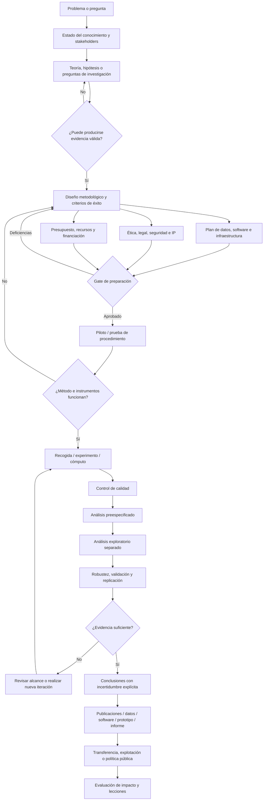
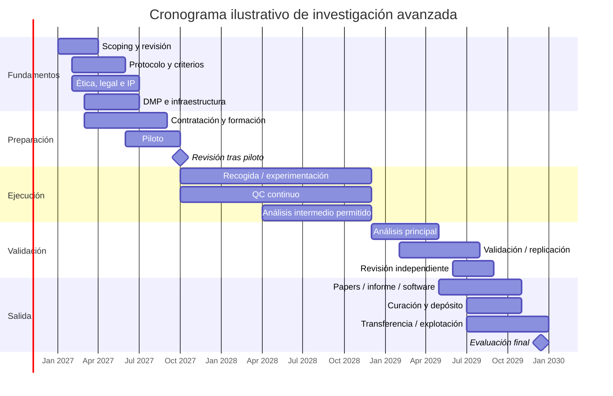

# Investigación avanzada: marco integral para diseñar, financiar, ejecutar y evaluar investigación de alta complejidad

**Fecha de corte:** 29 de septiembre de 2026.  
**Ámbito:** multidisciplinar; sin restricción de disciplina. Las recomendaciones deben adaptarse al campo concreto, especialmente cuando intervienen seres humanos, datos sanitarios, animales, infraestructuras críticas, materiales peligrosos, sistemas de IA regulados o experimentación de laboratorio.  
**Base documental:** se priorizan fuentes oficiales, normativas, organismos financiadores y trabajos científicos primarios. El Manual de Frascati de la OCDE se utiliza como anclaje conceptual para I+D; el marco regulatorio se contrasta con normativa de la UE y España vigente a la fecha de corte. citeturn21view0turn18search0turn18search1

## Resumen ejecutivo

“**Investigación avanzada**” no constituye una categoría estadística o jurídica universal comparable a “investigación básica”, “investigación aplicada” o “desarrollo experimental” del Manual de Frascati. En este informe se emplea como **concepto operativo** para proyectos que combinan una pregunta de elevada dificultad o incertidumbre con métodos rigurosos, infraestructura o capacidades especializadas, gestión explícita de datos y riesgos, y validación suficiente para producir conocimiento, tecnología, evidencia para políticas o capacidades reutilizables. No implica necesariamente alta tecnología: una investigación cualitativa longitudinal, una intervención social compleja o un estudio histórico basado en archivos distribuidos pueden ser “avanzados” si su diseño, integración y exigencia epistemológica lo justifican. citeturn21view0

La conclusión principal es que la sofisticación de una investigación **no debe medirse por la cantidad de tecnología empleada**, sino por la adecuación entre pregunta, diseño, evidencia y conclusión. Un modelo de IA, un supercomputador o un laboratorio robotizado no compensan un mal contrafactual, una muestra sesgada, variables mal definidas, falta de controles o una hipótesis que cambia después de observar los resultados. En investigación confirmatoria, la preespecificación y, cuando sea apropiado, el prerregistro ayudan a distinguir decisiones previas de análisis exploratorios posteriores; marcos como OSF proporcionan infraestructura para ello. citeturn21view15turn22view8

Una segunda conclusión es que **datos, software y gobernanza forman parte del método**, no son tareas administrativas posteriores. En Horizonte Europa, por ejemplo, la gestión mediante un Data Management Plan actualizado es obligatoria para los datos generados o recopilados y la Comisión exige prácticas FAIR —*Findable, Accessible, Interoperable, Reusable*— bajo el principio de hacer los datos “tan abiertos como sea posible y tan cerrados como sea necesario”. Asimismo, los resultados y herramientas necesarios para validar las conclusiones deben depositarse en repositorios de confianza cuando proceda. citeturn22view3turn22view4

Una tercera conclusión es que **la investigación reproducible no equivale a publicar todos los datos**. Privacidad, secretos empresariales, propiedad intelectual, seguridad, confidencialidad y otras obligaciones pueden justificar restricciones. La buena práctica es poder demostrar por qué se restringió cada activo, conservar metadatos suficientes y, cuando sea posible, proporcionar datos anonimizados o sintéticos, protocolos, diccionarios, código, entornos computacionales o mecanismos de acceso controlado. Horizonte Europa reconoce expresamente estas excepciones. citeturn22view3

Una cuarta conclusión es financiera. No existe un único “modelo de financiación de investigación avanzada”: en España conviven financiación competitiva de la AEI para generación de conocimiento, talento, redes y colaboración, instrumentos empresariales del CDTI y programas internacionales; a nivel europeo coexisten Horizonte Europa, ERC, MSCA y EIC, cada uno con una lógica diferente. El ERC prioriza investigación *frontier* evaluada esencialmente por excelencia, mientras que EIC se orienta en mayor medida a tecnologías e innovación con trayectoria hacia explotación; MSCA pone especial énfasis en formación, movilidad y carrera investigadora. citeturn20search15turn21view6turn21view7turn21view12turn3search10

En España, el calendario de 2026 de la AEI incluye, entre otros instrumentos, Doctorados Industriales, Torres Quevedo, Ramón y Cajal, Juan de la Cierva, Personal Técnico de I+D+i, proyectos de Generación de Conocimiento y colaboración internacional. La convocatoria de Doctorados Industriales 2026 fue publicada el 24 de septiembre de 2026. Estos instrumentos muestran que la construcción de capacidad no consiste únicamente en financiar proyectos: incluye formación doctoral, incorporación de talento, técnicos especializados y conexiones entre empresa y sistema científico. citeturn20search5turn20search17

Una quinta conclusión afecta a ética y cumplimiento. El **RGPD no contiene una exención general para “investigación”**: siguen siendo necesarios una base jurídica adecuada, proporcionalidad, minimización y garantías apropiadas, con las especificidades previstas para investigación científica en el artículo 89. En biomedicina española, la Ley 14/2007 añade obligaciones específicas y participación de comités de ética; en investigación médica con participantes humanos, la versión vigente de la Declaración de Helsinki es la revisión de 2024. citeturn21view4turn18search1turn16search2turn16search12

En IA existe una distinción igualmente importante. El Reglamento europeo de IA excluye de determinadas obligaciones los sistemas o modelos desarrollados y puestos en servicio específicamente **con investigación y desarrollo científicos como única finalidad**, y también determinadas actividades previas a la comercialización; eso no convierte en “zona sin ley” cualquier proyecto que utilice IA. El propio Reglamento exige respetar normas éticas y profesionales y el resto del Derecho de la Unión, y la protección de datos sigue aplicándose. A 29 de septiembre de 2026, el AI Act es ya aplicable en términos generales desde el 2 de agosto de 2026, aunque existen calendarios posteriores para determinadas obligaciones de alto riesgo. citeturn18search0turn19search1turn19search7

Finalmente, la evaluación debería evitar el error de reducir “excelencia” a un KPI único. CoARA promueve una evaluación apoyada principalmente en juicio cualitativo y revisión por pares, acompañada de indicadores cuantitativos utilizados responsablemente; DORA desaconseja emplear métricas de revista como el Journal Impact Factor como sustituto de la calidad de un trabajo individual. El sistema más robusto combina métricas de rigor, ejecución, outputs, resultados, reproducibilidad, impacto y desarrollo de capacidades. citeturn22view5turn9search0turn9search3

| Dimensión | Academia | I+D industrial | Sector público |
|---|---|---|---|
| Objetivo dominante | Nuevo conocimiento, teorías, métodos, formación y recursos científicos | Crear ventajas tecnológicas, reducir incertidumbre técnica/comercial, propiedad intelectual, nuevos productos o procesos | Evidencia para políticas, servicios públicos, capacidades estratégicas, misiones científicas o infraestructuras |
| Horizonte temporal | Habitualmente multianual; puede extenderse a décadas en *big science* | Desde ciclos de meses hasta programas tecnológicos plurianuales | Frecuentemente condicionado por programas presupuestarios, contratación y misiones de varios años |
| Presupuesto | Grants, financiación basal e infraestructuras compartidas | Presupuesto corporativo, subvenciones, préstamos, capital y colaboración público-privada | Presupuesto público, grants, contratación, agencias y programas internacionales |
| Equipo típico | PI, investigadores, postdocs, doctorandos, técnicos, estadística/datos | Científicos, ingenieros, producto, regulación, fabricación, IP, negocio | Científicos, analistas, técnicos, gestores de programa, jurídicos, contratación y stakeholders |
| Infraestructura | Laboratorios, repositorios, bibliotecas, HPC, instalaciones científicas | Laboratorios privados, pilotos, nube/HPC, prototipado, plantas de ensayo | Infraestructura nacional, misiones, plataformas de datos, observatorios y contratación externa |
| Gestión de datos | FAIR, repositorios, preservación, citabilidad | FAIR cuando conviene, pero equilibrado con secretos/IP | Interoperabilidad, trazabilidad, seguridad, archivo y reutilización pública cuando procede |
| Outputs | Artículos, datasets, métodos, software, tesis | Prototipos, patentes, know-how, productos, procesos | Informes, normas, datasets, servicios, decisiones, infraestructura |
| Riesgo central | Irreproducibilidad, incentivos académicos, discontinuidad de financiación | Fallo técnico, mercado, IP, regulación y *time-to-market* | Ciclos políticos, procurement, interoperabilidad, aceptación social |
| KPIs apropiados | Rigor, validación, outputs reutilizables, formación, impacto | Desempeño técnico, hitos, adopción, transferencia, retorno de cartera | Cumplimiento de misión, calidad de evidencia, cobertura, coste-efectividad, impacto público |

La tabla es deliberadamente arquetípica: un proyecto universitario con patente, una misión de ESA o un consorcio público-privado pueden atravesar simultáneamente varios modelos.

## Alcance y definición operativa

El marco internacional más útil para delimitar qué pertenece a I+D sigue siendo el **Manual de Frascati 2015**, cuya edición española fue publicada por OCDE/FECYT. Distingue investigación básica, investigación aplicada y desarrollo experimental y proporciona la referencia para contabilizar recursos humanos y económicos de I+D. Su existencia es una razón para no utilizar “avanzada” como si fuera una cuarta categoría formal. citeturn21view0

En términos prácticos, este informe propone considerar un proyecto de investigación “avanzada” cuando presenta varias de las siguientes propiedades simultáneamente:

| Propiedad | Qué significa en la práctica | Riesgo cuando falta |
|---|---|---|
| **Novedad real** | Incertidumbre sobre la respuesta, el mecanismo o la viabilidad | Actividad rutinaria presentada como investigación |
| **Pregunta falsable o problema explícito** | Se sabe qué evidencia cambiaría la conclusión | *Cherry-picking* y objetivos móviles |
| **Diseño trazable** | Hipótesis, población, variables, fuentes, criterios de exclusión y análisis documentados | Resultados difíciles de auditar |
| **Métodos especializados** | Métodos cualitativos, estadísticos, experimentales o computacionales adecuados al problema | Complejidad instrumental sin validez |
| **Gestión rigurosa de datos** | Procedencia, calidad, metadatos, seguridad, permisos y preservación | Pérdida de trazabilidad o incumplimiento |
| **Validación** | Controles, triangulación, replicación o validación externa según disciplina | Sobreajuste o conclusiones frágiles |
| **Gobernanza** | Responsables, decisiones, conflictos, ética, IP y riesgos explícitos | Problemas detectados demasiado tarde |
| **Reutilización** | Datos, código, protocolos o conocimiento transferible cuando sea legítimo | Costes de repetir trabajo |
| **Evaluación multidimensional** | Calidad científica + outputs + resultados + impacto + capacidad | Optimización de métricas superficiales |

Esta definición permite incluir desde física experimental hasta ciencias sociales, humanidades digitales, investigación clínica, economía, ciencia de materiales, inteligencia artificial, políticas públicas o investigación de producto.

El documento aportado por el usuario sobre investigación competitiva de *Storefront + QR Menu* ofrece precisamente un ejemplo de cómo operacionalizar investigación avanzada fuera del laboratorio: exige muestreo estratificado, verificación individual, taxonomías normalizadas, identificadores estables, estados de evidencia, registro de fuentes, separación entre observación e inferencia y matrices reutilizables. Esos principios son transferibles a otros dominios aunque cambie la instrumentación. fileciteturn0file0

**La unidad fundamental no debería ser “el estudio”, sino la cadena de evidencia.** Una investigación sólida puede representarse como:

> problema → afirmación que se desea poder sostener → evidencia necesaria → diseño que puede producirla → datos → análisis → pruebas de robustez → conclusión delimitada → artefactos reutilizables.

Esto obliga a separar cuatro conceptos que con frecuencia se mezclan:

| Concepto | Pregunta principal | Ejemplo |
|---|---|---|
| Exploración | ¿Qué podría estar ocurriendo? | Detectar patrones inesperados |
| Descripción | ¿Qué ocurre y con qué frecuencia? | Estimar prevalencias o mapear comportamientos |
| Explicación/causalidad | ¿Qué causa qué y bajo qué condiciones? | Ensayo, experimento natural, identificación causal |
| Predicción | ¿Qué ocurrirá en nuevos casos? | Modelo predictivo con validación externa |

Un modelo extremadamente preciso puede tener escaso valor causal y una estimación causal rigurosa puede no ser el mejor predictor individual. La selección metodológica debería partir del tipo de afirmación que se pretende realizar, no de la herramienta disponible.

## Metodologías y ciclo de trabajo

No existe una jerarquía general según la cual lo computacional sea “superior” a lo cualitativo o lo experimental a lo observacional. La combinación correcta depende de la pregunta, accesibilidad de datos, posibilidad de intervención, riesgos éticos y clase de inferencia necesaria.

| Familia | Casos de uso | Diseño y análisis | Fortalezas | Riesgos principales | Señales de calidad |
|---|---|---|---|---|---|
| **Cualitativa** | Significados, mecanismos sociales, experiencias, procesos, contexto | Entrevistas, grupos focales, etnografía, observación, análisis documental, estudios de caso | Profundidad contextual y descubrimiento de mecanismos | Sesgo de selección, interpretación opaca, falta de reflexividad | Muestreo argumentado, trazabilidad del código, triangulación, reflexividad, evidencia negativa |
| **Cuantitativa observacional** | Prevalencia, asociación, tendencias, predicción | Encuestas, paneles, registros, bases administrativas, series temporales | Escala y estimación formal de incertidumbre | Confusión, medición deficiente, selección, multiplicidad | Diseño previo, potencia cuando aplica, incertidumbre, sensibilidad, validación |
| **Experimental/cuasi-experimental** | Efectos causales, comparación de intervenciones | RCT, factoriales, A/B, laboratorio, campo, discontinuidad, diferencias en diferencias | Mejor identificación causal cuando los supuestos se cumplen | Contaminación, incumplimiento, falta de validez externa, ética | Controles, aleatorización adecuada, protocolo, análisis ITT cuando corresponde |
| **Computacional** | Simulación, ML/IA, modelos matemáticos, grandes datasets, bioinformática | Pipelines, modelos, simulaciones, optimización, NLP, visión | Escala, automatización y exploración de sistemas complejos | Leakage, sobreajuste, deriva, deuda de datos, reproducibilidad computacional | Separación train/test, benchmarks, análisis de error, semillas/versiones, validación externa |
| **Métodos mixtos** | Sistemas sociotécnicos y preguntas multicapas | Integración secuencial o concurrente de métodos | Une magnitud, mecanismo y contexto | Estudios paralelos sin verdadera integración | Pregunta de integración explícita y reglas para reconciliar evidencia |

Para determinados tipos de estudios existen guías de reporte específicas. CONSORT fue actualizado en 2025 para ensayos aleatorizados; PRISMA 2020 sigue siendo una referencia para revisiones sistemáticas y COREQ proporciona una lista de comprobación para investigación cualitativa basada en entrevistas y grupos focales. Su función no es sustituir el diseño metodológico, sino mejorar la transparencia con la que se reporta. citeturn5search5turn5search6turn5search3

**Flujo recomendado**

La separación entre análisis confirmatorio y exploratorio evita que decisiones tomadas después de ver los datos se presenten implícitamente como hipótesis previas. El prerregistro puede ayudar en estudios confirmatorios, aunque no es necesario ni apropiado para toda investigación exploratoria. OSF proporciona mecanismos de registro y conservación de planes de estudio. citeturn21view15turn12search2

**Workflow operativo recomendado**

| Gate | Pregunta que debe poder responderse antes de avanzar | Artefacto mínimo |
|---|---|---|
| Problema | ¿Qué desconocimiento concreto se quiere reducir? | Research brief |
| Evidencia | ¿Qué observación podría confirmar o debilitar la hipótesis? | Mapa de evidencia |
| Diseño | ¿Por qué este diseño responde a esa pregunta? | Protocolo |
| Datos | ¿Quién controla los datos y cómo se validarán? | DMP + diccionario/esquema |
| Ética | ¿Quién puede resultar perjudicado y qué autorización corresponde? | Evaluación ética/legal |
| Recursos | ¿Hay personas, cómputo, laboratorio y tiempo suficientes? | Resource & budget plan |
| Piloto | ¿El procedimiento funciona antes de escalar? | Informe de piloto |
| Calidad | ¿Puede detectarse un error antes de contaminar todo el dataset? | QC plan |
| Análisis | ¿Qué análisis son confirmatorios y cuáles exploratorios? | Statistical/analysis plan |
| Validación | ¿Cómo sabremos que el resultado generaliza o se reproduce? | Validation plan |
| Salida | ¿Qué debe quedar preservado además del informe? | Release/repository plan |

Un error frecuente consiste en hacer del “piloto” una miniatura del estudio principal sin definir **criterios de salida**. En investigación avanzada conviene establecer umbrales previos —por ejemplo, tasa mínima de reclutamiento, precisión instrumental, concordancia entre codificadores, latencia máxima, tasa de datos faltantes o estabilidad de un pipeline— que determinen si se escala, se rediseña o se cancela.

Otro principio útil es diseñar **controles negativos y pruebas de fallo**, no únicamente pruebas que se espera superar. En modelos computacionales puede implicar conjuntos fuera de distribución o ablaciones; en investigación causal, placebos y análisis de sensibilidad; en laboratorio, blancos y controles; en cualitativa, búsqueda activa de casos que contradigan la interpretación. La intención es transformar “robustez” en pruebas observables en lugar de una declaración retórica.

## Herramientas, infraestructura, datos y ciencia abierta

La infraestructura debe dimensionarse desde la pregunta y el volumen de trabajo. Comprar o contratar una plataforma antes de definir la carga, sensibilidad de los datos y necesidades de reproducibilidad suele producir sobrecostes y dependencia innecesaria.

| Capa | Herramientas o infraestructura | Cuándo aporta valor | Riesgos que deben gestionarse |
|---|---|---|---|
| Captura | Instrumentos científicos, sensores, encuestas, sistemas de adquisición, notebooks de laboratorio | Generación primaria de evidencia | Calibración, deriva, metadatos incompletos |
| Análisis cualitativo | CAQDAS, transcripción controlada, repositorios documentales | Grandes corpus de entrevistas/documentos | Confidencialidad, pérdida de contexto |
| Análisis cuantitativo | Entornos estadísticos y notebooks | Inferencia y modelización repetible | Versiones, dependencias, multiplicidad |
| Computación | CPU/GPU local, clúster HPC, nube | Simulación, IA, bioinformática, modelado intensivo | Coste, disponibilidad, seguridad, huella operacional |
| Workflow | Pipelines y orquestadores reproducibles | Procesos con múltiples pasos y datasets | Complejidad, bloqueo tecnológico |
| Datos | Bases estructuradas, object storage, data lake/warehouse cuando procede | Integración y escalabilidad | Gobernanza, proliferación de copias |
| Reproducibilidad | Contenedores, control de versiones, lockfiles, snapshots | Entornos dependientes de software | Imágenes desactualizadas, vulnerabilidades |
| Colaboración | Repositorios, OSF, ELN/LIMS, issue tracking | Equipos distribuidos | Permisos, fragmentación del conocimiento |
| Publicación | Repositorios institucionales/temáticos, Zenodo | Preservación y citabilidad | Licencias o datos que no pueden abrirse |
| Seguridad | MFA, cifrado, secretos, redes segregadas, entornos seguros | Datos sensibles o IP | Filtraciones, credenciales, accesos no revocados |

**Computación y workflows.** Jupyter proporciona un entorno interactivo ampliamente utilizable para integrar código, resultados y narrativa. Para pipelines computacionales más complejos, Nextflow está diseñado para workflows portables y reproducibles y soporta contenedores, versionado e infraestructura HPC o nube. citeturn11search9turn22view7

Para proyectos de cómputo intensivo en España, la **Red Española de Supercomputación** proporciona un ecosistema nacional de HPC, IA y recursos de datos mediante sus nodos; la selección entre HPC institucional, RES, nube comercial o infraestructura dedicada debería depender de carga, costes de transferencia, sensibilidad, aceleradores requeridos y necesidad de reproducir ejecuciones. citeturn21view13turn11search13turn11search15

A escala europea, EOSC persigue un ecosistema federado de datos y servicios FAIR; su EU Node incorpora servicios de computación y trabajo interactivo, entre ellos máquinas virtuales, recursos acelerados, notebooks, contenedores y almacenamiento. citeturn6search8turn6search15

**Laboratorio físico.** No existe un equipamiento “estándar” para investigación avanzada. Según la disciplina pueden dominar microscopía, espectrometría, secuenciación, cromatografía, fabricación, criogenia, cámaras ambientales, sensores, robótica, bancos de ensayo o biobancos. El presupuesto correcto debe incluir no solo adquisición, sino instalación, consumibles, calibraciones, certificación, mantenimiento, personal técnico, tiempo de parada y ciclo de reposición. Los programas del CDTI incluyen instrumentos específicamente relacionados con infraestructuras de ensayo y experimentación, incluidos pilotos y *living labs*, reflejando que la infraestructura experimental puede ser un output de I+D por derecho propio. citeturn3search13

**Gestión de datos.** Un DMP útil debería ser un documento vivo y responder al menos a:

| Área | Preguntas mínimas |
|---|---|
| Procedencia | ¿Quién creó los datos y mediante qué instrumento/proceso? |
| Esquema | ¿Cómo se definen unidades, variables, códigos y relaciones? |
| Calidad | ¿Qué validaciones y controles existen? |
| Identidad | ¿Qué identificadores persistentes se utilizarán? |
| Versionado | ¿Puede reconstruirse exactamente el dataset usado en un resultado? |
| Privacidad | ¿Hay datos personales o categorías especiales? |
| Seguridad | ¿Quién puede acceder y bajo qué controles? |
| Retención | ¿Cuánto tiempo deben conservarse datos y logs? |
| Compartición | ¿Qué puede publicarse, restringirse o requerir acceso controlado? |
| Licencia | ¿Qué reutilización se permite? |
| Preservación | ¿Dónde quedará almacenada la versión final? |
| Responsabilidad | ¿Quién es el *data owner/steward*? |

Horizonte Europa exige mantener actualizado el DMP, depositar los resultados en repositorios de confianza y hacer datos FAIR, admitiendo restricciones legítimas por protección de datos, confidencialidad, seguridad, secretos comerciales, explotación e IP. Zenodo funciona como repositorio general de respaldo cuando no existe un repositorio institucional o disciplinar más adecuado. citeturn22view3turn22view4turn6search0

**Reproducibilidad y ciencia abierta.** Un “paquete mínimo reproducible” para investigación computacional debería contener, cuando legalmente sea posible: versión exacta de datos o identificador; código; dependencias; configuración; semillas cuando afecten al resultado; instrucciones; recursos de cómputo relevantes; logs; figuras/tablas generadas programáticamente y tests. Los gestores de workflows y contenedores reducen diferencias entre entornos, aunque no garantizan por sí solos que la investigación sea conceptualmente correcta. citeturn22view7

Para investigación no computacional, reproducibilidad puede requerir protocolos, especificaciones de instrumentos, lotes de reactivos, calibration logs, materiales de estímulo, cuestionarios, guías de entrevista, decisiones de codificación y modificaciones de protocolo. NIH sitúa explícitamente rigor y reproducibilidad dentro del diseño robusto y no sesgado y ha reforzado iniciativas de replicación y validación. citeturn5search10turn5search2turn5search4

España dispone además de la **Estrategia Nacional de Ciencia Abierta 2023–2027**, orientada, entre otros objetivos, a infraestructuras interoperables, gestión de datos bajo principios FAIR, acceso abierto y mejora de la transparencia y reproducibilidad. citeturn0search7

Un modelo práctico de madurez puede representarse así:

| Nivel | Práctica |
|---|---|
| Frágil | Resultados solo en documentos finales; datos/código personales |
| Trazable | Versiones archivadas y metodología documentada |
| Reejecutable | Código, datos y entorno permiten regenerar outputs |
| Reproducible | Un tercero puede ejecutar el análisis con documentación suficiente |
| Replicable | Evidencia independiente compatible bajo un nuevo estudio/dataset |
| Reutilizable | Artefactos cuentan con metadatos, licencias e interfaces apropiadas |

La terminología concreta de “reproducibilidad” y “replicabilidad” varía entre disciplinas; lo importante en gobernanza es definir explícitamente qué nivel se está prometiendo.

## Financiación, capacidades y colaboración

La financiación debe buscarse después de definir el tipo de incertidumbre que se quiere resolver. Adaptar artificialmente la pregunta científica a una convocatoria suele producir un proyecto con objetivos heterogéneos, demasiado ambiciosos y difíciles de evaluar.

**Mapa de mecanismos**

| Ámbito | Instrumento | Encaje típico | Rasgos relevantes |
|---|---|---|---|
| España | AEI — Generación de Conocimiento y otros proyectos | Investigación académica y científico-técnica | Concurrencia competitiva dentro del PEICTI 2024–2027. citeturn20search15turn20search5 |
| España | AEI — Prueba de Concepto | Valorización de resultados previos | Puente entre resultados de investigación y potencial aplicación. citeturn0search11 |
| España | AEI — Redes | Coordinación y complementariedad entre grupos | Busca sinergias y actividades que aporten valor añadido sobre capacidades existentes. citeturn20search13 |
| España | Torres Quevedo | Incorporación de doctores a empresas y entidades tecnológicas | Financia contratación asociada a investigación industrial/desarrollo experimental; históricamente, ayudas de tres años. citeturn20search4 |
| España | Doctorados Industriales | Doctorado empresa–investigación | Convocatoria 2026 publicada el 24/09/2026. citeturn20search17 |
| España | CDTI | I+D empresarial | Combina instrumentos reembolsables y subvenciones según programa; en julio de 2026 aprobó 49 proyectos con €35,66 M de presupuesto total y €27,6 M de aportación CDTI. citeturn21view9 |
| España/internacional | INNOGLOBAL 2026 | Cooperación tecnológica internacional empresarial | Convocatoria de €30,25 M en subvenciones y proyectos con socios/cooperación internacional según modalidades elegibles. citeturn21view10 |
| UE | Horizon Europe | Consorcios de I+D+i y misiones | El programa de trabajo 2026–2027 moviliza aproximadamente €14.000 M y amplía el uso de financiación *lump sum*. citeturn21view8 |
| UE | ERC Starting | Investigación de frontera, PI inicial | Hasta €1,5 M durante cinco años, más financiación adicional justificada en determinados supuestos. citeturn21view6 |
| UE | ERC Consolidator | PI en consolidación | Hasta €2 M durante cinco años más financiación adicional aplicable. citeturn4search0 |
| UE | ERC Advanced | Investigadores consolidados | Hasta €2,5 M durante cinco años más posibles importes adicionales; actualmente utiliza modelo *lump sum*. citeturn4search3 |
| UE | ERC Synergy | Problemas que requieren varios PIs | De dos a cuatro investigadores principales; hasta €10 M/6 años y financiación adicional potencial. citeturn21view7 |
| UE | MSCA | Formación, movilidad y carrera | Doctoral Networks, Postdoctoral Fellowships, Staff Exchanges y COFUND, con fuerte componente internacional/intersectorial/interdisciplinar. citeturn3search10turn3search7turn3search16 |
| UE | EIC Pathfinder | Tecnología disruptiva temprana | Exploración de tecnologías de bajo TRL y alto riesgo/alto potencial. citeturn8search0turn10search13 |
| UE | EIC Accelerator | Startups/pymes de alta innovación | En 2026 combina grants de hasta €2,5 M y componente de equity en determinados casos. citeturn21view12turn10search5 |
| EE. UU. | NIH R01 | Investigación biomédica independiente | Mecanismo principal de proyecto NIH, normalmente con varios periodos presupuestarios y categorías de costes de investigación. citeturn10search2 |
| EE. UU. | NSF | Ciencia e ingeniería | Programas disciplinares y mecanismos específicos para investigación de alto impacto; elegibilidad depende de cada convocatoria. citeturn10search14 |
| Internacional | Wellcome Discovery Awards | Salud y ciencias de la vida | Para investigadores/equipos establecidos; financiación media alrededor de £3,5 M y proyectos frecuentemente plurianuales, sujetos a criterios geográficos. citeturn10search12 |

Estos importes no deben utilizarse como “presupuesto recomendado”: son límites o características de instrumentos concretos y pueden cambiar entre convocatorias.

**Estructura presupuestaria recomendable.** Antes de enviar una propuesta conviene elaborar un modelo *bottom-up* separado de las categorías de la convocatoria:

| Bloque | Drivers de coste que suelen olvidarse |
|---|---|
| Personal | contratación, seguridad social, incrementos salariales, solapamiento de puestos |
| Instrumentación | instalación, calibración, consumibles, mantenimiento y averías |
| Datos | adquisición/licencias, anotación, almacenamiento, transferencia, backup |
| Cómputo | GPU/HPC/nube, pruebas fallidas, inferencia, retención de resultados |
| Participantes | reclutamiento, compensación, desplazamiento, traducción |
| Seguridad | entornos controlados, auditorías, pentesting, certificación |
| Regulación | comités, monitorización, documentación, calidad |
| Open science | curación, repositorio, documentación, PID, preservación |
| Colaboración | viajes, integración, workshops, gestión de consorcio |
| Transferencia | validación, IP, estudios de explotación, estandarización |
| Contingencia | solo donde el financiador permita imputarla explícitamente |

Una buena propuesta diferencia el **coste de generar una observación** del coste de convertirla en evidencia fiable. Control de calidad, documentación, ingeniería de datos y validación pueden consumir una fracción importante de recursos aunque no produzcan un “resultado” visible por sí mismos.

**Capacidad y formación.** Una investigación avanzada rara vez necesita solo “más investigadores”. La estructura madura incorpora capacidades especializadas:

| Rol/capacidad | Responsabilidad crítica |
|---|---|
| Dirección científica / PI | Pregunta, decisiones científicas, coherencia |
| Especialista de dominio | Validez del contenido |
| Metodología/estadística | Diseño e inferencia |
| Data steward | Gobernanza, FAIR, metadatos, DMP |
| Research software engineer | Software fiable y mantenible |
| Data engineer | Pipelines, calidad, integración |
| Técnico de laboratorio | Instrumentos, SOP, calibraciones |
| Project/program manager | Dependencias, hitos, presupuesto |
| Ética/DPO/legal | Derechos, consentimiento, cumplimiento |
| Seguridad | Amenazas, controles y respuesta a incidentes |
| IP/transferencia | Propiedad, explotación y licencias |
| Comunicación/participación | Stakeholders y difusión responsable |

El propio sistema español dispone de instrumentos para construir estas capacidades, no solo para financiar PIs: Personal Técnico de I+D+i busca reforzar el manejo de equipos, instalaciones e infraestructura; Juan de la Cierva está destinado a formación posdoctoral; Ramón y Cajal, a incorporación y consolidación de investigadores; Torres Quevedo, a doctores en empresas. citeturn20search1turn20search0turn20search4

MSCA constituye el equivalente europeo más sistemático para movilidad y formación investigadora. Las Postdoctoral Fellowships 2026 disponen de un presupuesto de €399,05 M y combinan movilidad con desarrollo interdisciplinar e intersectorial; Doctoral Networks financia redes de formación doctoral y COFUND cofinancia programas institucionales. citeturn3search7turn3search10turn3search16

**Colaboración interdisciplinar.** El problema habitual no es que cada disciplina carezca de conocimiento, sino que utiliza distintas unidades de análisis, vocabularios y criterios de evidencia. Un consorcio debería acordar al inicio:

- qué pregunta es compartida y cuáles son subpreguntas disciplinares;
- una ontología mínima común y diccionario de variables;
- quién puede modificar protocolos, datos o modelos;
- reglas de autoría, contribución e IP;
- formatos de intercambio y APIs/esquemas cuando sean relevantes;
- mecanismo para resolver contradicciones entre disciplinas;
- un proceso de integración periódica, no solo una reunión final.

Las convocatorias de Redes de la AEI se basan precisamente en complementar capacidades entre grupos y generar actividades conjuntas que no podrían justificarse aisladamente. ERC Synergy parte de una lógica similar en investigación de frontera: problemas cuya ambición requiere varios investigadores principales. citeturn20search13turn21view7

## Ética, regulación y evaluación

El enfoque correcto no es “obtener ética” al final, sino convertir ética, legalidad, seguridad e impacto en **gates de diseño**. Un método que posteriormente resulta incompatible con consentimiento, minimización de datos o derechos de participantes puede obligar a rehacer todo el proyecto.

**Protección de datos y RGPD**

Para investigación en la UE deben identificarse desde el diseño: responsable y, en su caso, corresponsables; finalidades; base jurídica; categorías de datos; transferencias; plazos; acceso; derechos; medidas técnicas; y garantías para investigación. Los principios generales del RGPD siguen siendo aplicables, mientras su artículo 89 regula garantías para fines de investigación científica o histórica y estadísticos. citeturn21view4turn2search11

La minimización merece especial atención en proyectos de IA y *big data*: que resulte técnicamente posible recopilar una variable no demuestra que sea necesaria. Tampoco “anonimizado” debe tratarse como sinónimo automático de “sin riesgo”: la posibilidad de reidentificación depende del contexto, combinación de variables y acceso a datos auxiliares.

Cuando el tratamiento pueda representar alto riesgo para derechos y libertades, debe analizarse la necesidad de una evaluación de impacto en protección de datos. La AEPD proporciona herramientas de apoyo, pero advierte que su uso no equivale por sí mismo a garantizar cumplimiento normativo. citeturn2search18turn2search13

**Bioética**

En España, la Ley 14/2007 de Investigación Biomédica establece requisitos específicos relativos, entre otros ámbitos, a investigación con muestras biológicas humanas, consentimiento y comités de ética. Incluso en supuestos excepcionales en los que determinadas muestras codificadas o identificadas puedan utilizarse sin nuevo consentimiento, la ley exige condiciones y dictamen favorable del comité correspondiente. citeturn18search1

Para investigación médica con participantes humanos, la Declaración de Helsinki vigente es la revisión adoptada por la World Medical Association en octubre de 2024; las versiones anteriores han sido sustituidas como referencia normativa de la WMA. citeturn16search2turn16search12

**IA**

El Reglamento (UE) 2024/1689 exige una lectura por **uso y ciclo de vida**, no únicamente por tecnología. El artículo 2 excluye sistemas o modelos desarrollados y puestos en servicio específicamente para I+D científica como única finalidad y determinadas actividades de investigación, prueba o desarrollo anteriores a su comercialización; al mismo tiempo mantiene vigente la legislación de privacidad y protección de datos y requiere que la investigación respete normas éticas y profesionales. citeturn18search0

A 29 de septiembre de 2026, las obligaciones del AI Act se aplican por fases. El marco general y diversas reglas de transparencia son aplicables desde el 2 de agosto de 2026; la Comisión señala fechas posteriores, hasta diciembre de 2027 o agosto de 2028 según categoría, para diferentes sistemas de alto riesgo. Por ello cualquier proyecto con horizonte de varios años debe diseñarse contra la normativa prevista para **la fecha de despliegue**, no solo contra la vigente en el día de iniciar la investigación. citeturn19search1turn19search2turn19search6

Como marco ético complementario —no sustituto del Derecho— la Recomendación de UNESCO sobre Ética de la IA, adoptada por sus 193 Estados miembros, enfatiza derechos humanos, dignidad, equidad, transparencia, privacidad, supervisión humana, seguridad y evaluación de impacto. citeturn16search0turn16search14

**Integridad científica**

El Código Europeo de Conducta para la Integridad en la Investigación de ALLEA, revisado en 2023, constituye una referencia europea transversal. La revisión incorpora cambios asociados a ciencia abierta, evaluación de investigación, gestión de datos y nuevas prácticas científicas. citeturn21view5

En la práctica, la gobernanza debería cubrir al menos:

| Riesgo de integridad | Control |
|---|---|
| Fabricación/falsificación | datos originales inmutables, auditoría, separación de roles |
| Selección oportunista | protocolo y criterios previos |
| HARKing | marcar hipótesis post hoc como exploratorias |
| P-hacking/multiplicidad | plan analítico y correcciones pertinentes |
| Imagen/datos manipulados | procedencia y versionado |
| Autoría inadecuada | taxonomía de contribuciones acordada |
| Conflicto de interés | declaración y gestión |
| Uso de IA generativa | política sobre datos confidenciales, revisión humana y trazabilidad |
| Resultados negativos ocultos | criterios de publicación independientes del signo del resultado |
| Dependencia de un analista | revisión de código, documentación y reproducción independiente |

**Marco de evaluación**

El error más peligroso es optimizar la investigación para “número de papers”, “número de patentes” o “Journal Impact Factor”. CoARA plantea que la evaluación reconozca diversidad de outputs, prácticas y actividades, y que el juicio cualitativo y la revisión por pares sean centrales, con indicadores cuantitativos de apoyo. DORA recomienda evaluar la investigación por sus méritos y no usar métricas de revista como proxy automático de calidad individual. citeturn22view5turn9search0turn9search4

Un *scorecard* equilibrado podría ser:

| Dimensión | KPI posibles | Mala interpretación que evitar |
|---|---|---|
| **Rigor** | cumplimiento del protocolo, potencia/calidad de muestra, cobertura de controles | “Más datos = mejor estudio” |
| **Calidad de datos** | completitud, error, concordancia, trazabilidad | Confundir cantidad con representatividad |
| **Ejecución** | hitos, burn rate, lead time experimental, uptime | Premiar velocidad a costa de calidad |
| **Reproducibilidad** | % pipelines reejecutables, datasets versionados, pruebas reproducidas | Confundir subir código con reproducibilidad |
| **Validez** | validación externa, sensibilidad, calibración, replicación | Elegir solo el benchmark favorable |
| **Outputs** | papers, software, datasets, patentes, protocolos, estándares | Contar outputs sin medir utilidad |
| **Open science** | outputs con PID, metadatos FAIR, materiales de validación | Forzar apertura incompatible con privacidad/IP |
| **Transferencia** | licencias, pilotos, adopción, standards contributions | Equiparar patente a impacto |
| **Impacto científico** | uso por terceros, replicaciones, cambio de conocimiento | Usar JIF del journal como sustituto |
| **Impacto industrial** | riesgo técnico eliminado, rendimiento, adopción, economía del producto | Confundir demo con producto viable |
| **Impacto público** | cambio de política/servicio, cobertura, coste-efectividad, equidad | Atribuir causalidad sin contrafactual |
| **Capacidad** | personal formado, cross-training, documentación, continuidad | Premiar tamaño de equipo |
| **Ética/seguridad** | incidentes, desviaciones, tiempo de cierre, auditorías | “Cero incidentes” si nadie reporta problemas |

Para proyectos tecnológicos puede añadirse madurez tecnológica —TRL— como indicador de transición, pero **no es un indicador de calidad científica**. Una investigación fundamental de enorme importancia puede permanecer deliberadamente en TRL bajo; EIC Pathfinder, por ejemplo, está diseñado precisamente para tecnologías emergentes de etapas tempranas. citeturn8search0

Para innovación empresarial o pública, el Manual de Oslo de la OCDE resulta complementario a Frascati porque se centra en medición de innovación, mientras Frascati delimita I+D. Utilizar ambos evita equiparar automáticamente una invención científica con una innovación adoptada. citeturn8search4turn21view0

## Casos de estudio, cronograma y checklist

Los siguientes casos no pretenden ser “los mejores” proyectos, sino mostrar cuatro configuraciones muy diferentes de investigación avanzada.

| Caso | Objetivo | Horizonte y presupuesto | Equipo e infraestructura | Datos y outputs | Riesgos y KPIs |
|---|---|---|---|---|---|
| **Académico — LIGO** | Detectar directamente ondas gravitacionales mediante interferometría | Programa multidecadal. NSF situó su inversión acumulada en LIGO en aproximadamente **US$1.100 M** en el contexto del Nobel de 2017; la construcción inicial fue una inversión de centenares de millones. citeturn13search20turn13search5 | Caltech/MIT, gran colaboración internacional; interferómetros de brazos kilométricos, instrumentación ultraestable, cómputo distribuido | Señales, catálogos, publicaciones y datos públicos a través de GWOSC. En mayo de 2026 se publicó el conjunto O4b. citeturn13search14turn13search0 | Falsos positivos, sensibilidad instrumental, ruido y validación independiente. La primera detección ocurrió en 2015; el catálogo confirmado continuó expandiéndose hasta centenares de eventos. citeturn13search20turn13search17 |
| **Industria — AlphaFold** | Predecir estructuras de proteínas con IA con precisión útil para biología estructural | I+D plurianual en DeepMind; **presupuesto específico no publicado en las fuentes primarias consultadas**, por lo que no es metodológicamente correcto estimarlo. El salto de AlphaFold 2 se demostró en CASP14 en 2020 y se publicó en 2021. citeturn15search0turn14search3 | Investigadores de ML, ingeniería de datos/inferencia y científicos; entrenamiento e inferencia acelerados por GPU y grandes bases de secuencias y estructuras. El artículo primario documenta la composición técnica y requisitos de inferencia. citeturn15search0 | Código/modelos y posteriormente AlphaFold DB con EMBL-EBI; la base contiene cientos de millones de predicciones y es de acceso abierto para la comunidad científica. citeturn14search1turn14search4turn14search15 | Generalización, confianza de las predicciones, limitaciones respecto a observación experimental, costes de cómputo. KPI inicial: rendimiento CASP14; KPI de infraestructura científica: cobertura y uso mundial. citeturn15search0turn14search4 |
| **Sector público — Euclid/ESA** | Cartografiar la estructura a gran escala del universo para estudiar materia oscura, energía oscura y gravedad | Desde selección/concepción en la década de 2000 hasta operaciones actuales; lanzamiento 1/07/2023 y survey nominal desde 14/02/2024. Coste aproximado **€1.400 M**, incluido lanzamiento y seis años de operaciones científicas nominales. citeturn15search11turn14search7 | Más de 300 instituciones, 80 empresas, 21 países y más de 3.500 personas; instrumentos espaciales, telescopio, centros de datos y pipeline científico. citeturn14search7 | Catálogos, imágenes y datos astronómicos. La primera publicación amplia de datos fue el 19/03/2025; a esa fecha Euclid ya había observado ~2.000 grados cuadrados. citeturn15search4 | Riesgo de lanzamiento/operación, calibración, procesamiento masivo, coordinación industrial/científica. KPI: cobertura, calidad de survey y productos científicos. El DR1 cosmológico figuraba como previsto para **21/10/2026**, fecha todavía futura al corte de este informe y marcada por ESA como tentativa. citeturn15search11 |
| **Interdisciplinar — Proyecto Genoma Humano** | Obtener una secuencia de referencia del genoma humano y desarrollar capacidades genómicas | 1990–2003; previsión inicial hasta 2005. Coste aproximado de **US$2.700 M en dólares FY1991**, frente a una estimación inicial cercana a US$3.000 M. citeturn14search5turn14search13 | Consorcio internacional; biología molecular, instrumentación, secuenciación, computación, estadística, gestión y trabajo ético/legal/social | Secuencia de referencia, tecnologías, genomas modelo, métodos computacionales y programa ELSI. La secuencia terminada cubrió ~99 % de las regiones con genes, con una precisión declarada del 99,99 %. citeturn14search5turn14search10 | Escalabilidad de secuenciación, integración internacional, calidad y efectos éticos/sociales. KPI destacado: completar los objetivos aproximadamente dos años y medio antes del calendario previsto y por debajo de la proyección inicial. citeturn14search17 |

Estos cuatro casos muestran una regularidad importante. LIGO necesitó construir un instrumento extraordinariamente sensible antes de poder producir el dato decisivo; AlphaFold convirtió grandes recursos computacionales y datos existentes en un nuevo método; Euclid integra contratación industrial e infraestructura pública con ciencia abierta internacional; el Proyecto Genoma Humano combinó instrumentación, coordinación, informática y gobernanza social. En ninguno de ellos el “método” puede reducirse al algoritmo o experimento central. citeturn13search20turn15search0turn14search7turn14search5

**Cronograma ilustrativo de un proyecto avanzado de tres años**

No es una duración recomendada universal; representa cómo pueden solaparse gobernanza, ciencia, datos y validación.

La actividad de gestión de datos debería atravesar todo el calendario, aunque el gráfico destaque solo su planificación y depósito final. En Horizonte Europa, tanto el DMP como el plan de comunicación, difusión y explotación deben mantenerse actualizados durante la ejecución. citeturn22view3

**Checklist de diseño y mitigación de riesgos**

| Área | Pregunta de auditoría | Criterio de “listo” |
|---|---|---|
| Problema | ¿Existe una pregunta específica que no se responda ya adecuadamente? | Gap documentado |
| Estado del arte | ¿La revisión incluye evidencia que contradice la hipótesis? | Literatura y contraevidencia registradas |
| Claim | ¿Está claro qué podrá y qué no podrá concluirse? | Claims predefinidos |
| Metodología | ¿El diseño responde al tipo de inferencia pretendido? | Justificación explícita |
| Población/muestra | ¿Representa la población sobre la que se harán inferencias? | Sesgos y límites documentados |
| Potencia/saturación | ¿Existe justificación del tamaño? | Criterio previo y reproducible |
| Variables | ¿Hay definiciones operativas y unidades? | Diccionario/versionado |
| Instrumentos | ¿Calibración, validación y precisión están controladas? | SOP + registros |
| Datos | ¿Existe DMP con procedencia, seguridad y preservación? | DMP aprobado |
| Privacidad | ¿Se ha determinado base jurídica y minimización? | Revisión legal/DPO cuando corresponda |
| Ética | ¿El riesgo a participantes es proporcional al valor científico? | Aprobación necesaria antes de comenzar |
| IA | ¿Se conoce el rol regulatorio del sistema y la fecha de despliegue? | Clasificación y plan de cumplimiento |
| Seguridad | ¿Existe modelado de amenazas para activos críticos? | Controles y respuesta |
| IP | ¿Está claro qué es background/foreground IP? | Acuerdo firmado |
| Colaboración | ¿Responsabilidades y decisiones están asignadas? | RACI/gobernanza |
| Software | ¿Código y entorno están versionados? | Build reproducible |
| Análisis | ¿Se separa confirmatorio de exploratorio? | Plan de análisis |
| Leakage | ¿Los datos de validación permanecen realmente independientes? | Audit trail |
| Calidad | ¿Existe un mecanismo para detectar errores durante la ejecución? | QC automatizado/manual |
| Piloto | ¿Hay criterios explícitos de go/no-go? | Gate documentado |
| Robustez | ¿Se probarán explicaciones o modelos alternativos? | Sensitivity plan |
| Validación | ¿Existe una evaluación externa/independiente cuando es viable? | Dataset/equipo independiente |
| Reproducibilidad | ¿Un tercero podría regenerar los outputs principales? | Test de reproducción |
| Ciencia abierta | ¿Cada restricción a la apertura tiene justificación? | Open/closed matrix |
| Presupuesto | ¿Incluye costes de calidad, cumplimiento y mantenimiento? | Presupuesto *bottom-up* |
| Dependencias | ¿Hay proveedores/personas/instrumentos críticos sin sustituto? | Mitigación y contingencia |
| Cronograma | ¿Las aprobaciones y contratación están en camino crítico? | Critical-path review |
| KPIs | ¿Miden calidad y aprendizaje además de cantidad? | Scorecard multidimensional |
| Terminación | ¿Hay criterios para detener una línea sin “fracaso administrativo”? | Stop rules |
| Comunicación | ¿Se comunica incertidumbre y no solo resultados positivos? | Plan de comunicación |
| Cierre | ¿Datos, código y decisiones quedarán preservados? | Archivo/repository package |

**Matriz de riesgos recomendada**

| Riesgo | Señal temprana | Mitigación preferente |
|---|---|---|
| Pregunta demasiado amplia | Cada WP responde a una pregunta distinta | Reducir claims y establecer hipótesis prioritarias |
| Reclutamiento insuficiente | Ritmo por debajo del piloto | Multiplicar canales o recalcular alcance |
| Dataset no representativo | Drift demográfico/contextual | Muestreo dirigido y análisis por subgrupos |
| Datos de baja calidad | Aumento de missing/error | QC en origen, no limpieza tardía únicamente |
| Cambio de protocolo | Muchas excepciones manuales | Versionado formal y análisis de impacto |
| Sobreajuste | Benchmark excelente, externo mediocre | Holdout real y validación externa |
| Fallo instrumental | Deriva/calibraciones repetidas | Redundancia y preventive maintenance |
| Dependencia de proveedor | Formatos cerrados o costes crecientes | Exportabilidad y cláusulas de salida |
| Coste computacional | Burn rate superior al forecast | Profiling, cuotas y experimentos escalonados |
| Riesgo regulatorio | Uso final cambia durante proyecto | Revisión regulatoria por gates |
| Riesgo de IA | Uso distinto del “solo investigación” inicial | Revaluar AI Act antes de despliegue |
| Pérdida de conocimiento | Una persona concentra pipeline/datos | Pairing, revisión y documentación |
| Conflicto consorcial | Demoras sobre IP/autores | Acuerdo previo y comité de resolución |
| Irreproducibilidad | Solo funciona en máquina del autor | CI, contenedor y test independiente |
| Incentivo perverso | KPI premia paper/patente sin calidad | Scorecard balanceado |
| Hallazgo nulo | Presión para cambiar outcomes | Protocolos y compromiso de reportar |
| Incidente de datos | Accesos anómalos o copias locales | Least privilege, logs y respuesta |

**Referencias oficiales y recursos clave**

El **Manual de Frascati 2015 en español** es la referencia base para definición y medición de I+D. citeturn21view0 La **Estrategia Nacional de Ciencia Abierta 2023–2027** contextualiza la política española de ciencia abierta. citeturn0search7 Para requisitos prácticos de ciencia abierta en proyectos europeos, la guía de la **Comisión Europea sobre Open Science en Horizon Europe** explica FAIR, DMP, repositorios y excepciones legítimas. citeturn22view3turn22view4

Para financiación española, las páginas de **AEI sobre el PEICTI y calendario de convocatorias** permiten comprobar instrumentos vigentes. citeturn20search15turn20search5 Para I+D empresarial e internacionalización tecnológica resultan clave los instrumentos de **CDTI**. citeturn21view9turn21view10

En la UE, las páginas oficiales de **ERC**, **MSCA** y **EIC** permiten distinguir claramente investigación de frontera, formación/movilidad e innovación tecnológica. citeturn21view6turn21view7turn3search10turn21view12

Para ética y regulación, las referencias prioritarias son el **RGPD**, la **Ley española 14/2007 de Investigación Biomédica**, la **Declaración de Helsinki 2024** y el **Reglamento de IA de la UE en su versión consolidada vigente**. citeturn21view4turn18search1turn16search12turn18search0 La recomendación de UNESCO proporciona un marco adicional de ética de IA basado en derechos humanos. citeturn16search14

Para integridad y evaluación responsable, el **Código Europeo de Conducta para la Integridad en la Investigación de ALLEA**, **CoARA** y **DORA** proporcionan un conjunto complementario: integridad del proceso, reforma de la evaluación y prevención del uso abusivo de métricas bibliométricas. citeturn21view5turn22view5turn9search0

La síntesis práctica es que una investigación avanzada madura no se reconoce por poseer la herramienta más novedosa, sino porque **cada afirmación puede remontarse a datos y decisiones auditables; cada recurso tiene una función metodológica; los riesgos éticos y legales se controlan antes de materializarse; el conocimiento puede verificarse más allá del equipo que lo produjo; y el éxito se mide por calidad, aprendizaje, reutilización e impacto demostrable, no por volumen de actividad**. Los marcos actuales de ciencia abierta, integridad y evaluación convergen precisamente hacia esa dirección. citeturn22view3turn21view5turn22view5