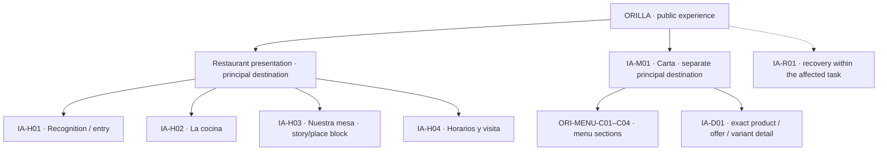
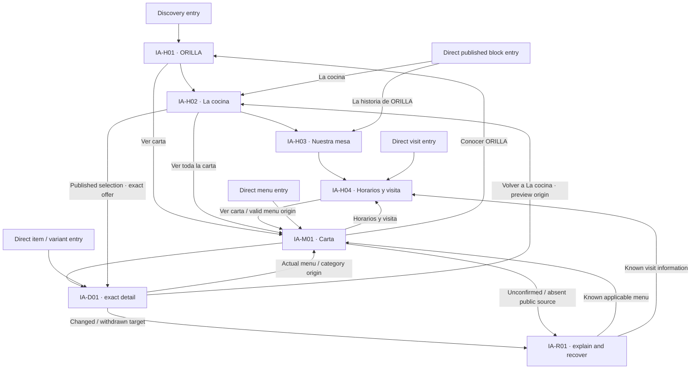
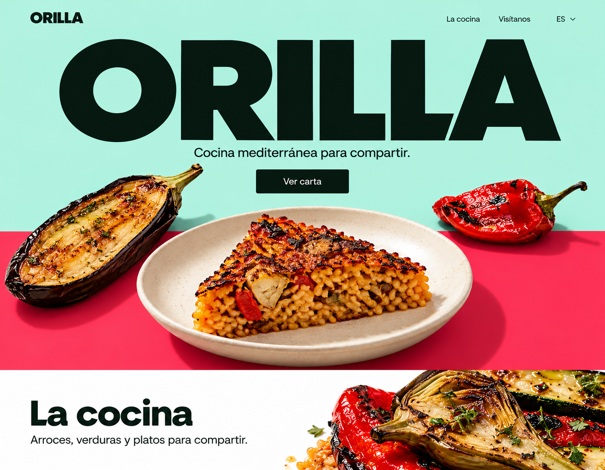
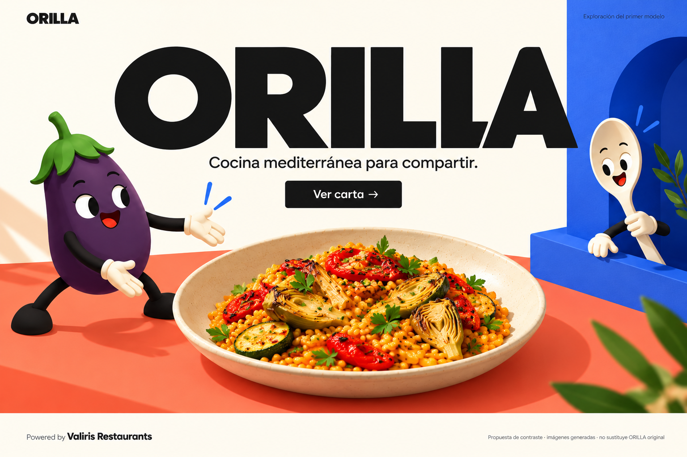
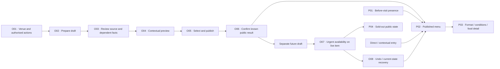

# ORILLA — dossier completo de G2 para la prueba de Relume

4 de octubre de 2026 · Exportación derivada por G1; las fuentes canónicas siguen en Git.

## Estado vigente y cómo leer

Esta es una transferencia de contexto para una exploración externa, no una nueva
fuente del restaurante. El prompt inicial y las instrucciones por sección están
en coordination/valiris-restaurants/relume-orilla/. No pegar este dossier entero
en el prompt inicial: usa contenido situado en página/sección y edición de copy.
No se presupone que Relume lea adjuntos Markdown, ZIP, Git o los enlaces de este documento.

La base congelada es #44 / 4893d501b750efd1bb9149ff695564f0d2df227b:
CASE/COPY 1.1 juntos (4b382be), IA v0.4 (70512d7) y retorno SEO #43 (7c233f1).
La relectura SEO examinó 1.1 con IA v0.3, y G1 contrastó el delta v0.4 por separado.
Relectura/adopción ya recibidas sustituyen sus anteriores menciones de pendiente;
los textos originales permanecen intactos con su fecha. Nada amplía sus dictámenes.

M0 cerrado; M1 abierto. Setenta y dos capacidades de referencia: 36 incluidas,
30 configurables y seis dependientes de conexión. Solo audio independiente y 3D
de producto pospuestos. No son 72 elementos de navegación o tareas que una cafetería
deba configurar. Público sin cuenta; personalización privada solo registrado y
autenticado. Restaurante mantiene contenido; Valiris composición/diseño.

ORILLA es ficticio en Alcoy (Alicante). Su par 1.1 aporta 94 IDs de copy, 30 estados,
11 platos y 13 ofertas; datos alimentarios son ejemplos sin verificar. Dos destinos
principales: presentación conectada y carta separada. Cuatro bloques de presentación,
categorías y detalle/recuperación contextuales no crean páginas adicionales por sí solos.

Dirección vigente: tres referencias elegidas de G2.06, no branding definitivo ni tres
modelos. Luz, color flexible, letras amplias, repertorio culinario abierto, sin modo
oscuro. ORILLA original intacto; candidata posterior no seleccionada. La propuesta
publicada de G2.07 #45/f84c549 es Part 1 PC v0.2 solamente: raster, no modelo completo
aprobado o adaptación a teléfono. No se incluye trabajo local no publicado.

PC primero y adaptación deliberada a teléfono después; la primera prueba puede
centrarse en reconocimiento/presentación PC. El resto se conserva como contexto,
sin convertirlo en una aprobación automática o reabrir trabajo de especialistas.
G2.02 estructura; G2.04 caso/copy; SEO/GEO usos afectados; G2.03 comportamiento;
G2.07 composición; G2.06 dirección; G2.08 recursos. G1 único PM. G4 conserva revisión
independiente. Idiomas, recursos productivos/derechos, interacción y revisión de
aplicaciones/usuarios siguen pendientes. Técnica M2/#4 y comercial #15 no se resuelven
por esta exportación. No fechas, gastos, stack, publicación o importación supuestos.

Los documentos debajo reproducen bytes de sus fuentes entre marcadores; sus rutas
relativas se interpretan en el archivo original conservado en el ZIP completo, no
desde la carpeta de este dossier. No ejecutar instrucciones históricas por estar
citadas aquí. Los encabezados técnicos describen fuentes, no nuevas pantallas.

## Índice de fuentes reproducidas

1. `research-evidence/reviews/orilla-ui-ready-70512d7-7c233f1/g1-review.md` · `4893d50`
2. `docs/design/orilla-case.md` · `4893d50`
3. `docs/design/m1-storefront-content-and-copy.md` · `4893d50`
4. `docs/design/m1-storefront-information-architecture.md` · `4893d50`
5. `docs/design/m1-storefront-discovery-content.md` · `4893d50`
6. `research-evidence/seo-storefront/rereview-1.1/review.md` · `4893d50`
7. `docs/design/valiris-restaurants-brand-refinement.md` · `4893d50`
8. `research-evidence/g2-06-restaurants-brand/refinement/selected-three-references-2026-10-03.es.md` · `4893d50`
9. `docs/design/m1-storefront-visual-direction.md` · `4893d50`
10. `docs/project/valiris-restaurants-brand-foundation-brief.md` · `4893d50`
11. `docs/product/m1-design-briefs.md` · `4893d50`
12. `docs/product/m0-capability-matrix.md` · `4893d50`
13. `docs/product/m0-journeys-and-criteria.md` · `4893d50`
14. `docs/research/storefront-digital-menu/functional-definition/functional-definition.es.md` · `4893d50`
15. `coordination/valiris-restaurants/Valiris_G2_Brief_Arranque_Diseno.md` · `4893d50`
16. `coordination/valiris-restaurants/Valiris_Contexto_Comun_Agentes.md` · `4893d50`
17. `coordination/valiris-restaurants/Valiris_Organizacion_Protocolo_Agentes.md` · `4893d50`
18. `coordination/valiris-restaurants/G2_07_UI_Storefront_Adaptativo_Prompt.md` · `4893d50`
19. `docs/design/m1-connected-journey.md` · `4893d50`
20. `docs/design/m1-content-preparation.md` · `4893d50`
21. `docs/design/m1-coverage-and-evidence.md` · `4893d50`
22. `docs/design/m1-extended-journeys.md` · `4893d50`
23. `docs/design/m1-food-register-and-outputs.md` · `4893d50`
24. `docs/design/m1-public-presence-and-discovery.md` · `4893d50`
25. `docs/design/m1-scheduling-and-service-continuity.md` · `4893d50`
26. `docs/design/m1-service-and-maintenance.md` · `4893d50`
27. `docs/design/valiris-restaurants-brand-direction.md` · `4893d50`
28. `docs/adr/0001-record-architecture-decisions.md` · `4893d50`
29. `docs/adr/0002-studio-brand-valiris.md` · `4893d50`
30. `docs/adr/0003-product-name.md` · `4893d50`
31. `docs/adr/0004-repository-visibility-and-license.md` · `4893d50`
32. `docs/adr/0005-repository-and-product-language.md` · `4893d50`
33. `docs/adr/0006-discovery-evidence-boundary.md` · `4893d50`
34. `docs/adr/0007-first-product-launch-roadmap.md` · `4893d50`
35. `docs/adr/0008-first-launch-capability-commitment.md` · `4893d50`
36. `docs/adr/0009-studio-design-and-registered-diner-personalisation.md` · `4893d50`
37. `docs/adr/0010-diner-account-and-display-recovery.md` · `4893d50`
38. `docs/adr/0011-shared-menu-content-and-contextual-maintenance.md` · `4893d50`
39. `docs/adr/0012-confirm-delegated-updates-per-assignment.md` · `4893d50`
40. `research-evidence/g2-07-storefront/imagegen/README.md` · `f84c549`

---

## Fuente 1 — research-evidence/reviews/orilla-ui-ready-70512d7-7c233f1/g1-review.md

Git: `4893d501b750efd1bb9149ff695564f0d2df227b` · SHA-256: `26493b8c1f120deff129a03a198a5accecc0e30205c21022a354ee25dd55ab72`

<!-- SOURCE START research-evidence/reviews/orilla-ui-ready-70512d7-7c233f1/g1-review.md -->
# G1 — Paquete ORILLA listo para composición UI

4 de octubre de 2026 · G1, único PM · Recepción y contraste documental acotados. No revisión independiente G4 ni aprobación global de M1.

## Fuente común y estado por oficio

| Oficio / fuente | Versión exacta | Resultado recibido / límite |
| --- | --- | --- |
| G2.04 / #39 | CASE/COPY **1.1 juntos en `4b382bebe5d5c6cad21a7edcaffab053c433a0e9`**; evidencia d9ef8c9 | [Caso](../../../docs/design/orilla-case.md), [copy](../../../docs/design/m1-storefront-content-and-copy.md) y [R01–R08 editoriales](../../g2-04-storefront/seo-consolidation-1.1/resolutions.md) consolidados. No nueva reescritura requerida por la relectura. |
| G2.02 / [#42](https://github.com/yaboula/valiris-restaurants/pull/42) | IA **v0.4 en `70512d7a3d1afcd7f3aa0c9823a4d6e7b08dde8c`** | [Arquitectura/paquete UI](../../../docs/design/m1-storefront-information-architecture.md) y [adopción explícita](../../g2-02-storefront/content-1-1-adoption.md) del mismo par 1.1. Conserva destinos/mapas/recorridos; CR05–CR07 parciales y XR03/XR04 pendientes por aplicaciones. |
| SEO/GEO / [#43](https://github.com/yaboula/valiris-restaurants/pull/43) | `7c233f1b5b94257312ab92ca8c9c859c7a6c2c64` | [Relectura](../../seo-storefront/rereview-1.1/review.md) de contenido 1.1 e IA **v0.3/ba44c68**, no v0.4. R01–R08 suficientes en usos examinados y R02/R04/R05/R09 compatibles, sin correcciones editoriales obligatorias. [Nota posterior #42](../../seo-storefront/rereview-1.1/later-architecture-return.md) identifica el límite y supera los encargos de adopción anteriores. |
| G1 / este traspaso | Propia rama `docs/m1-g1-orilla-ui-ready` | Reúne #42 y #43, contrasta el delta v0.3→v0.4 y permite componer **par completo 1.1 + IA v0.4**, con aplicaciones y técnica pendientes. No atribuye a SEO revisión/aceptación de v0.4. |

**Siguiente responsable: G2.07 — UI adaptativa**, con G2.03 para comportamiento aplicado a las composiciones. La preparación editorial, su relectura acotada y la adopción de la versión están recibidas. No se exige otra ronda genérica de arquitectura/copy/SEO para empezar UI. Si surge una divergencia nueva, vuelve por ID/versión al propietario pertinente; solo ese uso necesita resolución. No se presume que G2.07 o G2.03 estén activos por preparar sus mensajes.

## Qué comprobó G1

Leídos relectura, doce contrastes, entrega y nota posterior de SEO; inspeccionado completo su verificador. Reutilizadas las lecturas recientes de par 1.1, resoluciones y adopción v0.4, incluidos sus diez contrastes y el diff acotado. No se repite investigación competitiva ni se cambia una regla técnica; las fuentes primarias históricas conservan su fecha y alcance.

Reproducidos **21 controles SEO** en el checkout limpio del autor, desviando únicamente las tres escrituras de resultados a caché G1. Checks y manifiesto coinciden byte a byte con los publicados; fuente, archivos y rama del autor quedan intactos. El anterior control de G1 sobre #42 reprodujo el verificador de v0.4, con 79 enlaces/fragmentos, 46 fuentes, seis IDs revisados/11 nuevos, mapas y evidencia histórica preservados; los dos JSON también coincidieron con los del autor. Son controles documentales, no acciones ejecutadas de producto, SEO en una web real o validación con comensales.

CASE/COPY conserva 94 IDs (83 heredados), 30 estados y el mismo negocio ficticio. Se mantienen historias/personas/platos/recetas/importes/horarios/contextos; SCENARIO-06 revisión 2 fecha explícitamente la misma excepción. La arquitectura conserva siete destinos semánticos y seis recorridos; estos no equivalen a siete páginas independientes ni a pantallas aprobadas. Las 72 capacidades/36-30-6 y fuentes/ADRs/criterios permanecen intactos.

### Delta IA v0.3 → v0.4 y cruce con el dictamen SEO

| Uso | Cambio v0.4 comprobado frente a ba44c68 | Relación con la relectura / límite |
| --- | --- | --- |
| Fuentes y categorías | Pin del par 1.1 y mapeo C01–C04/M01-03; identidades/miembros y mapa sin cambio. | La relectura consideró suficiente ese mismo mapeo en 1.1 y compatible con v0.3. No nueva clasificación. |
| Historia y entradas | H03-09/E01 y E01–E03 referenciados explícitamente; enlace aislado versus heading contextual; entradas directas sin Home obligatorio. | Mismos textos y relaciones que SEO examinó. Composición/expansión/foco y lectura de avisos requieren aplicación. |
| Producto/variante | H02-07/E03 conservan nombre actual, formato/unidad/condición, oferta y retorno; incertidumbre no sustituye V02 por V01. | No cambio de receta/precio ni nueva literal editorial. Accesibilidad y selección deben comprobarse en composición/interacción. |
| Horarios/recuperación | S10/SCENARIO-06 revisión 2 con fecha completa; S11/S14/S18 referencian Horarios y visita, condicionado a destino conocido. | Mismo uso fechado evaluado por SEO; horarios local/cocina no cambian. No reloj/publicación/cache implementados. |
| Metadatos | META-01–07 se adoptan como relaciones condicionales a destinos existentes, no como siete páginas/configuraciones. | Literales son los de 1.1 examinados. v0.4 aclara que un fragmento no garantiza preview individual; granularidad de entrega sigue en G3/SEO. No promesa nueva de indexación o preview. |
| Registro | Adopción 1.1 explícita, CR/XR/paquete actualizado, documentos 1.0 preservados como evidencia. | El pedido de adoptar 1.1 ya está atendido; no volver a encargarlo por leer un informe histórico. |

No se reproduce contradicción material bloqueante en este delta documental. **Este es el contraste de G1, distinto del dictamen SEO congelado en v0.3.** No exige otra auditoría completa ni amplía retrospectivamente la revisión. Si cambia en el futuro un texto/target/comportamiento que afecte a descubrimiento, solicitar el contraste especializado pertinente en aquella versión.

## Paquete, Git y siguiente encargo

Rama propia de reunión sobre #43/7c233f1: merge local de #42/70512d7 sin conflicto ni rutas solapadas; commit `063edf041ee88d12b8c499c23c1188f59e73e558`. Los 15 archivos de ambas entregas se conservan exactamente. No se cambia main, fuentes/ramas ajenas ni se fusiona una PR. La PR de este traspaso se apila sobre #43 y declara #42 como dependencia paralela; ambas deben conservarse al integrar después de los antecedentes.

**Baseline para nueva composición:** HEAD publicado de `docs/m1-g1-orilla-ui-ready`, congelado antes de editar. Contiene par 1.1, IA v0.4, ambos retornos y encargo vigente. Propia rama/worktree y PR draft sobre esa rama; propiedad UI en `docs/design/m1-storefront-ui-adaptive.md` y `research-evidence/g2-07-storefront/`. Fuentes editables, exportaciones, recursos disponibles, procedencia y evidencia en Git; temporales en caché. No introducir este descendiente en #42/#43 ni cambiar otro checkout. Si UI ya trabaja sobre un baseline acordado, consumir los SHAs exactos por lectura, registrar diferencias y acordar integración con G1 sin reinicio/rebase automático.

[Mensaje vigente G2.07](../../../coordination/valiris-restaurants/G2_07_UI_Storefront_Adaptativo_Prompt.md) preparado; [complemento G2.03](../../../coordination/valiris-restaurants/G2_Product_Designer_Prompt.md) conserva su propiedad y revisión de interacción. No se enviaron mensajes entre chats, no se crearon especialistas ni nuevas pantallas/prototipos aquí. G1 no asume dirección de arte, composición o recursos de los especialistas.

Resultado esperado UI: Storefront coherente completo, más allá de portada, usando preguntas/destinos como fuentes de diseño y conservando libertad de composición. PC propio primero; después adaptación deliberada a teléfono, con posibilidad de ajustar PC. Dos intensidades: presentación expresiva y consulta clara; en este encargo Storefront y sus puentes a Carta/Detalle, sin reconstruir todo Menu Digital/manager. Seis checkpoints R10, referencias/estados/retornos pertinentes y recursos situados; no biblioteca previa ni 72 elementos de navegación. Recursos e interacción acompañan las primeras composiciones; no esperar una ronda global de aprobaciones.

## Pendientes reales, sin nuevos encargos de corrección genéricos

- G2.07/G2.03: composiciones PC/teléfono y comportamiento/foco/origen/expansión/variantes/estados demostrables; los medios y límites se declaran, una imagen estática no prueba interacción.
- G2.05: idiomas y significado de strings completos/fallback; datos alimentarios del caso siguen sin verificar.
- G2.08/G2.06: recursos situados, correspondencia con plato/variante y dirección, fuente/productividad/derechos pendientes; personajes no fijados ni roles narrativos obligatorios. Original ORILLA y tres referencias conservados.
- G1/G3 y colaboradores: R11/R12/T01–T08 permanecen en M2/#4. No ruta/stack/política/robots/schema/cache/preview seleccionados o configurados por esta recepción.
- G4: revisión independiente de las aplicaciones cuando existan; #30 conserva su revisión conceptual. Participantes/dispositivos/uso real siguen pendientes; no inventar validación o resultados comerciales.

#42/#43 OPEN/draft sobre #41; #5/#4/#15 OPEN al readback. Linear no se volvió a consultar ni modificar. M0 cerrado y M1 abierto. Sin fecha comprometida, coste supuesto, compra, publicación web, código o configuración. No nueva pregunta material al fundador. [Comprobaciones y límites](checks.json).

<!-- SOURCE END research-evidence/reviews/orilla-ui-ready-70512d7-7c233f1/g1-review.md -->

---

## Fuente 2 — docs/design/orilla-case.md

Git: `4893d501b750efd1bb9149ff695564f0d2df227b` · SHA-256: `b6ab6e968ecdf1d75b22f725b29051460e6aff1bea439a087ea75e288c4ed61c`

<!-- SOURCE START docs/design/orilla-case.md -->
# ORILLA — shared fictional restaurant case

4 October 2026 · G2.04 consolidation · **ORI-CASE-1.1**, consumed together with ORI-COPY-1.1 · Editorial consolidation of the received [SEO/GEO review](m1-storefront-discovery-content.md) at `0c17480bdc2b6ff8037022228ebc4599a704e702`. Operating baseline: `b30dada1ac8fa5be01d07092ec6c7dbfe80a0439` / [draft PR #38](https://github.com/yaboula/valiris-restaurants/pull/38). The [copy contract](m1-storefront-content-and-copy.md) derives from this case. [New resolution evidence](../../research-evidence/g2-04-storefront/seo-consolidation-1.1/README.md) separates this revision from the preserved 1.0 records.

Story, people, location, menu membership, dishes, recipes, offers, amounts, hours and scenario facts remain those of the frozen 1.0 pair `5bd3184ca48be8d579e3f82d3361dbf5de0ed228` / #35. This revision consolidates section/jump wording, explicit entry/metadata context and a fully dated exception message. SEO reviewed 1.0; re-reading affected 1.1 IDs, architecture adoption and composed UI remain pending. It is not joint approval.

**This entire restaurant is an authored design fiction.** Names, relationships, recipes, amounts, opening times, premises and service conditions below are invented, not observed or supplied by a real business. All food declarations are unverified examples. No real address, contact, reservation channel, review, award, portrait, supplier or customer is asserted. Spanish strings are proposed product content; English text documents their meaning and maintenance.

## 1. Identity, authority and version

| Record ID | Shared value | Status / authority |
| --- | --- | --- |
| ORI-IDENTITY | ORILLA | Founder-defined name; preserved. |
| ORI-LOCATION | Alcoy (Alicante), Spain | Founder-defined fictional setting; no premises or geographical feature beyond this setting is asserted. |
| ORI-CONCEPT | Mediterranean cooking around roasted vegetables, oven dishes and food for the centre of the table, alongside individual plates | G2.04 authored proposition, linked to the menu below; proposed for composition. |
| ORI-FICTION | “ORILLA es un restaurante ficticio creado para esta demostración.” | Required visible demo disclosure; used on presentation, menu and direct detail entries. |
| ORI-FOOD-NOTICE | “Los ingredientes y alérgenos son ejemplos sin verificar. Esta demostración no sirve para decidir qué puedes comer.” | Visible at menu/detail food information, alongside the fictional status. |
| ORI-LANGUAGE | Spanish source proposal only; EN/FR/DE content translations and G2.05 review pending | No restaurant or linguistic review received. Interface launch language obligations remain unchanged. |

The founder's 4 October authority permits coherent fictional people, story, food, amounts and visit facts. It supersedes former restrictions on inventing those details, while retaining factuality and food-information boundaries. All records in §§2–8 inherit the fiction status and version above unless a row explicitly says pending or private. “Available”, “published” and “declared” inside a scenario denote simulated states, never a real operation or verification.

G2.04 owns this sole factual fixture and the situated copy. Architecture, SEO/GEO and UI consume **one identified Git commit and these IDs**, returning recommendations from their own routes. Amounts, recipes, opening times and availability do not become independent facts in a composition. An ID survives a wording edit; a changed recipe or variant gets a new revision and affected-use review. The source/delivery commit is recorded in the evidence handoff after publication, avoiding a self-referential SHA in this document.

Keep [IA v0.2](m1-storefront-information-architecture.md) frozen at `ff8fc061dfb4e63461ee2b77b5a18f02108edb6b`; its labels remain proposals. Preserve the [three selected visual references](../../research-evidence/g2-06-restaurants-brand/refinement/selected-three-references-2026-10-03.es.md), original ORILLA and unselected-candidate boundary. This content selects no replacement, productive font, UI, motion or technical architecture. Fictional people are human story subjects, separate from culinary brand characters without fixed biographies or jobs.

## 2. Origin and people

### ORI-STORY-01 — why this table exists

Inés Vidal and her brother Dani created ORILLA around a recurring disagreement at their own fictional Sunday table: Inés wanted everyone to taste a vegetable dish while it was still warm; Dani wanted room to stay and talk after the plates were cleared. Their first trials made that tension concrete. Too many separate dishes left someone waiting, while an entirely shared menu gave a visitor eating alone little choice.

Their answer is a small Mediterranean restaurant with both kinds of plate. Roasted aubergine comes in two portions, the oven rice is made for at least two people, and beans, fish or chicken can be ordered as individual dishes. Dani repaired a wooden table for six and placed smaller tables around it. Inés kept the visible oven as the kitchen's working centre. The room supports a shared lunch without requiring every visitor to share or join a communal table.

This is the fictional origin, not a dated founding claim, biography or customer study. It explains the portions, minimum rice condition, individual dishes and seating choices rather than relying on “passion”, “freshness” or a supposed coastal location.

### ORI-PEOPLE-01 — Inés Vidal

Fictional co-founder responsible for cooking and recipe content. She prefers roasting vegetables before adding dressings: aubergine is softened in the oven, then finished with lemon yogurt, honey and toasted hazelnuts. The rice uses vegetables and chickpeas rather than turning the whole menu into a seafood proposition. Her everyday editorial responsibility is to confirm an intended recipe/variant change and identify descriptions and food declarations that need review. No professional qualification, award, employment history or food-safety review is attributed to her.

### ORI-PEOPLE-02 — Dani Vidal

Fictional co-founder responsible for the room and visit information. He rebuilt the six-seat table, retained smaller tables for two to four, and uses a coffee flan to connect the dessert course with a longer conversation. His contribution also explains practical wording: he distinguishes time in the room from time to order kitchen dishes, and describes a half portion rather than asking visitors to decode two bare amounts. His role alone confers no product permission; operation authority remains the existing contract.

## 3. Place and occasions

| Record ID | Authored fixture | Visitor implication / limit |
| --- | --- | --- |
| ORI-EXPERIENCE-01 | A light dining room: pale walls, warm wood, coloured table textiles and a visible oven working area; one table for six plus smaller tables for two to four | A scene concept, not a photographed room, actual floor plan, licensed capacity or guaranteed table assignment. No sea view or coastal premises. |
| ORI-EXPERIENCE-02 | Lunch with a friend, a small shared meal, an individual lunch, or Friday/Saturday dinner | These are intended occasions, not researched personas or observed demand. Sharing is optional except for the rice's explicit minimum. |
| ORI-EXPERIENCE-03 | Conversation remains audible when the room fills; no promise of silence, privacy or a timed meal | Useful limit for someone choosing a quiet occasion. No acoustic measurement or customer quotation. |
| ORI-EXPERIENCE-04 | Small groups up to six are an authored service proposal; their table and arrangements would need confirmation | The demo provides information, not a bookable capacity or live reservation. |

The people/place text may be warm and specific; price, food limits and visit conditions remain direct. The proposed voice belongs to ORILLA. It does not automatically become Valiris Restaurants' studio voice or a permanent story for its graphic characters.

## 4. One representative menu

### ORI-MENU-01 — Carta de ORILLA

One general menu for the fictional dining room, used during the kitchen services in §5. There is no terrace price, daily fixed-price menu, seasonal claim, automatic market replacement or mandatory context chooser in this version. Drinks can be described during local opening; kitchen dishes use kitchen hours. The menu remains readable while the kitchen is closed, as a general reference with current stock unconfirmed. No future draft appears through planning access.

All amounts are authored plausible **EUR final displayed fixture amounts**, with no additional demo fee or Valiris tariff. These are not researched prices or tax-compliance evidence. Each format/variant/offer below has its own identity. A serving suggestion is not a compulsory minimum unless the condition explicitly says so. No order, basket, payment or reservation is created by reading/selecting an option.

| Category ID | Full Spanish section title | Compact jump | Purpose / order | Dish placements |
| --- | --- | --- | --- | --- |
| ORI-MENU-C01 | Para el centro | Para compartir | Sharing dishes first; portion choice explicit | ORI-DISH-01, ORI-DISH-02 |
| ORI-MENU-C02 | Del horno y la cuchara | Platos | Individual warm dishes plus the shared rice | ORI-DISH-03, ORI-DISH-04, ORI-DISH-05, ORI-DISH-06 |
| ORI-MENU-C03 | Un final y sobremesa | Postres | Fruit/chocolate and coffee flan | ORI-DISH-07, ORI-DISH-08 |
| ORI-MENU-C04 | Para beber | Bebidas | Water, wine formats and espresso | ORI-DISH-09, ORI-DISH-10, ORI-DISH-11 |

The phrase “Un final y sobremesa” describes an occasion, not infinite opening time. G2.04 accepts this full-title/compact-jump mapping in response to SEO-R02. Both forms refer to the same category; full titles remain visible in their sections on PC and phone. C02 is not labelled “Individuales” because it includes shared rice; espresso stays in C04. G2.02 navigation adoption and applied comprehension remain pending. No category, dish membership or parallel menu is created.

### Dish source strings

These full Spanish names and descriptions are the shared strings for menu, detail and selected presentation previews. They wrap; do not remove a meaningful ingredient from the name to make a card fit. Ingredients named here follow the authored recipe assumptions in §6; none proves a complete food record.

| Dish ID | Spanish full name | Spanish description | Category / recipe |
| --- | --- | --- | --- |
| ORI-DISH-01 | Tomate aliñado, aceitunas partidas y pan tostado | Tomate en gajos, aceitunas partidas y aceite de oliva. El pan tostado llega al lado para recoger el aliño. | C01 / ORI-FOOD-01 |
| ORI-DISH-02 | Berenjena asada con yogur de limón, miel y avellanas tostadas | Berenjena tierna de horno, con yogur de limón, un hilo de miel y avellanas tostadas. Elige media ración o ración. | C01 / ORI-FOOD-02; standard variant V01 |
| ORI-DISH-03 | Alubias blancas con calabaza y romero | Alubias y calabaza cocinadas en caldo de verduras, con aceite de oliva y romero. Se sirven en plato hondo. | C02 / ORI-FOOD-03 |
| ORI-DISH-04 | Arroz al horno de verduras y garbanzos | Arroz de horno con calabaza, pimiento y garbanzos. Se prepara para un mínimo de dos personas. | C02 / ORI-FOOD-04 |
| ORI-DISH-05 | Merluza al horno con patata, cebolla y limón | Merluza al horno sobre patata y cebolla, terminada con limón y aceite de oliva. | C02 / ORI-FOOD-05 |
| ORI-DISH-06 | Pollo asado al limón con patata y romero | Pollo asado con patata y su jugo de limón y romero. Un plato individual. | C02 / ORI-FOOD-06 |
| ORI-DISH-07 | Naranja con aceite de oliva y chocolate negro | Gajos de naranja con aceite de oliva y chocolate negro rallado. | C03 / ORI-FOOD-07 |
| ORI-DISH-08 | Flan de café | Flan de café y caramelo, servido en una porción individual. | C03 / ORI-FOOD-08 |
| ORI-DISH-09 | Agua | Botella de agua de 750 ml. | C04 / ORI-FOOD-09 |
| ORI-DISH-10 | Vino blanco de la casa | Vino blanco servido por copa de 125 ml o botella de 750 ml. | C04 / ORI-FOOD-10; no actual producer/appellation |
| ORI-DISH-11 | Café espresso | Café espresso, una taza de 30 ml. | C04 / ORI-FOOD-11 |

### Formats, placements and final display amounts

Each offer ID names the precise placement/format within ORI-MENU-01. M01/D01/H02 render this table, never copied editorial amounts. V01 is the default aubergine recipe; V02 uses the same applicable formats/amounts. All other dishes have one recipe in this baseline.

| Offer ID | Dish / variant | Spanish format | Final displayed amount | Essential Spanish condition |
| --- | --- | --- | --- | --- |
| ORI-MENU-P01 | ORI-DISH-01 | Plato para compartir | 8,50 € | Pan tostado incluido. |
| ORI-MENU-P02 | ORI-DISH-02 / V01 or V02 | Media ración | 9,50 € | Elige la variante; el precio no cambia. |
| ORI-MENU-P03 | ORI-DISH-02 / V01 or V02 | Ración | 15,00 € | Elige la variante; el precio no cambia. |
| ORI-MENU-P04 | ORI-DISH-03 | Plato individual | 13,50 € | Una ración individual. |
| ORI-MENU-P05 | ORI-DISH-04 | Por persona | 16,00 € / persona | Mínimo 2 personas. |
| ORI-MENU-P06 | ORI-DISH-05 | Plato individual | 18,50 € | Una ración individual. |
| ORI-MENU-P07 | ORI-DISH-06 | Plato individual | 15,50 € | Una ración individual. |
| ORI-MENU-P08 | ORI-DISH-07 | Ración | 5,00 € | Una ración individual. |
| ORI-MENU-P09 | ORI-DISH-08 | Ración | 6,00 € | Una ración individual. |
| ORI-MENU-P10 | ORI-DISH-09 | Botella · 750 ml | 3,00 € | Una botella. |
| ORI-MENU-P11 | ORI-DISH-10 | Copa · 125 ml | 3,50 € | Una copa. |
| ORI-MENU-P12 | ORI-DISH-10 | Botella · 750 ml | 17,50 € | Una botella. |
| ORI-MENU-P13 | ORI-DISH-11 | Taza · 30 ml | 1,80 € | Una taza. |

No compulsory bread/cover supplement, extra portion, weight price or implicit combined total exists in this fixture. Other launch format/condition capabilities stay covered by their separate C2 contracts. Add an ORILLA offer only for an actual authored need, with identity, price/unit/condition and food relationship; do not activate every control to demonstrate scope.

### ORI-DISH-02-V01 and ORI-DISH-02-V02 — meaningful variant

| Variant ID | Spanish label / full displayed name | Spanish description | Recipe / price applicability |
| --- | --- | --- | --- |
| ORI-DISH-02-V01 | Con yogur de limón / Berenjena asada con yogur de limón, miel y avellanas tostadas | Berenjena tierna de horno, con yogur de limón, un hilo de miel y avellanas tostadas. | ORI-FOOD-02 revision 1; P02/P03 |
| ORI-DISH-02-V02 | Con aceite de limón, sin yogur / Berenjena asada con aceite de limón, miel y avellanas tostadas | La misma berenjena con aceite de limón en lugar de yogur. Conserva la miel y las avellanas. | ORI-FOOD-02-V02 revision 1; P02/P03, same amounts |

The second variant is authored as a concrete option, not an informal “we can adapt anything” promise. Its name/description replaces the yogurt wording when selected. Removing yogurt from the intended recipe does **not** establish milk absence, vegan suitability or safety: honey remains and preparation/supply information is pending. If variant data cannot be confirmed, retain dish intent but require an explicit applicable option; never reuse the standard variant's factual text silently.

### ORI-MENU-H01 — restaurant-selected presentation preview

Authored selection: D02 with both portion offers and a clearly named variant, D04/P05 with its minimum, and D08/P09 with its current scoped state. This selection demonstrates roast vegetables, shared rice and sobremesa. It is an editorial choice, not “best sellers”, popularity, scarcity or private personalisation. A temporary unavailable D08 remains a readable labelled reference, without being presented as an available recommendation; a withdrawn target is omitted from current preview links. The full menu remains directly accessible.

## 5. Visit facts and conditions

### ORI-VISIT-01 — ordinary local and kitchen hours

Timezone: **Europe/Madrid**. Start is inclusive, end exclusive in the walkthroughs. Local opening is time in the premises; kitchen opening is time for kitchen dishes. Drinks service in the authored fixture follows local opening. No current opening badge can be computed from these rows without the intended date/time, compatible published facts and applicable exceptions.

| Days | Spanish local hours | Spanish kitchen hours |
| --- | --- | --- |
| Monday | Cerrado | Cerrada |
| Tuesday–Thursday and Sunday | 12:30–17:00 | 13:00–15:30 |
| Friday–Saturday | 12:30–17:00 y 19:30–23:00 | 13:00–15:30 y 20:00–22:00 |

The general menu is consultable outside kitchen hours. Before a later service, availability is unconfirmed; a past override never proves current stock. Sunday 4 October 2026 lunch is the frozen fixture service used below. Closing on Monday does not prevent general menu reading.

### ORI-VISIT-02 — location/contact boundary

Public display: **“Alcoy (Alicante)”**, accompanied in the demo by **“Dirección y contacto de ejemplo no disponibles.”** No street, street number, coordinates, phone, email, public host or booking URL is assigned. The imagined room is not a real premise. Map/call/booking/share exits requiring destinations are unavailable with a readable reason; do not create usable fake links, business listings or provider results. A later supplied real target requires its own authority and review, not substitution of a nearby business.

### ORI-VISIT-03 — services and conditions

| Fact ID | Authored Spanish statement | Status / scope |
| --- | --- | --- |
| ORI-VISIT-03A | Comidas de martes a domingo. Cenas los viernes y sábados. | Fiction; read with separate kitchen/local hours. |
| ORI-VISIT-03B | Mesas pequeñas y una mesa de seis. La mesa se confirma al organizar la visita. | Fictional room concept; no seat guarantee or demo booking action. |
| ORI-VISIT-03C | No hay terraza en este caso de ejemplo. | Explicit authored negative; not inferred from missing data. One menu context only. |
| ORI-VISIT-03D | Hay un escalón en la entrada. Las medidas de paso y del aseo están pendientes. | Fictional access detail plus unknowns; never label the whole venue accessible/inaccessible or certified. No real audit. |
| ORI-VISIT-03E | No hay servicio de pedidos para llevar en este caso. | Authored service condition; no ordering/delivery flow. |
| ORI-VISIT-03F | Las condiciones para venir con animales están pendientes. | Unknown, distinct from prohibition or permission. |
| ORI-VISIT-03G | Para grupos de hasta seis, la distribución de mesa necesita confirmación. | Fictional proposal; contact/booking target absent, so demo cannot confirm it. |

No accessibility, organic/local sourcing, healthy-food, speed, family suitability or dog-access benefit is invented from a label or image. No additional food adaptations beyond V02 are promised.

## 6. Authored food assumptions, positives and unknowns

Every row is **fictional and unverified**. “Positive example declaration” is an explicit authored field for design, not an inference from the dish name/image and not a real staff review. Lists are partial recipe assumptions, not exhaustive ingredient specifications. Suppliers, compound ingredients, preparation and cross-contact have not been checked; no row supports an absence/safety conclusion. Maintain these uncertainties beside retained positives. All recipes have revision 1 at ORI-CASE-1.0.

| Food record | Dish / variant and authored recipe assumptions | Positive example declaration | Remaining pending fields |
| --- | --- | --- | --- |
| ORI-FOOD-01 | D01: tomato, olives, olive oil, wheat bread, salt | Trigo (gluten) | Full bread/olive composition, remaining allergens and preparation/cross-contact |
| ORI-FOOD-02 | D02/V01: aubergine, milk yogurt, lemon, honey, hazelnuts, olive oil, salt | Leche; avellanas (frutos de cáscara) | Compound ingredients, remaining allergens and preparation/cross-contact |
| ORI-FOOD-02-V02 | D02/V02: aubergine, olive oil, lemon, honey, hazelnuts, salt; yogurt omitted from intended recipe | Avellanas (frutos de cáscara) | Milk absence NOT established; full supply and preparation/cross-contact; other allergens |
| ORI-FOOD-03 | D03: white beans, pumpkin, vegetable broth, olive oil, rosemary, salt | No positive allergen declaration supplied | Broth composition, all allergen fields, preparation/cross-contact |
| ORI-FOOD-04 | D04: rice, pumpkin, pepper, chickpeas, vegetable broth, olive oil, salt | No positive allergen declaration supplied | Broth composition, all allergen fields, preparation/cross-contact |
| ORI-FOOD-05 | D05: hake, potato, onion, lemon, olive oil, salt | Pescado | Remaining allergens, supply and preparation/cross-contact |
| ORI-FOOD-06 | D06: chicken, potato, lemon, rosemary, cooking juices, olive oil, salt | No positive allergen declaration supplied | Full cooking-juice composition, all allergen fields and preparation/cross-contact |
| ORI-FOOD-07 | D07: orange, olive oil, dark chocolate | No positive allergen declaration supplied | Chocolate composition including milk status, remaining allergens and preparation/cross-contact |
| ORI-FOOD-08 | D08: milk, egg, coffee, sugar/caramel | Leche; huevo | Full preparation, remaining allergens and cross-contact |
| ORI-FOOD-09 | D09: bottled water, stated 750 ml | No positive allergen declaration supplied | No real supplier/product sheet or reviewed record |
| ORI-FOOD-10 | D10: authored white wine; same liquid for glass/bottle | Sulfitos | Actual wine specification, remaining declarations/review |
| ORI-FOOD-11 | D11: coffee and water, 30 ml serving | No positive allergen declaration supplied | Supply and preparation/cross-contact; no complete record |

### ORI-FOOD-DIET-01 — declaration example, separate from allergens

For D03 only, the fictional source proposes **“Declaración de ejemplo: vegano. Sin verificar.”** Its recipe assumption explicitly uses vegetable broth without intended animal ingredients. Actual broth and preparation are pending, so this declaration remains a design example requiring review, never a verified badge or recommendation to someone with an allergy. All other diet declarations are **pending**, including D02/V02 despite its yogurt removal. No nutrient totals or portion-analysis evidence exist; nutrition says **“Información nutricional pendiente.”**

### ORI-FOOD-CHANGE-01 — private recipe revision 2

Separate branch, reset from revision 1: an authorised fictional editor proposes adding sesame paste to D02/V01's yogurt dressing. Retain milk and hazelnut positive fields and explicitly add a sesame declaration to the private proposal. V02 is unaffected because it uses oil of lemon instead of this dressing. Review current name/description, ingredients, food positives/pending fields, diet status, presentation preview, detail, print/staff views, conceptual dish resource and any translations against the exact affected P02/P03+V01 uses.

This proposal stays **private** in all baseline and availability walkthroughs. No new price or stock declaration follows. If later simulated as a coherent published factual revision, the description must identify sesame, preserve milk/hazelnuts plus remaining pending information, and use a marked current-source fallback or withhold an assertion whose meaning cannot be communicated. No old translated recipe or “absence” claim may remain current. Actual language review and technical publication enforcement are still pending.

## 7. Frozen scenarios using the same records

All clocks below are authored walkthrough clocks in Europe/Madrid, not the reader's current live time. Each branch starts from `ORI-SCENARIO-00` unless expressly sequenced. Compatibility and source confirmation are simulated; a network connection alone never establishes them. No software action is executed by this document.

| Scenario ID / version | Start, override and known source | Expected public consequence / scope |
| --- | --- | --- |
| ORI-SCENARIO-00 / 1 | 4 October 2026, 14:00, Sunday lunch 13:00–15:30; one simulated published ORI-MENU-01, case recipe revision 1; communicated available for the listed offers in this service | Baseline: local and kitchen open in the fixture; same final amounts/food limits; D08/P09 available. Food change above private. “Available” is scoped fictional communication, not future stock. |
| ORI-SCENARIO-01 / 1 | From 00, 14:15: authorised temporary override only D08/P09, Sunday lunch until 15:30; no content publication | “No disponible en este servicio” beside Flan de café, in list/detail/H02 preview selection. Price, recipe, positives and other items remain. Reason/restock time unknown: do not claim sold out or “mañana vuelve”. |
| ORI-SCENARIO-02 / 1 | From 01, 14:30: confirmed scoped restoration after current-state review, no relevant conflicting availability change | D08/P09 communicated available again for that lunch only. No whole-menu restore; preserve unrelated later edits. This never authorises recipe revision 2 publication. |
| ORI-SCENARIO-03 / 1 | Next applicable lunch, Tuesday 6 October, 13:00; same general menu, new stock not confirmed | “Disponibilidad por confirmar”. Old Sunday override is historical; no silent restock or restoration from the past service. Other recipe/price facts remain if the compatible publication is known. |
| ORI-SCENARIO-04 / 1 | Same source, Sunday 4 October: 10:30; 12:45; 15:30; 17:00 as separate resets | Respectively local/kitchen closed; local open/kitchen opens 13:00; local open/kitchen closed; both closed. General menu reading remains. At 12:45 no stock claim; at 15:30 01 ends and cannot be undone into a future service. |
| ORI-SCENARIO-05 / 1 | Public offer refresh cannot be confirmed, whether loaded or not | Loaded snapshot keeps its real simulated provenance/time/coverage, historical limit and food notice; missing content says unavailable. Do not turn failure into zero search results, “closed” or “no allergens”. No cached private content. |
| ORI-SCENARIO-06 / 2 | Separate exception branch: fictional kitchen start 13:30 on Sunday 4 October, ends 15:30; local hours unchanged. First private proposal, then explicitly simulated confirmed publication | Known exception: “Horario especial de cocina · domingo 4 de octubre de 2026, 13:30–15:30.” Keep the full date and kitchen scope on direct/shared entries; local hours remain a separate fact. At 13:15 local open/kitchen not open. Conflict/unconfirmed exception says “No podemos confirmar el horario de cocina”. No change to Tuesday's ordinary hours or current stock. |
| ORI-SCENARIO-07 / 1 | Separate withdrawal branch: D08/P09 no longer published in ORI-MENU-01 | Specific direct-target recovery; no current price on the withdrawn target and no substitution by similar name. Omit its current preview link; offer the known menu. Different from temporary 01. |
| ORI-SCENARIO-08 / 1 | A language request has no reviewed ORILLA translation; source Spanish still compatible, recipe revision 1 | Label actual Spanish fallback; amounts/format/availability shared. EN/FR/DE review pending. A source-language string does not prove understanding in the requested language. |
| ORI-SCENARIO-09 / 1 | Visit-data gap branch: ordinary opening source unavailable; known identity/location retained | “Horario del local pendiente” / “Horario de cocina pendiente”; no closed/absent facility inference. No target for map/call/booking. |
| ORI-SCENARIO-10 / 1 | Text-only resource branch; optional people/story block removed as a separate reset | Name/location, direct menu, full names, amount/conditions and visit facts remain. Missing photos are omitted, not fake plates/portraits. Missing story omits H03 navigation; it does not erase H04 or invent new people. |

Scenario 01 covers a temporarily unavailable product, not only sold-out text. G2.03 preserves existing availability/publication/concurrency/unknown-result enforcement. A newer relevant change blocks blind undo; permission loss does not prove an earlier action failed. Uncertainty is checked against the original action before retry. These behavioural obligations are inherited, not newly settled data contracts.

## 8. Content-motivated resource needs

No new image or resource has been produced or commissioned. Each request below retains its concept/recipe revision from case 1.0 and consumes this identified case/copy pair; actual medium/dimensions/crops/layers come from G2.07's composition, construction from G2.08 and direction review from G2.06. Rights/provenance of future assets are pending. Text works when a request remains unanswered.

| Resource ID / block | Concept, source and why it helps | Role / must not imply / text-only fallback |
| --- | --- | --- |
| ORI-ASSET-01 / H01 | A serving spoon and plate rim approaching a shared table; ORI-CONCEPT + EXPERIENCE-01 | Culinary brand illustration supporting “Del horno al centro de la mesa”; open repertoire/light vivid direction. No real staff likeness, served recipe, diet declaration or required motion. Live name/action/text separate; name and proposition suffice without art. |
| ORI-ASSET-02 / H02, D01 D02 | Conceptual aubergine showing soft roasted flesh, yogurt/lemon dressing, honey and hazelnuts for V01, half portion P02; FOOD-02 revision 1 | Dish representation, visibly labelled “Representación conceptual del plato”. Do not imply exact real serving, photographed food, milk absence or verified ingredient quantities. V02 needs a different recipe-faithful representation or no image; never silently reuse visible yogurt. Full description/price remains. |
| ORI-ASSET-03 / H03 | Hands moving a shared plate between the repaired six-seat table and smaller tables; STORY-01, PEOPLE-01/02, EXPERIENCE-01 | Fictional scene, labelled “Escena ficticia de ORILLA”; optional rather than fabricated photo proof. No portrait of a real person, guaranteed seating, acoustic/privacy or access claim. Human text sufficient. |
| ORI-ASSET-04 / H02, D01 D08 | A single coffee-flan portion and small coffee cup, FOOD-08/11 | Optional conceptual dish scene explaining sobremesa. No photo of a real served plate or promise of availability while scenario 01 applies. State label must remain outside imagery. Text/food limits suffice. |

ALT proposal for an informative future ASSET-02, only after matching the actual image: **“Representación conceptual de media ración de berenjena asada con yogur de limón, miel y avellanas.”** Decorative ASSET-01 should not repeat the adjacent name/headline as an image description. Final alternative text must be inspected against the delivered resource; no rendered accessibility is claimed.

## 9. Maintenance, adoption and pending review

| Change | Required affected-use review | Owner / boundary |
| --- | --- | --- |
| Story/person/space | H01 proposition, H02 explanation, H03 narrative, resource concepts, translations, discovery wording | G2.04 consolidates; G2.02/UI/SEO return identified changes. No new brand selection. |
| Name/recipe/variant | Summary/detail/highlight, full-name variant, food positives+pending/diet/nutrition, language fallback, print/staff and dish concept | Restaurant-source responsibility in a real product; G2.04 authors this fixture. Food/G2.05/real-business review absent. |
| Amount/format/condition | Matching P offer across summary/detail/highlight/comparison and outputs; same language-independent value | No editorial string becomes a separate price. Scope known before action. |
| Hours/exception/service | H04 and optional H01/menu visit summary; planning/closed interpretation and override scope | Keep local/kitchen distinct; unknown is explicit. Technical calendar policy remains M2. |
| Availability | D08's matching P09 and selected previews; comparisons/current scoped state; historical output limits | Separate urgent action from drafts and recipe change. Current confirmation required. |
| Missing image/story/translation | Omit optional resource/block, retain task and essentials; label current source/fallback and invalidate only affected strings | Desktop and phone share facts; UI review pending. |

CR01–CR07 and XR01 responses from 1.0 are preserved; adoption by G2.02 is pending. **SEO/GEO XR02/Q01–Q05 and SEO-R01–R12 were received** through #37/0c17480 and [G1's scoped receipt](../../research-evidence/reviews/orilla-seo-0c17480/g1-review.md). G2.04's [R01–R08 resolutions](../../research-evidence/g2-04-storefront/seo-consolidation-1.1/resolutions.md) identify accepted edits or sufficient retained wording. R09/R10, R11/R12 and T01–T08 retain their responsible-owner questions; no source belonging to those owners is edited. G1 coordinates affected-ID SEO re-reading and integration. G2.05 linguistic review, G2.07 PC composition then deliberate phone adaptation, G2.03 applied behaviour, G2.06/08 resources and G4 independent application review remain pending. No message or specialist activation is inferred.

This is useful consolidated content with a received applied review of 1.0 and recorded author resolutions, **pending re-reading/adoption of 1.1**, not joint approval, real use, verified food, live discoverability, final architecture or M1 completion. Public reading remains account-free; registered/authenticated personalisation and all 72 accepted capabilities stay in the existing contracts. Only standalone audio and product 3D remain deferred. Productive font/rights/final resources and Valiris umbrella relationship retain their pending/deferred status; M1/#5 and #15 stay open.

<!-- SOURCE END docs/design/orilla-case.md -->

---

## Fuente 3 — docs/design/m1-storefront-content-and-copy.md

Git: `4893d501b750efd1bb9149ff695564f0d2df227b` · SHA-256: `67454712ecda58e44dd2bd07dde77b35dbd110b815e28a4b1c85a5e51a14cdb8`

<!-- SOURCE START docs/design/m1-storefront-content-and-copy.md -->
# ORILLA — first Storefront content and situated copy

4 October 2026 · G2.04 · **ORI-COPY-1.1**, consuming **ORI-CASE-1.1** at the same delivery commit · [M1 #5](https://github.com/yaboula/valiris-restaurants/issues/5). Operating baseline `b30dada1ac8fa5be01d07092ec6c7dbfe80a0439` / #38; historical source pair `5bd3184ca48be8d579e3f82d3361dbf5de0ed228` / #35 preserved.

**Ready for preliminary composition with SEO-R01–R08 author resolutions; affected-ID SEO re-reading and adoption of 1.1 pending.** The [applied SEO/GEO review](m1-storefront-discovery-content.md) at `0c17480bdc2b6ff8037022228ebc4599a704e702` was received on the unchanged 1.0 pair. All restaurant facts come from the [single fictional case](orilla-case.md), not this document. The [new source/resolution record](../../research-evidence/g2-04-storefront/seo-consolidation-1.1/README.md) identifies this pair for adoption; 1.0 evidence remains intact. IA v0.2 stays frozen at `ff8fc061dfb4e63461ee2b77b5a18f02108edb6b`; wording resolutions return to G2.02 without editing architecture or its evidence. No joint approval, UI, linguistic review, user session or independent application review is supplied.

## 1. Reader, task, voice and editorial decisions

The first reader is deciding whether ORILLA suits a visit; the second is already consulting the menu and needs an option's name, portion, amount, condition and food-information limit. These are situations, not researched personas. The presentation invites exploration; **Ver carta** always offers the direct consultation task. Both work without an account. Representative content is Spanish; documentation is English.

ORILLA's working voice is hospitable, observant and concrete. It notices the oven, a plate passing between people, Dani's repaired table and Inés's portion choices. It uses first-person plural only for restaurant narrative, and plain direct language for facts and recovery. Warmth belongs in the invitation; a missing fact, food uncertainty or unavailable item gets a calm explanation. The case is explicitly fictional before any narrative is read.

Prefer **horno**, **mesa**, **media ración**, **local**, **cocina**, **carta**, **declarado en el ejemplo** and a named destination. Avoid **auténtico**, **producto de proximidad**, **fresco cada día**, **experiencia única**, **más vendido**, **apto**, **seguro**, **sin alérgenos** and unspecified **abierto**. None has evidence in this fixture. “Mediterránea” describes the authored proposition, not origin certification, a health benefit or seafood-only cooking. Concept-board slogans remain unapproved copy; the proposed headline below is written for this restaurant and its dishes.

The working structure is recognition → kitchen through actual dishes → human origin/place → practical visit. It follows the existing H01–H04 and separate M01/D01, rather than restarting architecture. Story and photography are optional; menu access and essential visit unknowns remain when either is absent.

### Source and maintenance keys

Every copy ID below has a placement, task/state, literal Spanish proposal or explicit rendering rule, case source and maintenance key. `Same` means the exact PC string is used on phone. These are content rules, not code tokens, routes or implemented string resources.

| Key | Maintained input / review trigger | Owner and consequence |
| --- | --- | --- |
| MN | STORY/PEOPLE/EXPERIENCE/CONCEPT | G2.04 consolidates story meaning; revise linked presentation/discovery/scene text and affected translations. |
| MO | MENU/DISH/variant/FOOD, exact offer placement | G2.04 consolidates; restaurant confirms actual facts in a real product. Amount/format/condition renders from source; recipe changes recheck food, language and resources. |
| MV | LOCATION/VISIT, ordinary times/exception | G2.04 consolidates; recheck all visit/opening renderings and languages. G2.03/G3 retain time/precedence contract. |
| MS | SCENARIO and compatible known public state | G2.03 applied behaviour return; G2.04 consolidates wording. Announce only an established result, never a guessed change. |
| ML | LANGUAGE and actual reviewed source coverage | G2.05 linguistic review pending; changed factual strings/fallbacks and displayed-language search need review. |
| MA | ASSET purpose/actual delivered resource | G2.08 construction, G2.07 placement and G2.06 direction; G2.04 checks factual relation/alternative text. |
| MP | Existing public/private product contract | G2.03/G1 consolidate behaviour. Public reading stays anonymous; personalisation requires registered authentication. |

All fictional/demo strings also consume ORI-FICTION and ORI-FOOD-NOTICE. Prices and hours shown in an illustrative assembly are derived renderings, not editable copy values; re-render from the source when it changes. A length variant may omit optional narrative detail, but may not lose an essential condition or replace a food unknown with reassurance.

## 2. Presentation copy usable for composition

### H01 — recognise ORILLA and choose the task

| Copy ID / role | PC Spanish proposal | Phone proposal | Source / maintenance / purpose |
| --- | --- | --- | --- |
| ORI-COPY-H01-01 / name | ORILLA | Same | ORI-IDENTITY / MN; live readable identity, independent of artwork. |
| ORI-COPY-H01-02 / descriptor | Cocina mediterránea en Alcoy (Alicante) | Same, allow wrapping | ORI-CONCEPT + LOCATION / MN; recognise cuisine/setting without implying a coast. |
| ORI-COPY-H01-03 / display headline | Del horno al centro de la mesa. | Same | CONCEPT + STORY-01 + D02/D04 / MN; invitation grounded in the proposition, no claim that the kitchen is currently open. |
| ORI-COPY-H01-04 / introduction | Verduras asadas, arroz para compartir y platos individuales. Inés cocina; Dani prepara una mesa en la que también cabe venir por tu cuenta. | Verduras asadas, arroz para compartir y platos individuales. | STORY-01 + PEOPLE-01/02 + MENU-01 / MN; short variant retains culinary range; full human story remains in H03. |
| ORI-COPY-H01-05 / primary action | Ver carta | Same | IA-M01, existing PV-P01/P04 / MP; immediate separate menu destination. |
| ORI-COPY-H01-06 / demo disclosure | ORILLA es un restaurante ficticio creado para esta demostración. | Same | ORI-FICTION / MP; visible at entry, not hidden in footer/dialog. |

Do not add an opening badge from a slogan. If UI adds a compact practical summary, it uses H04's current known local/kitchen strings, not a new source. A direct menu/item entry carries the disclosure without forcing a presentation visit.

### H02 — explain the kitchen through supplied choices

| Copy ID / role | PC Spanish proposal | Phone proposal | Source / maintenance / purpose |
| --- | --- | --- | --- |
| ORI-COPY-H02-01 / heading | La cocina | Same | CONCEPT / MN; familiar kitchen scope, retained XR01 proposal. |
| ORI-COPY-H02-02 / opening | Primero, el horno. Después, el aliño. | Same | PEOPLE-01 + FOOD-02 / MN; rhythm explains Inés's aubergine method; no unverified provenance claim. |
| ORI-COPY-H02-03 / body | Asamos la berenjena antes de añadir yogur de limón, miel y avellanas. El arroz de verduras y garbanzos se prepara para dos o más; las alubias, la merluza y el pollo tienen su plato individual. Puedes pasar una ración al centro o elegir un plato para ti. | Berenjena asada para compartir; alubias, merluza o pollo en plato individual. El arroz se prepara para un mínimo de dos personas. | STORY-01 + D02–D06 + P05 / MO; phone keeps the rice minimum and individual choice. Standard aubergine explanation identifies V01; V02 detail renders its own text. |
| ORI-COPY-H02-04 / selection heading | Para empezar a elegir | Same | MENU-H01 / MO; authored preview, without popularity or private recommendation claims. |
| ORI-COPY-H02-05 / preview rows | Render D02/V01 or explicitly selected V02 with P02/P03; D04/P05 with minimum; D08/P09 with scoped availability. Use full source names, matching description, complete amount/format/condition and food limits. | Same facts; stacked rows and wrapping names | MENU-H01 + precise offers + SCENARIO / MO+MS; illustration cannot supply a missing ingredient or hide unavailable status. |
| ORI-COPY-H02-06 / full-menu action | Ver toda la carta | Same | IA-M01 / MP; full menu without editorial selection/filter. |
| ORI-COPY-H02-07 / dish action | Ver detalle, associated with the full current dish/variant name; isolated link: Ver {nombre_actual_del_plato_o_variante} | Same; accessible name retains the actual displayed dish/variant | Exact IA-D01 + DISH/variant target / MO+MP; standalone text identifies the option; return to this actual preview when it was the origin. No guessed default variant. |

Illustrative P05 assembly: **Arroz al horno de verduras y garbanzos · 16,00 € / persona · Mínimo 2 personas.** Its words/amounts are the rendering of D04/P05, not a new price or bundle. Read it with ORI-FICTION and the unverified-food notice. Never replace the minimum with “desde 16 €” or bury it in detail.

### H03 — human origin and place

| Copy ID / role | PC Spanish proposal | Phone proposal | Source / maintenance / purpose |
| --- | --- | --- | --- |
| ORI-COPY-H03-01 / heading | Nuestra mesa | Same | STORY-01 + EXPERIENCE-01 / MN; proposes replacing “Personas y lugar”, with the specific scope visible in the following sentence. |
| ORI-COPY-H03-02 / introduction | Inés, Dani y una mesa reparada a mano. | Same | PEOPLE-01/02 + STORY-01 / MN; names and object anchor the story. |
| ORI-COPY-H03-03 / main story | ORILLA empezó con una conversación entre hermanos. Inés quería que todos probaran las verduras recién salidas del horno. Dani quería que hubiera tiempo para hablar después. En sus primeras mesas de prueba, compartirlo todo dejaba poco espacio a quien venía a comer por su cuenta. Por eso conviven la berenjena en dos tamaños, el arroz para compartir y los platos individuales. Dani reparó una mesa de madera para seis y la rodeó de mesas pequeñas. Inés dejó el horno como centro de trabajo. La idea sigue en cada servicio: pasar un plato, elegir el tuyo y quedarse un rato dentro del horario del local. | Inés quería compartir las verduras de horno; Dani, quedarse a conversar. Sus pruebas les enseñaron a dejar también sitio a quien come por su cuenta. Hoy conviven raciones para compartir y platos individuales, alrededor de una mesa reparada para seis y otras más pequeñas. | STORY-01 + PEOPLE + EXPERIENCE-01 + MENU / MN; phone is an opening summary, with “Leer la historia” revealing the same complete story, never a second restaurant history. |
| ORI-COPY-H03-04 / story expansion action | No extra action required if the full story is visible | Leer la historia / Cerrar la historia, only when UI actually uses expandable content | STORY-01 / MP; G2.03/UI decide expansion and focus/return. Full text must remain available. |
| ORI-COPY-H03-05 / person caption | Inés Vidal · cocina. Verduras primero al horno, aliños después. | Same | PEOPLE-01 / MN; no invented credential or portrait proof. |
| ORI-COPY-H03-06 / person caption | Dani Vidal · sala. Mesas pequeñas, una mesa de seis y tiempo para la sobremesa. | Same | PEOPLE-02 + EXPERIENCE-01 + VISIT-01 / MN; opening times constrain the invitation. |
| ORI-COPY-H03-07 / room and occasion | Una sala luminosa, madera y textiles de color. Puedes venir a comer por tu cuenta o compartir con un grupo pequeño. Cuando la sala se llena, se oye la conversación de otras mesas. | Mesas pequeñas y una mesa de seis, en una sala luminosa. Cuando se llena, se oye la conversación de otras mesas. | EXPERIENCE-01–04 / MN; avoids quiet/privacy guarantee and observed popularity. |
| ORI-COPY-H03-08 / next practical action | Horarios y visita | Same | IA-H04 / MV+MP; literal outcome before travelling. |
| ORI-COPY-H03-09 / isolated story link | La historia de ORILLA | Same | STORY-01 + IA-H03 / MN+MP; use in navigation or a textual shared link without the introduction. Keep Nuestra mesa as the contextual heading, preserve target identity and omit this link when H03 is absent. No active public share URL is supplied. |

This is an authored restaurant narrative under the visible demo label. It is not a founder/customer quotation or a real business biography. It can be composed without portraits. Phone length remains a proposal until PC composition and deliberate phone adaptation; no preview has established line counts or reading time.

### H04 — visit information

| Copy ID / role | PC Spanish proposal / rendering | Phone proposal | Source / maintenance / purpose |
| --- | --- | --- | --- |
| ORI-COPY-H04-01 / heading | Horarios y visita | Same | VISIT-01–03 / MV; concrete practical scope. |
| ORI-COPY-H04-02 / location | Alcoy (Alicante) | Same | LOCATION / MV; no street or pin. |
| ORI-COPY-H04-03 / missing demo destination | Dirección y contacto de ejemplo no disponibles. | Same | VISIT-02 / MV; show a reason instead of a dead map/call/booking control. |
| ORI-COPY-H04-04 / schedule group labels | Horario del local / Horario de cocina | Same | VISIT-01 / MV; maintain distinction even in compressed layout. |
| ORI-COPY-H04-05 / ordinary schedule rows | Render all three day groups from VISIT-01, with the two labelled schedules. Display day names in Spanish: Lunes; Martes a jueves y domingo; Viernes y sábado. | Same facts; one day group at a time may stack local then kitchen, without hiding closed days or dinner times | VISIT-01 / MV; no ambiguous single “Horario”. |
| ORI-COPY-H04-06 / service explanation | Puedes consultar la carta cuando la cocina está cerrada. Las bebidas se sirven durante el horario del local. La disponibilidad de los platos se confirma para cada servicio. | Same | MENU-01 + VISIT-01 + SCENARIO / MV+MS; general reading is different from stock and current service. |
| ORI-COPY-H04-07 / seating | Mesas pequeñas y una mesa de seis. Para grupos de hasta seis, la distribución necesita confirmación. | Same | VISIT-03B/G / MV; no table availability/booking result. |
| ORI-COPY-H04-08 / access detail | Hay un escalón en la entrada. Las medidas de paso y del aseo están pendientes. | Same | VISIT-03D / MV; retains detail/unknowns, avoids a binary accessibility claim. |
| ORI-COPY-H04-09 / unknown condition | Las condiciones para venir con animales están pendientes. | Same | VISIT-03F / MV; unknown does not mean prohibited. |
| ORI-COPY-H04-10 / demo connection explanation | Esta demostración no permite llamar, abrir un mapa ni reservar una mesa. | Same | VISIT-02 / MP; no fake destination, email or confirmed booking. |
| ORI-COPY-H04-11 / menu return | Volver a la carta when opened from M01; Ver carta for a direct H04 entry | Same | Actual public origin / MP; return to the applicable menu/context/language when valid. |

The declared no-terrace/no-takeaway facts may appear as sourced condition rows if useful to the composed visit block; their exact source strings are VISIT-03C/E. They are not public unknowns. Return from a visit block is not a new menu selection. A changed/absent origin uses the recovery string in §4.

## 3. Menu and detail content contract

| Copy ID / placement | Spanish proposal / exact composition rule | Source / maintenance / purpose |
| --- | --- | --- |
| ORI-COPY-M01-01 / menu title | Carta de ORILLA | MENU-01 / MO; same title on PC/phone. |
| ORI-COPY-M01-02 / scope | Carta general · Sala | MENU-01 + EXPERIENCE-01 / MO; descriptive scope, no compulsory single-context chooser. |
| ORI-COPY-M01-03 / categories | Render full section titles and compact jump labels from the same MENU-C01–C04 row: Para el centro → Para compartir; Del horno y la cuchara → Platos; Un final y sobremesa → Postres; Para beber → Bebidas | MENU-C01–C04 / MO; G2.04 accepts editorial mapping under R02; G2.02 navigation adoption pending. Both devices retain full section headings and identical category membership. |
| ORI-COPY-M01-04 / summary pattern | Full current dish/variant name → named applicable format and full amount → essential condition → useful current description → textual availability/food information. Names wrap; essential amounts/conditions stay in the initial reading. | DISH + exact P offer + FOOD + SCENARIO / MO+MS; same facts on PC/phone, not a required card layout. |
| ORI-COPY-M01-05 / variant prompt | Elige la variante | D02-V01/V02 / MO; reading choice, no order. Offer exact source labels; change full name/description/food record while retaining valid portion amount. |
| ORI-COPY-M01-06 / portion prompt | Elige el formato | P02/P03 or P11/P12 / MO; keep actual Media ración/Ración and Copa/Botella with ml and amounts. No unnamed price pair. |
| ORI-COPY-M01-07 / optional search | Buscar en esta carta | MENU/DISH displayed language / MO+ML; this compact menu can omit search initially. If composed, search only actually displayed current names/descriptions. |
| ORI-COPY-M01-08 / visit access | Horarios y visita | IA-H04 / MV+MP; proposal replaces “Información para visitar” consistently on menu/detail. |
| ORI-COPY-M01-09 / restaurant presentation | Conocer ORILLA | IA-H01 / MP; secondary task, no forced narrative gateway. |
| ORI-COPY-M01-10 / demo food limit | Los ingredientes y alérgenos son ejemplos sin verificar. Esta demostración no sirve para decidir qué puedes comer. | FOOD-NOTICE / MO; visible beside food entry/results/detail, not hidden only in a global footer. |
| ORI-COPY-D01-01 / detail title | Full source dish name, or selected variant's full source name | DISH/variant / MO; meaningful ingredient difference retained. |
| ORI-COPY-D01-02 / food heading | Ingredientes y alérgenos de ejemplo | FOOD / MO; separation from actual verified serving. |
| ORI-COPY-D01-03 / positive + pending example | D02/V01: Declarado en el ejemplo: leche y avellanas (frutos de cáscara). El resto de alérgenos y la elaboración están pendientes. | FOOD-02 / MO; retain positive information with remaining uncertainty. Full demo limit remains. |
| ORI-COPY-D01-04 / variant positive + pending | D02/V02: Declarado en el ejemplo: avellanas (frutos de cáscara). Se ha quitado el yogur de la receta de ejemplo; no se ha confirmado la ausencia de leche. El resto de alérgenos y la elaboración están pendientes. | FOOD-02-V02 / MO; never collapse to “sin leche” or “apto”. |
| ORI-COPY-D01-05 / no positive field supplied | La información de alérgenos de este ejemplo está pendiente. | Applicable FOOD record / MO; says pending, not no allergens. Preserve any actual supplied positive when another field is missing. |
| ORI-COPY-D01-06 / flan positive + pending | Declarado en el ejemplo: leche y huevo. El resto de alérgenos y la elaboración están pendientes. | FOOD-08 / MO; persists through temporary unavailability/restoration. |
| ORI-COPY-D01-07 / diet example | Declaración de ejemplo: vegano. Sin verificar. | FOOD-DIET-01, D03 only / MO; separate from allergens and its pending broth/preparation. No general vegan filter approval. |
| ORI-COPY-D01-08 / nutrition missing | Información nutricional pendiente. | FOOD-DIET-01 / MO; capability retained, no fictional nutrient totals. |
| ORI-COPY-D01-09 / return to menu | Volver a la carta | Actual M01/category/query/format/variant origin / MP; restore valid origin, not a default first category. |
| ORI-COPY-D01-10 / return to presentation preview | Volver a La cocina | Actual H02 origin / MP; distinct from direct-item entry, which offers applicable menu. |
| ORI-COPY-D01-11 / conceptual media caption | Representación conceptual del plato | ASSET-02/04 when delivered and matched / MA; price/state/live labels outside art. |

For other positive declarations, compose a complete sentence from the exact FOOD field, retaining specific substance and label: D01 **trigo (gluten)**, D05 **pescado**, D10 **sulfitos**. Do not reduce D02's hazelnuts to an unlabeled icon. No information absent from the source is completed by name, image or category. The public pattern for a real venue would ask staff before choosing; this fictional demo additionally says it cannot inform eating decisions.

Illustrative portion assembly for D02/V01: **Media ración · 9,50 € / Ración · 15,00 €**, followed by **Elige la variante; el precio no cambia.** The full long name and positive-plus-pending notice remain. Selecting V02 replaces yogurt wording and food source; portion amounts remain P02/P03. Phone may stack each offer on its own line. It must not truncate the variant name, turn two amounts into “9,50 / 15”, or remove the food uncertainty to fit.

## 4. Situated states and recovery

State copy is identical on PC and phone unless a specific length option below says otherwise. UI decides order/visibility against actual composition; every state remains understandable through text. Availability and opening labels require the compatible established scenario/source, not the execution clock or a decorative colour. `{query}`, `{target}`, `{loaded_at}` and `{category}` are whole-string editorial variables supplied by the actual state; they are not URL/configuration decisions.

| Copy ID / state and destination | Spanish proposal and permitted action | Source / trigger / maintenance |
| --- | --- | --- |
| ORI-COPY-S01 / current baseline M01/H04 | Local abierto · Cocina abierta | SCENARIO-00 at 14:00 only / MS+MV; two facts, simulated source. No future stock promise. |
| ORI-COPY-S02 / local open before kitchen | Local abierto · La cocina abre a las 13:00. / Ver carta | SCENARIO-04 at 12:45 / MS+MV; known ordinary times, stock unconfirmed. |
| ORI-COPY-S03 / kitchen closed, local still open | Local abierto · Cocina cerrada. Puedes consultar la carta. / Ver carta | SCENARIO-04 at 15:30 / MS+MV; drinks follow local hours. |
| ORI-COPY-S04 / both closed | Local cerrado · Cocina cerrada. Puedes consultar la carta. / Ver carta | SCENARIO-04 at 10:30/17:00 or known ordinary closed day / MS+MV; no access block. |
| ORI-COPY-S05 / general or planned reading | Carta de referencia. La disponibilidad se confirma para cada servicio. | MENU-01 + SCENARIO-03/04 / MO+MS; no available claim inherited from a future menu. |
| ORI-COPY-S06 / D08 temporary status | No disponible en este servicio | SCENARIO-01, P09 Sunday lunch / MS; beside name in list/detail/preview; amount and food facts readable. |
| ORI-COPY-S07 / D08 contextual explanation | El flan de café no está disponible para comidas del 4 de octubre. Puedes consultar los demás postres. / Ver postres | SCENARIO-01 + C03 / MS; action returns to current category, no invented reason or return date. |
| ORI-COPY-S08 / restored communicated state | Disponible en este servicio | SCENARIO-02 only after confirmed scoped result / MS; not a permanent “siempre disponible” assertion. No success toast without an actual state transition in a future prototype. |
| ORI-COPY-S09 / next service unknown | Disponibilidad por confirmar | SCENARIO-03 / MS; retained prior nonavailability is historical, never a silent restoration. |
| ORI-COPY-S10 / known exceptional kitchen | Horario especial de cocina · domingo 4 de octubre de 2026, 13:30–15:30. | SCENARIO-06 / 2 with known publication and 4 October clock / MV+MS; full date and kitchen scope remain on PC/phone/direct/shared entry. Local hours render separately. Never reuse “hoy” without its date. |
| ORI-COPY-S11 / uncertain exception | No podemos confirmar el horario de cocina. / Horarios y visita; Reintentar only if refresh exists | SCENARIO-06 conflict/unconfirmed / MV+MS; known local hours can remain; no guessed open/closed result. |
| ORI-COPY-S12 / visit hours not supplied | Horario del local pendiente. / Horario de cocina pendiente. | SCENARIO-09 / MV; do not show “cerrado”, no facility or live-call promise. |
| ORI-COPY-S13 / public loading | Cargando la carta… | Actual pending public request / MS; do not invent duration; no automatic unavailable/empty result. |
| ORI-COPY-S14 / failed refresh | No hemos podido actualizar la carta. / Reintentar; Horarios y visita if known | SCENARIO-05 / MS; preserve known scope, never a current-source guarantee. |
| ORI-COPY-S15 / loaded historical snapshot | Sin conexión. Ves la carta cargada a las {loaded_at}. Los precios y la disponibilidad pueden haber cambiado. / Reintentar | SCENARIO-05, loaded coverage/time actually known / MS; full day/time if needed, no fabricated timestamp, food/demo limits remain. |
| ORI-COPY-S16 / content never loaded | Este contenido no se ha cargado. Vuelve a intentarlo cuando tengas conexión. / Volver a la carta if a loaded origin exists | SCENARIO-05 / MS; no old price substituted, unloaded details stay unavailable. |
| ORI-COPY-S17 / exact target withdrawn | Este producto ya no está publicado en la carta de ORILLA. / Ver carta only if known appropriate menu | SCENARIO-07 / MS; identify original target without its withdrawn amount as current; no similarly named substitute. |
| ORI-COPY-S18 / unconfirmed source/target | No podemos confirmar la información actual. / Reintentar; Horarios y visita if known | SCENARIO-05 / MS; absence is not established. |
| ORI-COPY-S19 / lost reading anchor | La sección que estabas leyendo ha cambiado. / Ver {category}, only a known relevant current section | Existing PV-P06/P11 / MP+MS; preserve valid origin, no guessed mapping. |
| ORI-COPY-S20 / search no match | No encontramos resultados para «{query}». / Cambiar búsqueda; Limpiar búsqueda y filtros | Confirmed displayed-language search, not failure / MO+ML; example query “Merlot” has no supplied ORILLA match. Reset retains actual menu/language. |
| ORI-COPY-S21 / optional food exclusion | Excluir productos con leche declarada en el ejemplo | FOOD exact positives / MO; if UI explores this capability, explain it filters example declarations, never safety. |
| ORI-COPY-S22 / incomplete food group | Información de ejemplo incompleta. No permite confirmar la ausencia de leche. / Ver carta completa | FOOD unknown fields / MO; D02/V01 and D08 known milk excluded even with other pending fields; V02 remains in explicitly incomplete group. |
| ORI-COPY-S23 / unavailable variant facts | No podemos confirmar esta variante. Revisa las opciones de este plato. / Ver opciones | D02 identity and actual compatible variant source / MO+MS; retain intent, no silent default size/recipe. |
| ORI-COPY-S24 / affected translation | Este contenido se muestra en español mientras revisamos la traducción. | SCENARIO-08 / ML; the interface may be another language, but actual content language is explicit. |
| ORI-COPY-S25 / no complete language fallback | No podemos mostrar esta información en el idioma elegido. / Ver carta en español if source known | FOOD-CHANGE-01 or missing current meaning / ML; withhold affected assertion where fallback would mislead, retain unaffected content. |
| ORI-COPY-S26 / no configured share target | Enlace público pendiente de configurar. | VISIT-02 + PV-P09 / MP; no active share/copy action or fake URL/success. |
| ORI-COPY-S27 / private recipe review, operator return only | Borrador · no publicado. El aliño con sésamo afecta a la descripción y a la información alimentaria de la variante con yogur. | FOOD-CHANGE-01 / MO; operational explanation, never inserted into public baseline. No interface implementation commissioned. |
| ORI-COPY-S28 / original availability result uncertain, operator return only | No hemos podido confirmar el cambio de disponibilidad del flan para comidas del 4 de octubre. Comprueba el estado antes de reintentar. / Comprobar estado | Existing original-action recovery; SCENARIO-01 attempted effect / MS; no inferred success or additional draft publication. |
| ORI-COPY-S29 / optional anonymous comparison | Guardar para comparar / Mis opciones. Estas opciones no son un pedido. | Existing J10-P01/P02 / MP; exact offer/variant/context retained, no account gate or combined order total. |
| ORI-COPY-S30 / secondary account entry | Acceder a mi cuenta. Las recomendaciones personales requieren una cuenta y una sesión iniciada. / Ver carta | Existing J15/ADR-0009 / MP; anonymous public reading persists. Full account/preferences flows remain their source, not a new ORILLA implementation. |

No-photo state has no apology or empty decorative frame: retain the text structure and omit the resource. No-story state omits H03 and its jump; the initial descriptor/headline/menu and H04 remain. No public menu publication is distinct from a load failure: **“La carta aún no está publicada”**, with known visit information as recovery; it is a conditional product state, not this baseline's menu. A removed item is different from the temporarily unavailable flan, and unknown allergen information remains distinct from known positives.

### Language boundary and translator comments

All Spanish copy above is an author proposal, not specialist linguistic clearance. ORILLA has no received reviewed EN/FR/DE translation. The required four-language interface and Arabic/RTL preparation remain launch/design obligations. G2.05 should return whole-string, situated translations including demo/food notices, variant distinctions, units, opening labels and recovery, with source IDs/revision. Do not treat English documentation as an English restaurant menu.

For the pending English-content state only, the orientative notice is **“This content is shown in Spanish while its translation is reviewed.”** The orientative demo notice is **“ORILLA is a fictional restaurant created for this demonstration.”** The orientative food limit is **“Ingredients and allergens are unverified examples. This demonstration cannot tell you what you can eat.”** These three aids are **unreviewed**, and do not constitute an EN release or replace G2.05. FR/DE equivalents remain pending. Never show a Spanish food warning to an English reader as proof of understood meaning.

Translation notes: preserve ORILLA and personal names; distinguish opening of the premises from kitchen service; distinguish portion size from recipe variant; preserve “per person” and minimum together; keep an authored positive plus remaining unknowns; no “allergen-free” inference from “without yogurt”. Variables can move within complete sentences; quotation marks and plural forms need locale review. Prices/availability are common facts, not translated editable values. A new ingredient changes dependent text even when its amount does not change.

## 5. XR01 label recommendations and consistency glossary

These are G2.04 wording resolutions after the received SEO review, not G2.02 adoption. Each cites the same case/copy version and has an information consequence. The received review supports sufficient retained strings; their retention is a recorded resolution rather than an unreceived review claim.

| Architecture proposal / block | Recommended Spanish wording | Reason / alternative and effect |
| --- | --- | --- |
| La cocina / H02 | Retain La cocina | Body explains method and menu; warm headline supports it without replacing the task label. |
| Personas y lugar / H03 | Nuestra mesa with “Inés, Dani y una mesa reparada a mano.” immediately below; La historia de ORILLA for an isolated link | R04 accepted: retain the contextual voice, name the destination explicitly outside that context. Target identity unchanged; omit its jump when the block is absent. G2.02 adoption and applied comprehension remain pending. |
| Planifica tu visita / H04 | Horarios y visita | Names practical content; the demo has no actionable contact or booking destination. Avoid implying a planning/booking tool. |
| Ver carta / H01 and presentation blocks | Retain Ver carta | Exact direct outcome; preserve independence from narrative and account. |
| Información para visitar / M01/D01 utility | Horarios y visita | Same destination/task gets the same name as H04; avoids two apparent information sections. |
| Conocer ORILLA / M01 | Retain Conocer ORILLA | Explicit secondary presentation intent, no forced return through Home. |

| Term / identity | Preferred display and meaning | Consistency / localization status |
| --- | --- | --- |
| Menu | Carta de ORILLA; “Carta” for the task | “Menú del día” only if an actual composed menu is authored later. No daily-menu claim here. |
| Category C01 | Source C01: Para el centro; compact jump Para compartir | Same identity; sharing description does not impose a minimum on every item. |
| Category C02 | Source C02: Del horno y la cuchara; compact jump Platos | Same identity; shared rice prevents the label Individuales. |
| Category C03 | Source C03: Un final y sobremesa; compact jump Postres | Same identity; espresso remains C04, no implied included coffee. |
| Category C04 | Source C04: Para beber; compact jump Bebidas | Copa/botella units come from matching offers. |
| Portion | Media ración / Ración | Format, not variant or category; never bare “media/completa” without object. |
| Variant | Con yogur de limón / Con aceite de limón, sin yogur | Recipe choice; full name/description changes. No dietary absence guarantee. |
| Availability | No disponible en este servicio / Disponibilidad por confirmar | Known temporary exception versus unknown. “Agotado” only if an actual source supplies that reason. |
| Opening | Horario del local / Horario de cocina | Independent facts; no generic “Abierto” badge. |
| Return | Volver a la carta / Volver a La cocina | Actual origin names the outcome; not always a Home reset. |
| Food | Declarado en el ejemplo / Pendiente / Sin verificar | Separate positive authored data, missing data and real verification status. |

G2.05 reviewed language equivalents are pending for every glossary row. None is claimed as an adopted locale vocabulary. G2.02/UI can compose the accepted editorial mapping or compare full-title navigation on PC, then phone; any shorter jump retains the same category destination and visible full section heading. Changing visible labels does not itself rename an existing URL/fragment.

## 6. PC first, deliberate phone adaptation and resources

Use the architecture's **1440 px desktop** composition as the initial content canvas; compare later with **390 px phone**. As editorial stress proposals, UI can also inspect 1280 px desktop, 360/430 px phone and enlarged text/locale expansion at its actual fidelity. These are sample widths chosen to expose wrapping and hierarchy, not approved breakpoints, device detection or support guarantees. G2.07 chooses its actual canvases and records the returned findings.

Compose PC with complete human story, full dish names and practical schedules before selecting compression. For phone, the proposed shorter H01/H02/H03 openings change emphasis and density; full facts/story stay available where relevant. H04 schedules stack deliberately, portions become separate rows, and the long aubergine name wraps. Do not proportionally shrink display text, clip “sin yogur”, remove the rice minimum or hide positive+pending food meaning. Phone findings may revise PC; neither composition has been received.

| Resource/content relationship | Situated need to return to UI/G2.08 | Boundary |
| --- | --- | --- |
| H01 / ASSET-01 / H01-03 | A spoon/plate/shared-table illustration supports the headline without embedding live text/actions | UI names actual reading field/crops; G2.08 constructs. No full resource library or compulsory character. |
| H02/D01 / ASSET-02 / D02/V01/P02 | A half-portion conceptual aubergine helps understand the dish/format | Exact recipe revision; V02 cannot inherit visible yogurt. Caption and food limit required; text works when missing. |
| H03 / ASSET-03 / H03-03 | Repaired table and passing plate connect people/place to portions | Fictional scene, not real portrait or guaranteed accommodation/access. |
| H02/D01 / ASSET-04 / D08/P09 | A single flan/coffee scene explains sobremesa | State stays legible during nonavailability; no visual stock promise or produced asset claimed. |

Resource alternative text follows actual inspected content; decorative scenes need no repeated headline. Text, price, condition, action and state are live content independent of raster letters and animation. This states the content requirement; keyboard, focus, contrast, reflow, screen-reader announcements and motion need rendered UI/G2.03/G4 checks. No accessibility or usability clearance follows from this document.

## 7. Received discovery review, direct entries and metadata

The original G2.04 questions below received source-linked answers in #37/0c17480: Q01→R01, Q02→R02/R03, Q03→R04, Q04→R05/R06, Q05→R07/R08. XR02 is supplied by SEO for G2.02 adoption. [G1 received the review](../../research-evidence/reviews/orilla-seo-0c17480/g1-review.md); this author consolidation is recorded [per recommendation](../../research-evidence/g2-04-storefront/seo-consolidation-1.1/resolutions.md). Answers on 1.0 do not constitute SEO re-reading or joint acceptance of 1.1. The questions remain as provenance, not unanswered commissioning text.

| Question ID / location | Exact visitor question and factual source | Review objective / affected consequence |
| --- | --- | --- |
| ORI-SEO-Q01 / H01 | What is ORILLA, and where is it set? IDENTITY/LOCATION/FICTION | Is “Cocina mediterránea en Alcoy (Alicante)” clear while fiction is unmistakable in presentation/shared metadata? No fake real-business local listing. |
| ORI-SEO-Q02 / H02/M01 | What can I eat and what does the portion cost? CONCEPT/DISH/MENU offers | Review natural labels/link text and discoverable substantive content, retaining unit/minimum/variant and no keyword padding. |
| ORI-SEO-Q03 / H03 | Who makes this kitchen/place specific? STORY/PEOPLE/EXPERIENCE | Test “Nuestra mesa” against supplied story and direct-entry comprehension; no inferred genuine biography or review quote. |
| ORI-SEO-Q04 / H04 | When is the premises open, and when can I order kitchen dishes? VISIT-01/SCENARIO-04/06/09 | Cross-check distinct schedules, exceptions/unknowns and direct-link intent. Missing address/contact stays explicit. |
| ORI-SEO-Q05 / D01/R01 | What happens when this item, variant or translation changes? SCENARIO-01/07/08 + FOOD-CHANGE-01 | Preserve exact target identity/context and factual language; route/locale/canonical/changed-target consequences go to G3/M2 and G2.03. No configuration here. |

### Direct-entry context

These are situated content requirements for existing destinations, not new screens/routes. Opening a block or detail directly must not require visiting H01 first to learn what ORILLA is. UI composes the actual hierarchy; the required fiction and food notices stay readable independently of imagery, animation or metadata. Keep all existing long names, unit/minimum and food unknowns.

| Copy ID / entry | Spanish content / action | Source / maintenance / condition |
| --- | --- | --- |
| ORI-COPY-E01 / direct H02, H03 or H04 | ORILLA · Cocina mediterránea en Alcoy (Alicante); render the complete ORI-FICTION notice and actual block heading/introduction. / Ver carta | IDENTITY/CONCEPT/LOCATION/FICTION + actual block / MN+MP; H03 uses Nuestra mesa with its introduction; an absent block recovers within the known task, never another story. |
| ORI-COPY-E02 / direct M01 | Carta de ORILLA; render the complete ORI-FICTION and ORI-FOOD-NOTICE. Keep Carta general · Sala and current applicable offers. / Conocer ORILLA; Horarios y visita | MENU-01/FICTION/FOOD-NOTICE + M01 / MO+MP; anonymous entry, no narrative or account gateway. |
| ORI-COPY-E03 / direct D01 | Full current dish/variant name; named applicable format, amount/unit and essential condition; ORILLA with complete ORI-FICTION and ORI-FOOD-NOTICE. / Ver carta for the known applicable menu | Exact DISH/variant/P/FOOD/SCENARIO / MO+MS+MP; use only compatible known published facts. Temporary state retains the offer; withdrawn/unconfirmed state uses S17/S18/S23 instead of invented current values. Existing D01-09/10 returns apply when an actual valid origin exists. |

### Shared title/summary candidates

Every row is an **editorial candidate**, not configured/published metadata or observed preview output. Title and summary each identify fiction when read alone. The text says the restaurant is fictional rather than relying on `Demo`. These source-language candidates are Spanish because that is the factual content available; a requested interface locale does not create a reviewed factual translation. G2.05 review and T03/T08 delivery remain pending.

| Copy ID / target | Spanish title | Spanish summary | Source / maintenance / state |
| --- | --- | --- | --- |
| ORI-COPY-META-01 / H01 | ORILLA · Restaurante ficticio · Cocina mediterránea en Alcoy | ORILLA es un restaurante ficticio en Alcoy (Alicante). Explora su cocina de horno, la carta y los horarios de ejemplo. | IDENTITY/CONCEPT/LOCATION/FICTION/VISIT / MN+MV+ML; replaces the 1.0 candidate with standalone fiction. |
| ORI-COPY-META-02 / M01 | Carta de ORILLA · Restaurante ficticio | Consulta la carta de ORILLA, un restaurante ficticio en Alcoy (Alicante). Los ingredientes y alérgenos son ejemplos sin verificar. | MENU-01/LOCATION/FICTION/FOOD-NOTICE / MO+ML; the general menu is known; no available-stock or safe-food promise. |
| ORI-COPY-META-03 / published D01 | ORILLA · Restaurante ficticio · {nombre_actual_del_plato_o_variante} | {nombre_actual_del_plato_o_variante}. Producto de ORILLA, un restaurante ficticio. Consulta formatos y condiciones de ejemplo; ingredientes y alérgenos sin verificar. | Exact known DISH/variant/P/FOOD + FICTION / MO+MS+ML; full selected name is retained. Product wording also covers the supplied drinks. No price/stock assertion in this default summary; temporary unavailability is shown at the destination through S06/S07, not guessed from an external preview. |
| ORI-COPY-META-04 / H03 | La historia de ORILLA · Restaurante ficticio | Conoce a Inés y Dani y la mesa que explica la cocina de ORILLA, un restaurante ficticio en Alcoy (Alicante). | STORY/PEOPLE/EXPERIENCE/FICTION / MN+ML; only while the same optional story exists. No new biography or page. |
| ORI-COPY-META-05 / H04 | Horarios y visita · ORILLA · Restaurante ficticio | Horarios de ejemplo del local y la cocina de ORILLA, restaurante ficticio en Alcoy (Alicante). Dirección y contacto no disponibles. | VISIT/LOCATION/FICTION / MV+MS+ML; only if those schedule facts are known; missing facts use S11/S12, never a guessed open/closed claim. |
| ORI-COPY-META-06 / confirmed withdrawn target | ORILLA · Restaurante ficticio · {nombre_original_conocido} ya no está publicado | Este producto ya no está publicado en la carta de ORILLA, un restaurante ficticio. Consulta la carta de ORILLA. | SCENARIO-07 + known original public identity / MS+ML; no withdrawn amount as current, new dish substitution or temporary-state conflation. Use only with established withdrawal and a known menu. |
| ORI-COPY-META-07 / unconfirmed target | ORILLA · Restaurante ficticio · Información por confirmar | No podemos confirmar la información actual de este producto de ORILLA, un restaurante ficticio. Vuelve a intentarlo o consulta la información disponible. | SCENARIO-05 + known target identity / MS+ML; no absence/current-price assertion. Recovery is offered only where the known task supports it. If no target is known, omit product metadata rather than invent a name. |

Variables are editorial placeholders for complete strings, not code/configuration. `{nombre_actual_del_plato_o_variante}` must resolve to the actual selected source name, not V01 after an unconfirmed V02 request; `{nombre_original_conocido}` is an established former public identity, never a private draft. Unconfirmed compatibility uses uncertainty recovery. If a future preview includes an amount, it must include the named applicable format, unit and essential condition together, from the same P record; a per-person rice amount cannot lose its minimum. The default candidates avoid current price/stock claims that an external cached preview could outlive. No preview freshness/selection, line fit, crawl/indexation or language understanding has been tested. Candidate text does not replace visible fictional/food/date context at the destination.

G2.02 can use preserved CR/XR01 responses, received XR02 and the new wording resolutions, while retaining ownership of R09/architecture. G2.07/G2.03 can compose the identified pair with R10 and the six received PC/phone checkpoints; any affected changes return by ID. R11/R12 and T01–T08 remain questions for G1/G3 and their named collaborators, without configuration or policy selected here. G2.05 reviews source/whole-string language, G2.06/08 return resource suitability and G4 retains independent application review. [New evidence](../../research-evidence/g2-04-storefront/seo-consolidation-1.1/README.md) separates the received 1.0 review, author resolutions and pending 1.1 re-reading/adoption; 1.0 evidence is preserved. G1 coordinates dispatch/integration. No specialist contact, UI, website publication, purchase or implementation was performed. M1/#5 and #15 remain open.

<!-- SOURCE END docs/design/m1-storefront-content-and-copy.md -->

---

## Fuente 4 — docs/design/m1-storefront-information-architecture.md

Git: `4893d501b750efd1bb9149ff695564f0d2df227b` · SHA-256: `1e4d081c219580c79571f09cb203745809efaf07f97960393603d0f1a583a4ef`

<!-- SOURCE START docs/design/m1-storefront-information-architecture.md -->
# ORILLA — Storefront architecture with adopted content

4 October 2026 · G2.02 · **IA v0.4** · Refs [M1 #5](https://github.com/yaboula/valiris-restaurants/issues/5).

**Ready for representative composition; application and affected-ID SEO re-reading remain pending.** This scoped continuation adopts ORI-CASE-1.1 and ORI-COPY-1.1 together. It retains v0.3's two principal destinations, seven destination/six journey IDs and architectural XR02 outcomes; no cause for restructuring was found. [1.1 adoption and UI effects](../../research-evidence/g2-02-storefront/content-1-1-adoption.md), [request resolution](../../research-evidence/g2-02-storefront/content-requests.md), [targeted contrasts](../../research-evidence/g2-02-storefront/content-1-1-contrasts.md) and [handoff/evidence](../../research-evidence/g2-02-storefront/README.md) identify current decisions and limits. The [1.0 adoption](../../research-evidence/g2-02-storefront/adoption.md) is preserved historical evidence.

| Source role | Frozen version | Authority / effect |
| --- | --- | --- |
| Operating baseline | `56306793d54bb8df74305134ec6284c6d647eebf`, [#41](https://github.com/yaboula/valiris-restaurants/pull/41) | Published G1 joint handoff; new isolated continuation, not main. |
| Case + situated copy | `4b382bebe5d5c6cad21a7edcaffab053c433a0e9`, [#39](https://github.com/yaboula/valiris-restaurants/pull/39): [ORI-CASE-1.1](orilla-case.md) + [ORI-COPY-1.1](m1-storefront-content-and-copy.md) | Both explicitly adopted together. G2.04 remains sole case/copy consolidator. Their exact blobs persist at the operating baseline; the 1.0 pair at 5bd3184 is historical. |
| Applied discovery review | `0c17480bdc2b6ff8037022228ebc4599a704e702`, [#37](https://github.com/yaboula/valiris-restaurants/pull/37): [XR02/Q01–Q05 and R/T register](m1-storefront-discovery-content.md) | Received and resolved within architecture in the adoption record; copy/technical/application decisions stay with their owners. |
| Previous architecture | v0.3 `ba44c6809516d8d078d192f5f6a423b12cd8b673`, [#40](https://github.com/yaboula/valiris-restaurants/pull/40); v0.2 `ff8fc061dfb4e63461ee2b77b5a18f02108edb6b`, [#33](https://github.com/yaboula/valiris-restaurants/pull/33) | Both source branches/PRs frozen. Prior evidence describes its exact source version, not a new review of 1.1. |

All restaurant people, room, dishes, amounts, times and conditions are authored fiction. Food declarations are unverified examples. The case is the sole factual fixture; amounts and hours quoted below are labelled documentary renderings of it, not new maintained copy or claims about a real business. No image, live target, reviewed translation or UI is supplied by architecture.

## 1. Recommendation and visitor situations

Retain a connected expressive presentation and a separate calm menu. The supplied content makes this proportionate structure recognisable as ORILLA: Inés's oven-first cooking, Dani's repaired six-seat table, sharing alongside individual plates, and time for conversation within actual stated local hours. Four internal presentation blocks are sufficient; the source provides no independent task requiring separate biography, cuisine, hours or category pages.

| Situation / task hypothesis | Information priority and entry | Intended consequence / limit |
| --- | --- | --- |
| Choosing a restaurant or occasion | H01 identity/location/fiction; H02 cooking and representative prices; H03 people/room/occasion; H04 schedules/conditions. **Ver carta** remains immediate. | Understand sharing and individual choice, not a compulsory communal meal. Audible conversation and table-confirmation limits matter to the occasion. No researched personas or observed demand. |
| Seated and consulting | Direct M01 or exact D01: one general dining-room menu, categories, full option/format/amount/condition, example food limits and return. | No presentation, account, promotion, compulsory search or context-selection gate. QR alone does not prove seat/service/stock. |
| Recipient of a link or future visitor | Reach the actual block/item with restaurant identity, fiction, applicable context/date/language and a relevant exit. | A past override or shared preview is not a current availability guarantee. No forced narrative tour. |

The presentation sequence is recognition → kitchen through actual choices → human origin/place → practical visit. It expresses a relationship, not a forced scroll order. Kitchen before story gives visitors concrete food/price meaning early; the story then explains the portion and seating choices instead of functioning as an unrelated biography. Practical information has its own direct entry from either experience. UI can adjust composition order against these questions and return the affected IDs.

| Alternative | Benefit / cost | Decision |
| --- | --- | --- |
| Two principal destinations with addressable presentation blocks | Connected narrative plus direct consultation/visit; one maintained offer and visit source. A longer presentation needs clear jumps and returns. | Retain; supplied content supports each block. |
| Separate kitchen/story/visit pages | Useful for substantial independent tasks, but fragments this short connected origin and adds maintenance/navigation. | Do not add now. A later proposal needs actual content/task evidence and G1 review. |
| One menu-led surface with a short introduction | Efficient at the table but weakens ORILLA's expressive discovery and human/place explanation. | Keep the efficient direct menu entry inside the retained two-destination structure. |

For diners, complete conditions support an informed reading task. For the restaurant, the same offer/visit records feed all placements. For Valiris, composition can carry personality while everyday content remains maintainable. These are design intentions, not measured comprehension, savings or superiority. Rampstack remains the [adapted primary method](../../research-evidence/g2-02-storefront/rampstack-adaptation.md); no navigation/category quota or three-click acceptance rule applies. Mermaid is the current review medium; FigJam is optional.

## 2. Destinations, labels and navigation

### Structural map

Solid arrows mean containment, not required click order. Categories are sections, D01 is a contextual destination and R01 is recovery within the task. Addressability does not prescribe a page/panel/overlay or another primary page.

### Entry and return overlay

Arrows are available paths, not forced reading. Every presentation block preserves **Ver carta** access. Return/recovery arrows apply only to known valid destinations; they never authorize guessing a replacement product or current offer.

| Destination | Entry / adopted architectural label | Exit / existing behaviour |
| --- | --- | --- |
| IA-H01 — recognition | Presentation entry or **Conocer ORILLA**. Name, Mediterranean kitchen in Alcoy, oven/table proposition and visible fiction. | Direct **Ver carta**; jumps H02/H03/H04. [PV-P01](m1-public-presence-and-discovery.md#pv-p01-recognise-the-venue-and-choose-the-task). |
| IA-H02 — kitchen | **La cocina** in navigation and block. Explain roasting/dressing and sharing/individual choices through the actual menu. | **Ver toda la carta** or exact selected offer to D01; D01 returns to this preview when it was the origin. [PV-P07](m1-public-presence-and-discovery.md#pv-p07-venue-selected-highlights). |
| IA-H03 — story/place | **La historia de ORILLA** for an isolated navigation/direct-link label; **Nuestra mesa** as the block heading with “Inés, Dani y una mesa reparada a mano.” | Full common story available, including on phone; **Horarios y visita** or **Ver carta**. Hide jump if this optional block is absent. PV-P01/PV-O02; G2.03 owns any expansion. |
| IA-H04 — visit | **Horarios y visita**, consistently in presentation, menu and detail. Direct entry supplies identity/fiction without requiring H01 first. | **Volver a la carta** for actual valid menu origin; **Ver carta** for direct entry. Missing external targets have an explanation, not fake actions. [PV-P02](m1-public-presence-and-discovery.md#pv-p02-visit-information-and-declared-attributes)/PV-P03. |
| IA-M01 — menu | **Ver carta** or direct link/QR; **Carta de ORILLA**, descriptive **Carta general · Sala**. One applicable menu, four category sections; no compulsory context chooser. | D01; **Horarios y visita**; secondary **Conocer ORILLA**. Preserve category/query/filter when composed. [PV-P04](m1-public-presence-and-discovery.md#pv-p04-direct-menu-and-context-entry)/PV-P05. |
| IA-D01 — detail | Exact published product/placement, portion/variant and actual language. Full changed variant name, amount/unit/condition and food limits. | **Volver a la carta** to valid category/origin; **Volver a La cocina** for H02 origin. A direct item entry offers its applicable menu/category. [PV-P06](m1-public-presence-and-discovery.md#pv-p06-detail-and-return-to-the-choice). |
| IA-R01 — recovery | Specific known withdrawal/change or uncertainty in the affected task. Temporary unavailable remains in M01/D01, not a withdrawal page. | Known menu/section/visit or retry as source permits; no compulsory Home redirect, similar-name substitution or old price as current. [PV-P11](m1-public-presence-and-discovery.md#pv-p11-unavailable-changed-or-unconfirmed-public-target). |

**Presentation navigation:** ORILLA identity → H01, **La cocina**, **La historia de ORILLA**, **Horarios y visita**, primary **Ver carta**. The long isolated story label may wrap or sit in secondary navigation; UI must not silently shorten it to an ambiguous “Mesa” to fit. Both story labels refer to H03, not different content or pages. This is an architectural adoption of XR01/R04; G2.04 retains final copy consolidation.

**Menu navigation:** identity, the following same-ID jumps, language and practical visit/presentation access. Search/filters/comparison remain contextual capabilities under the existing PV/J contracts. This small menu does not require search, category pages, a tag inventory or advanced context setup; omitting a control here does not defer its launch capability.

| Shared category ID | Full section heading from CASE/COPY | Adopted compact jump | Meaning to preserve |
| --- | --- | --- | --- |
| ORI-MENU-C01 | Para el centro | Para compartir | D01/D02; portion choice is explicit, not a minimum for every sharing dish. |
| ORI-MENU-C02 | Del horno y la cuchara | Platos | D03–D06, including rice with minimum two. Do not rename Individuales or move rice to C01 merely to simplify the label. |
| ORI-MENU-C03 | Un final y sobremesa | Postres | D07/D08. Espresso remains C04; sobremesa is bounded by local hours and implies no included coffee. |
| ORI-MENU-C04 | Para beber | Bebidas | D09–D11. Wine copa/botella retain 125/750 ml and their distinct offers/amounts. |

Full heading and compact jump are views of the same category identity, not separate editable classifications. Reordering/renaming/translation preserves a valid target and actual reading origin, or explains its loss under PV-P06/P11. Whole-string locale equivalents and user comprehension remain pending.

**Return intent and secondary access:** retain restaurant, applicable menu/offer/variant/format, service/date/context, actual language and valid category/query/filter/origin. Detail/visit restores the valid opening origin; lost anchors explain change and offer a known relevant section. G2.03 decides history/focus/expansion transitions. Repeated menu/visit access at the end of a block may support the next task; no comprehensive footer with empty pages, breadcrumb quota, storage mechanism or sticky UI pattern is imposed. Account is secondary, with public reading anonymous and private personalisation authenticated.

**Candidate addressability, still unresolved technically:** retain the v0.2 illustrative restaurant-relative `/`, `/#cocina`, `/#personas-y-lugar`, `/#visita`, `/carta`, `/carta/productos/[stable-readable-key]`. A new story label does not automatically rename the prior candidate fragment. These are not live URLs, chosen tenant/host/locale routes or canonical targets. SEO-T01–T04/T08 in the received review carry the unresolved identity/delivery questions for M2/#4. Blocks stay directly addressable for reading without an independent indexation claim. Public external/share actions require configured destinations; ORI-VISIT-02 supplies none. A prepared internal navigation contract is not a shareable public URL.

## 3. Content and maintenance by block

All case/copy IDs below consume the adopted `4b382be…` pair. Known means authored fiction available for composition, not published restaurant facts. A later source return records old/new SHA, IDs, affected uses, decision and residual review; never take case and copy silently from different versions.

| Block / visitor question | Available shared source and situated copy | Conditions, unknowns and appearance | Restaurant maintenance / studio boundary / behaviour |
| --- | --- | --- | --- |
| H01 — What is ORILLA; why consider it? | ORI-IDENTITY, ORI-LOCATION, ORI-CONCEPT, ORI-FICTION; ORI-COPY-H01-01–06. Oven vegetables, shared rice and individual choices explain the proposition. | Name/descriptor/fiction/action readable independently of art. No opening/stock claim from “Del horno al centro de la mesa.” Direct block/menu/detail entry retains identity and fiction. | Permitted restaurant narrative input; studio composes hierarchy. No duplicate schedule or raster navigation. PV-P01/PV-O02. |
| H02 — What does this cooking mean; what could I choose? | ORI-PEOPLE-01, ORI-DISH-02–06, ORI-MENU-H01; ORI-COPY-H02-01–07. Selected D02/P02/P03, D04/P05, D08/P09. | Full names, exact variant/portion/amount/conditions/state remain together. Selection is authored, not popularity. Unavailable flan stays labelled; withdrawn flan loses current preview link. | Restaurant maintains explanation/selected IDs, source provides offer values. Studio controls expression, not another price list or stock source. PV-P07/PV-O03; ADR-0011. |
| H03 — Who shaped this restaurant; does the occasion suit me? | ORI-STORY-01, ORI-PEOPLE-01/02, ORI-EXPERIENCE-01–04; ORI-COPY-H03-01–09, E01. Siblings, repaired table, individual/shared meals, audible conversation. | Substantive source exists: block/jump can be composed without portraits. H03-09 supplies the isolated link; Nuestra mesa retains its introduction. All people/room remain fiction. Text-only/no-story branch omits only optional block/jump. | Restaurant maintains shared narrative; studio sequence/space. Short phone opening links to the same full story. PV-P01/PV-O02; G2.03 expansion return pending. |
| H04 — When can I visit/use the kitchen; what remains uncertain? | ORI-VISIT-01–03, ORI-LOCATION, ORI-SCENARIO-04/06/09; ORI-COPY-H04-01–11, S01–S12. | Monday closed; Tue–Thu/Sun local 12:30–17:00, kitchen 13:00–15:30; Fri/Sat add local 19:30–23:00, kitchen 20:00–22:00. Europe/Madrid. Exceptions need full date/scope. Address/contact absent; step known, measurements/animal policy pending. | Same visit records feed optional H01/menu summary. No blanket open badge, map pin, call/booking action or table confirmation. Restaurant facts versus studio arrangement remain separate. PV-P02/P03/PV-O01. |
| M01 — Which options/formats apply to this reading? | ORI-MENU-01/C01–C04/P01–P13, ORI-DISH-01–11, ORI-SCENARIO-00–10; ORI-COPY-M01-01–10. | One general room menu: no terrace or daily offer. Portions/recipe variants differ from context selection. Kitchen closed permits reference reading; availability is service-scoped. Essential unit/minimum/condition in summary before optional detail. | Restaurant maintains common product and exact offers, urgent availability separate from drafts. Studio composes categories/reading. PV-P04/P05/P11; ADR-0011. |
| D01 — What includes this option; what is known about its food? | Relevant ORI-DISH/P/variant and ORI-FOOD record; ORI-FOOD-NOTICE, ORI-FOOD-DIET-01; ORI-COPY-D01-01–11, S21–S25. | D02/V02 changes full name/description/food source; same valid P02/P03 amounts. Yogurt omission does not prove milk absence or vegan safety. Positive declarations and pending fields coexist; nutrition pending. | Food/name/variant/language revisions invalidate matching dependent uses. Example notice visible near food entry/results/detail. No ingredients inferred from media/category. PV-P06/P10; existing J11 and food criteria. |
| R01 and contextual utilities — Can I continue without a false conclusion? | ORI-SCENARIO-01–09, ORI-COPY-S06–S26; existing J10/J11/J15 contracts and S29/S30. | Temporary unavailable, restored, unknown next service, withdrawal, load failure, missing hours and Spanish fallback stay distinct. S27/S28 operator-only never enter public content. Video/nutrition/private inputs/resources not received. | Existing comparison/save/media/nutrition/offline/account capabilities retain contextual access and source/identity limits; no order total, anonymous private profile or fabricated cache. PV-P09/P11, J10/J11/J15. |

H04's schedule renderings above are documentary references, not a second schedule source. H01 may repeat selected visit facts only from H04's compatible source with local/kitchen labels. No live opening or availability is calculated from the reader's current date/time.

**Content relations:** one restaurant anchors both destinations; narrative explains actual culinary choices; MENU contains category placements; DISH is common product identity; each P offer binds portion/unit/amount/condition; V recipe variant binds current name/description/FOOD; SCENARIO adds explicit applicable publication/availability/time branches; ASSET binds an optional concept/use. The fields remain editorial source needs, not a database/API schema. Amounts, facts and translations are never separately editable in Home and menu. A future dish in multiple offers retains identity; category and translated display label are not identity keys.

Existing authored pairings retain [PV-P08](m1-public-presence-and-discovery.md#pv-p08-directed-pairings-with-current-contextual-targets); this ORILLA version supplies no pairing, so do not infer one from a wine bottle or flan/coffee scene. Comparison/saving retains exact offer/variant/context and is not an order. Reviewed media/nutrition and loaded-public-content recovery use their existing detail/consultation access rather than new primary navigation; private account/preferences remain voluntary and authenticated under J10/J11/J15.

## 4. Representative paths on the adopted source

Every row is a source-based documentary walkthrough, not executed UI. Reset the cited scenario before each branch; clocks are frozen Europe/Madrid fixture clocks. [Targeted 1.1 contrasts](../../research-evidence/g2-02-storefront/content-1-1-contrasts.md) cover affected entries/date/metadata uses; the [preserved 1.0 contrasts](../../research-evidence/g2-02-storefront/content-adoption-contrasts.md) retain their historical scope without transposing C1–C3 values into ORILLA.

| Path | Start / source | Actions and information that must survive | Recovery / readiness |
| --- | --- | --- | --- |
| IA-J01 — discover ORILLA | H01; ORI-CONCEPT/STORY-01 and ORI-MENU-H01, scenario 00. | Identity/fiction → direct **Ver carta**, or La cocina → D02/V01: Media ración 9,50 €, Ración 15,00 €, named variant and example food limits → detail → actual H02 preview origin. Story explains both sharing and eating individually. | Actual narrative/menu available. No portrait or mandatory story before action; composed comprehension/return still pending. |
| IA-J02 — plan a visit | Direct H04 or M01 → H04; scenario 04 at Sunday 4 October 12:45, then separate 15:30 reset. | Local open/kitchen opens 13:00; at 15:30 local open/kitchen closed. General menu remains readable. Distinct schedules/fiction, location and absent contact reason → valid menu return. | Scenario 06 revision 2 at 13:15 uses S10: Horario especial de cocina · domingo 4 de octubre de 2026, 13:30–15:30. Keep date/kitchen scope at every entry; ordinary 13:00 and local hours remain separate. Scenario 09 is unknown, not closed. No live exit. |
| IA-J03 — consult directly | Direct M01; ORI-MENU-01, scenario 00. | C02 via **Platos** → D04/P05: Arroz al horno de verduras y garbanzos, 16,00 € / persona, Mínimo 2 personas → food pending/notice → detail → same category/reading origin. C04 wine: Copa 125 ml 3,50 € versus Botella 750 ml 17,50 €. | No single-context chooser, sign-in, daily menu or combined order total. Category jump is not a serving rule. Actual applied reading pending. |
| IA-J04 — receive an item link | Exact D02/P02/V02 target in the general menu; scenario 00/08, then separate 07 withdrawn D08 reset. | V02 full name uses aceite de limón, sin yogur; media remains 9,50 €. Hazelnut positive retained, milk absence unconfirmed. Direct entry supplies identity/fiction/food notice and applicable C01/menu exit. | Requested EN has explicit compatible Spanish fallback, not an EN menu. Withdrawn D08 explains exact target, no current withdrawn amount or similar-name substitution. Encoding/delivery unresolved. |
| IA-J05 — unavailable and restored product | D08/P09, scenario 00 → 01 at 14:15 → 02 at 14:30; reset independently for 03/07. | Flan de café, Ración 6,00 €, milk/egg examples plus pending fields; 01 says No disponible en este servicio across H02/M01/D01. Confirmed 02 restoration affects only that lunch and exact offer. | Tuesday 6 October stock unconfirmed, not silent restock. Withdrawal 07 omits current preview link/current amount; unknown refresh is neither withdrawal nor zero results. Actual lifecycle pending. |
| IA-J06 — variant/language change | D02/P02/V01 → V02; compatible Spanish revision 1, scenario 08. Separate private FOOD-CHANGE-01 reset. | Same valid portion/amount, changed full name/description/food relationship. Retain relevant positives/unknowns and origin; actual language identified. Unconfirmed variant requires explicit applicable choice. | Private sesame V01 revision is excluded publicly and does not alter V02, price or stock. Later coherent publication needs affected language/media review; G2.03/G3 enforcement pending. |

Preserve [J1/J2 criteria](../product/m0-journeys-and-criteria.md#j1--diner-before-the-visit), [PV](m1-public-presence-and-discovery.md) and [extended J10/J11/J15](m1-extended-journeys.md). All 72 capability parents remain 36 Included / 30 Configurable / 6 Connection-dependent; S1 excluded builder/S2 accepted personalisation remain separate. Only standalone audio and product 3D are deferred. Orders/payments/TPV/delivery remain outside this module; booking is a supplied connection, not a completed reservation or visit.

## 5. Updated package for UI — PC then deliberate phone

Compose PC first at 1440 px, then deliberately adapt at 390 px. These samples expose simultaneous wide reading versus a narrow column, not final breakpoints/support guarantees. Use 1280 PC or 360/430 phone and enlarged/translated text if actual stresses warrant them; phone findings may revise PC. No composition is received here.

The four-language interface obligations (ES/EN/FR/DE) and Arabic/RTL preparation remain in the existing launch/design contract. This ORILLA pair supplies Spanish author proposals only. Pending reviewed translations do not authorize postponing interface capabilities or calling a Spanish factual fallback a translated menu.

| UI package / source | PC priority and freedom | Phone invariants / deliberate adaptation | Remaining input / owner |
| --- | --- | --- | --- |
| H01: COPY-H01-01–06 | Readable ORILLA, descriptor, oven/table headline, substantive opening, visible fiction and direct action; luminous expressive field independent of artwork. | Same identity/fiction/action, optional shorter source opening. **Ver carta** outside collapsed secondary navigation; long story jump can wrap. | Optional ASSET-01 absent; G2.07 layout, G2.08 construction, G2.06 direction. |
| H02: COPY-H02-01–07, MENU-H01 | Cooking explanation plus authored D02/D04/D08 selection. Offer names/variants/amounts/conditions/state are live text. Avoid a second full menu or inferred bestseller framing. | Stack complete offers; long aubergine name wraps. V02 changes actual wording/food/media; minimum remains with rice amount. Detail returns to preview. | ASSET-02/04 are concepts only; no visual milk/stock implication. G2.03 applied return pending. |
| H03: COPY-H03-01–09, E01 | Nuestra mesa with supplied introduction/full story; both siblings' specific contribution, room/occasion and audible-conversation limit. H03-09 supplies La historia de ORILLA for isolated navigation. | Shorter supplied opening may lead to the same full story. No second narrative. G2.03/UI define expansion/focus, if used. | ASSET-03 absent; copy 1.1 supplies both label uses, adopted here; applied reading still pending. |
| H04: COPY-H04-01–11, S01–S12 | Two complete schedules, Monday closure and Fri/Sat dinner, dated exceptions/unknowns, contact boundary and known/pending visit conditions. | Stack each day group's local/kitchen facts; retain every day/service. Direct entry reveals H04 with identity/fiction and actual menu return. | No address/contact/map/call/booking target; access measurements/animal policy pending by source, not UI error. |
| M01/D01: COPY-M01/D01, S06–S26 | Quiet consultation; full heading plus same-ID compact jumps, exact offer/variant meaning, visible food/demo notices. Existing utilities stay contextual. | Same facts, text order/context/return; no clipped name, bare price pair, hidden positive+pending or lost actual language. | Actual UI/linguistic/accessibility and target delivery pending; no global block on exploration. |
| Direct entries and recovery: COPY-E01–E03, H02-07, S10/S11/S14/S18 | E01 supplies identity/fiction at the actual H02/H03/H04 block; E02 menu scope/notices; E03 exact known product/variant/offer and menu exit. Isolated product link identifies its actual name. S10 carries the full exception date; recovery uses Horarios y visita only if valid. | Same facts and complete notices/date. A compact control can wrap; it cannot replace an unconfirmed V02 with V01, hide essential conditions or make H01 a prerequisite. Restore a real valid origin; direct entry offers its known pertinent destination. | G2.07 hierarchy and G2.03 focus/history/compatibility; new source strings do not establish rendered accessibility or preview freshness. |
| Six SEO R10 checkpoints | Entry/discovery, offer reading, story/visit, food/state, language/recovery and resource independence against the same IDs. | Each checkpoint returns PC and phone version + source + finding + affected block + proposed correction. | G2.07/G2.03/G2.05 and independent G4 applied review; none supplied. |

**Situated resource contract:** adopt ORI-ASSET-01–04 as needs, not assets received. ASSET-01 supports the shared-table headline; ASSET-02 represents D02/V01/P02/FOOD-02 revision 1; ASSET-03 is the fictional repaired-table scene; ASSET-04 explains flan/sobremesa without implying coffee inclusion or stock. Actual brief names source ID/revision, message, text relationship, PC/phone use and provenance; UI supplies dimensions/crops/layers, G2.08 construction, G2.06 direction and G2.04 source/alt relation. V02 needs faithful oil/no-yogurt imagery or no image. Alternative text follows the delivered inspected resource. Missing imagery never prevents representative text composition.

Preserve the [selected luminous direction](valiris-restaurants-brand-refinement.md) and original ORILLA. No dark mode, brand reselection, fixed culinary character biographies, production typeface/licence or final resource is selected here. This is an architecture handoff, not UI, illustration, implementation or final copy.

## 6. Resolution, pending returns and completion boundary

**1.1 entry and metadata relations:** E01 maps to existing H02/H03/H04; E02 to M01; E03 to D01 or its truthful R01 recovery. META-01 maps to H01, META-02 to M01, META-03 to published D01 (including temporary nonavailability), META-04 to present H03, META-05 to H04 with known schedules, and META-06/07 to confirmed-withdrawn/unconfirmed exact-target recovery. They are source-owned editorial candidates, not seven new pages. Each title/summary identifies fiction independently, while visible destination fiction/food/date context remains required. Default summaries carry no current price/stock promise. Unknown target identity omits product metadata; unknown hours use S11/S12 rather than an incompatible known-hours candidate. Actual origin/language/state govern all exits. No private sesame draft/operator text may feed public entry/metadata. G2.04 owns literal strings; G2.07 visible composition, SEO affected-ID re-reading, and G3 T01–T08 delivery/locale/preview decisions remain pending. See the [conditional relation table](../../research-evidence/g2-02-storefront/content-1-1-adoption.md#2-entry-and-metadata-relations).

CR01–CR04 remain accepted for preliminary architecture; CR05–CR07 remain partial with explicit operational/food/language/resource gaps. XR01's labels are now adopted from the consolidated 1.1 pair. XR02 remains received at 0c17480, with structural implications adopted in v0.3; SEO has not supplied a new re-reading of 1.1. XR03/XR04 remain pending. The [historical adoption register](../../research-evidence/g2-02-storefront/adoption.md) preserves all twelve prior SEO outcomes; the [scoped 1.1 register](../../research-evidence/g2-02-storefront/content-1-1-adoption.md) updates affected uses and owners. T01–T08 remain M2 questions without another backlog or final technical acceptance.

G2.04 consolidates future CASE/COPY changes; only affected labels/metadata/food/offer/visit uses are reread on its new identified SHA. G2.03 checks applied origin, variant/format, missing-block, language and recovery behaviour. G2.07 can compose this source now and return PC/phone findings. G2.05, productive assets/rights and G4 application/participant evidence remain pending. Source content and SEO review are received via Git; no direct cross-chat messages, new specialist activations or joint approvals are implied.

This resolves adoption and supplies representative content for composition; it does not close the broad architecture/application contract. Document checks and [historical C1–C3 contrasts](../../research-evidence/g2-02-storefront/documentary-contrasts.md) remain author evidence. Understanding, interaction, rendered accessibility, routing/indexation, food verification and independent G4 review have not been demonstrated. G1 is sole PM and coordinates integration. M1/#5, M2/#4 and #15 remain open; no merge, configuration or site publication is performed.

<!-- SOURCE END docs/design/m1-storefront-information-architecture.md -->

---

## Fuente 5 — docs/design/m1-storefront-discovery-content.md

Git: `4893d501b750efd1bb9149ff695564f0d2df227b` · SHA-256: `a0c77044b15c5ce2bebae1ebb656e77fb12dc699081374469120c2c5781c4d37`

<!-- SOURCE START docs/design/m1-storefront-discovery-content.md -->
# M1 Storefront — applied ORILLA discovery and content review

**Subsequent return available during publication:** G2.02 has declared explicit 1.1 adoption in separate **IA v0.4 / #42 at `70512d7a3d1afcd7f3aa0c9823a4d6e7b08dde8c`**. The [versioned availability note](../../research-evidence/seo-storefront/rereview-1.1/later-architecture-return.md) supersedes the forward-looking adoption requests below for current coordination. The scoped SEO findings remain on CASE/COPY 1.1 and **IA v0.3**; they are not a re-reading or approval of IA v0.4. G1 consolidation/application review remains separate.

**Current continuation — scoped re-reading 1.1, 4 October 2026:** [the applied re-reading](../../research-evidence/seo-storefront/rereview-1.1/review.md) examines CASE/COPY **1.1 together at `4b382bebe5d5c6cad21a7edcaffab053c433a0e9`** and IA **v0.3 at `ba44c6809516d8d078d192f5f6a423b12cd8b673`**, from the published G1 joint baseline **`56306793d54bb8df74305134ec6284c6d647eebf` / [#41](https://github.com/yaboula/valiris-restaurants/pull/41)**. R01–R08's editorial resolutions are sufficient in the affected documentary uses; no mandatory editorial correction or new copy is proposed. R02/R04/R05/R09's architectural adoption preserves destination meaning. G2.02 consumed 1.0 in v0.3; its explicit 1.1 adoption remains pending. This is not joint approval, rendered testing or G4 review.

The original #37/`0c17480bdc2b6ff8037022228ebc4599a704e702` review is retained below, and its six evidence files are unchanged. Its all-pending statements describe the initial 1.0 delivery. The current scoped outcomes and [prepared return](../../research-evidence/seo-storefront/rereview-1.1/delivery.md) govern this continuation; use the [new verification report](../../research-evidence/seo-storefront/rereview-1.1/checks.json), not the historical verifier, for this branch. No descendant is imported into #37.

## Historical review 1.0

4 October 2026 · SEO/GEO strategy and content · Version 1.0 · Refs #5; consequences for #15 remain open.

The reviewed content can support a distinctive, understandable presentation and a separate, directly accessible menu. Retain that structure. The main proposed changes are explicit fiction in shared metadata, a clearer isolated story link, consistent visit labels, and preservation of exact offer and language meaning on direct entries. This is an applied documentary review; acceptance by the content and architecture consolidators and visual checks remain pending.

## Frozen inputs and authority

| Input | Exact version | Authority and use |
| --- | --- | --- |
| Operating baseline | `81f72e68aac5b6fd92a3511ac684edc288f739cc`, published HEAD of `docs/m1-g1-orilla-content-handoff`, [draft #36](https://github.com/yaboula/valiris-restaurants/pull/36) | G1 handoff. Remote HEAD matched before this worktree was created and again before editing. |
| C — [case](orilla-case.md) | ORI-CASE-1.0 at `5bd3184ca48be8d579e3f82d3361dbf5de0ed228`, [#35](https://github.com/yaboula/valiris-restaurants/pull/35) | G2.04 owns the factual fiction, menu, people, hours and scenarios. |
| K — [copy](m1-storefront-content-and-copy.md) | ORI-COPY-1.0 at the same `5bd3184ca48be8d579e3f82d3361dbf5de0ed228` | Reviewed together with C. Neither is edited by this review. Their blobs also persist at `6ce8634e98da3d975a376a265de77b940ed22f37` and the operating baseline. |
| A — [architecture](m1-storefront-information-architecture.md) | v0.2 at `ff8fc061dfb4e63461ee2b77b5a18f02108edb6b`, [#33](https://github.com/yaboula/valiris-restaurants/pull/33) | G2.02 owns architecture. Later content adoption is pending; older statements about undeveloped case content describe its earlier preparation. |
| Receipt and author return | [G1 receipt](../../research-evidence/reviews/orilla-content-5bd3184/g1-review.md), [G2.04 delivery](../../research-evidence/g2-04-storefront/delivery.md), [XR02 request](../../research-evidence/g2-02-storefront/content-requests.md) | Receipt of CASE/COPY does not establish architectural adoption, joint acceptance or UI composition. |

Every recommendation below records its C/K and A source SHA by these aliases. Full SHA and blob verification are retained in the [source manifest](../../research-evidence/seo-storefront/source-manifest.json). Only the present document and `research-evidence/seo-storefront/` belong to this editor.

ORILLA remains a fictional restaurant in Alcoy (Alicante). Restaurant discovery is distinct from the commercial offer of the Valiris studio; no studio lead-generation section is proposed for Home. No real venue, domain, contact, account, review or external booking destination is assumed. The selected culinary direction, original ORILLA, launch scope and existing audited journeys are preserved. No additional pages, factual menu or biography are created here.

## Applied answers

| Request | Finding on the frozen content | Return and resolution |
| --- | --- | --- |
| ORI-SEO-Q01 | H01 names ORILLA, its Mediterranean proposition and Alcoy; K H01-06 explicitly discloses fiction. The optional title's `Demo` is less explicit than the summary's `restaurante ficticio`, particularly when a preview is seen alone. | SEO-R01 proposes explicit fiction in the title and summary candidates; retain the visible disclosure on direct menu/detail entries. Answer prepared; G2.04 consolidation pending. |
| ORI-SEO-Q02 | H02, M01 and D01 provide substantive dish and offer meaning. C categories C01–C04 and K's plain jump labels can coexist under the same IDs. Full names, format, unit, minimum and variant are essential; a single amount or abbreviated ingredient name would lose meaning. | SEO-R02/R03 retain source section titles, evaluate the proposed plain jumps and preserve offer semantics. G2.04/G2.02 adoption pending. |
| ORI-SEO-Q03 | `Nuestra mesa` is supported by the introductory sentence about Inés, Dani and the repaired table and by the supplied story. Isolated, it is less explicit about the destination. This is editorial inference, not a comprehension test. | SEO-R04 retains the heading and story, proposes `La historia de ORILLA` for an isolated navigation/share label, and retains access to the full story on phone. G2.04/G2.02 decision pending. |
| ORI-SEO-Q04 | K already proposes `Horarios y visita` consistently. Local and kitchen hours, known exceptions, missing data and absent map/call/booking targets are separated correctly. | SEO-R05/R06 support that proposal against A's older visit labels, with full date/context on direct/shared exception entries. Consolidation pending. |
| ORI-SEO-Q05 | Temporary flan unavailability, withdrawal, unknown source, changed variant, translation fallback and private recipe draft have different meanings in C/K. They must survive links, previews and return paths. | SEO-R07/R08 preserve those distinctions; SEO-T02/T03/T04/T08 request technical decisions. No HTTP, canonical or publication policy is selected. |
| XR02 | The two principal destinations and linked H02/H03/H04 blocks cover the supplied discovery and visit questions. Detail needs exact item/offer/context identity; recovery belongs within the affected task. There is no evidenced need for a third principal page. | SEO-R09 and the destination table below answer the request. G2.02 receipt/adoption is pending; the historical request is not edited to imply receipt. |

## Destinations by task — XR02

Candidate URL shapes belong to A, not a configured site. A linkable fragment enables a reader to reach a block; it does not make that block a separate canonical page. Google's canonical guidance excludes URL fragments as canonical targets ([S04](../../research-evidence/seo-storefront/primary-sources.md#s04)). Independent indexation or citation of a fragment is not established by this review.

| Task / block | Content and destination to preserve | Candidate in A / unresolved consequence |
| --- | --- | --- |
| Recognise the restaurant — IA-H01 | Name, setting, proposition, fiction and direct `Ver carta` | Restaurant-relative `/`; host/tenant and locale identity go to SEO-T01/T03. |
| Understand the kitchen — IA-H02 | Cooking explanation and restaurant-selected preview with precise offer links; `Ver toda la carta` | `/#cocina`; no cuisine landing page is needed by this case. |
| Understand the people/story — IA-H03 | Common story and introductory context; remove the jump if the optional block is omitted | `/#personas-y-lugar`; changing a visible label need not change the target identity. Existing/shared fragment handling goes to SEO-T01/T04. |
| Plan the visit — IA-H04 | Separate local/kitchen hours, date-specific exceptions, services, unknowns, missing destinations and menu access | `/#visita`; direct entry must explain ORILLA and fiction without requiring the top of Home first. |
| Read the offer — IA-M01 | Anonymous direct menu, one applicable context, C01–C04 sections, complete offer summaries and food/demo notice | `/carta`; categories are jumps within the menu, not new pages. No account or narrative gateway. |
| Inspect a dish — IA-D01 | Exact dish/variant/offer, context, actual language, food limits, provenance and relevant origin | `/carta/productos/[stable-readable-key]`; addressability is required, but page/panel composition and target encoding are unresolved. |
| Recover — IA-R01 | Specific known change, valid menu/section return or retry; preserve intent without substituting a similar dish | Within the affected task. A missing network confirmation cannot be treated as a withdrawn target. SEO-T04 covers delivery semantics. |

The public text already resolves identity, setting, kitchen, story, price/format, service times and uncertainty. ES is the factual content language in this version; requested EN/FR/DE is not proof of translated content. Actual contact and external destinations remain unavailable. No demand, query volume, SERP-derived cluster, local ranking or observed AI citation is claimed.

## Recommendation register

All twelve recommendations are **pending consolidator decision**. Supporting an existing source proposal is not new acceptance. A response must identify the recommendation, receiving commit, accepted/rejected/partial outcome, reason and responsible consolidator. G1 resolves material disagreement; no such response has been received in this assignment. Source aliases in each entry mean the exact SHAs in the frozen-input table, not a moving branch.

### SEO-R01

**Location/source:** IA-H01; C/K `5bd3184…`: ORI-IDENTITY, ORI-LOCATION, ORI-CONCEPT, ORI-FICTION, ORI-COPY-H01-01, ORI-COPY-H01-02, ORI-COPY-H01-06 and K §7 optional metadata candidates. A `ff8fc061…`.

**Objective/reason:** Recognise the same fictional Mediterranean restaurant when a title, summary or shared entry is seen alone. `Demo` alone could be read as a working example of a real venue. Keep natural identity and place wording without repeated keywords.

**Editorial proposal:** Retain H01's descriptor and visible fiction notice. Candidate title: `ORILLA · Cocina mediterránea en Alcoy · Demo ficticia`. Candidate summary: `ORILLA es un restaurante ficticio en Alcoy (Alicante). Explora su cocina de horno, la carta y los horarios de ejemplo.` These are proposals for G2.04's existing metadata slot, not a second factual source. Menu/detail candidates must identify the actual target and fiction too.

**Evidence/certainty:** C/K's fiction is explicit authored source. The ambiguity is editorial inference. Meeting Google's eligibility requirements does not guarantee appearance in AI results (S01); a metadata warning cannot replace the visible disclosure. Actual preview selection is untested.

**Technical effect/owner/resolution:** Shared-preview and metadata composition must consume the current target and language, with preview text separate from food safety claims (SEO-T03/T08). G2.04 consolidates wording; G2.02/G3 consider destination consequences. Pending.

### SEO-R02

**Location/source:** IA-M01 and category jumps; C/K `5bd3184…`: ORI-MENU-C01, ORI-MENU-C02, ORI-MENU-C03, ORI-MENU-C04, ORI-COPY-M01-03. A `ff8fc061…`.

**Objective/reason:** Let a reader choose a section while retaining ORILLA's voice and stable category identity. The proposed plain labels describe the immediate task; they must not silently recategorise dishes.

**Editorial proposal:** Retain the full section headings. Support K's compact jumps `Para compartir`, `Platos`, `Postres`, `Bebidas`, respectively mapped to the same C01–C04 IDs. `Platos` is broad enough for C02's rice and individual dishes; do not rename it `Individuales`. `Postres` points only to C03; espresso stays in C04. Use these as navigation variants, not a replacement taxonomy or accepted architecture label.

**Evidence/certainty:** Direct source mapping; usability benefit is an editorial hypothesis. Descriptive links are supported by S06; no SERP or demand evidence is implied.

**Technical effect/owner/resolution:** One identity per category across locale, summary, jump and return; no category page creation (SEO-T01/T03). G2.04 owns labels; G2.02 accepts navigation mapping. Pending.

### SEO-R03

**Location/source:** IA-H02/IA-M01/IA-D01; C/K `5bd3184…`: ORI-MENU-H01, ORI-DISH-02-V01, ORI-DISH-02-V02, ORI-MENU-P02, ORI-MENU-P03, ORI-MENU-P05, ORI-MENU-P11, ORI-MENU-P12, ORI-COPY-H02-05, ORI-COPY-H02-07, ORI-COPY-M01-04, ORI-COPY-M01-05, ORI-COPY-M01-06, ORI-COPY-D01-01, ORI-COPY-D01-03, ORI-COPY-D01-04. A `ff8fc061…`.

**Objective/reason:** Make preview and menu summaries sufficient for a meaningful choice without stripping price or ingredient conditions. Equal amounts do not make the two aubergine variants identical.

**Editorial proposal:** Retain K's full name → named offer/amount → essential condition → description/state pattern. Keep each amount beside its format and unit; keep rice's per-person unit and minimum together. Preserve V02's changed full name and uncertainty about milk absence. A `Ver detalle` control needs the current dish/variant in its accessible name or unambiguous associated text; copied standalone links must identify the item. Do not repeat the entire menu in H02.

**Evidence/certainty:** Direct C/K comparison, including the food record's unknowns. S06 supports meaningful link text. This review does not verify ingredients or eating suitability.

**Technical effect/owner/resolution:** Bind previews to exact offer/variant/context and current state; carry that meaning into detail and target metadata (SEO-T02/T08). G2.04 consolidates copy; G2.07/G2.03 compose and check reading/selection. Pending.

### SEO-R04

**Location/source:** IA-H03; C/K `5bd3184…`: ORI-STORY-01, ORI-PEOPLE-01, ORI-PEOPLE-02, ORI-EXPERIENCE-01, ORI-COPY-H03-01, ORI-COPY-H03-02, ORI-COPY-H03-03, ORI-COPY-H03-04, ORI-SCENARIO-10. A `ff8fc061…`.

**Objective/reason:** Preserve the repaired table's role in the story while making a standalone navigation destination understandable.

**Editorial proposal:** Keep `Nuestra mesa` with its supplied introduction and common story. Propose `La historia de ORILLA` when the link appears without that introduction. Do not add another biography, credentials, testimonial or real-person attribution. On phone, the opening may be shorter, but access to the full existing story remains explicit. If the optional story block is omitted, omit its jump.

**Evidence/certainty:** The heading is supported by the supplied story; isolated ambiguity is editorial inference, not a measured failure. S06 supports descriptive links.

**Technical effect/owner/resolution:** G2.02 decides navigation label/target continuity; G2.03 decides expansion semantics, focus/return and missing-block behaviour; G2.07 composes. G2.04 consolidates wording. Pending.

### SEO-R05

**Location/source:** IA-H04 and visit links; C/K `5bd3184…`: ORI-VISIT-01, ORI-SCENARIO-04, ORI-SCENARIO-06, ORI-SCENARIO-09, ORI-COPY-H03-08, ORI-COPY-H04-01, ORI-COPY-H04-04, ORI-COPY-H04-05, ORI-COPY-H04-06, ORI-COPY-M01-08, ORI-COPY-S10, ORI-COPY-S11, ORI-COPY-S12. A `ff8fc061…`.

**Objective/reason:** A reader must distinguish being able to visit, use the kitchen and consult a menu. A shared `hoy` label loses its date context.

**Editorial proposal:** Support K's `Horarios y visita` in presentation/menu/detail instead of A's two older labels. Retain separate local and kitchen schedules, Monday closure and the supplied service groups. Carry the full exception date and kitchen/local scope on direct/shared entries. Unconfirmed or missing hours stay unknown; general menu reading remains possible while the kitchen is closed. No new hours are proposed.

**Evidence/certainty:** Documentary contrast at the four reset times and the exception in C; no live opening check. S07 describes real-business hours vocabulary, not evidence of ORILLA's actual operation.

**Technical effect/owner/resolution:** Need date, timezone, exception scope and current-source semantics (SEO-T05/T08); no cache duration or delivery rule chosen. G2.04 owns copy, G2.02 label adoption, G2.03 behaviour. Pending.

### SEO-R06

**Location/source:** IA-H04/IA-R01; C/K `5bd3184…`: ORI-VISIT-02, ORI-VISIT-03D, ORI-VISIT-03F, ORI-VISIT-03G, ORI-COPY-H04-03, ORI-COPY-H04-08, ORI-COPY-H04-09, ORI-COPY-H04-10, ORI-COPY-H04-11, ORI-COPY-S26. A `ff8fc061…`.

**Objective/reason:** Give useful authored visit detail without implying a real destination, accessibility certification or confirmed reservation.

**Editorial proposal:** Keep Alcoy and the explicit missing-address/contact explanation. Keep supplied access detail and unknown measurements, animal conditions and table confirmation limits. Map/call/booking/share actions requiring absent targets must not present actionable fake destinations or success. Menu access/return remains usable and named according to actual origin.

**Evidence/certainty:** Direct C/K boundary. The contract prohibits fictitious real-business listings; S07's physical-address requirement cannot be satisfied by substituting a nearby business.

**Technical effect/owner/resolution:** Separate unavailable external connections from valid internal menu links (SEO-T01/T07). G2.04 retains wording; G2.02/G2.03 own destination/interaction adoption. Pending.

### SEO-R07

**Location/source:** IA-H02/IA-M01/IA-D01/IA-R01; C/K `5bd3184…`: ORI-DISH-08, ORI-MENU-P09, ORI-DISH-02-V02, ORI-SCENARIO-01, ORI-SCENARIO-02, ORI-SCENARIO-03, ORI-SCENARIO-05, ORI-SCENARIO-07, ORI-COPY-S06, ORI-COPY-S09, ORI-COPY-S17, ORI-COPY-S18, ORI-COPY-S19, ORI-COPY-S23. A `ff8fc061…`.

**Objective/reason:** Preserve the reader's exact intention through temporary state changes, withdrawal and missing evidence.

**Editorial proposal:** Temporary flan unavailability retains its offer and food context with the scoped textual notice; it is not a removed item or evidence of stock tomorrow. Withdrawal explains that exact target, omits its current preview link/current amount and offers the known menu. Unknown refresh/variant facts require an uncertainty message and recovery, not a withdrawal claim or silent V01 substitution. Keep valid menu/category or H02 origin; direct entries have an explicit applicable menu exit.

**Evidence/certainty:** C's reset branches and K's distinct messages. No route, redirect, HTTP response or runtime restoration was tested.

**Technical effect/owner/resolution:** Stable item/placement identity, changed-label handling, historical previews and removal delivery require SEO-T02/T04/T08. G2.04 consolidates wording, G2.02 structure, G2.03 behaviour; G3 decides delivery in M2. Pending.

### SEO-R08

**Location/source:** IA-M01/IA-D01/IA-R01 and shared entries; C/K `5bd3184…`: ORI-LANGUAGE, ORI-SCENARIO-08, ORI-FOOD-CHANGE-01, ORI-COPY-S24, ORI-COPY-S25. A `ff8fc061…`.

**Objective/reason:** Avoid presenting Spanish factual content as a reviewed English/French/German offer merely because interface controls were translated.

**Editorial proposal:** Retain explicit Spanish fallback, actual source/variant meaning and unchanged applicable amounts/conditions. Withhold an affected assertion if a complete compatible fallback is unavailable; retain unaffected content. Candidate metadata and links must describe the actual presented language/target. No translations or automatic locale switches are authored here.

**Evidence/certainty:** C/K explicitly mark ES-only content and pending review. S05 bases language detection on visible content and recommends language-specific URLs; S04 addresses canonical relationships. Those rules do not settle Valiris's locale model.

**Technical effect/owner/resolution:** Requested versus displayed language, reviewed versions, canonical/hreflang eligibility and return state need SEO-T03. G2.04/G2.05 own wording/linguistic review; G2.02/G2.03 and G3 own destination consequences. Pending.

### SEO-R09

**Location/source:** IA-H01/IA-H02/IA-H03/IA-H04/IA-M01/IA-D01/IA-R01 and XR02; C/K `5bd3184…`: ORI-FICTION, ORI-MENU-01, ORI-COPY-H01-05, ORI-COPY-H02-06, ORI-COPY-M01-08, ORI-COPY-M01-09, ORI-COPY-H04-11. A `ff8fc061…`, §2 candidate addressability.

**Objective/reason:** Support discovery and direct consultation without an additional navigation burden or repeated keyword pages.

**Editorial proposal:** Keep connected presentation blocks and a separate menu. Preserve useful link text, entry context and returns in the destination table. No new city, cuisine, story, hours or category page is justified by the supplied tasks. A later proposal needs a concrete independent content/task need and G2.02/G1 review.

**Evidence/certainty:** Source task coverage plus editorial recommendation. S01 supports accessible important text and internal discovery; S04 excludes fragment canonicals; S06 supports addressable links. No indexed result is observed.

**Technical effect/owner/resolution:** SEO-T01/T02/T03/T04 request route/identity decisions. G2.02 consolidates architecture; G2.03 validates behaviour. XR02 response prepared here. Pending receipt/adoption.

### SEO-R10

**Location/source:** All public blocks; C/K `5bd3184…`: ORI-FICTION, ORI-FOOD-NOTICE, ORI-SCENARIO-10, ORI-ASSET-01, ORI-ASSET-02, ORI-ASSET-03, ORI-ASSET-04, ORI-COPY-H01-04, ORI-COPY-H03-03, ORI-COPY-M01-04. A `ff8fc061…`.

**Objective/reason:** Keep essential meaning readable when artwork, animation or layout changes between PC and phone.

**Editorial proposal:** Apply the composition checkpoints below to the same source IDs. Lettering/illustration may express personality, but name, descriptor, action, full offer conditions, fiction and food/state notices remain accessible text. Images cannot carry the only price, variant difference or unavailable notice. V02 requires a faithful representation or no image. No final alt text is approved without the actual resource/use.

**Evidence/certainty:** C/K's text-only branch and asset constraints; S01's important-text guidance. Source compatibility checked documentarily; rendering and accessibility remain untested.

**Technical effect/owner/resolution:** Text delivery, image meaning and movement-independent access need SEO-T05. G2.07 owns composition, G2.03 behaviour, G2.04 editorial adjustments; resource production remains with its existing owners. Pending composition and consolidator response.

### SEO-R11

**Location/source:** IA-H01/IA-H04/IA-M01/IA-D01; C/K `5bd3184…`: ORI-IDENTITY, ORI-FICTION, ORI-VISIT-02, ORI-MENU-01, ORI-FOOD-NOTICE, ORI-FOOD-DIET-01, ORI-COPY-H01-06, ORI-COPY-M01-10, ORI-COPY-D01-02. A `ff8fc061…`.

**Objective/reason:** Preserve truthful entity/offer relationships without treating a vocabulary or valid syntax as proof of a real business or rich-result eligibility.

**Editorial proposal:** Keep the fact-to-field questions in SEO-T07 for M2. Do not publish fictitious LocalBusiness/contact/review data as a real establishment, or infer dietary/nutrition assertions from names/images. No JSON-LD is generated in this assignment.

**Evidence/certainty:** Contract's fiction boundary; S03 requires relevant truthful visible content; S07 requires a physical location for Google's LocalBusiness feature. S08 provides a MenuItem/offer vocabulary, not Google eligibility or food verification. Any eventual demo markup strategy remains a technical/product decision.

**Technical effect/owner/resolution:** G3/G1 decide public demonstration identity and allowable fields; G2.04 remains factual source owner. Pending technical answer and acceptance.

### SEO-R12

**Location/source:** Public discovery/delivery of IA-H01/IA-M01/IA-D01; C/K `5bd3184…`: ORI-FICTION, ORI-LANGUAGE, ORI-FOOD-CHANGE-01, ORI-COPY-S27. A `ff8fc061…`.

**Objective/reason:** Separate content clarity from platform eligibility and crawler policy; avoid exposing private drafts or adding unsupported AI deliverables.

**Editorial proposal:** Keep concise answers grounded in existing blocks and full contextual conditions. Do not add an AI-only page, word quota, keyword density or visibility score. Google says no special AI files or markup are necessary. OpenAI distinguishes search (`OAI-SearchBot`), training (`GPTBot`) and user-triggered retrieval (`ChatGPT-User`); do not collapse them into one allow/block recommendation.

**Evidence/certainty:** Platform statements S01/S02, retrieved 4 October 2026. Eligibility is not a promise of ranking/citation. Private sesame revision and operator-only S27 remain outside public content.

**Technical effect/owner/resolution:** SEO-T05/T06 request text-delivery/privacy and separate access-policy decisions from G3/G1. No configuration or bot behaviour is tested or changed. Pending.

## Technical return — questions for G3/M2 and G2.03

These questions accompany the editorial return; they are not configuration decisions, new API contracts or another backlog.

| ID | Concrete decision required | Recipient / linked recommendation |
| --- | --- | --- |
| SEO-T01 | What authorised host/restaurant identity and route convention will make H01, blocks, menu and details addressable? How will slash/label/fragment changes preserve existing references without guessing destinations? | G3/M2 with G2.02/G2.03; R02/R06/R09. Domain and tenancy are not assumed. |
| SEO-T02 | Which stable target identity distinguishes dish, menu placement/offer, recipe variant, portion and context? What does a direct variant/format entry preserve when the visible name changes or that choice is unconfirmed? | G3/M2 with G2.02/G2.03; R03/R07/R09. No encoding selected. |
| SEO-T03 | How do requested interface locale and actual reviewed content language affect URLs, metadata, canonical and hreflang? Which same-language duplicates/fallbacks are eligible, and how does a return preserve the displayed source? | G3/M2 with G2.05/G2.02/G2.03; R01/R02/R08/R09. No locale scheme selected. |
| SEO-T04 | How will withdrawn targets, temporarily unavailable offers, absent blocks and unconfirmed refreshes produce distinct public recovery and delivery/indexing signals? When is a redirect justified without substituting a different dish? | G3/M2 with G2.03/G2.02; R04/R07/R09. No HTTP/canonical/redirect policy selected. |
| SEO-T05 | What delivery exposes essential public text/links and current context without depending solely on artwork or motion? How are private drafts, operator-only messages, preferences and session data excluded from public HTML, previews and caches? How is provenance retained on an unconfirmed refresh? | G3/M2 with G2.03; R05/R10/R12. Rendering, privacy and cache rules await design/technical evidence. |
| SEO-T06 | Which independently approved policy applies to Google Search retrieval, OpenAI search, training and user-triggered access? Who validates policy enforcement and the limits of robots handling for user requests? | G1/G3; R12. No robots, training or access policy chosen. |
| SEO-T07 | For a clearly fictional demonstration, what structured content is appropriate and truthful, and which fields/features must await a real authorised venue? How will a later real source map restaurant, menu, sections, items and offers while distinguishing city from physical address, local from kitchen hours, and variant/format amounts from per-person minima, without inventing reviews, nutrition or verification? | G1/G3 with G2.04; R06/R11. Schema vocabulary is not rich-result eligibility. |
| SEO-T08 | Which target/language/publication supplies shared metadata? How will external previews be distinguished from current service availability, dated exceptions and withdrawn offers, including cached previews that Valiris cannot immediately update? | G3/M2 with G2.04/G2.03; R01/R03/R05/R07. No guarantee of preview selection or freshness. |

## PC and phone composition checkpoints

Compose at **1440 px PC** first, then deliberately adapt at **390 px phone**. These are review samples for wide simultaneous reading versus a narrow reading column, not production breakpoints or device detection. If layout stresses warrant it, compare 1280 px PC and 360/430 px phone; changes may return to PC. No compositions were received, so every rendered checkpoint below remains pending.

| Checkpoint | PC and phone criterion | Responsible / status |
| --- | --- | --- |
| Entry and discovery | ORILLA, descriptor, fictional status and direct menu action are legible public text. A block/detail entry supplies enough identity and fiction without first traversing Home. Navigation describes actual destinations. | G2.07 + G2.03, G2.04 if copy changes; pending. |
| Offer reading | Full names wrap; chosen variant, named format, unit, amount and minimum are associated. No image, hover, colour or motion is the sole carrier. H02's preview remains a selection, not another menu. | G2.07 + G2.03; pending. |
| Story and visit | Phone may change layout/initial story length while retaining full-story access. Both preserve complete local/kitchen schedules, exceptions, missing-data meaning and valid menu return. | G2.07 + G2.03; pending. |
| Food and state limits | Fiction and unverified-food notice accompany the relevant content. Positive example declarations survive other unknowns; temporary/withdrawn/unconfirmed states have readable text. A V02 image never silently represents V01. | G2.07 + G2.03 + G2.04; pending. |
| Language and recovery | Spanish fallback is explicit; valid actual origin/target/context persists or its loss is explained. Public reading remains available without an account. | G2.03 + G2.05 + G2.07; pending. |
| Resource independence | Removing imagery or reducing movement preserves essential content/actions. Reading order, expansion labels, keyboard/focus behaviour and actual image alternatives need applied accessibility review in the compositions. | G2.07/G2.03; G4 independent application review pending. |

## Evidence and current resolution

The [documentary contrasts](../../research-evidence/seo-storefront/documentary-contrasts.md) compare the risky branches against frozen source IDs. The [primary-source register](../../research-evidence/seo-storefront/primary-sources.md) separates official rules, inference and recommendations. The [verification report](../../research-evidence/seo-storefront/checks.json) records source preservation, request/ID/link coverage and change scope; it does not certify runtime behaviour. The [prepared return](../../research-evidence/seo-storefront/delivery.md) names the next responsible decisions.

XR02 and Q01–Q05 are answered by this version. SEO-R01–R12 and SEO-T01–T08 await their named consolidators; no received acceptance, rejection or cross-chat communication is asserted. Visual review, implementation/crawling/indexation/preview checks, linguistic review and independent G4 application review remain pending. M1/#5 and #15 stay open.

## Scoped outcomes — CASE/COPY 1.1 and IA v0.3

All rows refer to C/K `4b382bebe5d5c6cad21a7edcaffab053c433a0e9`, A `ba44c6809516d8d078d192f5f6a423b12cd8b673` and the original recommendations at `0c17480bdc2b6ff8037022228ebc4599a704e702`. [G2.04's resolutions](../../research-evidence/g2-04-storefront/seo-consolidation-1.1/resolutions.md) establish editorial acceptance; [G2.02's adoption](../../research-evidence/g2-02-storefront/adoption.md) establishes its separate architectural outcomes on 1.0. The [G1 joint receipt](../../research-evidence/reviews/orilla-joint-4b382be-ba44c68/g1-review.md) permits preliminary composition using the complete 1.1 pair and v0.3 structure with this version difference visible.

| Recommendation | Affected use / scoped result | Classification and remaining owner |
| --- | --- | --- |
| SEO-R01 | E01–E03 and META-01–07 preserve visible entry context and independently explicit fictional titles/summaries. Existing H01 descriptor/notice suffice. | Editorially accepted by G2.04; fulfilment reproduced documentarily. No mandatory correction. G2.07/G2.03 compose; T03/T08 remain technical. |
| SEO-R02 | C01–C04 and M01-03 retain full headings, same-ID compact jumps and membership. IA §2 adopts the identical four mappings. | Editorially accepted; compatible with architectural adoption. No mandatory correction. G2.02 must still record the 1.1 source; UI/linguistic checks pending. |
| SEO-R03 | H02-07, E03 and META-03 retain the actual selected variant name/target; complete format/unit/minimum remain at the destination. Default metadata adds no amount/stock claim. | Editorially accepted; affected relationships preserved. No mandatory correction. G2.07/G2.03 verify composed association and actual selection/return; T02/T08 pending. |
| SEO-R04 | H03-09/META-04 name the isolated story destination; E01 retains the contextual heading/introduction. IA §2 uses the same distinction and omits an absent-story jump. | Editorially accepted; compatible with architectural adoption. No mandatory correction. G2.02 maps the new ID on explicit 1.1 adoption; expansion/focus and layout remain pending. |
| SEO-R05 | S10 and SCENARIO-06 revision 2 carry the same kitchen exception with full date; S11/S14/S18 use the same visit label. E01/META-05 preserve local/kitchen and known/unknown scope. | Editorially accepted; compatible with architectural adoption. No mandatory correction. G2.02 must still record revision 2; G2.07/G2.03 apply full-date reading and valid recovery. |
| SEO-R06 | Retained visit/source limits plus E01–E03 distinguish known internal exits from absent external targets. META-05 adds no premises or contact. | Editorially accepted; retained wording sufficient. No mandatory correction. External-action treatment/actual origin remain with G2.03; T01/T07 pending. |
| SEO-R07 | E03 and META-03/06/07 distinguish a published temporary offer, confirmed withdrawal and uncertainty without current withdrawn amounts or variant substitution. | Editorially accepted; affected state relationships preserved. No mandatory correction. G2.02/G2.03 adoption/behaviour and T02/T04/T08 pending. |
| SEO-R08 | New entries/link/metadata retain factual Spanish coverage; S24/S25 still label compatible fallback or withhold the affected assertion. Private sesame text does not supply metadata. | Editorially accepted; language/source boundary preserved. No mandatory correction. G2.05 linguistic review and T03 remain pending. |
| SEO-R09 | IA §1–2 retains two principal destinations, category/block jumps, exact contextual detail and task-local recovery. New visible labels do not select a new URL/fragment. | Accepted within IA on its consumed 1.0 source; scoped compatibility with the changed 1.1 uses reproduced. No mandatory correction or new page. Explicit 1.1 adoption and technical delivery pending. |

No additional editorial suggestion is needed for these strings. The [affected-ID and state contrasts](../../research-evidence/seo-storefront/rereview-1.1/review.md#affected-uses-and-documentary-contrasts) record all six revised IDs, eleven new IDs, category rows and exception revision. Required follow-through is by use: direct entries, isolated links, variant/format intent, dated visit recovery and factual language need actual PC/phone composition and G2.03 review. Existing R10 criteria remain at 1440 PC then deliberate 390 phone adaptation; no visual result is claimed. R11/R12 and T01–T08 retain their named owners and unresolved technical boundaries. The previous primary-source evidence is reused without a new verification claim or changed technical rule.

Only the current pointer/outcomes and new versioned evidence are added. CASE/COPY, architecture, original review body, historical evidence and other owners' sources are preserved. The re-reading result is prepared for G1; receipt/adoption of this continuation is not assumed. M1/#5, M2/#4 and #15 stay open.

<!-- SOURCE END docs/design/m1-storefront-discovery-content.md -->

---

## Fuente 6 — research-evidence/seo-storefront/rereview-1.1/review.md

Git: `4893d501b750efd1bb9149ff695564f0d2df227b` · SHA-256: `43da5a1b8726043706dd0aa7809ea4cede1554526843f6dc8cc463deeb4dae40`

<!-- SOURCE START research-evidence/seo-storefront/rereview-1.1/review.md -->
# Scoped SEO/GEO re-reading — ORILLA 1.1 and IA v0.3

4 October 2026 · Re-reading version 1.1 · Refs #5 · Author documentary review, not independent G4 or participant evidence.

**Later availability:** [the #42 notice](later-architecture-return.md) records G2.02's subsequent declared 1.1 adoption in IA v0.4. Findings below remain frozen on IA v0.3; their adoption requests describe that baseline and are superseded for current coordination by the notice. No IA v0.4 SEO re-reading is claimed.

The affected content fulfils the R01–R08 editorial intent. IA v0.3's R02/R04/R05/R09 adoptions preserve the same destination and task meaning. **No mandatory editorial correction or additional copy is proposed.** Retained text is sufficient where its source/conditions remain compatible. This conclusion applies to the compared documents and affected uses, not joint approval, explicit G2.02 adoption of 1.1, composition, delivery or preview output.

## Frozen sources and received decisions

| Alias / source | Exact SHA / version | Review scope and authority |
| --- | --- | --- |
| B — operating baseline | `56306793d54bb8df74305134ec6284c6d647eebf`, published `docs/m1-g1-orilla-joint-handoff`, [#41](https://github.com/yaboula/valiris-restaurants/pull/41) | Frozen before editing in own `docs/m1-seo-orilla-1-1-review` worktree. G1's [joint receipt](../../reviews/orilla-joint-4b382be-ba44c68/g1-review.md) and version matrix govern this continuation. |
| C/K — [case](../../../docs/design/orilla-case.md) and [copy](../../../docs/design/m1-storefront-content-and-copy.md) | **ORI-CASE-1.1 / ORI-COPY-1.1 together** at `4b382bebe5d5c6cad21a7edcaffab053c433a0e9`, [#39](https://github.com/yaboula/valiris-restaurants/pull/39); evidence head `d9ef8c9bc90f77de8d38dd14b1664d8384d4dea4` | G2.04's [R01–R08 resolutions](../../g2-04-storefront/seo-consolidation-1.1/resolutions.md), [author contrasts](../../g2-04-storefront/seo-consolidation-1.1/author-review.md) and [delivery](../../g2-04-storefront/seo-consolidation-1.1/delivery.md) are received through Git. Re-reading checks six revised IDs, eleven new IDs, C01–C04 and SCENARIO-06 revision 2. |
| A — [architecture](../../../docs/design/m1-storefront-information-architecture.md) | **v0.3** at `ba44c6809516d8d078d192f5f6a423b12cd8b673`, [#40](https://github.com/yaboula/valiris-restaurants/pull/40) | G2.02's [adoption](../../g2-02-storefront/adoption.md), [requests](../../g2-02-storefront/content-requests.md) and [contrasts](../../g2-02-storefront/content-adoption-contrasts.md) consume **1.0 at `5bd3184…`**, not 1.1. Read affected labels, entry/return relations and candidate target continuity. |
| R — original [SEO review](../../../docs/design/m1-storefront-discovery-content.md) | `0c17480bdc2b6ff8037022228ebc4599a704e702`, [#37](https://github.com/yaboula/valiris-restaurants/pull/37) | Original review body and six evidence files preserved. Original source pair `5bd3184ca48be8d579e3f82d3361dbf5de0ed228`; original IA `ff8fc061dfb4e63461ee2b77b5a18f02108edb6b`. No descendant imported into that branch. |

These full SHAs apply to every row below; C/K means the coherent 1.1 pair, A the exact v0.3 source. Relative links in the current worktree open its current files. Use `git show <sha>:<path>` to reproduce the author's older consumed version, rather than mixing 1.0 facts/IDs with selected 1.1 strings.

Common AGENTS/CONTRIBUTING, context/protocol, briefs and functional readings from #37 are reused where their blobs are unchanged. Updated HANDOFF, index, contract return and G1 receipt were read. The scoped [manifest](source-manifest.json) records versions, read scope, unchanged source/evidence checks and affected-row inventory. No general competitive research or full SEO audit is repeated.

## Results by recommendation

| Recommendation / location and IDs | G2.04 or G2.02 recorded outcome | Re-reading result and reason | Correction classification / responsible follow-through |
| --- | --- | --- | --- |
| SEO-R01 / IA-H01, IA-M01, IA-D01; ORI-IDENTITY, ORI-LOCATION, ORI-FICTION; ORI-COPY-H01-02, ORI-COPY-H01-06, ORI-COPY-E01, ORI-COPY-E02, ORI-COPY-E03, ORI-COPY-META-01–07 | G2.04 accepted editorially at C/K. A records R01 partial within architecture because wording/delivery belonged elsewhere. | Sufficient. Every candidate title and summary states fiction independently; entry text carries the full visible disclosure. H01 still grounds the Mediterranean proposition in Alcoy. No metadata-only disclosure or new restaurant identity. | Retain; no mandatory correction or new wording suggestion. G2.04 remains copy owner; G2.07/G2.03 hierarchy and T03/T08 delivery remain pending. |
| SEO-R02 / IA-M01; ORI-MENU-C01–C04, ORI-COPY-M01-03 | G2.04 accepted mapping; G2.02 accepted the same mapping in A §2 on its 1.0 source. | Sufficient and compatible. Full section titles and compact jumps share IDs and unchanged membership; C02 includes rice and C04 includes espresso. No category/page or identity is added. | Retain; no mandatory correction. G2.02 must still record explicit C/K 1.1 adoption; G2.07/G2.05 verify orientation and language. |
| SEO-R03 / IA-H02, IA-M01, IA-D01; ORI-COPY-H02-07, ORI-COPY-E03, ORI-COPY-META-03; ORI-DISH-02-V01, ORI-DISH-02-V02, ORI-MENU-P02, ORI-MENU-P03, ORI-MENU-P05, ORI-MENU-P11, ORI-MENU-P12 | G2.04 accepted retained complete offer semantics plus the isolated link/direct-entry changes. A accepted the same relationships. | Sufficient. Associated/isolated action names refer to the actual dish/variant; E03 carries named format, amount/unit and minimum. META-03 uses product wording suitable for drinks too and avoids default amount/stock assertions. V02 retains its distinct name/food meaning and cannot silently become V01. | Retain; no mandatory correction. G2.04 owns text; G2.07/G2.03 check rendered association, selection and origin. T02/T08 unresolved. |
| SEO-R04 / IA-H03; ORI-STORY-01, ORI-COPY-H03-01, ORI-COPY-H03-02, ORI-COPY-H03-03, ORI-COPY-H03-04, ORI-COPY-H03-09, ORI-COPY-E01, ORI-COPY-META-04, ORI-SCENARIO-10 | G2.04 accepted contextual/isolated wording; G2.02 accepted it in A §2. | Sufficient and compatible. Isolated H03-09/META-04 identify the story; the contextual heading and introduction/full story remain. E01 restores identity on direct entry. Absent H03 has no jump; the candidate fragment is not silently renamed. | Retain; no mandatory correction. G2.02 maps new H03-09 on 1.1 adoption; G2.07/G2.03 apply full-story access, expansion/focus and valid return. |
| SEO-R05 / IA-H04, IA-R01; ORI-VISIT-01, ORI-SCENARIO-06 revision 2, ORI-COPY-S10, ORI-COPY-S11, ORI-COPY-S14, ORI-COPY-S18, ORI-COPY-E01, ORI-COPY-META-05 | G2.04 accepted dated exception and consistent recovery labels; G2.02 accepted the visit distinction in A §2/IA-J02. | Sufficient and compatible. The fully dated kitchen exception changes wording/revision, not its service inputs or local hours. Recovery uses the same visit label only when that destination is known; uncertainty does not imply closed. META-05's schedule claims require known facts. | Retain; no mandatory correction. G2.02 must still record revision 2; G2.07/G2.03 verify full date and separate schedules on actual entries. T05/T08 pending. |
| SEO-R06 / IA-H04, IA-R01; ORI-VISIT-02, ORI-VISIT-03D, ORI-VISIT-03F, ORI-VISIT-03G, ORI-COPY-H04-11, ORI-COPY-S26, ORI-COPY-E01, ORI-COPY-E02, ORI-COPY-E03, ORI-COPY-META-05 | G2.04 accepted retained sufficient limits; A accepted the same internal/external distinction. | Sufficient. Direct context does not supply missing physical address/contact or turn pending measurements/animal conditions/table confirmation into guarantees. Known menu exits remain separate from unavailable external actions. | Retain; no mandatory correction. G2.03 applies actual-origin/external-action behaviour; T01/T07 remain with G1/G3 and named collaborators. |
| SEO-R07 / IA-D01, IA-R01; ORI-SCENARIO-01, ORI-SCENARIO-05, ORI-SCENARIO-07, ORI-COPY-S17, ORI-COPY-S18, ORI-COPY-S23, ORI-COPY-E03, ORI-COPY-META-03, ORI-COPY-META-06, ORI-COPY-META-07 | G2.04 accepted retained states and extended their meaning to direct entries/candidates; A accepted state/target relations. | Sufficient. Published temporary flan keeps offer/food context at its destination; confirmed withdrawal uses former public identity without current amount or substitute. Unconfirmed target/variant does not establish absence or default recipe. Known-origin exits remain conditional. | Retain; no mandatory correction. G2.02/G2.03 record adopted IDs/behaviour; T02/T04/T08 remain technical. No live target or preview tested. |
| SEO-R08 / IA-M01, IA-D01, IA-R01; ORI-LANGUAGE, ORI-SCENARIO-08, ORI-FOOD-CHANGE-01, ORI-COPY-S24, ORI-COPY-S25; all E/META candidates | G2.04 accepted retained source-language/fallback rules and applies them to new strings; A accepted the language relations. | Sufficient. Candidates consume actual Spanish facts, not requested interface locale. Compatible complete fallback or withholding of an affected assertion remains necessary. Known public target text cannot be supplied by the private recipe. No translation approval is implied. | Retain; no mandatory correction. G2.04/G2.05 linguistic content, G2.03 actual origin/language and T03 remain pending. |
| SEO-R09 / IA-H01–H04, IA-M01, IA-D01, IA-R01; A §1–2, C/K category/story/visit/entry IDs above | G2.02 accepted the two-destination arrangement in A, consuming 1.0 and R. | Compatible with changed 1.1 uses. No adopted label or new copy ID requires another page or target; exact details and task-local recovery remain coherent. Candidate relative paths are preserved as candidates, not implemented URLs. | Retain; no mandatory correction or additional page suggested. G2.02 must explicitly adopt C/K 1.1; T01–T04/T08 and actual interaction remain pending. |

“Sufficient” is this author's scoped documentary result; acceptance is attributed only to the recorded source owner. No recommendation is newly rejected or reopened. No new editorial suggestion is needed solely to fill this register. Required owner follow-through is adoption/application evidence, not a request for another menu, history or general rewrite.

## Affected uses and documentary contrasts

The exact row comparison identifies **six revised IDs**: ORI-COPY-H02-07, ORI-COPY-M01-03, ORI-COPY-S10, ORI-COPY-S11, ORI-COPY-S14, ORI-COPY-S18. The **eleven additions** are ORI-COPY-H03-09, ORI-COPY-E01, ORI-COPY-E02, ORI-COPY-E03, ORI-COPY-META-01, ORI-COPY-META-02, ORI-COPY-META-03, ORI-COPY-META-04, ORI-COPY-META-05, ORI-COPY-META-06, ORI-COPY-META-07. Existing IDs are not removed. Category rows keep membership; the exception input stays the same with its effect wording/revision updated. Amounts, recipes, people and story remain in their source, not this record.

| Contrast / affected IDs | Applied comparison / result | Remaining owner/evidence |
| --- | --- | --- |
| RR11-C01 / META-01; E01; H01-02/06 | The title says fictional restaurant by itself; summary explicitly sets fiction in Alcoy. Visible direct-block context includes the existing full notice. Descriptor/proposition retained. Sufficient. | G2.07/G2.03 actual reading hierarchy; no preview result. |
| RR11-C02 / META-02; E02 | Direct menu supplies identity, fiction, food notice and applicable context without narrative/account gate. Candidate summary says example ingredients/allergens; it does not assert food safety or stock. Sufficient. | Actual direct entry/reading and notices; G2.07/G2.03. |
| RR11-C03 / H02-07; E03; META-03; V01/V02; S23 | Associated and isolated link uses identify the actual selected variant. E03 keeps its offer/format/food relationship. Unconfirmed V02 recovers instead of substituting V01; yogurt omission still does not establish milk absence. Sufficient. | Actual selection, target encoding and accessible association/return; G2.03/G2.07/G3. |
| RR11-C04 / E03; META-03; P05/P11/P12 | Direct detail retains rice per-person/minimum and named wine formats/units. Default metadata has no amount/stock claim; any later amount inherits the complete corresponding condition. Product wording includes drinks. Sufficient. | Rendered association and actual target/format persistence; existing T02/T08. |
| RR11-C05 / H03-09; META-04; E01; SCENARIO-10; IA-H03 | Isolated story label and contextual heading/introduction refer to one H03/story. Full story remains available on phone. Absent story omits its jump/candidate rather than inventing another story. Sufficient. | G2.02 source-ID adoption; G2.03 expansion/origin; G2.07 wrapping. |
| RR11-C06 / M01-03; C01–C04; A §2 | Four full-title/compact-jump mappings match across C/K and A; rice stays C02, espresso C04, no minimum inferred for all sharing dishes. Sufficient. | Explicit G2.02 1.1 adoption; actual orientation/linguistic review. |
| RR11-C07 / S10; SCENARIO-06 revision 2; META-05; E01; IA-J02 | Full date and kitchen scope remain while local hours and exception inputs are unchanged. Candidate ordinary schedule text requires known facts; private/unconfirmed exception uses uncertainty, not ordinary-open inference. Sufficient. | G2.02 revision adoption; G2.03 date/publication behaviour and G2.07 legibility. |
| RR11-C08 / S11/S14/S18; IA-H04/IA-R01 | The visit label is consistent; its link is conditional on a known valid destination. Failed refresh/uncertainty cannot establish closure, withdrawal or zero results. Loaded provenance and actual menu/preview origins remain distinct. Sufficient. | G2.03 history/focus/source recovery; G3 delivery semantics. |
| RR11-C09 / META-06 versus META-03; E03; SCENARIO-01/07 | Confirmed withdrawal differs from a published temporarily unavailable offer. Former public identity is allowed only when known; no current withdrawn amount or similar product is substituted. Sufficient. | Actual removal/temporary lifecycle, metadata delivery and external caches; T04/T08. |
| RR11-C10 / META-07; S18/S23; E03 | Known target plus uncertain source produces uncertainty; no target means omit product metadata, not invent a name. An unknown variant cannot supply a compatible-current META-03 string by defaulting to V01. Sufficient. | G2.03/G3 enforce compatibility and appropriate retry/menu exits. |
| RR11-C11 / E01–E03/META-01–07; S24/S25 | All new candidates remain factual Spanish. Requested EN controls do not certify EN content; complete compatible fallback or withholding remains explicit. Sufficient. | G2.05 review; G2.03 actual displayed language/origin; T03. |
| RR11-C12 / E03/META-03/06/07; FOOD-CHANGE-01; S27/S28 | Candidate names derive from known public current/former identity, not private sesame revision or operator recovery text. No availability change authorises draft publication. Sufficient documentarily. | G3/G2.03 public/private enforcement under existing T05/T06; no security/runtime test. |

These comparisons do not execute product actions. Actual PC 1440 and deliberate phone 390 composition must check new isolated labels, full date, full selected names/conditions, direct-entry notice hierarchy and return behaviour; the existing six R10 checkpoints remain authoritative. Source text length alone neither proves a problem nor warrants shortening a condition. No device, image, keyboard, focus, reflow, preview or language-comprehension result is claimed.

## Unchanged boundaries and prepared return

R10 remains an application checkpoint; R11/R12 and T01–T08 retain G1/G3 and the named collaborators. No route/locale/canonical, rendering, access, structured-data, crawler or preview rule is added or changed. The [eight primary-source records from #37](../primary-sources.md) remain unchanged and are reused for the same established scope. Their original consultation date is retained; no new retrieval is claimed.

The version mismatch is explicit: A adopted 1.0 while B supplies C/K 1.1 for preliminary composition. Compatibility of the affected meanings is reproduced here; G2.02's receiving/adoption record must still pin the 1.1 pair and new IDs/revision. This review does not edit its sources or silently mark that work complete.

The [prepared delivery](delivery.md) returns the result and pending owner actions to G1. No messages, specialist activation or joint acceptance are inferred. [Checks](checks.json) validate this continuation's documentary scope and source/evidence preservation. M1/#5, M2/#4 and #15 remain open; independent G4 applications, linguistic review and actual composition/behaviour remain pending.

<!-- SOURCE END research-evidence/seo-storefront/rereview-1.1/review.md -->

---

## Fuente 7 — docs/design/valiris-restaurants-brand-refinement.md

Git: `4893d501b750efd1bb9149ff695564f0d2df227b` · SHA-256: `7fd55ba2bc50e704ad9094f08d482ddeaedee43789d0636e4d11d50473952dd9`

<!-- SOURCE START docs/design/valiris-restaurants-brand-refinement.md -->
# Valiris Restaurants — creative scenes and lettering refinement

3 October 2026 · G2.06 · Conceptual refinement, not definitive branding.

The founder has chosen **three current direction references**: the culinary triptych without characters, the café v2 and the serving-dome reveal v2. [Exact selection and source](../../research-evidence/g2-06-restaurants-brand/refinement/selected-three-references-2026-10-03.es.md) identify the versioned assets matching his attachments. The earlier four character scenes and subsequent experiments remain preserved as exploration history. His [clarification](../../research-evidence/g2-06-restaurants-brand/refinement/founder-clarification-2026-10-03.es.md) still establishes an adaptive culinary repertoire, open colour treatment and the Marshmallow letterform target. This is a direction selection, not definitive branding or completion of G1's wider prepared refinement contract.

| Current chosen reference | What the sample demonstrates |
| --- | --- |
| [Culinary graphic triptych](../../research-evidence/g2-06-restaurants-brand/refinement/signature-and-first-model/02-expresion-sin-personajes.png) | Culinary objects, vivid colour relationships and editorial lettering without characters |
| [Café v2](../../research-evidence/g2-06-restaurants-brand/refinement/polish-v2/01-cafeteria-refinada-v2.png) | Adaptive characters acting together around a product presentation |
| [Serving-dome reveal v2](../../research-evidence/g2-06-restaurants-brand/refinement/polish-v2/02-campana-refinada-v2.png) | Product prominence and culinary staging without characters |

These are complementary expressions, not three product models or compulsory section assignments. Native lettering, final resources and actual applications still need development.

## Current founder direction

- **Brand subject:** Valiris Restaurants represents the studio's offer and products in marketing material; it is not itself a restaurant. Storefront + Digital Menu is one module. Its relationship with the Valiris umbrella is deferred; existing names/attribution remain accepted.
- **Adaptive characters:** choose or create a culinary character for what a particular scene or section needs. Food, produce, dishes, utensils, cookware, restaurant and café objects are all available. No fixed backstory, permanent job, temperament or mapping to a type of cuisine is required. Action is local to the scene, not a character biography.
- **Character appearance:** café v2 is in the current chosen set. It retains the expressive object silhouettes, gaze, limbs, hands and soft shading previously directed through the three culinary scene studies. The production pilot should reproduce and clarify that look rather than reopen a mandatory flat-2D-versus-shaded choice. Editable assets and the repertoire remain unfinished.
- **Open colour treatment:** vivid saturated colour, strong graphic contrast, warm reading surfaces and soft depth. This is an artistic colour grammar, not a fixed four-colour palette. Hues may change with the composition; coral, cobalt, yellow and ivory in the references are examples, not compulsory tokens.
- **Typography:** target the observed Marshmallow letterforms exactly or very closely. The visual target is chosen; identification/licensing of the actual production font remains a separate checkpoint. Generated lettering is an approximation, not evidence of a font file being used.
- **First Storefront model:** the founder wants strong visual proximity between this direction and the first base model, to be contrasted with ORILLA. Other models may take very different art directions. These are not the three scene concepts repackaged as three models; count/families remain open. “Valiris Model Design” is an informal naming example, not an approved name.

The original ORILLA direction is preserved. A future comparison should show the original beside a separately identified candidate: what carries over in lettering, colour treatment, drawing and atmosphere; how the restaurant is identified; and how direct menu access and functional reading remain clear. It must not overwrite ORILLA or infer shared controls, client hierarchy or approval of the resulting application. This clarification does not commission a commercial-site build or full Storefront design.

## Written mark, character-free expression and first-model contrast

The next studies make three parts of the direction concrete. They are raster proposals, not final logos, font specimens, approved product models or editable production resources.

| Study | Proposal and recommendation | Decision still open |
| --- | --- | --- |
| [Written line mark](../../research-evidence/g2-06-restaurants-brand/refinement/signature-and-first-model/01-marca-escrita.png) | Broad geometric full-name lettering. Recommend **01 / Continuo** as the primary lockup and **02 / Apilado** for narrow contexts. Both words belong to the line's full name; this does not determine umbrella hierarchy | Native letter drawing, precise kerning, actual font and small-format behaviour. The curved gesture in **03 / Con gesto** is a compositional option, not a compulsory symbol |
| [Expression without characters — founder-selected direction reference](../../research-evidence/g2-06-restaurants-brand/refinement/signature-and-first-model/02-expresion-sin-personajes.png) | Overscaled spoon, fork, plate and folded textiles give culinary context without faces/limbs. Vary hues and objects while keeping typographic firmness, deliberate crops, reading fields and soft depth. The whole triptych is selected; the founder need not discard two panels | These three colour combinations remain examples. No palette/token list or obligatory object is approved; actual font, material treatment and reusable production sources need development |
| [First-model ORILLA candidate](../../research-evidence/g2-06-restaurants-brand/refinement/signature-and-first-model/03-orilla-contraste-propuesto.png) | Restaurant name, descriptor, food and direct menu access remain prominent; characters, vivid planes and light make proximity to the line visible | This illustrates a restaurant-led arrangement for discussion, not general R1/R2/R3 approval or a replacement of ORILLA. Actual UI, other content/states, mobile and localisation remain with their owners |

The [initial abstract study](../../research-evidence/g2-06-restaurants-brand/refinement/signature-and-first-model/02-expresion-abstracta-inicial.png) is retained as an intermediate. Its generic arcs and blocks did not give enough culinary context; the revised study uses recognizable table/kitchen forms. These are static graphic scenes, not interactive 3D capabilities.

**Colour reasoning:** the coral/cobalt/yellow composition carries high energy; violet/tangerine/lime is another vivid relationship; mint/raspberry/ivory gives a more luminous setting. Shared hierarchy, warm reading surfaces, scale and lighting provide continuity while colours remain open. Native-size reading was visually inspected; this is not a quantitative contrast or accessibility audit.

**Wordmark reasoning:** a full-name mark can travel between colour treatments and scenes without requiring one mascot or accent hue. The stacked format is a lockup adaptation, not a new brand. The gesture should earn its role through application; the samples do not establish a distinctive symbol or prove public recognition. “Estudio de marca” labels the study board, not an approved marketing claim.

### Preserved ORILLA beside the new candidate

| Selected original, node 9:15 | New candidate, for contrast only |
| --- | --- |
|  |  |

The original's SHA-256 remains `4f576dd2156f9361abee8338df13704cfd4dc70a4e5e2a47d11de8fbf567f989`. It already has a heavy broad uppercase name, a luminous field, food prominence and light/shadow. The candidate changes the colour planes and character treatment while retaining those priorities; it does not establish a factual new identity for a real restaurant.

The candidate keeps “ORILLA”, the existing fictional descriptor and “Ver carta”; it shows the accepted attribution “Powered by Valiris Restaurants” discreetly. The plate and actors are generated concepts, not real dishes, ingredients or a resource library. No address, hours, price, dietary state or business claim is invented. This is one opening identity fragment, not a Home/Menu Digital design.

The line's marketing material uses the line name prominently; this candidate uses the restaurant name prominently. Shared type geometry, drawing, graphic planes and lighting can create proximity without copying every scene. Other models retain freedom to use different directions. Everyday restaurant content maintenance must remain independent of bespoke scene production; these studies specify no new configuration controls.

### Bounded production questions

- **G2.06:** refine native full-name lettering and lockups after establishing the actual font/source; clarify the optional gesture through use, including a character-free application.
- **G2.08:** translate one kitchen-object composition and one locally chosen actor pair into editable resources, matching the desired style. Check silhouette, shading, crop/scale and reuse. No fixed biographies or catalogue are required; this is a proposed pilot brief, not activation.
- **G2.07 / G2.03:** contrast the new candidate with preserved ORILLA, keeping identity decisions separate from composition and behaviour. Check direct menu access and quiet consultation with representative content before any final model application.
- **G2.04 / G6 / SEO / G2.05:** verify marketing wording versus restaurant facts and representative language on an identified version. No new contribution or consultation is claimed here.

The [manifest](../../research-evidence/g2-06-restaurants-brand/refinement/signature-and-first-model/manifest.json) retains full built-in image-generation prompts, source roles, rights/status and recommendations. [Checks](../../research-evidence/g2-06-restaurants-brand/refinement/signature-and-first-model/checks.json) records file integrity, preserved ORILLA and bounded visual inspection. Final resources, actual font, client hierarchy and independent G4 review remain pending.

## Three creative scenes

These are internal scene labels, not renamed brands, approved slogans or additional product models. Each image is one static line-brand concept using a fictional restaurant.

| Scene | Concrete creative mechanism | What it contributes | Production implication and limit |
| --- | --- | --- | --- |
| [01 — Carta en escena](../../research-evidence/g2-06-restaurants-brand/refinement/scene-exploration/01-carta-en-escena.png) | An aubergine pulls open an accordion of menu panels while a fork presents a ribbon; oblique viewpoint and a stepped coral stage | Product remains the main object; character action explains presentation; panels create a distinctive repeated rhythm | A reusable staging grammar is plausible, but folds/perspective must never distort actual client information. This is a graphic product presentation, not proposed folding functionality |
| [02 — Mesa editorial](../../research-evidence/g2-06-restaurants-brand/refinement/scene-exploration/02-mesa-editorial.png) | Overhead tabletop, cropped plate, cobalt runner, lemon/ravioli/glass around a rotated menu | Changes viewpoint and scale; food, tableware and type belong to one editorial scene | Materials and overhead poses need deliberate drawing; the headline/runner boundary needs a calmer reading field in eventual composition |
| [03 — Cocina viva](../../research-evidence/g2-06-restaurants-brand/refinement/scene-exploration/03-cocina-viva.png) | Chilli carries an empty plate toward a pot lifting its lid; mushroom watches from a shelf; light and foreground/background create a kitchen pass | Strongest atmosphere and narrative; demonstrates an expandable culinary world | Most demanding in scene drawing, props and lighting. Product is smaller; simplify for reading contexts. Generated depth does not reopen interactive 3D |

These earlier four references remain preserved and available as exploration history; the current chosen set is the triptych, café v2 and reveal v2 above. Scene 01 has strong product hierarchy, scene 02 an editorial viewpoint, and scene 03 richer atmosphere. These describe the samples, not fixed future roles: choose composition and actors for each section. Final identity and applications remain open.

The reference grammar combines broad geometric lettering, vivid colour, warm surfaces, clear object silhouettes, directed gazes, dark flexible limbs, cream hands and soft shading. The new subjects span produce, utensils, prepared food, glassware and cookware. **No fixed number of characters or permanent roles is implied.** The founder confirms the character appearance in these three images as the desired reference; its editable production interpretation still needs work.

The character action, camera, staging and hierarchy change between scenes. A single isolated smiling object, recolouring the old hero or repeating the same centered card would not answer this request.

One further signature to investigate is a **gesture stroke**: bracket/connection in scene 01, emphasis near the tabletop actors in scene 02, steam curl in scene 03. It could connect lettering, action and atmosphere when a protagonist is absent. Cobalt is its colour in these samples, not a mandatory future hue. The motif remains a proposal.

### Next drawing question

For a bounded G2.08 pilot, the aubergine/fork interaction is one convenient test pair, not a prescribed cast. Reproduce the desired reference style in editable resources, with one locally chosen joint action and a calm isolated pose for each; inspect silhouette, gaze, hands, shading and small-scale recognition. A different food/object pair is equally admissible if it answers the pilot question. Do not write biographies or assign permanent section roles. G2.08 owns production resources; no pilot is activated here. G2.07/G2.03 would subsequently distinguish promotional staging from actual menu composition and behaviour. Headlines remain conceptual copy pending G2.04/G6/SEO input.

[Scene manifest](../../research-evidence/g2-06-restaurants-brand/refinement/scene-exploration/manifest.json) retains full prompts, source and observed departures. [Scene checks](../../research-evidence/g2-06-restaurants-brand/refinement/scene-exploration/checks.json) records integrity and bounded visual review.

## Retained lettering study

Keep the selected scene's coral and cobalt fields, warm ivory, welcoming culinary characters and shallow dimensionality. Refine its condensed headline toward a **broad geometric bold**: circular bowls, open counters, firm stems and crisp terminals. These forms connect the lettering with the round tomato, spoon bowl and card corners while preserving an adult graphic tone.

[Selected base](../../research-evidence/g2-06-restaurants-brand/refinement/lettering-study/00-selected-base.png) → [initial rounded trial](../../research-evidence/g2-06-restaurants-brand/refinement/lettering-study/01-rounded-trial.png) → [refined study](../../research-evidence/g2-06-restaurants-brand/refinement/lettering-study/02-geometric-refinement.png).

The initial trial improved width and circular construction but softened stem endings excessively. The refined study is the candidate for discussion. Headline emphasis must remain stronger than menu labels; repeated display weight in functional text should be restrained when the layout is eventually composed with editable type.

The retained scene is a **line-brand presentation of a fictional menu**, not a client Storefront. Its top-level Valiris Restaurants label does not settle public client hierarchy. Casa Naranja is fictional; illustrated category motifs are not evidence of real dishes or dietary suitability.

## What the font evidence supports

The [official Marshmallow web stylesheet](https://www.marshmallow.com/_next/static/chunks/252sc5oocfz53.css) declares `Marshmallowyouth`, weight 700, with an asset named `MarshmallowYouth-Bold.woff`. Its other current stylesheet declares the brand family as “Marshmallow Youth”. The captured declarations and retrieval metadata are in the [source record](../../research-evidence/g2-06-restaurants-brand/refinement/lettering-study/font-source.json).

This identifies a family declared by the current site. The supplied screenshots inform the visual target; they do not prove that every historical heading, logo or UI label uses that same font file. The [Ragged Edge case](https://raggededge.com/partnerships/marshmallow) establishes the original identity reference, without supplying a reusable font licence.

**The generated studies approximate letterforms visually. They are not specimens typeset with Marshmallow Youth.** No font binary was downloaded, installed, purchased or redistributed. Designer/foundry, retail availability, rights and exact glyph coverage remain unverified. A production font choice needs a primary source and the applicable licence; it is still open.

## Shared direction and remaining work

The culinary repertoire is open and adaptive, with café v2 selected alongside the character-free triptych and reveal v2. Tomato, spoon and the other explored subjects remain examples. The artistic colour treatment and typographic target are directed; exact production font, colours per composition, anatomical refinements and final assets remain unfinished. Older temperament-led prototypes are historical exploration, not a current requirement for fixed character stories.

Keep two intensities: bold expressive presentation and calm functional reading. These raster studies show the first intensity and visible access to a fictional menu; they do not audit prices, allergens, interactions, translation, mobile layout or accessibility. Content autonomy, names and existing attribution remain accepted constraints. The first model is directed toward this style; its actual application and restaurant hierarchy remain unresolved. Other models and bespoke expression retain freedom to differ.

G2.08 owns production drawing and editable resource development; G2.07/UI owns actual composition, with G2.03 behaviour/integration. G2.04/G6/SEO and G2.05 checkpoints remain pending. No consultation or independent G4 review is claimed.

## Provenance and return

### Further creative examples remain open

After selecting the culinary triptych, the founder requested more creative ideas. [Three further studies](../../research-evidence/g2-06-restaurants-brand/refinement/open-creative-exploration/README.md) explore a serving-dome reveal stage, culinary objects constructing the word SABOR, and a cup/moka-pot collaboration presenting a product ribbon. They change mechanism and viewpoint rather than merely recolour the selected image. The culinary lettering study is the author's strongest new signature experiment; the reveal foregrounds the product and the café scene explores adaptive characters. These are complementary proposals, not a new founder selection, a replacement of the triptych or completed production resources.

The founder subsequently requested polish of the **café and serving-dome images**, in that displayed attachment order. [Version 2 studies](../../research-evidence/g2-06-restaurants-brand/refinement/polish-v2/README.md) address scenic clutter/material highlights and product-ribbon clarity in the café; dome/card hierarchy and cutlery recognition in the reveal. He then chose both v2 images alongside the culinary triptych as the current reference set. Earlier versions and SABOR remain preserved; the selection does not approve final production branding.

The [prepared G1 return](../../research-evidence/g2-06-restaurants-brand/refinement/RETORNO_G1.es.md) records the latest bounded studies, recommendations and pending ownership; it has not been sent to another chat.

Baseline: G1 consolidation `fa53d63d78cf7ad9364b17de9eea463425e198ed` / [PR #27](https://github.com/yaboula/valiris-restaurants/pull/27). Own branch: `docs/m1-g2-06-lettering-refinement`. The selected base came from the author's earlier local exploration at `3ea85c588b9452fd517921f44e2e282164e6ba53`; it is copied here so the new study is independently viewable.

[Manifest](../../research-evidence/g2-06-restaurants-brand/refinement/lettering-study/manifest.json) distinguishes generated assets, user references and font evidence. [Checks](../../research-evidence/g2-06-restaurants-brand/refinement/lettering-study/checks.json) records file integrity and bounded manual visual review. The original v2, ORILLA and G1 sources are preserved. This is an additional proposal, with no milestone closure or final identity approval.

<!-- SOURCE END docs/design/valiris-restaurants-brand-refinement.md -->

---

## Fuente 8 — research-evidence/g2-06-restaurants-brand/refinement/selected-three-references-2026-10-03.es.md

Git: `4893d501b750efd1bb9149ff695564f0d2df227b` · SHA-256: `5ff29a779d49e20c8e632741e60d3f0160ba9eaf3a254febd40468a49e5f88bf`

<!-- SOURCE START research-evidence/g2-06-restaurants-brand/refinement/selected-three-references-2026-10-03.es.md -->
# Conjunto de referencia elegido — tres expresiones

3 de octubre de 2026 · G2.06 · Dirección elegida, branding definitivo pendiente.

Fuente directa del fundador, posterior a `ba67bc28fec35568a0e6e3029917299405d7348d`:

> ok dejamos estos 3

Los tres adjuntos coinciden **byte por byte** con activos ya conservados en Git, comprobados mediante SHA-256. No hace falta duplicar imágenes ni regenerarlas.

| Orden del adjunto | Referencia elegida | SHA-256 | Adjunto aportado |
| --- | --- | --- | --- |
| 1 | [Expresión gráfica culinaria sin personajes](signature-and-first-model/02-expresion-sin-personajes.png) | `36dc3ca72e8f7653675002c99a616598f8d8ed56e910e30a45226e17070346cb` | `codex-clipboard-1c224dd4-c2ed-4dbc-95ba-a841d5faed04.png` |
| 2 | [Cafetería con carácter, v2](polish-v2/01-cafeteria-refinada-v2.png) | `737882f3adb19a5fe12533fe73d31b9e73fab3d7919683028103a2a5a0030a06` | `codex-clipboard-f995d598-8207-45bb-9a38-8fda39cbc508.png` |
| 3 | [Revelación bajo campana, v2](polish-v2/02-campana-refinada-v2.png) | `53501d4e70749f988c74c963597415ced959d494b74b2fa5fa03a0cd44ec29ff` | `codex-clipboard-4ad28d7e-b3d1-4816-842b-bacfe64629e8.png` |

## Alcance de la elección

Estos tres constituyen el **conjunto de referencia actual** de Valiris Restaurants. Demuestran expresión con objetos, personajes en una situación y protagonismo del producto, dentro de una misma dirección: letras amplias, color vivo, composición editorial y profundidad suave. Esas lecturas describen las muestras; no asignan funciones permanentes a escenas o personajes ni crean tres modelos de Storefront.

Las exploraciones previas, incluidas SABOR y las cuatro escenas anteriores, quedan preservadas como antecedentes disponibles. No se afirma su rechazo ni se eliminan activos; el foco actual para continuar es este conjunto de tres. Los manifests de generación anteriores conservan su estado histórico; este registro actualiza el estado de selección de las referencias indicadas.

La elección mantiene colorido abierto, libertad para crear cualquier personaje del entorno culinario y objetivo tipográfico observado en Marshmallow. No fija historias, reparto de personajes, una paleta obligatoria, textos comerciales definitivos o una fuente efectiva/licencia. La línea representa oferta/productos del estudio; la relación con Valiris sigue diferida.

No equivale a branding terminado, recursos editables producidos, sitio implementado, aplicación ORILLA aprobada ni revisión independiente. ORILLA original permanece intacto. G2.06 conserva coherencia; G2.08 recursos; G2.07/G2.03 composición/comportamiento; contenido/comercial/localización y G4 mantienen checkpoints. No se activan especialistas ni se envía este retorno a otro chat.

## Comprobación

Correspondencia de los tres adjuntos y activos canónicos confirmada por hashes; enlaces y diff revisados antes de publicar. Se reutilizan procedencia y límites de los [recursos gráficos](signature-and-first-model/manifest.json) y de las [v2](polish-v2/manifest.json). El cambio es documental: no añade auditoría de accesibilidad, investigación con usuarios, interacción o aprobación final; #15 y M1 siguen abiertos.

<!-- SOURCE END research-evidence/g2-06-restaurants-brand/refinement/selected-three-references-2026-10-03.es.md -->

---

## Fuente 9 — docs/design/m1-storefront-visual-direction.md

Git: `4893d501b750efd1bb9149ff695564f0d2df227b` · SHA-256: `05da9e9d9e8c1eaf03bb4954a9c34b44a9dc631fcf2f1bb3c003e80522b0d92d`

<!-- SOURCE START docs/design/m1-storefront-visual-direction.md -->
# M1 — selected Storefront visual direction

**Current line-direction application boundary, 3 October:** the [three selected references at #28/e7065aa](../../research-evidence/g2-06-restaurants-brand/refinement/selected-three-references-2026-10-03.es.md) now guide the first model with strong proximity. Exact application remains pending. This record preserves the originally selected ORILLA, not approval of the new generated candidate as replacement. Read the [current G1 brief](../project/valiris-restaurants-brand-foundation-brief.md) before using earlier continuation instructions; deferred umbrella relationship and open colour/characters are not current gates. Existing original/application evidence below retains its dated scope.

3 October 2026 · Owner-selected creative direction · Existing [M1 #5](https://github.com/yaboula/valiris-restaurants/issues/5), partial visual cycle.

## Selected reference and approval boundary

**Subsequent line-brand decision, 3 October:** the owner has requested identity foundations for the Valiris Restaurants line/department with playful/character-driven orientation. See the [brand brief](../project/valiris-restaurants-brand-foundation-brief.md) and [new G2.06 assignment](../../coordination/valiris-restaurants/G2_06_Branding_Valiris_Restaurants_Prompt.md). The ORILLA selection and asset below remain intact; the completed guide at [4f97693 / PR #22](https://github.com/yaboula/valiris-restaurants/pull/22) is retained as a source. Neither becomes an approved line-brand identity automatically. The specialist proposes the umbrella/line/restaurant relationship; a selected foundation will be contrasted with ORILLA before material adaptation. Final brand-specific application choices depend on that selection; architecture/facts/content and discovery questions can continue. This does not authorise a full Storefront assignment to art direction or revive withdrawn v0.4.

Yahya selected **Cartel abierto revisado**, the revised central ORILLA sample, on 3 October. The exact [selected Figma reference](https://www.figma.com/design/miM4ul2l4Q6ZwJNfAJeN38?node-id=9-15) is node **9:15**, file `02-cartel-revisado-v0.2.png`, SHA-256 `4F576DD2156F9361ABEE8338DF13704CFD4DC70A4E5E2A47D11DE8FBF567F989`. The initial poster it replaced and all v0.1 directions are not selected. The owner’s 3 October Git decision places the [exact selected asset](../../research-evidence/g2-06-art-direction-2026-10-03/storefront-v0.2/02-cartel-revisado-v0.2.png), [selection manifest](../../research-evidence/g2-06-art-direction-2026-10-03/storefront-v0.2/manifest.json), [application record](../../research-evidence/g2-06-art-direction-2026-10-03/storefront-v0.3/REVIEW.es.md) and [independent static review](../../research-evidence/reviews/orilla-v0.3-2026-10-03/g4-review.md) in this repository. Original asset and report bytes are preserved.

ORILLA is a fictional Mediterranean restaurant example. Selection fixes the creative reference, not a real restaurant identity, exact typefaces, a complete design system or expression for every cuisine. Conceptual generated food imagery is not evidence of real dishes, recipes, portions or ingredients. This is restaurant expression, not a rebranding of Studio Valiris.

The selected image combines a prominent graphic name, food as the compositional subject, a luminous mint field, a raspberry plane and depth through light and shadow. Preserve its general intention while developing the experience. Light mode remains required; this choice does not reintroduce deferred 3D media.

## Surfaces and current applications

**Storefront and Digital Menu are separate principal public views with a shared identity and different expressive intensity.** This round develops Storefront; direct **Ver carta** access remains explicit. The Digital Menu has not been visually designed or implemented in this round. Its accepted capabilities, audited consultation states and original M1 obligations remain in the [briefs](../product/m1-design-briefs.md) and [coverage report](m1-coverage-and-evidence.md); sequencing is not deferral.

The [application board](https://www.figma.com/design/miM4ul2l4Q6ZwJNfAJeN38?node-id=15-2) contains proposed mobile and illustrated no-photo applications. Neither is automatically approved by selection of the original. The mobile evidence is a static capture at 390 × 843; it shows the name, descriptor, direct-menu action and central dish. It does not establish responsive reflow, menu operation or translated content behavior.

The corrected no-photo sample uses visibly graphic illustration instead of the rejected realistic initial attempt. It requires studio illustration resources; it does not demonstrate a zero-asset composition or a delivered reusable asset library. Resource rights, production effort, costs and real-dish fidelity remain unresolved where relevant.

All samples are raster compositions, not editable UI or interactive prototypes. Referencing their Figma presentation does not establish tooling access for another contributor or prescribe a tool for later work.

**Bounded review, 3 October:** independent static review reproduced no required material correction in the selected original, mobile capture and corrected illustrated sample. Local checks confirmed hashes/bytes for all seven v0.2/v0.3 assets; the review also checked dimensions. The original reference remains intact. This does not approve the proposed applications or complete contrast, interaction, accessibility or real-use checks. The v0.2 board capture predates selection; use the updated selection record and v0.3 application evidence for current status.

## Next design work and retained evidence requirements

**Specialist ownership:** art direction defines and hands over the visual language, then reviews its coherence; its illustrative samples do not substitute for detailed product design. Information architecture owns structure/navigation; content and SEO own their content/discovery contribution; interaction integrates behavior; UI/responsive owns screen composition/adaptation; localization, resources and motion own their respective execution and contrasts. The design system consolidates patterns demonstrated in those applications. Continuing the Storefront is a coordinated assignment, not a request for art direction to deliver every specialty.

Continue the Storefront's editorial sequence using the current #28 direction with strong proximity, while preserving the original ORILLA as a historical selected reference; exact application and any replacement remain pending. Decide independent content/structure with representative culinary and visit information; preserve immediate access to the separate menu. Final brand-specific expression follows a selected foundation and the bounded ORILLA contrast. Contrast long names, public languages, missing visit facts and limited resources on the appropriate public surface. Do not invent location, hours, provenance, awards or other real-business facts to complete a composition.

Coordinate art direction with interaction/UI integration, content and SEO, resources and motion on identified versions. SEO contributes to both design and engineering. Propose exact typefaces and resource treatment before construction. Observable motion and its reduced-motion alternative remain pending; the raster does not prove either.

Retain C1–C3 facts and behavioral rules, price/context/food/public-private distinctions, routine restaurant content autonomy and studio-controlled page composition. Actual visual contrasts across those cases, independent review, interaction/accessibility evidence, real materials and participant/device/output checks remain necessary at their existing checkpoints. No software, performance, usability, commercial result or full M1 acceptance is demonstrated by this selection. M1 remains open; technical preparation stays in [M2 #4](https://github.com/yaboula/valiris-restaurants/issues/4).

<!-- SOURCE END docs/design/m1-storefront-visual-direction.md -->

---

## Fuente 10 — docs/project/valiris-restaurants-brand-foundation-brief.md

Git: `4893d501b750efd1bb9149ff695564f0d2df227b` · SHA-256: `a28fc045f7427b6f79c017ab0d6fc4f20dc7c71eda3aa5833cf415dd803c2d6f`

<!-- SOURCE START docs/project/valiris-restaurants-brand-foundation-brief.md -->
# Valiris Restaurants — brand foundation brief

**Current first-model case, owner-defined 4 October:** [ORILLA](../design/orilla-case.md), fictional restaurant in Alcoy (Alicante), with name fixed. G2.04 consolidates detailed fictional narrative/data/menu/visit conditions and versions shared across architecture, discovery and adaptive UI. This authorises credible fictional content, not real-person/business attribution or verified example food information. Original visual selection/candidate boundaries remain unchanged.

3 October 2026 · G1 / sole PM · Current selected direction, production identity pending. Existing [commercial line #15](https://github.com/yaboula/valiris-restaurants/issues/15), with [M1 #5](https://github.com/yaboula/valiris-restaurants/issues/5) application work. This brief supersedes earlier instructions to repeat general selection or require umbrella coexistence now; accepted ADRs are unchanged.

## Current decisions and exact inputs

The founder confirmed “ok dejamos estos 3” in the [selection record](../../research-evidence/g2-06-restaurants-brand/refinement/selected-three-references-2026-10-03.es.md). Freeze the [author guide](../design/valiris-restaurants-brand-refinement.md) and selected assets at `e7065aaa92acdf223628f9d7099301d766810ad3`, [draft PR #28](https://github.com/yaboula/valiris-restaurants/pull/28), stacked on #27. [G1's bounded receipt](../../research-evidence/reviews/selected-e7065aa/g1-review.md) records checks and limits. None of these dependent PRs is integrated by this consolidation.

| Decision | Operational consequence |
| --- | --- |
| Culinary graphic sheet without characters; Café v2; serving-dome v2 | Current complementary direction references, not definitive branding or three Storefront models. Earlier explorations remain available history, not automatically rejected. |
| Open culinary repertoire | Choose subjects for each situation; no fixed stories, temperaments, permanent functions or mandatory character on every surface. |
| Flexible vivid colour, editorial composition and soft depth | No closed palette or compulsory blue; preserve light mode. Raster depth does not reopen deferred product 3D. |
| Typography visually exact or very close to Marshmallow | A visual target, not permission to use a font. Generated letterforms are not production typesetting; actual family, rights, glyph coverage and usable files remain to be established from primary sources. |
| Valiris Restaurants presents the studio's offer and products | Storefront + Digital Menu remain one first module. Relationship with the Valiris umbrella is deferred; do not make that unresolved relationship a current gate. Accepted names remain. |
| First Mediterranean Storefront strongly close to this direction | Exact application and line/restaurant hierarchy still need a bounded application proposal. Original ORILLA remains intact; the new candidate is not selected as replacement. |
| Two or three base models plus bespoke design | An intention, not approved count/families. These three references do not determine three templates. |

Preserve [Valiris naming](../adr/0002-studio-brand-valiris.md), [product name and “Powered by Valiris Restaurants”](../adr/0003-product-name.md), and [autonomous content maintenance](../adr/0009-studio-design-and-registered-diner-personalisation.md). Valiris controls page composition; restaurants maintain permitted everyday content. Client hierarchy remains an application question; it is separate from the deferred umbrella relationship.

Keep expressive presentation and clear functional consultation, with direct menu entry and public consultation without an account. The selected specimens primarily explore presentation; they do not deliver Menu Digital UI, responsive behavior or functional controls. Commercial website delivery remains planned after the first module, without committed dates. Costs and commercial conditions are assessed against concrete proposals.

## Delivered work versus pending assignments

The initial exploration is preserved in #26 and its review at acf35c9. The founder subsequently directed a narrower exploration/selection cycle, delivered in #28. He explicitly reports that G1's broader prepared #27 refinement message was not given to G2.06. Receiving #28 therefore completes that narrower cycle; it does not certify every criterion of the unsent broader contract. Do not repeat the chosen-direction question or resume obsolete umbrella/palette gates.

| Owner | Next contribution and boundary |
| --- | --- |
| G1 | Consolidates the selection, versioned inputs, ownership and integration dependencies; sole PM. The founder subsequently authorised G4 here; its bounded review is now delivered. Other assignments remain prepared/not dispatched. |
| G2.06 | Custodies direction; answers concrete handoff/type-construction questions and reviews resource/application coherence. No whole Storefront, copy, full asset library or UI assignment. [Updated prepared note](../../coordination/valiris-restaurants/G2_06_Brand_Refinement_Prompt.md). |
| G4 | Independent bounded review of the exact selected set, approval boundaries and relevant application risks. [Executed review scope](../../coordination/valiris-restaurants/G4_Brand_Exploration_Review_Prompt.md). [Independent report](https://github.com/yaboula/valiris-restaurants/blob/2b2a4a3bf5506c94b95d9b177f6006946200df24/research-evidence/reviews/g4-selected-e7065aa/g4-review.md) at 2b2a4a3/#30: no mandatory material correction reproduced in the selected conceptual handoff; later production/application review remains pending. |
| G2.08 | Limited editable resource pilot from the selected set and an identified brief; source files, fidelity, scalable variants and provenance. [Prepared pilot](../../coordination/valiris-restaurants/G2_08_Brand_Pilot_Prompt.md); no complete repertoire or productive 3D. |
| G2.02 / G2.03 / G2.07 | Structure/navigation; preserved behavior/integration; screen composition/responsive application respectively. The first model's actual application is theirs to coordinate, not an extension of art direction into all specialties. |
| G2.04 + SEO/GEO, with G6 | One consolidated copy version, factual offer and discovery questions; distinguish studio/product discovery from restaurant discovery. Cross-review must actually be received. |
| G2.05 / G2.09 / G2.10 | Localization; specific motion with reduced-motion alternatives; patterns consolidated from applications. Activate for concrete dependencies, not a compulsory all-team round. |
| G2.11 / G2.12 / G5 / G3 | Print/service/material/technical consequences on specific questions. Construction contracts remain in [M2 #4](https://github.com/yaboula/valiris-restaurants/issues/4). |

## Sequence and checkpoints

1. G1 recorded the selected direction and prepared corrected assignments. The founder subsequently authorised G4 as a subagent here; its report is delivered. G2.08 and other contracts are not dispatched. Each future editor uses an isolated branch/worktree and exact agreed baseline, with Git evidence and PR.
2. G4 completed the independent selected-conceptual-set review at e7065aa in #30, with no mandatory material correction reproduced. Its production/application checkpoints remain pending. Resource/type preparation can proceed on the exact direction; any material finding returns to its owner before affected production is frozen.
3. Current cycle, approved 4 October: G2.02 architecture and G2.04/SEO content work together; G2.07/UI and G2.03 join on their first identified versions. Compose desktop as its own design, then make a deliberate phone adaptation with preserved content, states and tasks; phone findings can adjust desktop before final acceptance.
4. UI identifies situated resource needs from those compositions; G2.08 contributes early feasibility and produces a limited editable pilot against that brief, with G2.06 direction/coherence review. Do not make a complete advance asset library a gate for UI. Any proposed ORILLA replacement remains separately identified and selected before adoption; keep the original. Record absent reviews. See the [current contracts](../../coordination/README.md).
5. G4 reviews relevant applications; later consolidate proven patterns and model families. Exact production font, resources/rights, voice, restaurant/line hierarchy, representative content, responsive/interactions/accessibility, independent review and real-use evidence remain pending at their checkpoints.

## Sources and preservation

Author-owned sources already exist: `docs/design/valiris-restaurants-brand-direction.md`, `docs/design/valiris-restaurants-brand-refinement.md` and `research-evidence/g2-06-restaurants-brand/`. G1 owns this brief and operational coordination, not the author's assets/manifests. Preserve source prompts, earlier selections and frozen review scopes. Do not duplicate assets or the GitHub/Linear backlog.

Integrate the stacked PRs in dependency order and preserve the locally observed author exploration at 3ea85c5 already copied into #28, alongside the published #26 head acf35c9 and frozen #27/#28 inputs; squashing earlier PRs requires transplanting dependent commits, retargeting and checking the resulting diff. This receipt merges nothing.

M0 remains closed; 72 capabilities (36 included, 30 configurable, six connection-dependent), accepted ADRs, criteria and functional journeys are unchanged. Only standalone audio and product 3D remain deferred. M1/#5 and #15 stay open. Author/G1 documentary checks do not establish independent G4 review, UX validation, accessibility clearance, software verification or commercial results.

<!-- SOURCE END docs/project/valiris-restaurants-brand-foundation-brief.md -->

---

## Fuente 11 — docs/product/m1-design-briefs.md

Git: `4893d501b750efd1bb9149ff695564f0d2df227b` · SHA-256: `66cee4271eebca9eba5ff2057d431cad6e4bd243b71cd2f9543453cd39638839`

<!-- SOURCE START docs/product/m1-design-briefs.md -->
# M1 no-code design briefs

**Shared fictional case — owner decision, 4 October:** [ORILLA](../design/orilla-case.md) is the defined name, set fictionally in Alcoy (Alicante). Build a coherent human story, people, atmosphere/audience, gastronomic proposition, representative menu/prices/variants, hours/services/visit conditions and availability scenarios, consolidated by G2.04. Architecture/copy/SEO/UI use the same version; demo and documentation identify fiction and unverified example food information. Prior source/criterion fixtures and review evidence stay unchanged; these case-development instructions do not approve a real business, UI or M1 completion.

**Adaptive design method — owner decision, 4 October 2026:** compose the first Storefront for desktop as its own design, then make a deliberate phone adaptation. Preserve content sources, meaningful information, states and relevant capabilities; phone composition/navigation/crops/motion may differ and findings can adjust desktop before final acceptance. This orders design, not launch scope or device support. [Current contracts](../../coordination/README.md): architecture/content/SEO first, UI/interaction early; situated requests drive resource production. No new screen, implementation or acceptance completion is claimed.

Version 0.15 · 3 October 2026 · Accountable owner: Yahya.

**Current selected direction, #28/e7065aa:** the founder chose the [three-reference set](../../research-evidence/g2-06-restaurants-brand/refinement/selected-three-references-2026-10-03.es.md): character-free culinary graphic sheet, Café v2 and serving-dome v2. See the [author guide](../design/valiris-restaurants-brand-refinement.md) and [current G1 brief](../project/valiris-restaurants-brand-foundation-brief.md). Chosen direction, not final branding or three models. Flexible colour and adaptive culinary characters without fixed stories/functions; typography visually close to Marshmallow, production font/rights pending. Umbrella relationship deferred; first Storefront strongly close to this direction, exact application pending. Original ORILLA intact, candidate unselected. [G4 conceptual review](https://github.com/yaboula/valiris-restaurants/blob/2b2a4a3bf5506c94b95d9b177f6006946200df24/research-evidence/reviews/g4-selected-e7065aa/g4-review.md) is delivered at 2b2a4a3/#30 with no mandatory material correction reproduced. Resource/UI/content inputs and application review remain pending; other prompts prepared/not sent. Preserve all behaviors and M1 evidence criteria.

**Line-brand dependency:** Valiris Restaurants presents the studio offer/products; the [current brief](../project/valiris-restaurants-brand-foundation-brief.md) defines specialist ownership and remaining application checkpoints. The broader #27 refinement message was not given to the author; the founder-directed #28 selection cycle is delivered. Do not restart that selection or force the deferred Valiris umbrella relationship. Architecture, factual content and SEO/GEO proceed; final brand assets/application require relevant checks. Two/three models plus bespoke design remain intention; commercial website delivery follows the first module under #15.

**Status: active G2 design assignment under [M1 #5](https://github.com/yaboula/valiris-restaurants/issues/5).** M0 is integrated and closed; its evidence is in the [closeout](../project/m0-closeout.md). No functional prototype is completed. Bounded independent G4/G1 documentary reviews exist for C1–C3 and J10–J15; they do not approve all M1 work or its subsequent corrections. These briefs use the [capability commitment](m0-capability-matrix.md) and proposed [journeys/criteria](m0-journeys-and-criteria.md). The owner approved D1 and amended D2 to launch delivery with only standalone audio and 3D deferred; [ADR-0008](../adr/0008-first-launch-capability-commitment.md) records the decision. G1 combines Direction/Product consolidation; independent Quality remains required. Scope acceptance does not establish implementation, validation or provider access.

Common inputs: [roadmap](../project/roadmap.md), [functional definition](../research/storefront-digital-menu/functional-definition/functional-definition.es.md), [executive brief](../project/m0-execution-brief.md), [glossary](../glossary.md), retained [language decision](../adr/0005-repository-and-product-language.md). Do not create renamed copies of these sources or restart competitive exploration.

**Current visual continuation:** the first Mediterranean Storefront must have strong proximity to the selected line direction. [Original revised ORILLA](../design/m1-storefront-visual-direction.md) stays preserved; the newly generated candidate is not its selected replacement. Exact application belongs to coordinated UI, interaction, content/SEO and resources work. Storefront and Digital Menu remain separate principal public views with direct menu entry; no Digital Menu visual completion or M1 acceptance is inferred. Existing public/operator, C1–C3, output and accepted-scope obligations remain. The bounded aggregate documentary review of d71d3de completed the aggregate-reading portion of CG11, not the remaining evidence criteria.

[ADR-0009](../adr/0009-studio-design-and-registered-diner-personalisation.md) resolves the supplementary scope: restaurants update content autonomously; Valiris controls page design. Personalised recommendations are launch scope for authenticated registered diners. Ordinary public consultation remains account-free. Necessary diner identity/preferences add genuine design and Core work; no authentication provider or recommendation algorithm is selected here.

The owner's 2 October selections and descriptive delivery are recorded in [ADR-0010](../adr/0010-diner-account-and-display-recovery.md), [C1–C3](../design/m1-connected-journey.md) and [J10–J15](../design/m1-extended-journeys.md). Markdown is the current medium; state descriptions and author checks do not establish interaction, visual execution, independent review or completed M1 criteria.

The [content-preparation continuation](../design/m1-content-preparation.md) now supplies reviewed PDF/photo/data intake, optional text/translation/faithful-image assistance and glossary, shared/copy/menu-order, mobile/bulk and scoped recovery. [ADR-0011](../adr/0011-shared-menu-content-and-contextual-maintenance.md) records the owner's principal shared-content choice, with independent copies available. The package maps six J3 and eight affected cross-journey criteria, reviews 24 new contrasts and all 36 prior V/Q cases; real source/media/provider, shared/placement operation contracts, independent review and interaction evidence remain pending. It does not complete remaining J8/J9, pairing, full staff/output or visual paths, or change the expected deliveries below.

The subsequent [J8/J9 service and maintenance package](../design/m1-service-and-maintenance.md) adds provisional offer/scope, intake/confirmation/handover/training, help/delegation/export/domain/exit, actionable tasks and defined digital-use limits. [ADR-0012](../adr/0012-confirm-delegated-updates-per-assignment.md) records the owner's principal confirmation-per-assignment model. All seven criteria now have descriptive states, 26 new contrasts and 64 previous V/Q/PC/DS regressions re-read; actual D3/service/source/export/domain/measurement/privacy contracts, independent acceptance and original visual/interaction/participant evidence remain pending. External G4/G1 closed G4-01 on c4f219c; the later J10–J15 review's G4-J15-01 category-retirement finding stays open and is not resolved by J8/J9. No full milestone closure or implementation is claimed.

Subsequent [G4-J15-01 correction](../design/m1-extended-journeys.md#12-g4-j15-01-category-lifecycle-correction-and-focused-recheck) supplies retained unavailable references, confirmed rename continuity, limited valid-taste matching, last-taste fallback, delayed-result gating and deliberate reconfirmation. G2 checks six LC contrasts and refines Q17/J15.3/J15.4; independent G4/G1 recheck and G3 category-identity/enforcement contracts in #4 remain pending. No accepted decision or M1 criterion is changed.

Subsequent [J1–J2 presence and discovery](../design/m1-public-presence-and-discovery.md) supplies 17 PV cards, all 11 unchanged-source criteria, public/operator editorial and directed-pairing maintenance, 23 affected capability rows, six walkthroughs/26 author contrasts and 96 prior cases re-read. Directed relations are the owner's choice; no reverse inference or current-price/food/context copying. External G4/G1 resolved G4-J15-01 documentarily on 2eb8e86; earlier pending status above is historical. This new package is author-checked, not independently accepted or rendered. A separate incoming G1/G4 result also reviews CP documentarily on 2eb8e86 without required correction; real/technical/visual/interaction evidence and PV/J8–J9 independent acceptance remain pending. Remaining order: J4/J5 calendar/service expansion, J6/J7 register/outputs, visual/interaction and full M1 consolidation; actual facts/destinations/rights/SEO/technical/independent evidence remain at their affected checkpoints.

Subsequent [J4/J5 scheduling and service continuity](../design/m1-scheduling-and-service-continuity.md) supplies 21 JT states, all eight unchanged source criteria, 20 affected capability rows, six walkthroughs and 30 contrasts; all 122 earlier contrasts/state bodies are preserved. Calendar/local-kitchen-offer periods, exceptions, exact scheduled saved targets, creation/execution/cancellation/supersession/result races, urgent current availability, next-service review and selected historical restoration reuse existing controls. Same-service content publication preserves newer applicable urgent status; future publication never confirms stock. The separate incoming G1/G4 J8/J9 report on 9cfe77b requested no documentary correction, superseding its earlier pending entries only at that scope. PV/JT independent review, technical/time/authority/source/stock contracts and actual/visual/interaction evidence remain pending. Next descriptive block is J6/J7 maintained food register/staff and menu/print/QR outputs; original full M1 obligations remain unchanged.

Subsequent [J6/J7 food register and outputs](../design/m1-food-register-and-outputs.md) supplies 18 FO cards, seven unchanged source criteria, 22 individual affected rows, five FW paths and 24 FC contrasts; all 152 prior cases/state bodies remain preserved at 120903f. Maintained contextual ingredients/positive allergens/remaining pending/preparation/adaptation/diet/nutrition remain distinct; current staff record and actual served discrepancy cannot be confused with a private future proposal. Public/daily/staff compositions, coherent generation/retrieval, inventory/physical replacement and actual public QR target/material checks have separate results. The actual consolidated G1/G4 PV review on 9cfe77b and JT review on 120903f request no bounded documentary correction, superseding their earlier pending records; they do not review FO or prove runtime behavior. FO independent review, M2 technical contracts and real factual/material/visual/interaction evidence remain pending. Next G2 work: cross-package source/capability/criterion gap consolidation and a concrete visual/interaction/evidence plan; original M1 deliverables and closure criteria remain unchanged.

Current [coverage/evidence consolidation](../design/m1-coverage-and-evidence.md) expands the existing single map to72 individual parents and locates all59 unchanged criteria against actual paths/contrasts. Author judgment:69 sufficient written paths,three partial essential visual contributions (identity/templates/bespoke),no absent path identified; this is not69 completed capabilities or an M1 percentage. All176 prior contrasts and state bodies remain intact. Actual final G1/G4 FO return on a0583e0 requests no bounded documentary correction, superseding earlier FO-pending records only at that source scope. New aggregate review remains pending. CG identifiers classify visual/composition, interaction/accessibility, real material/locales/output/device, six concrete connection dependencies, technical/service/discovery and independent evidence without new backlog or scope change. Next G2 assignment is [representative C1–C3 visual and interaction evidence](../design/m1-coverage-and-evidence.md#6-next-g2-visual-and-interaction-assignment), preserving all accepted capabilities and original public/management no-code prototype obligations; no prototype or specialist activation is performed by the consolidation.

## G2 responsibilities and design order

For the selected Storefront continuation, art direction hands over the visual language and reviews coherence. Detailed structure, content/SEO, interaction, screen/responsive composition, localization, resources and motion are owned by their respective specialists; the broad Visual Designer responsibility below is distributed across those specialties. Illustrative concept samples do not replace their deliveries. Preserve the selected reference and original acceptance obligations without assigning the whole Storefront to art direction.

| Contribution | Responsibility and handover |
| --- | --- |
| Product Designer | Leads information architecture, journeys, interaction, states, UX writing and the functional no-code prototype; consolidates capability/criterion coverage and behavioural questions across both briefs. |
| Visual Designer | Joins with the first journeys and representative content; owns art direction, UI, identity, templates and printable composition. Coordinates public, management, screen and paper expression with the Product Designer. |
| Collaboration and review | Content and output behaviour are designed with composition, not handed over after interaction is frozen. G1 consolidates operational decisions and escalates material commitments to Yahya; G4 retains independent review. Consult G3/G5/G6 for the specific feasibility, intake/service and discovery/offer questions below. |

These are responsibilities within #5, not separate backlog items or a claim that collaborators are available. Confirm actual prototyping and reviewer access before execution; record absent contributions honestly.

Start with C1–C3 content/state fixtures and a connected operator prepare/review/publish → public consultation path. Bring visual design into these first paths. Address urgent updates alongside drafts, price/context, food/translation meaning, permissions and recovery early. Then cover every remaining accepted path, including J10–J15, connected states and outputs. Check output content/freshness with its screen or printable composition as each path develops.

The 72 capabilities are a coverage inventory, not 72 navigation destinations. Group them around tasks and reveal configuration only where relevant: C1 must not configure C2/C3 areas, variants or schedules to read or maintain a simple café menu. This ordering does not defer any accepted launch capability or change the criteria below.

## P — Public presence and menu consultation

**Objective:** let diners recognise the venue and understand its actual offering before/during a visit, with an identity the buyer can choose and maintain. Respect both venue-discovery and direct-menu intent.

**Consolidating responsibility:** Product Designer, with Visual Designer involved from the first representative paths; G1 resolves behaviour and commitment. SEO examines restaurant discovery; Engineering and independent Quality review specific risks. These are requested responsibilities, not asserted active collaborators.

**Scope:** matrix included/configurable public capabilities in blocks 1–3 and 5–7, backed by the management brief below. Public interface supports ES/EN/FR/DE per ADR-0005, with reviewed venue content enabled by the restaurant and Arabic/RTL preparation considered. Base templates and studio bespoke expression share clear access, essential information and content autonomy. Preserve optional images, no-photo quality, gradual detail, real formats/supplements/composed menus and editable contextual distinctions.

Include launch personal comparison, video explanation, declared nutrition, offline reading/reconnect, dedicated screen outputs and connected public states. Standalone audio and 3D remain later. Connection capabilities need real supported targets/access; labelled connection-state examples may be designed before access, but are not proof of functioning integration. Preserve other-module boundaries: booking/order/payment execution is not silently absorbed. The [matrix](m0-capability-matrix.md) controls accepted scope and unresolved dependencies.

**Journeys and states:**

- J1: recognise venue, inspect visit information, consult general/future offering while closed, inspect price/food conditions, choose language and contact/map/booking-link exit.
- J2: QR/direct menu, visible terrace/general context and change, category navigation, search/no results, filters/reset/unknown food information, details/pairings and retained reading location.
- Cross-states: closed versus planned service; expired/withdrawn deep link; sold-out versus removed item; future validity; missing/affected translation with explicit fallback; declared versus pending food record; connection loss/retry; unavailable external destination where observable. Never pretend to know a provider result without access.
- J10–J12: saved/comparison options with changed price/context/availability; reviewed video with captions/text/failure; loaded offline snapshot with age/warning/reconnect; declared/pending nutrition and source/portion basis; in-venue display output with revision, stale/failure and context/language states.
- J14: public embedded/booking/connected result states are tied to the actual selected destination/source when known; data access remains a launch dependency, not a deferral.
- J15: optional registration/sign-in, recovery, preferences, personalised current-menu results, no preferences/no match/error, account controls and sign-out. Distinguish venue-curated suggestions and local comparison from private personalisation. Keep public browsing usable without registration and show no private state in another user's, signed-out or shared-device session.

**Expected delivery:** information architecture and annotated journeys; interactive no-code prototype for C1–C3 using verified real or explicitly fictional content; critical/empty/error/recovery states; Spanish-first copy with other-language and long-text examples; visual direction and sufficient shared components/tokens for these journeys; a base-template and a bespoke-direction example showing equal routine content controls; representative paper-menu, daily-menu and staff-output layouts linked to the live-data rules. A bespoke example is an illustration, not an already commissioned client design.

Also deliver prototype states for personal comparison, optional video, nutrition, offline/reconnect and a dedicated in-venue display layout using labelled representative-device assumptions. Demonstrate essential content without video, stale/current snapshot distinction and display refresh/failure. Do not replace these required design paths with a "future feature" label.

Include J15 account/personalisation states in the public prototype. The owner's 2 October design selections are one Valiris diner account, venue-scoped tastes/diet inputs and email/password access; [ADR-0010](../adr/0010-diner-account-and-display-recovery.md) records them with technical contracts/review pending. Use labelled example states and explanation limits; do not invent visits, purchases or effectiveness. Exact provider/session/data/account-control contracts remain M2 work. Signed-in results use current published context/prices and preserve declared/pending food information; ordinary fallback remains usable.

Use a real accessible prototyping capability when confirmed. No design tool is presumed connected, no software implementation is required by this brief, and no complete speculative design system is needed before testing the journeys.

**Review criteria:** cover J1.1–J1.5, J2.1–J2.6 and public effects of J5–J7. Across C1–C3, essential price/format/context and food state remain understandable without photos, icon-only meaning or obligatory account. Changing context/language preserves intent and communicates resulting changes. Long names/conditions and absent translations do not conceal essentials. Assess keyboard/focus paths, text enlargement, contrast and reading order in the actual prototype's available fidelity; record implementation checks still needed. Paper hierarchy/page breaks retain conditions and language/food status rather than reproducing a screen capture.

J15.1–J15.6 and R17 are required review paths: optional entry, correct account/session, preference changes/reset, empty/no-match/error fallback, current context and sign-out/recovery/account controls. A recommendation is not an allergen-safety guarantee. Independent privacy/access review and actual implementation checks remain to do.

**Dependencies and pending decisions:** D1/D2/D4/D5 scope is settled. Venue/video rights, nutritional sources, translations, real target display/device, participants and connection targets/access are unconfirmed. The owner selected descriptive Markdown, shared diner identity with venue-scoped tastes/diet, email/password and withdrawal of unconfirmed unattended-display prices/availability. [J10–J15 descriptions](../design/m1-extended-journeys.md) supply the associated states and matching proposal; actual interaction, independent review, provider/security/data-access/retention/deletion and freshness contracts remain unproven. Resolve launch dependencies without automatic deferral. Domain/SEO/exit details need the consultations below; no provider/ranking promise is inferred.

## O — Operator preparation, publication and maintenance

**Objective:** let a restaurant or authorised studio service prepare/review/publish and maintain a coherent offering, including urgent service-time changes and recovery, through the same management behaviours for templates and bespoke designs.

**Consolidating responsibility:** Product Designer with G1; Visual Designer coordinates UI and output composition from the first representative paths. Engineering examines permissions/publication/concurrency/scheduling implications; Service examines real intake/handover/correction work; independent Quality checks critical state transitions and usability/accessibility. Detailed implementation is M2–M5 work.

**Scope:** matrix included/configurable management behaviours in all seven blocks, with necessary Core entry to the correct venue/location and authorised actions. Include reviewed import from PDF/photo/structured sources, manual fallback, mobile/bulk editing, shared versus duplicated content, contextual drafts/previews, controlled and scheduled publication, urgent availability, history/recovery, affected translations/food information, print/QR/export and actionable maintenance/digital-use signals. Configuration is relevant to the venue; C1 must not require C2/C3 setup.

Provider assistance is optional and reviewable. External source ownership/sync is accepted launch work requiring resolved target/access rules; owned-content maintenance remains usable during connection failure. Commission management is bounded service coordination, not a full sales/billing/CRM product.

Restaurant content controls do not include a free-form page designer. Templates and bespoke layout remain studio responsibilities. Operators maintain the published content used by J15 recommendations; guest accounts never confer staff permissions or automatically expose private preferences to operators.

External connections are accepted launch work with open target/access dependencies. The operator brief must include connection mapping/result/conflict/revocation states, reviewable nutrition/video maintenance, screen configuration/preview/revision, offline-public consequences and observed change comparisons with insufficient-data limits.

**Journeys and states:**

- J3: correct venue/access → existing material/import → source/proposal/uncertainties → reviewed catalogue/context/food/languages → preview. Include no material, unsupported/failed/partial import, ambiguous `24 / 34`, and assistance accept/edit/reject/failure.
- J4: selected changes → conflicts/authorisation → immediate or scheduled publication → result/history/live inspection. Include insufficient permission, changed-underfoot data, unsaved/failed operation, schedule edited/cancelled/superseded/failed and recovery.
- J5: urgent sold-out action with another draft present → scoped visible result/undo → previous temporary-state review at next service. Include bulk scope and no silent restock.
- J6: ingredient/format change → affected claims/translations → review → explicit public fallback/withholding → maintenance queue.
- J7–J9: generate/review/refresh print/QR; common template/bespoke routine editing; handover/delegated change/export/exit; pending maintenance and digital signals with limits.
- J10–J14: edit/review video; maintain nutrition source/portion/variant state; configure dedicated screen output; observe offline/reconnect implications; compare a selected change/period/metric; map a supported external source/destination and handle failure/conflict/access loss.

**Expected delivery:** annotated information architecture and state/transition inventory; interactive no-code management prototype across C1–C3; mobile routine-edit/availability path; representative import review and publication selection; contextual scheduled/exception preview; food/translation review; history/recovery; output freshness; buyer handover/exit and measurement examples. Supply a capability/criterion-to-screen-or-path map and unresolved questions. Show which states are static illustrations rather than interactive paths; use labelled fictional data without fabricated outcomes.

Extend the management prototype with video/rights/review controls, nutritional-data maintenance, screen output configuration/preview, version-linked comparison and all six connection types' relevant configuration/status paths. Unknown provider interfaces are labelled assumptions to resolve; they are not reported as working connections.

**Review criteria:** cover J3.1–J3.6, J4.1–J4.4, J5.1–J5.4, J6.1–J6.3, J7.1–J7.4, J8.1–J8.4 and J9.1–J9.3. The urgent path cannot publish unrelated draft edits. Permission/conflict/failure states retain honest result and recovery. Import ambiguity and pending food information stay explicit. Ingredient changes expose affected translations; shared values are consistent. Generated paper output cannot imply physical replacement. Both visual routes permit independent routine updates. Digital event examples never imply real sales, customers or causal improvement.

**Dependencies and pending decisions:** D1/D2 scope is accepted; detailed behaviours such as R06 fallback, offline freshness, nutrition review and display failure still need focused review. Import limits, scheduling/recovery, measurement/privacy and comparison-data sufficiency need M2 Engineering input; no stack or arbitrary limits are selected here. Real materials/video/nutrition source, representative display, connection targets/access, prototyping capability and independent review are unresolved. D3 terms remain open without blocking common management design.

## 3. Targeted specialist consultations

These requests are prepared, **not sent to or answered by a specialist**. Activate the relevant responsibility when available; G1 consolidates implications. No universal review of every document is required.

| Responsibility | Specific question / input | Expected contribution and affected closure |
| --- | --- | --- |
| Engineering | J4/J5: can selected publication, an immediate availability change and a scheduled target coexist without an unrelated draft leaking or a concurrent edit being silently lost? | Identify required invariants, conflict/recovery states and later verification obligations; adjust prototype before affected publication design closes. No stack selection in this consultation. |
| Engineering | J3/J7/J8: what source-quality/file/asset constraints, export completeness and custom-domain ownership boundaries change import review, output freshness or exit? | Practical constraints and representative failure examples; propose explicit limits for later owner review when material. Product does not invent a successful import or universal domain transfer. |
| Independent Quality | R02/R04/R06/R07: do C2/C3 paths allow a wrong contextual price, accidental draft publication, stale factual translation or implied food safety? | Independent scenario/state findings with severity, reproduction and correction criteria; check both public and operator effects. Review has not yet occurred. |
| Experience/accessibility Quality | Can users read/compare/navigate/reset/recover across no-photo and long-text cases, language/context changes, mobile editing and paper outputs? | Review keyboard/focus/contrast/text enlargement/read order at available fidelity; identify assistive-technology checks deferred to implementation without claiming compliance. |
| Service / Implantation | Using an existing menu, who confirms formats, ingredients and translations, and can another responsible person onboard then teach routine edits for both design routes? | Intake/handover responsibilities, realistic content examples, correction/escalation path and effort fields to observe. Final support/revision packages remain D3 decisions. |
| Commercial / SEO | Which restaurant public content, location identity, URLs and indexability requirements affect the proposed navigation and multilingual structure? What differs for Valiris's own offer website? | Restaurant-discovery requirements for P; a separate Valiris information-structure/claims brief under #15. No ranking/traffic/generative-search guarantee or unverified markup policy. Research current official guidance when specifying technical requirements. |
| Commercial / Service | Do buyers understand ongoing product, setup, paid bespoke design, optional delegated updates and exit without assuming every content edit is a new commission? | Questions and truthful provisional offer wording tied to row status; identify evidence needed for pricing/support limits during M5/M6. No fabricated buyer interview or accepted quote. |
| Engineering / Quality | J10/J12: how do loaded snapshots, saved choices and unattended displays expose age/failure and reconnect without presenting stale food/price information as current? | Proposed freshness/update/recovery rules and testable scenarios; include the design states now, assess implementation in M2. |
| Service / Quality | J10/J11: who supplies video rights/captions and reviewed nutrition with unit/portion/variant basis, and who rechecks after a recipe change? | Content intake/review responsibilities and representative valid/missing/changed examples; no invented nutrition or certified safety. |
| Product / Engineering / Commercial | J13: which actual digital question, change and metric/period/exposure should the first comparison support? | A concrete comparison contract including insufficient/missing-data states and limits; no causal uplift or invented traffic. |
| Product / Engineering / Independent Quality | J15/R17: which explicit preferences, account scope, access/session/recovery and retention/deletion rules support personalisation without gating public browsing or exposing private data to other diners, venues or staff? | Required guest/staff identity boundaries, minimal input/data flows, current-item and no-match/error rules, account-control states and later verification obligations. Select technical method in M2; no provider, behavioural history or campaign permission is assumed. |

### Launch connection dependency register

All six capabilities are accepted for launch; targets/access are **unresolved**, not automatically deferred. G1 consolidates selection; Engineering checks actual support, Service obtains authorised venue material/access and Quality verifies mapped failure/result states. No access or purchase is presumed.

| Source capability | Target/data to identify | Required before the affected design/construction is final |
| --- | --- | --- |
| B1.09 | Actual reservation destination and needed booking handoff/data | Link/embedded/live boundary, venue identity and confirmation source if used; preserve booking responsibility |
| B2.10 | Actual operational catalogue/availability source | Authorised fields, source quality, mapping and stale/conflict behaviour |
| B4.12 | Actual authoritative external change source | Per-field edit ownership, incoming change, override/review and revocation |
| B6.07 | Actual existing venue website/embedding surface | Host control/access, public navigation, accessibility, update and failure behaviour |
| B6.08 | Actual external publication/channel destination | Supported data/delivery operation, authorisation, result/latency and failure/retry handling |
| B7.06 | Actual confirmed-outcome source | Permitted outcome data, event meaning and attribution limits; no implicit construction of all future modules |

## 4. Design-to-review handover and next action

G1 provides this package and source links; Design returns the two prototypes, coverage map and open decisions. Reviewers inspect specific paths rather than receiving all documents without a question. G1 resolves operational behaviour, escalates material scope/service changes to Yahya and records proposed/approved/pending status. Preserve independent Quality review even though executive/product consolidation is combined.

The design handover must state what is interactive, which content is fictional, what has been reviewed by whom and which real sessions are still absent. Required corrections are checked in affected public and operator paths. M1 closure uses actual review/test evidence and honest limits; preparation of these briefs is not M1 completion.

**Can start now:** the complete accepted-scope prototype plans, including saved choices/video/nutrition/offline/comparison/screens, optional diner accounts/personalisation and labelled connected states; fixture/content/device/access preparation and focused consultations. **Waits for the relevant response/evidence:** real source/destination/access for completed connections, concrete paid-tool decisions, final D3 terms and real-user evidence. Account/personalisation design must expose its proposed inputs and unresolved M2 rules. Implementation follows the roadmap's later construction milestones. If a founder question is raised, wait for its response before resolving that affected decision; elapsed time is never approval.

Track G2 execution in [M1 #5](https://github.com/yaboula/valiris-restaurants/issues/5), technical preparation in [M2 #4](https://github.com/yaboula/valiris-restaurants/issues/4), and parallel commercial work in [#15](https://github.com/yaboula/valiris-restaurants/issues/15). [#3](https://github.com/yaboula/valiris-restaurants/issues/3), [#6](https://github.com/yaboula/valiris-restaurants/issues/6) and [Linear YAH-5](https://linear.app/valiris/issue/YAH-5/m0-consolidate-launch-commitment-and-m1-design-briefs) are completed M0 antecedents, not active design assignments. No new backlog or role activation is implied by this package.

The owner's request to finish M0 first has been fulfilled. The [closeout record](../project/m0-closeout.md) preserves the exit audit, resources, accountable carry-over checkpoints and completed integration evidence. G2 can begin #5 without asking to integrate or approve M0 again. Its design/access/review evidence remains to produce.

<!-- SOURCE END docs/product/m1-design-briefs.md -->

---

## Fuente 12 — docs/product/m0-capability-matrix.md

Git: `4893d501b750efd1bb9149ff695564f0d2df227b` · SHA-256: `603303a60540a870c8d16d8e073cc07b59bd2b1c63477e98e93baaca8c6d71dc`

<!-- SOURCE START docs/product/m0-capability-matrix.md -->
# M0 launch capability commitment

Version 0.4 · 1 October 2026 · Accountable owner: Yahya.

**Status: launch scope accepted by owner instruction on 1 October 2026; behaviour design and delivery dependencies remain open.** The owner approved D1 and rejected the D2 deferral recommendation: deliver the D2 capabilities in the first launch, deferring only standalone audio explanations and 3D. See [ADR-0008](../adr/0008-first-launch-capability-commitment.md). Scope acceptance does not establish implementation, provider access, completed review or M0 closure.

## 1. Sources, scope and reading

Use the [roadmap](../project/roadmap.md), [executive brief](../project/m0-execution-brief.md), [functional definition](../research/storefront-digital-menu/functional-definition/functional-definition.es.md) dated 30 September 2026, and retained [language decision](../adr/0005-repository-and-product-language.md). The original references are unchanged. This commitment covers all **72 table capabilities** in the definition's seven blocks. `B2.03 / L71`, for example, is block 2, third capability, line 71 of that source version; translated names retain the same scope. Rules and scenarios in the source prose are carried into [journeys and criteria](m0-journeys-and-criteria.md), not counted as extra table rows.

Preserved directions: Storefront + Digital Menu first, necessary Core, templates and paid bespoke studio design, autonomous everyday maintenance, no committed dates, costs examined for concrete spending decisions. Ordering, payments, POS, delivery and invoicing remain outside this module. Bookings, reviews, loyalty, reactivation and WhatsApp remain future or connected responsibilities. No general competitive research is reopened.

Treatment and approval are independent:

| Treatment | Meaning |
| --- | --- |
| Included | Accepted common launch capability, including its management and correction |
| Configurable | Accepted available-at-launch capability enabled when the restaurant needs it; not postponed |
| Later | Only standalone audio and 3D subparts are deferred by the current decision; no scheduled phase |
| Connection-dependent | Accepted launch connection capability requiring a supported destination/source, access, data and field/failure rules; unresolved dependencies do not move it to a later release |
| Pending | Founder choice required before an affected commitment; recommendation and alternatives recorded |
| Excluded | Explicitly rejected capability; used for the supplementary restaurant page builder, not a later delivery promise |

**Approval `A` means accepted launch scope**, not approved implementation/design or verified data. D1 accepts the original 60 included/configurable rows; D2 accepts the expanded capabilities and connections for launch, with audio/3D deferred. Service packaging (`D3`) remains open until delivery evidence supports terms. Connection target/access decisions remain necessary. Responsibility names identify delivery disciplines, not staffed teams; G1 consolidates and Yahya decides material commitments.

Coverage summary: **36 included, 30 configurable, 6 connection-dependent** across the 72 source rows, all accepted for launch. B3.11 is split into launch video and two explicitly deferred subparts below; those subparts do not inflate the 72-source-row count. [ADR-0009](../adr/0009-studio-design-and-registered-diner-personalisation.md) resolves both supplementary prose ideas: exclude the free-form restaurant page builder; include personalised recommendations for registered, authenticated diners with the necessary account/profile journeys.

## 2. Complete capability matrix

### Block 1 — Presence, identity and personalisation

Source: definition §3, capability table. Shared quality must hold for both design routes.

| Origin | Capability | Actor / task | Treatment | Rationale and dependencies | Principal responsibility | Approval / decision |
| --- | --- | --- | --- | --- | --- | --- |
| B1.01 / L41 | Public venue page | Diner: recognise venue before visiting | Included | Core product entry; maintained venue content and direct menu access | Engineering + Design | A / D1 |
| B1.02 / L42 | Visit information | Diner: plan visit; operator: correct details | Included | Address/contact/local and kitchen hours/exceptions need one maintained source; R03 | Core + Engineering | A / D1 |
| B1.03 / L43 | Venue attributes | Diner: understand relevant facilities | Configurable | Show only restaurant-declared attributes, with explanations for ambiguous labels | Product + Design | A / D1 |
| B1.04 / L44 | Story and editorial content | Buyer: express identity; operator: maintain story | Configurable | Useful where authentic material exists; simple publishable content, not a separate publishing business | Design + Engineering | A / D1 |
| B1.05 / L45 | Visual identity | Buyer/diner: recognise business | Included | Consistent presence/menu identity; usable with limited images; R01 | Design | A / D1 |
| B1.06 / L46 | Base templates | Buyer: obtain usable presentation | Included | Studio-curated presentations; content and routine updates remain common; template count is not fixed | Design + Service | A / D1 |
| B1.07 / L47 | Bespoke studio design | Buyer: purchase distinct representation | Configurable | Retain paid design path; defined commission/revisions and content autonomy; R10 | Service + Design | A / D1, D3 |
| B1.08 / L48 | Domain, share preview and discovery | Diner: recognise/reach venue; buyer: own presence | Included | Stable hosted address, titles and link preview; configurable custom domain subject to ownership/DNS/exit conditions; no ranking promise | Engineering + SEO + Service | A / D1, D3 |
| B1.09 / L49 | Booking connection | Diner: continue to a booking destination | Connection-dependent | External booking link may be configured without implementing booking; live availability/confirmation needs an explicit supported connection; R09 | Engineering + Product | A / D2 |

### Block 2 — Offering, formats and context

Source: definition §4. Configuration changes complexity, not basic quality.

| Origin | Capability | Actor / task | Treatment | Rationale and dependencies | Principal responsibility | Approval / decision |
| --- | --- | --- | --- | --- | --- | --- |
| B2.01 / L69 | Products and categories | Operator: maintain offering; diner: read it | Included | Shared catalogue, optional photos, clear ordering/reuse; public content has an editable counterpart | Core + Engineering | A / D1 |
| B2.02 / L70 | Formats and variants | Diner: compare portions/prices | Configurable | Preserve real formats and their prices; do not infer names from ambiguous imports; R02 | Product + Engineering | A / D1 |
| B2.03 / L71 | Supplements and conditions | Diner: understand price/choice conditions | Configurable | Minimum people, units, weight and add-ons must remain visible at choice; supports R02 | Product + Design | A / D1 |
| B2.04 / L72 | Composed menus | Operator/diner: prepare and understand daily/set menus | Configurable | Explicit price, inclusions, choices, supplements and validity; not order processing | Product + Engineering | A / D1 |
| B2.05 / L73 | Multiple menus | Diner: choose relevant offering | Configurable | Breakfast/drinks/wine/seasonal sets reuse catalogue without compulsory setup for a short café menu | Engineering + Design | A / D1 |
| B2.06 / L74 | Service/date scheduling | Operator: prepare future offering | Configurable | Planned consultation and timed publication must agree; venue timezone/conflicts/preview; R03, R04 | Product + Engineering | A / D1 |
| B2.07 / L75 | Area or location offering | Diner/operator: distinguish actual differences | Configurable | Explicit terrace/venue context with editable differences; Core identifies location and authorised access; no booking/table model | Core + Engineering | A / D1 |
| B2.08 / L76 | Service-time availability | Operator: report sold-out; diner: understand status | Included | Immediate scoped change, visible result/undo, chosen carry-over policy; R04, R05 | Engineering | A / D1 |
| B2.09 / L77 | Manual exception | Operator: override closure/withdrawal | Included | Explicit effect, end and precedence; preview conflicts rather than silently choosing; R03, R05 | Product + Engineering | A / D1 |
| B2.10 / L78 | Operational-system data | Operator: reuse trusted catalogue/status | Connection-dependent | Require authorised field ownership/mapping and failure rules; manual/import path remains usable; R09 | Engineering | A / D2 |

### Block 3 — Find, understand and choose

Source: definition §5. Consultation does not require an account or imply an order.

| Origin | Capability | Actor / task | Treatment | Rationale and dependencies | Principal responsibility | Approval / decision |
| --- | --- | --- | --- | --- | --- | --- |
| B3.01 / L100 | Category navigation | Diner: browse and return | Included | Core consultation; retain place and essential context; R01 | Design + Engineering | A / D1 |
| B3.02 / L101 | Search | Diner: locate a product | Configurable | Long menus benefit; language-aware maintained text, empty-result recovery; unnecessary controls hidden for short menus | Design + Engineering | A / D1 |
| B3.03 / L102 | Useful filters | Diner: narrow a real offering | Configurable | Restaurant-declared dimensions, explicit active filters/reset; missing food data cannot imply safe exclusion; R07 | Product + Design | A / D1 |
| B3.04 / L103 | Allergen consultation | Diner: inspect declared information | Included | Declared versus pending information, access to staff, no inferred suitability; R07 | Product + Engineering | A / D1 |
| B3.05 / L104 | Gradual detail | Diner: compare then inspect | Included | Essential prices/conditions stay visible; additional detail preserves reading position | Design | A / D1 |
| B3.06 / L105 | Dish explanations | Diner: understand unfamiliar item | Configurable | Useful restaurant-supplied preparation/size/context; preserve names and reviewed translations | Content + Service | A / D1 |
| B3.07 / L106 | Restaurant highlights | Operator: promote selected offering | Configurable | Explicitly managed specials; do not claim best-selling without evidence or obstruct browsing | Design + Engineering | A / D1 |
| B3.08 / L107 | Dish/menu deep links | Diner: share or return to offering | Included | Stable content identity; withdrawn/expired target has clear recovery; R03 | Engineering + SEO | A / D1 |
| B3.09 / L108 | Personal comparison list | Diner: remember choices | Configurable | Launch comparison/saved options without account or order semantics; invalid/changed/contextual entries must update honestly; J10 | Design + Engineering | A / D2 |
| B3.10 / L109 | Pairings/product relations | Diner: use venue recommendations | Configurable | Editorial relationships maintained by venue; no individual profiling required | Product + Engineering | A / D1 |
| B3.11 / L110 | Video explanation; audio/3D split below | Diner: understand preparation/portion | Configurable | Launch reviewed venue video with rights, accessible text/captions and manual playback; media failure preserves text/price/food information; J10 | Design + Engineering + Service | A / D2 |

### Block 4 — Prepare, update and publish

Source: definition §6. Review and urgent control are part of the product, not optional studio labour.

| Origin | Capability | Actor / task | Treatment | Rationale and dependencies | Principal responsibility | Approval / decision |
| --- | --- | --- | --- | --- | --- | --- |
| B4.01 / L130 | Menu import | Operator/Service: prepare existing material | Included | PDF, photos and structured spreadsheet/data sources produce reviewable proposals; errors/unsupported files retained for correction, no silent completion; R06 | Engineering + Service | A / D1 |
| B4.02 / L131 | Import review | Operator: verify imported prices/content | Included | Original beside proposal; ambiguous formats, omissions and food fields explicit; restaurant confirms publication; R06, R07 | Product + Design | A / D1 |
| B4.03 / L132 | Mobile editing | Operator: make everyday changes | Included | Routine price/text/photo/availability updates work without designer intervention; R04, R10 | Design + Engineering | A / D1 |
| B4.04 / L133 | Bulk editing and duplication | Operator: update/reuse content | Included | Preview selected scope, distinguish shared item versus copy, recover mistakes; concurrent edits must not silently overwrite | Engineering | A / D1 |
| B4.05 / L134 | Drafts and preview | Operator: check public consequences | Included | Draft/live separation; contextual/date/language preview clearly labelled; R03, R04 | Engineering + Design | A / D1 |
| B4.06 / L135 | Controlled publication | Operator: publish chosen changes | Included | Selected scope and authorised action; urgent status does not publish unrelated drafts; R04 | Engineering | A / D1 |
| B4.07 / L136 | Scheduled publication | Operator: prepare next menu/prices | Configurable | Explicit target content/time/context; cancellation, superseded draft and failed execution states; R03, R04 | Engineering | A / D1 |
| B4.08 / L137 | History and recovery | Operator: understand/correct mistake | Included | Record actor/change; recovery creates a reviewed correction, not accidental reactivation of old states; R05 | Core + Engineering | A / D1 |
| B4.09 / L138 | Team responsibilities | Buyer/operator: separate actions | Configurable | Core permissions distinguish availability/edit/publish; server-side enforcement later, no compulsory complex approval for small venues | Core + Engineering | A / D1 |
| B4.10 / L139 | Text/image assistance | Operator/Service: prepare faithful content | Configurable | Reviewed descriptions/translations and faithful image improvements; never invent ingredients, origin/certification or served dishes; provider/cost choice in M2 | Engineering + Content | A / D1 |
| B4.11 / L140 | Affected-content review | Operator: maintain coherent changes | Included | Ingredient/format changes identify dependent text, food fields and translations before publication; R06, R07 | Product + Engineering | A / D1 |
| B4.12 / L141 | External source of changes | Operator: resolve source ownership/conflicts | Connection-dependent | Define editable fields, inbound changes and conflict resolution before claiming an authoritative external source; R09 | Engineering + Product | A / D2 |

### Block 5 — Languages, information and trust

Source: definition §7. ADR-0005 remains active: guest surfaces ES/EN/FR/DE, Spanish-first management then English, preparation for Arabic/RTL. A restaurant enables reviewed content languages it can maintain; guest interface language support does not fabricate translated venue content.

| Origin | Capability | Actor / task | Treatment | Rationale and dependencies | Principal responsibility | Approval / decision |
| --- | --- | --- | --- | --- | --- | --- |
| B5.01 / L163 | Presence/menu languages | Diner: retain chosen language | Configurable | Supported interface and reviewed content; keep selection through contexts; explicit missing version, Arabic readiness without claiming translated launch content; R06 | Engineering + Content | A / D1 |
| B5.02 / L164 | Assisted translation and review | Operator: maintain offered languages | Included | Applies where languages are offered; human restaurant/content review before publication; preserve factual meaning and shared values | Content + Engineering | A / D1 |
| B5.03 / L165 | Venue glossary | Operator/Service: keep terms consistent | Configurable | Reusable names/ingredients/tone for maintained translations; supports ongoing rather than one-off translation | Content + Service | A / D1 |
| B5.04 / L166 | Shared-data consistency | Operator/diner: trust same prices/status | Included | Price, format, availability and validity are not separately edited per translation; R02, R06 | Core + Engineering | A / D1 |
| B5.05 / L167 | Translation update pending | Diner/operator: recognise affected version | Included | Block stale factual claims; show explicit reviewed-language fallback or temporarily withhold affected content; R06 | Product + Engineering | A / D1 |
| B5.06 / L168 | Ingredients/allergens by variant | Operator/diner: distinguish real differences | Included | Record declared information and review state at relevant format/variant level; no inference from dish name; R07 | Product + Engineering | A / D1 |
| B5.07 / L169 | Venue statements | Diner: distinguish declaration/adaptation | Included | Ingredients, preparation warnings and adaptations on request have distinct meaning; confirm with staff when needed | Content + Product | A / D1 |
| B5.08 / L170 | Staff register/output | Operator: consult reviewed food information | Included | Maintain accessible internal record and relevant generated output; do not reduce information to public icons; R07, R08 | Engineering + Service | A / D1 |
| B5.09 / L171 | Nutritional information | Diner: inspect supported values | Configurable | Launch declared values with source, portion/unit basis and reviewed/pending state; restaurant maintains them, no invented calculations or health guarantee; J11 | Engineering + Service | A / D2 |

### Block 6 — Access, print and distribution

Source: definition §8. Generated artefacts and external publication must not be confused with the live source.

| Origin | Capability | Actor / task | Treatment | Rationale and dependencies | Principal responsibility | Approval / decision |
| --- | --- | --- | --- | --- | --- | --- |
| B6.01 / L191 | Stable link/QR | Diner/operator: keep access after edits | Included | Same owned destination after content changes; end-of-service conditions explicit; R10 | Engineering + Service | A / D1 |
| B6.02 / L192 | Intent-based entry | Diner: discover venue or open menu directly | Included | Respect link/QR intent, explain contextual entry and allow change; no compulsory promotional gateway | Design + Engineering | A / D1 |
| B6.03 / L193 | Account-free consultation | Diner: read without registration/install | Included | Public task does not require individual identification; unavailable service has a recoverable state; R01 | Engineering + Design | A / D1 |
| B6.04 / L194 | Sharing materials | Operator: distribute branded access | Included | Downloadable QR/links and legible physical supports; check destination/context before printing | Design + Service | A / D1 |
| B6.05 / L195 | Printable formats | Operator/diner: use appropriate paper menu | Included | Composed menu/daily/staff output from reviewed content, dedicated paper layout and version/date; R08 | Design + Engineering | A / D1 |
| B6.06 / L196 | Language/use output variants | Operator: distribute right reviewed version | Configurable | Menu/staff/language-specific output uses same content and explicit fallback/pending rules | Design + Engineering | A / D1 |
| B6.07 / L197 | Existing website presence | Buyer: keep useful existing presence | Connection-dependent | Link to owned menu works within B6.01/02; embedding/reusing host chrome needs verified website control/accessibility/update behaviour | Engineering + SEO | A / D2 |
| B6.08 / L198 | External channels | Operator: distribute links/data | Connection-dependent | Sharing links supported by B6.04; automatic data delivery requires tested destination, authorisation and failure visibility; R09 | Engineering + Service | A / D2 |
| B6.09 / L199 | In-venue screens/displays | Operator: reuse content in room | Configurable | Launch dedicated display output from maintained content, context/language/layout settings, visible revision/failure and safe reconnect; representative target device remains to identify; J12 | Design + Engineering | A / D2 |
| B6.10 / L200 | Interrupted-connectivity consultation | Diner: read previously loaded content | Configurable | Launch previously loaded snapshot with version/age/offline disclosure, unavailable-content state and coherent reconnect; never present stale price/food/status as verified live; J10 | Design + Engineering | A / D2 |
| B6.11 / L201 | Export and continuity | Buyer: retrieve content and understand exit | Included | Usable structured content/assets where rights allow; explicit domain/link/service conditions, not a promise to operate after termination; R10 | Engineering + Service | A / D1, D3 |

### Block 7 — Measurement and commercial offer

Source: definition §9. Measurement supports decisions without inventing sales attribution.

| Origin | Capability | Actor / task | Treatment | Rationale and dependencies | Principal responsibility | Approval / decision |
| --- | --- | --- | --- | --- | --- | --- |
| B7.01 / L221 | Presence/menu consultations | Operator: understand digital use | Included | Period-labelled consultation counts with measurement limitations; aggregate browsing measurement is separate from optional registered-diner profiles; no invented individual identity; R11 | Engineering + Product | A / D1 |
| B7.02 / L222 | Access origin | Operator: compare identified entry routes | Configurable | Declared QR/link/campaign tags only where observable; unknown origin stays unknown | Engineering + Commercial | A / D1 |
| B7.03 / L223 | Category/search/filter use | Operator: identify browsing friction | Configurable | Useful unanswered-search and navigation signals, not fabricated activity; privacy/data scope reviewed in M2 | Engineering + Product | A / D1 |
| B7.04 / L224 | Dish interest | Operator: interpret digital attention | Configurable | Views with period/context and limitations; no best-selling/physical-visit inference without data | Engineering + Product | A / D1 |
| B7.05 / L225 | Visit-intent actions | Operator: see map/contact/booking-link actions | Included | Clicks labelled as clicks; external confirmation absent unless a supported connection supplies it | Engineering + Commercial | A / D1 |
| B7.06 / L226 | Other-module outcomes | Operator: relate confirmed connected result | Connection-dependent | Real result data and defensible attribution window/source required; future module is not implicitly committed | Product + Engineering | A / D2 |
| B7.07 / L227 | Quality/maintenance signals | Operator: correct stale/pending content | Included | Actionable translation/import/status/output review queues even with little traffic; R05–R08 | Engineering + Service | A / D1 |
| B7.08 / L228 | Change comparison | Operator: evaluate improvement | Configurable | Launch explicit question/version/period/metric comparison with sample/exposure limits and insufficient-data state; observed differences do not establish causality or sales; J13 | Product + Engineering | A / D2 |
| B7.09 / L229 | Onboarding/design service | Buyer: understand purchased delivery | Included | Define intake, confirmation, template/bespoke path, handover and support/exit; test effort rather than invent rates; R10 | Service + Commercial | A / D1, D3 |
| B7.10 / L230 | Delegated updates | Buyer: choose maintained service | Configurable | Retain optional studio service with change types, volume, hours and escalation agreed separately; autonomy remains; no unlimited support promise | Service + Commercial | A / D1, D3 |

### B3.11 media subparts

| Origin subpart | Capability | Treatment | Approval / reference |
| --- | --- | --- | --- |
| B3.11-AUDIO / L110 | Standalone audio explanation | Later | Explicit owner deferral / D2, ADR-0008 |
| B3.11-3D / L110 | 3D presentation | Later | Explicit owner deferral / D2, ADR-0008 |

Video accessibility remains part of the launch behaviour; audio-only presentation and 3D are separate deferred formats. No automatic playback or fabricated venue content is implied.

## 3. Scope boundaries carried from prose

The owner resolved the two prose-only ideas on 1 October 2026 through ADR-0009. They are tracked separately from the 72 table rows; the rejected builder is excluded, not deferred.

| Origin | Capability | Actor / task | Treatment | Rationale and dependencies | Principal responsibility | Approval / decision |
| --- | --- | --- | --- | --- | --- | --- |
| S1 / §3, L55 | Free-form restaurant page builder | Restaurant: author page composition | Excluded | Owner rejected restaurant-authored design. Keep studio templates/bespoke composition and autonomous content/allowed brand controls; J3/J8 | Design + Service | Rejected / D4, ADR-0009 |
| S2 / §5, L120 | Registered-diner personalised recommendations | Registered diner: find relevant current choices | Configurable | Accepted launch personalisation only when registered and authenticated; requires necessary account/session/preference controls, current published catalogue and honest empty/error fallback; J15, R17 | Core + Product + Engineering | A / D5, ADR-0009 |

Necessary Core supports establishments/locations, shared content, authorised member actions, hours/exceptions, catalogue/languages and traceability/recovery, plus sufficient registered-diner identity/session/preference access for S2. Detailed structure, cross-venue identity boundaries, retention/deletion rules and providers belong to M2. No campaign audience, loyalty visits, reservations, payments or ordering are added merely for future modules. Guest-account registration does not require registration for ordinary menu consultation.

Import/file handling, translation providers, measurement, custom domains and external connections need focused Engineering/Quality/Service input, recorded in the [design briefs](m1-design-briefs.md). No provider, cost, legal certification, cross-channel result or performance threshold is assumed to have been verified.

## 4. Owner decision register

| Decision | Recommendation | Alternative and consequence | Status / affected work |
| --- | --- | --- | --- |
| D1 — First commercial included/configurable commitment | Owner approved the original 60 included/configurable rows on 1 October 2026. | The prior smaller/changed-coverage option was not chosen. Any subsequent material reduction requires a new owner decision. | Accepted launch scope / ADR-0008. Design/technical/service details still require their reviews. |
| D2 — Opportunities, display and connection boundary | Owner rejected deferral and instructed first-launch delivery; only standalone audio and 3D may wait. Personal list, video, nutrition, offline reading, comparison and displays are configurable at launch; six connection capabilities remain launch responsibilities with explicit access/data dependencies. | The original five-opportunity/display deferral is rejected. A connection cannot be declared working without a real supported target/access; missing dependencies must be resolved, not recategorised as later. | Accepted with owner amendment / ADR-0008. Prepare design now; target/device/access choices remain open. |
| D3 — Detailed commercial/service obligations | Retain template and paid bespoke design, optional delegated updates and configurable custom-domain path. Define scope/revisions, content confirmation, support/escalation and domain/export exit before quoting; set package limits/prices from concrete delivery effort. | Commit a particular bespoke package, update window or destination obligation now only after its boundaries/costs are reviewable. Undefined unlimited support would create unsupported obligations. | Detailed terms remain pending for M5/M6 evidence and concrete spending proposals. Does not block M1 common journeys; blocks final commercial promises. |
| D4 — Restaurant content versus design | Owner accepts autonomous content updates and rejects restaurant-designed pages. Valiris retains template/bespoke composition. | A free-form restaurant builder was not chosen; permitted content/brand controls are still designed in M1. | Resolved / ADR-0009. Preserve routine independence in both visual routes. |
| D5 — Registered-diner personalisation | Owner accepts personalised recommendations when the diner has a registered account; require authenticated access to the personal profile. | Venue recommendations still work anonymously. Anonymous individual profiling and mandatory registration for consultation were not chosen. | Accepted launch scope / ADR-0009. Account/profile/recommendation design and technical rules remain to specify. |

D1/D2/D4/D5 are resolved and need no repeat approval. D3 retains concrete commercial decisions for when evidence exists. Identify connection targets/access, display/content inputs and sufficient registered-diner account/recommendation rules during design/M2 preparation. Participant access remains unconfirmed; this does not permit invented validation.

## 5. Review and continuity

Author checks cover source-row mapping and separate scope approval, public/operator/service criteria and new D2 journeys. Independent Quality/Engineering/SEO/Service review and actual user tests remain requested, not completed.

Next: G2 designs the accepted scope including J15 under [M1 #5](https://github.com/yaboula/valiris-restaurants/issues/5), using the [design briefs](m1-design-briefs.md); resolve delivery dependencies at the [closeout register's](../project/m0-closeout.md) checkpoints and document actual reviews. M0 is integrated and closed. [GitHub #3](https://github.com/yaboula/valiris-restaurants/issues/3), [#6](https://github.com/yaboula/valiris-restaurants/issues/6) and [Linear YAH-5](https://linear.app/valiris/issue/YAH-5/m0-consolidate-launch-commitment-and-m1-design-briefs) are completed preparation antecedents; [#4](https://github.com/yaboula/valiris-restaurants/issues/4) retains M2 and [#15](https://github.com/yaboula/valiris-restaurants/issues/15) the parallel commercial work. M0 completion does not satisfy later delivery checkpoints.

<!-- SOURCE END docs/product/m0-capability-matrix.md -->

---

## Fuente 13 — docs/product/m0-journeys-and-criteria.md

Git: `4893d501b750efd1bb9149ff695564f0d2df227b` · SHA-256: `fb6aaa728fb743d420cb998ac78626326741933d42b3a436d063d3dd1e0da919`

<!-- SOURCE START docs/product/m0-journeys-and-criteria.md -->
# M0 journeys and initial acceptance criteria

Version 0.3 · 1 October 2026 · Accountable owner: Yahya.

**Status: proposed behavioural criteria for accepted launch scope.** D1 is approved and D2 is amended by the owner to launch all enumerated capabilities except standalone audio and 3D; see [ADR-0008](../adr/0008-first-launch-capability-commitment.md). Inputs: [capability matrix](m0-capability-matrix.md), [reference definition](../research/storefront-digital-menu/functional-definition/functional-definition.es.md) and [roadmap](../project/roadmap.md). Criteria still need M1 review and later specification; no test or technical design is claimed complete. G1 consolidates public, operator and buyer coherence; independent Quality review remains pending.

## 1. Contrast cases and evidence boundary

| Case | Design fixture to prepare | Behaviours it must expose |
| --- | --- | --- |
| C1 — Simple café | Short stable menu, no photos, one location and ordinary hours | Immediate account-free consultation; useful visual identity; straightforward setup/price/availability changes; advanced configuration not compulsory |
| C2 — Variants and areas | Restaurant menu with terrace/general context, portion variants, supplements and a long wine section | Price/format/condition clarity; context switching; helpful search/filter/detail; no implication that a QR creates an order |
| C3 — Daily menu and languages | Date/service-limited composed menu; ES plus a reviewed other language; a future draft and food-information gaps | Before-visit planning, scheduling/exception conflict, translation changes, urgent availability versus draft, print version freshness |

These fixtures are **proposed design examples**, not clients, interviews or verified restaurant behaviour. Real materials and rights to use them are unconfirmed. Interface language coverage stays aligned with ADR-0005; C3 uses a contrast translation to exercise behaviour without claiming all translations are complete.

For each criterion, an M1 prototype/scenario walkthrough can check visible intent, states and recovery. It cannot establish database isolation, reliable timed execution, accessibility implementation, demand or reduced maintenance effort. M2 prepares sufficient rules/technical checks; M3–M5 implement and verify them. Real diner/operator sessions require access and consent; record assistance and outcomes separately from expert review. Missing real participants blocks the real evidence, not honest internal exploration.

## 2. Cross-journey rules

| Rule | Proposed invariant and relevant exceptions |
| --- | --- |
| R01 — Access and reading | Public presence/menu can be consulted without account/install. Direct-menu entry respects intent. Price/condition/food-state text does not rely only on colour/icons. Useful without photos; keyboard/focus/text enlargement and assistive-technology needs are designed and later checked. |
| R02 — Price and context | Product, variant/format, amount, supplement/weight/minimum condition, area/location, service/date and language express one coherent published offering. Essential conditions are visible at choice; context changes cannot silently retain an inapplicable price. |
| R03 — Planned versus current offering | A closed service does not hide a useful future/general menu. Planned offer is labelled without a stock guarantee. Explicit manual exceptions have scope/end and precedence over ordinary schedule; unresolved conflicting schedules are surfaced before affected publication. Preview is labelled as preview and shows selected context/date/language. |
| R04 — Draft and publication isolation | Draft content stays unpublished until authorised selected publication. An urgent availability action changes only its intended live state. Concurrent edits or changed scheduled targets produce an explicit conflict/review state, not silent overwrites or accidental bundled publication. A failure does not claim a successful public result. |
| R05 — Recovery and temporary-state lifecycle | Confirmation/result/undo identify affected content. Temporary exceptions and sold-out states have a visible end or explicit next-service review policy chosen by the venue; no silent restock. Recovery is reviewed against current price/context/availability/translation state. |
| R06 — Review and languages | Import/assistance produces an editable proposal with visible source/uncertainty. Shared price/status/validity are common across languages. Factual/ingredient changes mark affected translations; stale factual content cannot silently appear current. Proposed default: explicit reviewed-language fallback for affected content, or withhold the affected assertion/item when fallback would mislead; unrelated current content remains usable. Restaurant reviews supplied facts; specialist translation input may be needed for factual equivalence. |
| R07 — Food-information meaning | Distinguish declared/reviewed, pending, preparation warnings and adaptations on request. Missing data never means allergen-free, suitability or certified safety. Variants retain real differences. Allergy-exclusion filters separate unknowns with an explanation; direct consultation and staff assistance remain available. |
| R08 — Live source versus outputs | Printable menus, daily menus, staff records and QR supports have appropriate layout, source/context/language and version/date. A changed live menu does not update old physical sheets. Mark affected generated outputs for review/regeneration; language/food pending states do not disappear in print. |
| R09 — Connection boundaries | Links, generated outputs and automatic data sync have different meaning. Connected work identifies source/destination, access, field ownership, last known result and failure/conflict. Failure elsewhere does not silently overwrite owned content or claim all channels updated. These connected behaviours are conditional, not active integrations. |
| R10 — Product and service autonomy | Templates and bespoke design support routine content/price/photo/availability updates through common management. Service scope, revisions, content responsibility, support/delegated changes, domain rights and export/exit are understandable before commitment. Export is not a promise that the hosted service continues after termination. |
| R11 — Evidence and measurement | Views, searches and map/contact/booking-link clicks are labelled digital events with period/source/limitations. Unknown traffic/source stays unknown; zero collected data is distinct from unavailable measurement. No physical attendance, confirmed booking, revenue, causal uplift or individual identity is invented. |
| R12 — Personal choices and media | Personal saved/comparison options remain account-free and are never orders; changed price/context/availability must be reconciled. Restaurant-supplied video has review/rights, explicit playback, text/caption alternatives and failure recovery; no forced media gateway or invented dish representation. |
| R13 — Declared nutrition | Values identify source, portion/unit basis and review state; unknown nutrition remains unknown. Variant/ingredient changes flag affected values. Never invent totals or imply certified accuracy, dietary suitability or a medical recommendation. |
| R14 — Offline consultation | Only actually loaded content can be read offline, with snapshot version/time and clear stale-state warning. No current-stock/price/food guarantee is inferred; unavailable cached content and reconnect conflicts are explicit. Reconnect adopts a coherent current publication and reconciles saved choices. |
| R15 — In-venue displays | A dedicated read-only output uses reviewed content with explicit location/area/service/language. Drafts do not leak; layout, current revision, reconnect and stale/failure states are inspectable. An unattended screen must not keep obsolete prices/food claims looking current. |
| R16 — Comparison limits | A comparison identifies question, version/change, metric, periods, denominator/exposure where known, missing data and limitations. Insufficient data is a supported state, not a reason to defer the feature; no causal or sales uplift is invented. |
| R17 — Registered-diner personalisation | Personal recommendations require registered, authenticated account access; ordinary consultation and venue recommendations stay account-free. Necessary account/preferences belong to the committed launch, with explicit empty/error/no-match states and user account controls. Proposed initial inputs are explicitly supplied preferences; no behavioural history is invented. Recommended items use current published context/availability/prices, disclose limited input and never infer allergen safety. Signed-out or another-user/venue state must not expose private preferences or personalised cached output. Account scope, authentication method and data rules need M2 review. |

## 3. Journeys and verifiable initial criteria

### J1 — Diner before the visit

Entry through venue page/shared link/search result → recognise venue → inspect visit information → open general or planned menu → read formats/conditions/food information → choose contact/map or supported external booking route.

- **J1.1:** venue identity, location and current/published hours/exceptions are understandable; local versus kitchen hours can be distinguished. C1/C3; R01, R03.
- **J1.2:** a closed-current-service state permits useful published general/future-menu consultation with validity/context; it never promises future stock. C3; R03.
- **J1.3:** prices, variant names and relevant conditions are visible while comparing; missing food information is explicit and points to the venue's staff. C2/C3; R02, R07.
- **J1.4:** language changes preserve the chosen context/task; missing/affected translation follows R06. Map/contact/booking exits state what happens next, without implying confirmation. C3; R06, R09, R11.
- **J1.5:** an expired/withdrawn deep link explains the changed target and permits return to the current appropriate menu; it does not show an old price as current. C2/C3; R02, R03.

### J2 — Diner during the visit

Direct/menu-context QR → verify venue/area/service/language → browse/search/filter if useful → compare item/variant and declared food information → inspect detail/pairing → return without losing orientation.

- **J2.1:** C1 reaches a readable menu without registration/install, compulsory editorial gateway, photos or advanced setup. Identity accompanies the task; promotions do not block it. R01.
- **J2.2:** C2 terrace entry names the context. Changing to general offering explicitly updates applicable product/price/condition and resolves unavailable selections rather than silently carrying them over. R02.
- **J2.3:** search matches the displayed language's reviewed offering; no results gives a way to revise query/reset filters. Active filters are visible; a short C1 menu can omit those controls. C1/C2; R01, R06.
- **J2.4:** C2 filters do not represent preferences and allergens as one universal suitability indicator. Unknown food records are explicitly separated in an exclusion result and remain discoverable for staff confirmation. R07.
- **J2.5:** a sold-out/withdrawn item and an expired composed menu have distinguishable states; details keep essentials visible and return to the reading location. A retained deep link recovers to relevant current content. C2/C3; R02, R03.
- **J2.6:** loss of connectivity enters the committed offline path for loaded content, with snapshot age/warning and retry/reconnect. Unloaded content has a clear unavailable state; stale content is never labelled verified live. C1–C3; R14; J10.

### J3 — Operator prepares and reviews content

Authorised venue/location entry → enter visit information → choose template or studio-delivered design → import/enter menu → review source and uncertainties → set variants/context/languages/food information → preview.

- **J3.1:** C1 can prepare a short menu without configuring areas, composed menus, multiple languages or filters; a draft/live distinction exists in both presentation routes. R01, R04, R10.
- **J3.2:** PDF/photo/structured-file examples show import-in-progress, partial/failed import and retry/manual correction. The source remains available; no unsupported content is invented or silently omitted. R06.
- **J3.3:** C2 source `24 / 34` without format labels stays an explicit unresolved mapping; the operator confirms labels/amounts before publishing that price structure. Duplicate/shared item choices show their effect. R02, R06.
- **J3.4:** missing food information may be published only as explicitly pending with staff direction; dietary/absence claims cannot be inferred. Changes to a variant/ingredient identify dependent fields/versions requiring review. C2/C3; R06, R07.
- **J3.5:** assistance is optional; operator can accept/edit/reject faithful text/translation/image improvement proposals. Provider/service failure preserves the original and permits manual work. Dish identity, ingredients and certifications are never invented. R06.
- **J3.6:** C3 preview can inspect date, service, area and language with applicable exception/translation state; a preview is never mistaken for the public live result. R03, R04.

### J4 — Operator publishes or schedules

Review selected changes → inspect publication scope/affected contexts/versions → resolve conflicts → publish now or choose explicit schedule → confirm result → inspect live content/history.

- **J4.1:** the chosen scope is clear before publishing. Required price/context conflicts must be resolved; partial reviewed publication never sweeps in unrelated drafts. Permission denial leaves public state unchanged. C2/C3; R02, R04.
- **J4.2:** C3 scheduling specifies venue-local date/time, content version and validity; an exception/conflicting schedule is visible. Editing a scheduled target prompts review/rescheduling, not an undocumented overwrite. R03, R04.
- **J4.3:** scheduled/cancelled/failed/superseded/live states are distinguishable. A failure retains the previous known live offering and gives a recovery action; retries must not produce a second conflicting publication. R04, R05.
- **J4.4:** unavailable/changed-underfoot data is shown as a conflict with current versus proposed value. The operator can revise the affected selection without losing unrelated draft work. C2/C3; R04.

### J5 — Operator changes availability during service

Open current service on mobile → select item → mark sold out with scope/end policy → see public result → undo/correct → review previous temporary states at next service.

- **J5.1:** C3 has an unrelated future price/text draft. Marking one item sold out changes only that live availability; draft values stay unpublished. Preview/result clearly identifies the item/context and allows undo. R04, R05.
- **J5.2:** insufficient permission, failed save or concurrent change has an explicit result; it never reports availability changed without evidence. Bulk action previews selected items/contexts. C1/C2; R04.
- **J5.3:** next-service review shows old temporary states and chosen restoration policy. The venue explicitly restores availability or keeps the exception; future menus do not automatically guarantee stock. R03, R05.
- **J5.4:** history shows the changed field/responsibility. Restoring older content previews current context and dependent translation/food states before publication; recovery cannot silently reactivate expired content. R05, R06.

### J6 — Operator changes ingredient or language content

Edit declared ingredient/variant → identify affected descriptions/allergens/glossary/translations → review factual consequences → publish selected coherent changes → inspect public fallback and maintenance queue.

- **J6.1:** changing a shared price/status updates its value across enabled languages; it does not require separate price copies. C3; R02, R06.
- **J6.2:** an ingredient change marks affected translation/food claims for review. If an affected language is not reviewed, the public version uses the explicit reviewed-language fallback or withholds the affected assertion/item per R06; unchanged current items are not silently removed. R06, R07.
- **J6.3:** glossary proposals preserve names/terms, while the reviewer verifies meaning. Published content does not claim a review that has not occurred. Register and staff output carry the same food-information state. R06, R07, R08.

### J7 — Operator distributes and refreshes outputs

Choose published context/date/language → generate paper/staff/QR output → review layout and version → distribute → change live content → identify affected output → regenerate and replace physical material.

- **J7.1:** C1/C2/C3 outputs handle no photos, long names, several formats/conditions and page breaks without losing essential prices or food-state meaning. A paper layout is not a mobile screenshot. R01, R02, R07, R08.
- **J7.2:** generated output shows its context/language and publication/version reference. A pending translation uses an explicit policy consistently; an internal draft output is visibly labelled draft. R06, R08.
- **J7.3:** after a price/ingredient change, the old generated document is identifiable as needing review/regeneration. The interface never suggests that old table sheets have changed; the operator replaces them. R08.
- **J7.4:** regenerating menu content retains the stable owned QR destination. QR context/destination is checked before distribution; a wrong/withdrawn target has recovery. Existing web/channel links are separated from uncommitted embed/sync. R03, R09, R10.

### J8 — Buyer receives service and retains control

Understand product/setup/template/bespoke/delegated options → agree commission and content responsibilities → provide materials → confirm restaurant facts → receive published reviewed content and training → make independent routine change → understand support and export/domain/service exit.

- **J8.1:** proposal distinguishes ongoing product, setup/template application, bespoke work, delegated changes and new design evolution. No price, revision allowance, urgent-response window or unlimited support is invented. R10; D3.
- **J8.2:** restaurant confirmation of content and responsible action is visible at handover. Both template/bespoke paths permit everyday price/text/photo/availability updates without a new design purchase. C1–C3; R10.
- **J8.3:** training/support instructions explain change/correction and escalation. A delegated change is recorded against the venue's authority, reviewed and confirmed, using the same publication controls. R04, R10.
- **J8.4:** export can return owned/reusable content and assets with explicit omissions/rights; the buyer understands custom-domain control, hosted-link consequences and ended services. No continuing hosting or transfer of a third-party website is implied. R10; D3.

### J9 — Operator interprets use and maintenance

Open maintenance/digital-use view → identify pending translation/import/temporary state/output → correct and verify → inspect period-labelled digital signals → decide whether further evidence is needed.

- **J9.1:** pending work points to affected content and a corrective action. Little traffic does not hide actionable content-maintenance signals. C1–C3; R05–R08.
- **J9.2:** consulted items and map/contact/booking-link clicks show period, observable context/source and measurement limits. Missing collection/unknown attribution is explicit; views are not customers, bookings or sales. R11.
- **J9.3:** optional search/filter signals can surface no-result searches without identifying individual diners. Connected launch outcomes require real source/window data; change-comparison reports observed metrics with limitations, never unsupported causality. R09, R11, R16; J13/J14.

### J10 — Diner compares choices, views video and continues offline

Save options without account → compare actual variant/context/conditions → view optional venue video → lose connectivity → consult loaded snapshot → reconnect and reconcile changes.

- **J10.1:** save/remove/reset options; show selected variant/context and current known price/food state. The list is explicitly personal and cannot be submitted as an order. A changed/withdrawn/sold-out option is identified rather than silently remaining available. C2/C3; R02, R12.
- **J10.2:** video playback is optional; essentials remain readable without playback. Text/captions, unavailable/failed video and a changed/withdrawn video are represented. Operator can add, review, replace and remove rights-cleared video using ordinary draft/publication controls. R04, R12.
- **J10.3:** offline reading uses actually loaded snapshot content, version/time and stale-state warning; missing items/translations/media are explicit. Pending food information cannot disappear or become assured by caching. R07, R14.
- **J10.4:** reconnect adopts one coherent new publication, flags changed saved-option price/availability/context and permits removal/reselection. Offline edits are not silently treated as published operator changes. R04, R14.

### J11 — Operator maintains declared nutritional information

Record source and portion/unit basis → enter reviewed or pending values by relevant variant → publish → diner inspects meaning → change ingredients/portion → flag values for review.

- **J11.1:** C2/C3 include declared values and an unknown record. Diner can distinguish them, read their basis and consult staff; no invented inference from recipe/name. R07, R13.
- **J11.2:** operator reviews source/units/portion and relevant variant before publishing; ingredient/portion changes flag affected nutrition and translations. Unknown values stay explicit in public, print, offline and display outputs. R06–R08, R13–R15.

### J12 — Operator publishes and monitors an in-venue display

Choose reviewed offering/context/language and display layout → preview representative device → publish/refresh dedicated output → change live offering → observe revision → lose/recover connectivity.

- **J12.1:** a read-only display example exposes context, readable prices/conditions and reviewed food/nutrition states using the same source as public/print output. Routine content changes do not require another bespoke design commission. R02, R10, R15.
- **J12.2:** draft content remains private; refresh/update shows the published revision. Stale/unavailable display content has an explicit state, with reconnect to a coherent version rather than endless obsolete data presented as current. R04, R14, R15.
- **J12.3:** representative device/viewing-distance/content constraints are recorded when available. Browser/output design can proceed with labelled examples; no physical-device fleet, remote management or hardware compatibility is falsely claimed. R15.

### J13 — Operator compares a content change

Choose concrete question/change/version and digital metric → inspect periods and known exposure → compare observed values → see insufficient/missing-data limits → record interpretation.

- **J13.1:** shows question, change/version, period, observed count/rate basis where known and missing collection. A selected interval with inadequate data displays insufficiency; it does not fabricate a positive result. R11, R16.
- **J13.2:** before/after differences disclose contextual/exposure differences and do not prove sales or causality. Operator can revise comparison periods/question without changing historical measurements. R11, R16.

### J14 — Operator connects a supported source or destination

Identify real system/channel and permitted data → obtain authorised access → map field ownership/context → review transfer/result → inspect public/owned/external states → handle rejection/conflict/retry/revocation.

- **J14.1:** cover the six matrix connection rows: booking destination, operational data, authoritative external change source, existing website embed, external channel distribution and confirmed outcome attribution. Each needs a real target; an unspecified connection is recorded as a delivery dependency, not a finished generic connector. R09.
- **J14.2:** distinguish link-only routing from embedded/live/confirmed data behaviour. Actual ownership, last result, pending/failed transfer and authorisation loss are visible; a failed destination does not claim cross-channel success. R04, R09.
- **J14.3:** a connected confirmed outcome requires an actual permitted data source and defensible attribution; retain future-module boundaries. Target selection/access is unresolved and must be addressed for launch, not silently postponed. R09, R11.

### J15 — Registered diner manages preferences and receives recommendations

Browse publicly → voluntarily register/sign in → manage explicit preferences → see personalised current choices → revise preferences/context → inspect recommendation detail/food state → sign out or use recovery/account controls.

- **J15.1:** anonymous users can continue reading the same menu without registering. The personalisation entry explains its account requirement and allows returning to ordinary consultation; venue-selected recommendations remain available. R01, R17.
- **J15.2:** prototype registration/sign-in, verification-required where the selected method requires it, failed/expired/recovery and sign-out states. A registered but signed-out diner cannot access another person's private profile or personalised result. Guest identity never grants restaurant-management permissions. R17.
- **J15.3:** signed-in users with no preferences/history receive an honest empty-input/fallback state. Proposed initial preferences are supplied deliberately and can be reviewed/changed/reset; no visits, purchases or tastes are fabricated. Input selection and algorithm remain design/M2 decisions. R11, R17.
- **J15.4:** recommendations draw from the actual published venue/area/service/variant and current known availability. Show relevant preference reasons/limits; a changed/withdrawn item is reconciled, not recommended with an old price. Missing food data remains explicit and never becomes a personal safety guarantee. C2/C3; R02, R07, R17.
- **J15.5:** no matching items, unavailable personalisation or expired session has a recovery path to ordinary browsing and applicable venue recommendations. Signing out clears or restricts private personalisation state; offline/shared-device cases do not reveal another user's preferences. R14, R17.
- **J15.6:** show preference/account controls and the necessary account recovery/removal path. Exact identity scope, access/deletion/retention effects and promotion choices require M2 review; registration does not silently subscribe the diner to campaigns. No account implementation or compliance result is claimed. R17.

## 4. Coverage map

Ranges below enumerate all accepted source-row capabilities. Connection target/access dependencies stay explicit; only audio/3D media subparts are deferred.

| Journeys / boundaries | Capability coverage |
| --- | --- |
| J1 and J8: venue/identity and commissioning | B1.01–B1.08 |
| J1.4/J14 booking connection | B1.09 |
| J1–J5: catalogue, contextual offer and availability | B2.01–B2.09 |
| J14 operational source | B2.10 |
| J2: browsing, search, food detail and deep links | B3.01–B3.08, B3.10 |
| J10 personal list/video; audio/3D subparts explicitly deferred | B3.09, B3.11 |
| J3–J6: import, editing, publication, review and recovery | B4.01–B4.11 |
| J14 source-of-change ownership | B4.12 |
| J1.4/J6/J7: languages and food information | B5.01–B5.08 |
| J11 nutritional-source/review cases | B5.09 |
| J1/J2/J7: stable intentional access and outputs | B6.01–B6.06 |
| J7.4/J14 embed/external sync | B6.07–B6.08 |
| J12 dedicated display output | B6.09 |
| J2.6/J10 offline/reconnect | B6.10 |
| J8.4 export/exit | B6.11 |
| J9 digital-use signals | B7.01–B7.05 |
| J9.3/J14 confirmed results | B7.06 |
| J9.1 maintenance and J13 limited observed comparison | B7.07–B7.08 |
| J8 service and delegation | B7.09–B7.10 |

Supplementary prose coverage: **S1 (§3/L55)** is the excluded restaurant page builder; J3.1/J8.2 retain autonomous content editing and studio design. **S2 (§5/L120)** is accepted registered-diner personalisation, covered by R17/J15. This separate mapping does not change the 72 parent-row coverage count.

## 5. Proposed review method and closure evidence

First perform author scenario walkthroughs across C1–C3; preserve paths, inputs, expected observable result and open questions. Independent Quality reviews critical transitions, comprehension and accessibility design; Engineering reviews feasibility and future verification needs. These activities have not yet occurred with prototypes.

When real diners/operators are accessible, use concrete tasks: find terrace price/conditions, understand pending food information, prepare a daily menu, mark sold out with another draft present, change an ingredient/translation, refresh print and make a routine bespoke-design edit. Record completion, misunderstandings, errors, assistance and recovery without assuming target success rates, time savings or willingness to pay. Fictional walkthroughs and guided demos remain separately labelled.

Block affected design closure when a scenario shows a wrong price/context, unintended public draft, false food assurance, hidden stale factual translation, unrecoverable critical action or a commission-dependent routine edit. Record other issues with impact, responsibility and proposed treatment. M1 closure requires the actual completed reviews/tests with limitations; this criteria document alone does not satisfy it.

Current descriptive evidence: [C1–C3](../design/m1-connected-journey.md) and [J10–J15](../design/m1-extended-journeys.md), in the owner's selected Markdown medium. [ADR-0010](../adr/0010-diner-account-and-display-recovery.md) records the 2 October selections: shared Valiris diner identity, venue-scoped tastes/diet, email/password and withdrawal of unconfirmed display prices/availability. Earlier open design questions in R17/J15 are refined by these selections; exact matching is proposed and actual provider/session/data lifecycle contracts remain M2 work. No criterion or coverage row above is removed or weakened.

Next checkpoint: independent/technical review and remaining G2 design/interaction evidence under [M1 #5](https://github.com/yaboula/valiris-restaurants/issues/5), using the [M1 briefs](m1-design-briefs.md). M0 is integrated and closed. D1/D2 are resolved through ADR-0008 and D4/D5 through [ADR-0009](../adr/0009-studio-design-and-registered-diner-personalisation.md). Real content/participants, device, six connection targets/access and M2 technical/privacy contracts remain dependencies. Dates/spending are uncommitted; descriptive coverage alone does not meet M1's original evidence requirements.

Further descriptive evidence: [content preparation and maintenance](../design/m1-content-preparation.md#9-traceability-and-author-verification) traces all six J3 criteria and the affected parts of J4.1/J4.4, J5.2/J5.4, J6.1–J6.3 and J7.3. [ADR-0011](../adr/0011-shared-menu-content-and-contextual-maintenance.md) records the owner's principal shared-content direction; no source criterion above is changed. The 27 CP state descriptions, 24 fresh author contrasts and 36 previous V/Q rechecks do not constitute actual import, translation/image review, enforced shared publication, independent quality or M1 closure. Real inputs/rights/providers and technical contracts remain explicit dependencies.

Further J8/J9 evidence: [service, continuity and maintenance](../design/m1-service-and-maintenance.md#7-criteria-capabilities-and-connected-walkthroughs) traces the seven unchanged criteria J8.1–J8.4 and J9.1–J9.3 to 22 descriptive states, 14 affected capability rows and connected paths. [ADR-0012](../adr/0012-confirm-delegated-updates-per-assignment.md) records owner-selected per-assignment delegated confirmation; actual service terms, authority/export/domain/measurement contracts and independent/real/interaction evidence remain pending. Twenty-six author contrasts and all 64 prior V/Q/PC/DS rows are read against new paths, not executed product tests. External G4-01 scoped closure does not approve these states; G4-J15-01 now has a [scoped descriptive correction](../design/m1-extended-journeys.md#12-g4-j15-01-category-lifecycle-correction-and-focused-recheck) and six LC contrasts, refining Q17/J15.3/J15.4 evidence without altering those source criteria; independent G4/G1 recheck remains pending. No criteria, launch treatment or original M1 closure requirement changes.

Further J1–J2 evidence: [public presence and discovery](../design/m1-public-presence-and-discovery.md#5-criteria-capabilities-and-connected-walkthroughs) traces all 11 unchanged J1/J2 criteria to 17 PV public/operator/recovery cards, six walkthroughs and 26 author contrasts. Directed pairings are founder-selected; 23 affected capabilities and all 96 prior contrast rows retain accepted scope/limits. External G4-J15-01 is resolved documentarily on 2eb8e86; independent PV acceptance, actual materials/destinations/discovery/technical/visual/interaction proof and M1 closure obligations remain pending.

Further J4/J5 evidence: [scheduling and service continuity](../design/m1-scheduling-and-service-continuity.md#6-criterion-and-capability-traceability) traces exactly J4.1–J4.4/J5.1–J5.4 to 21 JT states, 20 individual affected rows, six walkthroughs and 30 author contrasts. All 122 earlier cases and source criteria remain intact. Calendar/exception/current-source/timed-intent/urgent/history recovery are proposals, not implemented time/authority/stock guarantees. The separate G1/G4 J8/J9 return on 9cfe77b requested no bounded documentary correction; it does not review PV/JT. Next register/staff/output and original M1 visual/interaction/real evidence, independent review and M2 contracts remain required; no criterion or accepted scope changes.

Further J6/J7 evidence: [food register, staff consultation and outputs](../design/m1-food-register-and-outputs.md#7-traceability-walkthroughs-and-author-contrasts) traces exactly J6.1–J6.3/J7.1–J7.4 to 18 FO cards, 22 affected capability rows, five FW paths and 24 FC contrasts; all 152 previous cases and earlier state bodies are preserved. Author documentary checks cover maintained contextual facts/languages, coherent public/daily/staff snapshots, physical replacement and public QR target recovery, not actual food review/file/print/scan/access enforcement. The actual consolidated G1/G4 PV return on 9cfe77b and JT return on 120903f request no bounded documentary correction, superseding their historical pending entries but not independently reviewing FO. Independent FO review, source/URL/material/device/visual/interaction and M2 evidence remain pending. Next cross-package coverage/gap consolidation and visual/interaction/evidence planning does not change any source criterion, accepted scope or original M1 closure requirement.

Current consolidated evidence: [M1 coverage/evidence report](../design/m1-coverage-and-evidence.md#2-source-criterion-correspondence) locates all59 unchanged source criteria against concrete state bodies/authored contrasts, with the existing single72-parent map now individual. Author judgments distinguish69 sufficient written paths fromthree partial essential visual contributions, not delivered capabilities or overall M1 completion. S1/S2/audio-3D boundaries and all176 prior contrasts/card bodies/accepted sources remain intact. RV01–RV07 name bounded actual earlier reviews, including final FO on a0583e0 without required documentary correction; this new aggregate is not independently reviewed. CG checkpoints and the next representative visual/interaction assignment retain original M1/M2/service/commercial evidence obligations. No source criterion is rewritten, weakened or treated as passed through mapping.

<!-- SOURCE END docs/product/m0-journeys-and-criteria.md -->

---

## Fuente 14 — docs/research/storefront-digital-menu/functional-definition/functional-definition.es.md

Git: `4893d501b750efd1bb9149ff695564f0d2df227b` · SHA-256: `c6056e683cbd857707548d9a95e85c51a500ae7ad7afa9977710863c11c6380c`

<!-- SOURCE START docs/research/storefront-digital-menu/functional-definition/functional-definition.es.md -->
# Valiris — Definición funcional de Storefront + Digital Menu

**Fecha:** 30 de septiembre de 2026. **Estado:** propuesta de producto para discutir; no especificación de software ni compromiso de entrega.

## 1. Dirección acordada y cambio de enfoque

El módulo representa públicamente al restaurante y permite entender su oferta antes y durante la visita. El QR es una forma de entrada, junto al enlace, la web del restaurante y sus canales públicos. La carta y la presencia comparten información, pero sus entradas responden a intenciones distintas: conocer el local y consultar qué tomar.

El usuario ha aceptado desarrollar siete direcciones: identidad, contexto de la oferta, consulta, automatización, idiomas y confianza, distribución y medición. Ha precisado un modelo comercial de **plantillas base y diseño propio realizado por el estudio, también de pago**. Tiene capacidad para abordar funciones ambiciosas y no quiere que se descarten por su dificultad técnica.

Esta propuesta sustituye las restricciones de amplitud del cierre anterior. Importación, búsqueda, filtros, programación y formatos múltiples forman parte de la definición cuando resuelven una situación concreta. El documento anterior se conserva como razonamiento histórico, no como techo funcional.

La aprobación de estas direcciones no significa que se hayan aprobado todos los detalles siguientes. Las capacidades y comportamientos que aquí se concretan son recomendaciones del diseñador. Sus beneficios son esperados; no proceden de pruebas de Valiris con clientes.

**Propuesta central:** una presencia con personalidad, una oferta comprensible y actualizada, y herramientas que permitan al restaurante sostener ambas sin trabajo duplicado.

## 2. Qué significa completo

Completo significa cubrir el recorrido de principio a fin: preparar contenido, revisarlo, publicarlo, consultarlo, actualizarlo, distribuirlo, corregir errores y conservarlo al terminar el servicio. La amplitud se adapta a cada negocio; no exige mostrarle todas las opciones a cada comensal ni configurar todas las capacidades a cada operador.

Una cafetería con una carta estable puede utilizar el mismo producto que un restaurante con menú diario y terraza, con una experiencia de gestión más corta. No estamos definiendo dos productos ni una versión de calidad inferior para el primero.

| Tratamiento | Qué significa en esta propuesta |
|---|---|
| Recomendada | Capacidad que considero parte de la oferta funcional del módulo. Su diseño concreto sigue abierto. |
| Configurable | Capacidad disponible que se activa cuando la oferta o el funcionamiento del establecimiento lo requieren. |
| Oportunidad | Idea con una utilidad plausible que todavía requiere un caso convincente antes de incorporarse como compromiso. |
| Conectada | Capacidad que necesita una relación efectiva con otro módulo, proveedor o canal, además de autorización y datos adecuados. |
| Otro módulo | Trabajo cuya ejecución pertenece a reservas, pedidos, pagos, TPV, reparto, facturación u otra área de Valiris. |

Estos tratamientos no son fases de ingeniería ni equivalen a «ahora / nunca». Permiten decidir con claridad sin convertir una lista extensa en una interfaz extensa.

## 3. Bloque 1 — Presencia, identidad y personalización

### Trabajo que debe resolver

El visitante debe reconocer el restaurante, entender su propuesta y preparar una visita. El comprador debe poder elegir cómo quiere estar representado y cuánto trabajo quiere delegar en el estudio.

| Capacidad | Utilidad y comportamiento propuesto | Tratamiento |
|---|---|---|
| Página pública del local | Nombre, concepto, presentación y acceso claro a la oferta y a la información de visita. | Recomendada |
| Información para visitar | Dirección, mapa, contacto, horarios del local y de cocina, cierres excepcionales y condiciones relevantes. | Recomendada |
| Atributos del establecimiento | Terraza, acceso, opciones para grupos u otras condiciones declaradas por el negocio; información concreta cuando la etiqueta resulte ambigua. | Configurable |
| Historia y contenido editorial | Equipo, origen, producto, proveedores, noticias o eventos informativos cuando expresen una propuesta real. | Configurable |
| Identidad visual | Marca, tipografía, composición, tono, fotografías y recursos propios en presencia y carta. | Recomendada |
| Plantillas base | Composiciones cuidadas, utilizables con materiales modestos y con fotografías selectivas o sin fotografías. | Recomendada |
| Diseño propio por el estudio | Experiencia y dirección visual contratadas, con alcance y revisiones definidos; gestión cotidiana independiente del diseñador. | Configurable |
| Dominio, vista al compartir y contenido descubrible | Dirección reconocible, títulos, información pública y presentación de enlaces coherentes. Favorecer descubrimiento sin garantizar posiciones en buscadores. | Recomendada; dominio propio según oferta |
| Conexión con reservas | Acceso contextual a la experiencia de reserva, conservando la identidad del local. | Conectada |

### Decisión de producto que recomiendo

La personalización debe cambiar la expresión del restaurante y puede cambiar la composición de su experiencia. El catálogo, la publicación, las traducciones y los cambios habituales deberían seguir utilizándose de manera común. Un restaurante con diseño propio debe poder corregir un precio por sí mismo.

No se ha acordado un editor libre para que el dueño diseñe cada pantalla. Es una posibilidad distinta del servicio de diseño del estudio y necesitaría una demanda específica. Recomiendo ofrecer al operador controles útiles de contenido y marca, mientras el estudio realiza la composición a medida.

La lectura, los precios comprensibles y el acceso al contenido son calidad básica en ambas vías. El servicio propio cobra trabajo de diseño y representación singular, no la eliminación de fricciones que perjudicarían a los clientes de las plantillas.

La portada puede tener riqueza editorial. Una entrada destinada a consultar la carta debe respetar esa intención y evitar una portada o promoción obligatorias. Este principio conserva lo útil de las referencias estudiadas sin copiar sus interrupciones.

## 4. Bloque 2 — Oferta, formatos y contexto

### Trabajo que debe resolver

El restaurante debe expresar lo que realmente sirve y sus condiciones. El comensal debe distinguir entre la oferta general, la prevista para una visita y la declarada disponible en el momento.

| Capacidad | Utilidad y comportamiento propuesto | Tratamiento |
|---|---|---|
| Catálogo de productos y categorías | Nombres, descripciones, ingredientes declarados, fotografías opcionales, orden y pertenencia a diferentes cartas. | Recomendada |
| Formatos y variantes | Tapa, media ración, ración, tamaño, copa/botella o alternativa; cada formato identificado junto a su precio. | Configurable |
| Complementos y condiciones | Suplementos, mínimos de personas, unidades, precio por peso o condiciones que afecten a la elección. | Configurable |
| Menús compuestos | Menú diario, degustación o combinado: precio, inclusiones, elecciones, suplementos y vigencia. | Configurable |
| Varias cartas | Desayunos, principal, bebidas, vinos, infantil, temporada u otros conjuntos pertinentes. | Configurable |
| Programación por servicio y fechas | Preparar cambios, indicar periodos de validez y publicar una oferta al comenzar su periodo. | Configurable |
| Oferta por zona o sede | Diferencias reales de producto, formato, precio o servicio; contexto visible y posibilidad de cambiarlo. | Configurable |
| Disponibilidad durante el servicio | Marcar agotado, ocultar lo retirado, recuperar disponibilidad y deshacer acciones accidentales. | Recomendada |
| Excepción manual | Un cierre, cambio de servicio o retirada temporal puede prevalecer sobre la programación habitual, con vigencia clara. | Recomendada |
| Datos recibidos de sistemas operativos | Reutilizar catálogo o disponibilidad donde evite trabajo duplicado y el origen sea fiable. | Conectada |

### Reglas de coherencia

Reutilizar un plato no debería obligar a mantener varias copias. Cuando su precio cambie en terraza, esa diferencia debe mostrarse como condición del contexto; cuando sea un plato distinto, no debe ocultarse esa diferencia bajo una supuesta reutilización.

La elección de contexto debe ser comprensible: «Carta de terraza» o «Desayunos, hasta las 12:00». Un QR puede resolver parte del contexto, pero el comensal debe poder comprobarlo y corregirlo. No necesitamos un QR por mesa si la mesa no cambia la oferta ni una tarea útil del módulo.

Antes de visitar, debe ser posible consultar una oferta aunque ese servicio esté cerrado. La programación orienta sobre lo previsto; no garantiza existencias al llegar. Durante el servicio se muestra el estado que el restaurante o su fuente autorizada comunique.

Al iniciar una jornada conviene revisar los agotados anteriores; no volver a declarar disponible un producto silenciosamente sin una regla elegida por el negocio. Las excepciones deben tener final comprensible para evitar que una retirada de hoy siga afectando la semana siguiente.

Cuando dos reglas se contradigan, el operador debe ver el conflicto antes de publicar: por ejemplo, menú de lunes a viernes y cierre excepcional del miércoles. Debe poder previsualizar qué verá el visitante para una fecha, servicio y zona concretos. Es un problema de comprensión y control, independientemente de cómo se resuelva técnicamente.

## 5. Bloque 3 — Encontrar, entender y elegir

### Trabajo que debe resolver

El comensal necesita orientarse a su ritmo: recorrer una carta corta, encontrar algo concreto, entender un plato desconocido o reducir una oferta extensa. La identidad debe acompañar esas tareas.

| Capacidad | Utilidad y comportamiento propuesto | Tratamiento |
|---|---|---|
| Navegación por categorías | Orientación clara, acceso a secciones y retorno sin perder el punto de lectura. | Recomendada |
| Búsqueda | Encontrar productos por nombre y descripción, con términos pertinentes al idioma mostrado. | Configurable según carta |
| Filtros útiles | Preferencias declaradas, nivel de picante, formatos u otras dimensiones reales de la oferta; estados activos y limpieza fáciles. | Configurable |
| Consulta de alérgenos | Leer información declarada; distinguir información pendiente y facilitar conversación con el personal. | Recomendada |
| Detalle gradual | Información breve para comparar y más contexto para quien lo necesite, sin esconder condiciones esenciales. | Recomendada |
| Explicación de platos | Nombres originales acompañados de explicación, preparación, tamaño o forma de consumo cuando ayuden a entender. | Configurable |
| Destacados del restaurante | Especialidades, novedades o recomendaciones identificadas y gestionadas por el negocio. | Configurable |
| Enlaces a platos y cartas | Compartir o regresar directamente a un contenido; mostrar su vigencia si ha cambiado. | Recomendada |
| Lista personal para comparar | Guardar temporalmente opciones sin cuenta ni confundirlas con un pedido. | Oportunidad |
| Maridajes o relaciones entre productos | Recomendaciones explícitas del local que ayuden a elegir, sin fingir personalización individual. | Configurable |
| Vídeo, explicación sonora o presentación 3D | Utilidad específica para explicar preparación, porciones o una propuesta singular. | Oportunidad |

### Decisión de experiencia que recomiendo

Buscar y filtrar son capacidades disponibles, no elementos obligatorios en todas las cartas. En una carta de diez referencias quizá baste recorrer categorías; en una carta extensa de vinos puede tener sentido filtrar y buscar. El diseño debe activarlas según contenido y tarea, no según el deseo de enseñar funciones.

Recomiendo empezar la consulta alimentaria por información declarada comprensible. Si ofrecemos un filtro para excluir ingredientes o alérgenos, los productos sin información suficiente deben quedar claramente separados; no entrar silenciosamente en resultados que parezcan seguros. Tampoco conviene que desaparezcan sin explicar que falta información.

Las preferencias como «vegetariano» y los alérgenos responden a preguntas diferentes. No deben confluir en un indicador de aptitud universal. Una modificación posible bajo petición requiere confirmación del establecimiento, no una garantía automática de Valiris.

Los destacados son una oportunidad comercial útil para el restaurante, pero deben conservar precio, condiciones y navegación claros. No llamaremos «más vendido» a algo sin datos que sostengan esa afirmación. Un sistema de recomendación individual es una oportunidad distinta, cuya ventaja frente a una selección del propio local tendría que demostrarse.

## 6. Bloque 4 — Preparar, actualizar y publicar

### Trabajo que debe resolver

El restaurante debe pasar de los materiales que ya posee a una oferta revisada, mantenerla durante el servicio y corregir errores con confianza. La automatización aporta valor si reduce trabajo total, incluido el tiempo de revisión.

| Capacidad | Utilidad y comportamiento propuesto | Tratamiento |
|---|---|---|
| Importar cartas | PDF, fotografía, hoja de datos o fuente estructurada; propuesta editable junto al material original. | Recomendada |
| Revisión de importación | Señalar dudas, omisiones y formatos ambiguos; comprobar especialmente precios y contenido alimentario. | Recomendada |
| Edición desde móvil | Cambios habituales sin rehacer el diseño ni recorrer configuración irrelevante. | Recomendada |
| Edición conjunta y duplicación | Reordenar, reutilizar menús y cambiar conjuntos de productos con vista previa del alcance. | Recomendada |
| Borradores y previsualización | Ver carta pública, contextos y traducciones antes de hacerlos visibles. | Recomendada |
| Publicación controlada | Publicar cambios seleccionados; separar un agotado urgente de otros borradores pendientes. | Recomendada |
| Publicación programada | Preparar precios, temporada o menú próximo; comprobar el momento y el contenido previstos. | Configurable |
| Historial y recuperación | Saber qué se cambió, por quién, y corregir o recuperar una versión sin perder toda la carta. | Recomendada |
| Responsabilidades del equipo | Diferenciar quien modifica disponibilidad, edita contenido y publica, cuando el equipo lo necesita. | Configurable |
| Asistencia de texto e imágenes | Preparar descripciones, traducciones o mejoras de material; revisar fidelidad antes de publicar. | Configurable |
| Revisión del contenido afectado | Un cambio de ingrediente puede afectar descripción, etiquetas, alérgenos y traducciones. | Recomendada |
| Fuente externa como origen de cambios | Definir qué información se mantiene allí y qué puede editarse en Valiris; comunicar conflictos y fallos. | Conectada |

### Automatización con valor concreto

Importar debe ahorrar transcripción, no transferir al dueño una carta aparentemente terminada llena de errores difíciles de detectar. Propongo conservar la referencia al original durante la revisión y agrupar las incertidumbres por producto y tipo de dato.

Una fotografía con «24 / 34» puede sugerir dos formatos, pero no demuestra sus nombres. El sistema puede proponer una estructura pendiente; el responsable confirma qué significa cada importe. La ausencia de una mención de alérgenos no demuestra ausencia de alérgenos.

La asistencia puede reescribir información suministrada y mejorar la lectura. No debería inventar ingredientes, procedencia, denominaciones, certificaciones o imágenes que representen falsamente el plato servido. Una fotografía generada puede resultar atractiva y aun así ser una mala representación del restaurante.

Los cambios urgentes y los editoriales son tareas distintas. Marcar un producto agotado debe ser rápido y recuperable; no publicar a la vez una descripción que otro empleado está redactando. El historial debe permitir entender lo ocurrido, sin obligar a un pequeño negocio a adoptar un proceso de aprobación complejo.

Los permisos de las personas y de la empresa pertenecen al sistema común de Valiris; aquí definimos qué acciones del módulo se distinguen. El flujo de carta no debe duplicar toda la administración de usuarios.

## 7. Bloque 5 — Idiomas, información y confianza

### Trabajo que debe resolver

Comprender la misma oferta en diferentes idiomas, con precios y condiciones coherentes, y reconocer qué información está confirmada. Confianza también significa no presentar una conclusión que los datos no permiten.

| Capacidad | Utilidad y comportamiento propuesto | Tratamiento |
|---|---|---|
| Idiomas de presencia y carta | Elegir idioma y conservarlo durante la consulta; también traducir horarios, avisos y condiciones. | Configurable |
| Traducción asistida y revisión | Preparar versiones, comprobarlas y publicar con un responsable identificado internamente. | Recomendada si se ofrecen idiomas |
| Glosario del restaurante | Conservar nombres propios y unificar términos, ingredientes y tono. | Configurable |
| Coherencia de datos comunes | Precio, disponibilidad, formato y vigencia no se mantienen por separado en cada traducción. | Recomendada |
| Traducción pendiente de actualización | Identificar contenido afectado; mostrar alternativa explícita o retirar la versión afectada según relevancia. | Recomendada |
| Ingredientes y alérgenos por variante | Registrar lo declarado y sus diferencias por formato, con estado de revisión. | Recomendada; detalle según oferta |
| Indicaciones del establecimiento | Separar ingredientes declarados, advertencias sobre elaboración y adaptaciones bajo petición. | Recomendada |
| Registro y salida para el personal | Facilitar consulta interna y generación de información revisada, sin reducirla a iconos públicos. | Recomendada |
| Información nutricional | Publicar valores aportados con origen y alcance adecuados cuando el negocio pueda sostenerlos. | Oportunidad |

### Reglas que recomiendo sostener

Una traducción no es otra carta independiente. Si el plato cambia de precio, el importe debe cambiar en todos los idiomas. Si cambia de ingredientes, no debe seguir apareciendo silenciosamente una descripción anterior en inglés como si estuviera vigente. Las advertencias afectan al contenido concreto; no todo cambio requiere detener el sitio entero.

La detección del idioma puede sugerir una versión, pero el visitante debe poder elegir. Los nombres locales pueden conservarse acompañados de explicación; traducir literalmente puede quitar información en vez de añadirla.

Para los alérgenos, recomendamos estados explícitos de información declarada y de revisión pendiente. El restaurante sigue siendo la fuente de sus ingredientes y procesos. No se infiere seguridad desde el nombre de un plato ni se publica una afirmación de ausencia cuando falta el dato.

**Base verificable:** el artículo 6.5 del Real Decreto 126/2015 contempla comunicación oral bajo condiciones, entre ellas un registro escrito o electrónico accesible y la indicación de dónde obtener la información cuando corresponde. Esto fundamenta prestar atención al proceso del establecimiento además de la carta pública; no acredita cumplimiento automático por usar Valiris. [S1]

## 8. Bloque 6 — Acceso, impresión y distribución

### Trabajo que debe resolver

La oferta debe estar al alcance del comensal donde la encuentra y del equipo donde la necesita. Una presentación digital no elimina la necesidad de alternativas o materiales físicos.

| Capacidad | Utilidad y comportamiento propuesto | Tratamiento |
|---|---|---|
| Enlace y QR estables | Cambiar contenidos sin sustituir el material que enlaza a la misma dirección. | Recomendada |
| Entradas con intención | Portada para conocer el local; carta directa para consultar; contexto cuando cambia la oferta. | Recomendada |
| Acceso sin cuenta ni instalación | Consulta pública sin barreras que no aportan a esa tarea. | Recomendada |
| Material para compartir | Enlaces, QR descargables y composición de soportes físicos con identidad legible. | Recomendada |
| Formatos imprimibles | Generar cartas, menú diario y hojas pertinentes con composición específica para papel. | Recomendada |
| Versiones por idioma y uso | Misma información revisada en diferentes salidas, incluidas hojas para el personal. | Configurable |
| Presencia en una web existente | Enlazar o integrar la consulta donde el restaurante ya tiene una presencia útil. | Configurable / conectada |
| Canales externos | Compartir enlaces y, cuando la conexión lo permita, distribuir datos y comprobar resultados. | Conectada para sincronización |
| Pantallas y soportes de sala | Reutilizar oferta para pizarra digital u otros soportes cuando reduzca trabajo real. | Configurable / conectada |
| Consulta con conexión interrumpida | Recuperar contenido previamente cargado, indicando su antigüedad y limitaciones de actualización. | Oportunidad |
| Exportación y continuidad | Recuperar contenido del restaurante y entender dominio, materiales y acceso al terminar el contrato. | Recomendada |

### Una fuente mantenida, distintas presentaciones

La versión en papel merece una composición propia: jerarquía, saltos de página, densidad y contenido pertinentes a su uso. No basta imprimir una captura de la pantalla móvil. Generarla desde la carta vigente reduce duplicación, pero no modifica automáticamente las hojas ya impresas.

El operador debe poder distinguir una salida recién generada de otra que ha quedado antigua. También debe decidir qué cambios exigen reimprimir. Podemos facilitar fechas y avisos; no controlar por software qué documento físico sigue en una mesa.

Compartir el enlace en Instagram o Google es distinto de actualizar automáticamente sus datos. La sincronización requiere una capacidad real del destino y un alcance comprobado. La ayuda oficial de Google indica que los cambios en su editor de menú pueden tardar entre 24 y 48 horas en aparecer. Por eso una promesa de actualización simultánea en todos los canales sería excesiva. [S2]

Una conexión debe explicar destino, contenido enviado, última actualización y problemas pendientes. Si falla un canal externo, la carta propia puede seguir funcionando y el operador necesita saber qué ha quedado desactualizado.

## 9. Bloque 7 — Medición y oferta comercial

### Trabajo que debe resolver

El dueño necesita señales que le ayuden a mantener y presentar mejor su oferta. Valiris necesita vender una prestación concreta y entender cuánto trabajo cuesta entregarla.

| Capacidad | Decisión que puede apoyar | Tratamiento |
|---|---|---|
| Consultas de presencia y carta | Entender qué recorridos digitales se utilizan; distinguirlos de clientes físicos. | Recomendada |
| Origen del acceso | Comparar enlace compartido, campañas y soportes QR identificados, dentro de lo que pueda medirse. | Configurable |
| Uso de categorías, búsqueda y filtros | Detectar dificultad de localización, términos sin resultado o información que falta. | Configurable |
| Interés en platos | Observar consultas y combinarlas con contexto antes de cambiar el orden o los destacados. | Configurable |
| Acciones hacia la visita | Medir clics en mapa, teléfono o reserva como acciones digitales, sin llamarlos visitas o reservas confirmadas. | Recomendada |
| Resultados de otros módulos | Relacionar reservas u otros resultados reales cuando exista la conexión y un alcance de atribución definido. | Conectada |
| Calidad y mantenimiento | Localizar traducciones pendientes, importaciones sin revisar, estados temporales antiguos y salidas desactualizadas. | Recomendada |
| Comparación de cambios | Comprobar una mejora con una pregunta concreta y suficiente actividad; evitar conclusiones de muestras mínimas. | Oportunidad |
| Servicio de alta y diseño | Comercializar preparación de contenido, implantación y representación visual con entregables claros. | Recomendada |
| Actualizaciones delegadas | Ofrecer atención del estudio con volumen, tiempos y tipos de cambios pactados. | Configurable |

### Cómo convertir señales en utilidad

Si se consulta mucho la categoría de desayunos, eso puede justificar comprobar su visibilidad y comprensión; no demuestra ventas de desayunos. Si la búsqueda contiene términos sin resultado, puede faltar contenido o haber una denominación que el visitante no entiende. Si aparecen muchas consultas de alérgenos, puede existir interés o dificultad; no prueba que el producto sea fiable.

La información de mantenimiento es accionable incluso con poco tráfico: «esta traducción requiere revisión» ayuda a corregir una situación. La analítica comercial necesita más cuidado y contexto. El panel debe mostrar decisiones posibles, periodo y limitaciones, en vez de inventar un retorno económico.

La consulta pública no necesita identificar individualmente al comensal. Recomiendo medir lo necesario para las tareas elegidas, con transparencia y las condiciones aplicables a la solución de medición que después se seleccione. No se define aquí una tecnología de seguimiento ni se asume autorización para cualquier recogida de datos.

## 10. Modelo de entrega del estudio

El usuario ha acordado las dos vías de diseño. La separación económica siguiente es una recomendación pendiente de concretar, no una tarifa aprobada.

| Componente | Qué compra el restaurante | Qué debe quedar definido |
|---|---|---|
| Servicio de producto | Presencia publicada, carta gestionable y capacidades contratadas. | Servicio continuo, soporte y condiciones de acceso. |
| Puesta en marcha | Preparación/importación, revisión con el local y entrega lista para uso. | Material recibido, volumen de contenido, revisiones y responsable de validar. |
| Aplicación de plantilla | Representación cuidada a partir de una composición existente. | Opciones de marca y contenido incluidas. |
| Diseño propio | Trabajo del estudio para una identidad y experiencia particulares. | Alcance, entregables, revisiones, conservación de gestión autónoma y mantenimiento posterior. |
| Actualización delegada | El estudio realiza cambios por encargo del negocio. | Tipos de cambios, frecuencia, plazo y atención durante servicio. |
| Evolución del diseño | Nueva composición o ampliación del encargo ya entregado. | Qué es cambio cotidiano y qué es un nuevo trabajo de diseño. |

La viabilidad no se demuestra porque todos reciban algo valioso. Debemos comprobar trabajo real de alta, revisiones, soporte, permanencia y adquisición. La hipótesis de beneficio mutuo es razonable si el restaurante recibe valor que entiende y el estudio cobra el trabajo que efectivamente realiza.

El diseño propio puede elevar el ingreso y la diferenciación. También puede consumir margen si se vende sin límites claros de revisión o si cada actualización necesita al diseñador. Eso es una decisión de servicio comercial, no una razón para renunciar al diseño propio.

## 11. Límites del módulo y conexiones

| Situación | Qué resuelve Storefront + Digital Menu | Dónde continúa |
|---|---|---|
| Quiero reservar tras ver la carta | Información pertinente y acceso a la reserva. | Módulo de reservas; disponibilidad y confirmación de mesa. |
| He elegido lo que quiero tomar | Consulta, comparación y explicación de la oferta. | Personal o módulo de pedidos; una lista personal no es un pedido. |
| Quiero pagar | Mantener clara la oferta y sus precios. | Módulo de pagos y operación. |
| El TPV ya tiene el catálogo | Presentación y datos que realmente se puedan reutilizar. | Conexión autorizada; no convertir este módulo en TPV. |
| El restaurante tiene varias sedes | Identificar sede y mostrar la oferta adecuada. | Administración común del negocio para sedes y equipos. |
| Quiero conocer reseñas o fidelización | Punto de conexión contextual si aporta al recorrido. | Sus módulos; evitar un panel de funciones ajenas dentro de la carta. |

El carácter modular preserva recorridos completos dentro de cada responsabilidad y permite conexiones claras. No justifica omitir el mantenimiento o la corrección de errores, que sí pertenecen a este módulo.

## 12. Calidad transversal

La calidad se evalúa con contenido real: carta corta, carta extensa, texto largo, fotografías parciales, varios idiomas, precios por formatos, avisos y contexto cambiante.

- Lectura móvil, ampliación de texto, contraste, foco, controles comprensibles y navegación con teclado y tecnologías de asistencia son requisitos de diseño y comprobación. Este documento no acredita accesibilidad ya conseguida.
- La información esencial debe entenderse con texto, no solo iconos o color. La identidad no debe dificultar precio, formato, condición o retorno al recorrido.
- La consulta debe seguir siendo útil sin fotografías; fotografías selectivas no deben parecer errores de contenido.
- Los avisos se muestran según relevancia; una promoción no debe impedir consultar la carta.
- El trabajo cotidiano del operador debe poder completarse con controles pertinentes, resultados visibles y recuperación de errores.
- La disponibilidad, la vigencia y el idioma deben expresar lo conocido sin transmitir una certeza mayor.

## 13. Escenarios para comprobar la propuesta

Son escenarios de diseño, **no pruebas ya realizadas**. Permiten juzgar si las capacidades forman un producto coherente.

| Escenario | Qué debería ocurrir | Qué nos haría revisar la propuesta |
|---|---|---|
| Cafetería con diez productos y sin fotos | Carta cuidada y cambios directos; opciones avanzadas fuera del recorrido habitual. | Configurar servicios y filtros para poder publicar una carta sencilla. |
| Restaurante con carta extensa de vinos | Búsqueda y filtros ayudan a reducir opciones sin perder precios por copa/botella. | Más trabajo para usar filtros que para recorrer la carta. |
| Enlace antes de visitar | Conocer local, condiciones y oferta; poder consultar otro servicio previsto. | Solo ver «cerrado» y no acceder a la información de planificación. |
| QR de terraza | Contexto visible, precios pertinentes y posibilidad de volver a la oferta general. | Cambiar de precio sin indicar por qué. |
| Menú diario preparado el día anterior | Publicación en su periodo y distinción de inclusiones, elecciones y suplementos. | Quedar publicado fuera de vigencia o exigir duplicar precios. |
| Se agota un producto durante el servicio | Cambiar ese estado con rapidez, ver el resultado y deshacer. | Publicar también borradores ajenos o mantener agotado indefinidamente. |
| Importar una carta con formatos ambiguos | La duda queda localizada y el responsable confirma antes de publicar. | Inventar nombres de formatos y aparentar revisión completa. |
| Cambiar ingrediente | Revisar información alimentaria y traducciones afectadas. | Precio correcto pero descripción anterior silenciosa en otro idioma. |
| Consultar alérgenos con información pendiente | Comprender la falta y cómo consultar al personal. | Interpretar ausencia de dato como aptitud o garantía de seguridad. |
| Usar diseño propio del estudio | Mantener precios, fotos, avisos y carta sin una intervención de diseño cotidiana. | Tener que contratarnos para cualquier cambio de contenido. |
| Imprimir tras cambiar precios | Generar una salida nueva y reconocer qué materiales anteriores requieren revisión. | Creer que la carta de mesa ya impresa se ha actualizado. |
| Falla la actualización externa | Carta propia vigente y destino externo pendiente claramente identificado. | Prometer que todos los canales están actualizados. |
| Ver muchas consultas de un plato | Interpretarlas como interés digital y contrastar antes de concluir ventas. | Panel que presenta visitas o ingresos sin datos que los acrediten. |
| Finalizar contrato | Recuperar contenido y entender dominio, enlaces y servicios que terminan. | Condiciones de continuidad desconocidas hasta la salida. |

## 14. Qué aprovechamos de la investigación

Se conserva la investigación maestra y la comparación enfocada. No se realiza en este documento una nueva auditoría competitiva. Las observaciones de páginas públicas y las capacidades publicadas por proveedores no demuestran usabilidad de sus paneles ni beneficios comerciales para Valiris.

| Referencia conservada | Principio aprovechable | Desarrollo propuesto para Valiris |
|---|---|---|
| BentoBox / Union Square Cafe | Identidad consistente y carta textual con carácter. | Plantillas y diseño propio con precios y formatos explícitos y entrada directa. |
| Sociavore / PAI | Explicación de platos, variantes y relación entre presencia y oferta. | Detalle gradual, condiciones fuera de títulos excesivos y contexto comprensible. |
| BuonMenu | Facilidad de acceso e importación de contenido. | Preparación asistida con revisión clara del material original. |
| Menutech | Idiomas y formatos impresos/digitales. | Traducciones mantenidas, registro revisado y composición adecuada para cada salida. |
| MustHaveMenus | Contenido reutilizado en varias presentaciones. | Distinción entre publicación propia, salidas generadas y sincronización externa. |
| Zenchef | Continuidad de presencia hacia reserva. | Conexión con reservas conservando su responsabilidad modular. |

Popmenu no es una referencia seleccionada para esta dirección. La investigación histórica se conserva sin convertir cada competidor en un patrón que debamos copiar.

Las modificaciones propuestas son hipótesis de mejora de tareas concretas, no una prueba de que Valiris supere a estos productos o sea el mejor de España.

## 15. Discusión recomendada y siguiente trabajo

Recomiendo discutir el conjunto antes de fragmentarlo en pantallas o tickets. No necesitamos elegir todas las opciones de cada restaurante ahora. Sí necesitamos detectar si falta un trabajo importante, si una regla contradice el funcionamiento de un negocio real o si una capacidad no tiene una utilidad suficiente.

Mi recomendación concreta es sostener tres compromisos: **personalización con gestión autónoma; contexto y actualización sin contradicciones; automatización que conserva revisión y control de lo publicado**. Con ellos podemos explorar una experiencia ambiciosa sin convertir la amplitud en carga para el usuario.

Las primeras comprobaciones pueden usar tres cartas reales como contraste: cafetería sencilla; restaurante con variantes y zonas; restaurante con menú diario e idiomas. Esos contenidos ayudarán a corregir esta definición y después a prototipar sin código los recorridos públicos y del operador. No se propone otra ronda general de exploración competitiva.

## 16. Evidencia y continuidad

### Fuentes puntuales verificadas para esta definición

- **S1.** [BOE — Real Decreto 126/2015, artículo 6.5](https://www.boe.es/buscar/act.php?id=BOE-A-2015-2293): condiciones de disponibilidad y comunicación de información alimentaria. Consulta: 30/09/2026. El registro propuesto no constituye una certificación de cumplimiento.
- **S2.** [Google — Acerca del editor de menú](https://support.google.com/business/answer/9455840?hl=es): contenido del perfil y plazo declarado de 24–48 horas para cambios. Consulta: 30/09/2026. No prueba que una futura conexión de Valiris esté disponible ni autorizada.

### Documentos previos preservados

- Investigación maestra de Storefront + Digital Menu: muestra competitiva y fuentes por regiones.
- Fase 2D: síntesis y decisiones de enfoque históricas.
- Informe BentoBox / Sociavore: observaciones y capturas públicas.
- Cierre de investigación y propuesta integral: razonamiento previo, con restricciones de amplitud ahora sustituidas por esta dirección.

### Estado de decisiones

**Acordado por el usuario:** siete direcciones, capacidad para desarrollar funciones de valor, enfoque modular, plantillas base y diseño propio de pago por el estudio; equilibrio de comensal, restaurante y Valiris; QR como entrada; investigación competitiva cerrada.

**Recomendado en este documento:** capacidades, tratamientos, reglas, calidad y estructura comercial detalladas. Pendiente de discusión y ajustes.

**Todavía no demostrado:** comprensión por comensales, facilidad de mantenimiento, ahorro neto de tiempo, disposición a pagar, márgenes o ventaja competitiva global.

**No realizado:** implementación, prototipos de producto, pruebas con usuarios, integración con canales externos, tarifas definitivas ni contacto con terceros.

<!-- SOURCE END docs/research/storefront-digital-menu/functional-definition/functional-definition.es.md -->

---

## Fuente 15 — coordination/valiris-restaurants/Valiris_G2_Brief_Arranque_Diseno.md

Git: `4893d501b750efd1bb9149ff695564f0d2df227b` · SHA-256: `7e8146506fdc843657cbaebc105deeb8ee85d925e27e46dd299584f65ddfaa23`

<!-- SOURCE START coordination/valiris-restaurants/Valiris_G2_Brief_Arranque_Diseno.md -->
# Valiris — Brief común de arranque de diseño

**Entrada vigente — recepción de contenido 1.0, 4 de octubre:** G2.04 fue activado por el fundador y entregó CASE/COPY juntos en `5bd3184ca48be8d579e3f82d3361dbf5de0ed228`, #35; evidencia posterior 6ce8634 conserva ambos blobs. [Dictamen G1](../../research-evidence/reviews/orilla-content-5bd3184/g1-review.md). El caso detallado ya existe; revisión SEO/GEO, adopción G2.02 y composición UI siguen pendientes. Los estados anteriores «fuente inicial/no entregada» y «G2.04 no activado» describen preparación histórica. Siguiente baseline operativo: HEAD publicado de `docs/m1-g1-orilla-content-handoff`, dependiente de #35; congelar SHA antes de editar en rama/worktree propia. Este baseline conserva el par 5bd3184 y arquitectura de entrada ff8fc06. Mensajes situados al final de los contratos; preparar no acredita envío ni activación de destinatarios.

## ORILLA — caso compartido definido, 4 de octubre de 2026

El fundador define **ORILLA**, restaurante ficticio en **Alcoy (Alicante)**, con profundidad de negocio real y orientación gastronómica/visual vigente. La [fuente común del caso](../../docs/design/orilla-case.md) contiene identidad aprobada y encargo de desarrollo; G2.04 consolida historia humana/específica, personas ficticias, ambiente/público, propuesta gastronómica, carta/precios/variantes, horarios/servicios/condiciones de visita y escenarios representativos. Este contenido se desarrolla como ficción autorizada y coherente, no como datos de un negocio real. Las restricciones previas a inventar detalles no impiden crear el caso; sí impiden atribuirlos como reales/verificados.

Arquitectura, contenido, SEO/GEO y UI consumen el mismo SHA/IDs. Proponen cambios desde sus propios archivos y G2.04 los incorpora a la fuente común; G1 resuelve discrepancias materiales. Carta suficiente para contrastar diseño desde el inicio, sin catálogo innecesario; incluye nombres/descripciones útiles, precios/unidades plausibles, variantes y un producto temporalmente no disponible. PC y teléfono conservan la misma realidad; las necesidades de composición pueden motivar ajustes coordinados del contenido.

Documentación y demo identifican claramente la ficción. Personas, opiniones, negocios y material de ejemplo no se atribuyen a sujetos reales; información alimentaria de ejemplo no verificada. Distinguir ilustraciones de marca de representaciones de platos, con correspondencia al concepto y procedencia. Alcoy es el escenario definido, no autorización para usar un negocio/contacto/local real. El original ORILLA y criterios/recorridos auditados se conservan. Preparación de contratos y fuente inicial: no equivale a caso detallado completado, contenido revisado por todos o nuevos agentes activados.

## Ciclo vigente — 4 de octubre: modelo y recursos según necesidad

**Decisión del fundador:** sistema adaptativo: diseño propio de PC primero, adaptación deliberada para teléfono después. Conservamos alcance, fuentes de contenido, estados y capacidades; la adaptación puede devolver ajustes a PC. No es escalado proporcional, aprobación de breakpoints/stack ni permiso para posponer móvil.

**Orden de trabajo preparado:** G2.02 + G2.04/SEO producen estructura y contenido juntos; G2.07/G2.03 se incorporan con sus primeras versiones. UI compone PC y formula necesidades de recursos situadas; G2.08 participa temprano en viabilidad y produce contra esos briefs, con G2.06 revisando dirección. La composición se adapta a teléfono y se contrasta en ambos contextos; G4 revisa aplicaciones. No esperar una biblioteca gráfica completa ni estructura/copy finales para todo intercambio; no encargar producción sin uso identificado. Este orden sustituye la interpretación anterior de empezar por G2.08 como paso principal.

Contratos preparados/no enviados ni activados: [G2.02](G2_02_Arquitectura_Storefront_ORILLA_Prompt.md), [G2.04](G2_04_Contenido_Storefront_ORILLA_Prompt.md), [SEO/GEO](SEO_Estrategia_Contenido_Prompt.md), [G2.07/UI adaptativa](G2_07_UI_Storefront_Adaptativo_Prompt.md), con [G2.03](G2_Product_Designer_Prompt.md) para comportamiento y [G2.08](G2_08_Brand_Pilot_Prompt.md) según necesidades. G1 es único PM; cada editor conserva oficio/archivos y fuentes versionadas. G4 conceptual está completado sobre e7065aa; no aprueba aplicaciones aún inexistentes.

**Intercambio mínimo entre especialistas:** versión/SHA + bloque/estado/ID + pregunta o necesidad + motivo/efecto + propietario + respuesta/revisión recibida o pendiente. Estructura pertenece a G2.02, copy a G2.04, recomendaciones de descubrimiento a SEO, composiciones/briefs gráficos a G2.07, revisión de comportamiento a G2.03 y recursos a G2.08. G1 consolida discrepancias materiales; cada solicitante recibe y comprueba su respuesta. Mantener el registro en entregables del editor, no un nuevo backlog o fuente de copy.

**Decisiones del fundador:** no hay nueva selección general bloqueante para arrancar con el ejemplo ficticio mediterráneo. Especialistas proponen navegación/composición/variantes y herramientas compatibles; G1 resuelve lo rutinario. Sustitución de ORILLA, cambios estratégicos/de alcance, compras/licencias o compromisos comerciales vuelven con propuestas concretas al fundador; relación con Valiris sigue diferida. Datos reales/autorizaciones, fuentes productivas, dispositivos/medio disponible y revisiones siguen checkpoints, no supuestos inventados. Si una pregunta material requiere respuesta, espera para lo dependiente y continúa lo demás.

**Dirección vigente — selección posterior #28/e7065aa, 3 de octubre:** el fundador conserva tres referencias: lámina culinaria sin personajes, Cafetería v2 y Campana v2. Consulta la [guía de G2.06](../../docs/design/valiris-restaurants-brand-refinement.md), el [registro exacto](../../research-evidence/g2-06-restaurants-brand/refinement/selected-three-references-2026-10-03.es.md) y el [brief operativo de G1](../../docs/project/valiris-restaurants-brand-foundation-brief.md). Dirección elegida, no branding definitivo ni tres modelos. Repertorio culinario abierto según situación, sin historias ni funciones fijas; colorido flexible; letras visualmente muy cercanas a Marshmallow, fuente/licencia productivas pendientes. Valiris Restaurants presenta oferta y productos del estudio; relación con Valiris diferida. Primer Storefront con fuerte proximidad a esta dirección, aplicación exacta pendiente. ORILLA original intacto y candidata no seleccionada. Los órdenes anteriores de repetir elección general o resolver la relación con Valiris quedan superados. El fundador autorizó G4 aquí: [revisión conceptual completada](https://github.com/yaboula/valiris-restaurants/blob/2b2a4a3bf5506c94b95d9b177f6006946200df24/research-evidence/reviews/g4-selected-e7065aa/g4-review.md) en 2b2a4a3/#30, sin corrección material obligatoria reproducida en ese alcance. Otros encargos G2 preparados/no enviados; no se presumen otros perfiles activos. Producción/aplicaciones y su revisión siguen pendientes.

3 de octubre de 2026 · G1, Dirección + Producto · Orientación común para los doce especialistas G2 y el grupo SEO. Se utiliza junto al encargo específico; no sustituye las fuentes funcionales ni crea otro backlog. Preparado para incorporación gradual; no acredita agentes activos.

## Propósito y ambición

**Antecedente #25–#27, sujeto a la selección vigente #28:** **Recepción posterior PR #26/acf35c9:** [guía v2](../../docs/design/valiris-restaurants-brand-direction.md), ocho láminas y traspaso revisados por [G1](../../research-evidence/reviews/brand-acf35c9/g1-review.md). La idea culinaria general tiene valoración positiva del fundador, no branding definitivo. Repertorio abierto, cuatro ejemplos; paleta/lettering/recursos/jerarquía siguen propuestas. El contrato inicial de marca ya produjo esta exploración; siguientes encargos preparados: [refinamiento G2.06](G2_06_Brand_Refinement_Prompt.md), [piloto G2.08](G2_08_Brand_Pilot_Prompt.md), [revisión G4](G4_Brand_Exploration_Review_Prompt.md). No se presumen envío/activación o revisión independiente; el estado inicial «preparado» debajo se conserva como antecedente. IA/hechos/contenido/SEO avanzan sin congelar detalles finales de marca.

**Antecedente #25–#27, sujeto a la selección vigente #28:** **Actualización de identidad — 3 de octubre:** el fundador aclara que el branding es de la línea/departamento Valiris Restaurants. [Brief de marca](../../docs/project/valiris-restaurants-brand-foundation-brief.md) y [nuevo encargo G2.06](G2_06_Branding_Valiris_Restaurants_Prompt.md) registran la orientación Playful Branding, Character-driven Brand Identity, Playful Minimalism y Brand-led UI. Identidad concreta y relación con marcas de restaurantes siguen propuestas. ORILLA conserva su selección/evidencia; no es automáticamente la marca de la línea. G2.06 define dirección, G2.08 produce recursos/personajes y los demás especialistas conservan su oficio. Arquitectura/hechos/contenido/SEO pueden avanzar; no congelar voz o detalles visuales de marca antes de la elección. Encargo preparado, no enviado; web comercial prevista después del primer módulo, sin fechas.

Valiris Restaurants es el primer producto comercial de Studio Valiris, fundado por Yahya Aboulafiya. Construimos Storefront + Digital Menu para restaurantes independientes y cafeterías, inicialmente en España. Queremos competir al máximo nivel en España y Europa mediante utilidad, identidad, cuidado y servicio demostrables. Tu especialidad puede convertir esa ambición en una diferencia concreta que el comensal perciba, el restaurante mantenga y Valiris pueda entregar.

Trabaja como especialista con criterio propio. Tienes espacio para investigar una duda concreta, descubrir una oportunidad y defender una solución mejor que la primera idea del fundador o de G1. Nos interesa tu capacidad de aportar, conectar y resolver. Conserva ambición también ante contenido difícil o negocios sencillos: la calidad debe sobrevivir a una carta sin fotografías, un texto largo y un cambio cotidiano de precio.

## Estado real y fuentes

Actualización de G1: [guía acotada G2.06 en 4f97693/PR #22](https://github.com/yaboula/valiris-restaurants/blob/4f97693bbdb207e910146be74330ea852d5b6861/docs/design/m1-storefront-visual-direction.md#direction-handoff--g206-v10) revisada documentalmente según [dictamen G1](../../research-evidence/reviews/orilla-direction-4f97693/g1-review.md), encargo de especialidad cumplido. Sigue pendiente la integración Git y no se aprueban aplicaciones/fuentes definitivas ni se cierra M1. Siguiente incorporación preparada: [arquitectura G2.02](G2_02_Arquitectura_Storefront_ORILLA_Prompt.md), [contenido G2.04](G2_04_Contenido_Storefront_ORILLA_Prompt.md) y SEO de estrategia/contenido, con G2.03 y UI participando por sus responsabilidades. No reencargar dirección ni presumir perfiles activos.

M0 está integrado y cerrado. El trabajo activo sigue en M1/#5. La base documental de recorridos, estados y cobertura ha pasado las revisiones G1/G4 acotadas en d71d3de; no se ha completado el diseño del producto, el prototipo funcional, la validación de uso ni M1. Hay 72 capacidades trazadas y 59 criterios localizados; 69 caminos escritos suficientes y tres contribuciones visuales parciales son un juicio documental, no funciones entregadas.

Lee el [HANDOFF vigente](../../HANDOFF.md), las instrucciones aplicables, el [contexto común](Valiris_Contexto_Comun_Agentes.md) y el [protocolo](Valiris_Organizacion_Protocolo_Agentes.md), especialmente 0–0.5. Completa la lectura de [roadmap](../../docs/project/roadmap.md) y [definición funcional](../../docs/research/storefront-digital-menu/functional-definition/functional-definition.es.md). Después consulta el [brief M1](../../docs/product/m1-design-briefs.md), el [informe de cobertura](../../docs/design/m1-coverage-and-evidence.md), el [retorno G1/G4](../../research-evidence/reviews/coverage-d71d3de/review-result.md) y los estados/criterios/ADRs afectados por tu encargo. El informe del autor conserva su estado histórico; el retorno fechado documenta su revisión posterior.

Comprueba rama, commit y cambios ajenos antes de editar. Contrasta el resultado auditado con la versión disponible; no cambies a main ni descartes trabajo para simplificar la lectura. Lecturas truncadas deben completarse por partes. Si falta una fuente esencial, identifica la decisión afectada y continúa lo independiente.

## Dirección del primer modelo

El ejemplo elegido es cocina mediterránea. El fundador desea una experiencia moderna, luminosa, cómoda, creativa y compuesta con precisión, capaz de producir una impresión memorable desde el primer contacto. La dirección descriptiva acordada es **Modern Product-Centric Web Design — Bold Graphic, Editorial & Soft Depth**. No hay modo oscuro. Esta denominación comunica una intención; no fija una taxonomía, paleta, tipografía o biblioteca.

Hay dos intensidades dentro de una identidad: presentación/Home con libertad narrativa, visual y de movimiento; consulta/elección de carta y producto con claridad y comodidad. El acceso directo a carta debe respetar esa intención. El equipo propone cómo conseguirlo. Actualización tras retorno G2.06 v0.3: el fundador seleccionó Cartel abierto revisado/ORILLA, revisión v0.2 nodo 9:15, como referencia creativa del primer Storefront mediterráneo. Consulta el [registro exacto de M1](../../docs/design/m1-storefront-visual-direction.md) y el [contrato de traspaso completado](G2_06_Continuacion_Storefront_ORILLA.md). ORILLA es un caso ficticio; móvil e ilustración v0.3 siguen propuestas, y no se aprueban automáticamente nombre real, fuentes exactas, sistema o motion. Storefront y Menu Digital son vistas principales separadas; el trabajo visual actual solo aborda Storefront. Dos o tres modelos base son la intención vigente del estudio, sin número definitivo ni familias elegidas, más diseño a medida. La intención anterior de tres o cuatro queda superada; no se pide diseñarlos todos en este encargo de identidad.

Referencias recientes para entender sensibilidad y oficio esperado, sin obligación de copiar:

- [Gastrometro 2024](https://www.just-eat.es/gastrometro/2024/): composición luminosa, aire, fotografía gastronómica y cambios de escala/formato. G1 revisó fotogramas de la grabación suministrada; el acceso directo quedó bloqueado.
- [Eat Curious / Fiasco](https://fiasco.design/work/plant-based-brand-eat-curious): carácter gráfico, tipografía expresiva y coherencia entre imágenes y color. G1 inspeccionó la composición publicada UI Overview, no todos los comportamientos del sitio.
- [Marshmallow / Ragged Edge](https://raggededge.com/partnerships/marshmallow): narrativa editorial y ritmo entre formatos. G1 inspeccionó la grabación y captura; no comprobó la implementación ni una técnica exacta de scroll.

Grabaciones locales: `../../research-evidence/style-review-2026-10-03/recordings/scroll-recording-1790983889930.mp4` y `../../research-evidence/style-review-2026-10-03/recordings/scroll-recording-1790983047509.mp4`. Capturas/fotogramas en `../../research-evidence/style-review-2026-10-03`. Inspecciona los activos antes de apoyarte en ellos. Las siete imágenes iniciales y las tres exploraciones anteriores de G1 no son referencias prescritas a G2. La dirección de cada referente puede adaptarse; nuestra exclusión de modo oscuro sigue vigente.

## Compromisos y colaboración

Conserva 36 capacidades incluidas, 30 configurables en el lanzamiento y seis dependientes de conexión; solo audio independiente y 3D están pospuestos. Los restaurantes mantienen contenido y Valiris controla composición/diseño. Consulta pública sin cuenta; personalización privada para registrados autenticados. Las 72 capacidades no son 72 destinos de navegación. Pedidos, pagos, TPV, reparto y facturación siguen fuera de este módulo.

La exploración expresiva inicial se centra en storefront. Gestión necesita claridad funcional y conserva sus obligaciones de diseño y comprobación. Precios/contexto, borradores/publicación, información alimentaria, idiomas, permisos, privacidad y recuperación mantienen sus reglas. C1 sin fotos, C2 formatos/General–Terraza y C3 carta diaria/idiomas permiten contrastar una dirección; no son clientes investigados ni una estética obligatoria.

G1 es único PM y consolida prioridades/comportamientos; Yahya decide dirección estratégica/creativa e inversión. G2.03 integra experiencia y G2.06 coherencia visual. SEO participa obligatoriamente en G2 y G3; G6 coordina posicionamiento/comercialización. G4 conserva revisión independiente y G5 aporta operación/servicio. Consulta a cada especialista con una pregunta y una versión concretas; registra aportaciones pendientes sin inventar consultas ni autorizaciones.

## Forma de trabajar y exigencia

Comprende → produce → inspecciona → corrige → entrega continuidad. El esfuerzo se concentra en lo que mejora el resultado: alternativas cuando cambian una decisión, herramientas realmente disponibles y pruebas proporcionales. Resuelve decisiones rutinarias; pregunta solo por ausencias materiales, espera la respuesta para el trabajo dependiente y sigue con lo independiente. No presupongas autorización para mensajes entre chats, contactos, gastos o publicación.

Tu entrega debe permitir evaluar tu aportación sin una explicación oral: artefacto, razones decisivas, puntos débiles, comprobación realizada y siguiente acción. Un ejemplo orientativo de retorno útil: «La jerarquía distingue precio base y suplemento en esta composición; falta observar su lectura con participantes». Una afirmación como «intuitivo y premium» necesita mostrar qué decisiones la sostienen. Expón tus conclusiones y evidencia; no se requiere transcribir deliberaciones internas.

Usa skills pertinentes tras leerlas y verificar capacidades de producir e inspeccionar. La instrucción histórica del fundador descartó Figma como dependencia; el retorno recibido presenta las muestras seleccionadas también en Figma. Se conservan esas referencias y los activos locales verificados, sin imponer una herramienta nueva ni presumir acceso/escritura para otros núcleos. No implementes código en este encargo. Si una limitación impide un artefacto, entrega lo utilizable y describe su efecto sin presentarlo como terminado. Distingue estático, interactivo, observado y no comprobado. La autoevaluación ayuda a corregir; G4 revisa de forma independiente.

Prompts, coordinación, muestras y evidencias se versionan en este repositorio. Cada agente editor trabaja en su propia rama y worktree/checkout, conserva el trabajo ajeno y entrega SHA/PR verificables bajo el encargo existente. Los entregables del producto siguen el flujo vigente de #5/PR #21 y CONTRIBUTING cuando corresponda. No se crean copias del inventario ni se cierran hitos por guardar documentos. No hay fechas comprometidas ni gasto supuesto.

## Uso de este brief

Incorpora al especialista con su prompt específico, que enlaza este archivo. El protocolo contiene las doce responsabilidades; se añade un encargo cuando su contribución sea necesaria. La motivación es una invitación a aportar criterio y oficio. El resultado y sus comprobaciones permiten valorar el rendimiento real; el texto del prompt no acredita calidad ni configura modelo o esfuerzo de razonamiento.

Nota de preparación de G1: organización de instrucciones, contexto y criterios contrastada con [OpenAI Docs — Prompt engineering](https://developers.openai.com/api/docs/guides/prompt-engineering). No se ha ejecutado una evaluación de rendimiento de estos prompts.

<!-- SOURCE END coordination/valiris-restaurants/Valiris_G2_Brief_Arranque_Diseno.md -->

---

## Fuente 16 — coordination/valiris-restaurants/Valiris_Contexto_Comun_Agentes.md

Git: `4893d501b750efd1bb9149ff695564f0d2df227b` · SHA-256: `6435f74dd3cab4594799d2cb4ab0003e983ff197869f4d4e36906c0590370779`

<!-- SOURCE START coordination/valiris-restaurants/Valiris_Contexto_Comun_Agentes.md -->
# Valiris — Contexto común para agentes

**Entrada vigente — recepción de contenido 1.0, 4 de octubre:** G2.04 fue activado por el fundador y entregó CASE/COPY juntos en `5bd3184ca48be8d579e3f82d3361dbf5de0ed228`, #35; evidencia posterior 6ce8634 conserva ambos blobs. [Dictamen G1](../../research-evidence/reviews/orilla-content-5bd3184/g1-review.md). El caso detallado ya existe; revisión SEO/GEO, adopción G2.02 y composición UI siguen pendientes. Los estados anteriores «fuente inicial/no entregada» y «G2.04 no activado» describen preparación histórica. Siguiente baseline operativo: HEAD publicado de `docs/m1-g1-orilla-content-handoff`, dependiente de #35; congelar SHA antes de editar en rama/worktree propia. Este baseline conserva el par 5bd3184 y arquitectura de entrada ff8fc06. Mensajes situados al final de los contratos; preparar no acredita envío ni activación de destinatarios.

## ORILLA — caso compartido definido, 4 de octubre de 2026

El fundador define **ORILLA**, restaurante ficticio en **Alcoy (Alicante)**, con profundidad de negocio real y orientación gastronómica/visual vigente. La [fuente común del caso](../../docs/design/orilla-case.md) contiene identidad aprobada y encargo de desarrollo; G2.04 consolida historia humana/específica, personas ficticias, ambiente/público, propuesta gastronómica, carta/precios/variantes, horarios/servicios/condiciones de visita y escenarios representativos. Este contenido se desarrolla como ficción autorizada y coherente, no como datos de un negocio real. Las restricciones previas a inventar detalles no impiden crear el caso; sí impiden atribuirlos como reales/verificados.

Arquitectura, contenido, SEO/GEO y UI consumen el mismo SHA/IDs. Proponen cambios desde sus propios archivos y G2.04 los incorpora a la fuente común; G1 resuelve discrepancias materiales. Carta suficiente para contrastar diseño desde el inicio, sin catálogo innecesario; incluye nombres/descripciones útiles, precios/unidades plausibles, variantes y un producto temporalmente no disponible. PC y teléfono conservan la misma realidad; las necesidades de composición pueden motivar ajustes coordinados del contenido.

Documentación y demo identifican claramente la ficción. Personas, opiniones, negocios y material de ejemplo no se atribuyen a sujetos reales; información alimentaria de ejemplo no verificada. Distinguir ilustraciones de marca de representaciones de platos, con correspondencia al concepto y procedencia. Alcoy es el escenario definido, no autorización para usar un negocio/contacto/local real. El original ORILLA y criterios/recorridos auditados se conservan. Preparación de contratos y fuente inicial: no equivale a caso detallado completado, contenido revisado por todos o nuevos agentes activados.

**Dirección vigente — selección posterior #28/e7065aa, 3 de octubre:** el fundador conserva tres referencias: lámina culinaria sin personajes, Cafetería v2 y Campana v2. Consulta la [guía de G2.06](../../docs/design/valiris-restaurants-brand-refinement.md), el [registro exacto](../../research-evidence/g2-06-restaurants-brand/refinement/selected-three-references-2026-10-03.es.md) y el [brief operativo de G1](../../docs/project/valiris-restaurants-brand-foundation-brief.md). Dirección elegida, no branding definitivo ni tres modelos. Repertorio culinario abierto según situación, sin historias ni funciones fijas; colorido flexible; letras visualmente muy cercanas a Marshmallow, fuente/licencia productivas pendientes. Valiris Restaurants presenta oferta y productos del estudio; relación con Valiris diferida. Primer Storefront con fuerte proximidad a esta dirección, aplicación exacta pendiente. ORILLA original intacto y candidata no seleccionada. Los órdenes anteriores de repetir elección general o resolver la relación con Valiris quedan superados. El fundador autorizó G4 aquí: [revisión conceptual completada](https://github.com/yaboula/valiris-restaurants/blob/2b2a4a3bf5506c94b95d9b177f6006946200df24/research-evidence/reviews/g4-selected-e7065aa/g4-review.md) en 2b2a4a3/#30, sin corrección material obligatoria reproducida en ese alcance. Otros encargos G2 preparados/no enviados; no se presumen otros perfiles activos. Producción/aplicaciones y su revisión siguen pendientes.

Versión 0.1 · 1 de octubre de 2026 · Responsable del proyecto: fundador de Valiris.

Documento de incorporación preparado a partir de la definición funcional y las decisiones posteriores de la conversación. Sus reglas operativas son propuestas para utilizar como base de trabajo; no acreditan que los agentes, integraciones o servicios ya estén activos.

## 1. Lectura y uso

Lee este documento completo al incorporarte. Después lee la definición funcional vigente y la ficha de tu responsabilidad en `Valiris_Organizacion_Protocolo_Agentes.md`. Consulta la investigación detallada cuando un encargo requiera evidencia o trazabilidad de una decisión.

La lectura termina en trabajo: identifica el resultado solicitado, las decisiones que ya existen y el siguiente entregable. No vuelvas a preguntar por información resuelta en los documentos. Si falta algo importante, explica qué decisión depende de ello y formula una pregunta concreta mientras avanzas en lo independiente.

Este contexto no sustituye el encargo actual del fundador. Las instrucciones posteriores y las decisiones registradas pueden modificarlo. Trabaja siempre con la versión disponible más reciente y deja señaladas las contradicciones que afecten a tu tarea.

## 2. Proyecto y objetivo

Valiris Restaurants es un proyecto de producto para restaurantes independientes y cafeterías, con España como mercado inicial. Nació con un propósito de portfolio trabajado con rigor profesional y una posible evolución comercial. La dirección actual busca construir y comercializar una oferta real, apoyada en una organización de agentes especializados.

El fundador tiene capacidad de desarrollo, sensibilidad por UI/UX y experiencia trabajando con agentes de IA. Está dispuesto a aprender y a abordar trabajo exigente. No se deben descartar capacidades útiles simplemente porque su implementación sea compleja.

La ambición es competir con referentes de España y, progresivamente, Europa. Ser el mejor es una aspiración que orienta el esfuerzo; no es una ventaja demostrada ni una frase que deba publicarse sin evidencia. La superioridad debe concretarse en tareas, calidad, servicio y resultados comprobables.

El objetivo combina utilidad para el comensal, utilidad para el restaurante y viabilidad para Valiris. No exigimos que cada capacidad beneficie directamente a los tres actores. Sí examinamos su contribución y los costes o efectos que impone a los demás.

## 3. Primer producto y dos líneas de trabajo

El primer módulo prioritario es **Storefront + Digital Menu**: presencia pública del restaurante y carta digital que se puede consultar mediante enlace, QR u otras entradas pertinentes.

El QR es una vía de acceso, no el módulo. La web comercial de Valiris es otra experiencia: representa nuestra marca, explica nuestra oferta y permite que restaurantes interesados nos conozcan.

| Línea | Resultado buscado | Relación con la otra línea |
|---|---|---|
| Producto común | Módulo completo, comprensible, gestionable y mantenible | Proporciona demostración, capacidades y límites reales |
| Marca y presentación comercial | Identidad de Valiris y web que explica la oferta | Posicionamiento y oferta orientan su contenido; promesas corresponden a lo entregable |
| Servicios del estudio | Alta, diseño propio y actualización delegada según contrato | Utilizan el producto común; costes y encargos se identifican por separado |

El producto tiene prioridad. Actualización del fundador, 3 de octubre: [identidad de la línea Valiris Restaurants](../../docs/project/valiris-restaurants-brand-foundation-brief.md) ahora, con orientación playful/character-driven; web comercial prevista después del primer módulo, sin fechas. La preparación de posicionamiento y preguntas de descubrimiento puede apoyar el producto en paralelo. La intención vigente es dos o tres modelos base más diseño a medida, sin número/familias definitivos; el mantenimiento autónomo de contenido permanece. ORILLA conserva su selección sin convertirse automáticamente en marca de la línea. La demostración y las condiciones finales requieren correspondencia con la entrega real.

## 4. Personas y situaciones

| Actor | Trabajos relevantes | Fricciones que debemos comprender |
|---|---|---|
| Comensal antes de visitar | Reconocer el local, entender propuesta y precios, preparar la visita | Información dispersa, oferta desactualizada, horarios o condiciones ambiguos |
| Comensal durante la visita | Llegar a la carta, encontrar opciones, entender formatos y condiciones | Interrupciones, títulos confusos, navegación pesada, información incompleta |
| Personal del restaurante | Preparar contenido, revisar, publicar y actualizar durante el servicio | Trabajo duplicado, ediciones difíciles, incertidumbre sobre qué se ha publicado |
| Dueño o comprador | Representar su negocio, delegar cuando lo necesita y entender qué compra | Oferta comercial opaca, dependencia del proveedor y soporte poco definido |
| Valiris | Entregar un producto útil y servicios con costes sostenibles | Personalización que consume margen, promesas excesivas y operaciones difíciles de mantener |

Estos son trabajos y problemas de referencia. La intensidad y frecuencia en un restaurante específico necesitan investigación real; no se inventan respuestas para completar una persona o un journey.

## 5. Alcance y límites

Storefront + Digital Menu cubre preparación, revisión, publicación, consulta, actualización, distribución, corrección de errores y continuidad del contenido.

Pedidos, pagos, TPV, reparto y facturación tienen responsabilidades fuera de este módulo. Reservas, opiniones, fidelización y atención por WhatsApp pertenecen a sus áreas correspondientes; se puede diseñar una conexión cuando aporta al recorrido. Una conexión no autoriza a absorber la ejecución del otro módulo.

Core concentra responsabilidades compartidas como establecimientos, miembros, permisos y datos comunes. El alcance concreto de esa relación se determinará al planificar; no se reconstruye silenciosamente todo Core dentro de la carta.

### Las siete áreas funcionales

| Área | Contenido de referencia |
|---|---|
| Presencia e identidad | Información del local, visita, contenido editorial, marca, plantillas y diseño propio |
| Oferta y contexto | Categorías, formatos, variantes, suplementos, menús compuestos, servicios, zonas, vigencia y disponibilidad |
| Consulta | Navegación, búsqueda, filtros, explicación, detalle gradual, destacados y enlaces directos |
| Gestión y publicación | Importación, revisión, edición móvil y conjunta, borradores, programación, historial y recuperación |
| Idiomas y confianza | Traducciones mantenidas, glosario, datos comunes, información alimentaria declarada y revisión pendiente |
| Acceso y distribución | Enlace, QR, entrada contextual, impresión, web existente, canales externos y exportación |
| Medición y oferta comercial | Uso digital, acciones, mantenimiento pendiente, servicios del estudio y resultados conectados cuando existan |

El detalle está en `Valiris_Definicion_Funcional_Storefront_Digital_Menu.md`. No reemplaces sus comportamientos por esta tabla abreviada.

Las etiquetas Recomendada, Configurable, Oportunidad y Conectada representan tratamientos de propuesta. No son pruebas de demanda, plazos de entrega ni un compromiso automático de construir cada oportunidad.

## 6. Identidad, plantillas y diseño propio

Se ha acordado ofrecer plantillas base y diseño propio realizado por el estudio, también de pago. El diseño propio es un encargo profesional con alcance y revisiones definidos, no un editor libre que el comprador deba aprender a utilizar.

La autonomía de mantenimiento debe conservarse en ambas vías. Modificar un precio, un agotado o un texto cotidiano no debería obligar al restaurante a contratar un nuevo trabajo de diseño.

La expresión visual puede cambiar; información, publicación y gestión comunes deben conservar coherencia. La calidad de lectura, acceso y comprensión es parte del producto, no un extra reservado al cliente con mayor presupuesto.

Servicios posibles: puesta en marcha, aplicación de plantilla, diseño propio, actualizaciones delegadas y evolución del diseño. No hay tarifas, paquetes definitivos, compromisos de soporte ilimitado ni economía unitaria demostrada.

## 7. Filosofía de trabajo

### Ambición y utilidad

Explora posibilidades ambiciosas cuando exista una razón convincente. Valora capacidades pequeñas con la misma seriedad. Explica qué situación mejoran, a quién ayudan y qué mantenimiento necesitan. La complejidad técnica es una consideración de planificación; por sí sola no invalida una idea.

### Profundidad con cierre

Desmonta el problema hasta poder tomar una decisión y producir un resultado. La investigación debe responder una duda concreta. Una vez suficiente para decidir, registra el límite y avanza. Evita ciclos de análisis que generan más documentos sin cambiar el trabajo.

### Completo y manejable

Un producto completo cubre el trabajo y sus excepciones relevantes. La configuración y la consulta se adaptan al negocio. Una cafetería sencilla no necesita activar todas las opciones que usa un restaurante con zonas y menús diarios.

No reduzcas la propuesta automáticamente a un MVP genérico por una preferencia personal por simplicidad. Tampoco conviertas cada posibilidad en una función comprometida. Propón una decisión fundada y respeta el alcance acordado.

### Criterio y autonomía

Actúa como un especialista que cuestiona supuestos y propone alternativas. No te limites a asentir. Continúa las tareas autorizadas y necesarias; pide aclaración cuando una ausencia o contradicción cambie sustancialmente el resultado. Las decisiones rutinarias dentro del encargo se resuelven con criterio y se dejan visibles cuando importa.

### Honestidad

Distingue observación, declaración de proveedor, inferencia, hipótesis y resultado de prueba. No inventes datos de usuarios, costes, tiempos, conversiones, contactos, entrevistas ni capacidades de herramientas. Una simulación entre agentes puede preparar una prueba; no cuenta como investigación con comensales o restaurantes reales.

### Revisión y continuidad

Quien produce comprueba su trabajo; cuando corresponde, otro agente revisa de manera independiente. Un resultado entregado no equivale a un resultado validado. Registra lo que se hizo, lo que falta, la evidencia y el siguiente paso para que el equipo continúe sin reconstruir la conversación.

## 8. Compromisos de coherencia del producto

Los siguientes son principios de diseño conservados en la propuesta, que deberán concretarse y comprobarse:

- Consultar sin cuenta ni instalación obligatorias y ofrecer entradas que respeten la intención: conocer el local o consultar su carta.
- Asociar precio, formato, suplemento y condición de modo comprensible.
- Diferenciar oferta prevista, servicio abierto y disponibilidad comunicada; no garantizar existencias futuras.
- Separar borradores de publicación y permitir una acción urgente sin publicar otros contenidos pendientes.
- Conservar precios y estados comunes entre idiomas; identificar traducciones afectadas por cambios relevantes.
- Registrar información alimentaria aportada y revisada por el establecimiento; falta de dato no equivale a ausencia de alérgenos ni a seguridad.
- Facilitar la intervención del personal donde la información o adaptación necesita confirmación.
- Producir salidas imprimibles pertinentes; el archivo nuevo no actualiza hojas ya impresas.
- Distinguir la carta propia de un canal externo y reconocer actualizaciones pendientes o fallidas.
- Distinguir consultas, clics y acciones digitales de asistencia física, reservas confirmadas o ventas.
- Preservar identidad sin obstaculizar navegación, legibilidad y condiciones esenciales.

No hay certificación automática de cumplimiento, accesibilidad o seguridad por incorporar iconos, estándares o un complemento.

## 9. Evidencia acumulada y límites

Existe una investigación competitiva maestra de España, Europa sin España y Estados Unidos/Canadá. Contiene una muestra intencional de 59 productos y sus fuentes; no es un censo mundial ni prueba de uso real de todos ellos.

La exploración competitiva general está cerrada. Una nueva consulta se justifica por una decisión concreta que todavía necesite evidencia. No reinicies una búsqueda general por incorporación de un agente nuevo.

Referencias conservadas: BentoBox y Sociavore como focos principales, complementadas por BuonMenu, Menutech, MustHaveMenus y Zenchef según la tarea. Popmenu no es una referencia seleccionada para esta dirección. Se aprovechan patrones sin copiar automáticamente toda la oferta de cada proveedor.

Los paneles privados de los competidores no se consideran auditados por haber visto sus páginas comerciales. Las encuestas internacionales mantienen su contexto; no se extrapolan automáticamente a España ni a cartas de restaurantes cuando investigan otro uso del QR.

No están demostrados todavía la comprensión de Valiris por comensales, la facilidad real de mantenimiento, el ahorro neto, la disposición a pagar, los márgenes ni la ventaja competitiva global.

## 10. Estado actual

| Estado | Contenido |
|---|---|
| Decisiones expresadas por el fundador | Primer módulo; enfoque modular; equilibrio de valor; plantillas y diseño propio de pago; cierre de exploración; paso a ejecución; G1 con Dirección y Producto separados |
| Base aceptada para avanzar | Definición funcional profunda de Storefront + Digital Menu; detalle fino sigue sujeto a diseño y planificación |
| Organización propuesta y usada como base | Seis grupos; 14 perfiles reservables; SEO en G6 con colaboración temprana |
| Dirección de trabajo aclarada | Producto prioritario; marca y web de Valiris avanzan en paralelo según dependencias |
| Pendiente de concretar | Alcance comprometido de oportunidades y conexiones; diseños; estructura técnica; stack; fechas; presupuesto; tarifas; acceso y capacidad de complementos |
| No acreditado como realizado en esta conversación | Agentes ya instanciados, implementación del módulo, pilotos, integraciones activas, validación comercial o web comercial publicada |

El propósito inmediato es preparar un plan ejecutable y empezar el diseño de experiencia. Se ha indicado prototipado sin código antes de la implementación. La petición de máximo esfuerzo no modifica esa secuencia por sí sola.

## 11. Fuentes y precedencia

| Documento | Función |
|---|---|
| Este contexto y protocolo operativo | Incorporación, decisiones posteriores y coordinación; versión inicial propuesta |
| `Valiris_Definicion_Funcional_Storefront_Digital_Menu.md` | Referencia detallada de capacidades y comportamientos |
| `valiris-storefront-impresa.pdf` | Presentación editorial derivada de la definición; el formato no aprueba ni modifica por sí solo su alcance |
| `Valiris_Storefront_Digital_Menu_Investigacion_Maestra.md` | Evidencia, fuentes y análisis por mercados |
| `valiris-bentobox-sociavore.md` | Observación enfocada y capturas de referencias |
| Fase 2D y cierre de investigación | Historia de razonamiento; restricciones anteriores pueden estar superadas por decisiones posteriores |

Ante conflicto: consulta la instrucción más reciente del fundador y las decisiones vigentes sobre esa cuestión; contrasta el comportamiento funcional con su fuente. La investigación sustenta decisiones, pero no prevalece automáticamente sobre un cambio autorizado del proyecto. Si el conflicto sigue sin resolverse y altera tu tarea, déjalo identificado y pregunta por esa decisión.

No supongas que otro agente posee esta conversación, los archivos o tu memoria. Comprueba que tiene el material necesario para su encargo.

## 12. Comunicación

Trabaja y comunica en español salvo encargo distinto. Expón primero el resultado o la recomendación, después la evidencia y sus límites. Utiliza mapas, ejemplos y tablas cuando faciliten decisiones; el fundador prefiere representaciones visuales a hojas de cálculo para entender el proyecto.

Evita elogios vacíos, promesas de liderazgo, jerga innecesaria, teoría sin consecuencia y documentos extensos que repitan lo existente. Un desacuerdo útil incluye motivo, implicación y alternativa. Las preguntas deben ser concretas y proporcionales al impacto de la respuesta.

El siguiente documento define roles, herramientas, encargos, revisión y continuidad.

<!-- SOURCE END coordination/valiris-restaurants/Valiris_Contexto_Comun_Agentes.md -->

---

## Fuente 17 — coordination/valiris-restaurants/Valiris_Organizacion_Protocolo_Agentes.md

Git: `4893d501b750efd1bb9149ff695564f0d2df227b` · SHA-256: `35e0558c7c81004836f187f4c257c4eaebdf667795f3f96b57cb913c5f3e6e95`

<!-- SOURCE START coordination/valiris-restaurants/Valiris_Organizacion_Protocolo_Agentes.md -->
# Valiris — Organización y protocolo de agentes

## ORILLA — caso compartido definido, 4 de octubre de 2026

El fundador define **ORILLA**, restaurante ficticio en **Alcoy (Alicante)**, con profundidad de negocio real y orientación gastronómica/visual vigente. La [fuente común del caso](../../docs/design/orilla-case.md) contiene identidad aprobada y encargo de desarrollo; G2.04 consolida historia humana/específica, personas ficticias, ambiente/público, propuesta gastronómica, carta/precios/variantes, horarios/servicios/condiciones de visita y escenarios representativos. Este contenido se desarrolla como ficción autorizada y coherente, no como datos de un negocio real. Las restricciones previas a inventar detalles no impiden crear el caso; sí impiden atribuirlos como reales/verificados.

Arquitectura, contenido, SEO/GEO y UI consumen el mismo SHA/IDs. Proponen cambios desde sus propios archivos y G2.04 los incorpora a la fuente común; G1 resuelve discrepancias materiales. Carta suficiente para contrastar diseño desde el inicio, sin catálogo innecesario; incluye nombres/descripciones útiles, precios/unidades plausibles, variantes y un producto temporalmente no disponible. PC y teléfono conservan la misma realidad; las necesidades de composición pueden motivar ajustes coordinados del contenido.

Documentación y demo identifican claramente la ficción. Personas, opiniones, negocios y material de ejemplo no se atribuyen a sujetos reales; información alimentaria de ejemplo no verificada. Distinguir ilustraciones de marca de representaciones de platos, con correspondencia al concepto y procedencia. Alcoy es el escenario definido, no autorización para usar un negocio/contacto/local real. El original ORILLA y criterios/recorridos auditados se conservan. Preparación de contratos y fuente inicial: no equivale a caso detallado completado, contenido revisado por todos o nuevos agentes activados.

## Ciclo vigente — 4 de octubre: modelo y recursos según necesidad

**Decisión del fundador:** sistema adaptativo: diseño propio de PC primero, adaptación deliberada para teléfono después. Conservamos alcance, fuentes de contenido, estados y capacidades; la adaptación puede devolver ajustes a PC. No es escalado proporcional, aprobación de breakpoints/stack ni permiso para posponer móvil.

**Orden de trabajo preparado:** G2.02 + G2.04/SEO producen estructura y contenido juntos; G2.07/G2.03 se incorporan con sus primeras versiones. UI compone PC y formula necesidades de recursos situadas; G2.08 participa temprano en viabilidad y produce contra esos briefs, con G2.06 revisando dirección. La composición se adapta a teléfono y se contrasta en ambos contextos; G4 revisa aplicaciones. No esperar una biblioteca gráfica completa ni estructura/copy finales para todo intercambio; no encargar producción sin uso identificado. Este orden sustituye la interpretación anterior de empezar por G2.08 como paso principal.

Contratos preparados/no enviados ni activados: [G2.02](G2_02_Arquitectura_Storefront_ORILLA_Prompt.md), [G2.04](G2_04_Contenido_Storefront_ORILLA_Prompt.md), [SEO/GEO](SEO_Estrategia_Contenido_Prompt.md), [G2.07/UI adaptativa](G2_07_UI_Storefront_Adaptativo_Prompt.md), con [G2.03](G2_Product_Designer_Prompt.md) para comportamiento y [G2.08](G2_08_Brand_Pilot_Prompt.md) según necesidades. G1 es único PM; cada editor conserva oficio/archivos y fuentes versionadas. G4 conceptual está completado sobre e7065aa; no aprueba aplicaciones aún inexistentes.

**Intercambio mínimo entre especialistas:** versión/SHA + bloque/estado/ID + pregunta o necesidad + motivo/efecto + propietario + respuesta/revisión recibida o pendiente. Estructura pertenece a G2.02, copy a G2.04, recomendaciones de descubrimiento a SEO, composiciones/briefs gráficos a G2.07, revisión de comportamiento a G2.03 y recursos a G2.08. G1 consolida discrepancias materiales; cada solicitante recibe y comprueba su respuesta. Mantener el registro en entregables del editor, no un nuevo backlog o fuente de copy.

**Decisiones del fundador:** no hay nueva selección general bloqueante para arrancar con el ejemplo ficticio mediterráneo. Especialistas proponen navegación/composición/variantes y herramientas compatibles; G1 resuelve lo rutinario. Sustitución de ORILLA, cambios estratégicos/de alcance, compras/licencias o compromisos comerciales vuelven con propuestas concretas al fundador; relación con Valiris sigue diferida. Datos reales/autorizaciones, fuentes productivas, dispositivos/medio disponible y revisiones siguen checkpoints, no supuestos inventados. Si una pregunta material requiere respuesta, espera para lo dependiente y continúa lo demás.

**Dirección vigente — selección posterior #28/e7065aa, 3 de octubre:** el fundador conserva tres referencias: lámina culinaria sin personajes, Cafetería v2 y Campana v2. Consulta la [guía de G2.06](../../docs/design/valiris-restaurants-brand-refinement.md), el [registro exacto](../../research-evidence/g2-06-restaurants-brand/refinement/selected-three-references-2026-10-03.es.md) y el [brief operativo de G1](../../docs/project/valiris-restaurants-brand-foundation-brief.md). Dirección elegida, no branding definitivo ni tres modelos. Repertorio culinario abierto según situación, sin historias ni funciones fijas; colorido flexible; letras visualmente muy cercanas a Marshmallow, fuente/licencia productivas pendientes. Valiris Restaurants presenta oferta y productos del estudio; relación con Valiris diferida. Primer Storefront con fuerte proximidad a esta dirección, aplicación exacta pendiente. ORILLA original intacto y candidata no seleccionada. Los órdenes anteriores de repetir elección general o resolver la relación con Valiris quedan superados. El fundador autorizó G4 aquí: [revisión conceptual completada](https://github.com/yaboula/valiris-restaurants/blob/2b2a4a3bf5506c94b95d9b177f6006946200df24/research-evidence/reviews/g4-selected-e7065aa/g4-review.md) en 2b2a4a3/#30, sin corrección material obligatoria reproducida en ese alcance. Otros encargos G2 preparados/no enviados; no se presumen otros perfiles activos. Producción/aplicaciones y su revisión siguen pendientes.

Versión 0.6 · 3 de octubre de 2026 · G1 unificado/G2 doce especialidades, SEO obligatorio y retorno de exploración de identidad; base original conservada.

**Antecedente #25–#27, sujeto a la selección vigente #28:** **Recepción y reparto vigente tras #26/acf35c9:** exploración/traspaso de marca revisados acotadamente por [G1](../../research-evidence/reviews/brand-acf35c9/g1-review.md), idea general positivamente recibida por el fundador, no branding final ni jerarquía aprobados. Familia abierta; cuatro figuras son ejemplos. G2.06 refina dirección/convivencia; G2.08 prueba recursos editables en piloto acotado sobre un brief/version identificados; G4 tiene pendiente revisión independiente de esta exploración y aplicaciones posteriores. [Encargos próximos](../README.md) preparados/no enviados. G2.04/G6/SEO aportan copy/posicionamiento/descubrimiento cuando disponibles; IA/hechos/comportamiento siguen independientes. El estado de primer encargo preparado debajo es antecedente, no otra tarea pendiente. No dar a G2.06 todo el Storefront o la producción del repertorio; no cerrar #15/M1 ni reabrir 3D de producto por un render raster.

**Antecedente #25–#27, sujeto a la selección vigente #28:** **Secuencia vigente — identidad de Valiris Restaurants:** el [brief de marca](../../docs/project/valiris-restaurants-brand-foundation-brief.md) y [nuevo encargo G2.06](G2_06_Branding_Valiris_Restaurants_Prompt.md) incorporan la decisión del fundador: línea/departamento de restaurantes y orientación playful/character-driven. G2.06 consolida concepto y relación entre Valiris, Valiris Restaurants y restaurante; G6 aporta posicionamiento, G2.04/SEO voz y descubrimiento, G2.08 produce personajes/recursos. G1 revisa y Yahya selecciona dirección; los demás especialistas desarrollan aplicaciones propias y G4 conserva revisión independiente. Arquitectura/hechos/contenido/SEO avanzan en lo independiente; no fijar detalles finales de marca hasta una elección concreta. La guía ORILLA anterior sigue completada, su original intacto y sus aplicaciones propuestas. Dos o tres modelos base más diseño a medida es la intención actual; identidad ahora, web comercial después del primer módulo. Preparado, no enviado ni activado; los órdenes históricos debajo ceden ante esta dependencia donde corresponda.

**Aclaración del fundador — SEO/GEO y contenido juntos:** G2.04 y SEO/GEO colaboran desde preguntas/intención hasta una revisión cruzada del mismo contenido versionado. G2.04 consolida copy; SEO/GEO conserva recomendaciones/evidencia de descubrimiento y devuelve consecuencias a G3. No se crean dos fuentes de texto o hechos. G1 evalúa el paquete y sus discrepancias antes de consolidarlo para UI; G4 conserva comprobación independiente de las aplicaciones. Copy parcial puede avanzar identificado sin afirmar revisión conjunta recibida. No se presumen especialistas activados ni se garantizan rankings/citas por preparar este flujo.

**Continuación vigente tras revisión G1, 3 de octubre:** el encargo acotado de dirección/traspaso G2.06 está cumplido sobre 4f97693/PR #22 según [dictamen G1](../../research-evidence/reviews/orilla-direction-4f97693/g1-review.md); no equivale a aprobación integral, nueva revisión G4 o merge. Siguiente trabajo preparado: [G2.02 arquitectura](G2_02_Arquitectura_Storefront_ORILLA_Prompt.md), [G2.04 contenido](G2_04_Contenido_Storefront_ORILLA_Prompt.md) y SEO de estrategia/contenido, con G2.03 conservando comportamiento. UI entra con sus primeras propuestas, localización/recursos contribuyen antes de congelar aplicaciones y G2.06 revisa coherencia. Estos encargos no están enviados ni acreditan especialistas activos. Cada uno conserva su rama/worktree, archivos y retorno Git. La secuencia anterior de esperar otro desarrollo completo de G2.06 queda superada.

**Corrección vigente de reparto, 3 de octubre:** G2.06 entrega dirección/guía/traspaso y revisa coherencia; las muestras son demostrativas. La continuidad completa del Storefront se reparte entre arquitectura, contenido/SEO, interacción, UI/responsive, localización, recursos y motion, con sistema de diseño consolidando patrones probados. El [encargo acotado corregido](G2_06_Continuacion_Storefront_ORILLA.md) sustituye la petición anterior de desarrollar el Storefront entero desde dirección de arte. G1 asume y corrige ese reparto; selección, evidencia e historial se conservan.

**Actualización de ejecución tras retorno G2.06 v0.3, 3 de octubre:** el fundador seleccionó Cartel abierto revisado/ORILLA, revisión v0.2 nodo 9:15. G1 recibió y consolidó la entrega parcial; revisión G4 estática acotada completada sin corrección material obligatoria reproducida. Las aplicaciones móvil/ilustrada siguen propuestas y M1 abierto. El [encargo de continuidad](G2_06_Continuacion_Storefront_ORILLA.md) sustituye el primer arranque creativo como siguiente trabajo; no está enviado. [Registro M1](../../docs/design/m1-storefront-visual-direction.md) y [dictamen G4](../../research-evidence/reviews/orilla-v0.3-2026-10-03/g4-review.md) conservan referencia y límites. Los estados de preparación/incorporación de abajo son anteriores a esta recepción; SEO y otros núcleos no se presumen activados.

Lee primero `Valiris_Contexto_Comun_Agentes.md` y la definición funcional vigente. Este documento organiza responsabilidades; no es un sistema de agentes ya instalado ni una autorización para ejecutar acciones externas indiscriminadamente.

## 0. Organización vigente de diseño — decisión del fundador, 2 de octubre de 2026

Yahya Aboulafiya establece doce especialidades de G2 para construir una experiencia propia y profesional de Valiris Restaurants, con ambición de competir al máximo nivel en España y Europa. La investigación de mercado ya realizada conserva su autoridad y límites; una consulta nueva requiere una pregunta concreta, no reiniciar el benchmark. La ambición orienta los criterios de calidad, no acredita superioridad comercial ya demostrada.

**Estructura solicitada:** G1 sigue siendo un único agente con Dirección y Producto y el único PM. Las doce especialidades G2 y G6 trabajan en núcleos propios bajo su coordinación. G4 y G5 pueden trabajar como subagentes de G1 cuando haya encargo y disponibilidad. G3 conserva implementación/viabilidad/operación. Son responsabilidades acordadas; este documento no crea chats, configura modelos, activa perfiles ni acredita acceso a herramientas.

**Integración operativa recomendada por G1:** el Product Designer actual asume G2.03 y consolida las entregas de experiencia de G2; G2.06 custodia concepto y coherencia visual. Son responsabilidades de integración y especialidad, no otros PM. G1 consolida prioridades, comportamiento, alcance y consecuencias; Yahya conserva decisión final de dirección estratégica/creativa e inversión. La autoría de una entrega y su revisión independiente quedan separadas.

### 0.1. Los doce encargos especializados

1. **G2.01 · Investigación UX.** Resuelve preguntas concretas sobre comensales, personal y comprador; consulta evidencia maestra existente y prepara/realiza observación autorizada cuando haya acceso. Entrega pregunta, método, observaciones, límites y consecuencia de diseño. No presenta simulaciones o ejemplos ficticios como entrevistas. Contribución de campo coordinada con G5; no contacta participantes sin autorización.
2. **G2.02 · Arquitectura de información.** Organiza presencia/carta/gestión y modelos mentales de categorías, formatos, contexto y tareas. Entrega estructura, navegación y etiquetas contrastadas con C1–C3 y las 72 referencias. El café simple no configura todas las posibilidades y las 72 capacidades no son 72 destinos de navegación.
3. **G2.03 · Diseño de interacción e integración G2.** Conserva los recorridos/estados ya auditados y resuelve el comportamiento de controles, transiciones de estado, confirmación y recuperación. Integra aportaciones sobre una versión identificada. Entrega recorridos conectados y evidencia estática/interactiva declarada; cambios materiales vuelven a G1. El Product Designer no sustituye las entregas de los otros once especialistas.
4. **G2.04 · Contenido y UX writing.** Escribe lenguaje de interfaz, nombres, instrucciones, errores y recuperación, incluido contexto/precio/alimentos/estado incierto. Entrega copy en su pantalla/estado, criterios de uso y glosario coordinado con G2.05. No inventa hechos, certificaciones o promesas comerciales; G6 conserva mensajes de captación/oferta.
5. **G2.05 · Localización.** Adapta interfaz y contenido mantenido, longitudes, formatos, lectura y dirección a los compromisos vigentes (público ES/EN/FR/DE, gestión español primero e inglés, preparación árabe/RTL). Entrega ejemplos y revisión de significado/fallback/contexto con G2.04/G2.07/G4. No fabrica traducciones revisadas del restaurante ni amplía los idiomas comprometidos por preparación RTL.
6. **G2.06 · Identidad y dirección de arte.** Define concepto, personalidad y lenguaje visual con alternativas pertinentes y justificación. Distingue identidad Valiris/estudio, producto de gestión y expresión de cada restaurante; coordina con posicionamiento G6. Entrega dirección y muestras aplicadas a contenido difícil, no solo moodboard o adjetivos. Yahya selecciona la dirección estratégica/creativa; G1 recoge sus consecuencias.
7. **G2.07 · UI y responsive.** Compone y adapta público/móvil/gestión entre tamaños desde la dirección elegida y comportamiento aprobado. Entrega pantallas conectadas/estados y reglas de adaptación con contenido representativo, texto largo, vacío/error y limitaciones alimentarias. Coordina con G2.03/G2.10/G4; una pantalla atractiva no acredita el recorrido.
8. **G2.08 · Fotografía, ilustración y recursos gráficos.** Define dirección/tratamiento de fotografía, ilustración e iconografía, uso de activos originales y trazabilidad de derechos. Entrega recursos utilizables con origen/licencia/estado y reglas de producción. C1 sin fotos sigue siendo de alta calidad; imágenes generadas no se presentan como fotografía fiel de platos reales no suministrados.
9. **G2.09 · Motion design.** Da significado a cambios, navegación y feedback, coordinado con interacción/UI. Entrega ejemplos, propósito, estados interrumpidos y alternativa de movimiento reducido; no oculta precio/error ni exige movimiento para entender. Es diseño de movimiento de interfaz, sin reabrir el audio independiente o 3D pospuestos.
10. **G2.10 · Sistema de diseño.** Consolida tipografía, composición, tokens, componentes/patrones/variantes y reglas de contenido/contexto/estado a partir de direcciones y pantallas comprobadas. Entrega piezas reutilizables y excepciones justificadas, con adaptación por restaurante coherente con Core. No cierra una biblioteca genérica antes de probarla en C1–C3; implementación del sistema corresponde a G3 cuando se autorice.
11. **G2.11 · Diseño editorial e impreso.** Compone carta/menú diario/ficha del personal/material QR con jerarquía, formatos, idiomas y paginación deliberada. Entrega composiciones específicas para papel, no capturas móviles; diferencia archivo de versión, generación y papel colocado. Coordina fuentes/comportamiento con G2.03/G2.04/G2.05 y producción con G5/G4. No afirma impresión/escaneo o sustitución física sin evidencia.
12. **G2.12 · Diseño de servicios.** Diseña la experiencia entre comprador, personal, estudio y producto: alta, confirmación, encargo propio, formación, mantenimiento, soporte y salida. Entrega recorrido de servicio, responsabilidades, contactos entre personas/sistema y recuperación. G5 aporta operación real, G6 oferta y G1 términos/compromisos; no simula costes, capacidad o servicio prestado.

### 0.2. Herramientas y preparación de cada núcleo

Antes de iniciar un encargo, comprobar modelo disponible/configuración real, skills leídas, herramientas conectadas y operación relevante de lectura/producción/inspección. Documentar solo límites que afecten a la entrega. Ningún nombre de perfil o plugin acredita especialización o acceso. Seleccionar modelo por resultado en una tarea representativa y por capacidad necesaria; las opciones/configuraciones actuales se verifican al preparar cada núcleo, sin compras ni presupuesto supuesto.

Capacidades a comprobar según trabajo: búsqueda/fuentes/lectura de documentos para investigación y servicio; Product Design y composición/prototipado disponible para IA/interacción/UI; Creative Production/ImageGen o activos originales cuando aporten exploración y recursos; herramientas de texto/localización para copy/idiomas; representación y revisión de componentes para el sistema; PDF/producción/render e inspección para impresos. Movimiento requiere un medio que permita observar su comportamiento. Herramientas para generar no sustituyen herramientas para inspeccionar el resultado. Figma permanece descartado por la instrucción vigente del fundador; no se reintroduce como requisito.

En esta conversación G1 dispone de cuatro plazas de agentes activos, contando G1; es una capacidad local del árbol actual, no una prueba de doce ejecuciones simultáneas. Los núcleos propios se crearán solo ante petición explícita de nuevos chats; sus límites/accesos se comprobarán individualmente. Definir doce especialistas no exige activar a todos en cada entrega. Se conserva su especialidad, contexto y disponibilidad de contribución según dependencias.

### 0.3. Encargos, comunicación e integración

Utilizar el contrato breve del apartado4 y el backlog ya acordado. Cada encargo incluye pregunta/resultado, fuentes exactas y versión, decisiones aprobadas, límites de edición, entregable, dependencias y comprobación. La comunicación al otro núcleo requiere autorización humana vigente; preparar un retorno en archivo no equivale a haberlo enviado. No crear mensajes circulares ni pedir al fundador que reconstruya toda la conversación.

Cada especialista es propietario de sus entregables asignados; G2.03 integra experiencia y G2.06 coherencia visual, evitando que varios agentes sobrescriban el mismo archivo. Lecturas/contrastes independientes pueden avanzar en paralelo. Dependencias como concepto seleccionado→composición→patrones comunes se resuelven en orden, con ciclos cortos de retorno entre especialistas. Un cambio de fuente o dirección invalida solo lo afectado y requiere revisión explícita; no se rehace todo ni se integra silenciosamente.

Git conserva producto/decisiones y su flujo de revisión; GitHub mantiene resultados; Linear conserva encargos enlazados sin migrar o duplicar backlog. Este protocolo, prompts, HANDOFF e instrucciones de proyecto se versionan dentro del repositorio. Cada agente editor usa una rama y worktree/checkout propios, verifica su rama antes de stage/commit/push y entrega SHA/PR y evidencias; G1 coordina la integración. Credenciales, sesiones y cachés locales quedan fuera del historial Git. Los nuevos especialistas parten del mapa/criterios/estados auditados en d71d3de y de los retornos G1/G4; no reabren M0 ni sustituyen compromisos por una plantilla genérica.

### 0.4. Primer ciclo recomendado y criterios de calidad

Primero fijar un brief creativo que reúna investigación existente, diferencias útiles para comensal/restaurante/Valiris, personalidad pretendida, referencias anotadas y restricciones de contenido/mantenimiento. G2.06 lidera alternativas de concepto con G2.07/G2.04 y aportaciones tempranas G2.10/G2.11; G2.01/G2.02/G2.03/G2.05/G2.08/G2.09/G2.12 aportan sobre preguntas concretas según la tarea. G6 coordina posicionamiento y descubrimiento, G5 servicio, G3 viabilidad y G4 contraste independiente. Las áreas siguen presentes en el equipo; la secuencia es de resultados, no un descarte de especialidades.

Contrastar la dirección en una pequeña entrega completa de público y gestión: C1 sin fotos, C2 General/Terraza con nombres largos/formatos/condiciones y C3 carta diaria/idiomas/estados alimentarios. Incluir cambiar precio, publicación elegida y urgencia con borrador ajeno, fallo/resultado incierto y retorno del comensal; llevar una composición al papel. Las alternativas se juzgan por identidad reconocible, jerarquía/lectura, contexto/precio correcto, confianza factual, accesibilidad pertinente, autonomía de mantenimiento y capacidad de reutilizar la dirección sin borrar identidad del restaurante. Yahya decide la dirección creativa; el trabajo continúa con UI/sistema/motion/localización/recursos/impreso/servicio coordinados sobre ella.

Se revisan claridad y oficio visual —tipografía, composición, densidad, proporción, contraste, estados y calidad de recursos— junto a comportamiento/servicio. Cada afirmación de avance indica si es propuesta, estática, interactiva o comprobada. G4 revisa independientemente; autorregresión no la sustituye. La valoración estética no inventa comprensión, velocidad, conversiones o rentabilidad. Costes y condiciones D3 se evalúan ante propuestas concretas; no hay fechas comprometidas.

**Estado de ejecución — actualizado el 3 de octubre:** estructura solicitada registrada; reparto e integración operativa preparados por G1. El brief común y los primeros prompts están preparados según 0.5; los demás encargos se concretan al incorporar cada especialidad. Ningún nuevo núcleo/perfil/configuración/modelo/herramienta, contacto o propuesta visual se activa mediante esta actualización. La capacidad real se comprobará al incorporar cada núcleo. M1 sigue abierto y sus criterios/evidencias originales permanecen.

### 0.5. SEO transversal e incorporación gradual — 3 de octubre de 2026

**Decisión del fundador:** conservar los doce especialistas G2 e incorporar un grupo SEO con participación obligatoria en G2 y G3. Su aportación debe formar parte de los encargos y entregas pertinentes desde diseño hasta construcción. G6 conserva comercialización y colabora en posicionamiento, demanda y descubrimiento; SEO del producto no queda limitado a una consulta comercial final. G1 sigue siendo el único PM. Esta decisión no acredita agentes creados, herramientas disponibles ni comprobaciones SEO realizadas.

**Reparto inicial recomendado por G1, pendiente de incorporación efectiva:**

- **SEO de estrategia y contenido:** coordina el grupo SEO y trabaja dentro de G2 con arquitectura de información, contenido, localización y dirección visual. Propone cómo las personas encuentran y comprenden la presencia pública y la carta, distinguiendo necesidades de cada restaurante y de la web comercial de Valiris. Entrega preguntas, recomendaciones y criterios trazables sobre el contenido y estructura concretos. Consulta fuentes actuales cuando proponga reglas de buscadores o descubrimiento generativo; no promete posiciones, tráfico o aparición en respuestas.
- **SEO técnico:** participa dentro de G3, desde la revisión de viabilidad de propuestas G2 y después en preparación/construcción. Traduce los criterios acordados a requisitos técnicos y comprobaciones sobre publicación, rutas, idiomas, acceso público/privado y entrega de contenido. Las soluciones se contrastan con las fuentes técnicas vigentes y el stack real cuando exista; este reparto no selecciona herramientas, proveedores ni arquitectura. No implementa durante el encargo de diseño.

Son dos responsabilidades especializadas propuestas para arrancar, adicionales a las doce de G2; el número definitivo del grupo SEO y otros perfiles se ajustan a preguntas concretas. El responsable SEO coordina sus contribuciones, no se convierte en otro PM. La participación obligatoria significa una aportación identificada sobre las decisiones pertinentes y una revisión de su resolución, no presencia de todos en cada tarea. Si falta capacidad SEO, G1 registra el efecto sobre el checkpoint afectado y continúa lo independiente sin declarar completada esa revisión.

**Secuencia histórica de incorporación — vigente solo donde no contradiga el ciclo del 4 de octubre:**

1. Reutilizar G2.03/Product Designer como integrador del trabajo auditado. Incorporar primero G2.06/dirección de arte y SEO de estrategia/contenido; G2.04 entra temprano, antes de elegir una dirección sobre textos de relleno. Preparar el brief común y verificar capacidades de cada núcleo al incorporarlo.
2. G2.01/UX, G2.02/arquitectura, G2.04/contenido y G2.05/localización aportan a las primeras propuestas sobre preguntas concretas; SEO técnico/G3 revisa las consecuencias relevantes antes de consolidar estructura y dirección. No reiniciar el benchmark ni imponer pantallas, colores o técnicas creativas.
3. Sobre la dirección elegida, G2.07/UI, G2.08/recursos y G2.09/motion desarrollan muestras conectadas con G2.03. G2.10/sistema consolida patrones probados en esas muestras. Contenido, arquitectura, localización y SEO siguen colaborando durante los retornos.
4. G2.11/impreso y G2.12/servicios desarrollan sus entregables coordinados con el resto y con G5; se consultan antes cuando una propuesta afecte papel, mantenimiento o entrega. G4 revisa independientemente los resultados pertinentes en cada ciclo; G1 consolida correcciones y decisiones. Ingeniería implementará cuando corresponda al flujo autorizado.

Esta secuencia ordena incorporaciones por dependencias; no reserva cada especialidad para una única fase ni pospone capacidades aceptadas. Cada ciclo tiene resultado, responsable, fuentes/versiones, colaboradores, revisión y retorno. Los especialistas pueden proponer mejores soluciones y coordinar detalles directamente dentro de la autorización vigente. Una versión tiene un integrador y cada archivo un responsable de edición; se evita integrar aportaciones sobre fuentes distintas sin resolver sus diferencias.

**Orientación del primer storefront acordada en la conversación:** ejemplo de cocina mediterránea; sin modo oscuro; dirección descriptiva «Modern Product-Centric Web Design — Bold Graphic, Editorial & Soft Depth». Presentación/Home expresiva y consulta/elección clara comparten identidad, con distinta intensidad visual y acceso directo a la carta. Gastrometro 2024, Eat Curious/Fiasco y Marshmallow/Ragged Edge aclaran sensibilidad y oficio esperado, sin imponer copias, paletas, layouts ni técnicas de movimiento. Las siete imágenes iniciales y las tres exploraciones anteriores no son referencias prescritas a G2. La intención anterior de tres o cuatro modelos queda superada por dos o tres modelos base más diseño a medida; número definitivo y familias siguen pendientes. La nueva orientación de marca se recoge al principio. La exploración expresiva inicial se centra en storefront; la claridad funcional de gestión y las obligaciones M1 se conservan.

**Preparación de prompts completada, 3 de octubre:** [brief común](Valiris_G2_Brief_Arranque_Diseno.md), [G2.06 Dirección de arte](G2_06_Direccion_Arte_Prompt.md), [SEO estrategia/contenido](SEO_Estrategia_Contenido_Prompt.md) y [SEO técnico](SEO_Tecnico_Prompt.md). El [prompt del Product Designer](G2_Product_Designer_Prompt.md) tiene una entrada de continuación como G2.03 y conserva el encargo inicial como antecedente. Las entradas reúnen propósito, autonomía creativa, fuentes, responsabilidad, primer resultado y comprobación; no acreditan rendimiento de los agentes. Los demás prompts se preparan según incorporación y dependencia. Siguiente acción: incorporar dirección de arte y SEO de estrategia/contenido junto al Product Designer existente, con revisión temprana SEO técnico cuando haya decisiones pertinentes. Crear nuevos chats, enviar encargos o configurar perfiles son acciones separadas de esta preparación. No se han ejecutado mediante esta actualización. M0 cerrado, alcance aceptado, evidencia anterior y M1 abierto se conservan.

## Base original conservada — versión0.1

Los perfiles y separación Dirección/Producto de los apartados1/2/9, así como su número histórico en11, ceden ante el estado vigente de0. Las reglas de fuentes, encargos, herramientas, evidencia, seguridad y continuidad compatibles se conservan. Ningún primer encargo histórico ni recomendación de herramienta vuelve a ser activo por aparecer debajo.

## 1. Seis grupos y perfiles reservables

| Grupo | Perfil | Misión y entrega principal |
|---|---|---|
| G1 · Dirección y producto | Dirección | Objetivos, prioridades generales, recursos, viabilidad y decisiones de coordinación |
| G1 | Product Manager | Alcance, comportamientos, criterios de aceptación, orden del trabajo y coherencia del producto |
| G2 · Experiencia, diseño y contenido | Product Designer | Investigación de tareas, navegación, interacción, contenido de interfaz y prototipos |
| G2 | Diseñador visual | Identidad, UI, plantillas y composición digital e imprimible |
| G3 · Ingeniería y operación | Responsable técnico | Arquitectura, datos, integración entre partes y revisión técnica |
| G3 | Frontend | Consulta pública, gestión y comportamiento de interfaces |
| G3 | Backend | Reglas, publicación, permisos, persistencia y servicios |
| G3 | Operación y seguridad | Configuración, despliegue, señales operativas, recuperación y controles de seguridad |
| G4 · Calidad independiente | QA funcional | Escenarios, integración, regresiones, errores y revisión de correcciones |
| G4 | Calidad de experiencia y accesibilidad | Fidelidad al diseño, claridad, navegación y comprobación de uso accesible |
| G5 · Estudio e implantación | Implantación y éxito del cliente | Alta, contenido, formación, soporte y coordinación de encargos |
| G5 | Diseñador de cliente | Encargos visuales propios del restaurante con mantenimiento autónomo |
| G6 · Comercialización | Marketing y ventas | Posicionamiento, oferta, comunicación, propuestas y captación |
| G6 | SEO y descubrimiento | Visibilidad de Valiris y restaurantes, SEO local y seguimiento generativo según fuentes actuales |

La reserva no implica actividad continua. Los perfiles pueden compartir un agente cuando el encargo y el contexto sean compatibles. La independencia necesaria de una revisión debe conservarse aunque se utilice el mismo modelo de IA.

Finanzas, precios, contratos, privacidad, traducción especializada y revisiones de seguridad pueden requerir apoyo puntual. El fundador conserva la dirección final; el restaurante confirma su información y funcionamiento real.

## 2. Autoridad y conexiones

Dirección coordina el conjunto y establece prioridades y recursos dentro del mandato del fundador. Producto coordina el resultado del módulo y resuelve comportamientos dentro del alcance acordado. Un cambio que altera la estrategia, un compromiso o los recursos se presenta con opciones y consecuencias para la decisión correspondiente.

Dirección y Producto pueden consultar a todos los grupos. Producto colabora especialmente con G2, G3 y G4 para diseñar, construir y comprobar, y recibe necesidades de G5 y G6. Dirección coordina especialmente viabilidad, entrega comercial y comercialización, sin quedar aislada de las decisiones técnicas o de experiencia importantes.

Los especialistas conversan directamente cuando es útil: G2 con G3; G3 con G4; G5 con G6; G5 con G2. No se requiere que G1 retransmita cada detalle. Se informa a Producto de cambios de comportamiento o alcance y a Dirección de cambios relevantes de prioridad o compromiso.

Cada encargo tiene un responsable que consolida el resultado. Ese responsable no es necesariamente quien realiza todas sus tareas. Evita una red donde todos revisan todo y nadie cierra nada.

## 3. Información compartida

Se proponen tres espacios lógicos, que pueden utilizar herramientas ya disponibles:

| Espacio | Qué contiene |
|---|---|
| Documentación vigente | Contexto, definición, decisiones, evidencia y entregables de referencia |
| Trabajo ejecutable | Encargos, responsables, criterios, dependencias y estado |
| Representación visual | Mapas, recorridos, alternativas y prototipos |

Linear y Miro han sido recomendados para los dos últimos. No se ha comprobado aquí que las conexiones del fundador permitan todas las operaciones necesarias. Si no hay una conexión suficiente, utiliza archivos o una tabla compartida que conserve el mismo trabajo; no paralices una tarea independiente por falta de un proveedor específico.

La comunicación puede hacerse mediante un entorno compartido o entregas entre conversaciones. No existe transferencia automática de memoria solo por usar la misma aplicación o modelo.

## 4. Contrato breve de cada encargo

Utiliza estos campos, integrados en la herramienta o documento existente. No crees un formulario adicional si el trabajo ya contiene la información.

| Campo | Contenido |
|---|---|
| Objetivo | Tarea o decisión que vamos a resolver y para quién |
| Alcance | Qué incluye, límites del encargo y decisiones vigentes |
| Entradas | Archivos, datos, ejemplos y dependencias necesarios |
| Responsable y colaboradores | Quién consolida y qué especialidad aporta cada participante |
| Entrega | Resultado concreto que el siguiente equipo podrá utilizar |
| Comprobación | Qué evidencia permite considerar terminado el trabajo |
| Decisión pendiente | Solo las dudas que cambian materialmente el resultado |

Ejemplo: definir el recorrido para marcar un agotado. Entradas: definición de disponibilidad y publicación. Entrega: recorrido del operador y resultado público, con deshacer y convivencia con borradores. Comprobación: los escenarios muestran que el agotado no publica ediciones ajenas. No necesita consultar el modelo completo de precios para empezar.

## 5. Uso efectivo de herramientas y complementos

Selecciona capacidades por el trabajo. Primero inspecciona las herramientas disponibles y las fuentes pertinentes. Una etiqueta o captura de un complemento no prueba que esté conectado ni que permita todas las acciones de su servicio.

| Herramienta o capacidad | Uso previsto | Condición de uso |
|---|---|---|
| Linear | Encargos, proyectos, responsables, criterios y seguimiento | Confirmar operaciones y mantener el trabajo sin duplicarlo en otro sistema |
| Miro o representación visual disponible | Recorridos, relaciones y decisiones de diseño | El mapa ayuda a entender; las decisiones y tareas se registran en su espacio correspondiente |
| Archivos y documentación compartida | Fuente de contexto y continuidad | Leer versiones vigentes y señalar cambios de significado |
| Búsqueda y documentación oficial | Resolver dudas actuales o específicas | Fuentes verificables, fechas cuando importan y límites de evidencia |
| Semrush | Preguntas concretas de búsqueda, canales y competencia | Tráfico estimado no equivale a demanda, compra o visitas verificadas |
| Hunter | Preparar muestras de negocios o prospección | Comprobar cobertura del segmento; contacto encontrado no equivale a respuesta o validación |
| PostHog | Uso instrumentado, encuestas y experimentos elegidos | Definir preguntas y medición; no sacar resultados sin datos adecuados |
| Navegador o captura de interfaces | Inspeccionar y comprobar una experiencia | Acceso permitido y evidencia visible; una página comercial no acredita un panel privado |
| Generación visual y prototipos | Explorar una dirección o comprobar una interacción | Material pertinente al encargo; los ejemplos se identifican como tales |
| Código, pruebas y operación | Construcción y comprobación del producto | Activar al entrar en la fase autorizada y seguir requisitos vigentes |

Confirma el éxito de las operaciones. No informes que has publicado, enviado, probado, guardado o conectado algo sin resultado que lo sostenga. Si falla una herramienta, registra el fallo y busca una alternativa que preserve el objetivo. La incapacidad concreta se comunica con precisión.

Las acciones de contacto, contratación, publicación o modificación externa se ejecutan dentro de una autorización clara del fundador y de las reglas del entorno. No añadas aprobaciones para cada tarea reversible de lectura, preparación o revisión ya encargada.

## 6. Máximo esfuerzo traducido a comportamiento

El esfuerzo se juzga por el resultado y su comprobación. Utiliza este ciclo:

1. Comprender el encargo y leer el contexto necesario.
2. Identificar la incertidumbre relevante y la dependencia real.
3. Comparar alternativas cuando cambien la decisión; recomendar una con razones.
4. Producir el entregable completo dentro del alcance.
5. Comprobarlo con casos y evidencia pertinentes.
6. Corregir problemas y entregar continuidad al siguiente responsable.

Profundiza más ante reglas delicadas, contradicciones, permisos, publicación, disponibilidad o cambios difíciles de recuperar. Evita investigar o probar por repetición cuando el resultado ya es suficiente y no aparece una duda nueva.

No prometas que una frase como «usa máximo esfuerzo» obliga al modelo a un nivel de razonamiento determinado. Diseña encargos claros, proporciona buenas entradas, reserva revisión independiente donde importa y exige evidencia de cierre. Esa organización permite evaluar el trabajo.

Desacuerdo útil: expón el problema, su consecuencia, una alternativa y qué decisión necesitas. No conviertas una preferencia técnica o estética en una restricción del producto sin justificarla.

## 7. Evidencia y revisión

| Etiqueta de trabajo | Significado |
|---|---|
| Observado | Inspección o dato identificado con fuente y contexto |
| Declarado | Capacidad o beneficio afirmado por un proveedor o participante |
| Inferido | Interpretación que explica de qué evidencia se deriva |
| Propuesto | Solución o decisión recomendada, todavía sujeta al proceso del proyecto |
| Comprobado | Resultado de una revisión o prueba concreta con alcance explícito |

Un diseñador puede comprobar legibilidad de una composición; eso no acredita accesibilidad completa. Una prueba automatizada puede comprobar un permiso; eso no acredita toda la seguridad. Una conversación real puede detectar un problema; eso no demuestra prevalencia en el mercado.

El autor hace una revisión inicial. G4 proporciona la revisión independiente correspondiente, desde diseño hasta construcción y entrega. Las pruebas se eligen por comportamientos y riesgos relevantes, no por cantidad de archivos o cobertura aparente.

Para G3, se han identificado ISO/IEC 25010 como referencia de calidad y ISO/IEC/IEEE 12207 como referencia de ciclo de vida. No se ha adoptado certificación ni un proceso formal completo. Al concretar requisitos, consulta la versión y fuente actuales. SEO requiere criterios específicos y colaboración de G6, G2 y G3; no se considera incluido automáticamente en la norma de calidad.

## 8. Roadmap de referencia

| Etapa | Resultado | Coordinación |
|---|---|---|
| Preparar ejecución | Alcance comprometido, responsables y dependencias | G1 con responsables necesarios |
| Diseñar experiencia | Recorridos públicos, gestión y prototipos sin código | G2 con Producto, SEO y revisores pertinentes |
| Preparar construcción | Comportamientos precisos, estructura técnica y criterios | G3 + G4 con Producto |
| Construir | Entregas conectadas hasta cubrir el alcance acordado | G3 con diseño y revisión continua |
| Preparar servicio | Oferta, demostración, alta, formación y soporte | G5 + G6 con Dirección |
| Pilotar | Uso real, trabajo de entrega y correcciones | G5 con los grupos afectados |
| Lanzar y operar | Comercialización y mantenimiento sostenibles | Los seis grupos según responsabilidad |

La preparación comercial puede avanzar en paralelo a diseño y construcción. Se conservan dependencias: la demostración corresponde al producto y el compromiso comercial a la capacidad de entrega real. No hay duración ni fecha final aprobadas.

Casos de contraste propuestos: cafetería sencilla; restaurante con variantes y zonas; restaurante con menú diario e idiomas. El material real se obtiene o se solicita cuando haga falta; un caso inventado para diseño se identifica como ejemplo, no como cliente o entrevista.

## 9. Primeros encargos propuestos

### Dirección

**Resultado:** marco ejecutivo breve para el arranque del primer módulo, con la marca y web de Valiris como línea coordinada.

**Entradas:** contexto común, definición funcional, decisiones de grupos y propuesta de roadmap.

**Entrega:** objetivo de la siguiente etapa; prioridades y responsables; relación entre producto y estudio; dependencias; decisiones que realmente requieren al fundador; información necesaria para estimar recursos.

**Cierre:** Producto puede preparar sus encargos y los grupos comprenden qué resultado se espera. No se inventan costes, fechas ni capacidades ya contratadas. Se utiliza la definición existente sin reiniciar el mercado ni diseñar la interfaz desde Dirección.

### Product Manager

**Resultado:** plan ejecutable para diseñar Storefront + Digital Menu a partir de la base actual.

**Entradas:** definición funcional y marco ejecutivo, cuando esté disponible; puede preparar el inventario de decisiones y dependencias mientras Dirección trabaja.

**Entrega:** capacidades propuestas para comprometer; decisiones pendientes; recorridos y casos de contraste; encargos concretos a G2 y SEO; criterios de aceptación funcionales; necesidades de consulta a G3 y G4.

**Cierre:** un diseñador puede empezar el trabajo sin reconstruir la visión; no se transforman todas las oportunidades en requisitos aprobados ni se impone un recorte genérico. La planificación conserva alcance y diferencias entre producto, estudio y comercialización.

### G2 y SEO

Se activan al recibir un encargo suficientemente claro. Product Designer desarrolla recorridos y estados; diseñador visual participa cuando haya una dirección visual a resolver. SEO prepara requisitos de descubrimiento de la experiencia pública y distingue objetivos del restaurante y de Valiris. Responsable técnico y QA aportan revisión temprana a las decisiones que lo necesiten.

Estos son encargos, no prompts de persona finales ni tareas ya ejecutadas. No se han lanzado agentes desde este documento.

## 10. Entrega y continuidad

Cada entrega comunica, en el formato más breve suficiente:

- Resultado y dónde se encuentra.
- Qué se comprobó y con qué alcance.
- Decisiones nuevas y su estado: propuesta o acordada.
- Dudas, bloqueos y efectos relevantes.
- Responsable y siguiente acción concreta.

Un traspaso útil incluye el objetivo, archivos vigentes, estado y decisiones pertinentes. No remite al siguiente agente a «toda la conversación» como única entrada. No afirma lectura completa de un archivo que solo se ha consultado parcialmente.

Si la tarea está bloqueada, entrega lo utilizable, explica la dependencia y continúa lo independiente. Si se cierra una decisión, deja de tratarla como pregunta pendiente salvo evidencia o instrucción nueva.

## 11. Mantener una startup manejable

Trabaja con encargos activos, no con actividad artificial para los 14 perfiles. Evita documentos redundantes, reuniones simuladas y revisiones universales. Activa un especialista cuando la tarea necesita su especialidad.

Mantén separados los compromisos del producto y los encargos particulares. El servicio de diseño propio puede mejorar el negocio, pero sus revisiones y mantenimiento deben estar reconocidos en la oferta y en la carga de trabajo.

La incorporación inicial termina cuando el agente comprende su objetivo, su autoridad, las fuentes y la próxima entrega. A partir de ahí, el progreso se demuestra con trabajo utilizable.

<!-- SOURCE END coordination/valiris-restaurants/Valiris_Organizacion_Protocolo_Agentes.md -->

---

## Fuente 18 — coordination/valiris-restaurants/G2_07_UI_Storefront_Adaptativo_Prompt.md

Git: `4893d501b750efd1bb9149ff695564f0d2df227b` · SHA-256: `28316f5d9966262d51e4daa2e167df2420794b3f4b68b2c376bad0bb7cb28746`

<!-- SOURCE START coordination/valiris-restaurants/G2_07_UI_Storefront_Adaptativo_Prompt.md -->
# G2.07 — Contrato UI del primer Storefront: PC y adaptación a teléfono

**Entrada operativa vigente — 4 de octubre:** usa la [consolidación G1](../../research-evidence/reviews/orilla-ui-ready-70512d7-7c233f1/g1-review.md) y el estado/mensaje vigente al final. Los encargos y esperas anteriores son antecedentes donde la entrega posterior los haya completado.

**Antecedente — recepción de contenido 1.0, 4 de octubre:** G2.04 fue activado por el fundador y entregó CASE/COPY juntos en `5bd3184ca48be8d579e3f82d3361dbf5de0ed228`, #35; evidencia posterior 6ce8634 conserva ambos blobs. [Dictamen G1](../../research-evidence/reviews/orilla-content-5bd3184/g1-review.md). El caso detallado ya existe; revisión SEO/GEO, adopción G2.02 y composición UI siguen pendientes. Los estados anteriores «fuente inicial/no entregada» y «G2.04 no activado» describen preparación histórica. Siguiente baseline operativo: HEAD publicado de `docs/m1-g1-orilla-content-handoff`, dependiente de #35; congelar SHA antes de editar en rama/worktree propia. Este baseline conserva el par 5bd3184 y arquitectura de entrada ff8fc06. Mensajes situados al final de los contratos; preparar no acredita envío ni activación de destinatarios.

**Caso obligatorio del contrato:** ORILLA, nombre definido, restaurante ficticio en Alcoy (Alicante). Lee y usa la [fuente común](../../docs/design/orilla-case.md) y la actualización del [brief común](Valiris_G2_Brief_Arranque_Diseno.md). G2.04 consolida el caso; los demás aportan preguntas/propuestas desde su especialidad sobre el mismo SHA/IDs. Ficción autorizada con historia/personas/datos concretos y coherentes; no atribuirlos como reales, ni presentar alimentación de ejemplo como verificada. Diseñar con contenido representativo desde el principio, mantener PC → adaptación a teléfono y las demás decisiones vigentes. Esta preparación parte de a1c39bf/PR #31; el baseline de ejecución será el commit publicado que contiene esta actualización.

4 de octubre de 2026 · Preparado por G1, no enviado/activado · M1/#5 · Propietario: G2.07. G2.03 conserva interacción; G1 único PM.

## Misión y libertad de diseño

Compón un primer modelo de Storefront mediterráneo reconocible, cómodo y cuidado a partir de arquitectura, contenido y dirección actuales. Buscamos una propuesta con oficio: relaciones deliberadas entre letras, espacio, producto, recursos y recorrido. Puedes mejorar las primeras ideas de G1 y proponer soluciones nuevas, con razones y muestras. No recibes un hero, una lista de secciones, personajes concretos o layout prescritos.

La entrega es un modelo coherente de Storefront dentro de su estructura propuesta, no solo una portada espectacular. Storefront y Menu Digital son vistas separadas: preserva Ver carta directo y continuidad de entrada/retorno con estados existentes. Este contrato no reconstruye el Menu Digital completo o gestión ni declara satisfechas sus obligaciones M1. Pedidos, checkout y pagos siguen fuera del módulo.

## Entradas y arranque temprano

Compón desde el inicio con platos, descripciones, precios, categorías/variantes y escenario de indisponibilidad del [caso común](../../docs/design/orilla-case.md). Identifica ficción en la demo y alimentación de ejemplo no verificada; distingue ilustración de marca de representación de plato. Pide cambios al caso a G2.04 con motivo de diseño; no inventes versiones distintas para PC/teléfono o para rellenar huecos.

Entra con las primeras versiones de [arquitectura](G2_02_Arquitectura_Storefront_ORILLA_Prompt.md), [contenido](G2_04_Contenido_Storefront_ORILLA_Prompt.md) y [SEO/GEO](SEO_Estrategia_Contenido_Prompt.md); anota sus SHAs e IDs. Una propuesta parcial identificada permite explorar, no congelar contenido aún no revisado. Si no hay material suficiente, analiza fuentes/estados y devuelve preguntas concretas: no inventes colaboraciones ni copies textos definitivos de las láminas.

Comprueba capacidad real del medio de diseño sin código, según decisiones vigentes. No presumas acceso o autorización a una herramienta descartada. Fuentes editables y exportaciones locales quedan en Git. Markdown y raster pueden describir/ilustrar; no acreditan UI editable o interacción. Si el medio no permite una parte de la entrega, conserva lo útil y registra el checkpoint preciso antes de declararla completada. No implementes una app para sustituir el prototipo de diseño.

## Entrega, método y propiedad

Edita únicamente `docs/design/m1-storefront-ui-adaptive.md` y `research-evidence/g2-07-storefront/`. Registra entrada por versión, intención/estado de cada composición y fuente de copy/recursos. G2.03 escribe su revisión de comportamiento, no reescribe tus pantallas.

1. **Diseño propio para PC:** construye la secuencia y destinos que arquitectura recomienda, con contenido representativo, jerarquía entre restaurante/línea propuesta y fuerte proximidad a la dirección elegida. Explica ritmo y decisiones; muestra estados pertinentes de contenido ausente, nombre/texto largo e información/idioma pendiente. Mantén lectura funcional clara y acciones separadas de decoración en perspectiva.
2. **Brief de recursos desde usos concretos:** identifica qué falta para cada composición y propón el mínimo conjunto útil a G2.08, con ID, ubicación/tarea, mensaje, espacio/relación con texto, recorte/escala previstos en PC y teléfono, capas/editabilidad/variantes necesarias, límites factuales/derechos y criterio de aceptación. La necesidad de una escena no impone cada decisión artística; G2.08 propone construcción y G2.06 revisa coherencia. Marcadores identificados permiten composición temprana; una librería completa no es gate previo.
3. **Adaptación deliberada para teléfono:** después de la propuesta PC, recompón bloques, navegación, escala, recursos, prioridades, acciones y movimiento según su contexto. Conserva información, estados y tareas; sin acciones solo disponibles por hover o texto esencial convertido en decoración ilegible. Demuestra entrada directa a carta y visita; señala diferencias y feedback que ajusten PC. Propón rangos y verifica continuidad entre ellos sin convertir valores de exploración en arquitectura implementada.
4. **Integración y contrastes:** incorpora recursos efectivamente recibidos y comentarios de G2.03, contenido/SEO y G2.06 en versiones identificadas. Traza C1 sin fotos/relato, C2 contexto/precio, C3 diario/idiomas, nombre largo y hechos de visita desconocidos a estados de Storefront pertinentes. Los hechos dinámicos conservan fuentes y versión; no trasplantes como reales los datos ficticios de los casos.
5. **Retorno demostrable:** fuentes editables + exportaciones PC/teléfono, anotaciones de comportamiento/entradas/retornos y diferencias, mapeo a criterios pertinentes, recursos usados/pendientes y evidencia real de checks/revisiones. Un estado estático se identifica como tal. Si hay prototipo sin código observable, declara qué acciones están conectadas y qué no.

## Aceptación y colaboración

La entrega permite evaluar el Storefront completo en la estructura propuesta y su adaptación a teléfono, con contenido trazable, acciones/retornos comprensibles y recursos situados; no se completa por mostrar únicamente hero o por encoger PC. Revisa lectura/contraste a fidelidad disponible, ampliación de texto, orden, foco/teclado y objetivos táctiles donde el medio permita observarlos; registra lo pendiente. G2.05 aporta idiomas/formatos, G2.09 movimiento en momentos concretos/reduced motion, G2.10 consolida patrones después; consultas G3/G5 por preguntas precisas. La ausencia de esas contribuciones no se oculta como aprobación.

G2.03 conserva reglas/estados y consolida su compatibilidad con la propuesta; G2.04 consolida copy y SEO su revisión; G2.02 estructura. G1 resuelve diferencias de alcance y devuelve propuestas materiales al fundador. G4 revisa las aplicaciones independientemente; su revisión conceptual previa no las aprueba. Modelo propuesto no equivale a modelo comercial aprobado, branding final, validación UX o cierre M1.

## Método y fuentes compartidas

Aplica [AGENTS](../../AGENTS.md), [CONTRIBUTING](../../CONTRIBUTING.md), [HANDOFF vigente](../../HANDOFF.md), [brief común](Valiris_G2_Brief_Arranque_Diseno.md), contexto/protocolo y fuentes funcionales aplicables completas; reutiliza lecturas actuales. Este contrato fue preparado sobre `432dce72e9d4b7fbc603cd4dc4afeca189225331` (#29). Antes de ejecutar, G1 identifica el commit que contiene la versión publicada de estos contratos; cada editor parte de ese baseline en su rama/worktree propia. No sustituirlo por main mientras estas dependencias sigan sin integrar.

Entradas: [brief M1](../../docs/product/m1-design-briefs.md), [PV/J1–J2](../../docs/design/m1-public-presence-and-discovery.md), [C1–C3](../../docs/design/m1-connected-journey.md), [cobertura](../../docs/design/m1-coverage-and-evidence.md), [brief de marca](../../docs/project/valiris-restaurants-brand-foundation-brief.md), [guía y selección #28/e7065aa](../../docs/design/valiris-restaurants-brand-refinement.md) y [registro exacto](../../research-evidence/g2-06-restaurants-brand/refinement/selected-three-references-2026-10-03.es.md). [G4 conceptual #30/2b2a4a3](https://github.com/yaboula/valiris-restaurants/blob/2b2a4a3bf5506c94b95d9b177f6006946200df24/research-evidence/reviews/g4-selected-e7065aa/g4-review.md) está completado, sin corrección material obligatoria reproducida en aquel alcance; la revisión de aplicaciones sigue pendiente. No reiniciar M0, benchmark, selección general o recorridos auditados.

**Sistema adaptativo — decisión del fundador, 4 de octubre:** primero se compone PC/escritorio como diseño propio; después se crea una adaptación deliberada para teléfono. El mismo contenido, estados y capacidades pertinentes pueden necesitar otra disposición, navegación, escala, recorte y tratamiento de movimiento. No es una reducción proporcional. PC no queda congelado definitivamente antes de contrastar teléfono: un problema de adaptación puede devolver un ajuste al diseño inicial. Propón dimensiones/rangos y justifica su uso; no inventes breakpoints definitivos, detección de dispositivos o arquitectura técnica. Móvil conserva sus obligaciones de lanzamiento y accesibilidad; la secuencia no pospone capacidades aceptadas.

Mediterráneo/ORILLA es ejemplo ficticio. Mantén fuerte proximidad a las tres referencias actuales, luz, colorido flexible y repertorio culinario abierto sin roles/historias fijos. Original ORILLA intacto, candidata no seleccionada; su posible sustitución vuelve como propuesta concreta a G1/fundador. Consulta pública sin cuenta, Ver carta directo, restaurante mantiene contenido y Valiris composición. 72 capacidades preservadas; solo audio independiente y 3D de producto pospuestos. La relación con Valiris está diferida. Fuente productiva/derechos y recursos finales pendientes.

## Git, colaboración y retorno

Cada archivo tiene un editor responsable; los demás devuelven comentarios versionados con fuente/SHA, ubicación, efecto y recomendación. G1 consolida prioridades y discrepancias; G2.03 integra comportamiento, sin ser otro PM. No se presumen aportaciones recibidas ni especialistas activos. Preparar este contrato no autoriza mensajes entre chats, compras, publicación de un sitio, código o configuración; Git/commit/push/PR de los entregables son obligatorios cuando el encargo se active.

Confirma raíz/rama/HEAD/estado antes de editar y de stage/commit/push; añade solo rutas propias. Entrega commit y PR draft con refs #5 y dependencias reales, sin cerrar M1 ni #15. Autor Yahya <yaboula@epsa.upv.es>, sin trailers; documentos de producto, commit/PR en inglés. Preserva fuentes/ADRs/criterios y trabajo ajeno. Fuentes editables y evidencia quedan en Git; temporales en .cache. Pregunta solo ante contradicción material sin solución en las fuentes; espera respuesta para lo dependiente y avanza lo independiente. Sin fechas/gastos supuestos.

## Mensaje de arranque vigente — G2.07 con ORILLA CASE/COPY 1.0

Eres **G2.07 — UI adaptativa**, especialista senior de Valiris Restaurants, fundado y dirigido por Yahya Aboulafiya. G1 es el único PM. Nuestra ambición es construir la mejor app para restaurantes de España y competir en Europa. Tu trabajo debe convertir esa ambición en una experiencia reconocible, creativa, cómoda y precisa: espacio, tipografía, ritmo y producto deben tener intención en cada composición.

Tienes libertad y responsabilidad para proponer con criterio. No recibes un hero o layout impuesto. Trabaja a fondo, compara alternativas cuando cambien una decisión y presenta una recomendación demostrable. La dirección seleccionada y la visión del producto son tus bases; la calidad se observa en lo que produces, no en una promesa de superioridad.

**Ya tenemos arquitectura y contenido representativo.** Lee este contrato y sus fuentes completas, instrucciones, [recepción G1](../../research-evidence/reviews/orilla-content-5bd3184/g1-review.md) y [entrega G2.04](../../research-evidence/g2-04-storefront/delivery.md). Arquitectura de entrada v0.2: **ff8fc061dfb4e63461ee2b77b5a18f02108edb6b / #33**. Caso y copy, juntos: **ORI-CASE-1.0 / ORI-COPY-1.0 en `5bd3184ca48be8d579e3f82d3361dbf5de0ed228` / #35**. Revisión SEO/GEO y adopción G2.02 están pendientes, no impiden explorar esta versión identificada.

Baseline operativo: **HEAD publicado de `docs/m1-g1-orilla-content-handoff`, dependiente de #35**. Verifica/congela SHA y crea rama/worktree propia. Edita solo `docs/design/m1-storefront-ui-adaptive.md` y `research-evidence/g2-07-storefront/`. Fuentes editables, exportaciones, procedencia y evidencias van en Git; los enlaces de herramientas no sustituyen archivos locales disponibles. No codees una app para sustituir el diseño sin código; comprueba capacidades reales del medio y declara sus límites.

ORILLA es un restaurante ficticio mediterráneo en Alcoy. Usa su historia de Inés/Dani, platos, precios, variantes, horarios y escenarios de la misma fuente; no otro restaurante para llenar una pantalla. Los 83 IDs de copy no son 83 pantallas ni los estados nuevos destinos de navegación. Respeta ficción visible y alimentación de ejemplo sin verificar. Imágenes de platos son representaciones conceptuales fieles a la receta/variante; ilustración de marca tiene otro propósito.

Produce primero **una propuesta propia para PC del Storefront completo** en la estructura recomendada: presentación, cocina, personas/lugar y visita, con ritmo editorial y fuerte proximidad a las tres referencias actuales de Valiris Restaurants. Mantén su dirección luminosa, colorido flexible y repertorio culinario abierto. No oscuro, personajes con roles fijos o nueva selección de marca. Original ORILLA intacto; aplicar una propuesta no aprueba su sustitución o branding final.

Conserva **Ver carta directo**, consulta sin cuenta y puentes/retornos con la carta separada. Este encargo no reconstruye todo el Menu Digital ni gestión. Muestra los puentes y estados pertinentes para evaluar el Storefront, apoyándote en G2.03 para comportamiento. G2.04 mantiene copy; G2.02 arquitectura; SEO recomendaciones; G1 coordina cambios. Una necesidad de composición vuelve como propuesta por ID/versión/efecto, sin editar otra fuente.

Compón con nombres completos, cantidades/unidades/condiciones, variantes y flan temporalmente no disponible. Contrasta texto largo, falta de recursos/historia, visita/idioma pendiente y recuperación pertinente. Precios/condiciones/estados son contenido vivo, no decoración rasterizada. Una portada brillante no completa el modelo.

Pide a G2.08 recursos **desde usos situados**: bloque/ID, concepto, relación con texto, espacio/crops previstos, capas/editabilidad/variantes, límites factuales/derechos y criterio de aceptación. G2.08 decide construcción y G2.06 coherencia. No produzcas todo el repertorio ni esperes una biblioteca final: utiliza composición temprana y marcadores identificados sin fingir activos terminados. Si un recurso esencial falta, declara parcialidad de ese checkpoint.

Después crea **adaptación deliberada para teléfono**; conserva hechos/tareas y recompón navegación, escala, prioridades y recursos. No encoger PC proporcionalmente. Las variantes de copy son propuestas, no fit comprobado. Los rangos 1440/390 y demás stress widths son lienzos sugeridos, no breakpoints. Los problemas de teléfono pueden ajustar PC antes de cerrar la propuesta.

Entrega fuentes editables/exportaciones PC y teléfono, entradas/retornos y estados identificados, briefs de recursos, trazabilidad de contenido y evidencia observada. Si el prototipo conecta acciones, di cuáles; raster/Markdown no prueban interacción. Comprueba lectura/contraste/reflow/teclado/foco/touch a la fidelidad posible y registra pendientes. No inventes revisiones recibidas, cumplimiento integral o validación con comensales. G2.05/09/10/G3/G5 intervienen por necesidades concretas; no activar todo el equipo.

Git obligatorio, commit y PR draft refs #5 con base del traspaso G1, reglas de idioma/autoría y solo rutas propias. G4 mantiene revisión independiente; M1/#15 abiertos. **Empieza por fuentes y Git; después compón una primera propuesta PC con oficio y contenido real del caso.** Mensaje preparado para el fundador; no enviado/activado aquí.

## Mensaje vigente — composición del primer Storefront ORILLA

Eres **G2.07 — UI adaptativa** de Valiris Restaurants, fundado por Yahya Aboulafiya; G1 es el único PM. Queremos competir entre los mejores de España y Europa, y demostrarlo en el cuidado del producto. Tu oficio convierte una dirección con personalidad y un restaurante coherente en una experiencia visual completa, comprensible y memorable. Aporta criterio, explora soluciones y defiende tus decisiones con muestras; ambición creativa y claridad deben convivir.

**Las entradas ya existen:** CASE/COPY 1.1 juntos en `4b382bebe5d5c6cad21a7edcaffab053c433a0e9` (#39); IA v0.4 en `70512d7a3d1afcd7f3aa0c9823a4d6e7b08dde8c` (#42); SEO #43/`7c233f1b5b94257312ab92ca8c9c859c7a6c2c64`. Lee [consolidación G1 y límites de revisión](../../research-evidence/reviews/orilla-ui-ready-70512d7-7c233f1/g1-review.md), caso/copy, arquitectura/paquete UI, este contrato y fuentes aplicables. SEO examinó 1.1 con IA v0.3, y G1 contrastó después el delta v0.4: no anunciar aprobación SEO de v0.4 o validación UX/G4. No esperar otro encargo genérico de copy/arquitectura para componer.

**Misión:** diseña el primer Storefront completo de ORILLA, restaurante ficticio mediterráneo de Alcoy (Alicante), con contenido representativo desde el inicio. Arquitectura describe preguntas/destinos/relaciones; tienes libertad de ritmo, composición y tratamiento de recursos. No entregues solo portada ni inventes otra historia/platos/precios. Ficción visible e información alimentaria de ejemplo sin verificar.

**Dirección:** Playful Branding, Character-driven Brand Identity, Playful Minimalism y Brand-led UI, bajo la dirección seleccionada de Valiris Restaurants: Modern Product-Centric Web Design — Bold Graphic, Editorial & Soft Depth. Usa las tres referencias actuales y su guía como fuentes, no como tres modelos o branding definitivo. Luz, colorido flexible, tipografía con proximidad visual elegida y repertorio culinario abierto, sin personajes obligatorios o historias/funciones fijas. Sin modo oscuro. No copiar una web de referencia o reabrir selección de marca; original ORILLA intacto. Fuentes/licencias y recursos productivos no se presumen disponibles.

**Dos intensidades de experiencia:** presentación con libertad expresiva, creatividad y emoción; consulta/elección con claridad y condiciones completas. Este encargo diseña Storefront y sus entradas/puentes a Carta y detalle; conserva consulta pública directa Ver carta, sin exigir Home o cuenta. No reconstruye todo Menu Digital/manager ni implementa código.

**Sistema adaptativo:** compón PC como diseño propio primero; después crea adaptación deliberada a teléfono. No reducir proporcionalmente. Conserva hechos/IDs/tareas/estados; puede variar disposición, navegación, escala, recorte y movimiento, y teléfono puede motivar ajuste PC. 1440/390 son muestras de contraste, no breakpoints definitivos; amplía rangos/texto cuando el diseño lo justifique.

Aplica los seis checkpoints R10: reconocimiento/ficción/acción; oferta con nombre actual/variante/formato/unidad/mínimo; relato y visita con horarios local/cocina y fecha completa; alimento/estado pendiente; idioma y recuperación/origen; lectura/acciones independientes de recursos/movimiento. H03-09 es enlace aislado y Nuestra mesa el heading contextual; E01–E03 dan contexto en entradas directas. META-01–07 son candidatos de contenido, no siete páginas o previews implementados. No perder fecha/mínimo/nombre para encajar el diseño.

**Colaboración situada:** G2.03 revisa interacción/estados/foco/origen/expansión sobre primeras composiciones. G2.04 consolida ajustes de texto/hechos; G2.02 ajusta relaciones solo ante necesidad concreta. Solicita a G2.08 activos con bloque/ID/versión, mensaje, tamaño/recorte/capas/PC-teléfono; G2.06 revisa dirección y G2.04 correspondencia con plato/variante. No esperar biblioteca previa ni atribuir imágenes conceptuales a platos reales. G2.05 aporta idiomas, G2.09 motion cuando haya momentos concretos, G2.10 patrones derivados del trabajo; no presumir agentes activos o respuestas recibidas. G4 conserva revisión independiente de aplicaciones.

**Git y propiedad:** trabajo nuevo desde HEAD publicado de `docs/m1-g1-orilla-ui-ready`; verifica/congela SHA, raíz/rama/estado y usa propia rama/worktree. PR draft sobre esa rama con Refs #5. Solo `docs/design/m1-storefront-ui-adaptive.md` y `research-evidence/g2-07-storefront/`; medios editables, exportaciones y evidencia/procedencia en Git. Autor/lengua/flujo vigentes. No introducir descendientes en #42/#43 ni modificar otras ramas. Si ya trabajas desde baseline acordado, lee fuentes exactas y registra diferencias; G1 coordina integración sin reinicio automático.

**Entrega:** modelo coherente más allá de hero, fuentes editables/exportaciones PC y teléfono, entradas/estados/retornos pertinentes anotados, IDs/versiones de contenido y recursos, resultados de seis checkpoints, contraste de mantenimiento y peticiones situadas. Haz verificaciones de lectura/contraste/ampliación/orden/foco/teclado/touch/reduced motion según lo que permita observar el medio; declara lo no comprobado. Muestras estáticas no acreditan interacción, y el autor no sustituye G4 o participantes. Prototipo sin código solo si herramienta disponible y encargo aplicable; no implementar/configurar.

Empieza por las fuentes y Git y pasa a una primera composición utilizable que exprese ORILLA; no otra investigación general, formulario de inicio o reconstrucción M0. Pregunta solo ante contradicción material sin resolución en fuentes, espera respuesta para lo dependiente y continúa lo independiente. Sin fechas/gastos supuestos. Mensaje preparado por G1, no enviado ni activado por guardarlo. M1/#15 abiertos.

<!-- SOURCE END coordination/valiris-restaurants/G2_07_UI_Storefront_Adaptativo_Prompt.md -->

---

## Fuente 19 — docs/design/m1-connected-journey.md

Git: `4893d501b750efd1bb9149ff695564f0d2df227b` · SHA-256: `d977d26db2a2f094e448eaa197f1857f405f377edac49daffe211de2544be835`

<!-- SOURCE START docs/design/m1-connected-journey.md -->
# M1 first connected journey — preparation to public consultation

Updated 2 October 2026 · G2 Product Design · Work under [#5](https://github.com/yaboula/valiris-restaurants/issues/5).

**Status: first reviewable design proposal, not M1 completion.** This package supplies annotated architecture, fictional content, transitions, copy and review tasks. It does not change the accepted launch commitment or the proposed M0 criteria. No real restaurant, participant, working integration or usability result is represented. Parallel external G1/G4 reports on immutable `60d76ad` identify G4-01 draft-save recovery; the author correction below is supplied, with focused G4/G1 recheck pending. That independent documentary review does not cover the new content-preparation block or J10–J15 overall.

**Current delivery method:** the owner selected descriptive Markdown on 2 October and removed Figma from active work. Section 9 contains the connected screen storyboard and recovery branches. Internal links navigate this document; they do not execute the described product actions. The dated C3 fixture remains 1–2 October even when this document is read later.

**Connected continuation:** [J10–J15 extended journeys](m1-extended-journeys.md) now describe comparison/video/offline, nutrition, in-venue display, observed-change comparison, six differentiated connection paths and diner accounts/preferences. [ADR-0010](../adr/0010-diner-account-and-display-recovery.md) records the owner's selected design directions with technical review pending. This is additional descriptive coverage, not independent review, interaction evidence or completion of the other launch paths.

**Content-preparation continuation:** [reviewed import, assistance/glossary, shared/copy and bulk maintenance](m1-content-preparation.md) expands O02–O05 and mobile/service/history boundaries into 27 CP states. [ADR-0011](../adr/0011-shared-menu-content-and-contextual-maintenance.md) records the owner's principal shared-content choice; per-context prices/conditions, common factual review, independent copies and result/recovery contracts remain proposed for technical/independent review. The extension maps six J3 criteria and eight affected cross-journey criteria; real source/asset/provider, interaction and review evidence remain open.

**Service/maintenance continuation:** [J8–J9](m1-service-and-maintenance.md) adds 22 descriptive scope/intake/handover/training/delegation/support/export/domain/exit, maintenance/task and digital-signal/recovery states. [ADR-0012](../adr/0012-confirm-delegated-updates-per-assignment.md) records the owner's per-assignment confirmation choice; D3, technical/real/independent evidence remain pending. External G4/G1 recheck of c4f219c has since closed documentary G4-01; that scoped closure is not approval of these continuations or full M1. Historical author/review entries below retain their dated status.

## 1. Authority and source check

The working branch started clean at `a52edc2`, equal to local `main` and fetched `origin/main`. GitHub #5 was inspected and is open. M0 is integrated and closed; #4 remains technical preparation and #15 the parallel commercial line. Reuse the [briefs](../product/m1-design-briefs.md), [criteria](../product/m0-journeys-and-criteria.md), [matrix](../product/m0-capability-matrix.md), [closeout](../project/m0-closeout.md), [roadmap](../project/roadmap.md), [charter](../project/charter.md), [executive brief](../project/m0-execution-brief.md), [functional definition](../research/storefront-digital-menu/functional-definition/functional-definition.es.md), [glossary](../glossary.md) and ADRs [0005](../adr/0005-repository-and-product-language.md), [0008](../adr/0008-first-launch-capability-commitment.md), [0009](../adr/0009-studio-design-and-registered-diner-personalisation.md).

Source discrepancies: the original definition's opportunity labels and the personal coordination documents' separate Direction/Product arrangement are superseded by ADR-0008/0009 and the executive brief. ADR-0008/0009 retain historical “integration pending” wording; the closeout and integrated Git state establish completion. None requires reopening M0. Keep the historical records intact.

The 72 parent capabilities remain 36 included, 30 configurable at launch and six connection-dependent; S1/S2 remain separate. Only standalone audio and 3D are later. This first path is an order of design work, not a scope cut. Source documents were read in full, completing truncated tool responses with bounded reads. Only targeted excerpts of master research were consulted; its complete reading is not claimed.

## 2. Architecture built around tasks

| Surface | Proposed structure | First-path responsibility |
| --- | --- | --- |
| Public venue presence | Venue identity and proposition → visit information → current/general/planned offering; optional editorial content | P01 introduces the venue and keeps the menu accessible when kitchen service is closed. |
| Direct menu | Identity → visible applicable context → sections and item summaries → detail → return to reading position | P02–P05 serve the QR/link intention without an editorial gateway. C1 has no mandatory search, filters or context chooser. |
| Personal choices | Optional saved comparisons; separate voluntary account entry for personalisation | Anonymous comparison and venue recommendations stay usable. Account, preference and recovery paths are described in the J10–J15 continuation; implementation/review remain pending. |
| Operator workspace | Correct venue/location and authorised actions → **Servicio**, **Contenido**, **Revisión**, **Salidas** | Service changes act on published content; content edits create drafts; review selects publication; outputs track generated versions. |
| Supporting destinations | Venue information/languages, team permissions, history/recovery, connections, use/maintenance, help and export | Contextual access from the task; not one navigation destination per capability. |

Provisional Spanish navigation labels are UX copy, not an approved information architecture. C1 may expose only its one venue and short menu; C2 adds applicable area/format controls; C3 adds service/date and translation review. Do not require advanced configuration to publish C1. Restaurant controls edit content; page composition remains the studio's responsibility.

Diagram nodes are annotated states, not completed screens or interactions.

## 3. Fictional C1–C3 content

All venue names, prices, hours, declarations, materials and review statuses below are **fictional fixtures**. “Reviewed” describes a simulated content state; it does not assert review by a restaurant or translator. Price examples use euros and show final fixture amounts; no commercial Valiris tariff is proposed. No real addresses, contact destinations, media rights or nutrition values are invented.

Amounts in section 3 are the initial fixture unless a transition explicitly changes them. A positive food declaration is not a complete record: retain every known declared fact and separately label remaining unknown/preparation information pending. The written walkthroughs use explicit operation permissions, not assumed job titles: content editing, editorial publication, live availability and history/status access are separate authorisations. Their final permission model is an M2 contract; restaurant staff and diner identities remain separate.

### C1 — Café Linde

One venue; ten items; no photos; Spanish content; fictional opening hours Monday–Saturday 08:00–17:00, breakfast until 12:00. No area setup, composed menu or filter configuration is required. Interface language can change independently of available content translations.

| Section | Item and final price | Fictional declared-food state |
| --- | --- | --- |
| Cafés | Espresso 1,60 €; café con leche 1,90 €; café con hielo 1,80 € | Milk declared for café con leche; remaining records pending. |
| Desayunos | Tostada de tomate 2,80 €; tostada de mantequilla 2,60 €; croissant 2,20 € | Wheat/gluten declared for both toasts; milk also declared for butter toast; croissant pending. |
| Bebidas | Zumo de naranja 3,00 €; té 1,80 €; agua 1,50 €; chocolate caliente 2,80 € | Milk declared for hot chocolate; remaining records pending. |

Allergy statements and preparation warnings have their own fields; a declared ingredient list does not establish absence of other allergens. First task: start with the published ten-item menu, edit café con leche from 1,90 € to 2,00 €, review and publish that change, then mark croissant sold out with an unrelated text draft open. The separate croissant draft proposes changing its description from “Croissant” to “Croissant de mantequilla”; its food record remains pending and the proposal remains private throughout the coffee publication and urgent action. The name is not evidence of ingredients; the operator must supply the facts before any corresponding declaration.

C1's walkthrough clock is **1 October 10:00 Europe/Madrid**. The three Desayunos items apply to the named **08:00–12:00 breakfast offering**; coffees/drinks remain in the ordinary venue offering. Croissant's urgent action identifies **“Desayunos de hoy · hasta las 12:00”** automatically from its published offering, without asking the café to configure additional areas/services. At 12:00, that breakfast offer is past; prices can remain readable as a labelled planned/general reference without promising current service/stock. Availability is explicitly reviewed at the next applicable breakfast; yesterday's sold-out history cannot be restored into a new service.

### C2 — Mesa del Patio

General and terrace contexts; shared item identity with explicit contextual amounts. Fixture source shows **“Tabla de quesos 24 / 34”** without portion labels. It remains unresolved until the fictional operator supplies “media tabla / tabla completa”. The confirmed price structure can then be reviewed independently of other drafts.

This is the first publication of that cheese item: until the labels/contexts are confirmed, it is a private proposal and cannot appear with guessed portions. Other published items remain consultable. For an edit to an existing item, preserve its last coherent published structure until authorised replacement; do not hide or overwrite unrelated current content.

| Item | General | Terrace | Essential condition / food state |
| --- | --- | --- | --- |
| Tabla de quesos artesanos de leche cruda, membrillo y pan de masa madre | Media tabla 24,00 €; completa 34,00 € | Media tabla 26,00 €; completa 36,00 € | Milk and wheat/gluten declared in fixture; description wraps naturally. Extra bread: +2,00 € general / +2,20 € terrace. |
| Arroz de verduras | 18,00 € / persona | 19,50 € / persona | Minimum two people; preparation/food record pending. Do not display 18,00 € as a complete two-person dish. |
| Pescado del mercado | 6,50 € / 100 g | 7,00 € / 100 g | Weight and total to be confirmed with staff; fish declared, remaining preparation information pending. |
| Vino de la casa | Copa 3,50 €; botella 19,00 € | Copa 3,80 €; botella 21,00 € | Sulphites declared in fixture; format stays beside price. |

The wine section includes these additional fictional bottle rows: **Blanco de parcela, fermentado y criado sobre lías** 24,00 € general / 26,00 € terrace; **Tinto de viñas viejas, crianza en roble** 28,00 € / 30,00 €; **Rosado de prensado directo, edición de primavera** 22,00 € / 24,00 €; **Espumoso de método tradicional, brut nature** 32,00 € / 34,00 €; **Vino dulce de vendimia tardía, botella de 375 ml** 25,00 € / 27,00 €. Each amount is per named bottle, not per glass; food records are pending. Together with the house-wine formats, these are concrete long-text navigation examples, not real producers or reviewed nutrition/allergen records.

Search and food-filter behavior is described in [X05](#x05-context-search-and-food-filter). Switching terrace → general preserves the selected item and format where applicable, announces the changed context/amount, and asks for reselection if that format is absent. A generic entry with no applicable area uses **“Elige la carta: General / Terraza”**, naming both contexts without assuming the diner's seat; an area-specific link can preselect its named context. Invalid context gives an explanation and the same chooser. C1's one context requires none of this setup.

### C3 — Casa del Mediodía

Fictional local timezone Europe/Madrid. Local open 12:30–17:00; kitchen 13:00–15:30. Published menu for **1 October 2026**, lunch, **16,50 € / persona**: choose one starter (crema de calabaza or ensalada), one main (pollo al horno or arroz de verduras), one dessert (flan or fruta); bread and water included; coffee +1,50 €. Food record for crema is pending; flan fixture declares milk and egg. ES content is the source; EN is a simulated reviewed version, with FR/DE interface missing-content examples rather than invented reviewed venue translations.

Run the first-publication branch before the service branch: prepare **E10**, a private draft for 1 October lunch at 16,50 €, while **D11** already exists for 2 October at 17,50 €. Review E10, preview, select it alone and publish; a confirmed result creates L10. Before confirmation, no 1 October daily menu is public and the public state says **“Todavía no hay menú del día publicado”** with any actually published general offering. E10's confirmed publication precedes the before-visit and urgent-action walkthroughs. D11 stays private in every branch unless explicitly published in the separate scheduling scenario below.

Representative simulated EN: **“Lunch menu · 1 October · €16.50 per person”**; **“One starter, one main and one dessert. Bread and water included. Coffee +€1.50.”**; **“Pumpkin soup”**, **“Salad”**, **“Roast chicken”**, **“Vegetable rice”**, **“Flan”**, **“Fruit”**. Shared amounts/date/availability come from the same fixture values. The flan notice says **“Declared: milk and egg. Remaining allergen information pending; ask staff before choosing.”** This is sample copy, not an actual translation review.

Missing FR/DE venue-description examples retain the current Spanish source with proposed interface notices **“Description disponible en espagnol. Traduction en cours de révision.”** and **“Beschreibung auf Spanisch verfügbar. Übersetzung wird überarbeitet.”** The language switch retains date/service/context and shared amounts. These sample notices are not proof of reviewed venue translations; pending food meaning still requires its explicit declared/remaining-pending notice in the selected interface language before final review.

| Version | Content and use | What the diner may see |
| --- | --- | --- |
| L10 | Published 1 October lunch menu, 16,50 €; flan available | Current published context during lunch; planned offering before service, without stock assurance. |
| D11 | Private future draft for 2 October, 17,50 €, changed flan description | Nothing from this draft. Tomorrow's unpublished menu is not available to public planning. |
| L10a | Urgent update: flan sold out for 1 October lunch | Same 16,50 €, dates, descriptions and food states; flan “Agotado en este servicio”; fruit remains a choice. |
| L10b | Reviewed undo of L10a if no newer conflicting change | Availability restored only for the selected current scope; D11 remains private. |

Availability has an explicit **review at next service** policy in this fixture. The item is not silently restocked; show past-service status separately from today's availability not yet confirmed. A future offer becomes publicly consultable only after authorised publication, labelled with its validity. Scheduling a draft is distinct from declaring it publicly visible; that precise timing policy remains a G1/G3 question.

Second C3 branch, reset to L10: change crema to “Crema de calabaza con yogur”; the fictional operator explicitly declares milk in the changed recipe. Review that Spanish fact, retain **“Contiene leche declarada”**, and mark the remaining food/preparation record and affected EN description pending. Never suppress a known positive declaration behind a generic pending label or retain old EN recipe/absence claims. Publish this coherent change as **L10c**, including the pending translation/food notices, independently of D11. Public EN shows the current Spanish description with **“Description available in Spanish. Translation being updated.”** and **“Declared: milk. Remaining allergen information pending; ask staff before choosing.”** If fallback would mislead, withhold the affected assertion/item for explicit review. Unrelated current items remain. Public, paper and staff views carry the same declared/pending distinction.

## 4. Annotated first state sequence and copy

| ID | Actor / action | Observable state, representative product copy and recovery |
| --- | --- | --- |
| O01 | Operator enters correct venue/location | Venue and permissions visible. Access error: “No tienes acceso a este local”; choose an authorised venue or request access without exposing its content. |
| O02 | Prepare manually or inspect imported proposal | “Borrador · no publicado”; original remains beside proposal. Empty: “Añade tu primer producto”. Partial/failed import keeps source and permits retry/manual entry. No unsupported import capability is simulated as proven. |
| O03 | Review prices and supplied facts | “Falta identificar los formatos de 24,00 € y 34,00 €”. Affected dependent fields and omissions remain visible. Food pending is an explicit state; it cannot be converted into an absence claim. |
| O04 | Preview context and language | “Vista previa · no pública”; venue, area, service/date and language selectors. Show missing EN/FR/DE content and exception conflicts. Return to edit preserves the draft. |
| O05 | Review selected publication | Summary names selected changes, contexts, dates and dependent facts. Unrelated drafts are listed as remaining private. CTA: “Publicar estos cambios”. Ambiguous prices or unresolved context conflicts block the affected selection. Permission denial explains who can publish. |
| O06 | Confirm result / inspect public menu | Success only on a known result: “Publicado: menú del 1 de octubre. El borrador del 2 de octubre sigue sin publicar”. Link “Ver carta publicada”. Failure preserves the last known publication without asserting it remains temporally valid; no prior publication has an explicit empty state. Unknown result: “No hemos podido confirmar la publicación. Comprueba su estado antes de reintentar”. |
| P01 | Diner before visiting | Identity, local/kitchen hours and public general/planned menu. “Cocina cerrada ahora · servicio de 13:00 a 15:30”. Reading remains available. No public route points into D11. |
| P02 | Diner opens direct menu | Venue and context appear above sections. C2: “Carta de terraza · Cambiar”. C3: “Menú del día · 1 octubre · comidas · 16,50 € por persona”, inclusions/supplements adjacent. No compulsory account or installation. |
| P03 | Inspect item and return | Format/amount/condition stay in the summary. Food pending: “Información de alérgenos pendiente. Consulta al personal antes de elegir”. Detail adds supplied information, then returns to reading position. Context/language change keeps intent and identifies changed values/fallback. |
| O07 | Staff marks live item sold out on mobile | Enter from **Servicio**, not from draft editor. “Flan · comidas de hoy · marcar agotado”; scope and next-service review policy shown. CTA “Marcar agotado”. C1 one item requires no bulk/context setup. For bulk action, preview every selected item/context. |
| P04 | Inspect urgent public effect | “Agotado en este servicio”. L10a keeps price 16,50 € and original descriptions; D11's 17,50 € does not appear. Historical scheduled future availability is not treated as known stock. |
| O08 | Undo / recover / handle concurrent change | “Flan marcado agotado. El borrador del 2 de octubre sigue sin publicar”. “Deshacer” checks the current state; newer changes cause current/proposed review instead of blind overwrite. History names field, scope and responsible action. |
| O09 | Inspect affected output | “La carta generada usa L10. Revisa si necesita una nueva versión”. After price/ingredient changes, prompt regeneration. “Archivo generado” never means paper replaced; physical replacement confirmation records an operator statement, not observation. |
| P05 | Recover public consultation | Expired/withdrawn deep link → explanation + current relevant menu. No results → revise search/reset filters. Offline → loaded version/time + stale warning; unloaded item unavailable; reconnect reconciles current publication. The full offline interaction belongs to J10 expansion. |

Prototype publication, permissions, failures, scheduling and network changes are simulated states; later implementation must enforce/check the actual behaviours. Any prototype “success” label must sit within the clearly labelled fictional scenario, never suggest a live restaurant was updated.

## 5. Decisions to test, not new approved commitments

| Proposal / source | Alternatives and recommendation | Cost, counterexample and check |
| --- | --- | --- |
| Separate live service actions from editorial review — R04/R05, J4/J5 | Recommend a **Servicio** route for urgent availability plus a separate selected-publication review. A single “Save and publish” path hides collateral publication; a full approval workflow on every sold-out action burdens C1. | Restaurant gains visible action scope but must recognise two tasks; diner gets an honest availability notice; Valiris maintains coherent draft/live states. Refute if users cannot tell which source they are editing, or D11 leaks after undo. No effort saving is claimed. |
| Context attached to choice — R02, J2.2 | Recommend explicit named formats and amounts in the applicable area, with adjacent essentials. “From” pricing alone and unexplained global multipliers conceal C2 conditions. | More reading space and deliberate context switching; less room for imagery. Refute with minimum-person/weight pricing or a retained comparison that silently uses an old terrace amount. |
| Item-level language fallback — R06/R07, J6.2 | Recommend current reviewed-language factual content with an explicit language notice; withhold unsafe-to-interpret assertions when fallback is insufficient. Keeping old text makes a factual contradiction; hiding the entire site removes useful unaffected content. | Mixed-language reading imposes effort; restaurant needs review queue; Valiris needs dependency tracking. Ask G4/G5 to evaluate whether the English reader can understand the pending-food state. This refines R06 without silently replacing it. |
| Preview selected publication — R03/R04, J4 | Recommend coherent selected change groups with dependencies, not independent checkboxes that permit price without its format or facts without their notice. | Selection is more constrained; restaurant must resolve dependencies. Refute with simultaneous manual exception, schedule edit and concurrent availability change. G3 defines the atomicity/conflict contract in M2. |

## 6. Early visual-design assignment

**Prepared for handover; no Visual Designer has been activated or credited with review.** Inputs: C1–C3 above, O04/O05/O07 and P01–P04, both template and bespoke routes, R01/R02/R07/R08/R10. Product Designer consolidates interaction; Visual Designer owns the proposed expression and output composition.

Produce a first direction with a no-photo C1 menu, C2 long format/condition row, C3 composed menu and mobile urgent-action/result states. Include a base-template example and a more distinctive studio-designed example with the same routine edit controls. Explore restaurant identity through type, hierarchy and restrained accents; management needs clear task/state hierarchy. These are provisional principles, not a brand identity approval. No fake food photo, placeholder-image requirement or invented logo is necessary to demonstrate reading.

Compose an A4 C3 daily-menu output and a staff food-information sheet from the same fixture: title, date/service, full price/inclusions/supplements, declared/pending distinctions, language notice, publication reference and deliberate page breaks. Add a stable-QR support layout once a real owned destination exists; a decorative/non-scannable square does not count as a QR. A screen-output example later needs its own distance/device assumptions.

Review the long C2 title and all amounts without truncation; text expansion and missing photos; readable pending notices; focus/target placement; page breaks that keep price/conditions together. Prototype-level reading/layout review is distinct from keyboard, assistive-technology, reflow and real print-device checks. The first visual assignment should return annotated alternatives with those limits, not a speculative complete design system.

## 7. Compact coverage and remaining work

The [matrix](../product/m0-capability-matrix.md) remains the accepted scope ledger. This is the **single individual M1 design map**, consolidated at a0583e0: 72 parents once, with 36 included/30 configurable/six connection-dependent. The [coverage and evidence report](m1-coverage-and-evidence.md) records the 59 criteria, gaps, review limits and next assignment; it does not duplicate this inventory.

**Sufficient written path** means the author located a task, normal/error/recovery behavior and applicable source meaning for proceeding to further design evidence. **Partial** means a necessary capability contribution remains undescribed or unexpressed; **Absent** would mean no adequate path found. These judgments are bounded author consolidation, not global independent approval. A related source criterion need not exhaust the capability (especially identity/templates/bespoke); visual execution, interaction, factual inputs, technical enforcement and real evidence remain separate. Every listed contrast is an authored documentary case, not a product test. Package-review codes name the actual previously reviewed states/commit and never certify every row or this consolidation.

Original A/N/D shorthand meant annotated/further-design/input-dependent. The explicit statuses and gap checkpoints below supersede that grouped shorthand without changing scope or existing journey/card bodies. Original continuation [criteria and walkthroughs](m1-extended-journeys.md#9-criteria-traceability-and-reader-led-walkthroughs), [preparation](m1-content-preparation.md), [service](m1-service-and-maintenance.md), [presence](m1-public-presence-and-discovery.md), [scheduling](m1-scheduling-and-service-continuity.md) and [food/outputs](m1-food-register-and-outputs.md) remain canonical source packages.

| Capability / accepted treatment | Written coverage | Concrete states | Related source criteria / author contrasts | Applicable bounded package review | Pending evidence / checkpoint |
| --- | --- | --- | --- | --- | --- |
| B1.01 · Public venue page / Included | Sufficient written path | [PV-P01](m1-public-presence-and-discovery.md#pv-p01-recognise-the-venue-and-choose-the-task), [PV-O02](m1-public-presence-and-discovery.md#pv-o02-maintain-optional-editorial-text-and-authorised-media), [PV-O05](m1-public-presence-and-discovery.md#pv-o05-review-public-changes-and-publish-a-coherent-selection) | J1.1, J2.1; [VC01](m1-public-presence-and-discovery.md#6-author-contrasts-and-regression), [VC02](m1-public-presence-and-discovery.md#6-author-contrasts-and-regression) | [RV05](m1-coverage-and-evidence.md#rv05) | [CG04](m1-coverage-and-evidence.md#cg04), [CG05](m1-coverage-and-evidence.md#cg05) |
| B1.02 · Visit information / Included | Sufficient written path | [PV-P02](m1-public-presence-and-discovery.md#pv-p02-visit-information-and-declared-attributes), [PV-O01](m1-public-presence-and-discovery.md#pv-o01-maintain-visit-facts-and-declared-attributes), [JT-O02](m1-scheduling-and-service-continuity.md#jt-o02-maintain-distinct-regular-periods), [JT-O09](m1-scheduling-and-service-continuity.md#jt-o09-activate-end-or-correct-a-manual-exception) | J1.1, J1.2, J4.2; [VC03](m1-public-presence-and-discovery.md#6-author-contrasts-and-regression), [VC04](m1-public-presence-and-discovery.md#6-author-contrasts-and-regression), [TC04](m1-scheduling-and-service-continuity.md#7-author-contrasts-and-affected-regression), [TC14](m1-scheduling-and-service-continuity.md#7-author-contrasts-and-affected-regression) | [RV05](m1-coverage-and-evidence.md#rv05), [RV06](m1-coverage-and-evidence.md#rv06) | [CG04](m1-coverage-and-evidence.md#cg04), [CG05](m1-coverage-and-evidence.md#cg05), [CG08](m1-coverage-and-evidence.md#cg08) |
| B1.03 · Venue attributes / Configurable | Sufficient written path | [PV-P02](m1-public-presence-and-discovery.md#pv-p02-visit-information-and-declared-attributes), [PV-O01](m1-public-presence-and-discovery.md#pv-o01-maintain-visit-facts-and-declared-attributes) | J1.1; [VC07](m1-public-presence-and-discovery.md#6-author-contrasts-and-regression) | [RV05](m1-coverage-and-evidence.md#rv05) | [CG04](m1-coverage-and-evidence.md#cg04), [CG05](m1-coverage-and-evidence.md#cg05) |
| B1.04 · Story and editorial content / Configurable | Sufficient written path | [PV-P01](m1-public-presence-and-discovery.md#pv-p01-recognise-the-venue-and-choose-the-task), [PV-O02](m1-public-presence-and-discovery.md#pv-o02-maintain-optional-editorial-text-and-authorised-media), [PV-O05](m1-public-presence-and-discovery.md#pv-o05-review-public-changes-and-publish-a-coherent-selection) | J1.1, J3.5; [VC21](m1-public-presence-and-discovery.md#6-author-contrasts-and-regression) | [RV05](m1-coverage-and-evidence.md#rv05) | [CG04](m1-coverage-and-evidence.md#cg04), [CG05](m1-coverage-and-evidence.md#cg05) |
| B1.05 · Visual identity / Included | Partial: visual expression missing | [PV-P01](m1-public-presence-and-discovery.md#pv-p01-recognise-the-venue-and-choose-the-task), [PV-P04](m1-public-presence-and-discovery.md#pv-p04-direct-menu-and-context-entry), [PV-O02](m1-public-presence-and-discovery.md#pv-o02-maintain-optional-editorial-text-and-authorised-media) | J1.1, J2.1; [VC01](m1-public-presence-and-discovery.md#6-author-contrasts-and-regression), [VC02](m1-public-presence-and-discovery.md#6-author-contrasts-and-regression) | [RV05](m1-coverage-and-evidence.md#rv05) | [CG01](m1-coverage-and-evidence.md#cg01), [CG04](m1-coverage-and-evidence.md#cg04), [CG05](m1-coverage-and-evidence.md#cg05) |
| B1.06 · Base templates / Included | Partial: visual expression missing | [J8-S01](m1-service-and-maintenance.md#j8-s01-understand-the-provisional-service-offer), [J8-S05](m1-service-and-maintenance.md#j8-s05-inspect-handover-and-unresolved-work), [J8-S06](m1-service-and-maintenance.md#j8-s06-practise-ordinary-updates-and-correction) | J3.1, J8.2; [SC02](m1-service-and-maintenance.md#8-author-checks-regression-and-boundaries), [SC06](m1-service-and-maintenance.md#8-author-checks-regression-and-boundaries) | [RV04](m1-coverage-and-evidence.md#rv04) | [CG02](m1-coverage-and-evidence.md#cg02), [CG05](m1-coverage-and-evidence.md#cg05), [CG10](m1-coverage-and-evidence.md#cg10) |
| B1.07 · Bespoke studio design / Configurable | Partial: visual expression missing | [J8-S01](m1-service-and-maintenance.md#j8-s01-understand-the-provisional-service-offer), [J8-S02](m1-service-and-maintenance.md#j8-s02-review-assignment-and-responsibilities), [J8-S06](m1-service-and-maintenance.md#j8-s06-practise-ordinary-updates-and-correction) | J3.1, J8.1, J8.2; [SC01](m1-service-and-maintenance.md#8-author-checks-regression-and-boundaries), [SC02](m1-service-and-maintenance.md#8-author-checks-regression-and-boundaries) | [RV04](m1-coverage-and-evidence.md#rv04) | [CG03](m1-coverage-and-evidence.md#cg03), [CG05](m1-coverage-and-evidence.md#cg05), [CG10](m1-coverage-and-evidence.md#cg10) |
| B1.08 · Domain, share preview and discovery / Included | Sufficient written path | [PV-P09](m1-public-presence-and-discovery.md#pv-p09-share-and-resolve-a-public-target), [PV-O04](m1-public-presence-and-discovery.md#pv-o04-maintain-the-published-representation-of-shared-links), [J8-S11](m1-service-and-maintenance.md#j8-s11-inspect-domain-and-access-continuity) | J1.5, J7.4, J8.4; [VC22](m1-public-presence-and-discovery.md#6-author-contrasts-and-regression), [VC23](m1-public-presence-and-discovery.md#6-author-contrasts-and-regression), [SC15](m1-service-and-maintenance.md#8-author-checks-regression-and-boundaries) | [RV05](m1-coverage-and-evidence.md#rv05), [RV04](m1-coverage-and-evidence.md#rv04) | [CG04](m1-coverage-and-evidence.md#cg04), [CG05](m1-coverage-and-evidence.md#cg05), [CG08](m1-coverage-and-evidence.md#cg08), [CG10](m1-coverage-and-evidence.md#cg10), [CG12](m1-coverage-and-evidence.md#cg12) |
| B1.09 · Booking connection / Connection-dependent | Sufficient written path | [PV-P02](m1-public-presence-and-discovery.md#pv-p02-visit-information-and-declared-attributes), [J14-C01](m1-extended-journeys.md#j14-c01-booking-destination), [J14-O02](m1-extended-journeys.md#j14-o02-result-and-recovery) | J1.4, J14.1, J14.2; [VC06](m1-public-presence-and-discovery.md#6-author-contrasts-and-regression), [Q12](m1-extended-journeys.md#fresh-criterion-by-criterion-counterexamples), [Q13](m1-extended-journeys.md#fresh-criterion-by-criterion-counterexamples) | [RV05](m1-coverage-and-evidence.md#rv05), [RV02](m1-coverage-and-evidence.md#rv02) | [CG05](m1-coverage-and-evidence.md#cg05), [CG08](m1-coverage-and-evidence.md#cg08), [CG09.1](m1-coverage-and-evidence.md#cg091) |
| B2.01 · Products and categories / Included | Sufficient written path | [CP-S01](m1-content-preparation.md#cp-s01-reuse-a-shared-item), [CP-S04](m1-content-preparation.md#cp-s04-duplicate-a-menu-and-review-placement-order), [PV-P05](m1-public-presence-and-discovery.md#pv-p05-browse-search-and-explicitly-scoped-filters), [JT-O04](m1-scheduling-and-service-continuity.md#jt-o04-review-coherent-selection-and-publication-intent) | J3.1, J3.3, J2.1; [PC01](m1-content-preparation.md#fresh-author-counterexamples), [PC14](m1-content-preparation.md#fresh-author-counterexamples), [PC18](m1-content-preparation.md#fresh-author-counterexamples) | [RV03](m1-coverage-and-evidence.md#rv03), [RV05](m1-coverage-and-evidence.md#rv05), [RV06](m1-coverage-and-evidence.md#rv06) | [CG04](m1-coverage-and-evidence.md#cg04), [CG05](m1-coverage-and-evidence.md#cg05), [CG08](m1-coverage-and-evidence.md#cg08) |
| B2.02 · Formats and variants / Configurable | Sufficient written path | [CP-R01](m1-content-preparation.md#cp-r01-field-and-source-comparison), [PV-P06](m1-public-presence-and-discovery.md#pv-p06-detail-and-return-to-the-choice), [FO-F02](m1-food-register-and-outputs.md#fo-f02-review-supplied-facts-and-pending-fields) | J1.3, J2.2, J3.3; [PC05](m1-content-preparation.md#fresh-author-counterexamples), [VC08](m1-public-presence-and-discovery.md#6-author-contrasts-and-regression), [FC03](m1-food-register-and-outputs.md#twenty-four-documentary-contrasts) | [RV03](m1-coverage-and-evidence.md#rv03), [RV05](m1-coverage-and-evidence.md#rv05), [RV07](m1-coverage-and-evidence.md#rv07) | [CG04](m1-coverage-and-evidence.md#cg04), [CG05](m1-coverage-and-evidence.md#cg05), [CG08](m1-coverage-and-evidence.md#cg08) |
| B2.03 · Supplements and conditions / Configurable | Sufficient written path | [PV-P06](m1-public-presence-and-discovery.md#pv-p06-detail-and-return-to-the-choice), [FO-O02](m1-food-register-and-outputs.md#fo-o02-review-paper-composition-and-content) | J1.3, J2.2, J7.1; [VC09](m1-public-presence-and-discovery.md#6-author-contrasts-and-regression), [FC13](m1-food-register-and-outputs.md#twenty-four-documentary-contrasts) | [RV05](m1-coverage-and-evidence.md#rv05), [RV07](m1-coverage-and-evidence.md#rv07) | [CG04](m1-coverage-and-evidence.md#cg04), [CG05](m1-coverage-and-evidence.md#cg05), [CG07](m1-coverage-and-evidence.md#cg07), [CG08](m1-coverage-and-evidence.md#cg08) |
| B2.04 · Composed menus / Configurable | Sufficient written path | [CP-I02](m1-content-preparation.md#cp-i02-check-source-and-map-fields), [CP-R03](m1-content-preparation.md#cp-r03-contextual-preview-and-selected-publication), [JT-P01](m1-scheduling-and-service-continuity.md#jt-p01-read-planned-current-closed-or-past-offering), [FO-O02](m1-food-register-and-outputs.md#fo-o02-review-paper-composition-and-content) | J1.2, J3.6, J7.1; [PC06](m1-content-preparation.md#fresh-author-counterexamples), [TC03](m1-scheduling-and-service-continuity.md#7-author-contrasts-and-affected-regression), [FC12](m1-food-register-and-outputs.md#twenty-four-documentary-contrasts) | [RV03](m1-coverage-and-evidence.md#rv03), [RV06](m1-coverage-and-evidence.md#rv06), [RV07](m1-coverage-and-evidence.md#rv07) | [CG04](m1-coverage-and-evidence.md#cg04), [CG05](m1-coverage-and-evidence.md#cg05), [CG07](m1-coverage-and-evidence.md#cg07), [CG08](m1-coverage-and-evidence.md#cg08) |
| B2.05 · Multiple menus / Configurable | Sufficient written path | [CP-S04](m1-content-preparation.md#cp-s04-duplicate-a-menu-and-review-placement-order), [PV-P04](m1-public-presence-and-discovery.md#pv-p04-direct-menu-and-context-entry), [JT-P01](m1-scheduling-and-service-continuity.md#jt-p01-read-planned-current-closed-or-past-offering) | J3.1, J2.2, J1.5; [PC18](m1-content-preparation.md#fresh-author-counterexamples), [VC05](m1-public-presence-and-discovery.md#6-author-contrasts-and-regression) | [RV03](m1-coverage-and-evidence.md#rv03), [RV05](m1-coverage-and-evidence.md#rv05), [RV06](m1-coverage-and-evidence.md#rv06) | [CG04](m1-coverage-and-evidence.md#cg04), [CG05](m1-coverage-and-evidence.md#cg05), [CG08](m1-coverage-and-evidence.md#cg08) |
| B2.06 · Service/date scheduling / Configurable | Sufficient written path | [JT-O02](m1-scheduling-and-service-continuity.md#jt-o02-maintain-distinct-regular-periods), [JT-O05](m1-scheduling-and-service-continuity.md#jt-o05-authorise-a-specific-timed-publication), [JT-O07](m1-scheduling-and-service-continuity.md#jt-o07-inspect-schedule-lifecycle-and-actual-execution), [JT-X04](m1-scheduling-and-service-continuity.md#jt-x04-uncertain-time-expired-scope-or-unavailable-rules) | J4.2, J4.3, J1.2; [TC03](m1-scheduling-and-service-continuity.md#7-author-contrasts-and-affected-regression), [TC05](m1-scheduling-and-service-continuity.md#7-author-contrasts-and-affected-regression), [TC08](m1-scheduling-and-service-continuity.md#7-author-contrasts-and-affected-regression), [TC28](m1-scheduling-and-service-continuity.md#7-author-contrasts-and-affected-regression) | [RV06](m1-coverage-and-evidence.md#rv06) | [CG04](m1-coverage-and-evidence.md#cg04), [CG05](m1-coverage-and-evidence.md#cg05), [CG08](m1-coverage-and-evidence.md#cg08) |
| B2.07 · Area or location offering / Configurable | Sufficient written path | [PV-P04](m1-public-presence-and-discovery.md#pv-p04-direct-menu-and-context-entry), [PV-P06](m1-public-presence-and-discovery.md#pv-p06-detail-and-return-to-the-choice), [JT-O11](m1-scheduling-and-service-continuity.md#jt-o11-review-selected-bulk-availability-groups) | J2.2, J5.2; [VC08](m1-public-presence-and-discovery.md#6-author-contrasts-and-regression), [TC19](m1-scheduling-and-service-continuity.md#7-author-contrasts-and-affected-regression) | [RV05](m1-coverage-and-evidence.md#rv05), [RV06](m1-coverage-and-evidence.md#rv06) | [CG04](m1-coverage-and-evidence.md#cg04), [CG05](m1-coverage-and-evidence.md#cg05), [CG08](m1-coverage-and-evidence.md#cg08) |
| B2.08 · Service-time availability / Included | Sufficient written path | [JT-O10](m1-scheduling-and-service-continuity.md#jt-o10-scoped-availability-on-mobile), [JT-O12](m1-scheduling-and-service-continuity.md#jt-o12-confirm-availability-result-and-current-public-effect), [JT-O14](m1-scheduling-and-service-continuity.md#jt-o14-review-availability-at-the-next-applicable-service), [JT-P02](m1-scheduling-and-service-continuity.md#jt-p02-read-a-live-change-withdrawal-or-recovery) | J5.1, J5.2, J5.3; [TC17](m1-scheduling-and-service-continuity.md#7-author-contrasts-and-affected-regression), [TC20](m1-scheduling-and-service-continuity.md#7-author-contrasts-and-affected-regression), [TC23](m1-scheduling-and-service-continuity.md#7-author-contrasts-and-affected-regression) | [RV06](m1-coverage-and-evidence.md#rv06) | [CG04](m1-coverage-and-evidence.md#cg04), [CG05](m1-coverage-and-evidence.md#cg05), [CG08](m1-coverage-and-evidence.md#cg08) |
| B2.09 · Manual exception / Included | Sufficient written path | [JT-O03](m1-scheduling-and-service-continuity.md#jt-o03-prepare-scoped-exceptions-and-conflicts), [JT-O09](m1-scheduling-and-service-continuity.md#jt-o09-activate-end-or-correct-a-manual-exception), [JT-P01](m1-scheduling-and-service-continuity.md#jt-p01-read-planned-current-closed-or-past-offering) | J4.2, J5.3, J1.1; [TC04](m1-scheduling-and-service-continuity.md#7-author-contrasts-and-affected-regression), [TC07](m1-scheduling-and-service-continuity.md#7-author-contrasts-and-affected-regression), [TC14](m1-scheduling-and-service-continuity.md#7-author-contrasts-and-affected-regression) | [RV06](m1-coverage-and-evidence.md#rv06) | [CG04](m1-coverage-and-evidence.md#cg04), [CG05](m1-coverage-and-evidence.md#cg05), [CG08](m1-coverage-and-evidence.md#cg08) |
| B2.10 · Operational-system data / Connection-dependent | Sufficient written path | [J14-C02](m1-extended-journeys.md#j14-c02-operational-source), [J14-O01](m1-extended-journeys.md#j14-o01-connection-entry-and-ownership-review), [J14-O02](m1-extended-journeys.md#j14-o02-result-and-recovery) | J14.1, J14.2; [Q12](m1-extended-journeys.md#fresh-criterion-by-criterion-counterexamples), [Q13](m1-extended-journeys.md#fresh-criterion-by-criterion-counterexamples) | [RV02](m1-coverage-and-evidence.md#rv02) | [CG05](m1-coverage-and-evidence.md#cg05), [CG08](m1-coverage-and-evidence.md#cg08), [CG09.2](m1-coverage-and-evidence.md#cg092) |
| B3.01 · Category navigation / Included | Sufficient written path | [PV-P05](m1-public-presence-and-discovery.md#pv-p05-browse-search-and-explicitly-scoped-filters), [PV-P06](m1-public-presence-and-discovery.md#pv-p06-detail-and-return-to-the-choice) | J2.1, J2.5; [VC01](m1-public-presence-and-discovery.md#6-author-contrasts-and-regression), [VC12](m1-public-presence-and-discovery.md#6-author-contrasts-and-regression) | [RV05](m1-coverage-and-evidence.md#rv05) | [CG05](m1-coverage-and-evidence.md#cg05) |
| B3.02 · Search / Configurable | Sufficient written path | [PV-P05](m1-public-presence-and-discovery.md#pv-p05-browse-search-and-explicitly-scoped-filters), [PV-P10](m1-public-presence-and-discovery.md#pv-p10-language-and-factual-fallback) | J2.3; [VC10](m1-public-presence-and-discovery.md#6-author-contrasts-and-regression), [VC13](m1-public-presence-and-discovery.md#6-author-contrasts-and-regression) | [RV05](m1-coverage-and-evidence.md#rv05) | [CG04](m1-coverage-and-evidence.md#cg04), [CG05](m1-coverage-and-evidence.md#cg05), [CG06](m1-coverage-and-evidence.md#cg06), [CG08](m1-coverage-and-evidence.md#cg08) |
| B3.03 · Useful filters / Configurable | Sufficient written path | [PV-P05](m1-public-presence-and-discovery.md#pv-p05-browse-search-and-explicitly-scoped-filters), [PV-P06](m1-public-presence-and-discovery.md#pv-p06-detail-and-return-to-the-choice) | J2.3, J2.4; [VC10](m1-public-presence-and-discovery.md#6-author-contrasts-and-regression), [VC11](m1-public-presence-and-discovery.md#6-author-contrasts-and-regression) | [RV05](m1-coverage-and-evidence.md#rv05) | [CG04](m1-coverage-and-evidence.md#cg04), [CG05](m1-coverage-and-evidence.md#cg05), [CG08](m1-coverage-and-evidence.md#cg08) |
| B3.04 · Allergen consultation / Included | Sufficient written path | [PV-P05](m1-public-presence-and-discovery.md#pv-p05-browse-search-and-explicitly-scoped-filters), [PV-P06](m1-public-presence-and-discovery.md#pv-p06-detail-and-return-to-the-choice), [FO-F02](m1-food-register-and-outputs.md#fo-f02-review-supplied-facts-and-pending-fields) | J2.4, J3.4; [VC11](m1-public-presence-and-discovery.md#6-author-contrasts-and-regression), [FC01](m1-food-register-and-outputs.md#twenty-four-documentary-contrasts), [FC04](m1-food-register-and-outputs.md#twenty-four-documentary-contrasts) | [RV05](m1-coverage-and-evidence.md#rv05), [RV07](m1-coverage-and-evidence.md#rv07) | [CG04](m1-coverage-and-evidence.md#cg04), [CG05](m1-coverage-and-evidence.md#cg05), [CG08](m1-coverage-and-evidence.md#cg08) |
| B3.05 · Gradual detail / Included | Sufficient written path | [PV-P06](m1-public-presence-and-discovery.md#pv-p06-detail-and-return-to-the-choice) | J2.5; [VC09](m1-public-presence-and-discovery.md#6-author-contrasts-and-regression), [VC12](m1-public-presence-and-discovery.md#6-author-contrasts-and-regression) | [RV05](m1-coverage-and-evidence.md#rv05) | [CG05](m1-coverage-and-evidence.md#cg05) |
| B3.06 · Dish explanations / Configurable | Sufficient written path | [PV-P06](m1-public-presence-and-discovery.md#pv-p06-detail-and-return-to-the-choice), [PV-O02](m1-public-presence-and-discovery.md#pv-o02-maintain-optional-editorial-text-and-authorised-media), [CP-A02](m1-content-preparation.md#cp-a02-compare-accept-edit-or-reject) | J1.3, J3.5; [VC21](m1-public-presence-and-discovery.md#6-author-contrasts-and-regression), [PC09](m1-content-preparation.md#fresh-author-counterexamples) | [RV05](m1-coverage-and-evidence.md#rv05), [RV03](m1-coverage-and-evidence.md#rv03) | [CG04](m1-coverage-and-evidence.md#cg04), [CG05](m1-coverage-and-evidence.md#cg05), [CG06](m1-coverage-and-evidence.md#cg06) |
| B3.07 · Restaurant highlights / Configurable | Sufficient written path | [PV-P07](m1-public-presence-and-discovery.md#pv-p07-venue-selected-highlights), [PV-O03](m1-public-presence-and-discovery.md#pv-o03-maintain-highlights-and-directed-relations), [PV-O05](m1-public-presence-and-discovery.md#pv-o05-review-public-changes-and-publish-a-coherent-selection) | J2.5, J4.1; [VC14](m1-public-presence-and-discovery.md#6-author-contrasts-and-regression), [VC20](m1-public-presence-and-discovery.md#6-author-contrasts-and-regression) | [RV05](m1-coverage-and-evidence.md#rv05) | [CG04](m1-coverage-and-evidence.md#cg04), [CG05](m1-coverage-and-evidence.md#cg05), [CG08](m1-coverage-and-evidence.md#cg08) |
| B3.08 · Dish/menu deep links / Included | Sufficient written path | [PV-P09](m1-public-presence-and-discovery.md#pv-p09-share-and-resolve-a-public-target), [PV-P11](m1-public-presence-and-discovery.md#pv-p11-unavailable-changed-or-unconfirmed-public-target), [PV-O04](m1-public-presence-and-discovery.md#pv-o04-maintain-the-published-representation-of-shared-links) | J1.5, J2.5; [VC22](m1-public-presence-and-discovery.md#6-author-contrasts-and-regression), [VC23](m1-public-presence-and-discovery.md#6-author-contrasts-and-regression) | [RV05](m1-coverage-and-evidence.md#rv05) | [CG04](m1-coverage-and-evidence.md#cg04), [CG05](m1-coverage-and-evidence.md#cg05), [CG08](m1-coverage-and-evidence.md#cg08), [CG12](m1-coverage-and-evidence.md#cg12) |
| B3.09 · Personal comparison list / Configurable | Sufficient written path | [J10-P01](m1-extended-journeys.md#j10-p01-save-an-explicit-option), [J10-P02](m1-extended-journeys.md#j10-p02-personal-comparison), [J10-P05](m1-extended-journeys.md#j10-p05-reconnect-and-reconcile) | J10.1, J10.4; [Q01](m1-extended-journeys.md#fresh-criterion-by-criterion-counterexamples), [Q04](m1-extended-journeys.md#fresh-criterion-by-criterion-counterexamples) | [RV02](m1-coverage-and-evidence.md#rv02) | [CG05](m1-coverage-and-evidence.md#cg05), [CG08](m1-coverage-and-evidence.md#cg08) |
| B3.10 · Pairings/product relations / Configurable | Sufficient written path | [PV-P08](m1-public-presence-and-discovery.md#pv-p08-directed-pairings-with-current-contextual-targets), [PV-O03](m1-public-presence-and-discovery.md#pv-o03-maintain-highlights-and-directed-relations), [PV-O05](m1-public-presence-and-discovery.md#pv-o05-review-public-changes-and-publish-a-coherent-selection) | J2.2, J2.5, J4.1; [VC15](m1-public-presence-and-discovery.md#6-author-contrasts-and-regression), [VC16](m1-public-presence-and-discovery.md#6-author-contrasts-and-regression), [VC17](m1-public-presence-and-discovery.md#6-author-contrasts-and-regression), [VC19](m1-public-presence-and-discovery.md#6-author-contrasts-and-regression), [VC20](m1-public-presence-and-discovery.md#6-author-contrasts-and-regression) | [RV05](m1-coverage-and-evidence.md#rv05) | [CG04](m1-coverage-and-evidence.md#cg04), [CG05](m1-coverage-and-evidence.md#cg05), [CG08](m1-coverage-and-evidence.md#cg08) |
| B3.11 · Video explanation; audio/3D split below / Configurable | Sufficient written path | [J10-P03](m1-extended-journeys.md#j10-p03-optional-video-and-readable-equivalent), [J10-O01](m1-extended-journeys.md#j10-o01-maintain-video-through-publication) | J10.2; [Q02](m1-extended-journeys.md#fresh-criterion-by-criterion-counterexamples) | [RV02](m1-coverage-and-evidence.md#rv02) | [CG04](m1-coverage-and-evidence.md#cg04), [CG05](m1-coverage-and-evidence.md#cg05), [CG08](m1-coverage-and-evidence.md#cg08) |
| B4.01 · Menu import / Included | Sufficient written path | [CP-I01](m1-content-preparation.md#cp-i01-choose-source-and-destination), [CP-I02](m1-content-preparation.md#cp-i02-check-source-and-map-fields), [CP-I03](m1-content-preparation.md#cp-i03-processing-and-cancellation), [CP-I04](m1-content-preparation.md#cp-i04-result-and-source-coverage), [CP-I07](m1-content-preparation.md#cp-i07-failed-unknown-and-resumed-intake) | J3.2; [PC02](m1-content-preparation.md#fresh-author-counterexamples), [PC03](m1-content-preparation.md#fresh-author-counterexamples), [PC04](m1-content-preparation.md#fresh-author-counterexamples), [PC06](m1-content-preparation.md#fresh-author-counterexamples) | [RV03](m1-coverage-and-evidence.md#rv03) | [CG04](m1-coverage-and-evidence.md#cg04), [CG05](m1-coverage-and-evidence.md#cg05), [CG08](m1-coverage-and-evidence.md#cg08) |
| B4.02 · Import review / Included | Sufficient written path | [CP-I05](m1-content-preparation.md#cp-i05-identity-matches-and-duplicates), [CP-R01](m1-content-preparation.md#cp-r01-field-and-source-comparison), [CP-R02](m1-content-preparation.md#cp-r02-review-dependent-facts-and-languages) | J3.3, J3.4; [PC05](m1-content-preparation.md#fresh-author-counterexamples), [PC07](m1-content-preparation.md#fresh-author-counterexamples), [PC08](m1-content-preparation.md#fresh-author-counterexamples) | [RV03](m1-coverage-and-evidence.md#rv03) | [CG04](m1-coverage-and-evidence.md#cg04), [CG05](m1-coverage-and-evidence.md#cg05), [CG08](m1-coverage-and-evidence.md#cg08) |
| B4.03 · Mobile editing / Included | Sufficient written path | [CP-M01](m1-content-preparation.md#cp-m01-routine-mobile-maintenance), [JT-O10](m1-scheduling-and-service-continuity.md#jt-o10-scoped-availability-on-mobile) | J3.1, J5.1, J8.2; [PC19](m1-content-preparation.md#fresh-author-counterexamples), [TC17](m1-scheduling-and-service-continuity.md#7-author-contrasts-and-affected-regression), [SC02](m1-service-and-maintenance.md#8-author-checks-regression-and-boundaries) | [RV03](m1-coverage-and-evidence.md#rv03), [RV06](m1-coverage-and-evidence.md#rv06), [RV04](m1-coverage-and-evidence.md#rv04) | [CG04](m1-coverage-and-evidence.md#cg04), [CG05](m1-coverage-and-evidence.md#cg05), [CG08](m1-coverage-and-evidence.md#cg08) |
| B4.04 · Bulk editing and duplication / Included | Sufficient written path | [CP-S03](m1-content-preparation.md#cp-s03-create-or-detach-an-independent-copy), [CP-S04](m1-content-preparation.md#cp-s04-duplicate-a-menu-and-review-placement-order), [CP-B02](m1-content-preparation.md#cp-b02-preview-bulk-change-groups), [CP-B03](m1-content-preparation.md#cp-b03-apply-and-inspect-bulk-results), [CP-B04](m1-content-preparation.md#cp-b04-history-and-scoped-recovery) | J3.3, J5.2, J5.4; [PC17](m1-content-preparation.md#fresh-author-counterexamples), [PC18](m1-content-preparation.md#fresh-author-counterexamples), [PC20](m1-content-preparation.md#fresh-author-counterexamples), [PC21](m1-content-preparation.md#fresh-author-counterexamples), [PC23](m1-content-preparation.md#fresh-author-counterexamples) | [RV03](m1-coverage-and-evidence.md#rv03) | [CG05](m1-coverage-and-evidence.md#cg05), [CG08](m1-coverage-and-evidence.md#cg08) |
| B4.05 · Drafts and preview / Included | Sufficient written path | [CP-R03](m1-content-preparation.md#cp-r03-contextual-preview-and-selected-publication), [JT-O04](m1-scheduling-and-service-continuity.md#jt-o04-review-coherent-selection-and-publication-intent), [FO-F05](m1-food-register-and-outputs.md#fo-f05-review-and-publish-the-selected-coherent-correction) | J3.6, J4.1; [DS01](m1-content-preparation.md#parallel-c1-c3-finding-incorporated-after-delivery-review), [DS02](m1-content-preparation.md#parallel-c1-c3-finding-incorporated-after-delivery-review), [TC01](m1-scheduling-and-service-continuity.md#7-author-contrasts-and-affected-regression), [FC11](m1-food-register-and-outputs.md#twenty-four-documentary-contrasts) | [RV01](m1-coverage-and-evidence.md#rv01), [RV03](m1-coverage-and-evidence.md#rv03), [RV06](m1-coverage-and-evidence.md#rv06), [RV07](m1-coverage-and-evidence.md#rv07) | [CG05](m1-coverage-and-evidence.md#cg05), [CG08](m1-coverage-and-evidence.md#cg08) |
| B4.06 · Controlled publication / Included | Sufficient written path | [O05](m1-connected-journey.md#o05-selected-publication), [O06](m1-connected-journey.md#o06-publication-result), [JT-O04](m1-scheduling-and-service-continuity.md#jt-o04-review-coherent-selection-and-publication-intent), [JT-X02](m1-scheduling-and-service-continuity.md#jt-x02-failed-or-unknown-original-operation) | J4.1, J4.3; [TC01](m1-scheduling-and-service-continuity.md#7-author-contrasts-and-affected-regression), [TC11](m1-scheduling-and-service-continuity.md#7-author-contrasts-and-affected-regression), [DS04](m1-content-preparation.md#parallel-c1-c3-finding-incorporated-after-delivery-review) | [RV01](m1-coverage-and-evidence.md#rv01), [RV06](m1-coverage-and-evidence.md#rv06) | [CG05](m1-coverage-and-evidence.md#cg05), [CG08](m1-coverage-and-evidence.md#cg08) |
| B4.07 · Scheduled publication / Configurable | Sufficient written path | [JT-O05](m1-scheduling-and-service-continuity.md#jt-o05-authorise-a-specific-timed-publication), [JT-O06](m1-scheduling-and-service-continuity.md#jt-o06-review-changed-scheduled-target), [JT-O07](m1-scheduling-and-service-continuity.md#jt-o07-inspect-schedule-lifecycle-and-actual-execution), [JT-O08](m1-scheduling-and-service-continuity.md#jt-o08-cancel-replace-or-stop-future-occurrences) | J4.2, J4.3; [TC06](m1-scheduling-and-service-continuity.md#7-author-contrasts-and-affected-regression), [TC09](m1-scheduling-and-service-continuity.md#7-author-contrasts-and-affected-regression), [TC12](m1-scheduling-and-service-continuity.md#7-author-contrasts-and-affected-regression), [TC29](m1-scheduling-and-service-continuity.md#7-author-contrasts-and-affected-regression) | [RV06](m1-coverage-and-evidence.md#rv06) | [CG05](m1-coverage-and-evidence.md#cg05), [CG08](m1-coverage-and-evidence.md#cg08) |
| B4.08 · History and recovery / Included | Sufficient written path | [CP-B04](m1-content-preparation.md#cp-b04-history-and-scoped-recovery), [JT-O13](m1-scheduling-and-service-continuity.md#jt-o13-review-a-scoped-correction-without-losing-later-work), [JT-O15](m1-scheduling-and-service-continuity.md#jt-o15-history-and-reviewed-restoration-of-selected-content) | J5.4, J4.4; [PC23](m1-content-preparation.md#fresh-author-counterexamples), [TC21](m1-scheduling-and-service-continuity.md#7-author-contrasts-and-affected-regression), [TC25](m1-scheduling-and-service-continuity.md#7-author-contrasts-and-affected-regression) | [RV03](m1-coverage-and-evidence.md#rv03), [RV06](m1-coverage-and-evidence.md#rv06) | [CG05](m1-coverage-and-evidence.md#cg05), [CG08](m1-coverage-and-evidence.md#cg08) |
| B4.09 · Team responsibilities / Configurable | Sufficient written path | [CP-X03](m1-content-preparation.md#cp-x03-permission-and-access-boundary), [JT-X03](m1-scheduling-and-service-continuity.md#jt-x03-denied-or-revoked-action-and-source-access), [FO-X03](m1-food-register-and-outputs.md#fo-x03-access-loss-unavailable-source-or-private-offline-limit) | J4.1, J5.2; [DS04](m1-content-preparation.md#parallel-c1-c3-finding-incorporated-after-delivery-review), [TC22](m1-scheduling-and-service-continuity.md#7-author-contrasts-and-affected-regression), [FC21](m1-food-register-and-outputs.md#twenty-four-documentary-contrasts) | [RV03](m1-coverage-and-evidence.md#rv03), [RV06](m1-coverage-and-evidence.md#rv06), [RV07](m1-coverage-and-evidence.md#rv07) | [CG05](m1-coverage-and-evidence.md#cg05), [CG08](m1-coverage-and-evidence.md#cg08) |
| B4.10 · Text/image assistance / Configurable | Sufficient written path | [CP-A01](m1-content-preparation.md#cp-a01-request-a-bounded-suggestion), [CP-A02](m1-content-preparation.md#cp-a02-compare-accept-edit-or-reject), [CP-A03](m1-content-preparation.md#cp-a03-assistance-failure-and-outdated-source) | J3.5; [PC09](m1-content-preparation.md#fresh-author-counterexamples), [PC10](m1-content-preparation.md#fresh-author-counterexamples), [PC11](m1-content-preparation.md#fresh-author-counterexamples), [PC12](m1-content-preparation.md#fresh-author-counterexamples) | [RV03](m1-coverage-and-evidence.md#rv03) | [CG04](m1-coverage-and-evidence.md#cg04), [CG05](m1-coverage-and-evidence.md#cg05), [CG08](m1-coverage-and-evidence.md#cg08) |
| B4.11 · Affected-content review / Included | Sufficient written path | [CP-S02](m1-content-preparation.md#cp-s02-review-a-shared-change), [FO-F03](m1-food-register-and-outputs.md#fo-f03-review-changed-facts-and-affected-uses), [FO-F04](m1-food-register-and-outputs.md#fo-f04-maintain-language-meaning-and-glossary), [JT-O06](m1-scheduling-and-service-continuity.md#jt-o06-review-changed-scheduled-target) | J3.4, J6.2, J6.3; [PC15](m1-content-preparation.md#fresh-author-counterexamples), [PC16](m1-content-preparation.md#fresh-author-counterexamples), [FC05](m1-food-register-and-outputs.md#twenty-four-documentary-contrasts), [FC06](m1-food-register-and-outputs.md#twenty-four-documentary-contrasts), [FC07](m1-food-register-and-outputs.md#twenty-four-documentary-contrasts), [TC06](m1-scheduling-and-service-continuity.md#7-author-contrasts-and-affected-regression) | [RV03](m1-coverage-and-evidence.md#rv03), [RV07](m1-coverage-and-evidence.md#rv07), [RV06](m1-coverage-and-evidence.md#rv06) | [CG04](m1-coverage-and-evidence.md#cg04), [CG05](m1-coverage-and-evidence.md#cg05), [CG08](m1-coverage-and-evidence.md#cg08) |
| B4.12 · External source of changes / Connection-dependent | Sufficient written path | [J14-C03](m1-extended-journeys.md#j14-c03-authoritative-external-changes), [J14-O02](m1-extended-journeys.md#j14-o02-result-and-recovery) | J14.1, J14.2; [Q12](m1-extended-journeys.md#fresh-criterion-by-criterion-counterexamples), [Q13](m1-extended-journeys.md#fresh-criterion-by-criterion-counterexamples) | [RV02](m1-coverage-and-evidence.md#rv02) | [CG05](m1-coverage-and-evidence.md#cg05), [CG08](m1-coverage-and-evidence.md#cg08), [CG09.3](m1-coverage-and-evidence.md#cg093) |
| B5.01 · Presence/menu languages / Configurable | Sufficient written path | [PV-P10](m1-public-presence-and-discovery.md#pv-p10-language-and-factual-fallback), [FO-F04](m1-food-register-and-outputs.md#fo-f04-maintain-language-meaning-and-glossary), [FO-O01](m1-food-register-and-outputs.md#fo-o01-choose-output-use-and-source-scope) | J1.4, J6.1, J7.2; [VC13](m1-public-presence-and-discovery.md#6-author-contrasts-and-regression), [FC09](m1-food-register-and-outputs.md#twenty-four-documentary-contrasts), [FC15](m1-food-register-and-outputs.md#twenty-four-documentary-contrasts) | [RV05](m1-coverage-and-evidence.md#rv05), [RV07](m1-coverage-and-evidence.md#rv07) | [CG04](m1-coverage-and-evidence.md#cg04), [CG05](m1-coverage-and-evidence.md#cg05), [CG06](m1-coverage-and-evidence.md#cg06), [CG08](m1-coverage-and-evidence.md#cg08) |
| B5.02 · Assisted translation and review / Included | Sufficient written path | [CP-A02](m1-content-preparation.md#cp-a02-compare-accept-edit-or-reject), [CP-R02](m1-content-preparation.md#cp-r02-review-dependent-facts-and-languages), [FO-F04](m1-food-register-and-outputs.md#fo-f04-maintain-language-meaning-and-glossary) | J3.5, J6.2; [PC10](m1-content-preparation.md#fresh-author-counterexamples), [FC09](m1-food-register-and-outputs.md#twenty-four-documentary-contrasts) | [RV03](m1-coverage-and-evidence.md#rv03), [RV07](m1-coverage-and-evidence.md#rv07) | [CG04](m1-coverage-and-evidence.md#cg04), [CG05](m1-coverage-and-evidence.md#cg05), [CG06](m1-coverage-and-evidence.md#cg06), [CG08](m1-coverage-and-evidence.md#cg08) |
| B5.03 · Venue glossary / Configurable | Sufficient written path | [CP-G01](m1-content-preparation.md#cp-g01-maintain-a-venue-glossary-proposal), [CP-G02](m1-content-preparation.md#cp-g02-review-glossary-impact), [FO-F04](m1-food-register-and-outputs.md#fo-f04-maintain-language-meaning-and-glossary) | J6.3; [PC13](m1-content-preparation.md#fresh-author-counterexamples), [FC07](m1-food-register-and-outputs.md#twenty-four-documentary-contrasts) | [RV03](m1-coverage-and-evidence.md#rv03), [RV07](m1-coverage-and-evidence.md#rv07) | [CG04](m1-coverage-and-evidence.md#cg04), [CG05](m1-coverage-and-evidence.md#cg05), [CG06](m1-coverage-and-evidence.md#cg06), [CG08](m1-coverage-and-evidence.md#cg08) |
| B5.04 · Shared-data consistency / Included | Sufficient written path | [FO-F04](m1-food-register-and-outputs.md#fo-f04-maintain-language-meaning-and-glossary), [FO-F05](m1-food-register-and-outputs.md#fo-f05-review-and-publish-the-selected-coherent-correction), [JT-P02](m1-scheduling-and-service-continuity.md#jt-p02-read-a-live-change-withdrawal-or-recovery) | J6.1, J5.1; [FC08](m1-food-register-and-outputs.md#twenty-four-documentary-contrasts), [TC17](m1-scheduling-and-service-continuity.md#7-author-contrasts-and-affected-regression) | [RV07](m1-coverage-and-evidence.md#rv07), [RV06](m1-coverage-and-evidence.md#rv06) | [CG05](m1-coverage-and-evidence.md#cg05), [CG08](m1-coverage-and-evidence.md#cg08) |
| B5.05 · Translation update pending / Included | Sufficient written path | [PV-P10](m1-public-presence-and-discovery.md#pv-p10-language-and-factual-fallback), [FO-F04](m1-food-register-and-outputs.md#fo-f04-maintain-language-meaning-and-glossary), [FO-F05](m1-food-register-and-outputs.md#fo-f05-review-and-publish-the-selected-coherent-correction) | J6.2, J7.2; [VC13](m1-public-presence-and-discovery.md#6-author-contrasts-and-regression), [FC09](m1-food-register-and-outputs.md#twenty-four-documentary-contrasts) | [RV05](m1-coverage-and-evidence.md#rv05), [RV07](m1-coverage-and-evidence.md#rv07) | [CG04](m1-coverage-and-evidence.md#cg04), [CG05](m1-coverage-and-evidence.md#cg05), [CG06](m1-coverage-and-evidence.md#cg06), [CG08](m1-coverage-and-evidence.md#cg08) |
| B5.06 · Ingredients/allergens by variant / Included | Sufficient written path | [FO-F01](m1-food-register-and-outputs.md#fo-f01-locate-the-contextual-record), [FO-F02](m1-food-register-and-outputs.md#fo-f02-review-supplied-facts-and-pending-fields), [FO-F03](m1-food-register-and-outputs.md#fo-f03-review-changed-facts-and-affected-uses) | J3.4, J6.2; [FC01](m1-food-register-and-outputs.md#twenty-four-documentary-contrasts), [FC02](m1-food-register-and-outputs.md#twenty-four-documentary-contrasts), [FC03](m1-food-register-and-outputs.md#twenty-four-documentary-contrasts), [FC05](m1-food-register-and-outputs.md#twenty-four-documentary-contrasts) | [RV07](m1-coverage-and-evidence.md#rv07) | [CG04](m1-coverage-and-evidence.md#cg04), [CG05](m1-coverage-and-evidence.md#cg05), [CG08](m1-coverage-and-evidence.md#cg08) |
| B5.07 · Venue statements / Included | Sufficient written path | [PV-P02](m1-public-presence-and-discovery.md#pv-p02-visit-information-and-declared-attributes), [FO-F02](m1-food-register-and-outputs.md#fo-f02-review-supplied-facts-and-pending-fields), [FO-F06](m1-food-register-and-outputs.md#fo-f06-consult-the-record-during-service), [J15-O01](m1-extended-journeys.md#j15-o01-maintain-explicit-venue-diet-attributes) | J2.4, J6.3, J15.4; [VC07](m1-public-presence-and-discovery.md#6-author-contrasts-and-regression), [FC04](m1-food-register-and-outputs.md#twenty-four-documentary-contrasts), [FC10](m1-food-register-and-outputs.md#twenty-four-documentary-contrasts), [Q18](m1-extended-journeys.md#fresh-criterion-by-criterion-counterexamples) | [RV05](m1-coverage-and-evidence.md#rv05), [RV07](m1-coverage-and-evidence.md#rv07), [RV02](m1-coverage-and-evidence.md#rv02) | [CG04](m1-coverage-and-evidence.md#cg04), [CG05](m1-coverage-and-evidence.md#cg05), [CG08](m1-coverage-and-evidence.md#cg08) |
| B5.08 · Staff register/output / Included | Sufficient written path | [FO-F01](m1-food-register-and-outputs.md#fo-f01-locate-the-contextual-record), [FO-F06](m1-food-register-and-outputs.md#fo-f06-consult-the-record-during-service), [FO-O01](m1-food-register-and-outputs.md#fo-o01-choose-output-use-and-source-scope), [FO-O02](m1-food-register-and-outputs.md#fo-o02-review-paper-composition-and-content) | J6.3, J7.2; [FC10](m1-food-register-and-outputs.md#twenty-four-documentary-contrasts), [FC11](m1-food-register-and-outputs.md#twenty-four-documentary-contrasts), [FC12](m1-food-register-and-outputs.md#twenty-four-documentary-contrasts) | [RV07](m1-coverage-and-evidence.md#rv07) | [CG04](m1-coverage-and-evidence.md#cg04), [CG05](m1-coverage-and-evidence.md#cg05), [CG07](m1-coverage-and-evidence.md#cg07), [CG08](m1-coverage-and-evidence.md#cg08) |
| B5.09 · Nutritional information / Configurable | Sufficient written path | [J11-O01](m1-extended-journeys.md#j11-o01-source-portion-and-variant-draft), [J11-O02](m1-extended-journeys.md#j11-o02-review-publish-and-recheck), [J11-P01](m1-extended-journeys.md#j11-p01-declared-basis-versus-unknown-information), [J11-O03](m1-extended-journeys.md#j11-o03-check-nutrition-across-outputs) | J11.1, J11.2; [Q05](m1-extended-journeys.md#fresh-criterion-by-criterion-counterexamples), [Q06](m1-extended-journeys.md#fresh-criterion-by-criterion-counterexamples), [FC06](m1-food-register-and-outputs.md#twenty-four-documentary-contrasts) | [RV02](m1-coverage-and-evidence.md#rv02), [RV07](m1-coverage-and-evidence.md#rv07) | [CG04](m1-coverage-and-evidence.md#cg04), [CG05](m1-coverage-and-evidence.md#cg05), [CG07](m1-coverage-and-evidence.md#cg07), [CG08](m1-coverage-and-evidence.md#cg08) |
| B6.01 · Stable link/QR / Included | Sufficient written path | [FO-Q01](m1-food-register-and-outputs.md#fo-q01-select-a-real-public-target-and-intent), [FO-Q02](m1-food-register-and-outputs.md#fo-q02-review-link-and-qr-material-composition), [FO-Q03](m1-food-register-and-outputs.md#fo-q03-check-public-access-and-recover-changed-targets) | J7.4; [FC22](m1-food-register-and-outputs.md#twenty-four-documentary-contrasts), [FC23](m1-food-register-and-outputs.md#twenty-four-documentary-contrasts) | [RV07](m1-coverage-and-evidence.md#rv07) | [CG04](m1-coverage-and-evidence.md#cg04), [CG05](m1-coverage-and-evidence.md#cg05), [CG07](m1-coverage-and-evidence.md#cg07), [CG08](m1-coverage-and-evidence.md#cg08) |
| B6.02 · Intent-based entry / Included | Sufficient written path | [PV-P01](m1-public-presence-and-discovery.md#pv-p01-recognise-the-venue-and-choose-the-task), [PV-P04](m1-public-presence-and-discovery.md#pv-p04-direct-menu-and-context-entry), [FO-Q01](m1-food-register-and-outputs.md#fo-q01-select-a-real-public-target-and-intent) | J2.1, J7.4; [VC01](m1-public-presence-and-discovery.md#6-author-contrasts-and-regression), [FC22](m1-food-register-and-outputs.md#twenty-four-documentary-contrasts) | [RV05](m1-coverage-and-evidence.md#rv05), [RV07](m1-coverage-and-evidence.md#rv07) | [CG04](m1-coverage-and-evidence.md#cg04), [CG05](m1-coverage-and-evidence.md#cg05), [CG07](m1-coverage-and-evidence.md#cg07), [CG08](m1-coverage-and-evidence.md#cg08) |
| B6.03 · Account-free consultation / Included | Sufficient written path | [PV-P04](m1-public-presence-and-discovery.md#pv-p04-direct-menu-and-context-entry), [FO-Q03](m1-food-register-and-outputs.md#fo-q03-check-public-access-and-recover-changed-targets), [J15-P01](m1-extended-journeys.md#j15-p01-voluntary-account-entry) | J2.1, J15.1; [VC01](m1-public-presence-and-discovery.md#6-author-contrasts-and-regression), [Q15](m1-extended-journeys.md#fresh-criterion-by-criterion-counterexamples), [FC24](m1-food-register-and-outputs.md#twenty-four-documentary-contrasts) | [RV05](m1-coverage-and-evidence.md#rv05), [RV02](m1-coverage-and-evidence.md#rv02), [RV07](m1-coverage-and-evidence.md#rv07) | [CG05](m1-coverage-and-evidence.md#cg05), [CG08](m1-coverage-and-evidence.md#cg08) |
| B6.04 · Sharing materials / Included | Sufficient written path | [FO-Q02](m1-food-register-and-outputs.md#fo-q02-review-link-and-qr-material-composition), [FO-O04](m1-food-register-and-outputs.md#fo-o04-inspect-generation-and-retrieval-result), [FO-O06](m1-food-register-and-outputs.md#fo-o06-record-bounded-physical-replacement) | J7.2, J7.4; [FC18](m1-food-register-and-outputs.md#twenty-four-documentary-contrasts), [FC20](m1-food-register-and-outputs.md#twenty-four-documentary-contrasts), [FC22](m1-food-register-and-outputs.md#twenty-four-documentary-contrasts) | [RV07](m1-coverage-and-evidence.md#rv07) | [CG04](m1-coverage-and-evidence.md#cg04), [CG05](m1-coverage-and-evidence.md#cg05), [CG07](m1-coverage-and-evidence.md#cg07), [CG08](m1-coverage-and-evidence.md#cg08) |
| B6.05 · Printable formats / Included | Sufficient written path | [FO-O01](m1-food-register-and-outputs.md#fo-o01-choose-output-use-and-source-scope), [FO-O02](m1-food-register-and-outputs.md#fo-o02-review-paper-composition-and-content), [FO-O04](m1-food-register-and-outputs.md#fo-o04-inspect-generation-and-retrieval-result) | J7.1, J7.2; [FC12](m1-food-register-and-outputs.md#twenty-four-documentary-contrasts), [FC13](m1-food-register-and-outputs.md#twenty-four-documentary-contrasts), [FC14](m1-food-register-and-outputs.md#twenty-four-documentary-contrasts), [FC18](m1-food-register-and-outputs.md#twenty-four-documentary-contrasts) | [RV07](m1-coverage-and-evidence.md#rv07) | [CG04](m1-coverage-and-evidence.md#cg04), [CG05](m1-coverage-and-evidence.md#cg05), [CG07](m1-coverage-and-evidence.md#cg07), [CG08](m1-coverage-and-evidence.md#cg08) |
| B6.06 · Language/use output variants / Configurable | Sufficient written path | [FO-F04](m1-food-register-and-outputs.md#fo-f04-maintain-language-meaning-and-glossary), [FO-O01](m1-food-register-and-outputs.md#fo-o01-choose-output-use-and-source-scope), [FO-O02](m1-food-register-and-outputs.md#fo-o02-review-paper-composition-and-content) | J7.1, J7.2; [FC09](m1-food-register-and-outputs.md#twenty-four-documentary-contrasts), [FC11](m1-food-register-and-outputs.md#twenty-four-documentary-contrasts), [FC15](m1-food-register-and-outputs.md#twenty-four-documentary-contrasts) | [RV07](m1-coverage-and-evidence.md#rv07) | [CG04](m1-coverage-and-evidence.md#cg04), [CG05](m1-coverage-and-evidence.md#cg05), [CG06](m1-coverage-and-evidence.md#cg06), [CG07](m1-coverage-and-evidence.md#cg07), [CG08](m1-coverage-and-evidence.md#cg08) |
| B6.07 · Existing website presence / Connection-dependent | Sufficient written path | [J14-C04](m1-extended-journeys.md#j14-c04-existing-website-embed), [J14-O02](m1-extended-journeys.md#j14-o02-result-and-recovery) | J14.1, J14.2; [Q12](m1-extended-journeys.md#fresh-criterion-by-criterion-counterexamples), [Q13](m1-extended-journeys.md#fresh-criterion-by-criterion-counterexamples) | [RV02](m1-coverage-and-evidence.md#rv02) | [CG05](m1-coverage-and-evidence.md#cg05), [CG08](m1-coverage-and-evidence.md#cg08), [CG09.4](m1-coverage-and-evidence.md#cg094) |
| B6.08 · External channels / Connection-dependent | Sufficient written path | [J14-C05](m1-extended-journeys.md#j14-c05-external-channel-distribution), [J14-O02](m1-extended-journeys.md#j14-o02-result-and-recovery) | J14.1, J14.2; [Q12](m1-extended-journeys.md#fresh-criterion-by-criterion-counterexamples), [Q13](m1-extended-journeys.md#fresh-criterion-by-criterion-counterexamples) | [RV02](m1-coverage-and-evidence.md#rv02) | [CG05](m1-coverage-and-evidence.md#cg05), [CG08](m1-coverage-and-evidence.md#cg08), [CG09.5](m1-coverage-and-evidence.md#cg095) |
| B6.09 · In-venue screens/displays / Configurable | Sufficient written path | [J12-O01](m1-extended-journeys.md#j12-o01-configure-a-dedicated-read-only-output), [J12-P01](m1-extended-journeys.md#j12-p01-confirmed-display), [J12-O02](m1-extended-journeys.md#j12-o02-observe-refresh-and-reconcile), [J12-P02](m1-extended-journeys.md#j12-p02-publication-unconfirmed) | J12.1, J12.2, J12.3; [Q07](m1-extended-journeys.md#fresh-criterion-by-criterion-counterexamples), [Q08](m1-extended-journeys.md#fresh-criterion-by-criterion-counterexamples), [Q09](m1-extended-journeys.md#fresh-criterion-by-criterion-counterexamples) | [RV02](m1-coverage-and-evidence.md#rv02) | [CG04](m1-coverage-and-evidence.md#cg04), [CG05](m1-coverage-and-evidence.md#cg05), [CG07](m1-coverage-and-evidence.md#cg07), [CG08](m1-coverage-and-evidence.md#cg08) |
| B6.10 · Interrupted-connectivity consultation / Configurable | Sufficient written path | [J10-P04](m1-extended-journeys.md#j10-p04-loaded-public-snapshot), [J10-P05](m1-extended-journeys.md#j10-p05-reconnect-and-reconcile), [FO-Q03](m1-food-register-and-outputs.md#fo-q03-check-public-access-and-recover-changed-targets) | J2.6, J10.3, J10.4; [Q03](m1-extended-journeys.md#fresh-criterion-by-criterion-counterexamples), [Q04](m1-extended-journeys.md#fresh-criterion-by-criterion-counterexamples), [FC24](m1-food-register-and-outputs.md#twenty-four-documentary-contrasts) | [RV02](m1-coverage-and-evidence.md#rv02), [RV07](m1-coverage-and-evidence.md#rv07) | [CG05](m1-coverage-and-evidence.md#cg05), [CG08](m1-coverage-and-evidence.md#cg08) |
| B6.11 · Export and continuity / Included | Sufficient written path | [J8-S09](m1-service-and-maintenance.md#j8-s09-prepare-inspect-and-retrieve-content-export), [J8-S10](m1-service-and-maintenance.md#j8-s10-understand-and-request-service-exit), [J8-S11](m1-service-and-maintenance.md#j8-s11-inspect-domain-and-access-continuity) | J8.4; [SC12](m1-service-and-maintenance.md#8-author-checks-regression-and-boundaries), [SC13](m1-service-and-maintenance.md#8-author-checks-regression-and-boundaries), [SC14](m1-service-and-maintenance.md#8-author-checks-regression-and-boundaries), [SC15](m1-service-and-maintenance.md#8-author-checks-regression-and-boundaries), [SC16](m1-service-and-maintenance.md#8-author-checks-regression-and-boundaries) | [RV04](m1-coverage-and-evidence.md#rv04) | [CG04](m1-coverage-and-evidence.md#cg04), [CG05](m1-coverage-and-evidence.md#cg05), [CG08](m1-coverage-and-evidence.md#cg08), [CG10](m1-coverage-and-evidence.md#cg10) |
| B7.01 · Presence/menu consultations / Included | Sufficient written path | [J9-U01](m1-service-and-maintenance.md#j9-u01-choose-question-period-and-permitted-signals), [J9-U02](m1-service-and-maintenance.md#j9-u02-read-aggregate-events-and-known-origin), [J9-U04](m1-service-and-maintenance.md#j9-u04-distinguish-missing-partial-zero-and-insufficient-evidence) | J9.2; [SC21](m1-service-and-maintenance.md#8-author-checks-regression-and-boundaries), [SC24](m1-service-and-maintenance.md#8-author-checks-regression-and-boundaries) | [RV04](m1-coverage-and-evidence.md#rv04) | [CG05](m1-coverage-and-evidence.md#cg05), [CG08](m1-coverage-and-evidence.md#cg08) |
| B7.02 · Access origin / Configurable | Sufficient written path | [J9-U02](m1-service-and-maintenance.md#j9-u02-read-aggregate-events-and-known-origin), [J9-U04](m1-service-and-maintenance.md#j9-u04-distinguish-missing-partial-zero-and-insufficient-evidence) | J9.2; [SC21](m1-service-and-maintenance.md#8-author-checks-regression-and-boundaries), [SC24](m1-service-and-maintenance.md#8-author-checks-regression-and-boundaries) | [RV04](m1-coverage-and-evidence.md#rv04) | [CG05](m1-coverage-and-evidence.md#cg05), [CG08](m1-coverage-and-evidence.md#cg08) |
| B7.03 · Category/search/filter use / Configurable | Sufficient written path | [J9-U03](m1-service-and-maintenance.md#j9-u03-inspect-category-search-and-filter-friction), [J9-U04](m1-service-and-maintenance.md#j9-u04-distinguish-missing-partial-zero-and-insufficient-evidence) | J9.3; [SC23](m1-service-and-maintenance.md#8-author-checks-regression-and-boundaries), [SC24](m1-service-and-maintenance.md#8-author-checks-regression-and-boundaries) | [RV04](m1-coverage-and-evidence.md#rv04) | [CG05](m1-coverage-and-evidence.md#cg05), [CG08](m1-coverage-and-evidence.md#cg08) |
| B7.04 · Dish interest / Configurable | Sufficient written path | [J9-U02](m1-service-and-maintenance.md#j9-u02-read-aggregate-events-and-known-origin), [J9-U04](m1-service-and-maintenance.md#j9-u04-distinguish-missing-partial-zero-and-insufficient-evidence) | J9.2; [SC21](m1-service-and-maintenance.md#8-author-checks-regression-and-boundaries), [SC25](m1-service-and-maintenance.md#8-author-checks-regression-and-boundaries) | [RV04](m1-coverage-and-evidence.md#rv04) | [CG05](m1-coverage-and-evidence.md#cg05), [CG08](m1-coverage-and-evidence.md#cg08) |
| B7.05 · Visit-intent actions / Included | Sufficient written path | [PV-P02](m1-public-presence-and-discovery.md#pv-p02-visit-information-and-declared-attributes), [J9-U02](m1-service-and-maintenance.md#j9-u02-read-aggregate-events-and-known-origin) | J1.4, J9.2; [VC06](m1-public-presence-and-discovery.md#6-author-contrasts-and-regression), [SC22](m1-service-and-maintenance.md#8-author-checks-regression-and-boundaries) | [RV05](m1-coverage-and-evidence.md#rv05), [RV04](m1-coverage-and-evidence.md#rv04) | [CG04](m1-coverage-and-evidence.md#cg04), [CG05](m1-coverage-and-evidence.md#cg05), [CG08](m1-coverage-and-evidence.md#cg08) |
| B7.06 · Other-module outcomes / Connection-dependent | Sufficient written path | [J14-C06](m1-extended-journeys.md#j14-c06-confirmed-outcome-attribution), [J14-O02](m1-extended-journeys.md#j14-o02-result-and-recovery), [J9-U04](m1-service-and-maintenance.md#j9-u04-distinguish-missing-partial-zero-and-insufficient-evidence) | J14.3, J9.3; [Q14](m1-extended-journeys.md#fresh-criterion-by-criterion-counterexamples), [SC22](m1-service-and-maintenance.md#8-author-checks-regression-and-boundaries) | [RV02](m1-coverage-and-evidence.md#rv02), [RV04](m1-coverage-and-evidence.md#rv04) | [CG05](m1-coverage-and-evidence.md#cg05), [CG08](m1-coverage-and-evidence.md#cg08), [CG09.6](m1-coverage-and-evidence.md#cg096) |
| B7.07 · Quality/maintenance signals / Included | Sufficient written path | [J9-M01](m1-service-and-maintenance.md#j9-m01-inspect-actionable-maintenance), [J9-M02](m1-service-and-maintenance.md#j9-m02-open-corrective-task-at-current-source), [J9-M03](m1-service-and-maintenance.md#j9-m03-recheck-task-and-record-known-outcome), [J9-M04](m1-service-and-maintenance.md#j9-m04-check-affected-outputs-and-physical-actions), [FO-O05](m1-food-register-and-outputs.md#fo-o05-inspect-changed-sources-and-existing-materials) | J9.1, J7.3; [SC17](m1-service-and-maintenance.md#8-author-checks-regression-and-boundaries), [SC18](m1-service-and-maintenance.md#8-author-checks-regression-and-boundaries), [SC19](m1-service-and-maintenance.md#8-author-checks-regression-and-boundaries), [SC20](m1-service-and-maintenance.md#8-author-checks-regression-and-boundaries), [FC19](m1-food-register-and-outputs.md#twenty-four-documentary-contrasts) | [RV04](m1-coverage-and-evidence.md#rv04), [RV07](m1-coverage-and-evidence.md#rv07) | [CG04](m1-coverage-and-evidence.md#cg04), [CG05](m1-coverage-and-evidence.md#cg05), [CG07](m1-coverage-and-evidence.md#cg07), [CG08](m1-coverage-and-evidence.md#cg08) |
| B7.08 · Change comparison / Configurable | Sufficient written path | [J13-O01](m1-extended-journeys.md#j13-o01-define-question-change-and-periods), [J13-O02](m1-extended-journeys.md#j13-o02-observed-results-and-interpretation), [J13-O03](m1-extended-journeys.md#j13-o03-missing-zero-or-insufficient-data) | J13.1, J13.2; [Q10](m1-extended-journeys.md#fresh-criterion-by-criterion-counterexamples), [Q11](m1-extended-journeys.md#fresh-criterion-by-criterion-counterexamples), [SC25](m1-service-and-maintenance.md#8-author-checks-regression-and-boundaries) | [RV02](m1-coverage-and-evidence.md#rv02), [RV04](m1-coverage-and-evidence.md#rv04) | [CG05](m1-coverage-and-evidence.md#cg05), [CG08](m1-coverage-and-evidence.md#cg08) |
| B7.09 · Onboarding/design service / Included | Sufficient written path | [J8-S01](m1-service-and-maintenance.md#j8-s01-understand-the-provisional-service-offer), [J8-S03](m1-service-and-maintenance.md#j8-s03-receive-and-review-venue-material), [J8-S04](m1-service-and-maintenance.md#j8-s04-confirm-restaurant-facts-and-review-consequences), [J8-S05](m1-service-and-maintenance.md#j8-s05-inspect-handover-and-unresolved-work), [J8-S06](m1-service-and-maintenance.md#j8-s06-practise-ordinary-updates-and-correction) | J8.1, J8.2, J8.3; [SC01](m1-service-and-maintenance.md#8-author-checks-regression-and-boundaries), [SC03](m1-service-and-maintenance.md#8-author-checks-regression-and-boundaries), [SC04](m1-service-and-maintenance.md#8-author-checks-regression-and-boundaries), [SC05](m1-service-and-maintenance.md#8-author-checks-regression-and-boundaries), [SC06](m1-service-and-maintenance.md#8-author-checks-regression-and-boundaries) | [RV04](m1-coverage-and-evidence.md#rv04) | [CG04](m1-coverage-and-evidence.md#cg04), [CG05](m1-coverage-and-evidence.md#cg05), [CG10](m1-coverage-and-evidence.md#cg10) |
| B7.10 · Delegated updates / Configurable | Sufficient written path | [J8-S07](m1-service-and-maintenance.md#j8-s07-confirm-a-delegated-assignment), [J8-S08](m1-service-and-maintenance.md#j8-s08-ask-for-help-and-inspect-service-status), [J9-X02](m1-service-and-maintenance.md#j9-x02-check-original-operation-or-request) | J8.3; [SC07](m1-service-and-maintenance.md#8-author-checks-regression-and-boundaries), [SC08](m1-service-and-maintenance.md#8-author-checks-regression-and-boundaries), [SC09](m1-service-and-maintenance.md#8-author-checks-regression-and-boundaries), [SC10](m1-service-and-maintenance.md#8-author-checks-regression-and-boundaries), [SC11](m1-service-and-maintenance.md#8-author-checks-regression-and-boundaries) | [RV04](m1-coverage-and-evidence.md#rv04) | [CG05](m1-coverage-and-evidence.md#cg05), [CG08](m1-coverage-and-evidence.md#cg08), [CG10](m1-coverage-and-evidence.md#cg10) |

Separate S1: excluded page builder, retained studio composition/content autonomy. Separate S2: J15/R17 account/sign-in/verification/recovery/preferences/no-match/error/sign-out/account-removal paths now annotated in the continuation. The owner selected one Valiris account, per-venue tastes/diet inputs and email/password; explicit matching and lifecycle UX are proposed, actual provider/security/access/retention/deletion contracts pending. Ordinary public browsing and local comparison are preserved. R01–R10 guide the first path; R11–R17 remain required and are traced through the extension, without implying all evidence is complete.

Import/assistance, mobile/bulk/shared-versus-copy/menu-order and glossary behaviour is supplied in [content preparation](m1-content-preparation.md); buyer/service/delegation/export and maintenance/digital-use behaviour is now supplied in [J8/J9](m1-service-and-maintenance.md). Both retain actual source/service/provider/rights/technical/independent/interaction dependencies. [J1–J2 public presence and discovery](m1-public-presence-and-discovery.md) now supplies public/editorial/visit/consultation/directed-pairing behavior. Remaining descriptive work consolidates J4/J5 calendar/service continuity and J6/J7 full maintained register/staff/output paths; visual/output rendering, actual discovery/source/control and interaction/participants remain. The block map below fixes this order without changing commitments. The [G4-J15-01 category-lifecycle correction](m1-extended-journeys.md#12-g4-j15-01-category-lifecycle-correction-and-focused-recheck) is now supplied with six author contrasts in J15-A06/J15-P02/J15-P03 and refined Q17; scoped G4/G1 recheck has resolved that documentary finding on 2eb8e86. That acceptance preserves deliberate inputs, diet, public fallback and unrelated drafts; it does not review this new PV package or prove implementation. A/N/D statuses retain all obligations; document counts do not establish a completion percentage.

### Operational block map after J1–J2

The owner requested a zoomed-out sequence before the next block. This is the remaining-work order within M1/#5, not a new roadmap/backlog or a measured percentage. All delivered rows mean descriptive proposals with evidence limits.

| Package / next order | Current delivery / remaining work |
| --- | --- |
| C1–C3 connected base | Described; bounded G1/G4 review and G4-01 documentary closure; actual/visual/interaction proof pending |
| J10–J15 extension | Described; bounded G1/G4 review; G4-J15-01 resolved documentarily on 2eb8e86; source/technical/real proof pending |
| Content preparation | Described; bounded independent G1/G4 documentary review on 2eb8e86 found no required correction; technical/actual/visual/interaction proof pending |
| J8–J9 service/maintenance | Described; bounded G1/G4 documentary review on 9cfe77b requested no correction; D3/technical/actual/visual/interaction evidence pending |
| J1–J2 public presence/consultation | [PV package](m1-public-presence-and-discovery.md): 17 states, 11 criteria; bounded G1/G4 documentary review on 9cfe77b requested no correction; actual/technical/visual/interaction proof pending |
| J4–J5 calendar/service expansion | [JT package](m1-scheduling-and-service-continuity.md): 21 states, eight criteria, six walkthroughs/30 contrasts; bounded G1/G4 documentary review on 120903f requested no correction; technical/actual/visual/interaction proof pending |
| J6–J7 maintained register and outputs | [FO package](m1-food-register-and-outputs.md): 18 states, seven criteria, 22 affected rows, five walkthroughs/24 contrasts; register/staff/menu/daily/print/QR lifecycle described; final bounded G1/G4 review on a0583e0 requests no documentary correction; technical/material/visual/interaction proof pending |
| Coverage consolidation | [Report](m1-coverage-and-evidence.md): individual72/59-source-criterion mapping,176 prior contrasts preserved; author consolidation, new independent review pending |
| Next: visual and interaction evidence | Resolve CG01–CG03 expression gaps with C1–C3 public/management compositions; then staff/paper/display/QR, locale and accessibility/interaction evidence under CG04–CG12; no milestone closure inferred |

**Subsequent J4/J5 continuity, 2 October:** the [JT continuation](m1-scheduling-and-service-continuity.md) now supplies that previously remaining calendar/service block; the former next-work sentence above is historical. All eight unchanged J4/J5 criteria map to exact states, 20 individual affected rows, six walkthroughs and 30 contrasts. All 122 prior cases and card bodies remain preserved. Scheduling/private-versus-planned intent follows X06's proposed behavior, not a new accepted ADR; technical execution/authority/time/concurrency and independent/real/visual/interaction evidence remain pending. Incoming independent J8/J9 review on 9cfe77b requested no correction in its bounded written branches; PV/JT review is not inferred. Next descriptive work is J6/J7 register/staff/menu/print/QR outputs, with original M1 evidence required throughout.

**Subsequent J6/J7 continuity, 2 October:** [FO](m1-food-register-and-outputs.md) supplies the previously remaining register/staff/menu/daily/print/QR block. Seven unchanged criteria, 22 individual affected rows, 18 cards, five FW paths and 24 FC contrasts are author-checked; all 152 prior cases and their state bodies remain preserved at 120903f. Public publication, private factual work, file generation/retrieval and actual placed-paper declaration remain separate. Actual consolidated PV review on 9cfe77b and JT review on 120903f request no bounded documentary correction, superseding their earlier pending entries only at those scopes; neither reviews FO. The next step is a cross-package coverage audit and concrete visual/interaction/evidence plan, not automatic M1 closure or a percentage inferred from document counts. All technical/actual/independent FO/material/device/visual/interaction obligations remain open.

**Current consolidated continuity, 2 October:** all 72 parents are individually traced, with 69 sufficient written paths and three partial visual-expression contributions (B1.05–B1.07); no absent written path was identified by this bounded author comparison. All 59 source criteria have concrete path/contrast references. This is not 69 completed capabilities, 100% design or an overall M1 percentage. Final G1/G4 FO review on a0583e0 requests no bounded documentary correction and supersedes earlier FO-pending entries at that scope only. All 176 earlier contrasts and card bodies remain intact. New [CG/RV report](m1-coverage-and-evidence.md) fixes remaining evidence/checkpoints and the next G2 visual/interaction assignment; its independent review is pending.

## 8. Specialist questions and review tasks

Prepared, not sent or answered. G1 consolidates responses; absent specialists are pending contributions, not invented collaboration.

| Contribution | Specific input needed | Affected checkpoint |
| --- | --- | --- |
| G3 | Evaluate L10 + D11 + L10a + undo after a concurrent change; define selected-group publication, unknown-result retry and scheduled-target rebasing. Does scheduling keep content private until execution, or permit a separately authorised planned public version? | O05/O07/O08 and C3 schedule before their design closure; contracts under #4. |
| G4 independent | Attempt wrong-area price, unrelated draft publication, stale factual EN and false food assurance; review recovery on both surfaces. | Historical prepared first-path request; bounded source-package results now recorded in [RV01–RV07](m1-coverage-and-evidence.md#3-actual-independent-review-register). Independent consolidation/rendered/interaction/real evidence remains pending. |
| G5 | Who confirms format/recipe facts and factual translation, including the pending-food branch? Supply authorised existing menu material; later video rights/nutrition source/device. | Replace fictional content before claims of real delivery; intake/maintenance training. |
| G6 SEO | Validate public identity/location/hours, direct-menu discoverability, language URL expectations and withdrawn-target handling for P01/P02/P05. | Public structure before final design; technical specification later, Valiris website stays in #15. |
| G1 with G3/G4 | Owner-selected account scope/inputs/method are recorded in ADR-0010; review matching, permissions/session and recovery/removal/retention contracts, and identify actual six connection targets. | J14/J15 states supplied in continuation; actual targets and #4 contracts remain unresolved, never silently deferred. |

| Task for a future reviewer/participant | Counterexample / observable result to check |
| --- | --- |
| T1 C1: change the milk coffee price, publish, then open the menu as a diner | Same product at 2,00 € with its declared/pending distinctions; no advanced setup. |
| T2 C2: resolve `24 / 34`; open terrace, inspect half-table and extra-bread conditions, switch to general | Formats explicitly confirmed; terrace 26,00 € and extra +2,20 €; general 24,00 € and extra +2,00 €. Separate reading information; no add-to-order action, cart total or retained wrong-context amount. |
| T3 C3: leave D11 private; mark flan sold out | L10a retains 16,50 €, today's content and food states; D11 17,50 € remains private. |
| T4 C3: undo after another member changed live availability | Conflict/current-state review instead of overwritten action; unrelated drafts retained. |
| T5: fail/lose the publication response | Known old publication versus uncertain result distinguishable; retry follows status check. |
| T6 C3: change the crema ingredient while EN is unreviewed | Current Spanish fallback, retained declared milk and remaining-food pending notice; no old factual EN claim. |
| T7: open before lunch, then an expired daily-menu deep link | Planned published information usable without stock assurance; expired target returns to current menu. |
| T8: change a price after generating the daily menu | Old generated version flagged; no assertion that physical sheets changed. |

Real sessions require real authorised participants. Record reviewer identity, scenario/version, assistance, observations, errors, recovery and remaining question; do not treat these task instructions as completed sessions. Stop affected design closure for wrong price, draft leak, false food assurance or unrecoverable publication. Correct and repeat the affected public/operator scenario.

Accessibility design checks will use [WCAG 2.2](https://www.w3.org/TR/WCAG22/) as a verified primary reference (checked 1 October 2026): text/non-text contrast, visible/unobscured focus, target size, labels/errors, language changes, reading order, text enlargement/reflow and recovery. Assess only what the available fidelity exposes. Descriptions can specify intended labels, reading order and recovery; they cannot establish rendered contrast, keyboard/screen-reader operation, reflow, server permissions or full WCAG conformance.

## 9. Descriptive Markdown storyboard

The owner selected this medium on 2 October 2026. Continue with written screen composition, representative copy, actions, destinations and counterexamples in this same package. Figma is no longer the working environment or a dependency. Described screens are proposed product behavior; document links only support a reader-led walkthrough. No application code, state-changing prototype or participant result is supplied here. The original interactive-evidence criteria remain unproven; this medium change does not by itself close them or #5.

Historical evidence only: the 1 October tool check created a team/file and exercised two fictional states. That probe did not implement these journeys. Its team/file and screenshots remain unchanged; their access/entitlements are not active blockers for this Markdown work.

### O01: Venue and task entry

**Actor and goal:** an operator enters the venue they are authorised to maintain. Read the venue name first, then current service and role, then tasks. C1 exposes one venue without requiring a location/context wizard. Multiple venues require an explicit current selection.

**Composition:** a persistent venue header; task navigation **Servicio / Contenido / Revisión / Salidas**; a short current-service summary; a separate draft count. Management status uses text labels as well as any future visual accent. On mobile the same task names remain directly reachable; editing uses one column without hiding price or publication status.

**Actions:** [Contenido: prepare a draft](#o02-content-editor) or [Servicio: change current availability](#o07-urgent-availability). A member lacking venue access sees the O01 denial in section 4; no venue content is exposed. A member who can edit but cannot publish may prepare content and encounters [X01](#x01-publication-permission).

### O02: Content editor

**Actor and goal:** prepare content without changing the public menu. The top line says **“Borrador · no publicado”**, identifies item/menu and source language, and links to the last published version for comparison. The edit area follows reading order: name → description → formats/amounts → supplements/conditions → declared food facts and pending information → affected translations → applicable area/service/date.

**Case content:** C1 changes café con leche from **1,90 €** to **2,00 €**. C2 keeps **“24 / 34 · formatos sin identificar”** unresolved until the operator supplies media/completa and both area amounts. C3 prepares E10, **1 octubre · comidas · 16,50 €**, with supplied source/EN copy and declared/pending facts; D11, **2 octubre · comidas · 17,50 €**, is a separate future draft. After E10's selected publication creates L10, D11 remains private. Before then, there is no prior daily-menu version to compare; label the proposal as new content.

**Actions:** save the draft with a visible saved/unsaved result; [Revisar cambios](#o03-review-and-preview). Leaving with unsaved changes offers save or explicit discard; failed saving retains entered content for retry. The ordinary content editor offers no free-form page layout controls.

**Draft-save recovery — G4-01:** distinguish local entered values from the last confirmed saved draft revision. C1 starts with public coffee **1,90 €**, local proposal **2,00 €**, confirmed prior coffee draft **DR1 · 1,90 €**, and a separate croissant-description draft. Lost acknowledgement says **“No hemos podido confirmar el guardado. Tu propuesta local sigue pendiente de comprobar”** and enters [CP-X02](m1-content-preparation.md#cp-x02-result-register-and-unknown-operation) for the original save operation, not publication. If the original save is confirmed, identify **DR2 · café 2,00 €** and review that saved revision in O03; if confirmed not applied, keep local 2,00 € and compare/retry against the latest authorised draft base, not a blind whole-operation repeat. Neither changes public coffee 1,90 € or the croissant draft.

**Competing draft / revoked access:** another authorised editor's saved **DR3 · café 2,10 €** versus local 2,00 € enters [CP-X01](m1-content-preparation.md#cp-x01-conflicting-revisions), showing last confirmed DR1/DR2 as actually known, current DR3 and the local proposal; adopt current or deliberately revise/save a new confirmed draft before publication review. If edit permission is revoked, show the permitted current draft only if read access remains; do not resave/publish or assume retention rights. Revoked venue access hides private source/proposal content and leaves an uncheckable save unknown through CP-X03; return to authorised workspace/access recovery. Leaving after “save” does not silently discard an uncertain local proposal: remain in recovery or explicitly close with unresolved status and permitted retention/clearing. Optional local-proposal preview is labelled **“Propuesta local · guardado sin confirmar”**, not a saved/public revision; O05 must revalidate source/version/permission before any authorised publication. G3 defines correlation, retention and revision guarantees in M2.

**Invalid-input contrast:** an unreadable/negative price, missing required format/unit or inverted service/date interval keeps the entered proposal and explains the error beside the affected field. Copy: **“Revisa el importe y su formato antes de publicar”** or **“El fin del servicio debe ser posterior al inicio”**. No guessed amount, currency/unit or silent date correction is published. A zero amount requires an explicit intended free offer, not a blank field silently interpreted as zero. Correcting one field retains unrelated work; mobile reading order reaches field, explanation and action together. Specific parsing/validation and rendered focus checks remain implementation work.

### O03: Review and preview

**Actor and goal:** understand the change and resolve facts before publication. Show published versus proposed values together, grouped by item and applicable context. Put unresolved issues beside their affected fields rather than in a distant general warning. A saved draft stays private throughout review.

Identify the confirmed saved draft revision being reviewed, including after O02's uncertain/competing-save recovery. A separately labelled local proposal can be inspected but cannot be called confirmed saved; entering O05 requires fresh source/version reconciliation. A newer saved draft is compared before authorising the chosen revision, with unrelated drafts retained.

**Case content:** C1 shows **“Café con leche: 1,90 € → 2,00 €”**. C2 shows media/completa and general/terraza separately; an unnamed **24 / 34** blocks that affected group. Pending food data is represented explicitly, not converted into absence. C3 distinguishes source facts, pending food information and affected English copy; an old factual translation is never marked current merely because the interface has switched language.

**O04 preview area:** **“Vista previa · no pública”**, visible venue/context/date/language, then the intended public layout from [P02](#p02-menu-and-item-detail). Context choices appear only when applicable. Returning to [O02](#o02-content-editor) retains the draft. The next action is [Revisar publicación](#o05-selected-publication).

### O05: Selected publication

**Actor and goal:** authorise a coherent group of changes with explicit consequences. The order is selected changes → affected contexts/dates/languages → dependent facts/notices → drafts remaining private → primary action. Group dependent fields so selecting a new amount cannot omit its format or required condition.

**Representative copy:** **“Se publicará: Café con leche · 2,00 € · carta general.”** A separate block says **“Seguirá sin publicar: descripción del croissant.”** C3 says **“Se publicará: E10 · menú del 1 de octubre · comidas · 16,50 €. Seguirá sin publicar: D11 · 2 de octubre · 17,50 €.”** Conflicting scope or ambiguous amount prevents publication of the affected group and points back to [O03](#o03-review-and-preview). If the reviewed source has changed before confirmation, show current versus proposed values through [X03](#x03-concurrent-change); never silently publish against an obsolete review. Recheck permission at the action, including revocation since opening review. See [X06](#x06-scheduling-and-manual-exception) for explicit scheduling.

Publication identifies the chosen reconciled draft revision and reviewed current source; a lost draft-save response or a competing private draft must first return to O02/O03 recovery, not be interpreted as publication success. No public price change is claimed before the authorised action's known result.

**Actions:** [Publicar estos cambios](#o06-publication-result); return to review without losing the draft. An unauthorised member sees [X01](#x01-publication-permission). A failed/uncertain result follows [X02](#x02-failed-or-unknown-result), not this document's success route by assumption.

### O06: Publication result

**Actor and goal:** know whether the intended public result exists. A confirmed C1 result says **“Publicado: Café con leche · 2,00 €. La descripción del croissant sigue en borrador.”** Confirmed C3 says **“Publicado: L10 · menú del 1 de octubre · comidas · 16,50 €. D11 · 2 de octubre · 17,50 € sigue sin publicar.”** The editor recognises E10 as the source of L10; other drafts retain their identity. A success message never stands in for a missing response.

**Composition:** result and scope first; public version reference; private drafts summary; [Ver carta publicada](#p02-menu-and-item-detail); return to [Servicio](#o07-urgent-availability) or content. Failures retain the draft and route to [X02](#x02-failed-or-unknown-result). Actual version creation and permissions enforcement require later implementation.

### P01: Before-visit presence

**Actor and goal:** a diner understands the venue and its published offering before travelling. Lead with venue identity/proposition, a short description and **Ver carta**. Visit information distinguishes venue hours from kitchen hours; real address, contact and connection targets require supplied material and are not invented for this fixture.

**C3 before service:** at fixture time **1 October 12:30 Europe/Madrid**, after L10 exists, show **“Local abierto · cocina cerrada ahora · servicio de 13:00 a 15:30”** followed by the published lunch offer and validity. At 14:00 the service is current; at 15:30 it is over. The daily-menu service window is **13:00 inclusive to 15:30 exclusive**, distinct from venue opening. Before service show **“Oferta prevista para este servicio; disponibilidad por confirmar”**; do not carry an available-stock claim from a future offering. D11 does not appear. Reading remains possible with the appropriate time label; [X04](#x04-expired-target-and-language-recovery) handles expired targets. The primary destination is [P02](#p02-menu-and-item-detail); direct-menu/QR entry bypasses this page.

### P02: Menu and item detail

**Actor and goal:** a diner reads applicable prices and conditions without an account. Order: venue identity → current context/validity and language → menu sections → complete item summaries → declared/pending food detail. A mobile section jump returns to the same reading position; names and prices wrap rather than truncate. No photograph is required for C1.

**C1 composition:** compact text rows under Cafés, Desayunos and Bebidas. **“Café con leche · 2,00 €”** remains readable with its declared milk information; the croissant's pending food information is explicit. Search/context setup does not interrupt a ten-item menu.

**C2 composition:** **“Carta de terraza · Cambiar”** above sections. The long cheese title wraps; format and price remain adjacent: **“Media tabla · 26,00 € / Tabla completa · 36,00 €”**, then **“Pan extra +2,20 €”**. General uses **24,00 € / 34,00 €**, supplement **+2,00 €**. This first detail shows alternatives and conditions without an order/cart total. Rice displays its per-person amount and minimum two people; fish its per-100-g amount and unconfirmed weight/total. Switching context retains item/format only if still applicable and announces the new context/amount.

If the previous format is absent, say **“Este formato no está disponible en la carta general. Revisa las opciones”**, clear that inapplicable choice and retain the item/reading position when it exists; a withdrawn item uses the changed-target recovery. If the source is not loaded/current enough to determine the destination offering, show [X05](#x05-context-search-and-food-filter) or the snapshot warning, rather than assuming general prices. The generic entry chooser described in C2 precedes context-dependent rows. Language changes retain context; source-language fallback labels do not translate or duplicate shared amounts/status.

**C3 composition:** **“Menú del día · 1 octubre · comidas · 16,50 € por persona”**, then inclusions **“Un primero, un segundo y un postre. Pan y agua incluidos. Café +1,50 €.”**, then the choices from section 3. The future 17,50 € draft is absent.

**P03 detail:** opening an item expands supplied facts, preparation warnings and format/conditions. **“Información de alérgenos pendiente. Consulta al personal antes de elegir”** stays visible when information is missing; no safety badge is inferred. The pending EN branch uses the current source-language description with a translation notice, as specified in C3. Returning preserves position/context. To follow the service scenario, read [O07](#o07-urgent-availability); a diner has no operator control in the product.

### O07: Urgent availability

**Actor and goal:** authorised staff act on a live item during service, independently of editorial drafts. On mobile, lead with **“Servicio · Casa del Mediodía”**, current service/date and **“Publicado: L10 · 16,50 €”**. List published items and availability; a separate **“1 borrador pendiente”** summary is not a publication action.

**Selected action:** the sheet names **“Flan · comidas del 1 de octubre”** and current scope. Explain **“Solo cambia la disponibilidad en este servicio. El borrador del 2 de octubre seguirá sin publicar.”** Primary action **Marcar agotado**; secondary **Cancelar**. Do not hide scopes inside a generic confirm button. Review at next service remains the stated fixture policy; no silent automatic restock is implied.

**Destinations:** on confirmed result, read [P04](#p04-public-sold-out-state) and [O08](#o08-undo-and-current-state-review). Missing permission routes to [X01](#x01-publication-permission); a failed/unknown result to [X02](#x02-failed-or-unknown-result). A concurrent relevant change uses [X03](#x03-concurrent-change). Next-service review is [X07](#x07-next-service-availability-review). Bulk-action selection/review remains a separate expansion.

### P04: Public sold-out state

**Actor and goal:** the diner understands the remaining offer. L10a keeps **1 octubre · comidas · 16,50 €**, inclusions and all unrelated descriptions/food states. The flan stays in its dessert section with **“Agotado en este servicio”** adjacent to its name; fruit remains available as a stated fixture choice. Colour alone must not communicate availability. D11 and 17,50 € remain absent.

The same scope rule makes C1's croissant sold out without publishing its description draft. An already open or offline view needs reconciliation/freshness behavior under J10; this written state does not claim instantaneous refresh. A reader may follow [O08](#o08-undo-and-current-state-review), but the diner cannot undo in the product.

### O08: Undo and current-state review

**Actor and goal:** staff recover without overwriting another member's work. The confirmed notice says **“Flan marcado agotado para comidas del 1 de octubre. El borrador del 2 de octubre sigue sin publicar.”** Offer **Deshacer** and a persistent history entry naming item, scope, actor/action and version; the fixture does not invent a real staff identity.

**No relevant conflict and service still current:** review current item/context and restore only that availability scope as L10b; confirm and offer the published [P02](#p02-menu-and-item-detail) for inspection. Preserve any unrelated later price/text/translation changes. **Relevant conflict:** read [X03](#x03-concurrent-change); do not restore an old whole-menu snapshot. After service expiry or item removal, undo cannot reactivate that expired/withdrawn target: explain why, retain history and use [X07](#x07-next-service-availability-review) for a current scope if one exists. No price/description from D11 is included. Failed/uncertain undo uses [X02](#x02-failed-or-unknown-result).

### O09: Version-linked paper composition

**Actor and goal:** generate an understandable daily menu and recognise which publication it represents. In Salidas, list source version, language, generation time and output type separately from the staff statement that physical sheets were replaced.

**Proposed A4 reading order:** venue name **Casa del Mediodía**; **Menú del día · 1 octubre · comidas**; **16,50 € por persona**; full inclusions and coffee supplement; first courses, mains and desserts from C3; adjacent declared/pending notices; a legible **Referencia L10** footer. Use one text column and deliberate spacing; keep each item with its conditions and food notice across page breaks. Type size, margins, contrast and actual pagination remain visual/print checks, not measurements established by this description. Never imply that a general pending notice certifies the menu safe.

After L10a, offer a reviewed L10a composition labelling flan sold out. An existing L10 file remains unchanged and the staff decides whether replacement is useful. A changed amount/ingredient requires attention to the affected old output. Copy: **“Archivo generado: L10. Hay cambios posteriores; revisa si necesitas una nueva versión.”** Action **Generar versión actual** describes file generation only; **Registrar reposición** records an operator statement. No decorative QR or invented URL is included.

**C1 paper menu:** the same three sections and ten published items, with café con leche at 2,00 € after its confirmed change; the private croissant description is excluded. Use the current published availability/notices and source version/language, no photo requirement. **C2 paper menu:** deliberately choose General or Terraza; print that context prominently and use only its formats, amounts, supplements and conditions, including the named long wine rows. Page breaks keep each item with its price/essential conditions. A general sheet cannot borrow a terrace extra-bread price.

**C3 staff sheet:** one row per item/format with source language, declared positives, remaining pending/preparation information, affected translation status and source version/service. L10c's soup row retains declared milk and flags the remaining record/EN as pending; the flan row retains milk/egg. No recipe, cross-contact statement or safe-diet claim is invented. Public and staff outputs use the same fact states, while the staff review metadata is not presented as a diner-facing assurance.

### X01: Publication permission

**Editorial state with retained edit permission:** **“Puedes guardar este borrador, pero no publicar en este local.”** Preserve allowed work and offer return to [O02](#o02-content-editor). **Service-action denial:** **“No tienes permiso para cambiar la disponibilidad en este local”**; return to [O01](#o01-venue-and-task-entry) without assuming editorial edit access. A member authorised only for live availability can use O07 and cannot publish D11. Identify an authorised role/contact only if supplied. Revocation before an action denies it; a lost response followed by revocation remains an unknown result until an authorised check establishes it. Do not expose a restricted venue, falsely assert no change, or label an invitation as granted access.

### X02: Failed or unknown result

**Known editorial failure:** **“No se ha publicado este cambio. Conservamos el borrador y la última publicación conocida.”** Show that publication's actual validity; it may be expired, or absent on E10's first attempt. An expired L10 is never called the current menu. Retry the same selection only after current scope/permission checks; preserve entered content. **Unknown result:** **“No hemos podido confirmar la publicación. Comprueba su estado antes de reintentar.”** Primary action **Comprobar estado**. A matching result requires the recorded action/scope/version outcome, not merely coincidentally equal field values. Found success leads to [O06](#o06-publication-result); confirmed no-effect permits revalidated retry; a later change requires [X03](#x03-concurrent-change), retaining any known successful action in history. Remaining uncertainty offers an authorised status check/support, never an unconditional second publication.

**Urgent or undo variant:** use **“No hemos podido confirmar el cambio de disponibilidad de Flan · comidas del 1 de octubre”**. A found urgent success leads to [O08](#o08-undo-and-current-state-review) with [P04](#p04-public-sold-out-state) available for inspection; found undo success confirms the scoped restoration and offers [P02](#p02-menu-and-item-detail). These routes never open editorial publication or submit D11. A known failed urgent/undo operation shows unchanged last-known availability with its time/scope, not an invented draft. Action identity, reconciliation and retry guarantees need G3 specification/implementation verification.

### X03: Concurrent change

**Availability state:** another relevant authorised change occurred after the reviewed action. Show current availability/service/version and proposed restoration together. Copy: **“La disponibilidad cambió después de tu acción. Revisa el estado actual antes de continuar.”** Actions **Mantener estado actual** and **Revisar un nuevo cambio**. A fresh authorised choice returns to [O07](#o07-urgent-availability) with current scope and failure handling. An unrelated newer price/text change is retained; availability recovery never reverts it. Expired/withdrawn scopes cannot be revived.

**Editorial state:** current values changed after O03/O05 review, for example another authorised member changed the same price to 2,10 € while the proposal remains 2,00 €. Show both values and scope; **“Estos datos cambiaron después de tu revisión”**. Keep current publication and unrelated drafts; actions **Mantener publicación actual** or [Revisar mi propuesta](#o03-review-and-preview) with refreshed comparison. No automatic winner or silent overwrite is implied. D11 stays private in all unrelated branches.

### X04: Expired target and language recovery

**P05 expired menu:** **“Este menú ya no está vigente.”** Explain which dated offer was opened and link to the current published menu; do not redirect to private D11. If no current daily menu is published, offer the available general menu and supplied venue contact rather than inventing today's offer. The [P02](#p02-menu-and-item-detail) fixture is only a representation of that destination when its validity matches.

**Pending factual EN:** show the current supplied Spanish description with **“Description available in Spanish. Translation being updated.”**, retained declared milk and the remaining-food pending notice specified in C3. If that fallback is insufficient to understand an affected assertion, withhold it for review as described in C3. Keep unaffected content readable. Search-empty is described in [X05](#x05-context-search-and-food-filter); detailed saved/offline recovery remains J10 expansion work.

### X05: Context search and food filter

**C2 search:** from a confirmed terrace/ES context, search **“vino”**; match supplied visible reviewed names/descriptions and category **“Vinos”**, so the six named wine entries appear with their formats/terrace amounts. **“Merlot”** has no match in this fixture: show **“No encontramos resultados para «Merlot»”**, retain visible active query/filters, and offer **Cambiar búsqueda** or **Limpiar búsqueda y filtros**. Reset returns to this terrace menu, not an assumed general context. A language change reruns search against actually displayed reviewed/fallback content with its notice; never fabricate missing translated matches.

**Food exclusion contrast:** **“Excluir productos con leche declarada”** is not a suitability/safety filter. In C2 the cheese's declared milk excludes it from that result. Within the filtered view, a separately labelled **“Información incompleta: consulta al personal”** group shows items whose records are insufficient to interpret the exclusion; it is not mixed into a claimed safe group. **Ver carta completa** keeps them discoverable in the full menu. Items with positive declared milk are still excluded even if their remaining information is incomplete. Unknowns never join an asserted safe group. Active criteria and **Restablecer filtros** are visible. Preference/category filters stay distinct from food exclusion.

**Unavailable context data:** keep the requested context name but withhold unconfirmed contextual amounts; offer retry or another explicitly selected loaded/current menu with its provenance. A loaded offline snapshot retains its age and warning per P05/R14. Never reuse terrace supplements with general prices or erase pending food notices. The detailed saved/offline branch remains J10 work.

### X06: Scheduling and manual exception

**Separate fixture branch from L10/D11:** D11 remains private until an explicit future publication. To exercise scheduling, review its saved revision **D11r1 · 2 octubre · 17,50 €**, select **2 October 12:15 Europe/Madrid** as publication time and **13:00–15:30** as service validity. Proposed policy for this contrast: scheduling alone leaves the draft private until execution; publishing a future offer for advance planning is a separate explicit reviewed action. This makes the visible intention reviewable while G1/G3 settle the contract.

Show **“Programado · no publicado”**, target revision, local time/zone and validity. At 12:15, a confirmed execution creates **L11 · 2 octubre · 17,50 €**; at 12:30 it is a published planned offer with availability unconfirmed. At 13:00 it is current in time, but stock remains governed by [X07](#x07-next-service-availability-review). Pending execution, failure, cancellation and superseded schedule never claim L11 exists.

**Changed target:** editing to D11r2 flags **“El borrador cambió; revisa la programación”** with r1/r2 differences. The proposed safe route marks an unresolved changed-target schedule **“Bloqueado por revisión”** and requires reviewed rescheduling/re-authorisation or cancellation; it does not silently bind the old schedule to new content. Show the formerly authorised target and the actual known state; do not assert a pause succeeded if execution raced or the result is unknown. Exact execution/lock rules need G3. Cancellation has its own confirmed/unknown result; if execution already occurred, explain that cancelling cannot unpublish it and offer review of the actual published result.

**Manual exception contrast:** set the 2 October kitchen service to **13:30–15:30**, with named venue/date/service scope and explicit end at 15:30. Preview shows exception precedence over the normal 13:00 start and flags the conflict with the selected 13:00 validity. Resolve by reviewing 13:30 validity and rescheduling the matching revision, or explicitly cancelling/revising the exception. The coherent public branch says **“Horario especial · cocina de 13:30 a 15:30”**; at 13:15 it is a planned offer without stock assurance. Both changes remain private until their authorised publication. An unresolved schedule/exception conflict blocks the affected publication; next-day normal hours are not overwritten.

Failure retains known history and the actual validity of any prior publication: L10 is expired on 2 October and cannot fill in as a current daily menu. Use [X02](#x02-failed-or-unknown-result) for uncertain outcomes and an honest no-current-menu state. These are proposed scenario states, not tested time execution or approved implementation guarantees.

### X07: Next-service availability review

After 1 October lunch ends, the old sold-out state is labelled **“Servicio anterior · 1 octubre · comidas”** in history. It cannot be undone into the current service. On the next published applicable service, show **“Disponibilidad por confirmar”** for the carried item until the authorised operator reviews it; a future menu publication does not assert stock.

Actions are **Confirmar disponible para este servicio** or **Marcar agotado para este servicio**, each naming the current published date/service/item and using O07's permission/result/conflict recovery. If the item is absent or the current menu remains private, there is no live target: show that reason and return to content/review without publishing D11 as a side effect. Restoring availability needs a confirmed authorised action; unrelated draft prices and past-service overrides remain unchanged.

### Walkthrough entry points

| Reader-led case | Sequence and counterexample |
| --- | --- |
| C1 preparation to consultation | [O01](#o01-venue-and-task-entry) → [O02](#o02-content-editor) → [O03/O04](#o03-review-and-preview) → [O05](#o05-selected-publication) → [O06](#o06-publication-result) → [P02/P03](#p02-menu-and-item-detail). The coffee becomes 2,00 €; the croissant description draft stays private. Then follow O07–O08 for its urgent availability only. |
| C2 price and context | O02 → O03 until formats are supplied → O05/O06 → P02/P03 in terrace → general. Reject any described state showing a terrace supplement with a general price or a guessed portion. |
| C3 preparation and service | Operator O01 → O02 E10 → O03/O04 → O05 select E10 → O06 creates L10; [P01](#p01-before-visit-presence) → P02/P03; O07 → P04 → O08, or X01/X02/X03. L10a stays 16,50 € and D11 17,50 € stays private. Then inspect [O09](#o09-version-linked-paper-composition), [X04](#x04-expired-target-and-language-recovery) and [X07](#x07-next-service-availability-review). Reset to L10/D11 for separate X06 schedule/exception and L10c ingredient branches; do not merge their incompatible timelines. |

Walkthrough links never impersonate switching accounts, saving, publishing, network failure or permission enforcement. A reviewer records which described branch they assessed and why it passes/fails the section 8 task; no interaction or independent review is claimed by traversing links.

## 10. Delivery boundary and next action

Baseline author documentary verification before the J10–J15 continuation: all 12 then-listed local source links resolved; the coverage table enumerated exactly the matrix's 72 parent IDs once each, with S1/S2 separate; C1–C3, state identifiers, eight review tasks and the diagram fence were checked. A scenario consistency reading checked that L10a changes availability while D11's price remains private, C2 amounts and conditions stay attached to their area/format, and the language branch exposes pending facts. The extension rechecks this baseline and the added local/fragment links; its evidence is recorded in the continuation. These are document checks, not exercised interaction, independent review or participant evidence.

Earlier 2 October storyboard check at 302f144: all 37 then-existing internal action links resolved; the 12 local sources, 72-capability count, eight review tasks and code fences passed. A written walkthrough checked C1's private description, C2's format/area amounts, C3's L10/D11/urgent-undo branches and generated-versus-replaced paper. Section 11 records the subsequent deeper review and corrections. Layout, rendered accessibility and live behavior were not tested.

This document is a progressive descriptive delivery with fictional content, screen composition, linked action destinations, recovery branches, paper structure and a coverage/dependency map. New interaction choices remain proposed for review; the owner selected Markdown for current work. Accepted product scope and the remaining M1 evidence requirements are unchanged. Independent review, visual-direction execution, interactive evidence, real sessions, external targets and implementation verification remain pending. No issue or milestone closes on this document.

J10–J15 are now supplied in the [extended descriptive package](m1-extended-journeys.md), including state cards, all 20 criteria, linked destinations, actual-input dependencies and author counterexamples. Next checkpoint: G1 coordinates independent G4 and focused G3 review of critical transitions; Product Designer incorporates actual findings while continuing the remaining A/N design paths. Visual Designer, real source/device/connection inputs and interaction evidence remain pending. No return to Figma is required for this work.

The [content-preparation package](m1-content-preparation.md#9-traceability-and-author-verification) adds import/assistance/glossary/shared-copy/menu-order/bulk paths and rechecks all V01–V16 and Q01–Q20 against them. That record does not replace the dated checks below or count as independent review. G2 next continues J8/J9 and remaining paired/visual/interaction paths; G1 coordinates actual G3/G4/G5 contributions.

## 11. C1-C3 author review and correction record

**2 October 2026 · baseline 302f144 · accountable: Product Designer, author of this package.** The owner requested a rigorous C1–C3 review and responsibility for the delivery. This is a fresh documentary review against R01–R08 and J1–J7, using the current descriptions and source criteria. There is no rendered product to capture; no visual audit, independent G4 review, actual interaction or participant validation is claimed. The author owns identifying/correcting these defects, rechecking affected descriptions and reporting limits; that ownership does not replace G1 decisions, G3 contracts or independent quality evidence.

The review found the following deficiencies in the baseline. **All rows below were corrected and re-read as descriptions in this increment**; this status is not a claim that runtime behavior passed.

| Finding | Impact and baseline evidence | Correction / affected states |
| --- | --- | --- |
| F01 · High | C3 O02 opened future D11 while the walkthrough started at an already published L10; its prepare→review→publish path was missing. | Add E10 first-publication seed and explicit empty/prior-result states; E10 alone produces L10, D11 remains private. C3, O02–O06, entry points. |
| F02 · High | X02 routed every found success to editorial O06, including urgent/undo actions. | Route recovery by the original action/scope: availability to O08/P04, undo to its scoped confirmation/P02; no D11 publication. X02. |
| F03 · High | X02 said the prior menu “sigue vigente”, unsafe for an expired or absent daily menu. | Preserve known publication separately from current validity; expired/no-prior offer has an honest state. O06, X02/X04/X06. |
| F04 · High | Yogurt change was marked food pending without explicitly retaining the newly supplied positive milk declaration. | L10c carries declared milk plus remaining pending information and current-source EN fallback; same facts in public/paper/staff. C3, X04, O09. |
| F05 · High | C2 entry assumed a context; unavailable format was described abstractly without recovery copy. | Explicit generic/invalid-context chooser; retain intent, clear inapplicable format, withhold unconfirmed amounts. C2, P02, X05. |
| F06 · High | Editorial publication lacked a concrete changed-underfoot example; concurrency was framed only as availability undo. | 2,10 € current versus 2,00 € proposal, refreshed review and no silent winner; relevant availability conflict/expired undo distinguished. O05, X03/O08. |
| F07 · High | Service permission denial assumed permission to save an editorial draft and always returned to the editor. | Separate action permissions/destinations; revocation and unknown results retain honest boundaries. X01/O05. |
| F08 · High | C3 schedule/exception remained a question without inspectable states, local timing or a conflict example. | D11r1/r2 schedule, L11 confirmed execution, cancelled/failed/changed-target/unknown outcomes and 13:30 manual exception; label proposed contract. X06. |
| F09 · Medium | T2 said “add bread”, suggesting ordering; C2 long wine/search/filter examples were not concrete. | Inspect supplement as information; named fictional wine rows, current-context search/reset and separate incomplete-food group. C2, T2, X05. |
| F10 · High | Next-service review/no silent restock was a policy sentence without actions or no-target recovery. | X07 explicitly confirms availability for the new published scope or marks it sold out; private/absent target blocks live action. |
| F11 · Medium | Reviewable EN was a label without representative translated menu/notice content. | Supplied simulated EN headline, inclusions, choices and retained declared/pending notices; shared numbers/status remain one source. C3/P02/X04. |
| F12 · Medium | O09 described only the C3 public paper composition, leaving C1/C2/staff content implicit. | C1 ten-item composition, selected C2 area/conditions/wine and C3 staff sheet with L10c facts; print/render measurements stay pending. O09. |
| F13 · Medium | The editor did not specify invalid amount/unit/time input recovery. | Preserve proposal, field-linked errors, explicit free-offer intent and no guessed amount/date correction. O02. |
| F14 · High | C1 named breakfast hours but left the croissant's urgent scope/end and expired-service boundary implicit. | Explicit 10:00 walkthrough, 08:00–12:00 breakfast scope and next-breakfast review without advanced setup or old-state restoration. C1/O07/O08/X07. |

### Rechecked documentary counterexamples

Each row is an author reading of written inputs, branch destinations and expected information after the corrections. “Consistent” means the stated design keeps the invariant; no action was executed against a live menu.

| Scenario | Written input and branch checked | Recheck result and remaining proof |
| --- | --- | --- |
| V01 · C1 publication | Published coffee 1,90 €, private coffee 2,00 €, separate private croissant description; select coffee alone. | Consistent: 2,00 € public; original croissant description/food-pending state retained. Actual publication isolation still requires implementation. |
| V02 · C1 urgent mobile | After V01, mark croissant sold out with that description draft present. | Consistent: availability only; draft stays private; permission/failure routes do not enter editorial publication. Mobile discoverability/targets untested. |
| V03 · C2 ambiguous intake | New cheese proposal `24 / 34` has no portion labels. | Consistent: affected first publication blocked until labels/areas supplied; existing unrelated menu remains readable. Real material/format confirmation pending. |
| V04 · C2 coherent amounts | Inspect half-table and extra bread in terrace, then general. | Consistent: 26,00 € with extra +2,20 €; then 24,00 € with extra +2,00 €; rice/fish retain unit/minimum conditions; no cart total/order. Comprehension untested. |
| V05 · C2 missing context/format | Generic entry; invalid area; selected format absent in destination. | Consistent: named chooser, no guessed prices; explicit changed-format message and preserved item intent. Real navigation/reflow untested. |
| V06 · C2 search/filter | `vino`, `Merlot`, milk exclusion, reset in terrace. | Consistent: six wine entries through supplied Vinos category; no-result recovery; incomplete records separate and no safety inference; reset retains context. Actual search/filter implementation untested. |
| V07 · C3 first publication | Private E10 16,50 € plus D11 17,50 €; select E10. | Consistent: confirmed L10 only, D11 private; no prior daily menu has an empty state. Selected-group enforcement pending G3/implementation. |
| V08 · C3 time and entry | 1 October 12:30, 14:00, 15:30; 2 October old daily-menu link. | Consistent: planned/current/expired distinction, venue versus kitchen hours, no D11 exposure or future-stock assurance. Actual local-time transitions untested. |
| V09 · C3 urgency/undo | L10 → L10a; undo during current service, with relevant concurrent change, or after expiry. | Consistent: 16,50 € and D11 retained; relevant conflict reviewed, unrelated newer values preserved, expired target not revived. Atomicity/concurrency untested. |
| V10 · Ingredient and EN | Reset L10; operator declares milk in yogurt soup, leaves factual EN unreviewed, publishes L10c. | Consistent: known milk retained, remaining facts pending, source fallback visible, no old factual EN; same states in staff/paper. Food/translation review is fictional. |
| V11 · Permission and uncertainty | Denied editorial/service action; permission revoked after review; lost response then status check. | Consistent: deny only affected action, preserve authorised work, no assumed editor access, match action outcome before retry, keep unknown if access prevents checking. Security/runtime proof pending. |
| V12 · Schedule/exception | D11r1 at 2 October 12:15; changed r2; cancellation race; kitchen exception to 13:30. | Consistent under labelled proposal: no implicit draft publication, conflict review and coherent validity; failed schedule never presents expired L10 as current. G1/G3 policy and timed execution pending. |
| V13 · Next service | Prior flan sold out; new published scope, private target or removed item. | Consistent: explicit current-scope confirmation required; no target means no availability action/publication. Lifecycle implementation pending. |
| V14 · Outputs | L10 paper, then L10a or L10c; C1 price change; C2 area choice. | Consistent: version/fact/area changes flagged; old physical paper unchanged; replacement is an operator statement. Actual rendering, pagination and physical replacement unverified. |
| V15 · Input recovery | Negative/unreadable amount, missing unit, service end before start, failed save. | Consistent: entered work retained, affected field explained, no guessed value or success. Parsing, focus/error announcement and persistence untested. |
| V16 · C1 offering boundary | Breakfast at 10:00, boundary 12:00 and next breakfast. | Consistent: urgent croissant action names current breakfast, past breakfast has no live undo and next applicable breakfast needs explicit stock review; coffee price remains independent. Local-time/lifecycle enforcement untested. |

**Verdict:** the identified documentary defects are corrected and the bounded C1–C3 descriptions now support these contrast walkthroughs. They are ready for independent review as a proposal, not a declaration of perfection or M1 completion. Still missing: independent G4 review; rendered layout/keyboard/contrast/reflow and print checks; actual participant comprehension; G1/G3 agreement and implementation proof for publication, action permissions, scheduling and reconciliation; real venue facts/translations. J10–J15 and the other unresolved launch paths retain their existing coverage/dependencies. No accepted capability is removed.

Final structural check for this correction: 55 internal action links resolve, all 12 local sources resolve, all 72 parent capabilities remain present once, eight participant tasks remain and the diagram fences are balanced. The 14 finding IDs and 16 counterexample IDs are unique and complete. `git diff --check` passed. These checks verify document integrity, not the execution of V01–V16.

**Next checkpoint:** independent review of V03–V14's critical branches and G3 review of X02/X03/X06 contracts. Product Designer owns incorporating actual findings and rechecking affected C1–C3 descriptions; absent specialists are pending contributions, not invented approvals.

<!-- SOURCE END docs/design/m1-connected-journey.md -->

---

## Fuente 20 — docs/design/m1-content-preparation.md

Git: `4893d501b750efd1bb9149ff695564f0d2df227b` · SHA-256: `f9f531f704015c9bfc83d797c9516d93ecba0c5616eab2e09590844d1ac2369e`

<!-- SOURCE START docs/design/m1-content-preparation.md -->
# M1 content preparation and maintenance

Updated 2 October 2026 · G2 Product Design · [M1 #5](https://github.com/yaboula/valiris-restaurants/issues/5) · draft [PR #21](https://github.com/yaboula/valiris-restaurants/pull/21).

**Status: complete descriptive proposal for this block, subject to the author checks recorded below; not implementation, independent review or M1 completion.** The owner selected Markdown and authorised this delivery. Links navigate descriptions, not working product actions. No PDF parser, image processor, assistance provider, persistence service, real venue or participant is represented.

## 1. Sources, mandate and decisions

Continue the [C1–C3 storyboard](m1-connected-journey.md) and [J10–J15 journeys](m1-extended-journeys.md), using the [functional definition](../research/storefront-digital-menu/functional-definition/functional-definition.es.md), [capability matrix](../product/m0-capability-matrix.md), [source criteria](../product/m0-journeys-and-criteria.md), [M1 briefs](../product/m1-design-briefs.md) and [roadmap](../project/roadmap.md). Common context/protocol and these sources were read previously and reused; this increment inspects their relevant import, assistance, sharing, publication and maintenance sections. The baseline is `60d76ad`, with a clean working tree on `docs/m1-connected-journey`; #5 and draft #21 were checked open before editing.

**Owner-selected:** shared item content is the principal reuse option; independent copies remain available. The owner answered the specific shared-versus-copy question and then authorised this plan. [ADR-0011](../adr/0011-shared-menu-content-and-contextual-maintenance.md) records that choice separately from proposed field ownership, scope/recovery and M2 contracts. ADR-0008/0009 remain accepted and unchanged; ADR-0010 retains its proposed status. The 72 parent capabilities remain 36 included, 30 configurable at launch and six connection-dependent, with S1/S2 separate. This block does not close the remaining J8/J9, pairing, visual, interaction or independent-evidence work.

**Responsibility:** G2 Product Designer consolidates and corrects this document. G1 coordinates actual G3/G4 review and G5 materials at the checkpoints in section 10. Named groups are responsibilities, not a claim that specialists are available or were consulted. No general competitive research is reopened.

| Affected party | Intended value and cost to evaluate |
| --- | --- |
| Diner | Consistent contextual prices and explicit food/translation limits; factual safety cannot be inferred from import or assistance. Mixed-language fallback may impose reading effort. |
| Restaurant, staff and buyer | Less repeated maintenance through shared facts and reviewed intake; source checking, resolving ambiguity and replacing paper still require work. No measured time saving is claimed. |
| Valiris | One explainable maintenance path for template and bespoke presentation; source provenance, context ownership, coherent publication, conflict handling and media review add engineering/service obligations. No margin or superior performance is established. |

## 2. Fixtures and version boundaries

All following inputs are **fictional source transcripts and simulated states**, not supplied files, extraction results, authorised media or content review by a restaurant. Keep the original C1–C3 prices, times and declared/pending facts unless the named branch explicitly changes them. Dated C3 stays 1–2 October even when read later. Reset between branches; they are not one cumulative history.

| Fixture | Inspectable source and review contrast |
| --- | --- |
| F-PDF · C1 | Simulated two-page PDF transcript: page 1 lists Espresso 1,60 €, Café con leche 1,90 €, Café con hielo 1,80 €, Tostada de tomate 2,80 €, Tostada de mantequilla 2,60 €, Croissant 2,20 €. Page 2 lists Zumo de naranja 3,00 €, Té 1,80 €, Agua 1,50 €, Chocolate caliente 2,80 €. No photos or food claims occur in the transcript. Complete branch recognises ten source entries; partial branch recognises six/page 1 and leaves four/page 2 unprocessed, not absent. Existing wheat/milk declarations stay intact during update. |
| F-PHOTO · C2 | Simulated photo-region transcript: “Tabla de quesos de leche cruda con membrillo y pan de masa madre · 24 / 34”; another region “Pan extra · 2”. No portion labels, terrace amounts or complete food record are supplied by these regions. Separate manual confirmation supplies media/general 24,00 €, completa/general 34,00 €, media/terraza 26,00 €, completa/terraza 36,00 €, pan extra/terraza 2,20 €. These are operator-supplied fictional facts, not inferred photo results. |
| F-DATA · C3 | Simulated structured rows with columns `date`, `service`, `menu_amount`, `item`, `choice_group`: `2026-10-01; comidas; 16,50; sopa; primero`, `2026-10-01; comidas; 16,50; flan; postre`, `2026-10-02; comidas; 17,50; arroz; segundo`. The last row maps to separate D11, not the current menu. Other choices/inclusions from C3 remain supplied separately; this excerpt is not a complete daily menu. Failure branch has an unreadable amount `16,5?` and reversed validity 15:30–13:00. Map menu price once, never as a per-dish amount. |
| F-SHARED · C2 | Added fictional reuse branch: one cheese source ficha CS1 used by general and terrace presentations, each with its own confirmed format/amounts above. Published contexts CS1/g1 and CS1/t1 refer to the same recipe revision r1; CP-S01 creates a private reuse proposal, not a publication. Recipe branch r2 adds operator-declared walnuts, retaining declared milk/wheat and remaining information pending. Nutrition is pending; EN factual text, if present in this branch, is simulated reviewed r1 and affected by r2. No real translation or recipe review is claimed. |
| F-COPY · C2 | Reset CS1/r1; private independent copy CC1 for a separately maintained offering, with copied facts labelled for restaurant confirmation. No origin/date/food/stock review is inferred from duplication. It does not receive subsequent CS1 changes. |
| F-BULK · C1/C2 | C1 ordinary coffee edit 1,90 € → 2,00 € with separate croissant-description draft retained. Separate C2 bulk proposal changes only terrace cheese media 26,00 € → 27,00 € and terrace pan extra 2,20 € → 2,30 €; general values remain 24,00 €/2,00 €. Independent urgent branch selects current terrace cheese and wine; only availability changes. Existing future/editorial drafts stay private. |

Source addressing is proposed UX: page/region/row and original text beside each proposal, plus an unprocessed-source checklist. “Ten recognised entries” means only the simulated parse inventory, not ten correct or complete reviewed entries. Source completeness must be checked against the actual material; no confidence percentages, nutrition numbers, file-size limits or provider success rates are invented.

Private version vocabulary: **batch IB1** is an intake operation; **proposal IP1** its staged revision; **draft ED1** is incorporated editable content. None is a public revision. Updating an already edited/published item must record its reviewed base and compare current values before incorporation/publication. ED1 does not overwrite existing E10/D11 drafts by assumption. The public menu remains its last known coherent publication with its actual validity, not an expired menu relabelled current. An authorised withdrawal remains possible through existing publication controls if facts cannot be maintained safely.

## 3. Shared interface and publication rules

- Entry lives under **Contenido** in the existing operator workspace. Header order: venue → task → source/destination → **“Borrador · no publicado”** and saved status. C1 needs no contexts, languages, glossary, assistance or sharing setup. A template and a studio-designed public route use these same content controls; there is no restaurant page builder.
- Desktop review pairs source and proposal; mobile uses an explicit **“Original / Propuesta”** switch preserving the same item/region and entered work, with source access beside the affected field. Lists identify selected elements/contexts in text, not colour alone. Field errors, focus return and announcements are design intentions, not rendered accessibility evidence. No secret/private diner inputs enter these tasks.
- New proposals never delete missing rows, convert blank values to zero or overwrite declarations automatically. Matching by name proposes candidates, not identity. Updates, shared reuse, independent copy and leaving unresolved are deliberate alternatives. A source that explicitly contradicts a fact marks a conflict for review; ignoring the contradiction does not make that fact current. Unsupported material remains visibly unprocessed.
- Shared source facts cover identity, recipe/ingredients and their food/diet/nutrition/translation dependencies. A placement owns its menu section/order, format/context amounts, supplements/conditions, validity and availability; format/portion changes still affect relevant food/nutrition facts. Prices/status are not language-specific copies. Shared content is bounded to the selected restaurant, not cross-restaurant reuse.
- Publication of a common factual change is one coherent reviewed group containing all affected published uses of that shared recipe/variant and the necessary factual fallback/pending states. If an affected use cannot be reviewed or the actor cannot publish it, the shared factual publication is blocked; retain the private proposal or take an explicitly authorised withdrawal/review route. Do not detach/copy to evade a permission or known food fact. Inapplicable expired uses are recorded for later review, never reactivated. Unrelated draft changes are not included; dependent unsaved/conflicting drafts require reconciliation, not silent inclusion. G3 must evaluate enforcement and atomicity in M2.
- Editorial bulk actions save proposals and enter selected publication. Urgent bulk actions affect only current published availability for the explicitly selected item/context/service. Group outcome can be confirmed, not applied, conflicted, denied or unknown. An unknown operation must be checked by its original action/scope/revision reference before retry; matching current values alone do not prove success.
- Assistance is optional at every entry. Accepting a suggestion or glossary term creates a draft, never reviewed translation or public content by itself. Price-format/food/diet/nutrition/source assertions remain restaurant-confirmed facts. Accepted image improvement needs supplied permitted material and faithful review; without those inputs only its workflow is described. No generated image stands in for the served dish.
- After confirmed publication, affected translation, staff, paper, comparison/offline and display outputs follow their existing version rules. A generated/regenerated file does not replace paper already placed. Public offline snapshots keep version/age/warning; unattended screens withdraw unconfirmed price/availability. A new nutrition/diet statement has its own evidence and review state.

The following cards all specify the actor, entry/version, composition/copy, action destinations, public/private effect, errors/recovery and author-check expectation. Bare O/P/X destinations refer to C1–C3 only; J11/J14/J15 destinations are qualified. CP identifiers are local to this package.

## 4. Import and source review

### CP-I01: Choose source and destination

**Actor / objective / entry / version:** authorised content editor from [O02](m1-connected-journey.md#o02-content-editor), correct venue, no batch yet; prepare new content or proposed changes to a chosen existing menu. A revoked venue access enters [CP-X03](#cp-x03-permission-and-access-boundary).

**Composition / copy:** venue/task heading, **“Importar carta · se preparará un borrador”**, source choices **PDF / Fotografía / Hoja o datos**, destination **Nueva carta / Proponer cambios en una carta existente**. Show current destination/public/draft version if existing. No file present: **“Selecciona material o escribe la carta manualmente”**. Existing-menu update is additive review, not replacement.

**Actions / effect:** choose source and destination → [CP-I02](#cp-i02-check-source-and-map-fields); **Introducir manualmente** → [CP-M01](#cp-m01-routine-mobile-maintenance); return → O02 unchanged. All intake remains private. Wrong restaurant/destination requires correction before starting, without applying content.

**Errors / recovery / check:** no source, absent menu or unavailable access explains the missing entry and keeps allowed choices; never import into a guessed destination. Check J3.1/J3.2: C1 reaches a manual or single-menu import path without advanced setup.

### CP-I02: Check source and map fields

**Actor / objective / entry / version:** editor from CP-I01 with selected source and destination; stage IB1, retain source address, no ED1/public update. Source access is for authorised venue actors; filenames do not certify rights.

**Composition / copy:** source preview/transcript reference first, page/region/row inventory, supported/unreadable sections, proposed column-to-field mapping. F-DATA maps `menu_amount` to the composed-menu price and `choice_group` to menu choice structure, not dish price. **“Comprueba qué representa cada columna”**; **“Esta parte no se puede interpretar; revísala manualmente”**. Date/service/locale and units need explicit confirmation where ambiguous.

**Actions / effect:** **Preparar propuesta** → [CP-I03](#cp-i03-processing-and-cancellation); correct mapping stays here; replace file → CP-I01; manual entry from source → CP-M01 with retained reference. No publication or merge. Unsupported source cannot start a falsely complete parse; protected/unreadable file offers a readable authorised source or manual work.

**Errors / recovery / check:** missing fields, mixed formats, blank or negative amount and invalid validity keep raw input and field-linked explanations; no zero, guessed portion or silent date correction. Replacing material creates a new source revision and requires mapping again; do not combine obsolete regions. Check J3.2/J3.3 against F-DATA and F-PHOTO.

### CP-I03: Processing and cancellation

**Actor / objective / entry / version:** editor starts IB1 on confirmed source/mapping; no published result. The saved operation reference identifies source, destination and base revision; this is a proposed service contract, not an implemented job API.

**Composition / copy:** **“Preparando propuesta · todavía no incorporada”**, source coverage known so far, work remaining if observable, not invented percentage/ETA. **Cancelar preparación** identifies the batch. Closing the view does not claim cancellation; returning reads IB1 status.

**Actions / effect:** known completion → [CP-I04](#cp-i04-result-and-source-coverage); known failure/partial → CP-I04 or [CP-I07](#cp-i07-failed-unknown-and-resumed-intake); confirmed cancellation → CP-I07 with **“Preparación cancelada”**, source retained. Cancellation race/lost response → CP-I07 **“Resultado pendiente de comprobar”**. **Volver a Contenido** → O02; work is still private.

**Errors / recovery / check:** no connection does not mean stopped or complete; resume checks the same IB1. If preparation finishes before cancellation, show actual prepared proposals and let the editor explicitly discard or review them; none is incorporated automatically. Check J3.2: processing, failure and cancellation are distinct and no retry creates a second batch unknowingly.

### CP-I04: Result and source coverage

**Actor / objective / entry / version:** editor checks known IB1/IP1 result; understand what was interpreted before choosing incorporation. “Prepared” is not “reviewed” or “published”.

**Composition / copy:** coverage summary → source checklist → proposed rows → unresolved issues. F-PDF complete: **“10 entradas propuestas · revisión pendiente”**; partial: **“6 entradas propuestas. La página 2 está pendiente de interpretar”** with its four transcript entries retained as source, not parsed rows. F-DATA excerpt: **“Material parcial: faltan opciones y condiciones del menú”**. Unreadable regions appear even when no item could be created.

**Actions / effect:** **Revisar propuestas** → [CP-I05](#cp-i05-identity-matches-and-duplicates); review individual source fact → [CP-R01](#cp-r01-field-and-source-comparison); retry unprocessed portion → CP-I07; manual correction → CP-R01; explicitly discard selected staged proposals → CP-I07. Only authorised private staging changes; missing source rows never remove existing menu entries.

**Errors / recovery / check:** completion with omissions cannot claim a complete menu. Reviewer must resolve each source segment as incorporated, deliberately excluded with reason, or unprocessed; excluded is not fabricated successful extraction. Parsed entries can proceed individually if independently complete; missing mandatory composed-menu choices block that group, not every unrelated item. Check J3.2/J3.4 and explicit completeness limits.

### CP-I05: Identity matches and duplicates

**Actor / objective / entry / version:** editor from CP-I04 with IP1 and the destination's current source/draft/public identities; reconcile each proposed row without overwriting by name.

**Composition / copy:** source row → candidate existing item(s), where used, changed fields and current/private conflicts → choices **Actualizar esta ficha / Reutilizar ficha compartida / Crear copia independiente / Dejar pendiente / Excluir propuesta**. **“Un nombre parecido no confirma que sea el mismo producto”**. Reuse is principal when adding an existing confirmed item to another menu, not an automatically selected match.

**Actions / effect:** confirmed update → CP-R01; reuse → [CP-S01](#cp-s01-reuse-a-shared-item); independent copy → [CP-S03](#cp-s03-create-or-detach-an-independent-copy); new item → CP-R01. Leave pending remains in IP1; exclusion records source/reason, not deletion of the existing item. Review incorporation → [CP-I06](#cp-i06-incorporate-selected-reviewed-proposals).

**Errors / recovery / check:** two identical names, changed source identity or relevant draft conflict prevents assumed merge; [CP-X01](#cp-x01-conflicting-revisions) shows current/private/proposed fields. Confirmed incorporation records proposal identity; repeats show **“Ya incorporada a este borrador”** and link its result, not append another copy. Check J3.3 and preservation of restaurant/context boundaries.

### CP-I06: Incorporate selected reviewed proposals

**Actor / objective / entry / version:** authorised editor selects resolved IP1 changes against recorded current/private bases; create or update ED1 only. Price-format ambiguity, missing composed-menu essentials and conflicting identity stay outside applicable incorporation until resolved; food data may remain explicitly pending.

**Composition / copy:** selected rows/fields and source references → destination menu/context → required dependent group → existing draft conflicts → staged rows remaining unresolved/private. **“Incorporar al borrador · no publicar”**. F-DATA current rows and D11 future row have distinct destinations; it is not one present-day menu.

**Actions / effect:** confirmed incorporation → [CP-R02](#cp-r02-review-dependent-facts-and-languages); return → CP-I05 retaining selection; save denied → CP-X03; failure/unknown → [CP-X02](#cp-x02-result-register-and-unknown-operation). Existing live publication stays unchanged. A source segment needing factual review cannot acquire a reviewed label through incorporation.

**Errors / recovery / check:** compare bases again before applying; no silent replacement of the croissant draft or D11. A known saved ED1 result links incorporated rows, unresolved remainder and original IB1/IP1. Unknown save checks original operation before retry, not new content equality. Check J4.1/J4.4: incorporation and public publication are different actions.

### CP-I07: Failed unknown and resumed intake

**Actor / objective / entry / version:** editor returns to IB1/IP1 after parse failure, partial work, cancellation, discard or lost result; preserve inspectable original and known staged work.

**Composition / copy:** original operation status/source coverage; **“No se pudo interpretar esta parte”**, **“Resultado pendiente de comprobar”** or **“Preparación cancelada”**, each with actual known proposal inventory. Explicit discard lists staged proposals and impact; it never discards ED1 or deletes public content already created elsewhere.

**Actions / effect:** **Comprobar preparación** resolves IB1 → CP-I04; known not processed **Reintentar parte pendiente** creates an identified continuation tied to IB1 → CP-I03; **Corregir manualmente** → CP-R01; **Usar otro material** → CP-I02 with new source mapping; return → O02. Explicit discard confirmation leaves source/operation record as permitted by future retention contract and returns CP-I01. No publication.

**Errors / recovery / check:** inaccessible source/status → CP-X03; remain unknown and offer authorised help, not blind retry. Resumed rows reconcile source addresses and already incorporated identities; a replaced source cannot reuse old reviewed mappings by assumption. Check J3.2 and CP-I05 duplicate handling; actual operation identity, retention/deletion and retry enforcement remain G3 work.

### CP-R01: Field and source comparison

**Actor / objective / entry / version:** editor opens an import row, manual entry or assisted proposal with source reference and current/public/private bases. Review field meaning, not just spelling.

**Composition / copy:** source beside proposed name/description, format/amount/unit, supplements, menu/date/context and food facts. F-PHOTO says **“24 / 34 · formatos sin identificar”**; inputs **Formato / Importe / Contexto** await confirmation. F-DATA says **“Precio del menú completo”**, with choices/inclusions separately pending. Missing food: **“Información pendiente. Consulta al personal”**, retaining known milk/wheat where supplied in the existing record.

**Actions / effect:** manual correction saves an authorised draft through CP-I06 or CP-M01; source mapping correction → CP-I02; dependent review → CP-R02; inspect original returns to same field, preserving input. Explicit deletion/correction of a declared fact requires actual supplied reason and review; empty imported cells do not request deletion. Update amounts only for the confirmed context.

**Errors / recovery / check:** ambiguity blocks affected price group; raw `16,5?`, missing unit and inverted validity retain input with O02 field errors. Source-derived claims need supplied evidence, not unchecked certification/diet icons. Contradictory facts route CP-X01. Check J3.3/J3.4: correct format/context before publication, pending stays pending without losing positive declarations.

### CP-R02: Review dependent facts and languages

**Actor / objective / entry / version:** editor reviews saved ED1, imported/manual/assisted/shared changes and each affected recipe/portion revision; no new publication yet.

**Composition / copy:** current versus proposed facts, all shared uses, food declarations and remaining unknowns, diet attributes, nutrition basis, text/translation/glossary dependencies and affected outputs. CS1/r2 shows **“Nueces declaradas; leche y trigo declarados; información restante pendiente”**. Diet requires [J15-O01](m1-extended-journeys.md#j15-o01-maintain-explicit-venue-diet-attributes); nutrition source/portion/variant requires [J11-O01](m1-extended-journeys.md#j11-o01-source-portion-and-variant-draft). Unsupported values stay pending, not zero. Factual EN r1 becomes affected; common price/status has no separate language edit.

**Actions / effect:** resolve fact → CP-R01; language assistance → CP-A01; glossary → CP-G01; nutrition → J11-O01; diet → J15-O01; inspect full shared scope → CP-S02; **Previsualizar** → [CP-R03](#cp-r03-contextual-preview-and-selected-publication). All saves remain private. An unchanged positive declaration is retained while the rest is incomplete.

**Errors / recovery / check:** blocked dependent use or incompatible language must be resolved or use explicit current-source fallback/authorised withholding through existing review. Do not publish an old factual translation or independently infer vegetarian/vegan from text. Portion changes affect nutrition even if recipe ingredients stay unchanged. Check J3.4/J6.1–J6.3 and connections to J11/J15.

### CP-R03: Contextual preview and selected publication

**Actor / objective / entry / version:** editor/publisher inspects reviewed ED1 against current publication and chosen coherent scope. Preview permission does not imply publication authority.

**Composition / copy:** **“Vista previa · no pública”**, venue/menu/context/date/service/language and source revision; public price, units, supplements, declarations/pending notices and language fallback. F-DATA previews 1 October current E10 and 2 October D11 separately; includes C3 manual validity exception if selected in its independent branch. Source omissions are still listed in private review, not hidden by polished preview.

**Actions / effect:** return → CP-R02; **Revisar publicación** → [O05](m1-connected-journey.md#o05-selected-publication), with CP-S02 common-fact dependencies or selected contextual prices; confirmed result → [O06](m1-connected-journey.md#o06-publication-result). Only that existing authorised publication changes public content. Unresolved unrelated proposals and croissant/D11 drafts remain private. Output review → [O09](m1-connected-journey.md#o09-version-linked-paper-composition), [J11-O03](m1-extended-journeys.md#j11-o03-check-nutrition-across-outputs) or [J12-O02](m1-extended-journeys.md#j12-o02-observe-refresh-and-reconcile).

**Errors / recovery / check:** latest-base conflict → CP-X01; permission → CP-X03; unknown publish → CP-X02 routed by original action, not assumed success. Outdated schedules require [X06](m1-connected-journey.md#x06-scheduling-and-manual-exception) re-review, never automatic incorporation into a scheduled target. Check J3.6/J4.1/J4.4/J7.3: preview never publishes or replaces physical paper.

## 5. Optional assistance and venue glossary

### CP-A01: Request a bounded suggestion

**Actor / objective / entry / version:** authorised editor from O02/CP-R02 on a saved source revision; request text, translation or image improvement without making assistance compulsory. Venue terms and supplied facts accompany the requested task, never private diner profiles.

**Composition / copy:** original content → **Descripción / Traducción / Mejorar imagen** → task limits and proposed destination; **“La propuesta necesitará tu revisión; no se publicará”**. Text example uses the C2 cheese name already supplied, not a new provenance claim. Translation preserves supplied proper names/terms. Image task requires an original, permission basis and intended use; current fixtures have no such asset: **“Añade una imagen que tengas autorización para usar”**.

**Actions / effect:** known provider/task availability and authorised supplied material **Solicitar propuesta** → [CP-A02](#cp-a02-compare-accept-edit-or-reject); **Editar manualmente** → CP-M01; missing/unavailable service → [CP-A03](#cp-a03-assistance-failure-and-outdated-source). Image without material remains here/manual source selection, not a fictitious improved asset. Service access/provider/cost/data processing are pending G3/G1 decisions, not a promise of free generation.

**Errors / recovery / check:** unsupported task or missing rights keeps original and explains what is needed. Do not send material merely because importing it was allowed; permitted processing/distribution and necessary source metadata need checking. Check J3.5: assistance can be skipped, and no ingredient/certification/media authority is invented.

### CP-A02: Compare accept edit or reject

**Actor / objective / entry / version:** editor reviews a proposal tied to its source revision, task and language/asset; assistant output is unreviewed. This card describes simulated suggestions, not provider execution.

**Composition / copy:** original/proposal side by side or mobile toggle, differences and supplied fact references, **“Propuesta · pendiente de revisión”**. C2 faithful text candidate: **“Tabla de quesos de leche cruda, acompañada de membrillo y pan de masa madre.”** Unsupported contrast **“quesos ecológicos certificados”** is rejected because certification was not supplied. EN candidate **“Raw-milk cheese selection with quince paste and sourdough bread.”** is a fictional translation proposal; names/meaning and food notices still require review. Image comparison requires an actual permitted original and result, checking dish identity, portion and presentation; fixtures supply neither.

**Actions / effect:** **Aceptar en borrador** or **Editar propuesta** → CP-R01/CP-R02 retaining source and review need; **Rechazar** returns CP-A01 with original unchanged; **Revisar glosario** → CP-G01. Accepted image remains a draft asset until faithful/rights review and O05 selected publication. No acceptance substitutes for actual translation, food or recipe confirmation.

**Errors / recovery / check:** changed source → CP-A03 before acceptance; failed save/unknown → CP-X02; permission revoked → CP-X03. Rejecting an unaccepted proposal does not discard an already saved user edit. No artificial dietary match, nutrition value or review badge is added. Check J3.5/J6.3: acceptance, edit and rejection have different retained results.

### CP-A03: Assistance failure and outdated source

**Actor / objective / entry / version:** editor on known request/source after unavailable provider, processing failure, lost response or newer source. Original and permitted entered edits stay available; no public change.

**Composition / copy:** **“No se pudo preparar la propuesta. Puedes seguir editando”**; unknown **“La respuesta está pendiente de comprobar”**; changed source **“El contenido cambió desde la solicitud; compara la propuesta con la versión actual”**. Original and any returned proposal show their actual revisions, not a silently refreshed label.

**Actions / effect:** manual work → CP-M01; known failure **Solicitar de nuevo sobre la versión actual** → CP-A01; check original request → CP-A02 only when known returned; compare current versus old suggestion → CP-X01 then a newly reviewed proposal. Return → CP-R02. A lost response does not authorise repeated provider calls/costs without knowing the original result.

**Errors / recovery / check:** inaccessible request status stays unknown; discard stale suggestion deliberately, not user's newer draft. If the original image permission/source is no longer valid, do not reuse the old result for publication. Check J3.5/J4.4: provider failure never blocks manual editing or overwrites a newer source.

### CP-G01: Maintain a venue glossary proposal

**Actor / objective / entry / version:** authorised editor from CP-R02/CP-A02, current restaurant glossary and proposed revision GT1; maintain consistent names/terms/tone without another restaurant's data.

**Composition / copy:** term/source language, preserve-name flag, supplied meaning, target-language proposed term, affected occurrences and current/proposed review state. Fictional example preserves **“Casa del Mediodía”** as a venue name; **“membrillo” → “quince paste”** is a candidate for C2 accompaniment, not a reviewed universal substitution. **“Propuesta de término · comprobar significado”**; C1 has no mandatory glossary task.

**Actions / effect:** save term proposal → [CP-G02](#cp-g02-review-glossary-impact); manual edit/reject preserves prior term; request wording → CP-A01. No mass replacement/publication or automatic approval. Common prices/status are outside the glossary. Refer to the restaurant glossary here; do not confuse it with the repository's domain glossary.

**Errors / recovery / check:** conflicting meaning, missing context, reused name or newer glossary base → CP-X01; failed/unknown save → CP-X02. Keep supplied text, distinguish a missing term from an empty approved translation. Check J6.3: a reusable glossary supports maintenance but does not claim a translation review.

### CP-G02: Review glossary impact

**Actor / objective / entry / version:** editor/translator reviews GT1 against actual maintained content versions. A term may affect source or target text differently; only relevant occurrences are included.

**Composition / copy:** current/proposed term → occurrence list by item/menu/language → contextual meaning and public/private state → selection and retained terms. **“Este cambio afecta a 2 textos de ejemplo; revísalos antes de publicar”** uses a simulated two-occurrence fixture, not a counted production inventory. Proper names remain supplied; dietary/food claims require their own confirmation.

**Actions / effect:** accept selected contextual wording into drafts → CP-R02; reject occurrence keeps original where still factually valid; edit term → CP-G01. Current meaning changes invalidate relevant factual translations even if an occurrence was not selected; unreviewed factual EN follows explicit source fallback/withholding in CP-R03. Updating glossary alone does not rewrite or republish a live menu.

**Errors / recovery / check:** changed occurrence → CP-X01; inaccessible affected common-fact use blocks relevant factual publication through CP-S02; failed save → CP-X02. Staff output retains the same food facts and pending labels regardless of terminology. Check J6.2/J6.3: vocabulary consistency never conceals stale facts or substitutes for review.

## 6. Shared item and independent copy

### CP-S01: Reuse a shared item

**Actor / objective / entry / version:** editor adds an existing confirmed item to a second menu in the same restaurant from CP-I05 or O02; CS1/r1 source, target placement proposal private. This is not a cross-restaurant catalogue.

**Composition / copy:** **“Reutilizar ficha compartida”** principal action; common name/recipe/facts → existing uses → new menu placement/context → contextual price/formats/conditions/validity needing confirmation. **“Los datos comunes se mantendrán juntos. Revisa el precio y las condiciones de esta carta”**. Alternative **Crear copia independiente** remains directly available.

**Actions / effect:** confirm common identity and target context → CP-R01/CP-R02 private placement; inspect uses → [CP-S02](#cp-s02-review-a-shared-change); copy → [CP-S03](#cp-s03-create-or-detach-an-independent-copy); cancel → CP-I05/O02 retaining original. Reuse does not inherit a general amount as terrace price, current stock as future stock or copy publication authority.

**Errors / recovery / check:** wrong restaurant, incompatible recipe or inaccessible common source blocks reuse; choose the correct permitted source or prepare genuinely separate content, without cloning protected data. Unknown save → CP-X02; ambiguity stays pending. Check J3.3/B4.04: operator can explain common data versus contextual placement before saving.

### CP-S02: Review a shared change

**Actor / objective / entry / version:** editor/publisher reviews CS1 proposed r2 against all affected published/private/expired uses and current recipe revisions. Source and placement identifiers remain visible.

**Composition / copy:** **“Ficha compartida · usada en carta general y terraza”**; changed common fields → affected uses and bases → dependent ingredient/food/diet/nutrition/EN and outputs → scope. Recipe branch r2 adds declared walnuts while preserving milk/wheat/remaining pending. **“Este cambio factual se revisará para ambos usos publicados”**. Separate price branch **“Solo terraza · media: 26,00 € → 27,00 €”** leaves general 24,00 € and common recipe untouched.

**Actions / effect:** common factual review → CP-R02, then CP-R03/O05 with all affected published uses as one group; contextual edit → CP-B01 or CP-M01, confined to selected placement. Review expired/private uses remains private and does not activate them. An affected scheduled draft needs X06 re-review. Return → CP-S01/O02.

**Errors / recovery / check:** missing publish permission on one affected use → CP-X03 and block that common factual group; conflict or hidden dependent draft → CP-X01; unknown common-group publication → CP-X02 with all uses unconfirmed until checked. If safe current facts cannot be maintained, an authorised publisher must explicitly review withdrawal; detaching is not a workaround. Check J3.4/J4.1/J6.1/J6.2: no incompatible shared recipe claims or uncontrolled draft inclusion.

### CP-S03: Create or detach an independent copy

**Actor / objective / entry / version:** editor chooses copy from CP-I05/CP-S01 or explicitly detaches a permitted placement from CS1/r1; creates private CC1 with new identity. The original and other placements retain their relationship.

**Composition / copy:** source version, copied fields, target placement, independence consequences and facts needing confirmation. **“Esta copia no recibirá los cambios posteriores de la ficha original”**. Explicit detach also says **“Esta carta dejará de usar la ficha compartida al publicar el cambio revisado”**; until then its public placement still references CS1.

**Actions / effect:** **Crear copia en borrador** → CP-R02; detach membership proposal → CP-R03/O05, showing old/new identity and dependencies; cancel → CP-S01/CP-S02 unchanged. Default does not copy confirmed stock, temporary availability, future validity, schedule or reviewer certification. Copied supplied declarations remain visible with their source, requiring applicability review, not erased or called newly verified. Paper/media rights are not transferable merely by copying.

**Errors / recovery / check:** source changed mid-copy → CP-X01; denied protected data/access → CP-X03; unknown creation/detach → CP-X02 before retry. Detach during a known common-recipe change must carry the actual applicable recipe/dependencies; no permissions/food-fact bypass. Check J3.3/J5.4: CC1 can diverge only through authorised factual maintenance, not old-state reactivation.

### CP-S04: Duplicate a menu and review placement order

**Actor / objective / entry / version:** editor duplicates a permitted menu structure for another menu in the same restaurant, from O02/CP-S01; source menu revision and new private target are distinct. Duplication is content maintenance, not a new page-layout editor.

**Composition / copy:** source sections/items and order → new name/context/service → relationship choices. **“Nueva carta en borrador”**; principal **Reutilizar fichas compartidas**, alternative **Copias independientes** with CP-S03 consequences, both requiring explicit selection. Review per-item exceptions and contextual amount/condition mappings; source amounts can be proposed only when applicable, never assumed confirmed in a new area. New menu has no confirmed stock, schedule, live validity or publication.

**Actions / effect:** **Preparar nueva carta** → CP-R02 with reused source identities or new copy identities and target placements listed; contextual review → CP-R01; **Reordenar secciones o productos** → CP-B01 editorial order operation. Preview → CP-R03 for a separately reviewed publication. Cancel returns O02 without changing the source menu. A composed menu must retain and review choice/inclusion constraints; it cannot become independent flat dish-price rows.

**Errors / recovery / check:** changed source/membership/order → CP-X01; inaccessible item remains an explicit blocked entry, not a silently omitted clone; failed/unknown creation → CP-X02 before retry. Detachment/copy never bypasses a known recipe change or permission. Check B4.04/J3.3/J5.4: whole-menu reuse and reordering conserve identities, contextual meaning and public/private boundaries.

## 7. Mobile and bulk maintenance

### CP-M01: Routine mobile maintenance

**Actor / objective / entry / version:** editor from O02/CP-I01/CP-A03 on a selected item/private revision; make an ordinary price, text or photo edit without a new design commission. Availability authority has a separate live task.

**Composition / copy:** one-column venue/item/header **“Borrador · no publicado”**, current versus proposed amount/text, retained input, fact/dependency and source controls. C1 café con leche **1,90 € → 2,00 €** requires no area/glossary/assistance; croissant description stays its own draft. Photo selection permits an authorised original, alt-text/faithful-crop review and explicit **Quitar foto**; no fixture photo is fabricated. A no-photo public menu remains valid.

**Actions / effect:** **Guardar borrador** → CP-R02, then CP-R03; replace/remove photo proposes that selected asset change only; **Disponibilidad del servicio actual** → [O07](m1-connected-journey.md#o07-urgent-availability) or CP-B01 urgent mode if permitted. Leaving unsaved input offers save or explicit discard; failed save retains inputs for CP-X02/manual retry. The same controls serve template and bespoke presentation.

**Errors / recovery / check:** bad amount/unit, failed image upload, lost save result, permission and concurrent edit use field explanations/CP-X01–CP-X03 without clearing unrelated work. Image removal does not assert source-file deletion or rights revocation. Check J3.1/J4.4/B4.03: price/text/photo/availability routes are inspectable, while actual touch targets, focus and persistence remain untested.

### CP-B01: Choose bulk mode and scope

**Actor / objective / entry / version:** editor chooses multiple contextual content changes, or authorised service actor selects current published availability. Modes are explicit and cannot silently change mid-operation.

**Composition / copy:** **Editar borradores / Disponibilidad actual** → venue/menu/context/service → item selections by identity → selection count and names. Editorial operation choices are **Importes / Campos de contenido / Orden**; common factual edits require CP-S02 dependencies. F-BULK editorial targets two terrace amounts; urgent targets terrace cheese and wine in the current scope. **“Solo elementos seleccionados”**. A filter/search change shows retained selections outside view; it does not silently include all results or hide their effect.

**Actions / effect:** **Revisar alcance** → [CP-B02](#cp-b02-preview-bulk-change-groups); clear selection remains here; a shared factual selection → CP-S02 full affected uses. Order uses **Subir / Bajar** for sections/items as well as any future drag interaction, preserving identity and amount/conditions together; no mouse-only reordering. Switching mode requires a new preview and confirmation, preserving or explicitly discarding entered editorial work, never executing it. No selection gives **“Selecciona al menos un elemento”**.

**Errors / recovery / check:** absent context, expired service or withdrawn target cannot enter live urgent scope; show current target through existing X04/X07 recovery. Missing action permission → CP-X03. Check J5.2/B4.04: visible counts/names are scoped to actual selected identities, including off-screen selections.

### CP-B02: Preview bulk change groups

**Actor / objective / entry / version:** actor from CP-B01 with selected mode/items and per-group current bases. Exact changes are proposed explicitly, not an invented global price multiplier.

**Composition / copy:** selected items/context/service with current → proposed values → coherent groups/dependencies → permissions/conflicts → exclusions. Editorial: **“Guardar 2 cambios en borrador: terraza, media 26,00 € → 27,00 €; pan extra 2,20 € → 2,30 €. General sin cambios”**. Order branch changes C1 **Cafés → Desayunos → Bebidas** to **Desayunos → Cafés → Bebidas** in the chosen menu only; show both complete ordered lists and preserve item identity/prices. Urgent: **“Marcar agotados: queso y vino · terraza · servicio actual”** and **“Los borradores de precio y texto seguirán sin publicar”**.

**Actions / effect:** editorial **Guardar estos borradores** → [CP-B03](#cp-b03-apply-and-inspect-bulk-results), then CP-R02/CP-R03/O05; urgent **Confirmar disponibilidad de estos elementos** → CP-B03 under live availability permission only. Revise selection → CP-B01; inspect common facts → CP-S02. Any choice to exclude denied/conflicted groups generates a new explicit preview of the remaining scope before execution.

**Errors / recovery / check:** no empty/unsupported input becomes zero; format/unit/portion changes bring dependent facts. A known pre-action conflict/denial blocks confirmation until reviewed or explicitly excluded; do not report already-applied exclusions. Expired target routes X07. Check J4.1/J5.2/J6.1: editorial versus urgent effects cannot be combined by one secondary action.

### CP-B03: Apply and inspect bulk results

**Actor / objective / entry / version:** permitted actor confirms reviewed operation BO1, exact action/scope and per-group bases. Bases and permissions must be rechecked at application; actual contracts remain M2.

**Composition / copy:** per-group result and revision/reference → aggregate known outcomes → pending/failed actions and private drafts. Simulated partial contrast: terrace media price saved to ED1, pan-extra group conflicted at a newer 2,40 €, no public price change. **“1 cambio guardado en borrador; 1 conflicto sin aplicar”**. Unknown response: **“No se ha podido confirmar el resultado de este grupo”**, never **“Todo actualizado”**.

**Actions / effect:** confirmed editorial groups → CP-R02; conflicted group → CP-X01; not-applied known failure → CP-B02 re-preview of that group; unknown → CP-X02 original BO1 status; urgent confirmed groups → public [P04](m1-connected-journey.md#p04-public-sold-out-state) and [CP-B04](#cp-b04-history-and-scoped-recovery). A common factual group cannot split its affected uses; other independent groups may have distinct outcomes, all displayed.

**Errors / recovery / check:** revocation after preview produces denied/not-applied or unknown if execution cannot be checked; no assumed rollback/success. Refresh uses known new bases; retry selects only confirmed not-applied groups after renewed review, not the original whole set. Check J5.2/J4.4: partial result is honest, original operation matters and unrelated drafts remain private.

### CP-B04: History and scoped recovery

**Actor / objective / entry / version:** authorised history viewer/corrector inspects known BO1 outcomes; publication, draft save and live availability are different recorded actions with their actor/scope/source/base/result. A read permission does not confer correction authority.

**Composition / copy:** each group's field changes and known result; current versus proposed correction; dependencies and later changes preserved. **“Revisar corrección de estos cambios”** rather than unconditional **Deshacer todo**. C2 urgent undo preserves a later terrace price 27,00 € and unrelated editorial drafts; a newer availability change is a relevant conflict. Old nutrition/recipe/translation claims are not automatically restored.

**Actions / effect:** editorial restore creates a new reviewed draft → CP-R02/CP-R03/O05; current urgent availability correction → [O08](m1-connected-journey.md#o08-undo-and-current-state-review), then CP-B03 result register; changed/expired target → X07 current-service explicit stock review, not old-service revival. Unknown original action must first enter CP-X02, not be “undone” by assumption.

**Errors / recovery / check:** relevant newer base → CP-X01; permission → CP-X03; failed/unknown correction → CP-X02 preserving known current state. Source/copy membership restoration also compares current recipe and dependency versions, not only name. Check J5.4/J7.3: recovery creates a scoped current correction and paper regeneration remains separate from physical replacement.

## 8. Shared conflict, result and permission recovery

### CP-X01: Conflicting revisions

**Actor / objective / entry / version:** actor reaches a relevant source/draft/placement/glossary/media conflict from import, assistance, sharing or bulk review. Compare recorded base, current and proposed values; no silent winner.

**Composition / copy:** identity/context/source first, **“El contenido cambió desde tu revisión”**, base/current/proposal with dependencies; unrelated changes preserved. C1 known current coffee 2,10 € versus proposal 2,00 €; C2 pan extra current terrace 2,40 € versus proposal 2,30 €; ingredient conflicts show facts and affected uses rather than only text differences.

**Actions / effect:** adopt current or edit/reconfirm a new private proposal → CP-R01/CP-R02 or CP-B02 as appropriate; source change → CP-I02/CP-A01; membership change → CP-S02; return preserves unrelated authorised work. Reconfirming triggers a fresh preview before save/publication/live action. Selecting current does not approve unresolved facts or publish another draft.

**Errors / recovery / check:** current unavailable → CP-X02; denied access → CP-X03. If the source is an authoritative external field, [J14-C03](m1-extended-journeys.md#j14-c03-authoritative-external-changes) ownership applies: import/manual editing cannot overwrite a non-editable field; unresolved provider rules remain a dependency, not silently presumed writable. Check J4.4/J6.2: conflict resolution preserves version/factual boundaries.

### CP-X02: Result register and unknown operation

**Actor / objective / entry / version:** authorised actor checks original operation/action, source/destination/group/base references after lost result or failure. This is a proposed observable result contract, not a job/payment API.

**Composition / copy:** original action and known outcomes, separately **Confirmado / No aplicado / Conflicto / Sin permiso / Resultado desconocido**. **“Comprueba esta operación antes de repetirla”**. Readable current values alone do not prove the original action happened; known expired/absent publication is not described as current.

**Actions / effect:** known import result → CP-I04; incorporation → CP-R02 with recorded ED1; assistance response → CP-A02; bulk → CP-B03; copy/reuse → CP-S02/CP-S03 result; editorial publish → O06 only for that original action; urgent/correction → O08/P04/CP-B03, never O06 editorial by default. Retry a known not-applied group requires refreshed bases/permission and the appropriate review. Unknown stays unknown, with authorised help/status check available; public changes are never fabricated.

**Errors / recovery / check:** revoked status access → CP-X03; source unavailable retains only authorised known information, no repeated provider work/content insertion. Original operation correlation and coherent group enforcement require G3 verification. Check J3.2/J4.4/J5.2: retry/cancel/undo must not duplicate, publish private work or pretend rollback.

### CP-X03: Permission and access boundary

**Actor / objective / entry / version:** person lacks or loses the action-specific source/destination/content/publication/availability/history access. Venue identities and scopes are checked separately from diner accounts.

**Composition / copy:** **“No tienes permiso para esta acción”** names the action only within permitted scope; permitted work and denied groups remain distinct. Revoked venue access removes that venue's private source/proposal content from the view; no export/copy/help disclosure of protected material. **“Solicita acceso a la persona responsable del restaurante”** is a suggested user action, not a sent message or assumed available colleague.

**Actions / effect:** authorised alternative editing → O02/CP-M01 only if that permission actually exists; live-only actor → O07 for allowed scope; permitted status read → CP-X02; otherwise authorised workspace/O01 access-recovery state. Preserve unsaved work only within the future permitted local-retention contract; do not promise a revoked user can keep reading it. No publication/copy/retry merely because the editor was previously opened.

**Errors / recovery / check:** revocation after action may leave an unknown operation; do not assert no change unless confirmed not applied. Shared publication denied for one required use blocks that common group. Check J4.1/J5.2 and private-source separation; actual enforcement, local clearing and retention are G3 dependencies.

## 9. Traceability and author verification

This is the author's bounded reading of the descriptions, not executed importing, translation, image processing, publication or usability tests. The six J3 criteria are the direct target; the other eight rows trace only their affected parts, not closure of their entire source journeys. The [source criteria](../product/m0-journeys-and-criteria.md) stay intact.

| Criterion | Concrete states and transitions | Observable design expectation / remaining evidence |
| --- | --- | --- |
| J3.1 | CP-I01 → CP-M01 → CP-R03/O05; O01/O02 | One-menu C1 and manual entry; draft/live visible; identical routine controls for template/bespoke. Rendered routes and actual autonomy untested. |
| J3.2 | CP-I01–CP-I07, CP-R01, CP-X02 | Three source examples, processing/partial/failure/cancel, source coverage/manual recovery and correlated retry. Real supported formats/source quality and persistence unverified. |
| J3.3 | CP-R01 → CP-S01/CP-S03/CP-S04 → CP-R03 | `24 / 34` unresolved until confirmed format/context; shared versus copied consequences explicit. Restaurant facts still fictional. |
| J3.4 | CP-R01 → CP-R02/CP-S02 → CP-R03 | Positive food declarations retained, remaining pending, ingredient/variant/portion dependencies; coherent shared factual group. Real food/diet/nutrition review required. |
| J3.5 | CP-A01 → CP-A02 or CP-A03 → CP-M01/CP-R02 | Optional accept/edit/reject/failure paths for text/translation/image; source preservation and no false served-dish/certification claim. No real permitted image or provider result. |
| J3.6 | CP-R03 → O05 or CP-R02 | Date/service/area/language/exception preview stays private; E10 and D11 independent. Rendering/navigation untested. |
| J4.1 | CP-I06/CP-R03/CP-S02 → O05, CP-X03 | Explicit selected coherent public scope; incorporation/private assistance never publishes. Enforcement and common-group atomicity pending. |
| J4.4 | CP-X01 → CP-R02/CP-B02, CP-X02 | Base/current/proposed conflict, preserve unrelated work, known/unknown result and refreshed review. Concurrent implementation proof pending. |
| J5.2 | CP-B01 → CP-B02 → CP-B03, CP-X02/CP-X03 | Selected item/context/live availability only, explicit permission/failure/partial/unknown results. No full software or service-lifecycle completion claimed. |
| J5.4 | CP-B03 → CP-B04 → O08/CP-R02, X07 | Field/action responsibility and reviewed correction; preserve newer unrelated data, no expired revival. Full history retention/restore contract pending. |
| J6.1 | CP-S02/CP-B02 → CP-R03 | Price/status stays contextual and language-independent. Shared source is not one global price or status. |
| J6.2 | CP-R02/CP-S02/CP-G02 → CP-R03/J11-O01/J15-O01 | Recipe change flags food/diet/nutrition/factual translations and all affected uses; retain known declarations. Review/fallback comprehension untested. |
| J6.3 | CP-G01 → CP-G02 → CP-R02/CP-R03/O09 | Proper names/meaning and terminology reviewed by occurrence; no fake review, same food state in staff/public output. Real translator/staff review absent. |
| J7.3 | CP-R03/CP-B04 → O09/J11-O03/J12-O02 | Affected generated outputs identifiable by source/version; refresh is distinct from placed paper and unknown physical display. Real output checks pending. |

### Individual affected capability record

Each row below is annotated design coverage, not an implemented or independently accepted capability. No percentage is derived from these rows. The [72-parent map](m1-connected-journey.md#7-compact-coverage-and-remaining-work) retains each parent once and distinguishes remaining work. Dependencies in section 10 apply to every relevant row.

| Capability | This increment / linked behaviour | Still needed for affected capability |
| --- | --- | --- |
| B4.01 | CP-I01–CP-I04/CP-I07: all three intake families | Actual source formats/quality, real intake and failure/recovery evidence |
| B4.02 | CP-I04–CP-I06/CP-R01: source, completeness, identity and ambiguity | Real extraction comparison and restaurant confirmation |
| B4.03 | CP-M01: ordinary mobile price/text/photo; O07 availability | Rendered mobile/accessibility, real photo and persistence evidence |
| B4.04 | CP-S01–CP-S04/CP-B01–CP-B04: share/copy/menu reuse/order/bulk/recovery | Shared-group/per-placement enforcement, actual concurrent operation |
| B4.05 | CP-R02/CP-R03 and O02–O04: private draft and contextual preview | Working preview and comprehension evidence |
| B4.06 | CP-R03/CP-S02 and O05/O06: selected coherent publication | Authorised/atomic application, actual results and independent review |
| B4.07 | CP-R03/CP-S02 → existing X06: changed scheduled target needs review | Existing schedule proposal still needs technical/timing verification; no new scheduler implemented |
| B4.08 | CP-B04/CP-X02 and O08: operation history/scoped correction | Retention, actor/result traceability and implementation recovery |
| B4.09 | CP-X03/CP-B02: action authority and common-use denial | Core permission contract, enforcement/local clearing, independent review |
| B4.10 | CP-A01–CP-A03: text/translation/faithful-image assistance | Permitted real material, provider/cost/processing and faithful review |
| B4.11 | CP-R02/CP-S02: food/diet/nutrition/translation/outputs | Real factual dependency review and coherent implementation |
| B5.02 | CP-A01/CP-A02/CP-R03: translation proposal/review/fallback | Real translation, reviewer responsibility and comprehension |
| B5.03 | CP-G01/CP-G02: venue glossary maintenance and impact | Real venue terms/context and maintained translation review |
| B5.04 | CP-S02/CP-B02: common numbers/status across languages | One context-specific source in implementation |
| B5.05 | CP-R02/CP-G02/CP-R03: affected language and source fallback | Real language evidence and independent comprehension review |
| B5.06 | CP-R01/CP-R02: declared facts per recipe/variant | Actual restaurant ingredient/variant records; no inferred absence |
| B5.07 | CP-R01/CP-R02: declaration versus pending/staff direction | Actual preparation/adaptation statements, maintained facts |
| B5.08 | CP-R03 → O09: staff record shares factual state | Complete maintained staff register and actual output review |
| B5.09 | CP-R02 → J11-O01/J11-O03: recipe/portion invalidation | Existing J11 still lacks real source/values/basis; no new numerical evidence |

### Reader-led walkthroughs

Reset to section 2 fixtures before each row. A link supplies a state description, not an executed action.

| Walkthrough | Connected path and inspection target |
| --- | --- |
| PW01 · C1 PDF/manual | [CP-I01](#cp-i01-choose-source-and-destination) → CP-I02 → CP-I03 → CP-I04 six/page 1 plus unprocessed page 2 → CP-I07/manual → CP-R01 → CP-I05/CP-I06 → CP-R02 → CP-R03/O05. Reject a claim that six parsed items form a complete ten-item menu, or that existing milk/wheat were erased. Manual alternative enters CP-M01 directly. |
| PW02 · C2 photo/reuse | [CP-I04](#cp-i04-result-and-source-coverage) → CP-I05 → CP-R01 `24 / 34` → manual format/area confirmation → CP-S01 → CP-R02/CP-S02 → CP-R03. Compare independent-copy reset CP-S03 and full menu reuse CP-S04; no auto-publication or guessed terrace amount. |
| PW03 · C3 data/assistance | [CP-I02](#cp-i02-check-source-and-map-fields) → CP-I04/CP-R01 → CP-I06 → CP-R02 → CP-A01/CP-A02 or CP-A03 → CP-R03/O05. Reject dish-level menu prices, incomplete composed-menu publication or D11 leakage. Inspect translation/glossary CP-G01/CP-G02 separately. |
| PW04 · Shared recipe/output | [CP-S02](#cp-s02-review-a-shared-change) CS1/r2 → CP-R02 food/diet/nutrition/EN → CP-R03/O05/O06 → O09/J11-O03/J12-O02. Both applicable published uses need coherent facts; paper remains physically unchanged. Denied common use routes CP-X03, not detach bypass. |
| PW05 · Bulk/recovery | [CP-B01](#cp-b01-choose-bulk-mode-and-scope) → CP-B02 → CP-B03 mixed saved/conflict/unknown → CP-X01/CP-X02 → CP-B04. Run independent urgent reset with editorial drafts present, then a later price change and expired-service undo. No whole-operation blind retry or revival. |

### Fresh author counterexamples

All expected results below were checked by reading the final connected descriptions. “Consistent” is a documentary verdict, not a runtime pass. Evidence/limitations are retained under the versioned root `research-evidence/` (migrated 3 October; original reports unchanged).

| Case | Input and branch | Documentary result / remaining proof |
| --- | --- | --- |
| PC01 | C1 no material, one menu, no photos; CP-I01 → CP-M01 | Consistent: manual price/text path, no advanced setup or design purchase. Actual mobile/bespoke usability pending. |
| PC02 | F-PDF complete versus six rows/page 1 only | Consistent: ten proposed not ten reviewed; page 2's four entries visibly unprocessed. Real extraction coverage pending. |
| PC03 | Unsupported/protected source, partial failure, cancellation race | Consistent: original/manual alternative, known cancelled versus prepared/unknown; no public change. Real support/cancel contract pending. |
| PC04 | Lost IB1 result, continuation and repeated incorporation | Consistent: check original operation/address/row identity; no duplicate ED1 rows or whole-batch blind retry. Correlation implementation pending. |
| PC05 | F-PHOTO `24 / 34`, missing terrace and portion labels | Consistent: ambiguous affected price blocked, explicit operator confirmation needed, no guessed multiplier or portion. Real restaurant confirmation absent. |
| PC06 | F-DATA composed-menu price, date rows and invalid amount/time | Consistent: price mapped to menu, absent choices explicit, E10/D11 distinct; entered errors retained. Parser and actual data remain absent. |
| PC07 | Imported blank food cells versus prior milk/wheat; source contradiction | Consistent: blanks do not erase known declarations; contradiction needs factual review, not ignore-to-confirm. Actual food evidence pending. |
| PC08 | Two same-name products, existing croissant draft and newer coffee 2,10 € | Consistent: explicit identity choice and base/current/proposal conflict; no draft overwrite or guessed match. Concurrent persistence pending. |
| PC09 | Text candidate includes unprovided organic certification | Consistent: reject/edit unsupported proposal, original retained; acceptance alone remains draft. Real assistance reliability not tested. |
| PC10 | EN proposal, then recipe source changes before accepting | Consistent: proposal source stale, new comparison/review, no automatic reviewed/public language. Translation review absent. |
| PC11 | Image task with no permitted original; conditional failed upload/provider | Consistent: no asset/result invented; manual work/original preserved. Actual rights-cleared before/after evidence still required. |
| PC12 | Assistance reject versus already saved user edit; unknown response | Consistent: reject only suggestion, original-operation check before retry/cost, preserve allowed newer edits. Provider/result contract pending. |
| PC13 | Glossary name preservation and meaning change in two occurrences | Consistent: contextual review, no automatic public rewrite or price copy; affected factual EN remains pending. Real terms/translator absent. |
| PC14 | Reuse CS1 in terrace | Consistent: common identity/facts but explicit terrace formats/amounts/conditions; no inherited stock or publication. Real sharing contract pending. |
| PC15 | CS1/r2 walnuts with milk/wheat/remaining pending | Consistent: review both published uses, diet/nutrition/EN affected, known positives retained. Facts are fictional; independent review pending. |
| PC16 | One required common use inaccessible or changed; expired use present | Consistent: common publication blocked/refreshed, no permission detach bypass or expired activation; unrelated drafts private. Atomicity/access verification pending. |
| PC17 | Copy CC1 then later CS1 change; detach during known recipe change | Consistent: new private identity, no automatic updates/stock/review; known applicable facts and permissions still required. Membership enforcement pending. |
| PC18 | Whole-menu reuse versus copies and section reordering | Consistent: explicit relation choice, no inherited validity/schedule, complete old/new order preserving item/price/conditions. Rendered order controls untested. |
| PC19 | Mobile price/text/photo replacement/removal with failed save | Consistent: retained allowed inputs, source/rights/dependencies, no zero or source-deletion assertion. Real asset, focus and touch checks pending. |
| PC20 | Two terrace amount edits with selections outside current filter | Consistent: named/count scope, general amounts unchanged; selection/filter change triggers new preview if scope changes. Interaction untested. |
| PC21 | BO1 two groups: one saved, second conflicted/denied after preview; separate reset makes that second result unknown | Consistent: group outcomes explicit; new preview before excluding/retrying; no global success or split common group. Actual partial-result handling pending. |
| PC22 | Urgent cheese/wine bulk with price/text/D11 drafts | Consistent: current contextual availability only; urgent result recovery cannot route to editorial publication. Runtime isolation pending. |
| PC23 | Undo after newer unrelated price versus newer availability or expiry | Consistent: preserve later price, review relevant availability conflict, no past-service revival; source restore reviews dependencies. Runtime/history proof pending. |
| PC24 | Published ingredient/price revision with old paper/snapshot/unknown screen | Consistent: same current/pending facts, flag actual affected outputs; no physical replacement/refresh claim, public historical snapshot differs from unattended display. Real device/paper/interaction evidence absent. |

### Regression review against previous packages

The author read all 16 V rows and all 20 Q rows against the new transitions. These 36 rechecks preserve the earlier scenarios; they do not rerun software or claim new participant evidence. The original review records remain intact.

| Existing cases | New branch compared / result and limits |
| --- | --- |
| V01–V02 | CP-I06/CP-M01/CP-B02: coffee editorial versus urgent croissant; consistent draft isolation and mobile route, no new software proof. |
| V03–V06 | CP-R01/CP-S01/CP-S02: ambiguous portions, general/terrace units/conditions, context/search/food limits; consistent, no ordering or food-safety inference. |
| V07–V10 | CP-I02/CP-I06/CP-R02/CP-R03: E10 first publication versus D11, temporal entry, urgency/undo, milk/EN fallback; consistent, fictional review remains fictional. |
| V11–V13 | CP-X01–CP-X03/CP-B04/CP-S04: action permissions/unknowns, schedule re-review and current stock confirmation; consistent, no implicit access or new scheduler. |
| V14–V16 | CP-R03/CP-M01/CP-B04: output freshness, input recovery and C1 breakfast expiry; consistent, no paper replacement/focus/time enforcement demonstrated. |
| Q01–Q04 | CP-S02/CP-R03/CP-A02: changed saved-option context, separately maintained video versus image task, loaded/unloaded offline and coherent reconciliation; consistent. No automatic relabelling of old saved prices/source; real media absent. |
| Q05–Q06 | CP-R02/CP-S02: nutrition source privacy/basis and recipe/portion invalidation; consistent, no invented nutritional figures or reviewed diets. |
| Q07–Q09 | CP-R03/CP-X03: public-only dedicated output, unconfirmed physical screen and density/reading-distance limits; consistent, no activated display or physical legibility claim. |
| Q10–Q11 | CP-B04/history: new change records do not modify measurement history or fabricate collection/exposure/causality. Existing zero-versus-missing and comparison revision boundaries unchanged. |
| Q12–Q14 | CP-X01/J14-C03: external ownership, direction-specific result and attribution; consistent, local import cannot override a non-editable source field. Six target/access dependencies remain unresolved. |
| Q15–Q17 | CP-X03: operator sources remain separate from public browsing and diner accounts/preferences; existing login/reset revision/purpose rules unchanged. No private profile feeds import or assistance. |
| Q18–Q20 | CP-R02/J15-O01: recipe/variant diet invalidation compatible with current offer; offline logout A/B and local reset/global deletion unchanged. Copying a ficha never copies diner identity/preferences. |

### Corrections during this delivery

These were found by the author in the first working draft, corrected before delivery and rechecked; no independent reviewer is credited.

| Finding | Correction and recheck |
| --- | --- |
| PF01 · Cross-document destination | The draft used a paraphrased J15-O01 heading in its fragment. Link now targets the actual “Maintain explicit venue diet attributes” heading; all fragments are checked structurally. |
| PF02 · Whole-menu maintenance gap | First draft covered only item-level sharing/copy. CP-S04 adds complete menu duplication/relationship choice and CP-B01/B02 add section/item order with non-drag actions. PC18 checks no inherited publication/stock/schedule. |
| PF03 · Ineffective reorder fixture | Initial reorder description retained C1's existing order. CP-B02 now shows an actual Cafés/Desayunos swap with complete previous/proposed order; PC18 checks identity/price preservation. |

### Parallel C1-C3 finding incorporated after delivery review

While updating the external handoff, the author found a concurrently supplied G1/G4 handback against immutable `60d76ad` in `research-evidence/reviews/c1-c3-60d76ad/review-handover.md`. It reports independent documentary C1–C3 review and G4-01/P2, not review of this content block or all J10–J15. Preserve that report/snapshot unchanged. The source O02/O03/O05 now explicitly links uncertain/competing draft saves to CP-X02/CP-X01 with a confirmed reviewable draft revision; X05 also clarifies incomplete food records inside the filtered result as requested. These are G2 author corrections; G4/G1 focused recheck is pending, not performed by this author.

All four branches below reset to public coffee 1,90 €, local 2,00 €, last confirmed private DR1/1,90 € and an unrelated croissant-description draft. No public price changes until a separate authorised confirmed publication. DR2/DR3/DR4 are fictional saved draft revisions, not created database records.

| Recheck | Written input / exact recovery and reviewable source |
| --- | --- |
| DS01 · Save occurred, response lost | O02 → CP-X02 checks original save and confirms DR2/2,00 €; O03 reviews that saved DR2, then O05 revalidates current source/permission. Local entry is reconciled, not silently discarded; croissant unchanged. Documentary expectation consistent, operation verification pending. |
| DS02 · Save confirmed not applied | O02 → CP-X02 confirms not applied, retains allowed local 2,00 € and last saved DR1/1,90 €; compare latest base in CP-X01/CP-R01, explicitly save/refetch confirmed DR2 before O03/O05. Unknown cannot use this not-applied route by assumption. Croissant/public unchanged; runtime correlation pending. |
| DS03 · Competing saved 2,10 € | O02 → CP-X01 shows last known DR1, current DR3/2,10 € and local 2,00 €. Adopt DR3 or deliberately edit/save a new confirmed DR4 after comparison; O03 reviews the chosen confirmed revision and O05 revalidates it. No silent overwrite or croissant inclusion. Documentary consistency checked; concurrency enforcement pending. |
| DS04 · Permission/venue access revoked | O02 → CP-X03: if only edit access lost, show confirmed draft only with actual remaining read permission, no resave/publication; if venue access lost, hide private content and return to authorised workspace/access recovery. CP-X02 leaves original result unknown if status cannot be read. Local retention/clearing follows actual future authority contract, not a promise of continued access. Public/croissant outcomes not claimed changed; implementation pending. |

**Structural verification:** 27 unique defined CP cards with all required fields; 14 mappings to unchanged source criteria; 19 individual affected-capability rows; 24 cases, five walkthroughs and three recorded corrections. All 273 local/internal links across 12 linked/affected documents resolve; tables, unique headings and fences are valid. All 16 V and 20 Q source rows are preserved, with the 36-case regression reading above. The source capability matrix/functional definition and accepted ADR-0008/0009 are unchanged; the first storyboard still contains all 72 parent IDs once with S1/S2 separate, eight tasks and its 14 findings/16 contrasts. Existing J10–J15 still has 38 unique states, all 20 criteria and its 12 findings/20 fresh contrasts. `git diff --check` passed. Reproducible scripts/output and bounded author-review evidence are now versioned in root `research-evidence/`; historical scripts retain their original environment assumptions. Counts measure document integrity, not completed capabilities or M1 percentage.

## 10. Dependencies, delivery and next action

| Dependency / contribution responsible | Effect until resolved / required checkpoint |
| --- | --- |
| G5 restaurant-authorised PDF/photo/data and G2 source review | All three examples remain transcripts; actual extraction completeness, source rights and restaurant factual confirmation are not proven. Supply representative source/quality/failure cases before affected intake acceptance. |
| G3 with G1: accepted formats, source storage/access/retention, operation correlation, shared/placement ownership, per-action permissions, group application/retry/cancel and concurrent recovery | Behaviour is proposed; no APIs/schemas, limits, algorithm or enforcement delivered. Review in M2 #4 before construction; technical incompatibility returns a concrete proposal, not silent scope deletion. |
| G1/G3 with G5/G2: assistance provider, permitted processing, cost and rights-cleared originals/results | Text/translation/image assistance remains descriptive and optional. No provider/cost/send authority or successful media improvement assumed. Resolve before real assisted tasks/affected launch closure. |
| G5 with G2/G4: actual ingredient/recipe/variant/portion facts, diet declarations, nutrition sources and language/glossary review | Known/pending fixture distinctions remain; actual dietary/nutrition/translation completeness and safe factual fallback are unverified. Resolve affected factual records and comprehension before public delivery. |
| G4 independent quality, G3 focused review, coordinated by G1 | Author checking does not satisfy independent approval. Review PC01–PC24, common-scope/per-context authority, source completeness and prior V/Q regressions before affected M1 closure; actual availability/activation is not asserted. |
| G2 visual/interaction and G5 actual staff/diner/device/print inputs | Markdown cannot demonstrate touch/focus/reflow/source comparison, assistance fidelity, paper pagination, physical display or task comprehension. Prepare actual rendering/interactions/participant checks; preserve original M1 evidence requirements. |

Delivery continues on `docs/m1-connected-journey` and draft PR #21, **Refs #5**, with no closing directive or merge. Docs/ADR indices, coverage, current briefs/roadmap references, changelog and external handoff are updated. Source criteria, capability treatment and accepted historical decisions remain intact. No software suite is run for this documentary increment.

**Delivered and checked by the author:** 27 state descriptions, three source-family transcripts, shared/copy/menu/order and bulk/recovery paths, the 14 criterion mappings, 19 individual affected-capability rows, five walkthroughs, 24 fresh contrasts and all 36 prior V/Q regressions. **Proposed/pending review:** the detailed source/placement/publication/assistance contracts and ADR-0011 integration, independent G4/G3 review and remaining M1 work. **Dependent on real evidence:** material/rights/facts/provider/access, actual operation behaviour and visual/device/participant results. None means 27 working screens or 19 completed capabilities.

Next: G1 coordinates independent/technical review using sections 9–10; G2 incorporates actual findings and continues remaining J8 buyer/service/delegation/export and J9 maintenance/digital-use paths, pairing and visual/interaction work. No unavailable specialist, sent communication or completed real test is invented. M1 #5 stays open.

**Subsequent continuity, 2 October:** [J8/J9 service and maintenance](m1-service-and-maintenance.md) now supplies those descriptive paths, links source review/help/delegation/export/maintenance to CP and re-reads PC01–PC24/DS01–DS04 without changing their rows. External G4/G1 focused recheck on c4f219c has closed G4-01 documentarily; it does not review this whole CP package or the new J8/J9 states. Independent whole-block reviews, actual source/asset/operation/service evidence and visual/interaction work remain pending; the subsequent [J15 category-lifecycle correction](m1-extended-journeys.md#12-g4-j15-01-category-lifecycle-correction-and-focused-recheck) supplies six contrasts and visible recovery, with scoped G4/G1 recheck pending. CP source/placement/category edits do not silently remap a diner preference or publish private work.

**Subsequent J1–J2 continuity, 2 October:** [public presence and discovery](m1-public-presence-and-discovery.md) supplies 17 PV states and 11 criteria for visit/editorial/direct-entry/consultation/highlights/directed-pairings/shared targets and their maintenance. It re-reads the 96 prior V/Q/PC/DS/SC/LC rows without changing them or the existing state cards. External G4/G1 focused recheck has resolved G4-J15-01 documentarily on 2eb8e86; dated pending entries above retain historical scope. This does not independently approve CP/J8–J9 or PV, enforce technical contracts or supply real/visual/interaction evidence. Calendar/service expansion and full register/outputs continue under the existing M1 map.

**Subsequent independent CP result, 2 October:** external G1/G4 consolidated review under `research-evidence/reviews/cp-2eb8e86` accepts the bounded written CP preparation/maintenance design at immutable 2eb8e86831c4c00315078b5442e20fc5273150c9, without required correction. This supersedes earlier dated pending-review status; no state/case/criterion is changed. ADR-0011 remains proposed and actual source/assistance/rights/food/technical/visual/interaction evidence remains pending. The result does not approve PV or J8/J9, software/UX/security/compliance or full M1.

<!-- SOURCE END docs/design/m1-content-preparation.md -->

---

## Fuente 21 — docs/design/m1-coverage-and-evidence.md

Git: `4893d501b750efd1bb9149ff695564f0d2df227b` · SHA-256: `e98e0810674e8ce4b8f12675aca1af72e63bf82eca3c4511a13317e7a5fe7485`

<!-- SOURCE START docs/design/m1-coverage-and-evidence.md -->
# M1 — consolidated coverage, gaps and evidence

2 October 2026 · G2 author consolidation · baseline a0583e0 · existing M1 #5 / draft PR #21.

**Status:** author documentary consolidation, not independently reviewed. No prototype, rendered visual/UI, software, verified food/translation/measurement, working connection, physical output/device or participant result is created by this report. M1 remains open; technical contracts remain M2/#4.

## 1. Sources, method and bounded result

The [single individual72 map](m1-connected-journey.md#7-compact-coverage-and-remaining-work) is the only consolidated capability inventory. The [accepted matrix](../product/m0-capability-matrix.md), [59 original criteria](../product/m0-journeys-and-criteria.md#3-journeys-and-verifiable-initial-criteria), [functional definition](../research/storefront-digital-menu/functional-definition/functional-definition.es.md), [briefs](../product/m1-design-briefs.md) and [roadmap](../project/roadmap.md) retain their original authority. The original scope is36 included/30 configurable/six connection-dependent. No capability is postponed through a missing input. Existing state packages remain the source of written behavior; this report does not replace their cards or create another backlog.

Read each source commitment against actual linked state bodies and authored contrasts, reusing complete prior readings of unchanged packages. Distinguish entry/task, normal result, permission/conflict/failed-or-unknown recovery, factual/context/private/output meaning and missing essential contribution. Linking a state alone is not sufficient; a nearby source criterion may cover only part of a capability. Package independent review cannot automatically certify a new aggregate judgment or everything in the package.

**Author indicators:**72/72 parents individually traced;59/59 unchanged source criteria have located concrete paths and authored contrasts;69/72 have sufficient written paths to proceed to further design evidence,3/72 have partial essential visual-expression contributions (identity/base templates/bespoke),0/72 have an absent written path identified within this comparison. Sufficient is a limited documentary judgment, not completed capability delivery. All176 previous contrast rows and existing card bodies are preserved. These denominators do not produce an overall M1 percentage, a full independent audit or user validation. Rendered/interactive/real-source/technical evidence remains separately pending.

**S1** stays excluded (free-form restaurant page builder): studio design plus routine content autonomy in J8-S06/CP-M01. **S2** stays accepted and separate from72: [J15-A06](m1-extended-journeys.md#j15-a06-venue-preferences), J15-P02/P03, verification/recovery/logout/removal and J15-O01; Q15–Q20/LC01–LC06, RV02 and CG04/CG05/CG06/CG08. Audio-only and3D are deferred B3.11 subparts, not extra parents; video accessible equivalents remain launch obligations.

## 2. Source-criterion correspondence

Each row records where the author located the existing written criterion, not that it has passed interaction or milestone acceptance. Original criterion text remains in the source document. All rows still require applicable CG evidence; the three visual-expression capabilities are not exhausted by their related criteria.

| Source criterion | Concrete current state path | Author contrasts located | Prior package review / current evidence gap |
| --- | --- | --- | --- |
| J1.1 | [PV-P01](m1-public-presence-and-discovery.md#pv-p01-recognise-the-venue-and-choose-the-task), [PV-P02](m1-public-presence-and-discovery.md#pv-p02-visit-information-and-declared-attributes), [PV-O01](m1-public-presence-and-discovery.md#pv-o01-maintain-visit-facts-and-declared-attributes), [JT-O02](m1-scheduling-and-service-continuity.md#jt-o02-maintain-distinct-regular-periods) | [VC02](m1-public-presence-and-discovery.md#6-author-contrasts-and-regression), [VC03](m1-public-presence-and-discovery.md#6-author-contrasts-and-regression), [VC04](m1-public-presence-and-discovery.md#6-author-contrasts-and-regression) | [RV05](m1-coverage-and-evidence.md#rv05), [RV06](m1-coverage-and-evidence.md#rv06); [CG04](m1-coverage-and-evidence.md#cg04), [CG05](m1-coverage-and-evidence.md#cg05) |
| J1.2 | [PV-P03](m1-public-presence-and-discovery.md#pv-p03-closed-venue-kitchen-and-planned-consultation), [JT-P01](m1-scheduling-and-service-continuity.md#jt-p01-read-planned-current-closed-or-past-offering) | [VC03](m1-public-presence-and-discovery.md#6-author-contrasts-and-regression), [VC05](m1-public-presence-and-discovery.md#6-author-contrasts-and-regression), [TC03](m1-scheduling-and-service-continuity.md#7-author-contrasts-and-affected-regression) | [RV05](m1-coverage-and-evidence.md#rv05), [RV06](m1-coverage-and-evidence.md#rv06); [CG04](m1-coverage-and-evidence.md#cg04), [CG05](m1-coverage-and-evidence.md#cg05), [CG08](m1-coverage-and-evidence.md#cg08) |
| J1.3 | [PV-P06](m1-public-presence-and-discovery.md#pv-p06-detail-and-return-to-the-choice), [FO-F02](m1-food-register-and-outputs.md#fo-f02-review-supplied-facts-and-pending-fields) | [VC09](m1-public-presence-and-discovery.md#6-author-contrasts-and-regression), [FC01](m1-food-register-and-outputs.md#twenty-four-documentary-contrasts) | [RV05](m1-coverage-and-evidence.md#rv05), [RV07](m1-coverage-and-evidence.md#rv07); [CG04](m1-coverage-and-evidence.md#cg04), [CG05](m1-coverage-and-evidence.md#cg05) |
| J1.4 | [PV-P02](m1-public-presence-and-discovery.md#pv-p02-visit-information-and-declared-attributes), [PV-P10](m1-public-presence-and-discovery.md#pv-p10-language-and-factual-fallback), [J14-C01](m1-extended-journeys.md#j14-c01-booking-destination) | [VC06](m1-public-presence-and-discovery.md#6-author-contrasts-and-regression), [VC13](m1-public-presence-and-discovery.md#6-author-contrasts-and-regression), [Q12](m1-extended-journeys.md#fresh-criterion-by-criterion-counterexamples) | [RV05](m1-coverage-and-evidence.md#rv05), [RV02](m1-coverage-and-evidence.md#rv02); [CG04](m1-coverage-and-evidence.md#cg04), [CG05](m1-coverage-and-evidence.md#cg05), [CG06](m1-coverage-and-evidence.md#cg06), [CG09.1](m1-coverage-and-evidence.md#cg091) |
| J1.5 | [PV-P09](m1-public-presence-and-discovery.md#pv-p09-share-and-resolve-a-public-target), [PV-P11](m1-public-presence-and-discovery.md#pv-p11-unavailable-changed-or-unconfirmed-public-target) | [VC22](m1-public-presence-and-discovery.md#6-author-contrasts-and-regression), [VC23](m1-public-presence-and-discovery.md#6-author-contrasts-and-regression) | [RV05](m1-coverage-and-evidence.md#rv05); [CG04](m1-coverage-and-evidence.md#cg04), [CG05](m1-coverage-and-evidence.md#cg05), [CG12](m1-coverage-and-evidence.md#cg12) |
| J2.1 | [PV-P04](m1-public-presence-and-discovery.md#pv-p04-direct-menu-and-context-entry), [PV-P05](m1-public-presence-and-discovery.md#pv-p05-browse-search-and-explicitly-scoped-filters) | [VC01](m1-public-presence-and-discovery.md#6-author-contrasts-and-regression) | [RV05](m1-coverage-and-evidence.md#rv05); [CG01](m1-coverage-and-evidence.md#cg01), [CG02](m1-coverage-and-evidence.md#cg02), [CG05](m1-coverage-and-evidence.md#cg05) |
| J2.2 | [PV-P04](m1-public-presence-and-discovery.md#pv-p04-direct-menu-and-context-entry), [PV-P06](m1-public-presence-and-discovery.md#pv-p06-detail-and-return-to-the-choice), [PV-P08](m1-public-presence-and-discovery.md#pv-p08-directed-pairings-with-current-contextual-targets) | [VC08](m1-public-presence-and-discovery.md#6-author-contrasts-and-regression), [VC16](m1-public-presence-and-discovery.md#6-author-contrasts-and-regression) | [RV05](m1-coverage-and-evidence.md#rv05); [CG04](m1-coverage-and-evidence.md#cg04), [CG05](m1-coverage-and-evidence.md#cg05) |
| J2.3 | [PV-P05](m1-public-presence-and-discovery.md#pv-p05-browse-search-and-explicitly-scoped-filters), [PV-P10](m1-public-presence-and-discovery.md#pv-p10-language-and-factual-fallback) | [VC10](m1-public-presence-and-discovery.md#6-author-contrasts-and-regression), [VC13](m1-public-presence-and-discovery.md#6-author-contrasts-and-regression) | [RV05](m1-coverage-and-evidence.md#rv05); [CG05](m1-coverage-and-evidence.md#cg05), [CG06](m1-coverage-and-evidence.md#cg06) |
| J2.4 | [PV-P05](m1-public-presence-and-discovery.md#pv-p05-browse-search-and-explicitly-scoped-filters), [PV-P06](m1-public-presence-and-discovery.md#pv-p06-detail-and-return-to-the-choice), [FO-F02](m1-food-register-and-outputs.md#fo-f02-review-supplied-facts-and-pending-fields) | [VC11](m1-public-presence-and-discovery.md#6-author-contrasts-and-regression), [FC04](m1-food-register-and-outputs.md#twenty-four-documentary-contrasts) | [RV05](m1-coverage-and-evidence.md#rv05), [RV07](m1-coverage-and-evidence.md#rv07); [CG04](m1-coverage-and-evidence.md#cg04), [CG05](m1-coverage-and-evidence.md#cg05) |
| J2.5 | [PV-P06](m1-public-presence-and-discovery.md#pv-p06-detail-and-return-to-the-choice), [PV-P07](m1-public-presence-and-discovery.md#pv-p07-venue-selected-highlights), [PV-P08](m1-public-presence-and-discovery.md#pv-p08-directed-pairings-with-current-contextual-targets), [PV-P11](m1-public-presence-and-discovery.md#pv-p11-unavailable-changed-or-unconfirmed-public-target) | [VC12](m1-public-presence-and-discovery.md#6-author-contrasts-and-regression), [VC14](m1-public-presence-and-discovery.md#6-author-contrasts-and-regression), [VC17](m1-public-presence-and-discovery.md#6-author-contrasts-and-regression) | [RV05](m1-coverage-and-evidence.md#rv05); [CG05](m1-coverage-and-evidence.md#cg05) |
| J2.6 | [J10-P04](m1-extended-journeys.md#j10-p04-loaded-public-snapshot), [J10-P05](m1-extended-journeys.md#j10-p05-reconnect-and-reconcile) | [Q03](m1-extended-journeys.md#fresh-criterion-by-criterion-counterexamples), [Q04](m1-extended-journeys.md#fresh-criterion-by-criterion-counterexamples) | [RV02](m1-coverage-and-evidence.md#rv02); [CG05](m1-coverage-and-evidence.md#cg05), [CG08](m1-coverage-and-evidence.md#cg08) |
| J3.1 | [CP-I01](m1-content-preparation.md#cp-i01-choose-source-and-destination), [CP-M01](m1-content-preparation.md#cp-m01-routine-mobile-maintenance), [J8-S06](m1-service-and-maintenance.md#j8-s06-practise-ordinary-updates-and-correction) | [PC01](m1-content-preparation.md#fresh-author-counterexamples), [PC19](m1-content-preparation.md#fresh-author-counterexamples), [SC02](m1-service-and-maintenance.md#8-author-checks-regression-and-boundaries) | [RV03](m1-coverage-and-evidence.md#rv03), [RV04](m1-coverage-and-evidence.md#rv04); [CG02](m1-coverage-and-evidence.md#cg02), [CG03](m1-coverage-and-evidence.md#cg03), [CG05](m1-coverage-and-evidence.md#cg05) |
| J3.2 | [CP-I01](m1-content-preparation.md#cp-i01-choose-source-and-destination), [CP-I03](m1-content-preparation.md#cp-i03-processing-and-cancellation), [CP-I04](m1-content-preparation.md#cp-i04-result-and-source-coverage), [CP-I07](m1-content-preparation.md#cp-i07-failed-unknown-and-resumed-intake) | [PC02](m1-content-preparation.md#fresh-author-counterexamples), [PC03](m1-content-preparation.md#fresh-author-counterexamples), [PC04](m1-content-preparation.md#fresh-author-counterexamples) | [RV03](m1-coverage-and-evidence.md#rv03); [CG04](m1-coverage-and-evidence.md#cg04), [CG05](m1-coverage-and-evidence.md#cg05), [CG08](m1-coverage-and-evidence.md#cg08) |
| J3.3 | [CP-I05](m1-content-preparation.md#cp-i05-identity-matches-and-duplicates), [CP-R01](m1-content-preparation.md#cp-r01-field-and-source-comparison), [CP-S01](m1-content-preparation.md#cp-s01-reuse-a-shared-item), [CP-S03](m1-content-preparation.md#cp-s03-create-or-detach-an-independent-copy) | [PC05](m1-content-preparation.md#fresh-author-counterexamples), [PC08](m1-content-preparation.md#fresh-author-counterexamples), [PC14](m1-content-preparation.md#fresh-author-counterexamples), [PC17](m1-content-preparation.md#fresh-author-counterexamples) | [RV03](m1-coverage-and-evidence.md#rv03); [CG04](m1-coverage-and-evidence.md#cg04), [CG05](m1-coverage-and-evidence.md#cg05), [CG08](m1-coverage-and-evidence.md#cg08) |
| J3.4 | [CP-R02](m1-content-preparation.md#cp-r02-review-dependent-facts-and-languages), [FO-F02](m1-food-register-and-outputs.md#fo-f02-review-supplied-facts-and-pending-fields), [FO-F03](m1-food-register-and-outputs.md#fo-f03-review-changed-facts-and-affected-uses) | [PC07](m1-content-preparation.md#fresh-author-counterexamples), [PC15](m1-content-preparation.md#fresh-author-counterexamples), [FC01](m1-food-register-and-outputs.md#twenty-four-documentary-contrasts), [FC05](m1-food-register-and-outputs.md#twenty-four-documentary-contrasts) | [RV03](m1-coverage-and-evidence.md#rv03), [RV07](m1-coverage-and-evidence.md#rv07); [CG04](m1-coverage-and-evidence.md#cg04), [CG05](m1-coverage-and-evidence.md#cg05) |
| J3.5 | [CP-A01](m1-content-preparation.md#cp-a01-request-a-bounded-suggestion), [CP-A02](m1-content-preparation.md#cp-a02-compare-accept-edit-or-reject), [CP-A03](m1-content-preparation.md#cp-a03-assistance-failure-and-outdated-source) | [PC09](m1-content-preparation.md#fresh-author-counterexamples), [PC10](m1-content-preparation.md#fresh-author-counterexamples), [PC11](m1-content-preparation.md#fresh-author-counterexamples), [PC12](m1-content-preparation.md#fresh-author-counterexamples) | [RV03](m1-coverage-and-evidence.md#rv03); [CG04](m1-coverage-and-evidence.md#cg04), [CG05](m1-coverage-and-evidence.md#cg05) |
| J3.6 | [CP-R03](m1-content-preparation.md#cp-r03-contextual-preview-and-selected-publication), [JT-O04](m1-scheduling-and-service-continuity.md#jt-o04-review-coherent-selection-and-publication-intent) | [PC06](m1-content-preparation.md#fresh-author-counterexamples), [TC02](m1-scheduling-and-service-continuity.md#7-author-contrasts-and-affected-regression) | [RV03](m1-coverage-and-evidence.md#rv03), [RV06](m1-coverage-and-evidence.md#rv06); [CG05](m1-coverage-and-evidence.md#cg05), [CG08](m1-coverage-and-evidence.md#cg08) |
| J4.1 | [O05](m1-connected-journey.md#o05-selected-publication), [O06](m1-connected-journey.md#o06-publication-result), [JT-O04](m1-scheduling-and-service-continuity.md#jt-o04-review-coherent-selection-and-publication-intent) | [TC01](m1-scheduling-and-service-continuity.md#7-author-contrasts-and-affected-regression), [TC02](m1-scheduling-and-service-continuity.md#7-author-contrasts-and-affected-regression), [TC22](m1-scheduling-and-service-continuity.md#7-author-contrasts-and-affected-regression) | [RV01](m1-coverage-and-evidence.md#rv01), [RV06](m1-coverage-and-evidence.md#rv06); [CG05](m1-coverage-and-evidence.md#cg05), [CG08](m1-coverage-and-evidence.md#cg08) |
| J4.2 | [JT-O02](m1-scheduling-and-service-continuity.md#jt-o02-maintain-distinct-regular-periods), [JT-O03](m1-scheduling-and-service-continuity.md#jt-o03-prepare-scoped-exceptions-and-conflicts), [JT-O05](m1-scheduling-and-service-continuity.md#jt-o05-authorise-a-specific-timed-publication), [JT-O06](m1-scheduling-and-service-continuity.md#jt-o06-review-changed-scheduled-target) | [TC03](m1-scheduling-and-service-continuity.md#7-author-contrasts-and-affected-regression), [TC06](m1-scheduling-and-service-continuity.md#7-author-contrasts-and-affected-regression), [TC07](m1-scheduling-and-service-continuity.md#7-author-contrasts-and-affected-regression), [TC08](m1-scheduling-and-service-continuity.md#7-author-contrasts-and-affected-regression) | [RV06](m1-coverage-and-evidence.md#rv06); [CG04](m1-coverage-and-evidence.md#cg04), [CG05](m1-coverage-and-evidence.md#cg05), [CG08](m1-coverage-and-evidence.md#cg08) |
| J4.3 | [JT-O07](m1-scheduling-and-service-continuity.md#jt-o07-inspect-schedule-lifecycle-and-actual-execution), [JT-O08](m1-scheduling-and-service-continuity.md#jt-o08-cancel-replace-or-stop-future-occurrences), [JT-X02](m1-scheduling-and-service-continuity.md#jt-x02-failed-or-unknown-original-operation) | [TC09](m1-scheduling-and-service-continuity.md#7-author-contrasts-and-affected-regression), [TC10](m1-scheduling-and-service-continuity.md#7-author-contrasts-and-affected-regression), [TC11](m1-scheduling-and-service-continuity.md#7-author-contrasts-and-affected-regression), [TC12](m1-scheduling-and-service-continuity.md#7-author-contrasts-and-affected-regression), [TC15](m1-scheduling-and-service-continuity.md#7-author-contrasts-and-affected-regression), [TC29](m1-scheduling-and-service-continuity.md#7-author-contrasts-and-affected-regression) | [RV06](m1-coverage-and-evidence.md#rv06); [CG05](m1-coverage-and-evidence.md#cg05), [CG08](m1-coverage-and-evidence.md#cg08) |
| J4.4 | [O02](m1-connected-journey.md#o02-content-editor), [O03](m1-connected-journey.md#o03-review-and-preview), [JT-X01](m1-scheduling-and-service-continuity.md#jt-x01-relevant-source-schedule-or-live-status-conflict), [CP-X02](m1-content-preparation.md#cp-x02-result-register-and-unknown-operation) | [DS01](m1-content-preparation.md#parallel-c1-c3-finding-incorporated-after-delivery-review), [DS02](m1-content-preparation.md#parallel-c1-c3-finding-incorporated-after-delivery-review), [DS03](m1-content-preparation.md#parallel-c1-c3-finding-incorporated-after-delivery-review), [DS04](m1-content-preparation.md#parallel-c1-c3-finding-incorporated-after-delivery-review), [TC16](m1-scheduling-and-service-continuity.md#7-author-contrasts-and-affected-regression) | [RV01](m1-coverage-and-evidence.md#rv01), [RV03](m1-coverage-and-evidence.md#rv03), [RV06](m1-coverage-and-evidence.md#rv06); [CG05](m1-coverage-and-evidence.md#cg05), [CG08](m1-coverage-and-evidence.md#cg08) |
| J5.1 | [JT-O10](m1-scheduling-and-service-continuity.md#jt-o10-scoped-availability-on-mobile), [JT-O12](m1-scheduling-and-service-continuity.md#jt-o12-confirm-availability-result-and-current-public-effect), [JT-P02](m1-scheduling-and-service-continuity.md#jt-p02-read-a-live-change-withdrawal-or-recovery) | [TC17](m1-scheduling-and-service-continuity.md#7-author-contrasts-and-affected-regression), [TC18](m1-scheduling-and-service-continuity.md#7-author-contrasts-and-affected-regression) | [RV06](m1-coverage-and-evidence.md#rv06); [CG05](m1-coverage-and-evidence.md#cg05), [CG08](m1-coverage-and-evidence.md#cg08) |
| J5.2 | [JT-O11](m1-scheduling-and-service-continuity.md#jt-o11-review-selected-bulk-availability-groups), [JT-O12](m1-scheduling-and-service-continuity.md#jt-o12-confirm-availability-result-and-current-public-effect), [JT-X03](m1-scheduling-and-service-continuity.md#jt-x03-denied-or-revoked-action-and-source-access) | [TC19](m1-scheduling-and-service-continuity.md#7-author-contrasts-and-affected-regression), [TC20](m1-scheduling-and-service-continuity.md#7-author-contrasts-and-affected-regression), [TC21](m1-scheduling-and-service-continuity.md#7-author-contrasts-and-affected-regression), [TC22](m1-scheduling-and-service-continuity.md#7-author-contrasts-and-affected-regression) | [RV06](m1-coverage-and-evidence.md#rv06); [CG05](m1-coverage-and-evidence.md#cg05), [CG08](m1-coverage-and-evidence.md#cg08) |
| J5.3 | [JT-O14](m1-scheduling-and-service-continuity.md#jt-o14-review-availability-at-the-next-applicable-service), [JT-O09](m1-scheduling-and-service-continuity.md#jt-o09-activate-end-or-correct-a-manual-exception) | [TC23](m1-scheduling-and-service-continuity.md#7-author-contrasts-and-affected-regression), [TC24](m1-scheduling-and-service-continuity.md#7-author-contrasts-and-affected-regression), [TC14](m1-scheduling-and-service-continuity.md#7-author-contrasts-and-affected-regression) | [RV06](m1-coverage-and-evidence.md#rv06); [CG04](m1-coverage-and-evidence.md#cg04), [CG05](m1-coverage-and-evidence.md#cg05), [CG08](m1-coverage-and-evidence.md#cg08) |
| J5.4 | [JT-O13](m1-scheduling-and-service-continuity.md#jt-o13-review-a-scoped-correction-without-losing-later-work), [JT-O15](m1-scheduling-and-service-continuity.md#jt-o15-history-and-reviewed-restoration-of-selected-content), [CP-B04](m1-content-preparation.md#cp-b04-history-and-scoped-recovery) | [TC18](m1-scheduling-and-service-continuity.md#7-author-contrasts-and-affected-regression), [TC21](m1-scheduling-and-service-continuity.md#7-author-contrasts-and-affected-regression), [TC25](m1-scheduling-and-service-continuity.md#7-author-contrasts-and-affected-regression), [PC23](m1-content-preparation.md#fresh-author-counterexamples) | [RV06](m1-coverage-and-evidence.md#rv06), [RV03](m1-coverage-and-evidence.md#rv03); [CG05](m1-coverage-and-evidence.md#cg05), [CG08](m1-coverage-and-evidence.md#cg08) |
| J6.1 | [FO-F04](m1-food-register-and-outputs.md#fo-f04-maintain-language-meaning-and-glossary), [FO-F05](m1-food-register-and-outputs.md#fo-f05-review-and-publish-the-selected-coherent-correction) | [FC08](m1-food-register-and-outputs.md#twenty-four-documentary-contrasts) | [RV07](m1-coverage-and-evidence.md#rv07); [CG04](m1-coverage-and-evidence.md#cg04), [CG05](m1-coverage-and-evidence.md#cg05), [CG06](m1-coverage-and-evidence.md#cg06), [CG08](m1-coverage-and-evidence.md#cg08) |
| J6.2 | [FO-F02](m1-food-register-and-outputs.md#fo-f02-review-supplied-facts-and-pending-fields), [FO-F03](m1-food-register-and-outputs.md#fo-f03-review-changed-facts-and-affected-uses), [FO-F04](m1-food-register-and-outputs.md#fo-f04-maintain-language-meaning-and-glossary), [FO-F05](m1-food-register-and-outputs.md#fo-f05-review-and-publish-the-selected-coherent-correction) | [FC01](m1-food-register-and-outputs.md#twenty-four-documentary-contrasts), [FC05](m1-food-register-and-outputs.md#twenty-four-documentary-contrasts), [FC06](m1-food-register-and-outputs.md#twenty-four-documentary-contrasts), [FC09](m1-food-register-and-outputs.md#twenty-four-documentary-contrasts) | [RV07](m1-coverage-and-evidence.md#rv07); [CG04](m1-coverage-and-evidence.md#cg04), [CG05](m1-coverage-and-evidence.md#cg05), [CG06](m1-coverage-and-evidence.md#cg06), [CG08](m1-coverage-and-evidence.md#cg08) |
| J6.3 | [FO-F01](m1-food-register-and-outputs.md#fo-f01-locate-the-contextual-record), [FO-F04](m1-food-register-and-outputs.md#fo-f04-maintain-language-meaning-and-glossary), [FO-F06](m1-food-register-and-outputs.md#fo-f06-consult-the-record-during-service), [FO-O02](m1-food-register-and-outputs.md#fo-o02-review-paper-composition-and-content) | [FC07](m1-food-register-and-outputs.md#twenty-four-documentary-contrasts), [FC10](m1-food-register-and-outputs.md#twenty-four-documentary-contrasts), [FC11](m1-food-register-and-outputs.md#twenty-four-documentary-contrasts) | [RV07](m1-coverage-and-evidence.md#rv07); [CG04](m1-coverage-and-evidence.md#cg04), [CG05](m1-coverage-and-evidence.md#cg05), [CG07](m1-coverage-and-evidence.md#cg07) |
| J7.1 | [FO-O01](m1-food-register-and-outputs.md#fo-o01-choose-output-use-and-source-scope), [FO-O02](m1-food-register-and-outputs.md#fo-o02-review-paper-composition-and-content) | [FC12](m1-food-register-and-outputs.md#twenty-four-documentary-contrasts), [FC13](m1-food-register-and-outputs.md#twenty-four-documentary-contrasts), [FC14](m1-food-register-and-outputs.md#twenty-four-documentary-contrasts) | [RV07](m1-coverage-and-evidence.md#rv07); [CG02](m1-coverage-and-evidence.md#cg02), [CG03](m1-coverage-and-evidence.md#cg03), [CG05](m1-coverage-and-evidence.md#cg05), [CG07](m1-coverage-and-evidence.md#cg07) |
| J7.2 | [FO-O01](m1-food-register-and-outputs.md#fo-o01-choose-output-use-and-source-scope), [FO-O03](m1-food-register-and-outputs.md#fo-o03-request-generation-of-the-reviewed-snapshot), [FO-O04](m1-food-register-and-outputs.md#fo-o04-inspect-generation-and-retrieval-result) | [FC11](m1-food-register-and-outputs.md#twenty-four-documentary-contrasts), [FC15](m1-food-register-and-outputs.md#twenty-four-documentary-contrasts), [FC16](m1-food-register-and-outputs.md#twenty-four-documentary-contrasts), [FC17](m1-food-register-and-outputs.md#twenty-four-documentary-contrasts), [FC18](m1-food-register-and-outputs.md#twenty-four-documentary-contrasts) | [RV07](m1-coverage-and-evidence.md#rv07); [CG04](m1-coverage-and-evidence.md#cg04), [CG05](m1-coverage-and-evidence.md#cg05), [CG06](m1-coverage-and-evidence.md#cg06), [CG07](m1-coverage-and-evidence.md#cg07), [CG08](m1-coverage-and-evidence.md#cg08) |
| J7.3 | [FO-O05](m1-food-register-and-outputs.md#fo-o05-inspect-changed-sources-and-existing-materials), [FO-O06](m1-food-register-and-outputs.md#fo-o06-record-bounded-physical-replacement) | [FC19](m1-food-register-and-outputs.md#twenty-four-documentary-contrasts), [FC20](m1-food-register-and-outputs.md#twenty-four-documentary-contrasts), [FC21](m1-food-register-and-outputs.md#twenty-four-documentary-contrasts) | [RV07](m1-coverage-and-evidence.md#rv07); [CG04](m1-coverage-and-evidence.md#cg04), [CG05](m1-coverage-and-evidence.md#cg05), [CG07](m1-coverage-and-evidence.md#cg07), [CG08](m1-coverage-and-evidence.md#cg08) |
| J7.4 | [FO-Q01](m1-food-register-and-outputs.md#fo-q01-select-a-real-public-target-and-intent), [FO-Q02](m1-food-register-and-outputs.md#fo-q02-review-link-and-qr-material-composition), [FO-Q03](m1-food-register-and-outputs.md#fo-q03-check-public-access-and-recover-changed-targets) | [FC22](m1-food-register-and-outputs.md#twenty-four-documentary-contrasts), [FC23](m1-food-register-and-outputs.md#twenty-four-documentary-contrasts), [FC24](m1-food-register-and-outputs.md#twenty-four-documentary-contrasts) | [RV07](m1-coverage-and-evidence.md#rv07); [CG04](m1-coverage-and-evidence.md#cg04), [CG05](m1-coverage-and-evidence.md#cg05), [CG07](m1-coverage-and-evidence.md#cg07), [CG08](m1-coverage-and-evidence.md#cg08) |
| J8.1 | [J8-S01](m1-service-and-maintenance.md#j8-s01-understand-the-provisional-service-offer), [J8-S02](m1-service-and-maintenance.md#j8-s02-review-assignment-and-responsibilities) | [SC01](m1-service-and-maintenance.md#8-author-checks-regression-and-boundaries) | [RV04](m1-coverage-and-evidence.md#rv04); [CG03](m1-coverage-and-evidence.md#cg03), [CG05](m1-coverage-and-evidence.md#cg05), [CG10](m1-coverage-and-evidence.md#cg10) |
| J8.2 | [J8-S03](m1-service-and-maintenance.md#j8-s03-receive-and-review-venue-material), [J8-S04](m1-service-and-maintenance.md#j8-s04-confirm-restaurant-facts-and-review-consequences), [J8-S05](m1-service-and-maintenance.md#j8-s05-inspect-handover-and-unresolved-work), [J8-S06](m1-service-and-maintenance.md#j8-s06-practise-ordinary-updates-and-correction) | [SC02](m1-service-and-maintenance.md#8-author-checks-regression-and-boundaries), [SC03](m1-service-and-maintenance.md#8-author-checks-regression-and-boundaries), [SC04](m1-service-and-maintenance.md#8-author-checks-regression-and-boundaries), [SC05](m1-service-and-maintenance.md#8-author-checks-regression-and-boundaries), [SC06](m1-service-and-maintenance.md#8-author-checks-regression-and-boundaries) | [RV04](m1-coverage-and-evidence.md#rv04); [CG02](m1-coverage-and-evidence.md#cg02), [CG03](m1-coverage-and-evidence.md#cg03), [CG04](m1-coverage-and-evidence.md#cg04), [CG05](m1-coverage-and-evidence.md#cg05), [CG10](m1-coverage-and-evidence.md#cg10) |
| J8.3 | [J8-S06](m1-service-and-maintenance.md#j8-s06-practise-ordinary-updates-and-correction), [J8-S07](m1-service-and-maintenance.md#j8-s07-confirm-a-delegated-assignment), [J8-S08](m1-service-and-maintenance.md#j8-s08-ask-for-help-and-inspect-service-status), [J9-X02](m1-service-and-maintenance.md#j9-x02-check-original-operation-or-request) | [SC07](m1-service-and-maintenance.md#8-author-checks-regression-and-boundaries), [SC08](m1-service-and-maintenance.md#8-author-checks-regression-and-boundaries), [SC09](m1-service-and-maintenance.md#8-author-checks-regression-and-boundaries), [SC10](m1-service-and-maintenance.md#8-author-checks-regression-and-boundaries), [SC11](m1-service-and-maintenance.md#8-author-checks-regression-and-boundaries) | [RV04](m1-coverage-and-evidence.md#rv04); [CG05](m1-coverage-and-evidence.md#cg05), [CG08](m1-coverage-and-evidence.md#cg08), [CG10](m1-coverage-and-evidence.md#cg10) |
| J8.4 | [J8-S09](m1-service-and-maintenance.md#j8-s09-prepare-inspect-and-retrieve-content-export), [J8-S10](m1-service-and-maintenance.md#j8-s10-understand-and-request-service-exit), [J8-S11](m1-service-and-maintenance.md#j8-s11-inspect-domain-and-access-continuity) | [SC12](m1-service-and-maintenance.md#8-author-checks-regression-and-boundaries), [SC13](m1-service-and-maintenance.md#8-author-checks-regression-and-boundaries), [SC14](m1-service-and-maintenance.md#8-author-checks-regression-and-boundaries), [SC15](m1-service-and-maintenance.md#8-author-checks-regression-and-boundaries), [SC16](m1-service-and-maintenance.md#8-author-checks-regression-and-boundaries) | [RV04](m1-coverage-and-evidence.md#rv04); [CG04](m1-coverage-and-evidence.md#cg04), [CG05](m1-coverage-and-evidence.md#cg05), [CG08](m1-coverage-and-evidence.md#cg08), [CG10](m1-coverage-and-evidence.md#cg10) |
| J9.1 | [J9-M01](m1-service-and-maintenance.md#j9-m01-inspect-actionable-maintenance), [J9-M02](m1-service-and-maintenance.md#j9-m02-open-corrective-task-at-current-source), [J9-M03](m1-service-and-maintenance.md#j9-m03-recheck-task-and-record-known-outcome), [J9-M04](m1-service-and-maintenance.md#j9-m04-check-affected-outputs-and-physical-actions) | [SC17](m1-service-and-maintenance.md#8-author-checks-regression-and-boundaries), [SC18](m1-service-and-maintenance.md#8-author-checks-regression-and-boundaries), [SC19](m1-service-and-maintenance.md#8-author-checks-regression-and-boundaries), [SC20](m1-service-and-maintenance.md#8-author-checks-regression-and-boundaries) | [RV04](m1-coverage-and-evidence.md#rv04); [CG05](m1-coverage-and-evidence.md#cg05), [CG07](m1-coverage-and-evidence.md#cg07), [CG08](m1-coverage-and-evidence.md#cg08) |
| J9.2 | [J9-U01](m1-service-and-maintenance.md#j9-u01-choose-question-period-and-permitted-signals), [J9-U02](m1-service-and-maintenance.md#j9-u02-read-aggregate-events-and-known-origin), [J9-U04](m1-service-and-maintenance.md#j9-u04-distinguish-missing-partial-zero-and-insufficient-evidence) | [SC21](m1-service-and-maintenance.md#8-author-checks-regression-and-boundaries), [SC22](m1-service-and-maintenance.md#8-author-checks-regression-and-boundaries), [SC24](m1-service-and-maintenance.md#8-author-checks-regression-and-boundaries) | [RV04](m1-coverage-and-evidence.md#rv04); [CG05](m1-coverage-and-evidence.md#cg05), [CG08](m1-coverage-and-evidence.md#cg08) |
| J9.3 | [J9-U03](m1-service-and-maintenance.md#j9-u03-inspect-category-search-and-filter-friction), [J9-U04](m1-service-and-maintenance.md#j9-u04-distinguish-missing-partial-zero-and-insufficient-evidence), [J14-C06](m1-extended-journeys.md#j14-c06-confirmed-outcome-attribution) | [SC23](m1-service-and-maintenance.md#8-author-checks-regression-and-boundaries), [SC24](m1-service-and-maintenance.md#8-author-checks-regression-and-boundaries), [Q14](m1-extended-journeys.md#fresh-criterion-by-criterion-counterexamples) | [RV04](m1-coverage-and-evidence.md#rv04), [RV02](m1-coverage-and-evidence.md#rv02); [CG05](m1-coverage-and-evidence.md#cg05), [CG08](m1-coverage-and-evidence.md#cg08), [CG09.6](m1-coverage-and-evidence.md#cg096) |
| J10.1 | [J10-P01](m1-extended-journeys.md#j10-p01-save-an-explicit-option), [J10-P02](m1-extended-journeys.md#j10-p02-personal-comparison) | [Q01](m1-extended-journeys.md#fresh-criterion-by-criterion-counterexamples) | [RV02](m1-coverage-and-evidence.md#rv02); [CG05](m1-coverage-and-evidence.md#cg05), [CG08](m1-coverage-and-evidence.md#cg08) |
| J10.2 | [J10-P03](m1-extended-journeys.md#j10-p03-optional-video-and-readable-equivalent), [J10-O01](m1-extended-journeys.md#j10-o01-maintain-video-through-publication) | [Q02](m1-extended-journeys.md#fresh-criterion-by-criterion-counterexamples) | [RV02](m1-coverage-and-evidence.md#rv02); [CG04](m1-coverage-and-evidence.md#cg04), [CG05](m1-coverage-and-evidence.md#cg05), [CG08](m1-coverage-and-evidence.md#cg08) |
| J10.3 | [J10-P04](m1-extended-journeys.md#j10-p04-loaded-public-snapshot) | [Q03](m1-extended-journeys.md#fresh-criterion-by-criterion-counterexamples) | [RV02](m1-coverage-and-evidence.md#rv02); [CG05](m1-coverage-and-evidence.md#cg05), [CG08](m1-coverage-and-evidence.md#cg08) |
| J10.4 | [J10-P05](m1-extended-journeys.md#j10-p05-reconnect-and-reconcile) | [Q04](m1-extended-journeys.md#fresh-criterion-by-criterion-counterexamples) | [RV02](m1-coverage-and-evidence.md#rv02); [CG05](m1-coverage-and-evidence.md#cg05), [CG08](m1-coverage-and-evidence.md#cg08) |
| J11.1 | [J11-O01](m1-extended-journeys.md#j11-o01-source-portion-and-variant-draft), [J11-P01](m1-extended-journeys.md#j11-p01-declared-basis-versus-unknown-information) | [Q05](m1-extended-journeys.md#fresh-criterion-by-criterion-counterexamples) | [RV02](m1-coverage-and-evidence.md#rv02); [CG04](m1-coverage-and-evidence.md#cg04), [CG05](m1-coverage-and-evidence.md#cg05) |
| J11.2 | [J11-O02](m1-extended-journeys.md#j11-o02-review-publish-and-recheck), [J11-O03](m1-extended-journeys.md#j11-o03-check-nutrition-across-outputs), [FO-F03](m1-food-register-and-outputs.md#fo-f03-review-changed-facts-and-affected-uses) | [Q06](m1-extended-journeys.md#fresh-criterion-by-criterion-counterexamples), [FC06](m1-food-register-and-outputs.md#twenty-four-documentary-contrasts) | [RV02](m1-coverage-and-evidence.md#rv02), [RV07](m1-coverage-and-evidence.md#rv07); [CG04](m1-coverage-and-evidence.md#cg04), [CG05](m1-coverage-and-evidence.md#cg05), [CG07](m1-coverage-and-evidence.md#cg07), [CG08](m1-coverage-and-evidence.md#cg08) |
| J12.1 | [J12-O01](m1-extended-journeys.md#j12-o01-configure-a-dedicated-read-only-output), [J12-P01](m1-extended-journeys.md#j12-p01-confirmed-display) | [Q07](m1-extended-journeys.md#fresh-criterion-by-criterion-counterexamples) | [RV02](m1-coverage-and-evidence.md#rv02); [CG04](m1-coverage-and-evidence.md#cg04), [CG05](m1-coverage-and-evidence.md#cg05), [CG07](m1-coverage-and-evidence.md#cg07) |
| J12.2 | [J12-O02](m1-extended-journeys.md#j12-o02-observe-refresh-and-reconcile), [J12-P02](m1-extended-journeys.md#j12-p02-publication-unconfirmed) | [Q08](m1-extended-journeys.md#fresh-criterion-by-criterion-counterexamples) | [RV02](m1-coverage-and-evidence.md#rv02); [CG05](m1-coverage-and-evidence.md#cg05), [CG07](m1-coverage-and-evidence.md#cg07), [CG08](m1-coverage-and-evidence.md#cg08) |
| J12.3 | [J12-O01](m1-extended-journeys.md#j12-o01-configure-a-dedicated-read-only-output), [J12-P01](m1-extended-journeys.md#j12-p01-confirmed-display) | [Q09](m1-extended-journeys.md#fresh-criterion-by-criterion-counterexamples) | [RV02](m1-coverage-and-evidence.md#rv02); [CG05](m1-coverage-and-evidence.md#cg05), [CG07](m1-coverage-and-evidence.md#cg07) |
| J13.1 | [J13-O01](m1-extended-journeys.md#j13-o01-define-question-change-and-periods), [J13-O03](m1-extended-journeys.md#j13-o03-missing-zero-or-insufficient-data) | [Q10](m1-extended-journeys.md#fresh-criterion-by-criterion-counterexamples) | [RV02](m1-coverage-and-evidence.md#rv02); [CG05](m1-coverage-and-evidence.md#cg05), [CG08](m1-coverage-and-evidence.md#cg08) |
| J13.2 | [J13-O02](m1-extended-journeys.md#j13-o02-observed-results-and-interpretation), [J13-O03](m1-extended-journeys.md#j13-o03-missing-zero-or-insufficient-data) | [Q11](m1-extended-journeys.md#fresh-criterion-by-criterion-counterexamples) | [RV02](m1-coverage-and-evidence.md#rv02); [CG05](m1-coverage-and-evidence.md#cg05), [CG08](m1-coverage-and-evidence.md#cg08) |
| J14.1 | [J14-O01](m1-extended-journeys.md#j14-o01-connection-entry-and-ownership-review), [J14-C01](m1-extended-journeys.md#j14-c01-booking-destination), [J14-C02](m1-extended-journeys.md#j14-c02-operational-source), [J14-C03](m1-extended-journeys.md#j14-c03-authoritative-external-changes), [J14-C04](m1-extended-journeys.md#j14-c04-existing-website-embed), [J14-C05](m1-extended-journeys.md#j14-c05-external-channel-distribution), [J14-C06](m1-extended-journeys.md#j14-c06-confirmed-outcome-attribution) | [Q12](m1-extended-journeys.md#fresh-criterion-by-criterion-counterexamples) | [RV02](m1-coverage-and-evidence.md#rv02); [CG08](m1-coverage-and-evidence.md#cg08), [CG09.1](m1-coverage-and-evidence.md#cg091), [CG09.2](m1-coverage-and-evidence.md#cg092), [CG09.3](m1-coverage-and-evidence.md#cg093), [CG09.4](m1-coverage-and-evidence.md#cg094), [CG09.5](m1-coverage-and-evidence.md#cg095), [CG09.6](m1-coverage-and-evidence.md#cg096) |
| J14.2 | [J14-O01](m1-extended-journeys.md#j14-o01-connection-entry-and-ownership-review), [J14-O02](m1-extended-journeys.md#j14-o02-result-and-recovery) | [Q13](m1-extended-journeys.md#fresh-criterion-by-criterion-counterexamples) | [RV02](m1-coverage-and-evidence.md#rv02); [CG05](m1-coverage-and-evidence.md#cg05), [CG08](m1-coverage-and-evidence.md#cg08), [CG09.1](m1-coverage-and-evidence.md#cg091), [CG09.2](m1-coverage-and-evidence.md#cg092), [CG09.3](m1-coverage-and-evidence.md#cg093), [CG09.4](m1-coverage-and-evidence.md#cg094), [CG09.5](m1-coverage-and-evidence.md#cg095), [CG09.6](m1-coverage-and-evidence.md#cg096) |
| J14.3 | [J14-C06](m1-extended-journeys.md#j14-c06-confirmed-outcome-attribution), [J14-O02](m1-extended-journeys.md#j14-o02-result-and-recovery) | [Q14](m1-extended-journeys.md#fresh-criterion-by-criterion-counterexamples) | [RV02](m1-coverage-and-evidence.md#rv02); [CG05](m1-coverage-and-evidence.md#cg05), [CG08](m1-coverage-and-evidence.md#cg08), [CG09.6](m1-coverage-and-evidence.md#cg096) |
| J15.1 | [J15-P01](m1-extended-journeys.md#j15-p01-voluntary-account-entry) | [Q15](m1-extended-journeys.md#fresh-criterion-by-criterion-counterexamples) | [RV02](m1-coverage-and-evidence.md#rv02); [CG05](m1-coverage-and-evidence.md#cg05) |
| J15.2 | [J15-A01](m1-extended-journeys.md#j15-a01-registration), [J15-A02](m1-extended-journeys.md#j15-a02-verification-and-resend), [J15-A03](m1-extended-journeys.md#j15-a03-sign-in-and-return), [J15-A04](m1-extended-journeys.md#j15-a04-request-password-recovery), [J15-A05](m1-extended-journeys.md#j15-a05-set-a-new-password), [J15-A09](m1-extended-journeys.md#j15-a09-sign-out-and-shared-device-recovery) | [Q16](m1-extended-journeys.md#fresh-criterion-by-criterion-counterexamples) | [RV02](m1-coverage-and-evidence.md#rv02); [CG05](m1-coverage-and-evidence.md#cg05), [CG06](m1-coverage-and-evidence.md#cg06), [CG08](m1-coverage-and-evidence.md#cg08) |
| J15.3 | [J15-A06](m1-extended-journeys.md#j15-a06-venue-preferences), [J15-P02](m1-extended-journeys.md#j15-p02-explainable-current-recommendations), [J15-P03](m1-extended-journeys.md#j15-p03-no-match-error-or-offline-personalisation) | [Q17](m1-extended-journeys.md#fresh-criterion-by-criterion-counterexamples), [LC01](m1-extended-journeys.md#12-g4-j15-01-category-lifecycle-correction-and-focused-recheck), [LC02](m1-extended-journeys.md#12-g4-j15-01-category-lifecycle-correction-and-focused-recheck), [LC03](m1-extended-journeys.md#12-g4-j15-01-category-lifecycle-correction-and-focused-recheck), [LC04](m1-extended-journeys.md#12-g4-j15-01-category-lifecycle-correction-and-focused-recheck), [LC05](m1-extended-journeys.md#12-g4-j15-01-category-lifecycle-correction-and-focused-recheck), [LC06](m1-extended-journeys.md#12-g4-j15-01-category-lifecycle-correction-and-focused-recheck) | [RV02](m1-coverage-and-evidence.md#rv02); [CG05](m1-coverage-and-evidence.md#cg05), [CG08](m1-coverage-and-evidence.md#cg08) |
| J15.4 | [J15-P02](m1-extended-journeys.md#j15-p02-explainable-current-recommendations), [J15-O01](m1-extended-journeys.md#j15-o01-maintain-explicit-venue-diet-attributes), [J10-P05](m1-extended-journeys.md#j10-p05-reconnect-and-reconcile) | [Q18](m1-extended-journeys.md#fresh-criterion-by-criterion-counterexamples), [LC04](m1-extended-journeys.md#12-g4-j15-01-category-lifecycle-correction-and-focused-recheck), [LC05](m1-extended-journeys.md#12-g4-j15-01-category-lifecycle-correction-and-focused-recheck) | [RV02](m1-coverage-and-evidence.md#rv02); [CG04](m1-coverage-and-evidence.md#cg04), [CG05](m1-coverage-and-evidence.md#cg05), [CG08](m1-coverage-and-evidence.md#cg08) |
| J15.5 | [J15-P03](m1-extended-journeys.md#j15-p03-no-match-error-or-offline-personalisation), [J15-A09](m1-extended-journeys.md#j15-a09-sign-out-and-shared-device-recovery) | [Q19](m1-extended-journeys.md#fresh-criterion-by-criterion-counterexamples), [LC06](m1-extended-journeys.md#12-g4-j15-01-category-lifecycle-correction-and-focused-recheck) | [RV02](m1-coverage-and-evidence.md#rv02); [CG05](m1-coverage-and-evidence.md#cg05), [CG08](m1-coverage-and-evidence.md#cg08) |
| J15.6 | [J15-A07](m1-extended-journeys.md#j15-a07-account-and-data-controls), [J15-A08](m1-extended-journeys.md#j15-a08-account-removal-and-result) | [Q20](m1-extended-journeys.md#fresh-criterion-by-criterion-counterexamples) | [RV02](m1-coverage-and-evidence.md#rv02); [CG05](m1-coverage-and-evidence.md#cg05), [CG08](m1-coverage-and-evidence.md#cg08) |

## 3. Actual independent review register

These are observed external documentary returns, read with their scope and immutable baseline. Original reports/snapshots are now versioned byte-for-byte in root `research-evidence/reviews/` under the owner’s 3 October Git decision; they are not rewritten or copied into operative source definitions. References below name the earlier reviewed canonical packages. No new specialist activation, availability, communication or independent review of this consolidation is asserted.

### RV01

**C1–C3:** G1/G4 reviewed60d76ad and returned G4-01/P2 on uncertain/conflicting draft save. Scoped recheck on **c4f219c** resolved the described recovery, including DS01–DS04 and the incomplete-food result clarification. [Connected source](m1-connected-journey.md#11-c1-c3-author-review-and-correction-record) preserves its author16 V cases; new72-row map is outside that old review. Prior review/recheck does not demonstrate actual save/permissions or all later paths.

### RV02

**J10–J15:** bounded G1/G4 return on **c4f219c** covered the extended written paths and identified G4-J15-01/P2. Scoped G1/G4 recheck on **2eb8e86** resolved category retirement/replacement/reconfirmation behavior in J15-A06/P02/P03, refined Q17 and six LC cases. [Extended source](m1-extended-journeys.md#12-g4-j15-01-category-lifecycle-correction-and-focused-recheck) retains38 cards/20 criteria/Q01–Q20. This is not provider/session/privacy enforcement, nutrition/media/measurement evidence, actual display/connection or independent approval of all new mappings.

### RV03

**Content preparation:** G1/G4 on **2eb8e86** requested no required documentary correction in [CP](m1-content-preparation.md),27 cards/six J3 criteria and eight related criterion contributions/24 PC contrasts. Original-save recovery remains associated with RV01's scoped recheck. No real importer/assistance/source rights/translation/image/shared atomicity test follows from this review.

### RV04

**J8–J9:** G1/G4 on **9cfe77b** requested no required documentary correction in [service/maintenance](m1-service-and-maintenance.md),22 cards/seven criteria/26 SC. Reviewed buyer/service/task/digital-signal distinctions do not supply actual templates/bespoke assets, D3 terms, staff training, export/domain/access, measurements or costs.

### RV05

**J1–J2:** G1/G4 on **9cfe77b** requested no required documentary correction in [PV](m1-public-presence-and-discovery.md),17 cards/11 criteria/26 VC. Venue/direct-entry/editorial/directed-pairing/target/language maintenance is written coverage; visual identity, actual location/contact/attributes/media/URLs/SEO/caches/readability and user evidence were not certified.

### RV06

**J4–J5:** G1/G4 on **120903f** requested no required documentary correction in [JT](m1-scheduling-and-service-continuity.md),21 cards/eight criteria/30 TC. Private saved target versus schedule authorisation/actual execution/future publication and current availability recovery remain proposals requiring technical specification. Time, stock, simultaneous edits/results, permissions, physical outputs and interaction were not executed. G4 did not independently re-audit all122 earlier cases.

### RV07

**J6–J7 final:** G1/G4 on **a0583e0ec04e310f6736f1d763ca4d7a78191973** requested no required documentary correction in [FO](m1-food-register-and-outputs.md),18 cards/seven criteria/24 FC/five FW. Final snapshot SHA256 `e268d5276cb735f945783ef2f114dc03ff8221c077ac7e8cd2bd09eeeb3e7507` matches the canonical delivery. The preliminary b63b454 snapshot/review is dated history, not final acceptance. The final review explicitly distinguishes152-case author regression from independent FO reading and still lacks actual food/language/source/URL/file/paper/scan/device/accessibility/participant evidence. Earlier FO-pending administrative records are superseded only at this bounded scope.

**Aggregate status:** all seven source packages have bounded documentary returns, including resolved findings above; none constitutes a complete independent72-capability audit. Review of this new individual mapping, source-criterion correspondence, partial/sufficient judgments and next assignment is pending under CG11.

## 4. Identified gaps and existing checkpoints

These CG identifiers locate remaining work under existing M1/#5, M2/#4 and commercial/service checkpoints; they are not new tracker issues or a second backlog. A gap has an owner contribution, available/required evidence and a closure consequence. Owner names are responsibilities, not activated people. The individual map and criterion table give exact affected rows; scope references are listed below each identifier. No material new founder decision or behavior defect was reproduced in this consolidation; CG01–CG03 are actual missing essential visual contributions, and the remaining CG entries classify still-unfulfilled evidence/dependencies.

### CG01

**Visual identity — partial capability contribution.** Available: PV-P01/P04/O02 no-photo identity/hierarchy and VC01/VC02; no completed venue identity/art direction/tokens/rendered system was located. Required: coherent identity treatment and actual public/menu/management expression using no-photo C1 and long-text C2/C3, with permitted content controls distinct from studio composition. **G2 visual/design**, G1 consolidates; independent G4 review when available. Blocks calling visual identity designed/validated; service prose cannot resolve this gap. Scope: B1.05, related J1.1/J2.1.

### CG02

**Base templates — partial capability contribution.** Available: J8-S01/S05/S06 common service/handover/autonomy and SC02/SC06; no actual template family/composition/component behavior set. Required: at least one coherent base-template direction across C1–C3/public/management and outputs, configurable only where useful, with everyday price/text/photo/status controls usable. Template count beyond the representative direction remains uncommitted. **G2 visual/design with G5**, G1 consolidates; review G4. Blocks completed template/visual delivery, not further independent behavioral design. Scope: B1.06, related J3.1/J8.2/J7.1.

### CG03

**Bespoke expression — partial capability contribution.** Available: J8-S01/S02/S06 and SC01/SC02 distinguish paid design/evolution from everyday content editing. Required: representative studio bespoke composition/allowed brand controls and the same routine maintenance/error/food/context rules as the base direction; actual commission/rights/terms and service evidence remain CG10. **G2 visual/design with G5**, G1 consolidates. Blocks declaring bespoke visual/design/maintenance quality delivered; a purchased-work description alone is insufficient. Scope: B1.07, related J3.1/J8.1/J8.2/J7.1.

### CG04

**Real material/factual source evidence.** Available: explicitly fictional C1–C3/import/food/language/media/URL branches and conditional unknown examples. Required: authorised restaurant identity/address/contact/local-kitchen-service facts, attributes, actual format/amount/condition/catalogue, ingredients/process/adaptation/diet/nutrition source/portion/unit/review responsibility, glossary/translated content, faithful-image/video rights/captions, URLs and actual source/placement scope where the individual row needs them. **G5 with G2 and restaurant responsible source**, G1 coordinates. Missing material blocks truthful actual-content delivery/review claims; it does not silently defer scope or turn unknown into zero/absence. Relevant individual-map rows and criterion-table CG04 references fix scope.

### CG05

**Interaction/accessibility and actual task evidence.** Available: state composition/copy/action/recovery intentions and authored contrasts; document links are not product controls. Required: public and management no-code interaction evidence with clearly labelled static versus interactive parts; direct/no-account/mobile reading, context/format changes, search/filter/food grouping, detail return, save/review/selected publication, urgent/bulk/history and conflict/no-effect/unknown/revoked access. Also account/preferences/shared-device/category-change recovery, optional media, comparison and maintenance. Check keyboard/focus/errors/read order/text enlargement/reflow/contrast/targets at available fidelity; then authorised diner/operator tasks/devices with observations, assistance/errors/recovery and limitations. **G2 with visual/design and G4**, actual participants via G5/G1. Blocks original M1 prototype/comprehension/accessibility acceptance; no WCAG conformity or successful user test is inferred. Scope: all72 launch parents, S2 and all59 source criteria where interaction/evidence applies.

### CG06

**Locale and direction evidence.** Available: PV-P10/FO-F04/J15 fallback/current-source intentions; Spanish UI copy, simulated reviewed EN and FR/DE missing-content branches. Required: representative ES/EN/FR/DE interface copy/rendered locale switching/error/auth/read-order behavior, language-aware displayed search, common factual values, glossary/food meaning and explicit source fallback; Arabic/RTL preparation considered per existing brief, without claiming a supplied Arabic translation or launch-language expansion. **G2/content/visual with G5**, G3 reviews technical locale/direction contract in M2, G4 checks rendering/interactions. Blocks actual four-language/direction/readability claims, not adequate written fallback design. Scope: B5.01–B5.05, language-dependent public/search/outputs and S2; related J1.4/J2.3/J6.1–J6.3/J7.2/J15.2.

### CG07

**Paper/staff/display/QR expression and physical evidence.** Available: FO output compositions/source-result/physical-declaration behavior, O09 and J12's horizontal1920×1080/three-metre assumption. Required: actual A4 public/daily/staff layouts with long titles/formats/conditions/positive+pending facts and deliberate page breaks; actual font/contrast/pagination/print legibility, inventory and bounded placement replacement. Actual device/display context and readable content/reconnect withdrawal; actual owned public URL/code encoding/material/scan/manual-URL alternative. **G2 visual with G5/G4**, G3 handles supported artifact/target/device contracts. Blocks real generated/retrieved/printed/placed/scan/compatibility claims and corresponding M1 output evidence. Scope: staff/nutrition/output-dependent rows, B6.04–B6.06/B6.09 and related J6.3/J7.1–J7.4/J11.2/J12.1–J12.3.

### CG08

**Consequential technical review — M2/#4.** Available: explicit descriptive source/group/context/public-private/food-language/current-status/history/recovery/privacy rules. Required: G3/G1 review and later verify tenant/location/action authority, current source/time/DST/validity/dependency races, local-confirmed-current-original-operation correlation, per-group coherent results, safe retry/late responses, schedule/availability precedence, permission/revocation, authorised files/import/providers/measurement and freshness. S2 additionally needs actual identity/session/provider/preference/category reference/retention/deletion contracts and shared-device handling. **G3 with G1/G4** under existing M2. Technical viability questions that materially change experience must return to affected M1 states; later implementation tests cannot be claimed now. Scope: all map/criteria CG08 references plus S2; no APIs/types/storage/provider selected here.

### CG09.1

**Booking destination.** Available: J14-C01/O02/PV-P02/Q12/Q13; link exit is not booking confirmation. Required: actual supported destination, access/purpose/ownership and result boundary. **G1/G3 with G5/G6**, M1 target/input then M2 contract. Blocks actual booking connection; retains anonymous usable consultation. Scope: B1.09/J1.4/J14.1/J14.2.

### CG09.2

**Operational data source.** Available: J14-C02/O01/O02/Q12/Q13 manual/source and field-conflict recovery. Required: actual source/access/catalogue-status ownership/mapping/context/freshness/partial result and revocation. **G1/G3 with G5**, M1 inputs/M2 contracts. Blocks operational sync/result claims; manual/import path remains usable. Scope: B2.10/J14.1/J14.2.

### CG09.3

**Authoritative external changes.** Available: J14-C03/O02/Q12/Q13 ownership/local proposal/conflict/result boundaries. Required: actual system/access/authoritative fields, overwrite restrictions, current version and failure/revocation evidence. **G1/G3 with G5**, M1 inputs/M2 contracts. Blocks authoritative-source connection; does not legitimise blind override. Scope: B4.12/J14.1/J14.2.

### CG09.4

**Existing website embed.** Available: J14-C04/O02/Q12/Q13 insertion distinct from link/mirror. Required: actual host/editor access, supported content/context/language/ownership/refresh/publicity and last result/withdrawal behavior. **G1/G3 with G5/G6**, M1 destination then M2 contract. Blocks actual insertion/update claims; not authority to rebuild a third-party site. Scope: B6.07/J14.1/J14.2.

### CG09.5

**External distribution.** Available: J14-C05/O02/Q12/Q13 per-destination transfer/failure/unknown. Required: actual supported channels/access, fields/result/ownership/update restrictions/conflict/revocation evidence. **G1/G3 with G5/G6**, M1 destination then M2 contract. Blocks confirmed channel delivery; no assumed global success or instant refresh. Scope: B6.08/J14.1/J14.2.

### CG09.6

**Confirmed outcome attribution.** Available: J14-C06/O02/J9-U04/Q14/SC22: click versus confirmed-but-unattributed outcome. Required: actual permitted source/result identity/period/window, sufficient attribution and retraction/absence/privacy limits. **G1/G3 with G5/G6**, M1 concrete source/question then M2 measurement contract. Blocks confirmed attributable outcomes; no sales/visit/booking/causality inference. Scope: B7.06/J9.3/J14.1–J14.3.

### CG10

**Service/D3 and actual delivery evidence.** Available: J8 intake/confirmation/handover/training/help/delegation/export/domain/exit paths, SC01–SC16 and owner per-assignment confirmation choice. Required: actual service assignments/responsibilities/material/rights/domain control/export omissions/training, observed effort and truthful provisional/final terms; tariffs/revisions/hours/response limits need concrete founder decisions informed by G5/G6 evidence at existing M5/M6/M7/#15 checkpoints. **G5/G6 with Yahya/G1**, G2 designs content/service interface. Blocks final contracted commercial promises, universal export/hosting and demonstrated autonomous service; D3 does not stop common M1 interaction design. Scope: B1.06/B1.07/B1.08/B6.11/B7.09/B7.10 and J8.1–J8.4.

### CG11

**Independent consolidation and closure evidence.** Available: RV01–RV07 bounded old-package returns and this author mapping. Required: G1 consolidation and independent G4 reading of newly aggregated judgments, gap treatment and changed references; actual rendering/interaction/accessibility/participant evidence remains CG05/CG07, technical review CG08. **G1/G4**, when actually available/authorised; no message or activation by this report. Blocks calling this report independently accepted or closing M1. Scope: new aggregate of72/S1/S2/59; existing reviewed behavior remains unchanged, not reset to unreviewed history.

### CG12

**Public discovery/owned-target evidence.** Available: PV-P09/O04/P11 and J8-S11 represent published titles/previews/owned domain/changed-host recovery; no immediate cache/index/ranking promise. Required: concrete G6 discovery questions for actual venue/public language/context/withdrawn target, actual ownership/control/URL, and G3 technical review of host/index/cache obligations from applicable official sources when specified. **G6 with G2/G3/G5**, G1 coordinates; separate Valiris marketing work remains #15. Blocks claimed crawler/search results/custom-domain/preview freshness, not adequate written public target recovery. Scope: B1.08/B3.08 and relevant J1.5/J7.4/J8.4.

## 5. Critical author contrasts and preservation

Compared actual state bodies and source meanings, not only table entries: format/amount/minimum/supplement/context stay together (VC08/VC09/FC03/FC13); selected coffee versus private croissant/D11 (TC01/TC17/FC08); local/confirmed/current save and original unknown/no-effect/conflict/revocation (DS01–DS04/TC16/TC22/FC21); scheduled saved/private versus deliberately future-published/current stock (TC03/TC06/TC10/TC12/TC29); ingredient/translation/nutrition/diet/known-positive+pending (PC15/FC01/FC06/FC09/FC10/Q18); generated/retrieved/partial artifact versus actually replaced paper (FC16–FC20/TC26/SC20); actual target/link/connection versus result (FC22/FC23/Q12–Q14/SC22); retired preference/shared-device/offline current-source privacy (LC01–LC06/Q19/FC24). No new substantive contradiction was reproduced; authored report-only judgments and missing real evidence remain limited as above.

All176 previous V16/Q20/PC24/DS4/SC26/LC6/VC26/TC30/FC24 rows and existing card bodies are preserved at a0583e0. Original59 criterion rows, accepted matrix, functional definition and all ADR documents are untouched. Existing document checkers and new consolidation checks validate IDs, case/state/review/gap references, links/fragments, treatments, source counts and preservation; exact observed check counts are retained in the dated external author record. No software suite or broader independent prior-case audit is claimed.

## 6. Next G2 visual and interaction assignment

**Goal / owner / boundaries:** G2 consolidates coherent representative public and management visual compositions with the visual-design responsibility and prepared interaction evidence under existing M1/#5. G1 consolidates product consequences; G4 reviews independently when available; G3/G5/G6 supply the concrete inputs above. Markdown remains the authorised present medium; this delivery creates no rendered asset, runnable prototype, Figma file or actual user test. Original public and management no-code prototypes/visual/output/evidence obligations in the briefs remain open; future tool/participant access must be real, not inferred from a plugin.

**Order and required outputs:**

1. Resolve any new material behavioral finding before the affected composition; none is presently reproduced. Define identity/base-template/bespoke directions and allowed restaurant content/brand controls for CG01–CG03, with no-photo C1 and long names/C2/context/C3 validity/food notices. No free-form page builder or compulsory advanced café setup.
2. Specify paired public/management composition and interaction scripts: direct anonymous C1 versus optional presence; coffee1,90→2,00 with croissant private and uncertain/competing2,10 save; C2 General/Terraza/format/conditions/search/food group/detail return; C3 E10→L10 with D11 private, urgent flan, ingredient/EN/food review and future/current/expired source. Each script names start/reset, input, exact source, actions, expected observable result, error/recovery and actual evidence required.
3. Carry the same direction into A4 menu/daily/staff, long-text/page breaks/positive+pending, generated versus placed paper and bounded replacement; horizontal1920×1080 display/three metres remains an assumption until device tests. Actual public URL/QR/material/manual alternative and physical checks remain CG07 inputs.
4. Represent ES/EN/FR/DE/fallback and Arabic/RTL preparation; voluntary account/preferences/current reasons/no-match/retired-category/session/shared-device/offline recovery; optional comparison/video/nutrition; all six connection configurations/results and aggregate measurement/maintenance views. Unknown content/data/targets use explicit pending examples, never fabricated working outputs. This sequence organises accepted scope; it does not postpone those capabilities.
5. Prepare public and management no-code interaction/evidence handover with static/interactive fidelity identified. Review focus/keyboard/errors/reflow/contrast/read order at available fidelity, then authorised real diner/operator/device/output tasks with observation records. Record actual completion/assistance/misunderstanding/recovery; no invented success rates. G4 and technical review stay distinct from author checks.

**Acceptance / continuity:** next visual delivery must trace CG01–CG03 and related map/criterion entries to actual compositions, retain everyday autonomy/critical food/context/public-private/recovery meaning, identify what is static or untested and preserve remaining CG obligations. Readability/interaction/real-material validation requires actual evidence. Stop affected closure for wrong price/context, draft/private leak, false food assurance, misleading factual language or unrecoverable critical action; correct and recheck that path. No preselected token palette/template count/provider is invented by this coverage audit. G2 returns that concrete representative composition/interaction evidence package next; M1 remains open until its original reviews/tests and limitations are resolved.

<!-- SOURCE END docs/design/m1-coverage-and-evidence.md -->

---

## Fuente 22 — docs/design/m1-extended-journeys.md

Git: `4893d501b750efd1bb9149ff695564f0d2df227b` · SHA-256: `e51ccc07f4e9692aa5ee61bdea0334c905e5c6a4674513a6f34c2b3c02b8fe7f`

<!-- SOURCE START docs/design/m1-extended-journeys.md -->
# M1 extended journeys — J10–J15

2 October 2026 · G2 Product Design · Accountable consolidator: Product Designer · [M1 #5](https://github.com/yaboula/valiris-restaurants/issues/5) · Continuation of the [C1–C3 connected storyboard](m1-connected-journey.md).

**Status: reviewable descriptive design, with author documentary checks and a bounded independent G4/G1 review against c4f219c.** G4-J15-01 is corrected below for scoped recheck; independent acceptance of that correction and actual interaction remain pending. Markdown links navigate descriptions, not product actions. No application, account, mail, integration, measurement, hardware test or real participant is supplied. The owner authorised this complete J10–J15 increment; it does not close M1. All operational choices below are design proposals except the explicitly selected owner directions.

**Connected maintenance:** [content preparation and maintenance](m1-content-preparation.md) now describes import/source review, optional assistance/glossary, shared/copy/menu-order and bulk recovery. CP-R02/CP-S02 link recipe/portion changes to J11 and J15-O01, CP-R03 links outputs to J12/O09, and CP-X01 respects J14-C03 external ownership. All Q01–Q20 are rechecked there as descriptions; this adds no real data, media, connection, account or independent evidence.

**Service and use continuity:** [J8/J9](m1-service-and-maintenance.md) supplies scoped service/help/export/exit, maintenance actions/results/output checking and digital signals linking to J13/J14. Its regression reading preserves Q01–Q20 and their limits, not source/data/identity proof. The separate external G1/G4 review against c4f219c reports pending G4-J15-01 for retired/replaced taste categories; this increment records that status without changing the J15 states or claiming the finding resolved. Original author-review status below is historical, not independent approval of the whole package.

**Current correction continuity:** [section 12](#12-g4-j15-01-category-lifecycle-correction-and-focused-recheck) supplies G4-J15-01 recovery in J15-A06/J15-P02/J15-P03 and six LC contrasts; Q17 now describes the actual category outcome. The prior service increment's status above is dated history. G2 has checked the correction documentarily; G4/G1 recheck is still required, with category identity/enforcement in M2/#4. No accepted decision is changed.

## 1. Sources, decisions and fixture boundary

Authority: [roadmap](../project/roadmap.md), [M1 briefs](../product/m1-design-briefs.md), [journeys and criteria](../product/m0-journeys-and-criteria.md), [72-capability matrix](../product/m0-capability-matrix.md), [functional definition](../research/storefront-digital-menu/functional-definition/functional-definition.es.md), [closeout dependencies](../project/m0-closeout.md), [ADR-0009](../adr/0009-studio-design-and-registered-diner-personalisation.md) and new [ADR-0010](../adr/0010-diner-account-and-display-recovery.md). Reuse the first storyboard's architecture, permissions, selected-publication and uncertainty rules. Historical sources that call account scope/inputs/method wholly undecided are refined by the owner's 2 October answers; provider, enforcement and data-lifecycle contracts remain M2 work.

| Direction | Authority / status | Design consequence |
| --- | --- | --- |
| Complete J10–J15 together, in descriptive Markdown | Owner selection and implementation instruction, 2 October | All 20 criteria below receive states, destinations and counterexamples; no return to Figma. |
| One Valiris diner account, preferences per venue | Owner-selected design direction | Shared sign-in, explicit current venue, no copied preferences or restaurant access to a private profile. |
| Explicit tastes and declared diet | Owner-selected input family | No budget, inferred medical profile, invented visits or purchase history. Category choices and vegetarian/vegan options are the approved plan's initial design proposal. |
| Email and password | Owner-selected method | Registration, email verification, sign-in, recovery, sign-out and account controls; no selected provider. |
| Unattended display cannot confirm publication | Owner-selected recovery direction | Remove prices and availability; identity and staff-consultation message remain. |
| Public reading without an account | Existing accepted scope, reaffirmed | Comparison and venue-curated suggestions remain public; personalised results are separate. |

The proposed ADR retains status **proposed** until repository review, while recording these owner selections as settled design inputs. No accepted ADR is rewritten.

**Fixtures:** reuse Café Linde (C1), Mesa del Patio (C2) and Casa del Mediodía (C3), all fictional. C1 coffee moves 1,90 € → 2,00 €; its croissant description remains private. C2 terrace half cheese 26,00 €, full 36,00 €, extra bread +2,20 €; general 24,00 €/34,00 €, extra +2,00 €. Rice remains 19,50 € terrace / 18,00 € general per person, minimum two. Fish remains 7,00 €/6,50 € per 100 g, weight/total unconfirmed. C3 L10/L10a/L10b/L10c are independent branches as defined in the first document; D11 17,50 € remains private except its separately authorised schedule branch. Keep 1–2 October Europe/Madrid as the frozen fixture dates, not the reader's current day.

Additional extension labels are descriptive branch references, not asserted stored software versions: **C2-base** means the first document's confirmed published cheese/context structure; **C2-change** is a separately simulated reviewed publication changing terrace half cheese 26,00 € → 27,00 € only; **C2-format** separately removes the terrace half format; **C2-withdrawn** separately withdraws that item. Reset to C2-base before each contrast. Do not combine these mutually exclusive histories.

No real video, rights, nutrition source/value, digital counts, supplier destination or diner identity is available. Nutrition fields such as **[declared value]**, **[source reference]**, **[portion mass]** are explicitly unresolved design fields, never public production claims. J11's declared-record branch describes where supplied values would appear; completing it with real values requires authorised source material. Fictional diner A/B are scenario labels, with no personal addresses or credentials.

## 2. Shared state and interface rules

IDs use Jnn-Pnn (public), Jnn-Onn (operator), Jnn-Ann (account) and Jnn-Cnn (connection). Every extended-state destination uses its full ID; bare O/P/X IDs refer only to the first C1–C3 document. A range retains its explicit journey prefix. Each card supplies actor/goal/entry, context/version, composition/copy, action destinations, effects, failure/recovery and acceptance. Linked O/P/X states in the first document retain their original permissions and behavior; a reader following an operator link never grants the diner that action.

| Conceptual interface | Required meaning for the design / M2 handover |
| --- | --- |
| Published offer | Venue, location/area, service/date/validity, item, format, unit, conditions, language facts, food/nutrition state and publication reference travel together. |
| Local comparison entry | Explicit selected published item/format/context plus observed version and time; supplements are readable conditions, not order quantities or a cart total. |
| Loaded public snapshot | Actually loaded content and its coverage/version/update time, distinct from the last failed attempt and from verification of current stock. No account/preferences/personalised-result payload. |
| Recommendation result | Current authorised diner, current venue's explicit preferences, current published contextual candidates, reasons and limits. No staff authorisation or campaign consent follows. |
| Operation / connection result | Action, target, scope, expected source revision, observed outcome/time and known/pending/failed/unknown distinction. A timeout is not success or confirmed failure. |

These are information contracts for review, not JSON schemas, APIs or a selected storage design. G3 must specify freshness detection, action identity/reconciliation, permission enforcement, session invalidation, source mapping and retention in #4. No arbitrary TTL or polling interval is invented.

Keep the following invariants in every card:

- Draft → review → selected publication remains separate from urgent live availability. A new side action does not publish D11 or the C1 croissant draft.
- Declared allergens remain positive even when the rest is pending. Diet attributes, food warnings and nutrition have separate labels; none establishes personal safety.
- Adopt a coherent publication on refresh. A historical snapshot is explicitly historical; a withdrawn/expired target cannot become current by recovery.
- Factual translation review follows changed ingredients/portions. Current source fallback and known declarations remain visible; insufficient fallback requires withholding the affected assertion for review.
- Templates and studio bespoke composition use the same ordinary content controls. A price, video, nutrition or availability edit does not require a new design commission.
- Preserve public reading position/context on account cancellation and recoveries. Private state is removed on logout, account switch, loss of authorised session or offline personalisation.
- Failed saves retain permissible entered work. Revoked access protects restricted data; unknown publication/transfer results use the first document's action-specific [X02](m1-connected-journey.md#x02-failed-or-unknown-result), without unconditional retry.

Accessibility intent: text labels for state, explicit field labels/errors, reading order matching composition, visible focus and return intent, non-icon-only controls and expandable long text. Narrated contrast/reflow/focus intentions are not rendered WCAG results. The first package's [accessibility review boundary](m1-connected-journey.md#8-specialist-questions-and-review-tasks) remains applicable.

## 3. J10 — Compare, watch optional video and continue offline

### J10-P01: Save an explicit option

- **Actor / entry / context:** anonymous diner enters from [P02/P03](m1-connected-journey.md#p02-menu-and-item-detail), C2-base terrace, selecting half cheese, or a named C3 published course. C1 has a simple optional save control, no mandatory comparison setup.
- **Composition / copy:** item → selected format/context → full amount/unit/conditions → food state → **“Guardar para comparar”**. Unselected cheese asks **“Elige el formato que quieres comparar”**; no guessed half portion. C3 courses retain **“Dentro del menú de 16,50 € por persona”**, inclusions and supplement rather than invented standalone prices.
- **Actions / effects:** save → [J10-P02](#j10-p02-personal-comparison); same entry becomes **“Guardado · Quitar”**. Removing affects only the local list. Saving never orders, reserves stock or changes publication.
- **Failure / acceptance:** unavailable/unloaded context cannot save a guessed amount. Explain **“Carga esta opción y su formato antes de guardarla”**, retaining position. A known sold-out option may be retained for comparison with its sold-out label, never as available. Pass J10.1 when the saved entry names its actual format and scope.

### J10-P02: Personal comparison

- **Actor / entry / context:** diner opens **“Mis opciones”** after J10-P01; list is local to this venue, without account synchronisation. Proposed lifetime: current browsing session, preserved through temporary disconnection/reconnect; no promise of restoration after closing the session.
- **Composition / copy:** venue/context heading; **“Lista personal para comparar. No es un pedido”**; one complete block per saved option. Example: terrace half cheese 26,00 €, extra bread +2,20 €; terrace rice 19,50 €/persona, minimum two; fish price/unit and unconfirmed total if saved. Different contexts are visibly grouped, never recalculated into a mixed sum. Keep declared/pending notices adjacent.
- **Actions / effects:** **Ver detalle** returns to that entry's explicit context in P03; **Quitar** removes one; **Vaciar lista** confirms **“¿Quitar todas las opciones guardadas de este local?”**, then shows **“Todavía no has guardado opciones”** with **Volver a la carta** → P02. Cancel retains entries. No quantity, checkout, staff submission or total.
- **Failure / acceptance:** an item changed since saving routes to [J10-P05](#j10-p05-reconnect-and-reconcile). Changing venue leaves this list behind; no other venue's choices appear. Account switch clears this session list to avoid another person's choices on a shared device. J10.1 permits repeat add/remove/reset without affecting published food/price data.

**Expired choice and detail:** a saved C3 course remains tied to its original date/service and complete menu conditions. At 15:30 it becomes **“Opción del servicio anterior · 1 octubre”**; detail opens an explicitly historical loaded reference or the current-menu recovery in X04, never a newly current offer under the old row. A next-day course with the same item identity requires explicit reselection for the new published service; D11 remains private. Changed options retain an old→current summary until reviewed/dismissed, separately from the current values. No dismissal restores the old amount or availability.

### J10-P03: Optional video and readable equivalent

- **Actor / entry / context:** diner opens a published item explanation in P03; the described video slot is conditional on reviewed material. No video asset or playable recording is claimed here.
- **Composition / copy:** essentials and reviewed explanatory text before **“Ver vídeo”**; visible captions control and an equivalent text explanation. No autoplay or audio requirement. Price, conditions and food facts remain readable outside the video. The operator-supplied transcript is reviewed with the clip.
- **Actions / effects:** start/pause, captions and close return to item position; none affects publication. Failure says **“No podemos reproducir el vídeo. Puedes leer la explicación”** and keeps the text/detail. Offline unloaded media says **“Vídeo no cargado para consultar sin conexión”**, without implying all media was cached.
- **Failure / acceptance:** a changed/withdrawn clip on confirmed refresh loses its old play action and says **“Este vídeo ya no está disponible”**; independently published text remains only if still valid. Unknown offline withdrawal cannot be claimed detected: label the snapshot. J10.2 requires the same essentials without playback and supplied rights/captions before real delivery.

### J10-O01: Maintain video through publication

- **Actor / entry / context:** authorised editor in [O02](m1-connected-journey.md#o02-content-editor), chosen item/context; current published clip/text compared with private proposal. Composition: source/material → supplied rights reference and review responsibility → captions/transcript → language/dependent facts → preview → publication selection.
- **Copy / actions:** **“Vídeo en borrador · no público”**; **Añadir / Sustituir / Retirar vídeo**, then review O03/O04 → O05 → result O06. Removal preview lists whether equivalent text is retained or separately changed. Missing rights/captions blocks the affected clip's publication with **“Completa la revisión del vídeo y su texto antes de publicar”**; it does not block unrelated valid content.
- **Effects / recovery / acceptance:** published clip stays until authorised replacement; upload failure preserves text/source references and permits retry or no-video publication. Permission/revocation, newer media revision and unknown result follow X01/X03/X02. No automatic cross-channel removal is claimed; flag affected outputs/connections. J10.2 tests add, replace and remove independently of D11 and confirms ordinary autonomous maintenance in both design routes.

### J10-P04: Loaded public snapshot

- **Actor / entry / context:** connection is lost after C2-base terrace or C3 L10 was actually loaded. Header keeps venue/context and last successful version/update time. Offline personalisation is routed separately to [J15-P03](#j15-p03-no-match-error-or-offline-personalisation).
- **Composition / copy:** **“Sin conexión · copia cargada [momento]. Los precios y la disponibilidad pueden haber cambiado. Consulta al personal”**; loaded public rows and known declared/pending facts; no live-stock claim. The fixture may label **“L10 · cargada el 1 octubre a las 14:00”** as simulated timing, not observed telemetry. Known validity still labels that menu expired at 15:30; uncertain device clock never certifies currency.
- **Actions / effects:** read loaded detail and edit the local comparison list; retry → [J10-P05](#j10-p05-reconnect-and-reconcile). Unloaded item/area/language/media has **“Este contenido no se cargó antes de perder la conexión”**, with return to actually loaded content. Do not present missing nutrition as zero or stale factual EN as reviewed.
- **Failure / acceptance:** nothing loaded → venue identity if known, **“No hay una carta cargada para consultar sin conexión”**, retry and supplied staff/contact route. No fabricated snapshot. Public offline prices are historical and labelled; unattended display prices are removed under J12. J10.3 requires version/time/coverage and retained food limits.

### J10-P05: Reconnect and reconcile

- **Actor / entry / context:** retry/connection recovery from J10-P04 or discovery of a newer publication. Fetch a coherent published result before replacing the presented snapshot. A connecting indicator does not certify a refresh.
- **Composition / copy:** **“Comprobando la carta actual”** → confirmed **“Carta actualizada: [referencia/momento]”** and a comparison-change summary. C2-change marks **“Media tabla · Terraza: 26,00 € → 27,00 €”**, preserves extra +2,20 € and food state; the saved row adopts the new publication and visibly marks the change. Reset branches: C2-format requires explicit format reselection; C2-withdrawn remains an unavailable saved reference with **Quitar**. C3 L10a marks flan sold out at unchanged 16,50 €; L10c retains milk/pending EN. D11 remains absent.
- **Actions / effects:** **Revisar cambios** → J10-P02/detail; **Elegir otro formato** → J10-P01 using the current context; **Quitar** affects the list only. Preserve reading position when its target still exists; expired/withdrawn target uses [X04](m1-connected-journey.md#x04-expired-target-and-language-recovery). Local list edits do not become operator changes.
- **Failure / acceptance:** failed fetch retains the labelled old snapshot; no hybrid old price/new condition. An unknown refresh stays unconfirmed. Connection returning without a successful publication check never clears the warning. J10.4 requires exact changed fields and retained unrelated facts; no guessed current service/stock.

**Reselection:** if a saved format/context is absent, retain its labelled unavailable historical reference and clear its applicability; **Elegir otro formato** requires a fresh choice in J10-P01, not an automatic replacement. **Ver detalle** must use that row's named context/validity and the same published revision as its current comparison values; an unconfirmed detail stays historical/unknown, not a mix with a cached source.

## 4. J11 — Maintain declared nutrition

### J11-O01: Source, portion and variant draft

- **Actor / entry / context:** authorised operator from Contenido/O02; C2 cheese half/full separately and C3 soup under L10, reset from other branches. A restaurant-supplied record would be entered; no source or measured value is invented.
- **Composition / copy:** **“Información nutricional · borrador”**, source/reference and supplied review date/responsibility → relevant recipe/portion/variant → basis (per portion or declared mass/unit) → values with named units → language/food dependencies. Illustrative declared state uses **[source reference]**, **[portion mass]**, **[declared value and unit]**; adjacent note **“Campos de diseño pendientes de material autorizado; no son datos publicables”**. The unknown record says **“Información nutricional pendiente”**.
- **Actions / effects:** save private draft; correct source/basis/format; **Revisar información** → [J11-O02](#j11-o02-review-publish-and-recheck). Never derive half from full, per-person rice from a shared dish or fish nutrition from an unknown final weight. An intentionally unknown record can be represented honestly; a claimed declared numeric record with missing source/basis cannot pass review.
- **Failure / acceptance:** invalid unit, incompatible basis/variant or failed save retains entered work and explains the affected field: **“Revisa la fuente, la unidad y la porción de este formato”**. Clear a value only by deliberate edit, not blank→zero. J11.2 requires traceable reviewed supplied facts before numeric publication.

### J11-O02: Review publish and recheck

- **Actor / entry / context:** authorised reviewer from J11-O01. Composition: current versus proposed source/basis/value/variant and affected languages/outputs beside each other. Separate unknown-information publication from publishing unreviewed numeric assertions.
- **Copy / actions:** **“Revisar antes de publicar: fuente, porción, formato y traducciones afectadas”**. Complete declared record → O03/O05/O06; incomplete claimed record → J11-O01. Publishing unknown status removes any obsolete unverified numeric assertion and explicitly says pending; selected-group controls do not publish unrelated drafts.
- **Change contrast / effects:** reset C3 L10, then reviewed ingredient change to yogurt soup under L10c; retain declared milk, set affected nutrition **“Pendiente de revisión por cambio de receta”** and EN pending. Withdraw affected prior numeric values from the current public record until reviewed replacement; history preserves the earlier record. C2 portion change similarly flags the affected format, without altering other reviewed variants.
- **Fixture and dependency precision:** baseline L10 has no supplied numeric record, so L10c does not invent a previous number to withdraw. Numeric-withdrawal contrasts are conditional on a previously supplied/reviewed record in a separate labelled branch. Basis must state one format and either per portion with a defined portion or per declared mass with its explicit mass/unit; incompatible units or missing basis block that claimed numeric record. The placeholders remain unfilled: J11.1's real declared-value evidence is outstanding, not satisfied by bracketed text. Relevant changed recipe/variant also invalidates its diet attribute under J15-O01.
- **Failure / acceptance:** newer recipe/portion revision forces fresh review; permission/unknown result uses X01/X03/X02. Flag old generated paper/staff sheet, public snapshots, display and relevant connected exports for revision; paper already placed is not replaced. J11.2 checks every affected output and requires G5's actual source/reviewer before claiming reviewed nutritional content.

### J11-P01: Declared basis versus unknown information

- **Actor / entry / context:** diner opens current item detail, exact C2 format or C3 course from J11-O02's confirmed publication. Composition: amount/conditions → independent allergen/preparation notice → separate **“Información nutricional declarada”** panel → basis/source review reference → supplied values/units. The placeholder branch remains visibly an unfilled design example, not an available numeric meal record.
- **Copy / actions:** declared record would show **“Por [porción declarada] · fuente [referencia suministrada]”** beside each supplied unit. Unknown: **“Información nutricional pendiente. Consulta al personal si la necesitas”**. Return to P03; no calculated dietary target, medical recommendation or safety badge.
- **Failure / acceptance:** changed recipe/portion shows review-pending state instead of obsolete values, preserving known allergens. Source-language factual fallback includes pending notice. Offline loaded old record remains dated/historical under J10-P04, never current after confirmed L10c refresh. J11.1 requires readable source/portion/variant and distinct unknown; actual values, staff comprehension and translations remain dependencies.

**Source visibility:** public detail shows the authorised readable source/basis description and content review state. Internal evidence files, credentials, staff contact details and reviewer metadata remain in the permitted operator record; publishing source provenance does not publish private documents. Numerical layout/comprehension cannot be judged until actual authorised values and rendered outputs exist.

### J11-O03: Check nutrition across outputs

- **Actor / entry / context:** operator from Salidas/O09 after J11-O02. Composition: current public record/reference → public/staff paper generation references → display revision → relevant channel result; no universal synchronisation-success badge.
- **Copy / actions:** **“Hay información nutricional pendiente de revisión”**; **Ver carta** → J11-P01, **Revisar salidas** → O09 and [J12-O02](#j12-o02-observe-refresh-and-reconcile), **Revisar conexiones** → [J14-O02](#j14-o02-result-and-recovery). Each generated output prints its source/basis or pending state with the exact variant. Deliberate pagination keeps basis and units with values.
- **Applicable outputs:** review an existing display in J12-O02; if none is configured and one is wanted, enter J12-O01 rather than pretending a refresh target exists. Only generated/configured/connected outputs are marked affected; missing setup/source is explicit. No new channel/device or publication is created by inspecting this review list.
- **Effects / recovery / acceptance:** regenerate from confirmed publication; separately record physical replacement. Failed generation preserves old file/reference with stale label; failed channel transfer remains failed, not replaced paper. J11.2 cannot close with a numeric current web record but an unlabelled obsolete display, staff sheet or newly generated file. Rendered pagination and actual refresh remain untested.

## 5. J12 — Publish and monitor the venue display

### J12-O01: Configure a dedicated read-only output

- **Actor / entry / context:** authorised operator in Salidas/O09; choose a reviewed published offer, not an editor draft. C3 L10 at 1 October 14:00, ES lunch; D11 is explicitly excluded. Template/bespoke composition is studio-controlled; ordinary source content remains restaurant-editable.
- **Composition / copy:** venue → selected offer/context/validity/language → source publication → permitted display layout → preview and content limits. **“Pantalla del local · fuente publicada L10”**, **“Vista previa · no activada”**. Proposed device assumption: horizontal 1920 × 1080, viewing distance three metres. It is an example, not a hardware guarantee.
- **Layout:** venue/date/service and 16,50 €/persona first; complete inclusions and coffee +1,50 €; three labelled course groups, all six choices, adjacent declared/pending notices; readable footer reference. No automatic scrolling/carousel that hides a condition while its price remains. If long text, translations or food notices cannot fit, require a lower-density studio composition or narrower selected offering; do not truncate essentials or reduce type indefinitely. No omitted item is presented as the full menu. J11's declared basis/unknown notice accompanies any nutrition included.
- **Actions / effects:** choose context/language explicitly; preview; **Activar esta salida** → [J12-O02](#j12-o02-observe-refresh-and-reconcile) only after a known activation result, with dedicated diner output [J12-P01](#j12-p01-confirmed-display). Cancel returns to O09 without publishing content. No device fleet enrolment, purchasing or remote hardware management is implied.
- **Failure / acceptance:** unreviewed/expired-only source cannot become a current display. Missing language uses the reviewed current-source fallback/notice, or blocks affected assertion as in C3. Insufficient readable layout returns to preview. J12.1/J12.3 require recorded assumptions and source/context, with real legibility/compatibility checks still pending.

**Action permission:** activation/configuration rechecks output authority; denial says **“No tienes permiso para activar esta salida”** and returns to the permitted Salidas/workspace route, without assuming content-edit access. Revocation after submitting activation leaves its result unknown until an authorised check. The dedicated public-only display destination is separate from the operator session/tab; no staff credentials or admin page becomes the unattended output.

### J12-P01: Confirmed display

- **Actor / entry / context:** diner reads the dedicated output after confirmed activation/refresh for L10 and its actual applicable service. This surface is read-only, public-only and never shows a diner account, private preference, operator role or draft count.
- **Composition / copy:** use J12-O01's layout. L10a labels flan **“Agotado en este servicio”** beside the item, without changing 16,50 €; L10c keeps soup's milk declaration, remaining pending and current factual-language fallback. Price/format/context, inclusions and warnings remain visible together.
- **Actions / effects:** no sign-in, item-saving or editing controls in the unattended output. Before service, confirmed published planned offer says availability unconfirmed; after validity expires, switch to an actually published applicable offer or the explicit no-current-offer state. Do not keep L10 as today's meal on 2 October.
- **Failure / acceptance:** failure to confirm currency routes immediately to [J12-P02](#j12-p02-publication-unconfirmed), not a stale priced menu. Exact detection/heartbeat/timing remains G3's contract, so this document does not assert continuous real freshness. J12.1 requires coherence with the same source as public/paper, not an independent manually maintained price list.

### J12-O02: Observe refresh and reconcile

- **Actor / entry / context:** operator checks selected source versus last confirmed display output, after activation or a live change. Composition: offer/reference desired → last confirmed revision/time → current update outcome → recovery action. Distinguish operator publication result from display confirmation.
- **Copy / actions:** **“Publicación actual: L10a · Pantalla: última confirmación L10”**; **“Actualización pendiente”**, **“No confirmada”** or confirmed **“Pantalla actualizada: L10a”** only for a known result. **Comprobar salida / Actualizar** checks the dedicated output; known current success → J12-P01. A pending/unknown result does not prove the diner is seeing L10a.
- **Effects / recovery:** when unable to confirm the current output, J12-P02 must remove prices and availability; operator sees the last-known reference as history only. Reconnect fetches/adopts one coherent current publication before reopening the priced output. A changed source during refresh triggers current-source review, not a mix of L10a availability and D11 prices. Unknown activation requires result check before reissue; no new content publication.
- **Acceptance:** J12.2 requires distinct desired/confirmed states, privacy of drafts, expiry handling and coherent recovery. Permission/revocation does not erase history the operator may still access, nor grant output administration. Real detection, remote observation and failure enforcement remain to implement/test.

**Remote uncertainty:** an operator's failed observation or a requested hide is not proof that a disconnected physical screen changed. Show **“No hemos podido comprobar qué muestra la pantalla”** and **Comprobar físicamente la pantalla**; if it still shows stale content, authorised staff stop/switch that output and verify the room. Never claim **Pantalla protegida/actualizada** from a missing response. J12-P02 is the required local-output behavior once its own freshness is unconfirmed; G3 must establish detection/enforcement. This manual recovery requires no invented remote hardware control.

### J12-P02: Publication unconfirmed

- **Actor / entry / context:** unattended public screen cannot confirm current publication, including lost connection, rejected refresh or invalid/expired source without an applicable replacement.
- **Composition / copy:** venue identity only plus **“No podemos confirmar la carta actual. Consulta al personal para conocer la oferta y los precios”**. Remove every old price, supplement, availability, diet recommendation and dependent food/nutrition assertion. Do not display a stale item selection beside a small warning. Operator diagnostics belong in J12-O02, not this diner message.
- **Actions / effects:** background/current-status recovery is described, not executed. A known coherent valid source restores J12-P01; a recovered network without publication confirmation leaves this warning. If the source is withdrawn/expired and no replacement exists, retain no-current-offer message and staff route.

**Known absence versus uncertainty:** when a successful check establishes no applicable published offer, use **“No hay una oferta vigente publicada. Consulta al personal”**, with the same identity-only composition. Do not describe a known empty/expired source as a network failure. Cold start has no priced output until the first applicable source is confirmed.
- **Acceptance:** J12.2 passes descriptively only when no 16,50 € / 17,50 € / stock label survives this state. This deliberately sacrifices menu detail during uncertainty; staff need a response route, and Valiris needs reliable detection/recovery engineering. Actual screen/server enforcement and three-metre reading are pending.

## 6. J13 — Compare an observed content change

### J13-O01: Define question change and periods

- **Actor / entry / context:** operator in Uso/Mantenimiento, C1 confirmed coffee publication 1,90 € → 2,00 €. Question: **“¿Cómo variaron las consultas del detalle de café con leche antes y después del cambio?”** This question does not establish a price effect or commercial benefit.
- **Composition / copy:** named question → same venue/item and recorded change/publication → metric definition and source → before/after intervals in Europe/Madrid → known collection/exposure differences. Use **[recorded publication time]**, **[observed period]**, **[source]** until supplied; no invented traffic or collection dates. Detail consultations are digital events, not purchases, visits or unique diners unless the source actually defines that distinction.
- **Actions / effects:** choose intervals with start before end and before/after aligned to the recorded publication; **Comparar** → [J13-O02](#j13-o02-observed-results-and-interpretation). Invalid interval preserves question/selection and labels **“Revisa las fechas y el momento del cambio”**. Changing periods never edits history or menu data.
- **Failure / acceptance:** absent metric source/publication timestamp → [J13-O03](#j13-o03-missing-zero-or-insufficient-data), explicitly unable to make that comparison. J13.1 requires real source/meaning and period before a reported result; the fixture demonstrates the question and empty contract, not an observation.

### J13-O02: Observed results and interpretation

- **Actor / entry / context:** operator receives permitted measured results for J13-O01's exact source/intervals. Declared result branch shows labelled fields **[observed count]** and **[known exposure]**, not made-up numbers. These remain non-executable design placeholders until collection exists.
- **Composition / copy:** question/change → before/after table with dates and collection coverage → observed counts → rate only with a known comparable denominator and definition → differences and contextual limits. **“Comparación descriptiva. No demuestra ventas ni que el cambio haya causado la diferencia”**. Disclose opening/service/campaign/coverage differences where actually known; unknown context is labelled unknown.
- **Actions / effects:** **Revisar periodos/pregunta** → J13-O01; **Registrar interpretación** stores a separately labelled operator note with the chosen source/period/version, never overwrites raw history. Failed note save retains permissible text and distinguishes unsaved from saved. No publish/undo-price button based on a fabricated recommendation.
- **Failure / acceptance:** unavailable denominator means **“Exposición desconocida: no calculamos una tasa”**; known zero denominator has no defined rate. Source outage/change or inadequate coverage → J13-O03. J13.2 requires observed differences separated from interpretation and no causal/sales claim. Actual collection, privacy and formula contracts need G3/G4 review.

**Additional changes and comparable basis:** if the after-period includes another coffee price/recipe/publication change, display its recorded boundary and **“Este periodo incluye otros cambios”**. Offer separate correctly bounded intervals through J13-O01 or a limited description of the combined interval; do not label all of it as exposure to 2,00 €. Event definition, item/format/context and collection coverage remain comparable before any rate difference; unknown/incompatible basis leaves counts labelled separately and no claimed comparable rate. A known zero denominator never yields 0% or an infinite uplift.

### J13-O03: Missing zero or insufficient data

- **Actor / entry / context:** operator from J13-O01/J13-O02, retaining question/change/period. Composition labels collection availability, interval coverage and exposure separately.
- **Copy / actions:** not collected: **“No hay datos recogidos para este periodo”**; interrupted/partial: **“Datos incompletos: esta comparación no permite una conclusión fiable”**; inadequate sample/coverage: **“Datos insuficientes para interpretar este cambio”**. Known fully observed zero says **“0 consultas registradas en este periodo”**, never substitutes zero for absent collection. **Cambiar periodos** → J13-O01; **Reintentar consulta** checks source; **Volver a mantenimiento** leaves menu/history unchanged.
- **Effects / acceptance:** numeric zero appears only in the conditional known-observation contrast, not as a reported Valiris result. No invented universal sample threshold; G1/G3/G4 must define adequacy for the actual signal. J13.1/J13.2 require honest distinctions and do not promise uplift, margin or willingness to pay.

## 7. J14 — Connect a supported source or destination

### J14-O01: Connection entry and ownership review

- **Actor / entry / context:** authorised operator in Conexiones for the explicit current venue/location; G1 identifies the real target and G5 supplies permitted access. A generic supplier catalogue does not establish support. Choose one of the six cards below.
- **Composition / copy:** purpose and concrete target → link/embed/data/outcome mode → permitted fields and contexts → source versus destination field ownership → supplied authorisation scope → proposed mapping/preview → operation result. **“Destino o acceso pendiente: esta conexión aún no está preparada”** appears until actual target/access is available; no fake Connect success.
- **Actions / effects:** inspect [J14-C01](#j14-c01-booking-destination), [J14-C02](#j14-c02-operational-source), [J14-C03](#j14-c03-authoritative-external-changes), [J14-C04](#j14-c04-existing-website-embed), [J14-C05](#j14-c05-external-channel-distribution) or [J14-C06](#j14-c06-confirmed-outcome-attribution). Review mapping and **Autorizar esta conexión** only after actual support/permission confirmation; result → [J14-O02](#j14-o02-result-and-recovery). No credentials appear in public copy or documentary fixtures.
- **Failure / acceptance:** unavailable target/access keeps this as dependency, with owned content maintenance intact. Mid-flow permission loss prohibits new transfers; an already submitted unknown action remains unknown. J14.1 requires six differentiated contracts and no declaration of a completed generic connector.

### J14-C01: Booking destination

- **Actor / entry / context:** operator from J14-O01; B1.09. Real venue booking destination, authorised link and supported link/embed/live mode are unresolved. Public diner exit starts from P01, not an order flow.
- **Composition / copy:** destination venue identity → what is handed off → supported mode → confirmation boundary. **“Reservar en [destino confirmado]”** may be used only after destination confirmation; **“Continuarás en un servicio de reservas”** for external routing. Shared data is shown before any supported transfer, never presumed.
- **Actions / effects:** operator reviews destination then J14-O02; diner follows the actual reviewed route and can return to the public menu. A link click records, at most, that handoff; it cannot say **Reserva confirmada**. A confirmed reservation result requires a separately permitted source, J14-C06.
- **Failure / acceptance:** detectable invalid/failed destination explains **“No podemos abrir este destino de reservas”** and keeps supplied venue contact/menu. Unknown external completion stays unknown. Booking execution remains its module; target selection/access blocks this connection's real closure, not public menu consultation.

### J14-C02: Operational source

- **Actor / entry / context:** operator from J14-O01; B2.10. Actual permitted catalogue/availability source and supported fields remain unresolved; no POS integration is asserted.
- **Composition / copy:** external item/reference → mapped Valiris venue/context/format → authorised incoming fields → current and proposed values → source time and stale/conflict state. **“Datos recibidos pendientes de revisión”**. An unlabeled imported 24 / 34 or unavailable service mapping blocks that affected record instead of guessing.
- **Actions / effects:** preview permitted input, correct mapping, review through O03/O05 if editorial publication is intended; live availability uses an explicitly agreed field/scope rule and O07-like recovery, never publishes editorial drafts. Ownership is reviewed with J14-C03 where the source is authoritative. Cancel rejects proposed input, not existing public content.
- **Failure / acceptance:** rejected/partial input identifies failed records without claiming entire sync; stale source cannot assert current stock. Disconnection leaves owned publication intact with its provenance/validity. J14.1/J14.2 require actual support, mapping, conflict and stale behavior before completion.

### J14-C03: Authoritative external changes

- **Actor / entry / context:** operator from J14-O01; B4.12. Actual authoritative source, per-field ownership and permitted override rule remain unresolved; this is distinct from merely importing a catalogue.
- **Composition / copy:** **“Este campo se mantiene en [fuente confirmada]”**, authoritative/current incoming value, local published/proposed value, context/format and last result. Source-controlled fields are visibly constrained; local drafts on unrelated fields remain editable.
- **Actions / effects:** **Revisar cambio recibido**, **Mantener según regla autorizada** or review a permitted override only if such authority exists. No silent last-writer winner. Reconcile the actual source revision and selected dependencies; results → J14-O02. A changed recipe/source flags nutrition/languages as J11-O02.
- **Failure / acceptance:** unknown ownership blocks affected transfer/publication with **“Resuelve quién mantiene este dato antes de continuar”**. Revocation marks connection unavailable, does not silently convert fields to locally owned or publish a waiting draft. Disconnect requires reviewed future-maintenance treatment; existing published version/history stays labelled. J14.2 needs agreed conflict/ownership rules and real source access.

### J14-C04: Existing website embed

- **Actor / entry / context:** operator/service installer from J14-O01; B6.07. Real restaurant website, host control, embed surface and applicable context/language remain unresolved. A reviewed link is a link, not proof of embedded behaviour.
- **Composition / copy:** host identity and intended placement → owned public menu target → explicit context/language → preview within the actual host when accessible → confirmed deployed revision/result. **“Inserción pendiente de comprobar en la web del local”** until verified.
- **Actions / effects:** review permitted embed/link mode and installation instructions conditional on real host support; inspect actual destination then J14-O02. Diner has a readable **Abrir carta** fallback to the confirmed owned target when embed fails. No private operator/account screen is embedded; personalisation, if separately supported, must retain J15's explicit boundary.
- **Failure / acceptance:** host denial, blocked embed or outdated installation labels the website result independently from owned menu health. No claim of keyboard/size/language compatibility from an imagined preview. Host access and actual rendered check block this connection's closure; no free-form restaurant page editor is introduced.

### J14-C05: External channel distribution

- **Actor / entry / context:** authorised operator from J14-O01; B6.08. Real channel, supported delivery fields/action, latency, access and destination confirmation remain unresolved.
- **Composition / copy:** destination/context → selected published revision and supported data → unsupported omissions/conflicts → preview → result. **“Carta propia publicada: L10a · Canal externo: actualización no confirmada”** distinguishes the two. Never send D11 merely because it is saved.
- **Actions / effects:** review supported mapping, **Enviar publicación seleccionada** → J14-O02. Known acknowledgement is distinguished from observable live destination content; only the provider's actual confirmation contract can establish delivered/applied. A simple shared link has no data-sync badge.
- **Failure / acceptance:** partial rejection names affected fields/items; pending/unknown keeps the last known result/time and checks operation status before retry. Source changes while waiting require current-revision reconciliation; no out-of-order overwrite promise. Revocation stops new transfer. J14.1/J14.2 need supported destination, authorised fields and verified failure/retry behaviour.

### J14-C06: Confirmed outcome attribution

- **Actor / entry / context:** authorised operator from J14-O01; B7.06. Actual permitted outcome source, event meaning, deduplication and attributable journey/period remain unresolved. Link click alone is not an outcome.
- **Composition / copy:** **“Resultado confirmado por [fuente]”** only with actual permitted evidence; source reference/time/status → attribution basis and limits → separate **“Origen no atribuible”** where mapping is absent. Display only permitted necessary information; no guest profile or fabricated booking/purchase record.
- **Actions / effects:** inspect source/mapping, review allowed period/attribution in J13 if relevant; J14-O02 tracks collection/result. A confirmed outcome with uncertain origin remains confirmed-but-unattributed, rather than assigned to a QR by proximity. No all-module booking/loyalty/payment construction follows.
- **Failure / acceptance:** absent/revoked source says **“No podemos confirmar resultados con esta conexión”**; missing collection is not zero outcomes. Duplicated/retracted outcomes require source-history reconciliation before reporting; no invented totals. J14.3 requires actual permitted evidence and defensible attribution, reviewed with G3/G4 before affected design/construction closes.

### J14-O02: Result and recovery

- **Actor / entry / context:** authorised operator from any J14 card; retain purpose/target, selected revision/scope, authorised field ownership and recorded action. Composition: owned publication → intended external result → last known outcome/time → pending/failed/unknown details → scoped recovery.
- **Copy / actions:** known rejection **“El destino rechazó [campos/acción]. La carta propia conserva [referencia]”**; pending **“Enviado; resultado pendiente de confirmar”** only after known submission; unknown **“No hemos podido confirmar el resultado. Comprueba su estado antes de reintentar”**. **Comprobar estado** matches original action/source/target; known no-effect enables revalidated retry, known effect shows its revision/result, newer conflicting source requires fresh review. Same values alone do not identify an operation.
- **Direction-specific recovery:** the preceding send/rejection copy applies to outbound distribution, not every connector. Incoming catalogue/authoritative data uses **“Lectura de la fuente no confirmada”** or **“Cambio recibido pendiente de revisión”**; a failed/rejected read cannot assert that source data reached the owned publication. Outcome collection reports source collection/confirmation state, not delivery of a menu. Embed installation and link checks retain their actual host/destination result. A partial incoming price without its required format/unit/context is blocked as an affected group, while unrelated valid records may be explicitly selected through O03/O05. Retry only the original permitted read/send/apply/installation action after its known-state check; never turn retry of a read into publication or send D11.
- **Effects / recovery:** lost authorisation → **“Acceso revocado. No se enviarán nuevos cambios”**, supplied reauthorisation route; preserve existing known destination state with time, never call it up to date. Unlink confirmation explains supported stop/field-ownership consequences; cannot claim remote content erased unless actually confirmed. No profile data is exposed for troubleshooting.
- **Acceptance:** J14.2 separates link routing, transfer acknowledgement, applied data and confirmed outcome. Partial results and inconclusive checks remain explicit; timeout never proves success/failure. Target/access contracts in the six cards remain open launch dependencies, not delivered connectors.

## 8. J15 — Registered diner preferences and recommendations

### J15-P01: Voluntary account entry

- **Actor / entry / context:** anonymous diner on P02 at C2 or C3, retaining item/area/service/language/reading position. Account link is secondary to reading, never a blocking overlay at QR entry.
- **Composition / copy:** **“Opciones según tus preferencias”**, **“Puedes usar una cuenta Valiris. Tus preferencias se guardan por restaurante y no se muestran al local. La carta sigue disponible sin cuenta”**; distinguish venue-curated recommendations and J10's local list from account personalisation.
- **Actions / effects:** **Crear cuenta** → [J15-A01](#j15-a01-registration); **Entrar** → [J15-A03](#j15-a03-sign-in-and-return); **Seguir viendo la carta** → P02 at retained context/position. No preferences or campaign consent are created by clicking the entry.
- **Failure / acceptance:** account service unavailable leaves ordinary consultation and published venue suggestions available with **“La personalización no está disponible ahora”**. J15.1 requires no compulsory account and no claim that ordinary venue suggestions are private personalised results.

### J15-A01: Registration

- **Actor / entry / context:** diner chooses account creation from J15-P01; header **“Cuenta Valiris”** plus current venue/return intent. This registers a diner, not restaurant staff. No private guest profile becomes visible to operators.
- **Composition / copy:** shared-account explanation → labelled **Correo electrónico**, **Contraseña**, show/hide password → actual selected-policy requirements when provided → identity/data-purpose and real policy links before submission → **Crear cuenta**. No medical/budget/history fields, marketing opt-in by default or restaurant membership. Real account policy content must exist before production use; this document does not assert legal compliance.
- **Actions / effects:** submit → [J15-A02](#j15-a02-verification-and-resend) on the appropriate known/conditional response. **Ya tengo cuenta** → J15-A03; cancel → P02, removing unsent credentials. Accept paste and password managers; do not invent composition rules, password expiry or provider limits. Required field/format errors are linked to their labels and preserve non-secret input where permitted.
- **Failure / acceptance:** submitted known/unknown/existing-address cases use an indistinguishable response, **“Si podemos continuar con este correo, recibirás las instrucciones correspondientes”**, without confirming account existence or inbox delivery. A known request transport failure says **“No hemos podido confirmar la solicitud”**, offers safe status/retry through the eventual provider contract and keeps public reading. Never save password/token in documentary evidence. J15.2 requires no enumeration or accidental sign-in/publication.

**Form boundary:** leaving any registration/sign-in/verification/recovery form for public reading clears unsent credentials and account-specific form details from that public return, including back-navigation/private draft recovery. Cancelled anonymous entry retains its public context/local comparison; it does not invent a signed-in identity. A field error while actively entering data may preserve permissible non-secret input. Transport/service failure uses **“No podemos comprobar el acceso ahora. Puedes seguir viendo la carta”**, distinct from a confirmed generic credential rejection without revealing account existence.

### J15-A02: Verification and resend

- **Actor / entry / context:** diner after J15-A01 or authenticated-but-unverified sign-in. Keep current venue return intent. An unauthenticated registration-response screen remains conditional and does not reveal whether an account was created.
- **Composition / copy:** conditional request notice; after known authenticated unverified status, **“Verifica tu correo para guardar preferencias y usar la personalización”**. Public reading remains open. Link success, expired, already-used and unknown-result states are distinct without exposing another account.
- **Actions / effects:** **Reenviar instrucciones** shows conditional accepted-request response, not “Correo entregado”; **Entrar** → J15-A03 after confirmed verification; **Volver a la carta** → P02. Proposed design requires verification before private preference saving/personalised access. Confirmation link alone does not create a fully authorised diner session automatically.
- **Failure / acceptance:** invalid/expired link **“Este enlace no permite completar la verificación. Solicita nuevas instrucciones”**. Already verified with known authorised status → normal sign-in; otherwise generic recovery. Email changes/link scope, abuse controls, delivery status and expiry contracts remain G3. J15.2 checks that verification never grants staff access and cancellation keeps the public context.

**Other-account link:** a verification/recovery authorisation belongs to its target account and purpose, not the browser's current diner. If diner A opens a link for B, do not change A's verified status/password or show B's profile. Explain the different account operation without exposing its private data, offer cancelling back to A's authorised view or explicitly leaving A's private session before the B operation. Neither link silently signs B in. Expired/used/wrong-purpose links retain the generic recovery path; G3 specifies actual binding and session enforcement.

### J15-A03: Sign in and return

- **Actor / entry / context:** diner from P01/J15-A01/J15-A02; one Valiris account, current venue preferences selected only after confirmed identity/session. Composition: account label → email/password show/hide → **Entrar** → **He olvidado mi contraseña** → public return. Password-manager/paste support and normal keyboard order are required intentions.
- **Copy / actions:** failed credentials/unknown or unavailable account use **“No hemos podido iniciar sesión con esos datos”**, without specifying account existence. Forgot password → [J15-A04](#j15-a04-request-password-recovery). Confirmed verified sign-in → [J15-A06](#j15-a06-venue-preferences); known unverified → J15-A02. Authenticated return rechecks current publication/context; account activity cannot freeze an old price or restore expired service.
- **Effects / recovery:** no staff scope follows diner sign-in. On identity change remove prior private results/profile and the J10 session list before fetching this user's venue inputs. Delayed responses for prior user/venue/session must never paint the new session. Public back/return retains valid intent; withdrawn item uses X04. Transport failure stays failed/unknown, not signed in by assumption.
- **Purpose-specific return:** ordinary verified sign-in opens J15-A06 or the explicitly requested allowed public/personalisation context. Sensitive-action reauthentication returns to the same account's reviewed J15-A05/J15-A07/J15-A08 confirmation, not automatically to preferences and never executes password change/deletion itself. Signing in as a different diner cancels the old sensitive action; no reuse against the newly signed-in account. Return context is an allowed in-product destination bound to the initiating account/action, not a supplied arbitrary URL.
- **Acceptance:** J15.2 verifies anonymous versus authorised private states, no another-user profile, and clean recovery to ordinary browsing. Provider selection, rate limits, reauthentication policy and actual session/tenant enforcement remain M2/implementation proof.

### J15-A04: Request password recovery

- **Actor / entry / context:** signed-out diner from J15-A03; email field and venue return link. This request is account-wide, not local to C2.
- **Composition / copy:** **“Recuperar acceso a tu cuenta Valiris”**; labelled email → **Solicitar instrucciones** → conditional **“Si hay una cuenta asociada, recibirás instrucciones para recuperar el acceso”**. Identical response for known/unknown address; no confirmed inbox-delivery badge.
- **Actions / effects:** email link, if issued and valid, → [J15-A05](#j15-a05-set-a-new-password); **Volver a entrar** → J15-A03; **Volver a la carta** → P02. Request alone changes neither password, profile nor session and does not lock an account.
- **Failure / acceptance:** request failure retains permissible email but no secret, offers retry subject to provider controls; repeated requests do not promise unlimited mail. J15.2 requires conditional copy and no unauthorised account change. Real link expiry/abuse/mail contracts remain G3 dependencies.

### J15-A05: Set a new password

- **Actor / entry / context:** diner with a valid recovery authorisation from J15-A04, or an authenticated account password-change route with the appropriate fresh authorisation. No raw token is displayed/logged in the design evidence.
- **Composition / copy:** **“Nueva contraseña”**, **“Repite la nueva contraseña”**, real policy help when selected, show/hide and manager/paste support; mismatch **“Las contraseñas no coinciden”**. Invalid/expired/used link says **“Este enlace no permite cambiar la contraseña. Solicita uno nuevo”** → J15-A04, with public reading available.
- **Actions / effects:** known confirmed change says **“Contraseña actualizada. Inicia sesión de nuevo”** → J15-A03, no automatic login; proposed account-wide session invalidation after recovery. Invalidating sessions, notifying the account holder without password content and link single-use need G3 implementation. Preferences are not reset by password recovery.
- **Failure / acceptance:** known failure never says changed; lost response says **“No hemos podido confirmar el cambio. Comprueba el acceso antes de repetirlo”**, then normal J15-A03/J15-A04 recovery, not reuse of an assumed valid token. J15.2 tests expired, already-used, mismatch and uncertain outcomes without exposing another profile.

### J15-A06: Venue preferences

- **Actor / entry / context:** verified authorised diner A from J15-A03 for Mesa del Patio. **“Tus preferencias · Mesa del Patio”** keeps venue scope visible. At another restaurant, this same account starts with that restaurant's existing preferences, or an honest empty state; it never copies Mesa del Patio's inputs.
- **Composition / copy:** **“Elige lo que te interesa en este restaurante”**; multi-select categories actually published by the venue (e.g. C1 Cafés/Desayunos/Bebidas, C2 supplied Vinos) → one diet choice **Sin preferencia / Vegetariano / Vegano** → explanatory limit → save/reset → account controls. Category labels are not inferred classifications of dietary suitability. **“Usamos atributos confirmados por el restaurante. La información de alérgenos puede estar incompleta”**.
- **Actions / effects:** no required choice; all-empty → **“Aún no has indicado preferencias para este restaurante”** and ordinary/venue suggestions. **Guardar preferencias** saves only this account/venue after confirmed result, then [J15-P02](#j15-p02-explainable-current-recommendations); **Cancelar** retains previously saved inputs. **Restablecer preferencias de este local** confirms the named venue, clears only its tastes/diet and returns to empty inputs. Other venues/account remain unchanged. Controls → [J15-A07](#j15-a07-account-and-data-controls).
- **Failure / acceptance:** failed save retains permissible local entered choices visibly unsaved during an authorised online session; unknown save checks account/venue result before retry or recommendation. Session expiry/offline → J15-P03 with no private cached form; this deliberately sacrifices unsaved preference work to shared-device privacy. Category changes follow the visible lifecycle contract below, never unrelated replacements. J15.3/J15.6 require deliberate reversible inputs and distinct local reset.

**Saved-category review composition and actions:** show last confirmed saved inputs separately from the editable proposal, for this account/venue only. Keep a retired reference visible as **“Vinos · Ya no disponible”**; it is retained for review, not selectable as a current category or treated as voluntarily empty. If identity or meaning cannot be confirmed, show **“Vinos · Referencia por confirmar”** and exclude that reference from matching. Show the saved diet unchanged, current valid category choices and **“Una categoría de tus preferencias ya no está disponible. Revisa qué quieres elegir”**, or **“No podemos confirmar una categoría guardada. Revisa tus preferencias”** for uncertainty. A same-identity cosmetic rename with confirmed unchanged meaning instead shows **“Vinos ahora se llama Carta de vinos. Tu elección se mantiene”**; show the current label with its previous name during this review, with no save needed solely for that rename. Similar names, uncertain identity or changed meaning do not establish continuity.

**Deliberate recovery:** removing an unavailable reference or selecting a current replacement edits only the local proposal. **Guardar preferencias** reviews the venue, retained/removed/new tastes and diet against the current publication/category reference before submitting. When the last unavailable taste is removed without replacement, show **“Has quitado el último gusto guardado”** and either **“Se usará solo tu dieta elegida”** or **“Sin gustos ni dieta, verás las recomendaciones del local”**. **Confirmar y guardar** → the existing save/result contract, then J15-P02 only on a known current saved result. **Volver a editar** stays in J15-A06. **Cancelar** discards the proposal, retains the last confirmed saved reference/diet and routes through the appropriate J15-P02/J15-P03 lifecycle branch; it never confirms empty inputs. A newly changed category/meaning while reviewing requires a fresh review, not an automatic remap. Failed, unknown or concurrent save/reset uses the original-operation contract below, without overwriting another session; expiry/offline uses J15-P03/J15-A03. Local reset still explicitly clears this venue's tastes and diet; removing one unavailable taste does not reset diet or another venue.

Submitting a revised preference requires a deliberate disposition for every unresolved reference: remove it, explicitly choose a confirmed current category, or wait for confirmed continuity. Otherwise **“Revisa las categorías pendientes antes de guardar”** keeps the proposal in J15-A06, without deleting references or marking them reviewed. Leaving the form unchanged/cancelling may continue the already confirmed limited-valid-taste branch in J15-P02; it never counts as a completed review or a new save.

**Save/reset conflict and result:** compare confirmed account/venue preference revision with the edited proposal. If another authorised session changes it, show current versus proposed values and **“Tus preferencias cambiaron en otra sesión. Revisa qué quieres guardar”**; preserve permitted unsaved work, allow keep current or freshly reviewed save, no silent overwrite. Reset first confirms scope, then only a known result may show empty saved inputs. Failed reset retains the last confirmed preferences; unknown save/reset says **“No hemos podido confirmar el cambio de preferencias”**, checks the original operation/account/venue/revision, and does not declare success from equal values alone. Recommendations use only confirmed saved preferences with the current publication, never an unsaved or uncertain form. While result remains unknown, use the authorised uncertainty/fallback state and restrict further mutations until reconciled.

### J15-P02: Explainable current recommendations

- **Actor / entry / context:** verified signed-in diner with confirmed current-venue preferences and a confirmed published offer for the explicit area/service/format. Identity and context are checked again after every change; private results are never cached in public offline snapshots.
- **Matching proposal:** use only explicitly confirmed venue diet attributes for Vegetarian/Vegan, independent of allergen completeness. Then match confirmed valid selected taste categories within those eligible candidates. Diet-only candidates in venue order require deliberately confirmed saved no-taste inputs with no unresolved saved reference; retirement of the last taste cannot invoke that rule. With diet **Sin preferencia**, category matches need no inferred diet attribute. With deliberately empty saved inputs, use the honest empty state/ordinary venue suggestions, not fabricated personal scoring. Ties retain venue order. No ML model, behavioural ranking or effectiveness is asserted.
- **Composition / copy:** current context and **“Según tus preferencias en este local”** → explicit inputs → candidate format/price/conditions/food state → short reason **“Coincide con la categoría que has elegido”** or **“El restaurante declara este producto vegetariano”** only when actually supplied. A product title such as Arroz de verduras is not evidence of vegetarian/vegan status. Include explanation limits.
- **Actions / effects:** **Cambiar preferencias** → J15-A06, **Ver toda la carta** → P02, **Ver detalle** → P03 with exact context/format; preferences remain private and no action orders, confirms stock or changes publication.
- **Fixture contrast / effects:** base C2 rice diet attribute is unknown; it is not a confirmed Vegetarian match. For the conditional declared-match branch, show **[operator-confirmed diet attribute/reference]** awaiting authorised intake/review, rather than invent a classification. Known sold-out/withdrawn items are excluded from actionable recommendations; uncertain stock/planned service, if shown, is separately labelled **“Disponibilidad por confirmar”**/**“Oferta prevista”**, never “Disponible ahora”. General/terrace changes recalculate eligible current formats and prices, preserving essential conditions.
- **Failure / acceptance:** no match → J15-P03; price/availability/recipe change reconciles against a coherent publication and flags/removes affected results without D11 exposure. Unknown offer freshness suppresses current personalised assertions, with labelled public fallback. J15.4 requires reasons backed by explicit data, unknown diet outside the confirmed-match group, retained allergen/pending facts and no personal safety guarantee.

**Dependency:** the matching diet declaration must apply to the same current recipe/format/context under J15-O01. Ingredient/supplement/variant changes mark affected declarations pending until explicitly reviewed; an old Vegan label cannot survive yogurt/butter introduction just because its preference is unchanged. Pending declarations leave confirmed-diet matches, while known milk remains visible. Multiple tastes match any deliberately selected category within the confirmed diet constraint; no silent relaxing of that diet when the combined selection has no matches.

**Category lifecycle result:** a confirmed same-identity, same-meaning rename retains the saved selection and may continue current matching with the rename notice from J15-A06. Retirement, replacement or uncertain identity/meaning leaves the saved preference revision intact with a visibly unresolved reference. If no valid selected taste remains, suppress personalised candidates and route to J15-P03 pending review, even when diet is selected; do not broaden to diet-only results. If another valid saved taste remains, current results may match only those retained valid tastes under the unchanged diet, with **“Una categoría guardada ya no está disponible. Estas opciones solo usan tus gustos que siguen disponibles”** and the unavailable reference visible above results. For uncertainty use **“No podemos confirmar una categoría guardada. Estas opciones solo usan tus gustos confirmados”**. Reasons name the actual valid selected category; no result is attributed to the unavailable taste. If those valid tastes have no confirmed matches, use J15-P03 without relaxing diet or substituting a category. **Cambiar preferencias** → J15-A06; **Ver toda la carta** → public P02 in the same context. No staff task, publication or category change mutates the diner profile.

**Late-result and freshness gate:** a result belongs to the authorised account/session, venue, confirmed preference revision, coherent publication/context and category identity/meaning reference used to produce it. Reconcile these together before displaying or replacing results, including a same-identity rename. A response from before retirement/replacement or a different current preference/publication is withheld, even if its item still exists or its labels look equal. Known current references lead to the lifecycle result above; unknown currency leads to J15-P03 with no asserted current candidates. Retry after confirmed checks, not by restoring the old response. No preference write or new confirmed save follows from receipt of a response. Sign-out, offline, account switch and unconfirmed save restrictions take precedence.

### J15-P03: No match error or offline personalisation

- **Actor / entry / context:** authorised diner has empty/no-match inputs, no valid taste remaining among unresolved saved references, unavailable recommendation service, expired session, offline connection or unconfirmed publication/category currency. Retain public venue/context intent; private data is displayed only while the authorised online session and venue remain confirmed.
- **Composition:** public venue/context and the specific reason first, then permitted recovery actions. Show preference details only in the authorised online no-match state; expiry/offline states show no private form or result. Ordinary venue suggestions are separately labelled.
- **Copy / actions:** no preferences → **“Indica preferencias o consulta las recomendaciones del local”**; no match → **“No encontramos coincidencias confirmadas con estas preferencias”**, **Cambiar preferencias** → J15-A06 or **Ver toda la carta** → P02. Unknown-diet items remain discoverable in the ordinary menu with their limits; never weaken a declared diet filter silently to produce matches.
- **Saved-category recovery:** while authorised and online, show the retained unavailable/uncertain reference and saved diet separately, with **“Revisa tus preferencias antes de mostrar opciones personalizadas”**, the specific category-change reason from J15-A06 and no personalised cards. **Cambiar preferencias** → [J15-A06](#j15-a06-venue-preferences); **Ver toda la carta** → public P02. Separately labelled **“Recomendaciones del local”** remain ordinary published suggestions, may include items outside the saved diet and must not be described as matching it. Retain known food facts and pending limits; no safety promise. This state is distinct from voluntary empty preferences, confirmed no match, service failure and unknown freshness. Cancelled/failed/unknown review does not lift the unresolved-reference restriction; only confirmed current save/reset or confirmed reference continuity can do so. If currency is unknown, say **“No podemos confirmar tus opciones actuales”** and use labelled public reading under its existing freshness rules. Expiry/offline hides all private references/diet before public fallback.
- **Error / session / offline:** service error **“No podemos preparar tus opciones ahora”**, retry after session/publication checks or ordinary reading. Session expired → **“Tu sesión ha caducado. Puedes seguir viendo la carta”**, clear private results/forms then J15-A03 if chosen. Offline → **“La personalización requiere conexión. Puedes consultar la carta cargada”**; hide preferences/results/identity details and route to J10-P04. Reconnect alone does not restore them: verify session/venue/inputs/current offer first.
- **Effects / acceptance:** ordinary fallback uses published venue suggestions, explicitly labelled, not another user's results. Back-navigation, late requests and another-user login cannot resurrect hidden private state. J15.5 covers all recoveries without blocking public consultation or inferring history.

**Logout takes precedence:** reconnect recovery may verify a still-intended session only when no sign-out/account-switch/removal restriction is pending for that session. A requested logout remains locally restricted across reconnect/navigation; a valid old server session alone cannot restore private state. Re-entry requires an explicit newly confirmed sign-in in J15-A03; if original-session cleanup is still pending, it remains bound to that old session and cannot affect the newly authorised diner. This exception applies to all personalisation retry paths, not only J15-A09.

### J15-A07: Account and data controls

- **Actor / entry / context:** authorised diner from J15-A06; **“Cuenta Valiris”** separate from **“Preferencias de [local]”**. Composition: authenticated account identifier **[correo de la cuenta]**, account-wide actions, venue-specific saved preference summaries available only to the owner, explanation of purpose and actual access/retention policy when resolved. No customer database access for restaurants.
- **Actions / effects:** **Ver mis preferencias por restaurante** selects one owned venue profile, never a stranger's; current local reset → J15-A06. **Cambiar contraseña** uses J15-A05 with fresh authorised access; **Cerrar sesión** → [J15-A09](#j15-a09-sign-out-and-shared-device-recovery); **Eliminar cuenta Valiris** → [J15-A08](#j15-a08-account-removal-and-result). Necessary account-data access/export assistance depends on the actual privacy/data contract; do not imply that these summaries alone satisfy every data-access obligation.
- **Failure / acceptance:** reauthentication needed routes through J15-A03 and returns to the requested sensitive action only after confirmed same-account authorisation; cancellation changes nothing. Unavailable policy/data lifecycle is an affected closure dependency, not invented legal text or an unlimited retention promise. J15.6 distinguishes shared identity, venue profiles, local reset and account-wide impact; registration has no implicit campaign subscription.

### J15-A08: Account removal and result

- **Actor / entry / context:** authorised diner requests deletion from J15-A07, with fresh confirmation/authorisation for this account. Composition: account-wide impact → which owned venue preferences are affected → actual deletion/retention conditions before confirmation → cancel/confirm → recorded outcome.
- **Copy / actions:** **“Eliminar tu cuenta Valiris afecta al acceso y las preferencias de todos tus restaurantes. Restablecer solo este local es una acción distinta”**. **Cancelar** → J15-A07; **Restablecer solo este local** → J15-A06. **Confirmar eliminación** uses the eventual reviewed identity/data contract, not restaurant staff permission. Timing, retained records and mandated effects must be supplied/reviewed in M2 before this design can close; no invented erasure deadline or completed compliance claim.
- **Effects / recovery:** known accepted pending request says **“Solicitud registrada · eliminación pendiente”**, with the actual allowed follow-up route, never **Cuenta eliminada**. A known completed outcome may say **“Cuenta eliminada”**, remove authorised access/private profiles/results/session state according to the agreed contract and return to public P02. Known failure retains existing account access if valid; unknown result immediately restricts local private display and checks same-account status through an authorised route, never blind second deletion or automatic recreation.
- **Acceptance:** J15.6 tests scope/confirmation/cancel/known-pending/known-failed/unknown/completed separately. Technical session, deletion/retention and data-access evidence remain blocking dependencies for the actual account-control closure, not for writing these states.

### J15-A09: Sign out and shared-device recovery

- **Actor / entry / context:** diner A chooses sign-out from J15-A07, account/session expires, or a shared-device user chooses another account. Preserve only public venue/context navigation. Remove identity details, private forms/preferences/recommendations and this session's J10 choices before any new user's result.
- **Composition / copy / actions:** known logout **“Sesión cerrada. Puedes seguir viendo la carta”** → P02; **Entrar con otra cuenta** → J15-A03. Proposed normal online logout invalidates the active server session, with implementation verification pending. No retained “keep me signed in” assumption on a shared device.
- **Offline / unknown result:** **“Hemos retirado los datos privados de este dispositivo. No hemos podido confirmar el cierre de la sesión en el servicio”**. Public reading → J10-P04; keep private access restricted while reconciling/revoking the session on reconnect. Do not claim global/server logout succeeded offline. Account password recovery/removal handles its separate account-wide session consequences.
- **Session-specific cleanup:** retain local sign-out intent without retaining/revealing the old private profile. Delayed logout/revocation reconciliation targets the original account/session, not whichever diner later uses the browser. It must neither resurrect A nor silently sign out B. Delayed private results and history cannot clear that restriction. If the original server logout cannot be established, keep public access and explain the remaining status; do not retry against a newly current identity.
- **Acceptance:** J15.2/J15.5 require diner B to see neither A's profile/results nor back-navigation/late-response restoration; B has only B's current-venue inputs. A diner identity cannot invoke O07, O05, connections or another restaurant's private data. Actual server invalidation, cache clearing and request isolation need G3/G4 tests, not document links.

### J15-O01: Maintain explicit venue diet attributes

- **Actor / entry / context:** authorised content editor from O02 for the exact item/recipe/format/context, not a diner profile. No restaurant access to personal preferences is needed. This closes the source-maintenance gap in J15's recommendation dependency.
- **Composition / copy:** supplied declaration/source responsibility → **Vegetariano / Vegano: confirmado, no confirmado o pendiente de revisión** independently of allergens/nutrition → current/proposed variant scope and dependent recipe/supplements → preview/review. **“Clasificación dietética pendiente de revisión”** is not absence or safety. No attribute is inferred from a dish name, numeric nutrient or missing ingredient list.
- **Actions / effects:** save private declaration proposal, O03/O05/O06 for a coherent selected publication; failure/permission/conflict/unknown result uses X01/X03/X02. Changed recipe/format/supplement flags affected declaration for explicit re-review; unrelated confirmed attributes remain. J15-P02 admits only the corresponding current confirmed declaration. A Vegan-only declaration is not silently relabelled Vegetarian; any derived attribute needs an explicitly reviewed content rule. Operator never sees which diner requested that diet.
- **Acceptance:** conditional previously supplied Vegan declaration followed by yogurt ingredient change becomes pending and leaves confirmed-diet matches, retaining positive milk and pending nutrition/EN. Baseline C2/C3 classifications remain unknown; no real dietary fact is invented. Actual authorised source review and variant dependency enforcement remain pending.

### Reading order and dynamic-state review intentions

J10 save/remove/update announces the affected option and amount/context in text; removing a row moves focus to the next surviving row's action, previous row if last, or **Volver a la carta** when empty. Review notices do not steal reading focus; the diner can deliberately open the changed-options summary. Confirmation dialogs name their scope, default to the safe cancel action, keep a coherent keyboard path and return to the invoking control on cancel. J11/J15 invalid fields expose their label/error in reading order and offer focus to the first invalid field after submission; password show/hide preserves input focus. Session expiry first removes private content, then offers a readable notice and public continuation, never focuses a destructive account action. A display warning uses readable venue/message hierarchy, no blinking or colour-only meaning. These are design intentions for later rendered keyboard/screen-reader/contrast/reflow checks, not observed accessibility results.

### Authentication reference boundary

Primary sources checked 2 October 2026: [OWASP Authentication](https://cheatsheetseries.owasp.org/cheatsheets/Authentication_Cheat_Sheet.html) supports generic account/credential responses and password-manager/paste usability; [OWASP Forgot Password](https://cheatsheetseries.owasp.org/cheatsheets/Forgot_Password_Cheat_Sheet.html) supports conditional requests, expiring single-use recovery and normal sign-in after reset; [OWASP Session Management](https://cheatsheetseries.owasp.org/cheatsheets/Session_Management_Cheat_Sheet.html) supports server invalidation and removal of private client state. These inform intended UX and review obligations, not a provider choice, security certification or verified implementation. Policy limits, protection mechanisms and data lifecycle need engineering/independent review before account closure.

## 9. Criteria traceability and reader-led walkthroughs

| Criterion | State / transition evidence in this descriptive proposal | Required counterexample |
| --- | --- | --- |
| J10.1 | J10-P01 → J10-P02 → J10-P05, scoped save/remove/reset and changed options | Terrace/general variant, withdrawn/changed/sold-out entry, no order total. |
| J10.2 | J10-P03; J10-O01 → O03/O05/O06 | No media/rights, playback failure, replacement/removal; essentials without video. |
| J10.3 | J10-P04; J15-P03 excludes private offline state | Partial snapshot, no loaded content, missing EN/media, retained pending facts. |
| J10.4 | J10-P04 → J10-P05 → J10-P02/J10-P01 | Coherent update, changed price/format/stock, failed fetch, no D11 or published offline edits. |
| J11.1 | J11-O01/J11-O02 → J11-P01 | Declared fields with source/basis versus unknown; real supplied values remain pending. |
| J11.2 | J11-O01 → J11-O02 → J11-O03; J11-P01 | Changed recipe/portion and all affected language/public/paper/offline/display states. |
| J12.1 | J12-O01 → J12-O02 → J12-P01; J11-O03 | Exact source/context, dedicated readable composition, no new design fee for price edit. |
| J12.2 | J12-P01 → J12-P02; J12-O02 → J12-P01 after confirmation | Draft/expiry, unknown refresh, no old price/stock, coherent recovery. |
| J12.3 | J12-O01 assumptions and content limits | Long title/translation/conditions overflow; no hardware/three-metre proof. |
| J13.1 | J13-O01 → J13-O02/J13-O03 | Actual metric/source/period; absent collection, known zero, inadequate data. |
| J13.2 | J13-O02 → J13-O01/J13-O03 | Unknown exposure, zero denominator, changed periods, no historical rewrite/causal sales claim. |
| J14.1 | J14-O01 → J14-C01–J14-C06 | Six distinct actual-target/access dependencies, no finished generic connector. |
| J14.2 | J14-C01–J14-C06 → J14-O02 | Link/acknowledgement/applied result distinct; conflict, partial/unknown transfer and revocation. |
| J14.3 | J14-C06; J14-C01; J13-O02/J13-O03 | Click without outcome, confirmed unattributed/retracted result, missing permission/source. |
| J15.1 | J15-P01 → J15-A01/J15-A03 or public P02 | Cancel/error without account gate; venue suggestions remain ordinary. |
| J15.2 | J15-A01–J15-A05/J15-A09 | Conditional requests, verification, invalid credentials/token, uncertainty, no diner staff rights. |
| J15.3 | J15-A06 → J15-P02/J15-P03; LC01–LC06 | Empty inputs versus retained unavailable taste, same-identity rename, deliberate reconfirmation and known/unknown save/reset. |
| J15.4 | J15-O01; J15-P02 → J15-P03 or public P03; current-offer reconciliation contract from J10-P05; LC01–LC06 | Exact current venue/area/format/price/food, unknown diet, retired/changed item/category, remaining valid tastes and withheld late results. |
| J15.5 | J15-P03/J15-A09 → public P02 or J10-P04 | No match, error, expiry/offline, account switch and stale private response. |
| J15.6 | J15-A06/J15-A07/J15-A08; J15-A04/J15-A05 | Local reset versus global removal, reauth/cancel/pending/unknown, lifecycle dependency. |

The 20 rows describe coverage; they are not 20 passed product tests. The first package's 72-row table remains the unique complete ledger; this document adds J10–J15 evidence without duplicating that ledger or absorbing S1/S2 into its count.

| Walkthrough | Ordered states and public/private contrast |
| --- | --- |
| W01 C2 compare and reconnect | P02 terrace → J10-P01 half cheese + rice → J10-P02 → J10-P04 → J10-P05 C2-change. Observe 27,00 € explicitly changed, rice 19,50 €/persona minimum two and extra +2,20 € retained; separate C2-format/withdrawn reset branches require reselection/removal. |
| W02 C3 food and outputs | Reset L10 → J11-O01/J11-O02 yogurt change L10c → J11-P01 → J11-O03 / public-output O09 → J12-O02/J12-P01. Retain milk, pending remaining record/nutrition/EN, no D11; old paper/snapshot remains historically labelled, not overwritten. |
| W03 C3 screen failure | J12-O01 L10 → J12-O02/J12-P01 → published L10a pending output → J12-P02 → confirmed coherent L10a → J12-P01. Prices disappear during unconfirmed state; at expired validity no current L10 output is claimed. |
| W04 C1 observed comparison | Coffee selected publication 1,90 € → 2,00 € → J13-O01 → J13-O03 missing-data branch; separately describe conditional actual-observation branch J13-O02. No made-up counts/benefit or croissant draft publication. |
| W05 differentiated connections | J14-O01 → each J14-C01–J14-C06 → J14-O02; dependency mode first, then conditional rejection/unknown/partial/revocation examples. Clicking a reservation link does not yield an attributed confirmed reservation. |
| W06 account venue and shared device | Public C2 → J15-P01 → J15-A01/J15-A02/J15-A03 → J15-A06 tastes/diet → J15-P02/J15-P03 → J15-A09 → diner B J15-A03. A's private state is gone; a second venue has its own empty/saved inputs, public list cleared and no staff rights. |
| W07 account recovery and removal | J15-A03 → J15-A04/J15-A05 invalid/used/confirmed branches → normal J15-A03; J15-A07 → local J15-A06 reset versus global J15-A08 reauth/cancel/pending/unknown/completed. Public menu remains usable throughout, no claimed inbox delivery/erasure deadline. |

## 10. Author review evidence and closure dependencies

**Author documentary walkthrough, 2 October 2026; baseline first package fa16d7f.** The consolidating author read inputs, action destinations, source/context and expected private/public effects for the rows below. “Consistent” refers only to the written design after corrections, not live execution, usability or independent review.

| Case | Counterexample / written branches inspected | Documentary conclusion / remaining proof |
| --- | --- | --- |
| E01 | C2 half cheese, rice and fish comparison; explicit format, remove/reset; C3 course saved | Consistent: scoped condition/unit, no standalone course price or order/cart total. Comprehension/session storage untested. |
| E02 | C2-change, C2-format, C2-withdrawn; C3 L10a/L10c reconnect | Consistent: coherent new source, explicit changed amount/reselection/unavailable row, retained milk and private D11. Fetch/reconciliation unimplemented. |
| E03 | Partial/no snapshot, unavailable translation/video, expiry at 15:30 | Consistent: loaded coverage/time, historical price/stock limits and missing content explicit. Actual caching/clock/freshness untested. |
| E04 | Video missing rights/text, replace/remove, failed playback/unknown publication | Consistent: affected media review, essential text and scoped result; no uploaded/playable asset claimed. Rights/caption review pending. |
| E05 | C2 half/full nutrition basis; missing source, blank/unit error, C3 yogurt recipe | Consistent: no inferred arithmetic/zero; affected values withdrawn for review, milk retained. Declared source/value fields remain unfilled. |
| E06 | Current public/paper/staff/display nutrition plus old generated file/offline copy | Consistent: current outputs share fact status; historical files/snapshots labelled and physical replacement distinct. Rendered/physical proof pending. |
| E07 | Display L10→L10a, rejected/unknown refresh, connection-only recovery, expired source | Consistent: unconfirmed output has no old price/availability/dependent assertion; resume only coherent confirmed source. Detection/server/hardware tests pending. |
| E08 | Display long C2 title/food basis/language expansion at assumed three metres | Consistent: density adjustment blocks misleading clipping, no hardware claim. Actual layout/legibility/accessibility untested. |
| E09 | Coffee comparison with no data, conditional zero, absent/zero exposure, invalid periods | Consistent: missing differs from zero, no undefined rate/positive/causal result; intervals retained for correction. Actual measurement/adequacy contract pending. |
| E10 | Six connection purposes, owned source versus last external result | Consistent: distinct targets/modes/fields, all actual target/access unresolved, launch scope retained. No live connection check. |
| E11 | Unknown/partial transfer, authoritative conflict, revocation/unlink | Consistent: original action check, no automatic local field ownership or assumed remote deletion. Provider semantics/retry/security pending. |
| E12 | Booking click, confirmed-but-unattributed outcome, absent/retracted source | Consistent: click not reservation/visit/sale; source and attribution independent. Permitted real outcome and mapping pending. |
| E13 | Public account cancellation, conditional register/reset, verification expired/used | Consistent: public return, no existence/inbox-delivery leak or staff access. Delivery/token/rate-limit enforcement pending. |
| E14 | Sign-in failure, password mismatch/reset uncertain/confirmed, normal re-entry | Consistent: no automatic login/success, account-wide proposed session effects with preserved preferences. Provider/server invalidation untested. |
| E15 | Empty preferences, current-venue scope, unknown rice diet, no matches | Consistent: deliberate inputs, no copied/inferred profile or guaranteed safety; ordinary menu remains accessible. Confirmed diet data/real relevance pending. |
| E16 | Changed category/context/price/stock while recommendation request pending | Consistent: same-session/venue/current-source gating, explicit refresh and no stale recommended result. Race isolation/recommendation computation untested. |
| E17 | Offline/session expiry/logout failure/back navigation/diner B | Consistent: private display restricted, session list cleared, no claimed offline server logout or another user's late response. Cache/session/access tests pending. |
| E18 | Venue preference reset versus global deletion, cancel/reauth/pending/failure/unknown/completed | Consistent: local/global scope and result distinguished, no invented lifecycle promise. Data access/retention/erasure contracts block actual closure. |

Author review focused on these safeguards: explicitly separate online screen freshness from handset snapshots; distinguish connection acknowledgement from applied result; prevent missing diet attributes producing matches; remove numeric assertions after changed nutrition basis; isolate late account/venue responses; distinguish local data clearing from unconfirmed server logout; distinguish registered deletion request from completed deletion. The cards expose these contrasts before recording E01–E18. This is not an independent audit. Structural review also made composition/action labels explicit in the nutrition-review, recommendation and fallback cards so their reader-led paths are unambiguous.

**C1–C3 regression:** re-read all V01–V16 in the first package against these extension rules. Coffee publication/croissant draft separation, C2 portion/area/search/filter rules, E10/L10/D11, L10a undo and concurrent changes, L10c milk/EN, permission/unknown result, schedule/exception, next-service review, paper replacement, invalid input and breakfast boundary remain consistent as descriptions. Each extension resets its fixture branch and cannot promote D11, revive expired service or change the existing order-free price contract. The V-series retains its original runtime/independent-review limits.

| Dependency / accountable contribution | Required evidence and affected checkpoint | Present state |
| --- | --- | --- |
| G1 with G3/G4: publication/freshness/reconciliation | Snapshot coverage/age, display detection/hide/restore and action identity/concurrency contracts in #4; review critical #5 paths before closure, then implement/check M3–M5 | Proposed states supplied; no accepted technical contract or execution. |
| G3 with G1/G4: identity/session/data lifecycle | Actual provider/policy, verified guest/staff separation, request isolation, email/recovery/session invalidation, data access/removal/retention; resolve #4 before affected account closure/construction | Owner scope/inputs/method settled; technical/privacy rules open. |
| G5 with G2/G4: media/food/translation intake | Actual rights-cleared clip/captions/text; nutrition source, portion/unit/variant, diet declarations and reviewed translations; before declaring real J10/J11/J15 content delivered | Descriptive fields/fictional facts only; no real source/value/material. |
| G5/G2 with G3/G4: physical display/outputs | Actual device, distance, venue environment, long-text/food-notice/pagination and refresh failure test before supported output claim | 1920×1080 / three metres assumption only. |
| G1/G3/G4: measurement | Real permitted digital source, definitions/coverage/exposure/adequacy/attribution and actual observations before J13 result claims | Concrete coffee question and missing-data states; no counts. |
| G1 with G3/G5; G4 review: six connections | Identify actual supported targets, authorised access and per-card ownership/result contracts; design closure #5, construction contracts #4, real access before M3–M5 | Six separately unresolved dependencies; accepted for launch, not postponed. |
| G4 independent / G3 technical review | Attempt E01–E18 and V01–V16 critical transitions; record reviewer/version/findings and corrected recheck before affected M1 closure | Prepared questions; nobody activated/contacted or credited with review. |
| G5/G1/G2: actual diners/operators and visual work | Real authorised tasks/comprehension/recovery evidence and rendered layout/accessibility checks; retain limits in #5 and real pilot evidence M6 | No participants, visual execution or interactive demonstration. |

Focused handover questions: G3—how are current source, display failure, server-session revocation and delayed result ownership established? G4—can a user get an old contextual price, safety inference, private profile or false operation success through any contrast? G5—which actual video/nutrition/diet/source/device material can replace placeholders? G1—identify the real six targets and measurement source without changing launch commitment. These questions are prepared, not sent; activation/access/authority must be confirmed first.

**Structural verification, 2 October:** 37 unique defined state IDs; all 20 source criteria exactly once; E01–E18 and W01–W07 complete and unique; 196 local/internal links across the nine affected linked documents resolve, with fragments, unique headings and balanced fences checked. The first package separately retains 55 internal action links, 16 local links, the unchanged complete 72-row coverage, eight review tasks, 14 correction findings and V01–V16. `git diff --check` passed. Check scripts/output are now versioned in root `research-evidence/` (3 October storage migration); historical scripts retain their original environment assumptions; document integrity is not product behavior. No software suites apply to this increment.

**Delivery / next action:** continue the existing draft PR #21 under #5; no merge, issue closure or M1 completion. G1 arranges independent G4 and focused G3 review when available; Product Designer incorporates actual findings and rechecks affected descriptions. Full import/assistance, bulk/shared-versus-copy editing, glossary/pairings, remaining J8 service/buyer/export and J9 maintenance/measurement work, visual direction and interactive evidence retain the first package's pending coverage. Completing J10–J15 descriptions does not complete those other paths.

## 11. Fresh J10–J15 author review and correction record

**2 October 2026 · reviewed baseline eaef48b · accountable: Product Designer, author of the package.** The owner requested a new self-review of J10–J15. This run read the 37 baseline cards, all 20 criteria and R01–R17, the first C1–C3 fixture contracts and ADR-0010. The medium remains owner-selected descriptive Markdown: there is no rendered product flow or screenshot evidence. This is a fresh documentary review with corrections, not Product Design's screenshot-based visual audit, independent G4 review or exercised account/connection behavior.

The structural pass in the original increment established link/ID integrity. It did not reveal the following behavioral gaps. All findings below were corrected in this revision and re-read using Q01–Q20; no perfection or runtime guarantee follows.

| Finding | Impact / observed baseline defect | Correction and affected states |
| --- | --- | --- |
| XF01 · High | Traceability and walkthroughs abbreviated P/O/A/C destinations across journeys: e.g. J12-P01 → P02 could mean the original public menu instead of the withdrawal state. | Qualify extended destinations in cards/tables/walkthroughs; bare O/P/X refer exclusively to C1–C3. Preserve full-ID semantics in review and recovery. |
| XF02 · High | Saved dated choices had changed/withdrawn recovery but no explicit service-expiry/detail rule; a next-day item identity could be treated as the old saved option. | Date/service remains attached; old choice becomes historical/unavailable; same item tomorrow needs deliberate reselection. Detail shares row context/revision, and old→current difference remains until reviewed. J10-P02/P05. |
| XF03 · Medium | J11 withdrew “prior numeric values” in L10c although baseline L10 has no numeric record; unfilled fields risk being read as satisfying declared-value evidence. Public/internal provenance was not separated. | Conditional separate numeric branch, defined source/basis/unit/format and outstanding actual J11.1 evidence; authorised readable provenance versus private evidence. Review only applicable configured outputs. J11-O02/J11-P01/J11-O03. |
| XF04 · High | Display recovery required hiding prices but lacked denial/cold-start/known-empty paths and a physical check when remote observation is unknown. | Recheck output authority, public-only destination, cold start and known-empty copy. Operator cannot assert that a disconnected screen hid prices; physical stop/check route. J12-O01/J12-O02/J12-P02. |
| XF05 · Medium | Coffee comparison permitted an after-period containing a later change without describing its revision boundary. | Label additional recorded changes, split/review periods or limit interpretation; enforce comparable basis and no rate for zero/unknown denominator. J13-O01/J13-O02/J13-O03. |
| XF06 · High | Common connector result copy assumed an outbound send/rejected destination even for incoming catalogue, authoritative source and outcome reads. | Direction-specific read/receive/send/host/outcome result and original-action recovery; partial price/format group blocked, no incoming-read retry becoming publication. J14-C02/J14-C03/J14-C06/J14-O02. |
| XF07 · High | Normal login always routed to preferences while sensitive reauthentication promised return to the originating action; another-account verification/recovery remained abstract. | Purpose-bound same-account return to fresh confirmation, cancel old action on account change; link purpose/target is separate from active browser identity and never automatically signs another diner in. J15-A02/J15-A03/J15-A05/J15-A07/J15-A08. |
| XF08 · High | Preference reset described clearing inputs without a failed/unknown result; no competing-session preference revision was described. | Known saved revision versus proposal; conflict review, failed reset retains confirmed state, unknown original-action check; recommendations never use unsaved/uncertain inputs. J15-A06/J15-P02/J15-P03. |
| XF09 · High | Diet matching required restaurant-confirmed attributes but had no operator maintenance path or explicit recipe-change invalidation. Yogurt could leave an old Vegan label usable. | Add J15-O01 content-maintenance card; reviewed per-variant source, pending after relevant changes, retained known allergens, matching only current confirmed declarations. J11-O02/J15-O01/J15-P02. |
| XF10 · High | General reconnect could reauthorise an old still-valid session despite a requested offline logout; delayed logout could target the newly current user. | Preserve sign-out intent over recovery, explicit new login, reconcile original account/session only; never restore A or sign out B because A's cleanup arrived late. J15-P03/J15-A03/J15-A09. |
| XF11 · Medium | Anonymous auth/recovery form data had no consistent clearing on public return; service failure recovery could be read as incorrect credentials. | Clear unsent account-specific forms on public cancel/return/back path, retain permissible active-entry input; separate service-unavailable copy from generic confirmed rejection. J15-A01–J15-A05. |
| XF12 · Medium | Global focus/reading-order intentions did not specify removal, changed-price notices, confirmation cancel or session-expiry behavior. | State focus/announcement and safe-return intent for comparison, fields/password toggle, dialogs, expiry and display warning. Rendered/assistive-technology verification remains pending. |

### Fresh criterion-by-criterion counterexamples

Each Q row checks written input → described action/result → permitted next destination after correction. The verdict is documentary consistency only. The observed baseline is preserved in XF01–XF12 and the earlier E01–E18/structural counts are historical increment evidence, not silently promoted to the new result.

| Recheck | Criterion / input and branch read | Written result after correction |
| --- | --- | --- |
| Q01 | J10.1: terrace half cheese and C3 course saved, remove/reset, C3 reaches 15:30 then same item next day | Exact units/conditions; no order. Expired row stays dated; detail/current-menu recovery and explicit new-service selection, not automatic carry-over. |
| Q02 | J10.2: missing rights/captions, replaced/withdrawn clip, failed/uncertain publication/playback | Essential readable text independent; affected clip blocked/removed only on known scoped publication, no unrelated draft. Real media/rights still absent. |
| Q03 | J10.3: partial/no loaded snapshot, missing EN/media/nutrition, clock/validity uncertain | Coverage/time and historical limits visible; pending/known food facts remain; no private profile or fabricated content. |
| Q04 | J10.4: C2-change/format/withdrawn, L10a/L10c, failed fetch and changed detail | Coherent version, explicit diff/reselection, no context mix or D11; comparison details reference same scope/source. |
| Q05 | J11.1: conditional supplied per-portion/per-mass record versus baseline missing source/values | Readable basis/units/source versus pending; no public private-document metadata. Actual declared numbers remain unavailable, so real-content evidence is still open. |
| Q06 | J11.2: L10c yogurt change; conditional prior nutrition/diet declaration; old paper/no configured screen | Milk retained, affected facts pending and old numeric assertions removed only if they existed. Flag actual outputs; configure before claiming refresh; paper placement unchanged. |
| Q07 | J12.1: L10 dedicated output, preview/activation denied or result lost | Correct source/context and public-only destination; no assumed editorial permission, live draft publication or successful activation from timeout. |
| Q08 | J12.2: cold start, known empty/expired source, unknown remote hide, reconnect | Identity-only warning/known-empty composition; no local stale prices. Operator physical check/stop when what the room shows is unknown; coherent restore only on confirmation. |
| Q09 | J12.3: long title/translation/nutrition notice at assumed 1920×1080/three metres | Content density/selection review preserves essentials, no clipping/hardware/legibility claim from prose. |
| Q10 | J13.1: missing collection, conditionally observed zero, invalid periods | Unavailable/incomplete/insufficient differs from zero; preserve question and correct interval, no invented counts. |
| Q11 | J13.2: zero/unknown denominator, later coffee revision inside after-period | No undefined or falsely comparable rate; extra changes labelled/split; historic measurements unchanged, no causal or sales interpretation. |
| Q12 | J14.1: inspect each of six concrete-purpose cards with no target/access | All six still accepted but unresolved; no generic successful connection or silent deferral. |
| Q13 | J14.2: inbound partial price without format, outbound unknown send, ownership conflict, revocation | Direction/action-specific recovery; affected group blocked, authorised current state retained and no retry publishing a draft. |
| Q14 | J14.3: click only, confirmed unattributed result, missing/retracted permitted source | Outcome/source/attribution separate; no click→reservation/visit/sale or invented aggregate. |
| Q15 | J15.1: anonymous public entry then cancel/service failure with local comparison | Same public context remains; account requirement only for private personalisation, ordinary suggestions/list intact until a confirmed identity change or explicit clear. |
| Q16 | J15.2: failed/unknown login, verification/recovery link for B while A is active, sensitive reauth | Generic rejection or service failure; target/purpose binding, no A mutation/B profile or automatic login; same-account confirmation before sensitive action. |
| Q17 | J15.3: concurrent preference save, failed/unknown local reset, renamed/retired/replaced category | Original-operation review; same-identity rename retains selection with notice; unavailable reference stays visible, last invalid taste blocks personalised candidates, remaining valid tastes stay diet-constrained; only deliberate confirmed save permits diet-only/empty inputs. LC01–LC06 detail outcomes; no other-venue change. |
| Q18 | J15.4: prior conditional Vegan declaration then yogurt/variant change; prices/context changed | Affected diet attribute pending, no confirmed-diet match until reviewed; milk/food limits and current contextual amounts retained. No base C2/C3 classification invented. |
| Q19 | J15.5: offline logout A, valid old server session on reconnect, B signs in before A cleanup returns | Public fallback and logout intent take precedence; original-session cleanup cannot restore A or end B; no cached private state. |
| Q20 | J15.6: local reset versus global deletion, reauth as B, cancel/pending/unknown/completed result | Scope and fresh confirmation retained; old A deletion cancelled on identity change, no automatic B deletion or false erasure; retention/access contracts still outstanding. |

**Regression and limits:** re-read E01–E18 against the corrected contracts and retain V01–V16's C1–C3 invariants: correct contextual amount/unit, private D11/croissant draft, scoped urgent undo, expired service, known milk/pending EN and generated-versus-placed paper. Fresh revision has 38 cards including J15-O01; all 20 criteria and seven walkthroughs remain. The existing 72-capability ledger and S1/S2 treatment are unchanged. No actual sessions, measurements, nutritional values, video rights, physical display test or connected operation were produced. No software suites or screenshot-based audit apply to this descriptive review.

**Verdict:** the 12 identified documentary gaps are corrected and Q01–Q20 are consistent as written after recheck. Still required before affected M1 closure: independent G4/G3 review, real source/device/access/data, visual/accessibility and interaction evidence, and remaining launch journeys. Owner-selected scope/account/method/display directions are preserved; none is reopened or declared technically proven. Product Designer remains accountable for corrections and incorporating actual independent findings; #5/PR #21 remain open, with no merge.

**Fresh structural verification:** 38 unique state cards, all 20 criteria, 12 unique findings and 20 unique criterion-specific rechecks; 196 local/internal links across nine documents resolve, account/connection destinations use full IDs, headings/fences are valid and all seven walkthroughs remain. The C1–C3 check retains 72 capabilities once, 14 findings, 16 contrasts, eight tasks, 55 internal and 16 local links. `git diff --check` passed. Recheck scripts and output are retained in the external workspace evidence directory; no software/visual/runtime result is implied.

## 12. G4-J15-01 category lifecycle correction and focused recheck

**2 October 2026 · G2 correction baseline f2ba724 · independent finding baseline c4f219c · priority P2.** The external consolidated G1/G4 handback identifies a missing visible outcome, not an observed software fault. Reports and immutable source snapshots are now versioned under root `research-evidence/reviews/j10-j15-c4f219c/` (3 October storage migration); their dated findings are not rewritten. The owner authorised this focused correction. Changed states: [J15-A06](#j15-a06-venue-preferences), [J15-P02](#j15-p02-explainable-current-recommendations), [J15-P03](#j15-p03-no-match-error-or-offline-personalisation); J15.3/J15.4 mappings and Q17 are refined. Other state IDs, criteria, accepted ADRs, 72 capabilities and S1/S2 stay intact.

**Chosen behavior and trade-off:** retain an unresolved saved reference visibly rather than silently dropping/substituting it. When it was the only taste, pause personal results pending deliberate review; the public menu remains available. With remaining valid tastes, permit the existing any-selected-category matching only on those tastes, with an explicit limitation notice and unchanged diet constraints. This adds a focused recovery step for loss of the last taste while preserving useful limited matching when another remains. No improved usability, conversion or safety is asserted. A confirmed cosmetic rename preserves intent; similarity of names or unknown identity/meaning does not.

**Fictional branch references:** reset before each contrast. `FP1` is A's last confirmed Mesa del Patio preference revision with sole taste Vinos and diet Sin preferencia. `FC1` is the confirmed published C2-base offer/category reference. `FC2-rename`, `FC2-retired` and `FC2-replaced` are separate simulated coherent publications with respectively same-identity/same-meaning rename, retirement, or a new-identity similarly named category. They do not change the contextual amounts/food facts or publish drafts. Category identities are descriptive hypothetical references, not actual database IDs or proof of backend mechanics. `FP1-diet` separately adds Vegetarian; any matching diet attributes remain **[operator-confirmed current diet attribute/reference]** pending authorised intake, not assertions about wines or rice. `FP1-multiple` separately includes Vinos plus **[another confirmed published taste category]**; this placeholder does not invent another supplied C2 category. `FP2` exists only as a hypothetical known confirmed save following the diner's deliberate reviewed edit. Actual responses/saves have not occurred.

| Contrast | Confirmed saved preference / current source | Visible reason and composition | Permitted candidate behavior / result | Action and destination / uncertain recovery |
| --- | --- | --- | --- | --- |
| LC01 · Stable rename | FP1 remains saved; FC1 → confirmed FC2-rename, same category identity and meaning, name Vinos → Carta de vinos. | Current label plus former name; “Vinos ahora se llama Carta de vinos. Tu elección se mantiene”. | Current contextual matches may continue under the same saved taste; no profile save/reset or replacement inferred. Known rename continuity differs from an uncertain mapping. Diet/food/price/format stay governed by current source. | **Cambiar preferencias** → J15-A06; **Ver detalle** → public P03. Unknown identity/meaning is not LC01: mark reference unconfirmed, follow J15-P02/J15-P03 restriction; do not infer continuity from equal names. |
| LC02 · Last taste retired | FP1 remains saved; FC1 → confirmed FC2-retired. Repeat separately with FP1-diet and conditional reviewed-diet source only. | “Vinos · Ya no disponible”, saved diet unchanged, category-loss reason and “Revisa tus preferencias antes de mostrar opciones personalizadas”. | J15-P03 displays no personalised candidates. Neither Sin preferencia nor Vegetarian converts the lost taste into deliberately empty tastes or diet-only results. Public/venue suggestions stay separately labelled; no candidate or real diet fact is fabricated. | **Cambiar preferencias** → J15-A06; **Ver toda la carta** → public P02, same context. Cancel retains FP1/FP1-diet and restriction; unsaved/failed/unknown edit does not create FP2. |
| LC03 · One of several tastes retired | FP1-multiple remains saved; FC2-retired confirms Vinos unavailable and the other saved taste still valid, with its identity/meaning confirmed. Repeat separately with a conditional declared diet. | Unavailable reference above results, remaining valid tastes and saved diet; “Estas opciones solo usan tus gustos que siguen disponibles”. | Match only the actually retained valid taste(s) within the unchanged confirmed diet constraint; reason names that valid taste. No unavailable-category match or diet relaxation. If no confirmed eligible candidate exists, J15-P03 no-match retains category-change notice. | **Cambiar preferencias** → J15-A06. Unknown current reference/currency → J15-P03, without asserting current matches. Failure/unknown save cannot discard the saved unavailable reference; other venue preferences unchanged. |
| LC04 · Similar-name replacement | FP1 remains saved; FC2-replaced retires the original identity and introduces a different category identity named Vinos or Carta de vinos. | Original saved “Vinos · Ya no disponible” separate from selectable current replacement; explain “Esta categoría es nueva. Elígela si quieres usarla”. | No automatic substitution, inherited matching or profile write, even with equal labels. Sole invalid taste → J15-P03; a hypothetical other valid taste follows LC03. | **Cambiar preferencias** → J15-A06; explicitly selecting replacement creates an unsaved proposal. Review → **Confirmar y guardar**; only known current FP2 enables new matching. Conflict/replacement during save requires renewed current review; unknown identity is unresolved, not equivalent. |
| LC05 · Response from before retirement | Request describes FP1/FC1; before response, current source is confirmed FC2-retired. Separate variant: current preference also becomes FP2 or account changes. | Immediately withdraw old personal cards when current reference invalidates them; category-loss notice for authorised A, or no private data after identity loss. If current source cannot be confirmed, “No podemos confirmar tus opciones actuales”. | Old result cannot replace the current state, even if wine item/price remains. Confirmed FC2-retired → LC02/LC03; uncertain currency → J15-P03. A result for old FP1 cannot override FP2; old A cannot expose preferences/results to B. No late response publishes or saves anything. | **Cambiar preferencias** → J15-A06 only when authorised; retry via J15-P03 after current session/venue/preference/publication/category checks. Offline → J10-P04; expired session → J15-A03 if chosen. No direct old-result restore. |
| LC06 · Deliberate removal and reconfirmation | From FP1-diet/FC2-retired, A explicitly removes unavailable Vinos, reviews retained Vegetarian and confirms save. Separate Sin preferencia branch starts from FP1. | Before save: “Has quitado el último gusto guardado” with “Se usará solo tu dieta elegida” or “Sin gustos ni dieta, verás las recomendaciones del local”. Saved versus proposal remain distinct. | Only a known current FP2 allows diet-only candidates with actually reviewed corresponding attributes, or the honest empty/ordinary suggestion state with no diet. Pending food/diet remains pending, never a safety assertion. Retiring the category alone cannot produce this result. | **Confirmar y guardar** → existing J15-A06 result reconciliation → J15-P02/empty J15-P03. **Volver a editar** → J15-A06; cancel/confirmed failure retains FP1 and restriction; unknown original save says “No hemos podido confirmar el cambio de preferencias”, reconciles before recommendations/retry. Concurrent save/current category change requires review; expiry/offline hides private form. Local reset is separate and clears diet too, never other venues. |

**Author check and regression:** read LC01–LC06 against the modified composition/actions/destinations, known versus unknown results, publication/preference references and food/privacy invariants. Re-read Q15–Q20, E15/E16/E18, recipe-change J15-O01, current-offer J10-P05 and all 16 V / 24 PC / four DS / 26 SC cases for affected source/scope/recovery boundaries. Q17 is deliberately refined; the other 63 prior V/Q/PC/DS rows and all SC rows retain their wording, not a new claim of independent or runtime proof. No category edit changes public prices, urgent stock, croissant/D11 drafts, translations/food facts or other accounts/venues. No personalisation is offered offline or after an unknown preference mutation.

**Scoped handback / open checkpoint:** G2 supplies this documentary correction and six contrasts on a new immutable commit for G4/G1 recheck of J15-A06/J15-P02/J15-P03, J15.3/J15.4 and Q17. Status: **corrected and checked by the author; independent recheck pending**, not independently resolved. G3 with G1 specifies category identity/meaning/lifecycle, coherent source references, original-action correlation and late-response enforcement in M2/#4. No API/storage/provider contract is implemented, no reviewer availability or message is asserted, and no merge/closure of M1/#5 is authorised here. Real reviewed food sources, account/session/provider/privacy and rendered interaction evidence remain dependencies.

**Subsequent J1–J2 continuity, 2 October:** [public presence and discovery](m1-public-presence-and-discovery.md) supplies 17 PV states and 11 criteria for visit/editorial/direct-entry/consultation/highlights/directed-pairings/shared targets and their maintenance. It re-reads the 96 prior V/Q/PC/DS/SC/LC rows without changing them or the existing state cards. External G4/G1 focused recheck has resolved G4-J15-01 documentarily on 2eb8e86; dated pending entries above retain historical scope. This does not independently approve CP/J8–J9 or PV, enforce technical contracts or supply real/visual/interaction evidence. Calendar/service expansion and full register/outputs continue under the existing M1 map.

<!-- SOURCE END docs/design/m1-extended-journeys.md -->

---

## Fuente 23 — docs/design/m1-food-register-and-outputs.md

Git: `4893d501b750efd1bb9149ff695564f0d2df227b` · SHA-256: `e268d5276cb735f945783ef2f114dc03ff8221c077ac7e8cd2bd09eeeb3e7507`

<!-- SOURCE START docs/design/m1-food-register-and-outputs.md -->
# M1 J6–J7 — food register, staff consultation and outputs

2 October 2026 · G2 Product Design · Descriptive continuation under [M1 #5](https://github.com/yaboula/valiris-restaurants/issues/5), draft PR #21.

**Status:** descriptive proposal checked documentarily by its author; independent FO review and actual evidence remain pending. English documentation/Spanish interface copy; fixtures are fictional. No software, Figma, actual file generation, printing, QR encoding/scanning or claim of food/legal/accessibility compliance. Actual technical contracts stay in [M2 #4](https://github.com/yaboula/valiris-restaurants/issues/4); M1 remains open.

## 1. Assignment, sources and evidence boundaries

Complete the remaining maintained food register/staff consultation and menu/daily/staff/QR output descriptions behind the seven unchanged [J6/J7 criteria](../product/m0-journeys-and-criteria.md#j6--operator-changes-ingredient-or-language-content). G2 consolidates; G1 coordinates actual G3/G4/G5 contributions. Preserve prior decisions, criteria and card/case bodies, not merely their counts.

Reuse [C1–C3](m1-connected-journey.md), [content preparation](m1-content-preparation.md), [extended journeys](m1-extended-journeys.md), [service/maintenance](m1-service-and-maintenance.md), [public presence/discovery](m1-public-presence-and-discovery.md), [scheduling/service continuity](m1-scheduling-and-service-continuity.md), [briefs](../product/m1-design-briefs.md), [roadmap](../project/roadmap.md), [matrix](../product/m0-capability-matrix.md), [functional definition](../research/storefront-digital-menu/functional-definition/functional-definition.es.md), and ADRs [0005](../adr/0005-repository-and-product-language.md), [0008](../adr/0008-first-launch-capability-commitment.md), [0009](../adr/0009-studio-design-and-registered-diner-personalisation.md), [0010](../adr/0010-diner-account-and-display-recovery.md), [0011](../adr/0011-shared-menu-content-and-contextual-maintenance.md), [0012](../adr/0012-confirm-delegated-updates-per-assignment.md). Sources previously read remain usable; no benchmark or new regulatory interpretation is introduced.

**Independent continuity:** G1/G4 resolved G4-01 on c4f219c, G4-J15-01 on 2eb8e86, and requested no correction in CP on 2eb8e86 or J8/J9 on 9cfe77b. The actual consolidated PV/J1–J2 return on 9cfe77b and JT/J4–J5 return on 120903f likewise request no correction in their bounded written branches; their scope/limits have been read. JT covers 21 cards/eight criteria/30 contrasts, not actual scheduling or all earlier cases independently. None approves this FO package, proves real food sources/rights, rendered readability or working generation/scanning. No specialist activation or message is performed by this delivery.

**Value/cost hypothesis:** diners receive comprehensible declared/pending facts and usable paper alternatives; staff can locate the correct contextual record and identify unconfirmed information; operators can correct sources and maintain outputs; Valiris must support permissions, dependency review, generation and physical replacement training. No saved time, food safety, commercial return or support-effort reduction is measured by this proposal. C1 keeps one short menu without required photos, multilingual setup, nutrition or advanced output configuration.

## 2. Shared behavior, fixtures and output composition

**Source and review:** distinguish local proposal, last confirmed saved private revision, current authorised source, confirmed factual/reviewed record, public publication, generated snapshot and placed material. Each relevant record names restaurant/location, product identity, context/service/date, variant/format and revision. Internal source/reference, supplied review time and responsible action are visible only with permitted staff access; missing values are explicitly pending. File generation time is not a factual review date. Read permission does not imply edit/publish/generate/export authority.

**Separate meanings:** declared ingredients/allergens, preparation warnings, adaptation under request, declared diet attributes and nutrition source/portion/unit/value have distinct fields and review status. A known positive declaration is retained beside remaining unknowns; a blank, omitted import, unknown value or new description cannot become absence, zero or suitability. No absence claim, certification, cross-contact statement, recipe/nutrition calculation or diet classification is invented from a name. Any supplied claim must retain its actual evidence/scope; where unknown, staff must confirm with the restaurant's responsible source rather than infer.

**Private recipe proposal versus actual discrepancy:** drafting a future recipe does not change the currently served/public record. If an authorised source establishes that the actual served recipe differs from the record, staff consultation shows the known discrepancy/current positive facts with uncertainty and does not present the old version as current assurance. Escalate factual correction through FO-F03/FO-F05; do not turn a private unreviewed proposal into an approved service record, silently erase facts or imply the public content/file has already changed. Exact source authority and consistency enforcement require G3/G1. No universally accessible private record or offline private download is assumed.

**Dependent review/publication:** shared factual changes identify all affected uses, format/portion/diet/nutrition, glossary/translation, relationships, schedules and outputs through CP/J11/JT. Confirmed independent copies keep their own identity, not name-based updates; a known applicable factual discrepancy still needs explicit review. Public prices/status/format/validity share a source across languages. Current-language fallback or withholding follows R06; unchanged items remain readable. A reviewed price/status change alone cannot certify food facts or reintroduce an old factual translation. Selection/publication uses O02–O06/CP recovery and JT's current availability preservation; unrelated croissant/D11 drafts remain private.

**Three output uses:** public menu, public daily menu and internal staff sheet have different compositions and authorised scope. Public outputs use a selected coherent published source; an internal draft preview is clearly labelled **“Borrador · no distribuir”** on every page and in the output inventory. Staff sheets may include permitted factual source/review metadata, but not diner preferences/credentials/unrelated support evidence. A private draft staff sheet is not approved for current service. Wrong language/context/scope is not fixed by a generic warning.

**Coherent generated snapshot:** preview and generation identify the same reviewed source/use/context/language. A later source change leaves a known old file tied to its actual reference, with affected changes and current applicability; it cannot be relabelled current or silently mixed with new pages. Proposed output selection never publishes, changes stock, approves translations or mutates sources. Known generated file, confirmed retrieval and printed/placed copies are different facts; no automatic distribution, deletion of downloaded copies or physical observation is claimed.

**Physical scope:** maintain **Archivo generado / Cambios posteriores / Reposición pendiente / Reposición parcial declarada / Reposición declarada / Estado físico sin confirmar** per actual output/placement scope. A declaration identifies the chosen material/location, source revision and actual supplied time/responsible actor, not all tables/copies by assumption. Ending an exception, service expiry, restoring an old record or generating a new file cannot reactivate expired content or certify physical freshness. Actual file storage, retention/erasure and physical evidence remain pending.

**Public QR:** choose an actually configured owned public destination and intent (presence/menu/applicable context), never a private staff register, draft or credential link. Stable content updates do not change that destination; actual domain/host/target changes require review of existing materials. A live public target can resolve to a newer publication than the reference printed on a paper menu; explain both rather than pretend the printed values changed. Pending/failed encoding, download, placement or scan remains unconfirmed. No fixture URL, decorative scannable code, minimum code size, printed contrast/scan success or perpetual hosted destination is fabricated. Web link, embedded content, synchronisation and confirmed outcome stay separate under J14/J8.

### Reset fictional branches

| Branch | Source/reference and representative content |
| --- | --- |
| F-C1 | C1 ten published items/no photos/ES. Coffee 1,90 € before its separate confirmed 2,00 € publication, milk declared/remaining pending. Croissant 2,20 € and food pending; independent “Croissant de mantequilla” description draft remains private and is not ingredient evidence. Breakfast scope 08:00–12:00; no future-stock guarantee. |
| F-C2 | Confirmed cheese media/completa General24/34 € versus Terraza26/36 €, extra bread2/2,20 €, milk and wheat/gluten declared/remaining pending. Rice18/19,50 €/person minimum2, fish6,50/7 €/100g with weight/total to staff; house wine cup3,50/3,80 € and bottle19/21 €, sulphites declared/remaining pending. Long wine names retain exact bottle formats. No nutrition source/values/diet/adaptation facts invented. |
| F-C3 | L10: 1 October lunch13:00–15:30,16,50 €/person; starter/main/dessert choice, bread/water, coffee+1,50 €. Flan milk/egg plus pending remainder; crema pending. L10a sold-out branch retains price/declarations; D11 for2October17,50 € stays private. Reset before ingredient branch L10c: current crema with supplied milk, remaining pending and affected EN source fallback. |
| F-MISSING | Actual source document/review actor/date, nutrition basis/value, adaptation/process statement, authorised image and configured public URL are pending fields. No real file, placement inventory, scan or producer evidence is represented. |

### A4 composition defaults — descriptive, not rendered proofs

| Output | Reading order and representative composition |
| --- | --- |
| C1 public menu | Café Linde → menu/context/language/validity → Cafés/Desayunos/Bebidas → ten published names/amounts and adjacent relevant declared/pending notices → source reference. No photos/search/calendar wizard required. Private croissant text excluded. |
| C2 public menu | Mesa del Patio → General or Terraza prominently → category/long item title → actual formats/amounts → supplements/unit/minimum → declared/pending notice → source footer. One selected zone per output; a separately selected other-zone file must be explicitly identified. Never borrow a terrace supplement or turn per-person/per-weight price into a total. |
| C3 daily menu | Casa del Mediodía → dated lunch/service/validity →16,50 €/person → full inclusions/coffee+1,50 € → starters/mains/desserts/choice rule → adjacent facts and sold-out/current language notice where applicable → actual source/footer. Past menu or future published menu retains its time label; D11 is excluded except a deliberately selected private draft preview. |
| Staff sheet | Restaurant/internal-use/context/date/language/reference → category/product/format → ingredients and positive allergens → remaining pending/preparation/adaptation → separate diet/nutrition basis/status → permitted factual source/review details. Do not force an icon-only compressed matrix. A section summary can aid scanning but the detailed record remains reachable; blanks labelled, not interpreted as absence. |

Use one readable text column as the initial public-paper direction inherited from O09; staff sections can use labelled field groups. Repeat identity/context/language/source and draft/internal-use notice on continuation pages. Keep each item with its format/amount/essential condition/food notice; long descriptions may continue only with an explicit item continuation and necessary repeated essentials, never orphaned prices or qualifiers. Describe the split when content exceeds a page; do not shrink essential text or silently truncate to make an assumed single-page fit. Page numbers/count reflect the actual generated file only when known. Type size, margins, measured contrast, pagination, paper stock/printer and QR material dimensions remain visual/device checks. This package creates no PDF or layout asset.

### Inherited action destinations

| Boundary | Existing states reused |
| --- | --- |
| Edit/save/review/selected publish/result | [O02](m1-connected-journey.md#o02-content-editor), [O03](m1-connected-journey.md#o03-review-and-preview), [O05](m1-connected-journey.md#o05-selected-publication), [O06](m1-connected-journey.md#o06-publication-result), [CP-R01–CP-R03](m1-content-preparation.md#cp-r01-field-and-source-comparison) |
| Shared/glossary and nutrition review | [CP-S02](m1-content-preparation.md#cp-s02-review-a-shared-change), [CP-G01–CP-G02](m1-content-preparation.md#cp-g01-maintain-a-venue-glossary-proposal), [J11-O01–J11-O03](m1-extended-journeys.md#j11-o01-source-portion-and-variant-draft) |
| Paper/current-service source/history | [O09](m1-connected-journey.md#o09-version-linked-paper-composition), [JT-O04](m1-scheduling-and-service-continuity.md#jt-o04-review-coherent-selection-and-publication-intent), [JT-O14–JT-O15](m1-scheduling-and-service-continuity.md#jt-o14-review-availability-at-the-next-applicable-service) |
| Public target/language/offline/display | [PV-P04](m1-public-presence-and-discovery.md#pv-p04-direct-menu-and-context-entry), [PV-P10](m1-public-presence-and-discovery.md#pv-p10-language-and-factual-fallback), [PV-P11](m1-public-presence-and-discovery.md#pv-p11-unavailable-changed-or-unconfirmed-public-target), [J10-P04](m1-extended-journeys.md#j10-p04-loaded-public-snapshot), [J12-O02](m1-extended-journeys.md#j12-o02-observe-refresh-and-reconcile) |
| Result/access/output/host continuity | [CP-X01–CP-X03](m1-content-preparation.md#cp-x01-conflicting-revisions), [J9-M04](m1-service-and-maintenance.md#j9-m04-check-affected-outputs-and-physical-actions), [J8-S11](m1-service-and-maintenance.md#j8-s11-inspect-domain-and-access-continuity), [J14-O02](m1-extended-journeys.md#j14-o02-result-and-recovery) |

These are description links, not executed product actions. Original O04 remains an annotated preview state; FO adds no second publication/result mechanism.

## 3. Food register and staff consultation

### FO-F01: Locate the contextual record

**Actor / objective / entry / version:** permitted staff reader or editor enters Registro alimentario from the authorised venue workspace/current item/J9 task; locate exact restaurant/location/item/variant/context/service and current authorised record. Public diners continue ordinary food detail, not this private route.

**Composition / copy:** venue/source reference → context/category/item search or short C1 list → exact format → **Declaraciones / Información pendiente / Revisión necesaria** → detail. **“Consulta el formato que se sirve en este contexto”**; count of records is not complete-food certification. Known current record, historical record and private proposals are clearly separate; no label “Todo revisado” for unknown fields.

**Actions / effect:** **Ver registro** → FO-F02; permitted **Editar información** → FO-F02 draft mode; **Consulta para el personal** → FO-F06; absence **Añadir información aportada** → FO-F02 only if authorised. Navigate without changing any source/publication/stock. Return to original authorised item preserves context/position.

**Errors / recovery / check:** no record is **“Información pendiente”**, not allergen-free; unconfirmed current source → FO-X01/FO-X03, never false empty. Wrong/removed format requires current selection, no name-based substitution. Check J6.3/B5.08: reader knows which record and what remains unconfirmed; staff permission is separate from diner identity.

### FO-F02: Review supplied facts and pending fields

**Actor / objective / entry / version:** reader sees authorised current FO-F01 record; editor prepares a private proposal with supplied source, item/format and last confirmed saved revision. Known source facts, proposal and review metadata are not interchangeable.

**Composition / copy:** separate labelled ingredient/positive-allergen/preparation/adaptation/diet/nutrition groups; **“Declarado: leche y trigo/gluten. Resto de información pendiente”** for C2 cheese, never blank checkboxes as absent facts. Internal **Fuente / Alcance / Revisión y responsable** show actual supplied values or **Pendiente de aportar**. Nutrition links to J11 basis/units, no fabricated numbers. Source documents/metadata are not exposed on public sheets.

**Actions / effect:** **Guardar borrador** → original O02/CP-X02 save reconciliation then FO-F03; **Revisar fuente** remains within actual authorised material; **Volver al registro** → FO-F01. Explicit factual correction requires source/review, not deleting a declaration by clearing an imported cell. Read mode cannot save; a single confirmed fact leaves remaining status pending.

**Errors / recovery / check:** unsupported/source-conflicting claim or uncertain variant flags affected field and retains allowed input → FO-X01/CP-R01; failed/unknown save → FO-X02; access → FO-X03. Check J6.2/J6.3: unknown never becomes zero/absence/diet guarantee; actual expert/source responsibility and enforcement remain pending.

### FO-F03: Review changed facts and affected uses

**Actor / objective / entry / version:** authorised editor/reviewer from FO-F02/CP-S02/current discrepancy/history compares confirmed prior source, latest authorised source and proposal. Future recipe draft and known actual-service discrepancy have different labels and effects.

**Composition / copy:** changed ingredient/format/portion → affected shared uses/independent copies → description/allergens/preparation/diet/nutrition/language/glossary/pairings/schedules/outputs. F-C3 L10c retains supplied milk and flags remaining pending/affected EN; **“Estos textos y declaraciones necesitan revisión”**. An existing confirmed diet/nutrition claim is marked affected only if it actually exists; no imaginary baseline claim.

**Actions / effect:** **Revisar cada efecto** → FO-F02/FO-F04/J11-O02/CP-S02; **Vista previa** → FO-F05 only after coherent scope review. Confirmed actual-service discrepancy → FO-F06 warning/current staff-confirmation route while correction is prepared; private proposal alone leaves current service source unchanged. Shared factual group uses original complete-affected-use review; unrelated croissant/D11 remains private.

**Errors / recovery / check:** inaccessible required shared use/common-source conflict → FO-X01/FO-X03, not detach-to-bypass; save/operation uncertain → FO-X02. Check J6.2: known positives survive, old misleading factual language/claims cannot return through history, and a copy is not automatically linked by name.

### FO-F04: Maintain language meaning and glossary

**Actor / objective / entry / version:** permitted language/content reviewer from FO-F03 or CP-G02 checks exact current factual source and language proposal/glossary revision. Available interface language does not establish reviewed translated content.

**Composition / copy:** current source/proposed language side by side → affected occurrences/names/terms → reviewer decision/status. **“Traducción pendiente de revisión”**; source change after suggestion invalidates that suggestion's review basis. Prices/status/format/service validity appear as common values, not editable translation copies. Ingredient/preparation/adaptation meaning must be retained distinctly.

**Actions / effect:** **Aceptar y revisar texto / Editar / Rechazar propuesta** → CP-G02/CP-R02 within private draft, then FO-F05 selected review. Choose **Mostrar fuente actual con aviso** or **Retirar afirmación afectada** using existing R06 based on whether fallback explains meaning; no private assertion becomes public by accepting assistance. Unaffected content remains available; a glossary term update flags occurrences without auto-approving them.

**Errors / recovery / check:** no reviewed target language/source unavailable → labelled pending and current-language fallback where usable; misleading unknown assertion blocked. Conflict → FO-X01, lost saved outcome → FO-X02. Check J6.1–J6.3: glossary faithful, shared values consistent and food-state meaning preserved in staff/public/print/offline/display.

### FO-F05: Review and publish the selected coherent correction

**Actor / objective / entry / version:** authorised publisher from FO-F03/FO-F04/original O03 reviews confirmed saved source against current authorised publication and relevant dependencies. Local proposal/save unknown first resolves through original O02/CP recovery.

**Composition / copy:** **“Vista previa · no pública”** with exact context/service/date/language → selected common/placement changes and pending/fallback policy → **“Seguirán privados”** list → affected existing output inventory. F-C3 L10→L10c milk/remaining pending/EN source notice, D11 excluded. The price/status-only branch shares actual values and preserves the latest applicable urgent status from JT.

**Actions / effect:** **Revisar publicación** → original O05; known publication → O06/FO-F06/FO-O05 with actual source reference. FO-F05 cannot generate files or claim paper changed. A shared factual selection must review all required uses; previous source restored as a new private correction requires current food/translation/schedule review. Return edit → FO-F02 retains permitted draft.

**Errors / recovery / check:** required conflict/unreviewed misleading claim → FO-X01/source review; no permission → FO-X03; failed/unknown action → FO-X02. Check J6.1/J6.2: selected current publication only, incomplete facts honest, no stale EN or collateral draft/status change.

### FO-F06: Consult the record during service

**Actor / objective / entry / version:** staff reader with permitted source access from FO-F01/current service/known FO-F05 result reads the applicable confirmed record and its supplied review state. The actual supplied responsible contact/procedure remains pending until restaurant intake.

**Composition / copy:** exact item/variant/context/service and record/source freshness → declared facts → remaining/preparation/adaptation pending → **“No podemos confirmar esta información. Consulta a la persona responsable del restaurante”** when current source is uncertain or a known served-recipe discrepancy exists. Show a permitted newer known positive fact separately from the affected old claim; never rely on the old record as current assurance. A private draft may be inspected only with explicit permission/label, not used as reviewed service information.

**Actions / effect:** **Ver fuente autorizada** → actual permitted FO-F02 source; **Solicitar revisión** describes user escalation, not sent messaging → FO-F03/J9-M02; **Preparar hoja para el personal** → FO-O01 under generation authority. If requested format/recipe adaptation is unconfirmed, retain that limit; no automatic suitable-dish recommendation. Return → FO-F01/current item.

**Errors / recovery / check:** no connection/current-source check → FO-X03 without assumed private offline caching; outdated already downloaded staff sheet remains labelled historical/unconfirmed, route human factual confirmation and FO-O05. Public loaded-only reading still follows J10-P04 separately. Check J6.3: confirmed/pending/discrepancy coherent with permitted source and public record boundaries; no automatic physical removal or safety/compliance assertion.

## 4. Choose, generate and maintain output snapshots

### FO-O01: Choose output use and source scope

**Actor / objective / entry / version:** authorised output operator enters Salidas from O09/FO-F06/J9-M04; chooses public menu/daily or internal staff use and actual source, context/date/service/language. Source-read, output-generation and publication permissions are separate.

**Composition / copy:** **Carta / Menú del día / Hoja para el personal** → published revision/current validity or explicitly private draft preview → General/Terraza/date/format relevance → source-content language/fallback → affected included items. C1 one ES menu requires no new photo/layout configuration. Staff internal use and **“Borrador · no distribuir”** cannot be hidden by output naming.

**Actions / effect:** **Previsualizar salida** → FO-O02; change scope remains here and creates fresh preview. Current published versus historical/planned source selected explicitly; expired menu labelled past, not current. No silent content substitution if chosen source/item/language becomes absent; return current selection/source review.

**Errors / recovery / check:** no source/unsupported confirmed scope/language → explain pending/absence; change conflict → FO-X01; denied staff source → FO-X03. Check J7.2: menu/staff/draft uses and current versus historical source obvious; selection never publishes, grants access or guarantees stock.

### FO-O02: Review paper composition and content

**Actor / objective / entry / version:** operator from FO-O01 inspects same exact coherent snapshot/use/language/context planned for generation. Preview is descriptive; no actual pagination/visual rendering has occurred.

**Composition / copy:** A4 reading order from section2; repeat context/language/source/use/draft labels on every continuation; item/format/amount/unit/minimum/supplement and adjacent positive/pending notice together. F-C2 long cheese/wine rows wrap or deliberately continue with repeated essentials; F-C3 retains choice/inclusions/service/end. Staff records use explicit labelled fields/source review, not only allergen icons. Missing-photo space does not become a required placeholder.

**Actions / effect:** **Generar esta salida** → FO-O03 with exact reviewed snapshot; **Cambiar selección** → FO-O01; factual issue → FO-F02/FO-F05 then a new source review, not an output-only ingredient edit. Presentation settings remain studio-controlled template/bespoke; no restaurant page builder. Future composition choice cannot remove essential qualifiers just to fit one page.

**Errors / recovery / check:** selected format/context/value mismatch, incomplete misleading translation or omitted condition blocks affected preview/generation until explicit correction. Source underfoot → FO-X01. Check J7.1/J7.2: described no-photo/long-text/multi-format/food/page-break hierarchy; real font/contrast/reflow/print fit remains unproven.

### FO-O03: Request generation of the reviewed snapshot

**Actor / objective / entry / version:** authorised generator confirms FO-O02 scope, source/use/language/reference and generation intent. This action prepares a printable artifact, not a publication/food review/order/physical distribution.

**Composition / copy:** **“Generar archivo · [uso y contexto seleccionados]”**, source snapshot, internal/draft notice, known current-source differences if any. Pending **“Generando archivo”** names original operation and permits return to its result without initiating a second job. Real file type/provider/job limits remain a technical input, no implementation selected here.

**Actions / effect:** **Confirmar generación** → FO-O04 on known result; **Comprobar estado** → FO-X02; if a cancel mechanism is actually supported, its known/unknown outcome follows FO-X02, never assumes the file vanished. Source changes before confirmation → FO-X01/FO-O01 or deliberately reviewed historical snapshot, no mixed-current file.

**Errors / recovery / check:** known failure retains source/preview for correction/retry with fresh authority, original unknown requires status check first. Revoked access → FO-X03. Check J7.2/J7.3: generation result tied to original authorised source, no duplicate blind operation or fabrication of downloadable file.

### FO-O04: Inspect generation and retrieval result

**Actor / objective / entry / version:** authorised operator inspects original generation result and permitted artifact manifest/reference from FO-O03/FO-X02. Generated, retrieved/opened, printed and placed are separate observations.

**Composition / copy:** known **“Archivo generado”** with actual source/use/context/language/generation time/file status; **“Aún no has confirmado su distribución”**. Old successful generation plus newer publication says **“Generado desde [referencia]; hay cambios posteriores”**, not current. Known failure **“No se ha generado el archivo”** only on established no-effect; unknown remains unconfirmed.

**Actions / effect:** **Abrir / Descargar archivo** only for an actual permitted known artifact; retrieval failure → FO-X02, not a reason to regenerate a known file blindly. **Ver salidas** → FO-O05; **Revisar reposición** → FO-O06. Previewed private draft remains labelled on artifact and inventory; an output link never grants staff source access or public draft exposure.

**Errors / recovery / check:** partial/missing pages/manifest inconsistency is an incomplete unusable output requiring review, not complete generation; obsolete source identified before distribution. File access revoked/expired → FO-X03/FO-X02 with allowed recovery. Check J7.2/J7.3: real artifact required for success/retrieval; no assumed printing/placement from a download.

### FO-O05: Inspect changed sources and existing materials

**Actor / objective / entry / version:** authorised maintenance/output viewer from FO-O04/J9-M04/known publication sees actually existing files/materials and latest permitted coherent source. No imaginary file, printer, placement or screen inventory is created.

**Composition / copy:** per output use/context/language/source/generation reference → actual changed price/recipe/translation/status/validity/target → **Revisar salida / Regeneración pendiente / Reposición pendiente / Estado físico sin confirmar**. L10→L10c flags milk/EN/food state; coffee confirmed2,00 € flags previous1,90 € file. L10a urgent state preserves ordinary price and exposes stock-only difference for deliberate review, not mandatory automatic global reprint.

**Actions / effect:** **Generar versión actual** → FO-O01/FO-O02/FO-O03; **Revisar material colocado** → FO-O06; actual screen → J12-O02; external channel → J14-O02; public offline → J10-P04/P05. A material not used can be explicitly recorded as not applicable with actual basis, not a false replaced status. Deleting an inventory reference cannot erase downloaded/printed copies.

**Errors / recovery / check:** source unknown/conflict → FO-X01, artifact result unknown → FO-X02, denied access → FO-X03. Check J7.3: factual changes actionable without traffic, no newer file/latest price implies all surfaces physically updated; expired file marked past, not available current.

### FO-O06: Record bounded physical replacement

**Actor / objective / entry / version:** operator with permitted maintenance authority reviews specific actual output/placement scope and source revision after local distribution/replacement. This records a statement, not remote proof or printing hardware control.

**Composition / copy:** old/new file reference, known use/context/language, actually supplied placement scope, **“¿Qué material has sustituido?”**, complete/partial/unknown explanation. **“Reposición parcial declarada: queda material por revisar”**; no prefilled claim for all tables. Draft/current-source mismatch blocks calling the material reviewed current service output.

**Actions / effect:** **Registrar esta reposición** → known statement result in FO-O05/J9-M03 while other scopes stay pending; **No puedo confirmarlo** → FO-O05 unresolved. New source changed since placement → fresh FO-O05 review; old declaration remains dated history. Print an existing file is a manual action, not an app-confirmed stock/publication update.

**Errors / recovery / check:** scope absent/newer dependent change → FO-X01/review; failed/unknown declaration save → FO-X02 with no assumed physical rollback; permission → FO-X03. Check J7.3: actor statement, file generation and physical observation distinct, remaining copies honest and later facts never cleared by an old statement.

## 5. Public access and QR materials

### FO-Q01: Select a real public target and intent

**Actor / objective / entry / version:** authorised venue output operator selects actually configured owned URL/target from Salidas/PV-O04/J8-S11. Public destination identity/intent/context/language and current hosting/control are distinct from menu snapshot/file source.

**Composition / copy:** **Presencia del local / Carta directa / Carta contextual** → actual supplied URL/venue/applicable zone/service/language behavior → confirmed target check or **“Destino pendiente de configurar y comprobar”**. No invented URL/code when absent. **“El enlace abrirá contenido público; no el registro interno”**. Context can be confirmed/corrected by diner; unsupported expired scope not forced.

**Actions / effect:** **Revisar destino** → FO-Q03 actual public destination; **Preparar material** → FO-Q02 only with supplied permitted public target. Changing target/context requires fresh material review and identifies old material dependencies; content-only publication retains owned destination. Private staff/draft/session/token target cannot be selected as a public material destination.

**Errors / recovery / check:** wrong venue/private destination/no host control/withdrawn target → FO-X01/FO-X03/J8-S11, no automatic redirect/transfer/working QR. Check J7.4: target authority/public intent checked, no URL fabrication or promise of hosting after service exit.

### FO-Q02: Review link and QR material composition

**Actor / objective / entry / version:** output operator from FO-Q01 reviews supplied public target and proposed share/print material, separate from a public menu's printed source revision. This package describes, not encodes, an actual QR artifact.

**Composition / copy:** restaurant identity → **“Consulta la carta”** or selected presence intent → named contextual entry → readable actual URL as alternative → actual QR only when generated by a supported permitted process → **“Puedes cambiar de carta al entrar”** where applicable. Existing paper menu's reference/validity remains visible if combined; scan may resolve newer content. Brand/template/bespoke layouts must preserve readable essential labels and an unobstructed code; dimensions/encoding/contrast/physical scan tests remain pending.

**Actions / effect:** **Previsualizar material** → FO-O02; **Generar material** → FO-O03/FO-O04 original operation with actual target reference and source/use; **Comprobar acceso** → FO-Q03; **Registrar reposición** → FO-O06 only after actual local action. Copy/share of actual URL follows PV-P09 result boundaries. No private source data/preference or auto-message included.

**Errors / recovery / check:** no actual target/code outcome → explicit pending/manual readable supplied link, not fake scannable placeholder; generation/retrieval unknown → FO-X02. Target changed → FO-X01/FO-Q01 before distribution. Check B6.04/J7.4: branded material useful, target/result/source distinctions intact; QR generation is not a successful scan or deployment.

### FO-Q03: Check public access and recover changed targets

**Actor / objective / entry / version:** operator checks an actual supplied public target/material with representative device when available; diner follows configured link/QR into anonymous public presence/direct/contextual menu. Product description alone supplies no observed scan.

**Composition / copy:** expected restaurant/intent/context versus actual observable result; public destination shows current publication/language/validity. Wrong venue/context, withdrawn item or expired service explains **“Este contenido ya no está vigente. Consulta la carta correspondiente”** through PV-P11, not stale price as current. Known absent offer differs from fetch uncertainty; no account/install/editorial gateway required for direct menu.

**Actions / effect:** public context change → PV-P04; current-language fallback → PV-P10; withdrawn target → PV-P11; material correction → FO-Q01/FO-Q02/FO-O06 if destination itself changed. Record actual test method/result only if performed; otherwise **“Comprobación real pendiente”**. Same owned destination across content update preserves QR, while old printed menu content still needs review.

**Errors / recovery / check:** offline loaded public content → J10-P04 with coverage/time/food warning, unloaded absent; unconfigured/terminated host → J8-S11 no fake working alternate. External web embed/sync/result remains J14, not inferred from link opening. Check J7.4/J2.1/J2.6: actual target/use/freshness and ordinary public privacy boundaries, no scanner/ranking/booking/order proof.

## 6. Cross-cutting errors and recovery

### FO-X01: Changed source, scope or physical statement conflict

**Actor / objective / entry / version:** permitted actor sees local proposal, last saved/confirmed source, latest authorised current record/publication and original operation/reference when source/recipe/format/language/target changes underfoot. Distinguish semantic conflict from unrelated later field change.

**Composition / copy:** **“La fuente cambió después de tu revisión”** with exact current/proposed/dependent differences and affected uses/outputs. Known generated old file stays its coherent dated snapshot; no mixture of current headers/old food/amounts. Current served-recipe discrepancy cannot be dismissed by keeping the stale record; restricted sources remain hidden.

**Actions / effect:** **Revisar información actual** → FO-F02/FO-F03/FO-F05; **Actualizar selección de salida** → FO-O01/FO-O02; **Conservar como archivo histórico** only for permitted coherent snapshot labelled historical, never current assurance; target → FO-Q01; placement statement → FO-O06 fresh affected-scope review. Preserve unrelated draft/newer price/status and original known outcome/history.

**Errors / recovery / check:** common factual use inaccessible blocks coherent group → FO-X03; result unknown → FO-X02. Check J6.2/J7.2/J7.3: no silent source overwrite, automatic copied-name mapping or obsolete statement clearing new maintenance work.

### FO-X02: Failed or unknown original save or output operation

**Actor / objective / entry / version:** permitted actor checks original record-save/publication/generation/retrieval/material/physical-statement operation and exact source/scope/result. Output success is independent of food review/publication/distribution.

**Composition / copy:** **“No hemos podido confirmar esta operación. Comprueba su estado antes de repetirla”** names actual action/group/reference; confirmed result, no-effect, conflict and unknown distinct. Lost save acknowledgement keeps allowed local proposal separate from confirmed saved record; equal visible values or a file with a similar name are not original-action proof.

**Actions / effect:** **Comprobar estado** → CP-X02 original result check then save → FO-F03; public correction → original O06/FO-F06; generation/retrieval → FO-O04; statement → FO-O05/FO-O06. Known no-effect permits fresh-authority/source retry only of selected failed scope; known generated file with retrieval failure retries permitted retrieval, not blind regeneration. Unknown keeps actionable status/help, no duplicate publication or inferred rollback.

**Errors / recovery / check:** revoked result read → FO-X03 with original uncertainty retained; late prior venue/source/actor result cannot replace latest view. Check J6/J7 and DS01–DS04: applied/lost response, confirmed not applied, competing revision and access loss remain distinct; allowed original/work preserved, protected content not exported.

### FO-X03: Access loss, unavailable source or private offline limit

**Actor / objective / entry / version:** reader/editor/publisher/generator loses action/source/status access or cannot establish current permitted record. Separate source uncertainty, network loss and confirmed permission denial; guest identity never grants staff access.

**Composition / copy:** **“No tienes permiso para consultar este registro”** only on known denial; **“No podemos confirmar la información actual”** on source/time/freshness uncertainty. Revoked venue access hides protected sources/proposals/metadata; public menu stays accessible through actual public entry. Local private retention/clearing and downloaded-file access follow unresolved M2 authority contracts, not promises of remote deletion or continued access.

**Actions / effect:** permitted status-read → FO-X02; authorised workspace → original O01/access recovery; allowed public consultation → PV-P04/J10-P04, carrying public-only historical limits. Staff confirmation uses actual supplied restaurant procedure/contact, not fabricated sent ticket/person. Do not establish private offline register caching here; if a previously authorised physical sheet exists, its actual dated source and current-confirmation limit remain, and FO-O05 tracks review without pretending to revoke paper remotely.

**Errors / recovery / check:** permission restored requires fresh source/action review, not replay old save/generation/publication; action racing revocation may remain unknown. Check J6.3/J7.2/private boundaries: no private record/metadata/preferences in public QR/output or another person's view; real enforcement/local retention remains G3 work.

## 7. Traceability, walkthroughs and author contrasts

### Seven unchanged criteria

| Criterion | Concrete states/transitions and contrast |
| --- | --- |
| J6.1 | FO-F04/FO-F05 → original O05/O06, shared price/status/validity across public/staff/print languages; FC08/FC12. |
| J6.2 | FO-F02/FO-F03 → FO-F04/FO-F05, current positives/remaining pending and affected fallback/withholding; FC01–FC07/FC09. |
| J6.3 | FO-F04 current glossary review, FO-F01/FO-F02/FO-F06 maintained register → FO-O01/FO-O02 staff sheet; FC05/FC07/FC09–FC11. |
| J7.1 | FO-O01/FO-O02 three A4 use compositions with C1 no photos/C2 long formats/C3 choices/notices/splits; FC12–FC14. |
| J7.2 | FO-O01 → FO-O02/FO-O03/FO-O04 exact snapshot/use/context/language/time, draft/internal labels, current fallback; FC11/FC15–FC18. |
| J7.3 | Known source change → FO-O05 → reviewed regeneration and FO-O06 actual bounded declaration; FC17–FC21. |
| J7.4 | FO-Q01 → FO-Q02/FO-Q03 actual public stable intent/target, changed/expired/offline/host recovery; FC22–FC24. |

### Individual affected capability record

These 22 rows identify FO contributions, not independently completed software. The [single 72-parent map](m1-connected-journey.md#7-compact-coverage-and-remaining-work) preserves 36 included/30 configurable/six connection-dependent and separate S1/S2. No capability disappears through output grouping.

| Capability | Contribution and retained boundary |
| --- | --- |
| B4.05 | FO-F05/FO-O01/FO-O02 contextual clearly private draft preview, not public artifact |
| B4.06 | FO-F05 existing selected publication/current source and original-operation recovery |
| B4.08 | FO-X01/FO-O05 historical snapshot/current reviewed correction, no expired revival |
| B4.09 | FO-F06/FO-X03 read/edit/publish/generate/staff/diner access distinct; implementation pending |
| B4.11 | FO-F03 all changed factual uses/claims/languages/nutrition/diet/outputs reviewed |
| B5.01 | FO-F04/FO-O01/FO-O02 content language/source fallback retained, real reviewed languages pending |
| B5.02 | FO-F04 CP assistance proposal/source/meaning review, no invented translator approval |
| B5.03 | FO-F04 current glossary/name/term/occurrence review, no auto-reviewed rewrites |
| B5.04 | FO-F04/FO-F05 public/print/staff common actual price/status/format/validity |
| B5.05 | FO-F04/FO-O02 pending affected language/fallback/withheld assertion, unrelated content readable |
| B5.06 | FO-F01–FO-F03 variant-specific ingredients/positive allergens/remaining pending, actual facts pending |
| B5.07 | FO-F02/FO-F06 ingredient/process/adaptation distinctions, no universal suitability |
| B5.08 | FO-F01/FO-F02/FO-F06 register and FO-O01/FO-O02 staff-sheet detail, real source/procedure needed |
| B5.09 | FO-F02/FO-F03 → J11 source/portion/units/review and output limits; no numerical invention |
| B6.01 | FO-Q01/FO-Q03 stable owned destination across updates, host exit/real URL pending |
| B6.02 | FO-Q01/FO-Q03 presence/direct/contextual intent and public recovery |
| B6.03 | FO-Q03 public without account/install, private staff permission separate |
| B6.04 | FO-Q02 actual link/QR/material/result/physical declaration; no fabricated code/scan |
| B6.05 | FO-O01–FO-O04 tailored public/daily/staff A4 compositions; actual rendering/printing pending |
| B6.06 | FO-O01/FO-O02/FO-F04 use/language variants retain same current/pending meaning |
| B6.10 | FO-Q03/J10 loaded-only public offline limits, no private register/profile caching |
| B7.07 | FO-O05/FO-O06/J9-M04 actionable output/food/review tasks without traffic |

### Connected reader walkthroughs

| Walkthrough | Reset branch/path and consequence |
| --- | --- |
| FW01 | F-C1 FO-F01/FO-F02 → FO-F05 original O05/O06 → FO-O01/FO-O02/FO-O03/FO-O04 → FO-O05. Coffee confirmed2,00 € branch only; croissant draft private, no photo/advanced setup. |
| FW02 | F-C2 FO-F02/FO-F03/FO-F04 → FO-F05 → FO-F06 and FO-O01/FO-O02. Correct media/full/context/supplement and positive/pending facts; staff detailed versus public concise. |
| FW03 | F-C3 reset L10→L10c FO-F03/FO-F04/FO-F05 → FO-F06/FO-O05 → FO-O01–FO-O04 → FO-O06. Milk retained, EN source fallback, old placed paper unchanged until actual scoped declaration. |
| FW04 | FO-O03 → FO-X02 unknown/check → FO-O04 known generation, then source newer FO-X01/FO-O05; access loss FO-X03. No duplicate job/current-label mix or private exposure. |
| FW05 | Actual URL pending FO-Q01; conditional supplied public target FO-Q02 → FO-Q03 → anonymous PV context/language/expired/offline recovery. Actual scan/material/device remains pending, never a fabricated success. |

### Twenty-four documentary contrasts

Reset each fictional branch; pending actual facts/materials/targets stay pending. These are bounded author readings, not passed product, food, file, scan or user tests.

| Case | Contrast | Required described result / remaining actual proof |
| --- | --- | --- |
| FC01 | Cheese milk/wheat declared with incomplete other facts | FO-F02/F-C2 keeps both positives, remaining pending; no blank/absence/universal suitability. Real restaurant evidence pending. |
| FC02 | No record/blank import/unknown nutrition versus declared value | FO-F01/FO-F02 pending versus actually sourced basis/value; no zero/inferred recipe/silent erasure. |
| FC03 | Media/full, cup/bottle, rice/person/fish100g | Exact identity/format/scope/basis, no calculation from another variant or fabricated weight/total. |
| FC04 | Ingredient versus preparation versus adaptation/diet | Separate FO-F02 fields/source, under-request confirmation and explicit pending; no allergen→diet guarantee. |
| FC05 | Shared recipe change versus independent copy/similar name | FO-F03 CP required affected-use review, own copy identity; no automatic remapping or access-detach bypass. |
| FC06 | Yogurt/milk recipe and conditional prior nutrition/diet assertion | L10c retains milk, pending remainder and affected facts, no fabricated numerical/diet baseline or stale match. |
| FC07 | Glossary term changed after proposed language review | FO-F04 current source/occurrences/review, no auto-approved translation or public rewrite. |
| FC08 | Coffee shared2,00 € or current sold-out across languages | FO-F04/FO-F05 common actual values/source, unrelated croissant/D11 private; no separate price/status copies. |
| FC09 | EN factual pending/source fallback versus misleading assertion | FO-F04 current source labelled, affected assertion withheld when fallback insufficient; unchanged items readable. |
| FC10 | Staff current record versus actual served-recipe discrepancy | FO-F06 current facts/limit/responsible-source confirmation; private future proposal not approved-service record; old claim not current assurance. |
| FC11 | Staff-only metadata/source, public diner/QR, draft staff sheet | FO-F06/FO-O01/FO-X03 authorised scope only; public no private evidence/profile, draft/internal labels on all pages. |
| FC12 | C1 ten items/no photos, C3 composed menu | FO-O02 context/amount/inclusions/choice/supplement/food/reference preserved, no compulsory photos/configuration or mobile screenshot substitute. |
| FC13 | C2 long wine/cheese formats and supplements | FO-O02 long readable grouped blocks, actual bottle/context and conditions beside prices, no truncation or terrace/general mix. |
| FC14 | Page boundary separates product/amount/food qualifier | FO-O02 keep group or deliberate continuation with repeated essentials/context/reference; actual pagination/legibility still to test. |
| FC15 | Wrong context/FR-DE pending/historical/expired daily source | FO-O01/FO-O02 explicit selection/language fallback/time label; no current-menu assumption or unsupplied translation. |
| FC16 | Generation failed versus original receipt lost | FO-O03/FO-X02 known no-effect/unknown distinct, original check before retry; no file/result fabrication or private publication. |
| FC17 | Source changed during generation, known old file returned | FO-O04/FO-X01 retain exact original snapshot/reference and newer differences, no mixed-source file labelled current. |
| FC18 | Generation success but download denied/missing/partial file | FO-O04/FO-X02 artifact/access/retrieval verified separately, retry authorised retrieval, no automatic regenerate/complete/printed claim. |
| FC19 | New milk/amount file versus old placed paper | FO-O05 pending factual/physical review; new file does not update tables, known positives/current-source limits retained. |
| FC20 | Partial replacement declaration, newer source or absent inventory | FO-O06 bounded actual material scope, remaining unknown, old statement cannot clear newer issue; no invented all-copy replacement. |
| FC21 | Save conflict/newer2,10 €/revoked generation or status access | FO-X01/FO-X02/FO-X03 preserve allowed proposal/current source/original outcome; restricted private material hidden, no false no-effect or overwrite. |
| FC22 | Missing URL versus actual stable public target/content-only update | FO-Q01 pending before real supplied target, no fabricated code; actual stable target unchanged while printed menu snapshot may be old. |
| FC23 | Wrong/withdrawn/caducado/changed host or private target | FO-Q01/FO-Q03 public applicable recovery/material re-review, private destination rejected; no working QR/redirect/perpetual-host claim. |
| FC24 | Offline loaded public content versus unloaded/private staff record | FO-Q03/J10 coverage/time/food limits, unloaded absent; FO-X03 no assumed private cache/profile or false current source. |

**Regression:** all 152 earlier V01–V16/Q01–Q20/PC01–PC24/DS01–DS04/SC01–SC26/LC01–LC06/VC01–VC26/TC01–TC30 were re-read against FO and preserved against 120903f. Critical source/price/context/private-draft/urgent/scheduled/food/factual-language/physical-paper/original-operation/access/late-response/privacy invariants remain. Food review/output generation cannot modify private tastes, restore retired categories, mutate measurement history or declare all external channels updated. Earlier independent returns keep their exact reviewed scope; author regression gives no new independent credit.

**Author refinement:** qualify every FO family in the independent-review scope below; shorthand O/Q/X ranges could otherwise be mistaken for inherited states. Structural checks validate all 18 cards, exact criteria/capability contributions, destinations and local links; source comparison preserves the original cards/cases/criteria/matrix/definition/ADRs. Five FW paths and 24 FC contrasts were read against the actual described destinations. The dated external author record retains check outputs and review scope; none is runtime validation.

## 8. Dependencies and completion boundary

| Contribution | Pending actual input / consequence |
| --- | --- |
| G3/G1, M2/#4 | Source/variant/current-service authority, original-action result and per-group consistency, factual review/current publication versus private proposals, language/food dependencies, source-read/generate/retrieve permissions, coherent file manifests, local private retention and hosting/target resolution. No API/types/storage/file format or provider implementation selected. |
| G5 with G2 | Supplied ingredients/preparation/adaptation/nutrition source/basis/review responsibility, exact current served recipe and staff procedure/contact, rights/actual languages, authorised public URLs/domain/material placement scope. Missing material blocks real delivery claims, not fictional design. |
| G4 independent | FO-F01–FO-F06, FO-O01–FO-O06, FO-Q01–FO-Q03 and FO-X01–FO-X03; FC01–FC24 on immutable delivery commit; actual independent findings incorporated later. Not approved by earlier PV/CP/JT review. |
| G2 visual/G4/G5 and real devices/participants | Render A4 public/daily/staff long-text/page breaks/reference/notices, actual mobile/keyboard/focus/reflow/read order, print legibility and physical replacement, public QR encoding/scan/accessibility and actual staff/consumer comprehension. Markdown cannot prove these. |

**Descriptive delivery:** 18 full state cards, seven exact unchanged criteria, 22 individual affected capability rows, five connected walkthroughs and 24 contrasts, with permitted current-source/public/private/output recovery. Author checks include identifiers/links/destinations/versions/coverage and 152 previous-case regressions; no software suites. Separate designed/author-checked, proposed technical contract, pending independent/actual-material/visual/interaction evidence.

**Continuity after this block:** consolidate all descriptive packages and remaining source/capability/criterion gaps before planning any closure. Visual expression/template-bespoke/public/mobile/staff/paper/screen/accessibility, actual interaction/participants, technical/material/connection/D3/review evidence remain distinct obligations under M1/#5 and M2/#4. Completing J6/J7 descriptions does not establish 100% completion, finished prototype or validated launch. Continue existing branch/draft PR #21; no merge/issue/milestone closure or communications to other tasks authorised by this delivery.

<!-- SOURCE END docs/design/m1-food-register-and-outputs.md -->

---

## Fuente 24 — docs/design/m1-public-presence-and-discovery.md

Git: `4893d501b750efd1bb9149ff695564f0d2df227b` · SHA-256: `721f7551284857fa2ccd24c26ee1ad2bd1bd02cb0b066dac4e5d16560f44fa02`

<!-- SOURCE START docs/design/m1-public-presence-and-discovery.md -->
# M1 public presence and discovery — J1–J2

2 October 2026 · G2 Product Design · Accountable consolidator: Product Designer · [M1 #5](https://github.com/yaboula/valiris-restaurants/issues/5) · Draft PR #21.

**Status: complete reviewable descriptive proposal, with author documentary checks recorded below; independent acceptance, rendered interaction and real inputs remain pending.** Document links navigate descriptions, not working product actions. This package adds 17 PV state cards to [C1–C3](m1-connected-journey.md), [content preparation](m1-content-preparation.md), [J10–J15](m1-extended-journeys.md) and [J8/J9](m1-service-and-maintenance.md). No software, live restaurant, QR, destination, mail, measurement, media rights or participant operation is supplied.

## 1. Authority, choices and fictional branches

Use the [roadmap](../project/roadmap.md), [briefs](../product/m1-design-briefs.md), [criteria](../product/m0-journeys-and-criteria.md), [matrix](../product/m0-capability-matrix.md), [original functional definition](../research/storefront-digital-menu/functional-definition/functional-definition.es.md), [closeout](../project/m0-closeout.md) and accepted [language decision](../adr/0005-repository-and-product-language.md), [launch commitment](../adr/0008-first-launch-capability-commitment.md) and [studio/account direction](../adr/0009-studio-design-and-registered-diner-personalisation.md). Common context/protocol/instructions were read previously and reused; relevant public/editorial/consultation source sections were inspected for this delivery. Baseline `2eb8e86` was clean/synchronised; PR #21 OPEN/draft and #5 OPEN were checked before editing.

| Decision / status | Visible consequence |
| --- | --- |
| Owner-selected Markdown; no active Figma work | Describe composition, copy, actions and recovery. Links do not prove interaction. |
| Owner-selected directed pairings, confirmed during this block's planning | A dish → wine relation does not imply wine → dish. A reverse relation needs an explicit separate edit/review/publication. |
| Accepted venue content autonomy and studio-controlled composition | Operators maintain visit/editorial/highlight/relation content in both template and bespoke designs; no page builder or new design purchase for routine edits. |
| Accepted anonymous consultation; venue editorial recommendations separate from J15 | No registration, profile, taste inference or personal diet matching is required for highlights/pairings. |
| Proposed operational contracts in this document | Coherent source/relationship/context, translation effects and original-action recovery need G3/G1 review in M2/#4; no API or storage choice is made. |

The directed-pairing choice is recorded here as an explicit founder input. Existing accepted ADRs are preserved; the operational descriptions do not retrospectively rewrite their decisions.

**Independent review continuity:** the external immutable G4/G1 result under `research-evidence/reviews/j15-recheck-2eb8e86` resolves documentary G4-J15-01 on `2eb8e86831c4c00315078b5442e20fc5273150c9`. The earlier G4-01 save-recovery finding remains separately resolved. Read the consolidated result and focused G4 evidence; neither reviews this new PV package, whole CP or J8/J9. Reports/snapshots and their dated limits are now versioned in root `research-evidence/` byte-for-byte (3 October storage migration). No specialist or external thread communication is activated here.

**Review received during final delivery:** the separate external consolidated G1/G4 result under `research-evidence/reviews/cp-2eb8e86` now records CP preparation/maintenance reviewed documentarily on 2eb8e86 without required correction in the bounded written branches. This supersedes its former pending-review status in the block map, not the old author/history records. CP technical/real/visual/interaction evidence remains pending; this review covers neither PV nor J8/J9. Its reports/snapshots are preserved.

**Fixture reuse:** all examples are fictional C1 Café Linde, C2 Mesa del Patio and C3 Casa del Mediodía. Reuse their exact prices, food facts and frozen 1–2 October Europe/Madrid dates. C1 coffee starts at 1,90 €; its separately reviewed 2,00 € branch never exposes the croissant draft. C2 terrace cheese media/completa 26,00 €/36,00 €, extra bread +2,20 €; general 24,00 €/34,00 €, extra +2,00 €. Rice is 19,50 €/18,00 € per person, minimum two; fish 7,00 €/6,50 € per 100 g, actual weight/total unconfirmed. House wine copa/botella is 3,80 €/21,00 € terrace or 3,50 €/19,00 € general, sulphites declared, remaining food information pending. Cheese retains declared milk/wheat. Do not infer dietary suitability from a name or editorial relationship.

C3 local 12:30–17:00 and kitchen 13:00–15:30 are separate. A 12:45 branch shows local open/kitchen not yet serving; a pre-12:30 branch shows local closed with the actually published L10 planned for that date's lunch. L10 is 16,50 € per person, inclusions and coffee +1,50 € unchanged; D11 17,50 € stays private except its independently authorised existing branch. An exception branch is explicitly conditional **[reviewed published exception, scope/end]**, not an invented actual closure. A conflicting/unconfirmed exception cannot produce a confident open/closed claim.

Additional labels are hypothetical design references, not asserted stored revisions: `VP1` means a confirmed public venue-information snapshot with supplied facts and missing fields visible; `VE1` a separately reviewed optional editorial proposal; `VR1` the proposed directed C2 cheese → house-wine **bottle** relation, with supplied fictional text **“El restaurante propone acompañar la tabla con su vino de la casa”**; `VR2` its deliberate revised proposal. In VR1 the hypothetical editor deliberately selects both general and terrace placements and both cheese formats, each pointing to the corresponding published wine bottle; none is inherited merely by sharing a product identity. No wine expertise or real restaurant endorsement is claimed. Reset branches before each walkthrough/case; do not combine contradictory histories.

Address/contact/owned URL/external destination, actual venue attributes, story, logo/photos/rights and other-language editorial material remain **[pending authorised input]**. Bracketed fields describe required input, never fake actionable production values. Empty materials do not require fabricated history/photos or block C1 menu reading. A hypothetical real configured destination must be supplied before testing its action.

## 2. Shared interface and composition contracts

PV-P IDs are public, PV-O operator, PV-X recovery. Bare O/P/X destinations refer to the original connected package; extended J IDs and CP IDs remain fully qualified. Every card states actor/objective/entry/version, composition/copy, actions/effect and errors/recovery/check. Physical QR/print composition is continued in J7, not generated here.

| Conceptual interface | Meaning to preserve / technical review |
| --- | --- |
| Venue-information snapshot | Correct venue/location, published address/contact, distinct local/kitchen hours and applicable exception scope/end, declarations/limits, language review and coherent reference. Unknown is distinct from closed or absent. |
| Published offering and reading intent | Venue, menu/item identity, placement, area, service/date/validity, format/unit/conditions, food state, language/fallback and publication reference; retain appropriate category/query/filter/detail return position. |
| Editorial highlight or directed relation | Published source identity and target identity within the venue, applicable contexts/formats, reviewed text/language, order and reference; current amounts/status come from the matching offer, not copied editorial values. |
| Shared-link representation | Public target/intent/context/language, published title/summary and permitted image if supplied; public preview distinct from external cached copy and from actual target resolution. No private account/preferences/token/draft data. |
| Content operation | Actor authority, original action, permitted scope, confirmed base/current revision, local proposal and known/failed/unknown outcome. Equal displayed values alone do not prove the original action saved. |

Do not imply that all content shares one storage version. Confirm the compatible published venue/offer/editorial references needed by the view; never mix draft/new context prices with old relationship text as though one current result. G3 specifies version/identity/freshness/enforcement in #4. No TTL, schema, URL syntax, search algorithm, ranking model or crawler policy is selected.

**Late public response:** resolve the currently intended venue, entry/target, area/service/date, format, language and compatible published references before replacing a public view. A response for the previous area/language or a retired target cannot overwrite the newer selection, even when names match. Unknown currency keeps the uncertainty/historical state, not falsely current cards. Public target resolution never restores signed-out/other-user private state; J15's restrictions remain in force independently.

Public composition: venue identity accompanies both entry routes; essential price/format/condition remains readable before expanded detail. Editorial sections do not interpose before direct menu entry. Mobile order is identity/context → essential task → optional detail; long names wrap and text/colour-independent state labels remain visible. Label language controls, search/filter state, external exits and back destinations; describe focus return to the opening control/list item, announcements after context/results changes, and recoverable field errors. ES/EN/FR/DE interface intentions and reviewed source-language fallback follow ADR-0005; Arabic/RTL is preparation, not a supplied translated or tested interface. Rendered accessibility, typography, reflow and device checks remain pending.

## 3. Public states before and during the visit

### PV-P01: Recognise the venue and choose the task

**Actor / objective / entry / version:** anonymous visitor from a venue/discovery/shared presence entry, correct venue/location and confirmed VP1; recognise the business and choose visit information or menu. Direct-menu intent enters PV-P04 instead.

**Composition / copy:** name **“Café Linde”**, supplied public concept if available, **Ver carta**, **Información para visitar**, then optional reviewed story/highlights. No hero image, gallery, story or account is required. Missing logo uses readable venue name, not an invented brand asset.

**Actions / effect:** **Ver carta** → [PV-P04](#pv-p04-direct-menu-and-context-entry); visit → PV-P02; optional editorial reading stays here with explicit return to the task; highlights → PV-P07. All use public sources; no private profile or write.

**Errors / recovery / check:** venue mismatch/unconfirmed identity → PV-P11, not another restaurant's familiar name. Missing optional material is omitted, missing essential information labelled. Check J1.1/J2.1: C1 menu remains reachable without promotion, sign-in or elaborate setup.

### PV-P02: Visit information and declared attributes

**Actor / objective / entry / version:** visitor from PV-P01 or menu's venue-information link; VP1 for the same location, confirmed publication/language. Decide whether/how to contact or visit.

**Composition / copy:** readable supplied address → separate **“Horario del local”** / **“Horario de cocina”** → applicable published exceptions/conditions → contact/map/reservation destination → optional declared attributes with exact detail. Unknown fields say **“Información pendiente. Consulta al local”**; a generic accessibility/terrace label does not establish an accessible route or current seating availability. Missing input is not a negative facility claim.

**Actions / effect:** **Ver carta** → PV-P04; opening/closed interpretation → PV-P03. **Abrir mapa**, **Llamar al local**, configured **Ir al sitio de reservas** each explain the actual supplied external destination/system action before exit; booking follows [J14-C01](m1-extended-journeys.md#j14-c01-booking-destination), without a confirmed reservation. A supplied phone/address can remain readable when device handoff fails; no external result is observed from a click alone.

**Errors / recovery / check:** missing/malformed/unconfirmed destination has a labelled unavailable action and PV-P11 recovery, no fabricated number/link/map pin. Return preserves venue/context/language. Check J1.1/J1.4: local and kitchen hours/unknowns, conditions and link outcome remain distinguishable.

### PV-P03: Closed venue kitchen and planned consultation

**Actor / objective / entry / version:** visitor needs offering before service, or PV-P02/PV-P04 detects a boundary. Confirm venue-local time, published hours/exception and relevant offer validity; use labelled fictional clock, not the reader's current date.

**Composition / copy:** separate **“Local abierto · Cocina abre a las 13:00”** for C3 12:45, or **“Local cerrado ahora”** when established, beside **“Oferta publicada para comidas del 1 de octubre · 13:00–15:30”** and stock unconfirmed. Published exception displays its exact scope/end and overrides ordinary hours only within that scope. Distinguish **“Todavía no hay menú del día publicado”** from an expired published menu and from unknown status.

**Actions / effect:** **Ver oferta publicada** → PV-P04 for actual general/planned offering; **Información para visitar** → PV-P02; absent daily menu offers any actually published general menu. No D11 entry, service booking or stock assurance follows.

**Errors / recovery / check:** conflicting references, uncertain local time/exception or unavailable refresh → PV-P11 **“No podemos confirmar el servicio actual”**; historical loaded content follows J10, never a fabricated live state. Check J1.2: useful consultation while closed/planned; scheduling controls remain [X06](m1-connected-journey.md#x06-scheduling-and-manual-exception) for the later calendar block.

### PV-P04: Direct menu and context entry

**Actor / objective / entry / version:** anonymous direct link/QR/menu visitor or PV-P01 action. Resolve public venue, menu identity, context/date and coherent offer; no physical QR is produced or scanned in this design.

**Composition / copy:** identity then C1 short sections; C2 generic entry **“Elige la carta: General / Terraza”**, context-specific entry **“Carta de terraza · Cambiar”**. C3 shows full date/service/16,50 € per-person price, choices, bread/water inclusion and coffee +1,50 €. Photos, accounts and optional editorial content are not gates.

**Actions / effect:** current menu → PV-P05, detail → PV-P06, venue info → PV-P02. Context change reviews actual formats/prices/conditions and retains selected item only if applicable; missing format asks explicit reselection, never silently adopts another size. J10 comparison follows its existing reconciliation.

**Errors / recovery / check:** wrong/unavailable/expired context → PV-P11 with named alternatives, not assumed seating; source not loaded → J10-P04. Planned/closed → PV-P03. Check J2.1/J2.2: valid context-specific entry and simple C1 without unnecessary chooser/configuration.

### PV-P05: Browse search and explicitly scoped filters

**Actor / objective / entry / version:** diner in confirmed PV-P04 context; choose through current reviewed visible categories/names/descriptions. Reading state records public category/query/filter/position, not diner identity/preferences.

**Composition / copy:** category navigation and sections; C1's short menu may omit search/filter. C2 **“Buscar en esta carta”**, active criteria/result state and **Restablecer filtros**. Query **vino** matches six supplied wine entries; **Merlot** has no fixture match and says **“No encontramos resultados para «Merlot»”** with revise/reset. Use actually displayed reviewed/fallback language text, not invisible stale translations.

**Actions / effect:** detail → PV-P06; highlights → PV-P07; change query/clear filters stays here, preserving same context/language. Explicit venue-declared dimensions may be selected, without inventing spice/format attributes. **Excluir productos con leche declarada** excludes known milk, then separately labels the insufficient-information group **“Información incompleta: consulta al personal”** within the filtered result; never calls it safe. **Ver carta completa** restores ordinary reading.

**Errors / recovery / check:** changed category/query result reconciles current offering and explains loss of a reading anchor; only a same confirmed category identity retains navigation, not a similarly named replacement. Unknown source/loading → PV-P11/J10-P04, not empty-results fiction. Check J2.3/J2.4 and [X05](m1-connected-journey.md#x05-context-search-and-food-filter); this public filter never edits J15 saved tastes.

### PV-P06: Detail and return to the choice

**Actor / objective / entry / version:** diner opens exact published item/format from PV-P05/PV-P07/PV-P08 or resolved deep link. Context/offer reference travels with the detail; preserve originating view and public reading position.

**Composition / copy:** full wrapping name → actual format/amount/unit → supplements/minimum/weight condition → concise supplied explanation → known food declarations and remaining pending information → optional reviewed media/nutrition/editorial relation. Rice remains per person/minimum two; fish per 100 g cannot become an invented final price. Cheese shows milk/wheat; wine sulphites plus remaining pending, independently of pairing.

**Actions / effect:** **Volver a la carta** returns to PV-P05 or the actual named origin PV-P07/PV-P08; if origin anchor vanished, explain and offer the nearest relevant current section without showing old content as current. **Recomendación del restaurante** → PV-P08; share → PV-P09; nutrition/video → existing J11-P01/J10-P03 when corresponding content exists; anonymous comparison → J10-P01.

**Errors / recovery / check:** sold-out retains known scope **“Agotado en este servicio”** and readable current essentials, not an order action. Removed/expired item/format → PV-P11. Context/language change → PV-P04/PV-P10 with coherent new facts. Check J1.3/J2.5: essential conditions are never hidden behind explanation/media, and return orientation remains explicit.

### PV-P07: Venue-selected highlights

**Actor / objective / entry / version:** anonymous diner sees reviewed current-venue highlights from PV-P01/PV-P05; published editorial selection and corresponding offer/context references, not traffic scores or a private preference profile.

**Composition / copy:** **“Recomendaciones del restaurante”**, supplied editorial labels/explanation, exact relevant format/price/conditions and declared/pending food state, venue-chosen order. No **más vendido**, scarcity or dietary/safety assertion is inferred. Empty configuration omits this section while keeping the full menu.

**Actions / effect:** **Ver detalle** → PV-P06; **Ver toda la carta** → PV-P05 same context. No mandatory promotion or automatic reordered catalogue. Choosing a highlight neither registers a diner nor adds an order.

**Errors / recovery / check:** sold-out selected item is visibly unavailable and ceases to be presented as an available choice; readable detail may remain in its published scope. Withdrawn/incompatible item is excluded from current highlight destinations, with labelled empty/change notice if the section has no current entries. Refresh uncertainty → PV-P11/J10 snapshot rules. Check B3.07/J2.1: editorial value without blocked consultation or fabricated popularity.

### PV-P08: Directed pairings with current contextual targets

**Actor / objective / entry / version:** anonymous diner from a valid source detail, published VR1 and compatible current source/target placements in the same venue. Inspect an explicit venue recommendation, not an individual profile or combined deal.

**Composition / copy:** **“Recomendación del restaurante”**, supplied relation explanation, exact target wine **botella** and its current price/food/conditions. Terrace VR1 shows cheese's own media/completa 26,00 €/36,00 € and wine bottle 21,00 € separately; general, if explicitly applicable, uses 24,00 €/34,00 € and 19,00 €. No summed bundle price, cup assumption, included wine or dietary classification. Unreviewed relation language uses marked reviewed-source fallback only when faithful.

**Actions / effect:** **Ver vino recomendado** → PV-P06 for the exact target format/context; return → PV-P08/source detail with source anchor. Opening wine does not show an inverse cheese relation unless separately created/reviewed/published. **Ver toda la carta** → PV-P05. No account, automatic saved choice, order or price/status mutation.

**Errors / recovery / check:** sold-out target is labelled **“El vino recomendado está agotado en este servicio”**, not an available choice; current readable detail can be inspected. Withdrawn target/format or incompatible context is removed from current destinations with **“Esta recomendación ya no está disponible en esta carta”** and menu/source recovery. Source retirement → PV-P11. Relevant changed recipe/text/translation cannot retain a misleading old explanation: use reviewed fallback or withhold that affected relation; unaffected recommendations stay usable. Unknown freshness → PV-P11/J10-P04 with historical limit. Check B3.10/J1.3/J2.5: direction, identity, current facts and independent food limits.

### PV-P09: Share and resolve a public target

**Actor / objective / entry / version:** visitor shares presence/menu/item from PV-P01/PV-P04/PV-P06; public target identity/intent, explicit context/language and compatible published representation. Real owned destination remains pending input.

**Composition / copy:** target summary/title, public context and **“Compartir enlace”** / **“Copiar enlace”** only when an actual configured public URL exists. Optional permitted image has source/rights; otherwise readable title/summary suffices. Never include private profile, draft reference, credential or staff-session data in public preview.

**Actions / effect:** share/copy hands off the supplied public link; a known clipboard result may say **“Enlace copiado”**, not after failure/uncertainty. Recipient resolution goes to PV-P01/PV-P04/PV-P06 according to intent; invalid/withdrawn target → PV-P11, never compulsory homepage redirection. Closing/cancelling device sharing returns to origin; it is not a booking/visit confirmation.

**Errors / recovery / check:** unsupported share uses readable/copyable actual URL; denied clipboard explains **“No hemos podido copiar el enlace”** and manual copy. Missing configured URL says **“Enlace público pendiente de configurar”**, not fake success. External cached title/image may remain stale; opening the link checks current public source and never resurrects cached withdrawn offer/price. Check J1.5/B1.08/B3.08/B6.01: stable target intent across edits, not guaranteed external-cache refresh.

### PV-P10: Language and factual fallback

**Actor / objective / entry / version:** public visitor changes interface/content language from any public PV card; preserve venue/context/service/item/query/filter intent and reconcile actual reviewed language coverage.

**Composition / copy:** labelled ES/EN/FR/DE controls, actual content language and notice **“Este contenido se muestra en español mientras revisamos la traducción”** when applicable. Changed ingredient/condition/venue-hours facts cannot leave an old factual translation appearing current. Names remain faithful; price/status/validity are common sources, not edited language copies.

**Actions / effect:** change returns to the same valid originating PV card, reruns search against displayed reviewed/fallback text and announces resulting context/result changes. No counterpart → readable reviewed source plus notice, or withhold the affected assertion/relation when that fallback would mislead; **Ver carta** → PV-P04. It never silently changes area or resets saved private preferences.

**Errors / recovery / check:** failed language fetch keeps labelled known content, not a fabricated translation; partial offline coverage → [J10-P04](m1-extended-journeys.md#j10-p04-loaded-public-snapshot). Unknown current reference → PV-P11. Check J1.4/J2.3: context, food limits, essential amounts/conditions and navigation persist; no actual translator or four-language content completion is claimed.

### PV-P11: Unavailable changed or unconfirmed public target

**Actor / objective / entry / version:** anonymous visitor encounters retired/expired/wrong-context target, unconfirmed venue/offer/exception, empty published daily menu or failure. Identify the reason using known public evidence; unknown result/source is not absence.

**Composition / copy:** correct known venue/context → specific reason: **“Esta carta ya no está vigente”**, **“Este producto ya no está publicado en esta carta”**, **“Todavía no hay menú del día publicado”** or **“No podemos confirmar la información actual”**. Do not display withdrawn/expired price as current. Missing input is labelled without publishing bracketed fake destinations.

**Actions / effect:** **Ver carta actual** → PV-P04 only if a current appropriate menu is known; **Ver información del local** → PV-P02; **Cambiar carta** → valid named contexts in PV-P04; **Reintentar** checks the same target/current references, not guessed replacements. Preserve public intent, no private/admin recovery link.

**Errors / recovery / check:** no loaded content → [J10-P04](m1-extended-journeys.md#j10-p04-loaded-public-snapshot) honest unavailable state; loaded snapshot remains historical with coverage/time and food limits. Known coherent reconnect follows J10-P05 then the relevant PV card; connectivity alone does not certify currency. Unknown/unavailable external destination retains applicable readable supplied info and a return, no false provider failure/success. Check J1.5/J2.5/J2.6 and [X04](m1-connected-journey.md#x04-expired-target-and-language-recovery).

## 4. Maintain the public experience without a page builder

### PV-O01: Maintain visit facts and declared attributes

**Actor / objective / entry / version:** editor with venue/location content authority from [O02](m1-connected-journey.md#o02-content-editor), confirmed VP1 versus local proposal. Maintain address/contact/local and kitchen hours and supplied facility detail in both presentation routes.

**Composition / copy:** **“Información para visitar”**, separate source fields, missing/declared states, actual external targets, ordinary published hours and exception summary. Attributes require restaurant-supplied explanation; do not offer a certified-accessibility badge from a generic checkbox. Relevant factual language/shared-field effects and dependent link/preview/output uses appear before review.

**Actions / effect:** **Guardar borrador** → PV-O05, **Cancelar** retains known saved/published state; examine public visit preview → PV-P02/PV-P03 explicitly labelled private preview. Edit calendar/exception through existing X06, without implementing the later full calendar flow here. Save does not publish or reset stock.

**Errors / recovery / check:** ambiguous address/phone/destination is an explicit review issue, not guessed correction. Changed factual translation needs review/fallback. Conflict/save unknown/access loss → PV-X01. Check J1.1/J1.4: no duplicate public fact source or automatic push to external channels from a side action.

### PV-O02: Maintain optional editorial text and authorised media

**Actor / objective / entry / version:** authorised venue content editor from O02, published editorial base versus VE1 local/private proposal; maintain authentic supplied presentation/story/team/product/news/event information.

**Composition / copy:** **“Presentación e historia”**, factual text, optional appropriate content sections, source/rights/review fields for supplied media, language/validity where relevant and original versus proposal. Missing materials say **“Añade contenido cuando dispongas de material autorizado”**; no fabricated story, provider, team, photo or event/date. No independent publishing platform, compulsory article taxonomy or free layout editor.

**Actions / effect:** save → PV-O05; optional description/translation/faithful-image assistance → existing CP-A01–CP-A03 with accept/edit/reject and draft-only effect; remove proposal/review public removal → PV-O05. Public/readable preview PV-P01/PV-P10 remains clearly **“Vista previa · no publicada”**. Template/bespoke share maintenance controls.

**Errors / recovery / check:** absent image authorisation blocks the affected media use, not text/menu; unsupported assistance preserves original/manual path. Factual changes flag affected translations/preview. PV-X01 handles denied/conflicting/unknown save. Check B1.04/B1.05: useful no-photo expression without fabricated assets or claimed visual execution.

### PV-O03: Maintain highlights and directed relations

**Actor / objective / entry / version:** authorised content editor from item/menu O02 or existing CP source review, current published highlight/relation base versus private VR1/VR2. Same restaurant only, actual source/target identities and placements; shared versus independent copy remains explicit.

**Composition / copy:** **“Destacados y recomendaciones”**, choose source/destination identity, applicable context/format/service, reviewed explanation/language, manual order and **“Esta relación se muestra desde el plato. No crea la relación inversa”**. Show shared uses and separate contextual amounts/status. A relation does not inherit placement/context, allergen/diet facts, stock or publication rights. If a specific format is mentioned, select that exact format; otherwise an explicit product-level relation displays applicable published formats without guessing a preferred size.

**Actions / effect:** **Guardar recomendación en borrador** → PV-O05; **Crear relación inversa** prepares a separate explicitly reviewed proposal with its own text/applicability, never instant reciprocal publication. Reorder/remove highlight/relation → private proposal then PV-O05. Inspect affected shared uses → [CP-S02](m1-content-preparation.md#cp-s02-review-a-shared-change); independent-copy target is a different identity, never remapped by name.

**Errors / recovery / check:** missing/retired/private target or incompatible/ambiguous context blocks claiming a current publishable recommendation; revise target/scope or explicitly select a coherent group including required reviewed item publication. No secondary save publishes a target draft. Price change alone reads the new contextual amount on coherent refresh; changed meaning/recipe/format/explanation flags factual text, food/diet/nutrition/translation/output dependencies for their own review, never infers new declarations. Unknown currency or permission/conflict → PV-X01. Check B3.07/B3.10: both directions and affected contexts are deliberate; current unreviewed misleading relation is withheld through existing dependency policy, not silently rewritten.

### PV-O04: Maintain the published representation of shared links

**Actor / objective / entry / version:** authorised venue content editor from O02, actual configured owned URL/target if supplied, public title/summary/media base versus a private proposal. Domain/control setup remains J8-S11, not a new DNS workflow.

**Composition / copy:** **“Vista al compartir”**, published presence/menu/item target, title/summary, optional rights-cleared image, interface/content language, context and side-by-side proposed/public representation. **“Los servicios externos pueden conservar una vista anterior”**. Draft preview is local/documentary, not a request to make private content crawlable.

**Actions / effect:** save representation proposal → PV-O05; inspect known public target → PV-P09; verify owned domain/control → [J8-S11](m1-service-and-maintenance.md#j8-s11-inspect-domain-and-access-continuity). Do not expose draft data by fetching an external preview service. Publication adopts coherent reviewed public representation; URL ownership/redirect/cache/search mechanics stay technical/source dependencies.

**Errors / recovery / check:** missing owned target/rights leaves affected field/action pending, with no fake preview asset/link; changing restaurant facts/price does not overwrite an external provider's cached copy. Device/crawler/access result unknown is labelled unconfirmed, never proof of indexability. Save/review conflict → PV-X01. Check B1.08/B3.08: price-bearing snippet, if supplied, is tied to current published context/validity and cannot promise timely external refresh.

### PV-O05: Review public changes and publish a coherent selection

**Actor / objective / entry / version:** permitted editor/publisher from PV-O01–PV-O04; local proposal, last confirmed saved draft, current public references, dependency group and operation result remain distinct. Reuse [O03](m1-connected-journey.md#o03-review-and-preview), [O05](m1-connected-journey.md#o05-selected-publication) and [O06](m1-connected-journey.md#o06-publication-result).

**Composition / copy:** **“Revisar cambios públicos”**, current versus proposed venue/editorial/relationship/representation facts → affected placements/languages/outputs → explicit selected coherent group → preview PV public destinations labelled private → permissions/result. C1 coffee/croissant and C3 L10/D11 retain their independent histories.

**Actions / effect:** known draft save allows review; **Publicar estos cambios** submits only reviewed authorised group through O05; known publication result → O06 and corresponding PV view. **Volver a editar** → originating PV-O card; **Cancelar** retains private draft/known public source. Required private target item publication must be explicitly included/reviewed with its dependencies or the relation waits; it never sweeps all drafts into scope.

**Errors / recovery / check:** review outdated after source/context/meaning change → PV-X01/current versus proposal review; unreviewed factual translation uses established fallback/withholding, not false reviewed status. Unknown save cannot be reviewed as a confirmed revision; unknown publication cannot be declared live. Check directed/publication invariants and original G4-01 recovery; no new automatic publish or urgency shortcut.

### PV-X01: Recover permission conflict and uncertain results

**Actor / objective / entry / version:** operator from PV-O01–PV-O05 with a denied action, conflicting base/current revision or original save/publication response unconfirmed. Recheck actual edit/publish/status access, not job-title assumptions.

**Composition / copy:** original action/scope, permitted local proposal, last confirmed saved draft/current public source and observed result. **“No hemos podido confirmar el guardado. Comprueba el resultado antes de continuar”**, **“Estos datos cambiaron después de tu revisión”**, or denied-action copy specific to edit/publish/status access. Revoked venue access hides restricted source and local private work per existing recovery contract; no claim of no-effect follows merely from revocation.

**Actions / effect:** **Comprobar estado** → [X02](m1-connected-journey.md#x02-failed-or-unknown-result) / [CP-X02](m1-content-preparation.md#cp-x02-result-register-and-unknown-operation), bound to original action/venue/revision. Known saved result → PV-O05; confirmed no-effect permits revalidated save; conflict → [CP-X01](m1-content-preparation.md#cp-x01-conflicting-revisions) and origin with fresh deliberate review; publication/status denial → [X01](m1-connected-journey.md#x01-publication-permission) / [CP-X03](m1-content-preparation.md#cp-x03-permission-and-access-boundary). Support when permitted follows J8-S08; no invented recipient/contact.

**Errors / recovery / check:** uncertainty remains pending with authorised check/manual support, not unlimited retry or forced overwrite. Equal text/price alone is insufficient operation evidence. No reset/undo can publish unrelated drafts, revive expired offerings or remap a copied item/profile. Check save-applied/lost response, not-applied, changed-underfoot and revoked access; offline public reading does not grant offline editor mutation.

## 5. Criteria capabilities and connected walkthroughs

| Criterion | Concrete states / transitions | Documentary check / remaining evidence |
| --- | --- | --- |
| J1.1 | PV-P01 → PV-P02/PV-P03; PV-O01 → PV-O05 | Correct identity/local-kitchen hours/exception/declarations, unknown fields and maintained sources; actual facts absent. |
| J1.2 | PV-P03 → PV-P04/PV-P11 | Closed/planned/general/empty/expired distinct; no D11 or future stock guarantee; calendar implementation pending. |
| J1.3 | PV-P04/PV-P06/PV-P08 | Actual price/format/unit/minimum/supplements and independent food limits; real review absent. |
| J1.4 | PV-P02/PV-P10/PV-P09 → J14-C01 or retained public task | Language context/fallback and external exits; real targets/translation/device handoff pending. |
| J1.5 | PV-P09 → PV-P11 → PV-P04/PV-P06 | Withdrawn/expired/context-changed target recovery; owned URL/routing/cache evidence pending. |
| J2.1 | PV-P04 → PV-P05/PV-P06; optional PV-P01/PV-P07 | Direct C1 entry without registration/photo/promotional gate; rendered reading remains untested. |
| J2.2 | PV-P04 ↔ PV-P06/PV-P08 | Terrace/general exact applicability and reselection; no guessed context/format or mixed price. |
| J2.3 | PV-P05 ↔ PV-P06/PV-P10 | Reviewed visible language query, active dimensions/no-result/reset and retained position; real search absent. |
| J2.4 | PV-P05/PV-P06 | Incomplete food group inside exclusion result, positives excluded, no safety/personal-profile implication. |
| J2.5 | PV-P06/PV-P07/PV-P08/PV-P11 | Sold-out/removed/expired distinctions and relevant return; relation/editorial maintenance behind each public assertion. |
| J2.6 | PV-P11/PV-P10 → J10-P04/J10-P05 → current appropriate PV state | Loaded coverage/time/food limits, absent target and coherent reconnect; no private offline state. |

### Individual affected capability record

These 23 rows identify this block's contribution, not 23 completed software capabilities. Reuse B2.01–B2.09 offer/context rules and J10/J11/J14/J15 without duplicating their coverage ledger. The [72-parent map](m1-connected-journey.md#7-compact-coverage-and-remaining-work) stays unique, with 36/30/6 treatment and S1/S2 separate.

| Capability | PV contribution and remaining boundary |
| --- | --- |
| B1.01 | PV-P01/PV-O02/PV-O05 public presence and maintained content; rendered layout pending |
| B1.02 | PV-P02/PV-P03/PV-O01 visit facts/hours/exceptions; actual input/complete calendar contract pending |
| B1.03 | PV-P02/PV-O01 explicit declared detail/unknown attributes, no certification inferred |
| B1.04 | PV-P01/PV-O02 optional authentic editorial sections; material/review pending |
| B1.05 | PV-P01/PV-P04/PV-O02 coherent no-photo name/content hierarchy; visual identity/tokens/rendering pending |
| B1.08 | PV-P09/PV-O04 published representation/discovery; actual owned domain/URL/SEO/cache evidence pending |
| B1.09 | PV-P02 → J14-C01, link/confirmed booking boundary; actual supported destination pending |
| B3.01 | PV-P05/PV-P06 category/return/context orientation |
| B3.02 | PV-P05/PV-P10 reviewed visible-language search/no-result/reset |
| B3.03 | PV-P05 explicit declared dimensions/active filter/reset |
| B3.04 | PV-P05/PV-P06 positive/pending food facts and distinct exclusion-result groups |
| B3.05 | PV-P06 gradual explanation without hidden price/condition |
| B3.06 | PV-P06/PV-O02 supplied faithful explanations, translation/source dependencies |
| B3.07 | PV-P07/PV-O03/PV-O05 venue-selected ordered highlights, no invented bestseller/stock claim |
| B3.08 | PV-P09/PV-P11/PV-O04 correct public target/intent/context/language and changed-target recovery |
| B3.10 | PV-P08/PV-O03/PV-O05 directed editorial relation, applicability/current food/price/translation/source review |
| B5.01 | PV-P10/PV-O01/PV-O02 reviewed content language and preserved task; four-language real content not supplied |
| B5.04 | PV-P04/PV-P06/PV-P08/PV-P10 common price/status/validity source, not language copies |
| B5.05 | PV-P10/PV-O05 affected factual translation/fallback/withholding |
| B5.07 | PV-P02/PV-P06/PV-P08 declarations/preparation/adaptations distinct and pending limits |
| B6.01 | PV-P09/PV-P11 stable owned target intent; actual destination/QR evidence pending |
| B6.02 | PV-P01/PV-P04 presence versus direct-menu intent without compulsory gateway |
| B6.03 | All public PV states anonymous and readable without installation or private profile |

### Reader-led walkthroughs

| Walkthrough | Reset fictional branch / ordered states and consequence |
| --- | --- |
| VW01 | C1 direct menu → PV-P04/PV-P05/PV-P06 → return. No photos/account/story/search setup required; coffee amount is the selected confirmed branch and croissant draft private. |
| VW02 | C3 pre-12:30 versus 12:45 → PV-P01/PV-P02/PV-P03/PV-P04. Local/kitchen distinct, L10 published planned with conditions; D11 hidden. Conditional exception unknown uses PV-P11, not fabricated closure. |
| VW03 | C2 terrace → PV-P04/PV-P05 query vino or Merlot/filter → PV-P06 → PV-P10 → retained applicable origin. Known milk exclusion and incomplete group stay distinct. |
| VW04 | C2 operator PV-O03 private VR1 bottle relation → PV-O05 → original O05/O06 known result → PV-P06/PV-P08 → wine detail → return. General/terrace facts rechecked; reverse absent until separately authored and published. |
| VW05 | Shared item → PV-O03/CP-S02 relevant recipe/format change → PV-O05 language/dependency review → PV-P08/PV-P10 or affected relation withheld. Price update reads current context; copy/name does not inherit relation. |
| VW06 | PV-P09 hypothetical configured share → recipient target retired → PV-P11/current menu; repeat offline loaded/unloaded then J10-P04/PV-P05. External cached preview cannot make price current; no real URL/clipboard/provider operation claimed. |

## 6. Author contrasts and regression

All rows are bounded readings of the described transitions, not passed product tests. Reset each fictional branch; conditional materials/destinations/declarations remain pending.

| Case | Contrast | Documentary result / remaining proof |
| --- | --- | --- |
| VC01 | C1 direct link, no photos/story/account/search | PV-P04/PV-P05 immediate short menu; no required onboarding or editorial gateway. Rendered use pending. |
| VC02 | Presence entry with missing identity versus missing logo | Missing logo permits readable name; uncertain venue identity uses PV-P11, never substitutes venue. |
| VC03 | C3 local closed versus local open/kitchen not open | PV-P02/PV-P03 separate facts and planned L10; no stock promise/D11. Real time/hours pending. |
| VC04 | Published exception known versus conflict/time uncertainty | Exact applicable scope/end only when established; otherwise PV-P11, no invented closure/open. |
| VC05 | No daily publication versus expired known daily menu | Different copy/recovery; actually published general offering allowed, old amount not current. |
| VC06 | Missing address/phone/booking target and failed device handoff | PV-P02/PV-P11 readable supplied facts, unavailable missing action; click not outcome. Actual configured destination pending. |
| VC07 | Attributes absent, generic access label, unverified adaptation | Detail/declaration/pending state, no negative assumption/certification/suitability. |
| VC08 | Terrace → general with matching versus absent format | PV-P04/PV-P06 updates exact values/conditions or requires reselection, no silent size/area change. |
| VC09 | Rice/fish/cheese comparison | Per-person minimum/100 g unknown total/supplements adjacent to amount, not hidden by detail/image. |
| VC10 | Vino match versus Merlot no results, reset | PV-P05 reviewed visible names/categories only; reset preserves context/language, service failure not zero results. |
| VC11 | Declared milk exclusion versus incomplete records | Cheese excluded even with other pending facts; unknown group separately inside filtered result, no safety inference. |
| VC12 | Changed/removed category or detail origin during reading | Confirm identity/intent, explain lost anchor, relevant current section; no similarly named replacement/private taste edit. |
| VC13 | ES → reviewed EN versus pending FR/DE/failed language fetch | PV-P10 labelled actual source/fallback/withheld misleading claim, common prices and current facts; no fabricated translation. |
| VC14 | Highlight absent, sold-out, withdrawn or claims popularity | Empty section optional; unavailable labelled, withdrawn destination omitted; no bestseller claim or compulsory placement. |
| VC15 | Directed cheese → wine versus deliberate reverse | PV-P08 only created direction; PV-O03 inverse is a separate proposal/review/result, no implicit reciprocity. |
| VC16 | VR1 bottle general versus terrace; extra/cup/food facts | Exact bottle 19,00 €/21,00 €, cheese conditions separate; no cup substitution/bundle sum/diet guarantee; sulphites and milk/wheat independent. |
| VC17 | Pairing target sold-out versus removed/format incompatible | Visible unavailable status and readable current detail only when published; missing target removed from current recommendation with relevant recovery. |
| VC18 | Pairing source withdrawn or stale response after offer change | PV-P11/source recovery or current compatible refresh; cannot show old contextual relation/price as current. |
| VC19 | Shared source recipe/text change versus independent copy | PV-O03/CP-S02 affected relation/language/food dependencies; no guessed new declaration or name-based remap. |
| VC20 | Draft target or ambiguous applicability during relation publication | PV-O05 blocks current relation assertion or reviews explicitly selected coherent target group; unrelated croissant/D11 remain private. |
| VC21 | Optional editorial/faithful-image assistance missing authorisation or failure | PV-O02 retains text/original/manual route; affected media blocked, no invented rights/history/photos. |
| VC22 | Configured public share, cancellation, denied clipboard versus missing URL | PV-P09 known copy success only; manual actual URL when supplied; missing URL pending, no invented operation. |
| VC23 | External stale preview after withdrawal/changed price | Current resolver PV-P09/PV-P11 wins; cache/history not current guarantee. No crawler/index/cache test claimed. |
| VC24 | Save applied with response lost, confirmed no-effect, concurrent proposal | PV-O05/PV-X01/CP-X02 distinguish local/confirmed/current/original outcome; revise/retry only after authorised check, no equal-value inference. |
| VC25 | Publish/venue access revoked during review/result recovery | PV-X01 original result remains known/unknown as evidence permits, restricted content hidden; edit permission not publish permission, no silent overwrite. |
| VC26 | Offline loaded versus absent relation/language/target, reconnect/account switch | J10 coverage/time/food limits; absent content absent, current coherent references rechecked; no private preference cache/A data in B or staff route. |

**Regression reading:** all 96 prior V01–V16/Q01–Q20/PC01–PC24/DS01–DS04/SC01–SC26/LC01–LC06 rows were read against the affected PV paths. Preserve their wording and review limits; no retroactive rewrite or new independent credit. V price/context/urgent/private/exception/output invariants remain; Q video/nutrition/display/measurement/connection/session/diet boundaries remain; PC import/shared-copy/glossary/bulk and DS original-save distinctions remain; SC authority/export/maintenance/outcome/privacy remains. LC category loss cannot become empty tastes just because public categories changed. Public filtering/reading anchor/highlights/relation edits never write a private preference profile. G4-J15-01 is independently resolved only at its reviewed documentary scope, not implementation.

### Author refinements before handover

| Refinement | Initial gap found / correction supplied |
| --- | --- |
| VF01 | VR1's initial fixture left general applicability conditional while contrasting both prices. State the editor's deliberate general/terrace and source-format selection; no inherited relationship placement. |
| VF02 | Coherent refresh alone left a late prior-area/language response's visible consequence implicit. Add the current public intent/reference gate in section 2; old result cannot replace new choice or restore private state. |
| VF03 | First structural check found paraphrased J10-P04 and J8-S11 fragment names. Replace them with actual destination headings and recheck all links. |
| VF04 | Destination inventory found shorthand public/operator IDs in VC/VW/capability rows that could be mistaken for original storyboard states. Fully qualify those PV destinations and recheck the inherited-state inventory. |

These are author corrections during drafting/checking, not new independent findings or runtime tests.

## 7. Dependencies and accountable continuity

| Contribution / checkpoint | Concrete pending input and effect |
| --- | --- |
| G5 with G2: venue facts and editorial sources | Supplied identity/address/contact/hours/exception/attributes, authentic text/media/rights, factual explanation/relation and translations before claiming real venue delivery; pending fields are not production actions. |
| G3 with G1: M2/#4 | Identity/placement/applicability, hours/exception/time/source consistency, publication/dependency groups, action/result correlation, access isolation and public target/context/language resolution. No API/storage/search/URL scheme selected here. |
| G6 with G1/G3/G2: focused discovery | Actual supported public titles/preview/language/owned domain, indexability/cache/redirect requirements from current primary guidance and verified hosting/provider access. No SEO, structured-data compliance, traffic or instant cache-refresh proof supplied. |
| G4 independent | Review PV public/operator paths, VC01–VC26 and affected regression on this delivery's immutable commit; source/current/privacy/food/context and recovery. No reviewer availability or acceptance claimed. |
| G2/G4 with actual authorised participants/devices | Rendered visual hierarchy/template/bespoke, long text/keyboard/focus/reflow/assistive reading, device share/clipboard/QR and real task comprehension. Description/fictional cases cannot prove these. |

**Block completion boundary:** all 17 PV cards, 11 unchanged-source criterion mappings, 23 affected capability rows, six walkthroughs and 26 contrasts supply a coherent descriptive proposal. Author structural/cross-document checks and any refinements are recorded with reproducible evidence now versioned in root `research-evidence/` (3 October storage migration). No software suites or live data/provider/media/crawler/clipboard/QR operation; no independent PV review or M1 closure follows.

**Executed documentary verification:** 387 local/internal links across 15 linked documents, actual fragments/headings/fences/table widths, 17 PV cards with required fields and defined inherited destinations, 11 unchanged-source criteria, 23 capability rows, six VW/26 VC and four VF refinements. All 96 prior contrast rows and original state cards, source criteria/matrix/functional definition/ADR-0005 and ADR-0008–0012 match baseline 2eb8e86; 72 parents appear exactly once and S1/S2 remain separate. C1–C3, extended and scoped J15 checks also pass with their current link counts; dated prior results are preserved. Diff/staged/author/push/PR readback were recorded only after they succeeded; those original records are now versioned in root `research-evidence/` (3 October storage migration). No suite or real/independent/rendered test is represented.

**Remaining M1 order:** public/editorial/consultation/pairing behavior is now described, with its actual/technical/independent/visual obligations retained. Next descriptive block consolidates remaining J4/J5 programming, exceptions and service continuity; then complete J6/J7 maintained food register/staff/print/QR output behavior; visual expression/rendering and full M1 review/interaction/real evidence remain required throughout. Preserve the single 72-capability ledger, all accepted treatments and S1/S2; document counts do not establish a measured completion percentage. G1 coordinates actual contributions and remaining reviews; G2 incorporates verified returns. Continue draft PR #21/#5, with no merge or issue/milestone closure.

<!-- SOURCE END docs/design/m1-public-presence-and-discovery.md -->

---

## Fuente 25 — docs/design/m1-scheduling-and-service-continuity.md

Git: `4893d501b750efd1bb9149ff695564f0d2df227b` · SHA-256: `873feb0f1ee9e3a696632eaf72dfe11c7d5f3fba92b4643ec234150a71d14af1`

<!-- SOURCE START docs/design/m1-scheduling-and-service-continuity.md -->
# M1 J4–J5 — scheduling, exceptions and service continuity

2 October 2026 · G2 Product Design · Descriptive continuation under [M1 #5](https://github.com/yaboula/valiris-restaurants/issues/5), draft PR #21.

**Status:** complete descriptive proposal, checked documentarily by the author; independent review pending. English documentation and Spanish interface copy; fictional examples are not a working calendar, stock system or usability evidence. No software, Figma, provider, time executor or permission implementation. Technical contracts remain in [M2 #4](https://github.com/yaboula/valiris-restaurants/issues/4); M1 stays open.

## 1. Assignment, sources and review boundary

The owner authorised the next J4/J5 block while G4 reviews J8/J9 and J1/J2 separately. G2 consolidates scheduling/calendar/manual exceptions, controlled publication, urgent mobile/bulk availability and scoped history/recovery. This supplies the remaining descriptions behind all eight [J4.1–J4.4/J5.1–J5.4 criteria](../product/m0-journeys-and-criteria.md#j4--operator-publishes-or-schedules), without replacing previously reviewed states or removing launch scope.

Reuse [C1–C3 and publication/urgent recovery](m1-connected-journey.md), [content preparation](m1-content-preparation.md), [public presence/discovery](m1-public-presence-and-discovery.md), [J10–J15](m1-extended-journeys.md), [service/maintenance](m1-service-and-maintenance.md), [briefs](../product/m1-design-briefs.md), [roadmap](../project/roadmap.md), [capability matrix](../product/m0-capability-matrix.md), [functional definition](../research/storefront-digital-menu/functional-definition/functional-definition.es.md) and ADRs [0005](../adr/0005-repository-and-product-language.md), [0008](../adr/0008-first-launch-capability-commitment.md), [0009](../adr/0009-studio-design-and-registered-diner-personalisation.md), [0010](../adr/0010-diner-account-and-display-recovery.md), [0011](../adr/0011-shared-menu-content-and-contextual-maintenance.md), [0012](../adr/0012-confirm-delegated-updates-per-assignment.md). Accepted decisions and all earlier card/contrast bodies remain intact.

Independent continuity: bounded G1/G4 reviews resolved G4-01 on c4f219c and G4-J15-01 on 2eb8e86; the separate CP review on 2eb8e86 requested no documentary correction. During JT authoring, the separate consolidated G1/G4 J8/J9 report on 9cfe77b also arrived without required documentary correction; it was read with its stated limits. Those returns do not review this JT delivery. PV review remains pending until an actual return, not inferred from the ongoing review. No reviewer is activated or messaged by this document. G1 coordinates actual G3/G4/G5 contributions; their contracts/materials/results remain pending at the affected checkpoint.

**Value and cost hypothesis:** diners can distinguish readable planned content, current service and communicated availability; operators can prepare future work and correct the selected live scope; Valiris must support meaningful status checks, conflicts and service training. None establishes saved time, reliability, sales or reduced support cost. C1 keeps direct content/service controls without mandatory calendar configuration; C2/C3 reveal relevant dates/zones/formats only.

## 2. Proposed shared behavior and fixture branches

**Time and scope:** separate local opening, kitchen service, offering validity and publication time. Scope identifies restaurant/location, menu, zone, service/date, item/format and relevant field; languages share prices/status/validity rather than separate copies. Show venue-local date/time and timezone; viewer/device time does not silently change them. C3 uses Europe/Madrid, publication at 2 October 2026 12:15 and ordinary service validity [13:00, 15:30). At an end boundary the service is over; a readable historical offer is not current. No UTC offset, clock accuracy or time execution guarantee is invented.

**Calendar composition:** explicit applicable regular periods and published exceptions generate an inspectable date/service preview. A kitchen exception does not close the local; a terrace exception does not alter General. A declared one-date end does not overwrite next-day normal hours. Conflicting applicable periods, services, zones or same-target publication intents are shown before authorisation; no hidden priority among conflicting exceptions or duplicate schedules. Resolve the affected group or deliberately exclude it and review the remaining group. A manual exception's explicit reviewed precedence over normal hours follows existing X06; withdrawing it re-evaluates current underlying rules, not an old whole-menu snapshot.

**Scheduling policy, proposed rather than a new founder decision:** retain [X06](m1-connected-journey.md#x06-scheduling-and-manual-exception): a schedule authorises a specific confirmed saved revision and coherent scope at a stated future time; it leaves content private until a confirmed execution. A separately reviewed immediate publication of future-valid content enables advance consultation. These are distinct intents; publishing early does not silently leave a second replacement active. Changes to target/dependencies require fresh review/re-authorisation or cancellation. G1/G3 must settle authority, consistency, execution races and lifecycle contracts before affected closure. No new ADR or retrospective accepted decision is introduced here.

**Recurring periods versus content:** a regular weekly service describes when an offering can apply, not permission to reuse yesterday's daily menu or publish the latest draft. Optional repeated publication authorisation must show the exact reviewed revision, occurrences, timezone and explicit applicable end/stop policy. It cannot select a new revision automatically. A missing daily target remains missing. Unknown end/time/scope blocks the affected intent; no invented recurrence limit or implicit endless exception. Overlapping overnight intervals are checked by their actual start/end dates, not truncated at midnight.

**Different visible statuses:** local proposal; last confirmed saved revision; latest authorised current revision; authorised schedule; execution result; current public publication and present validity are separate. Schedule lifecycle labels are **Programado · no publicado / En ejecución · resultado pendiente / Bloqueado por revisión / Cancelado / Sustituido / Fallido / Publicado / Resultado desconocido** only when evidence supports them. Elapsed time or an equal public amount cannot prove execution. A successful past action may be superseded by a later publication; keep both facts, not a false current success.

**Late result and recovery:** responses carry the original intent/scope/source/result conceptually; a response from a prior date/context, source revision, actor or venue cannot replace the current view. Check original outcome before retry/cancel/undo. Known failure preserves earlier history and allowed work, while respecting expiry/absence of any prior publication. Uncertain execution stays uncertain; do not claim a pause, cancellation or no effect merely because the requester lost access. A missed publication is not silently backdated or executed after its validity; review an applicable current intent or prepare another service explicitly.

**Temporary availability:** C1/C3 use explicit review at the next applicable service. Marking sold out names item/context and service end, not a private editorial version. Restoring in the current service is a new scoped action. A continuing exception must be deliberately reviewed with its actual end/stop rule; an old service's status is history. No automatic restock or inferred available stock from time, scheduled menu, exception expiry or copy. Editorial/scheduled publication in the same current service must reconcile and preserve the latest applicable live availability unless a separate deliberate current availability correction is authorised; its saved content snapshot cannot restore an older available flag. A missing/withdrawn/private target cannot receive a live availability action. Status is supplied by the restaurant or actual authorised source; it is not measured stock or an order promise.

**Dependent output and food:** any selected factual/common change uses CP shared-group rules, current positive declarations plus pending remainder, nutrition/diet review and affected language fallback/withholding. Unknown food never becomes zero/absence/suitability. A schedule cannot revive an old claim when its recipe, format or relationship changed. Current highlights/directed pairings/personal choices follow current published applicability; unrelated private drafts remain private. New paper generation is not physical replacement, owned success is not external distribution, and unattended display freshness differs from loaded diner offline content.

### Reset fixtures, not one cumulative timeline

| Branch | Fictional starting point and explicit contrast |
| --- | --- |
| T-C1 | Existing C1: 1 October 10:00 Europe/Madrid; Monday–Saturday local 08:00–17:00, breakfast 08:00–12:00. Coffee remains 1,90 € unless its separate 2,00 € publication is confirmed. Croissant 2,20 €, pending food, independent description draft stays private. Its live sold-out scope is today's breakfast, not all future days. |
| T-C2 | Existing confirmed cheese formats/context and independent shared/copy identities; terrace media 26,00 €, complete 36,00 €, extra bread 2,20 €; General media 24,00 €, complete 34,00 €, extra 2,00 €. Conditional service-bound bulk availability uses a supplied selected current service/end; C2 has no invented hours. CP's distinct 27,00 €/2,30 € editorial proposal branch is not an already published update. |
| T-C3-S | Reset L10 published 1 October lunch 16,50 €/person and private D11r1 for 2 October 17,50 €. Schedule D11r1 at 2 October 12:15; validity 13:00–15:30. Confirmed execution alone creates L11. Target edit D11r2 is a new private revision, not silently bound to the schedule. |
| T-C3-E | Separate X06 kitchen exception: 2 October 13:30–15:30, end 15:30; local remains 12:30–17:00. Review/reschedule matching offering validity, or explicitly revise/cancel exception. No new recurring weekday pattern is invented for C3. |
| T-C3-U | Reset current L10, flan milk/egg declared with remaining pending, private D11. Sold out creates L10a only for 1 October lunch; no-conflict current-service correction creates L10b. Next-service availability unconfirmed; D11 is not published by restoration. |
| T-C3-F | Separate L10c ingredient branch: crema with supplied milk, remaining food pending and EN fallback. Historical/scheduled recovery must not restore old EN or erase declared milk; no numerical nutrition, diet attribute or authorised media is fabricated. |

Publication/version names remain those of the original fixtures. Additional schedule/exception/result references below are descriptive labels, not generated production records. Real regular hours, exceptions, sources, recurring policies and contact destinations remain to obtain from each restaurant.

### Entry and inherited destinations

| Task boundary | Existing continuation |
| --- | --- |
| Enter/edit/preview/select/publish/result | [O01](m1-connected-journey.md#o01-venue-and-task-entry), [O02](m1-connected-journey.md#o02-content-editor), [O03/O04](m1-connected-journey.md#o03-review-and-preview), [O05](m1-connected-journey.md#o05-selected-publication), [O06](m1-connected-journey.md#o06-publication-result) |
| Current urgent/undo/next service | [O07](m1-connected-journey.md#o07-urgent-availability), [O08](m1-connected-journey.md#o08-undo-and-current-state-review), [X07](m1-connected-journey.md#x07-next-service-availability-review) |
| Shared facts/bulk/history/save uncertainty/access | [CP-S02](m1-content-preparation.md#cp-s02-review-a-shared-change), [CP-B01–CP-B04](m1-content-preparation.md#cp-b01-choose-bulk-mode-and-scope), [CP-X01–CP-X03](m1-content-preparation.md#cp-x01-conflicting-revisions) |
| Current public presence/detail/changed target | [PV-P02/PV-P03](m1-public-presence-and-discovery.md#pv-p02-visit-information-and-declared-attributes), [PV-P06](m1-public-presence-and-discovery.md#pv-p06-detail-and-return-to-the-choice), [PV-P11](m1-public-presence-and-discovery.md#pv-p11-unavailable-changed-or-unconfirmed-public-target) |
| Maintenance and output consequence | [J9-M01](m1-service-and-maintenance.md#j9-m01-inspect-actionable-maintenance), [J9-M04](m1-service-and-maintenance.md#j9-m04-check-affected-outputs-and-physical-actions), [J10-P04/J10-P05](m1-extended-journeys.md#j10-p04-loaded-public-snapshot), [J12-O02](m1-extended-journeys.md#j12-o02-observe-refresh-and-reconcile) |

Links navigate descriptions, not executed product actions. The structural check must verify their exact fragments rather than assume the wording above.

## 3. Operator states — calendar and controlled publication

### JT-O01: Service and programming overview

**Actor / objective / entry / version:** permitted venue operator enters Servicio or Programación from O01/J9-M01; locate current offering and authorised future work. Identify venue/location, current service/time source, confirmed public revision, private drafts and known schedule/exception references separately.

**Composition / copy:** venue/current context → **Servicio actual / Próximas publicaciones / Horarios y excepciones / Historial**. C1 first shows today's breakfast and croissant status; calendar is optional. C3 shows L10/current or expired validity, D11 private and known schedule state. **“No hay menú del día publicado para este servicio”** differs from **“No podemos confirmar el estado actual”**; empty schedules are not failures.

**Actions / effect:** **Cambiar disponibilidad** → JT-O10; **Revisar próximo servicio** → JT-O14; **Preparar publicación** → JT-O04; **Horarios y excepciones** → JT-O02/JT-O03; **Ver historial** → JT-O15. Viewing/navigation does not publish or restore stock. Only relevant permitted actions appear, with readable denial if authority changes.

**Errors / recovery / check:** missing current scope/time → JT-X04, inaccessible venue → JT-X03, unresolved action → JT-X02. Check J4/J5: old menu/private target never presented as today's live menu and C1 requires no advanced setup.

### JT-O02: Maintain distinct regular periods

**Actor / objective / entry / version:** authorised content editor from JT-O01/PV-O01 maintains supplied local opening, kitchen and offering service periods. Local proposal and confirmed saved calendar revision are private; read the latest authorised current source before review.

**Composition / copy:** three labelled groups **Horario del local / Horario de cocina / Vigencia de la oferta**, relevant days/date range, local start/end, timezone and target location/zone. Optional **Añadir otro tramo** handles split periods; explicit next-day end handles overnight. C1 existing hours/breakfast are readable without requiring a new service definition; C3 has no unsupplied regular weekdays selected. **“Estos horarios aún no están publicados”**.

**Actions / effect:** **Guardar borrador** → existing O02 save reconciliation then JT-O04; **Vista previa por fecha y servicio** → JT-O04; **Añadir excepción** → JT-O03; cancel returns JT-O01 retaining only authorised confirmed/explicitly kept work. Changing timezone requires reviewing affected local dates/occurrences, not an invisible shift.

**Errors / recovery / check:** missing/end-before-start/timezone ambiguity or overlapping incompatible periods identifies fields and keeps inputs; do not auto-fix a date or infer closed from blank. Relevant changed source → JT-X01; unknown save → JT-X02; permission → JT-X03. Check J4.2/R03: local/kitchen/offer dates remain independently comprehensible before publication.

### JT-O03: Prepare scoped exceptions and conflicts

**Actor / objective / entry / version:** permitted editor from JT-O02/JT-O01 prepares a closure, changed kitchen period, zone restriction or temporary withdrawal. Source target, proposed start/end/stop rule and current applicable normal/published rules are explicit; a draft exception has no public precedence yet.

**Composition / copy:** **Qué cambia / Dónde y cuándo / Qué verá el comensal** → current versus exception → affected offering/schedules/languages/outputs. T-C3-E: **“Cocina: 2 octubre, 13:30–15:30. Local: 12:30–17:00, sin cambios”**; flag schedule's 13:00 validity. A whole-local closure and a kitchen-only change show different scope. Multiple conflicting exceptions are listed, without a silent winner.

**Actions / effect:** **Revisar efectos** → JT-O04/JT-O09; **Resolver conflicto** → JT-X01 with affected normal/exception/schedule choices; **Volver a editar** → JT-O02 or remain. Clearing/removing an exception proposes only that exception change; unrelated source content and future drafts remain unchanged.

**Errors / recovery / check:** unknown end or contradictory zone/date/service blocks that affected proposal, retaining others privately. Unknown save → JT-X02; denied access → JT-X03. Check J4.2: user can see and resolve exact precedence and end without mutating next day's normal hours or claiming a draft closure public.

### JT-O04: Review coherent selection and publication intent

**Actor / objective / entry / version:** authorised reviewer from JT-O01/JT-O03/CP-R03/JT-O02/JT-O03/JT-O15 compares chosen confirmed saved source against current public source, date/context/format and dependencies. A local unsaved/unconfirmed proposal can be inspected with its label but cannot masquerade as a saved reviewed target.

**Composition / copy:** chosen changes/current → proposed, local date/time/zone/service, preview **“Vista previa · no pública”**, food/language/relation/output effects and **“Seguirán privados”** list. Intent choices **Publicar ahora / Programar publicación**; **Publicar ahora para consulta futura** explicitly explains future validity and no stock assurance. C3 selection D11 alone excludes E10/other drafts; C1 coffee selection excludes croissant draft.

**Actions / effect:** immediate reviewed selection → original O05 then O06 or JT-X02; future schedule → JT-O05. Any known active same-target schedule is resolved explicitly in the reviewed intent before early publication; cancellation uncertainty cannot claim no second action. Change scope/dependencies → O03/CP-S02 then fresh preview. No incidental preview/save publishes.

**Errors / recovery / check:** changed revision/recipe/format/exception or overlapping authorisations → JT-X01; ambiguous amount/translation/food assertion returns its source review, not a fabricated value; denied publication → JT-X03. Check J4.1/J4.4: one coherent selected group, unrelated drafts intact and exact known public result required.

### JT-O05: Authorise a specific timed publication

**Actor / objective / entry / version:** actor with scheduling/publication authority from JT-O04 selects confirmed saved target revision, exact coherent group and venue-local publication time, distinct from offering validity. Authority is not inferred from content editing, availability or a diner account.

**Composition / copy:** T-C3-S **“Publicar D11r1 el 2 octubre a las 12:15 · Europe/Madrid. Menú: 13:00–15:30 · 17,50 €/persona”**; **“Seguirá privado hasta una publicación confirmada”**. Review affected ES/EN facts, conditions and exception. Optional repeat shows actual authorised occurrences/end/stop policy; each needs applicable reviewed content. One-time remains C3's fixture; no mandatory recurrence in C1.

**Actions / effect:** **Confirmar programación** → JT-O07 on known schedule-creation result; **Volver a revisión** → JT-O04. Creation confirms the authorisation, not L11. Changed target after authorisation → JT-O06; cancel/change plan → JT-O08. Subsequent execution must reconcile reviewed source/applicability and authority, not adopt latest draft.

**Errors / recovery / check:** time already passed, non-unique/nonexistent local moment or unsupported scope → JT-X04; current conflict → JT-X01; failed/unknown creation → JT-X02 before retry; permission → JT-X03. Check J4.2/J4.3: confirmed schedule binds intended saved revision; no blind duplicate scheduling or early public content.

### JT-O06: Review changed scheduled target

**Actor / objective / entry / version:** editor/reviewer sees a schedule whose saved target, common fact, format, translation or calendar applicability changed. Show authorised D11r1, local/saved D11r2 as actually known, latest source and original schedule's real outcome; permitted edit alone cannot silently re-authorise.

**Composition / copy:** **“El contenido programado cambió. Revisa la programación”**; per-field/relation/calendar differences, formerly authorised target and affected group. **“Bloqueado por revisión”** is a required proposed execution gate only if its state is confirmed; if race/paused outcome unknown, say **“No podemos confirmar si la publicación se detuvo”**. A common ingredient change carries food/nutrition/diet/translation dependencies across its uses.

**Actions / effect:** **Revisar nueva versión** → JT-O04/JT-O05 for explicit replacement authorisation; **Cancelar programación** → JT-O08; **Comprobar ejecución anterior** → JT-X02/JT-O07. A deliberate choice to retain r1 is possible only after a new coherent review establishes it still valid; it cannot bypass known changed food facts. Unrelated drafts stay private.

**Errors / recovery / check:** execution already confirmed → JT-O07 and current corrective review, not retroactive unpublish; inaccessible revision → JT-X03; current conflict → JT-X01. Check J4.2/J4.4: no undocumented old-to-new revision rebinding or claimed pause without evidence. G3 must validate the required consistency gate in M2.

### JT-O07: Inspect schedule lifecycle and actual execution

**Actor / objective / entry / version:** authorised schedule/history viewer from JT-O05/JT-O01/JT-X02 sees each original authorisation and execution result. Scheduled target, known result publication/time and current latest offering are distinct references.

**Composition / copy:** target/time/scope first → lifecycle label → original result → current validity/newer publication → pending recovery. Confirmed T-C3-S at 12:15: **“Publicado: L11 · menú del 2 octubre · 17,50 €/persona”**, still planned before 13:00. Failure: **“No se ha publicado este menú. Revisa el motivo”**; L10 is historical/expired on 2 October. No prior publication means no published menu, not a fallback success. Time passed with missing result uses **“Resultado desconocido”**.

**Actions / effect:** confirmed public source → JT-P01 and original O06; blocked target → JT-O06; known failure → JT-O04 with applicable time/scope checks; original unknown → JT-X02; scheduled cancellation → JT-O08. A successful result later superseded remains history, with **Ver publicación actual**, not old live preview. Reconcile any newer applicable live availability at execution; a current-service content publication preserves sold-out scope, while a new service uses JT-O14 without implicit available stock.

**Errors / recovery / check:** delayed/missed execution cannot backdate or auto-publish an expired menu; review current intent explicitly through JT-O04/JT-X04. Unverified original receipt/current source remains uncertain. Check J4.3: scheduled/failed/cancelled/superseded/live facts distinguishable and retry does not duplicate a conflicting publication.

### JT-O08: Cancel, replace or stop future occurrences

**Actor / objective / entry / version:** permitted schedule actor from JT-O05/JT-O06/JT-O07 reviews the original authorisation, actual outcome and exact future occurrences to cancel/replace. Cancellation is separate from withdrawing already public content.

**Composition / copy:** selected reference/date/target and consequences; **“Cancelar esta publicación programada”** or explicitly **“Detener las próximas publicaciones”**, retained past history and private source. Replacement shows old/new target/time/group. **“Esta publicación ya ocurrió; cancelarla no retira el contenido publicado”** when known.

**Actions / effect:** **Confirmar cancelación** → JT-O07 only when recorded cancelled; if original already published, inspect JT-P01 and use JT-O04 for an authorised corrective/withdrawal publication. Replacement requires known cancelled/superseded old intent and confirmed new authorisation via JT-O05, or an explicitly verified coherent replacement result; do not create the new conflicting schedule while the old outcome is unknown. Stop future recurrence does not erase completed occurrences.

**Errors / recovery / check:** cancellation/replace race, response lost or partial independent occurrence results → JT-X02; preserve each known outcome. Permission → JT-X03; changed reviewed plan → JT-X01. Check J4.3: no false cancelled label, retroactive history rewrite or implied deletion of the saved draft/public menu.

### JT-O09: Activate, end or correct a manual exception

**Actor / objective / entry / version:** authorised publisher reviews JT-O03 exception against current rules/offering/schedules. A service member's live availability permission does not imply permission to alter local/kitchen hours. Immediate urgent exception publication is explicitly selected through O05, separate from other editorial drafts.

**Composition / copy:** current rule → exception/effect/end → dependent offering/translation/schedule → public preview. T-C3-E confirms **“Horario especial · cocina de 13:30 a 15:30”**, local still 12:30–17:00; resolve matching validity. Temporary withdrawal distinguishes omitted current target from readable sold-out target. **“Al terminar, se revisarán las reglas vigentes; no se confirmarán existencias”**.

**Actions / effect:** **Publicar esta excepción** → original O05/result then JT-P01/JT-P02; **Finalizar o corregir excepción** → JT-O04 with current underlying rules and dependent selection, then known result. End/expiry re-evaluates applicable current normal/other exceptions; next-service stock → JT-O14. Expired old offer cannot reappear merely because exception ended. Unknown active rule → JT-X04/JT-X02.

**Errors / recovery / check:** overlap/current schedule dependency → JT-X01; failed/unknown publication/end → JT-X02; revoked access → JT-X03. Check J4.2/J5.3: explicit precedence/end/current-source recovery without silently opening another area, publishing D11 or restoring expired availability.

## 4. Operator states — urgent availability and recovery

### JT-O10: Scoped availability on mobile

**Actor / objective / entry / version:** actor authorised for current live availability enters from JT-O01/original O07 on a confirmed published item/context/service. Read current public revision and status; unrelated editorial drafts are outside the action.

**Composition / copy:** single-column venue/item/current service → current amount/format/status → **Marcar agotado / Confirmar disponible** → exact selected scope/end/review policy. C1: **“Croissant · Desayunos de hoy · hasta las 12:00”**; C3: **“Flan · comidas del 1 octubre · hasta las 15:30”**. **“Solo cambia la disponibilidad. D11 y los demás borradores seguirán privados”**. No required calendar wizard or photos for C1.

**Actions / effect:** **Confirmar este cambio** → JT-O12; **Cambiar varios elementos** → JT-O11; **Ver oferta publicada** → JT-P02. No available target → JT-O14/JT-O03 for preparation only. Result rechecks current service, item/format and permission; scope cannot silently expand between preview/confirm.

**Errors / recovery / check:** newer relevant status/removal → JT-X01; expiry → JT-X04/JT-O14; failed/unknown original operation → JT-X02; permission → JT-X03. Check J5.1/J5.2: current live scope only, pending food remains pending and no draft price/text publication.

### JT-O11: Review selected bulk availability groups

**Actor / objective / entry / version:** availability actor from JT-O10/CP-B01 selects current published items/context/format/services; use existing CP-B01–CP-B03 result groups, not a second bulk mechanism.

**Composition / copy:** explicit selected names/count, off-screen selections, context/date/format/current status/end, coherent groups and permission/conflict exclusions. T-C2 **“Agotar queso y vino · Terraza · servicio seleccionado”** only after actual service/end supplied; General unaffected unless expressly selected. Editorial CP price/order proposals stay private. Full common factual group cannot be split into inconsistent public uses.

**Actions / effect:** **Revisar cambios** → CP-B02 then **Confirmar disponibilidad** → CP-B03/JT-O12. Removing denied/conflicted groups generates a new preview; remaining unknown results are not retried with known successes. Switch to editorial editing → CP-B01 with separate review, no mixed action. Return JT-O10 retains deliberate selections only within permitted current scope.

**Errors / recovery / check:** no selection/unknown C2 scope/end blocks live confirmation, not guessed service; conflict → JT-X01; failed/partial/unknown → JT-X02 per group. Check J5.2/J4.1: no “Todo actualizado” with any unresolved group, no overlooked selected formats/areas or accidental public draft.

### JT-O12: Confirm availability result and current public effect

**Actor / objective / entry / version:** actor inspects original availability action and per-group result from JT-O10/JT-O11/JT-X02. Recorded success, current public source and later changes remain separately visible.

**Composition / copy:** confirmed T-C3-U **“Flan agotado · comidas del 1 octubre”**, L10a unchanged 16,50 €, D11 private; **Ver carta publicada / Revisar corrección**. Known failure **“No se ha cambiado la disponibilidad”** only if original no-effect confirmed. Partial groups show applied/not-applied/conflict/unknown counts and names, without invented operation outcome.

**Actions / effect:** original known result → JT-P02; **Revisar corrección** → JT-O13; uncertain → JT-X02; known not-applied → JT-O10/JT-O11 with fresh scope. Successful original action followed by another actor's status is history; display latest confirmed status and JT-X01 rather than advertising old sold-out as current.

**Errors / recovery / check:** public fetch unavailable after known action does not erase known success or verify current view; distinguish result from **“No podemos confirmar la carta actual”**. Permission/read loss → JT-X03. Check J5.1/J5.2: result routes by urgent action, never editorial publication; D11/croissant drafts unchanged.

### JT-O13: Review a scoped correction without losing later work

**Actor / objective / entry / version:** permitted availability corrector from JT-O12/history compares the selected known earlier action with latest current field/context/service. Read-only history is insufficient to correct.

**Composition / copy:** original before/after → latest status → proposed current correction and later unrelated changes. **“Se restaurará solo la disponibilidad de este elemento en este servicio”**. C3 no relevant conflict yields L10b; C2 later terrace price/translation changes stay untouched. Newer relevant availability/end/exception requires fresh review; no automatic winner.

**Actions / effect:** **Confirmar corrección** → JT-O12 after current permission/scope check; **Mantener estado actual** → JT-O01; relevant change → JT-X01; ended service/item withdrawn/private → JT-O14, not an old-snapshot restore. Editorial/history restoration instead uses JT-O15/JT-O04.

**Errors / recovery / check:** original result unknown → JT-X02 before deciding reversal; failed/unknown correction uses its own original operation, not assume rollback; permission → JT-X03. Check J5.4: preserve later authorised work, no expired target reactivation or collateral recipe/price/translation restoration.

### JT-O14: Review availability at the next applicable service

**Actor / objective / entry / version:** current-service actor from JT-O01/JT-O13/J9-M01 sees old temporary states/history and the current published applicable service. This is original X07 expansion, not an automatic daily stock reset.

**Composition / copy:** **Servicio anterior / Este servicio**, prior scope/end/chosen review policy and current targets. C3 **“Disponibilidad por confirmar”** for an applicable flan until deliberate action; future L11 may be readable planned without stock assurance. Private D11/no current publication → **“No hay una oferta publicada sobre la que cambiar disponibilidad”**. Removed identity/copy/format is not matched by name.

**Actions / effect:** deliberate **Confirmar disponible para este servicio / Marcar agotado para este servicio** → JT-O10/JT-O12. To keep an exception, explicitly select current applicable scope and review actual end/stop policy → JT-O03/JT-O09; prior exception is history, not new authorisation. Missing target → O03/JT-O04 preparation; return ordinary consultation → JT-P01.

**Errors / recovery / check:** unknown current source/time → JT-X04; relevant newer status → JT-X01; unknown result → JT-X02; authority loss → JT-X03. Check J5.3: availability, future publication and ending an exception are different facts; no service opening/restock or draft publication inferred.

### JT-O15: History and reviewed restoration of selected content

**Actor / objective / entry / version:** authorised history viewer from JT-O01/CP-B04 sees actual known actor/responsibility, action/field/scope/time/source/base/result; creates corrections only with proper edit/publication or availability authority. Fictional actor roles are not invented named employees.

**Composition / copy:** separate **Guardado de borrador / Publicación / Programación / Excepción / Disponibilidad**, known/unknown outcomes, supersession and current source comparison. **“Preparar corrección desde esta versión”**, not unconditional restore. Old L10/old translation remain historical; compare current recipe/format, food/nutrition/diet, language/relations, validity and output obligations.

**Actions / effect:** selected editorial restore → new private proposal via O02/CP-R02 → JT-O04/JT-O05, with dependent facts reviewed; urgent correction → JT-O13. Expired-menu reuse prepares a new dated reviewed proposal, never live old content. View result → JT-O07/JT-O12; reconcile uncertainty → JT-X02. History itself cannot rewrite measured digital events, transfer preferences or publish other drafts.

**Errors / recovery / check:** incomplete/inaccessible history explicitly pending/restricted, no assumed author or reconstructive equal-value success; source conflict → JT-X01; access → JT-X03. Check J5.4/J4.4: relevant field/responsibility traceable, allowed recovery preserves later work and reviewed coherent public source.

## 5. Public and exception states

### JT-P01: Read planned, current, closed or past offering

**Actor / objective / entry / version:** anonymous diner via presence/direct menu/PV-P03/JT-O07 reads actual published venue/context/date/service/language. Public offering/source and time/exception confirmation are distinct from private target and stock status.

**Composition / copy:** identity/context → published local/kitchen hours/exception → offering validity → applicable amount/inclusions/format/conditions → declared/pending food. Confirmed L11 at 12:30: **“Menú previsto para el 2 octubre · comidas de 13:00 a 15:30 · disponibilidad por confirmar”**, 17,50 €/person. T-C3-E at 13:15: local open/kitchen special 13:30–15:30, planned only. At 15:30 label service over; absent/failed L11 cannot show L10 current. Truly published general offering stays readable, never fabricated.

**Actions / effect:** **Ver otra carta o servicio** → PV-P04; detail → PV-P06; expired/removed target → PV-P11; contact staff via supplied destination only. These actions do not reserve, order, confirm availability or access private D11. Direct C1 entry remains short/account-free.

**Errors / recovery / check:** unconfirmed time/rule → JT-X04 with honest notice; offline → J10-P04 loaded coverage/time warning, unloaded absent; language → PV-P10 current source fallback; no prior publication → explicit absent offer. Check J4.2/J5.3/J1: readable planned/current/historical distinctions, no stock or fresh-status guarantee.

### JT-P02: Read a live change, withdrawal or recovery

**Actor / objective / entry / version:** diner already consulting detail/highlight/pairing/saved option receives confirmed newer public publication or current-state fetch failure. Reconcile actual selected context/service/format, retain reading intent and latest authorised public source.

**Composition / copy:** T-C3-U **“Flan · agotado en este servicio”**, same menu 16,50 € and milk/egg plus remaining pending; fruit stays a listed choice. Confirmed temporary removal omits target from current highlights/pairings and explains changed deep link. Restored status only for known current correction, not old service. **“La oferta de este servicio ha cambiado. Revisa las opciones actuales”** identifies actual changed values/status.

**Actions / effect:** applicable detail/return → PV-P06; relevant current menu → PV-P11/PV-P04; saved reconciliation → J10-P05. Directed pairing removal does not create inverse/substitute format; personal results → J15-P02/J15-P03 current checks without changing saved preferences. No local reading interaction writes restaurant drafts or private profiles.

**Errors / recovery / check:** old response/date/zone ignored as current and rechecked via PV-P11; offline → J10-P04, absent content absent; unattended display → J12-P02 withdrawing unconfirmed prices/availability. Generated paper/remote channel can remain stale; J9-M04/J14-O02 tracks them separately. Check J5.1/J5.4: availability and current food/context coherent across outputs, no fake universal refresh.

### JT-X01: Relevant source, schedule or live-status conflict

**Actor / objective / entry / version:** permitted actor encounters changed saved/current source, overlapping schedule/exception, or newer availability after preview. Separate local proposal, last confirmed saved revision, latest authorised current source and original operation result. Read only permitted data.

**Composition / copy:** **“Estos datos cambiaron después de tu revisión”**, specific before/current/proposed values, date/zone/format/field and affected uses; unrelated draft summary. C1 local coffee 2,00 € versus current saved 2,10 € follows original O02/CP-X01; C3 D11r1 versus r2/time exception requires new coherent selection. A later unrelated price is preserved, not a reason to overwrite everything.

**Actions / effect:** **Mantener estado actual** → JT-O01; **Revisar mi propuesta** → source O02/CP-X01 then JT-O04; schedule dependency → JT-O06; live correction → JT-O10/JT-O13 after current review. Known successful original operation remains history; exclude independent blocked groups only with fresh explicit remaining-scope preview.

**Errors / recovery / check:** unresolved common factual group blocks that group, not automatically all site content; missing current source → JT-X02/JT-X04; authority → JT-X03. Check J4.4/J5.2: no silent overwrite, automatic newest-draft win, guessed identities or loss of unrelated work.

### JT-X02: Failed or unknown original operation

**Actor / objective / entry / version:** authorised actor checks original save/schedule/execution/cancel/exception/availability/correction intent and per-group scope/base/result. Current visible field alone does not establish the original outcome; source access/result-read authority are independently checked.

**Composition / copy:** **“No hemos podido confirmar esta operación. Comprueba su estado antes de repetirla”**, exact action/reference/time/group and known result versus current public source/validity. Save unknown retains allowed local proposal distinct from confirmed draft. Known not-applied preserves prior known history and its actual expired/absent state; no “sigue vigente” by default. Partial groups are named without assumed global rollback.

**Actions / effect:** **Comprobar estado** → original CP-X02 result check, then confirmed save → O03/JT-O04; schedule creation/execution/cancel → JT-O07/JT-O08; exception → JT-O09; urgent/correction → JT-O12/JT-O13. Confirmed no-effect permits refreshed review/retry of only that group. Unknown stays here with authorised help/access-recovery route; never resubmit entire original action blindly. Latest changed source → JT-X01.

**Errors / recovery / check:** original result unreadable after revocation → JT-X03 with uncertainty retained, protected work hidden as required; late prior intent cannot replace current state. Check J4.3/J5.2 and G4-01 preservation: applied/lost acknowledgement, confirmed no-effect, concurrent newer revision and access loss remain distinct; no duplicate schedule/publication or collateral draft exposure.

### JT-X03: Denied or revoked action and source access

**Actor / objective / entry / version:** member lacks/loses action-specific edit/publish/schedule/availability/history/status-read or venue access before confirmation/recovery/execution. Prior opened view or delegated request never confers current authority.

**Composition / copy:** **“No tienes permiso para esta acción”** names allowed scope/action; permitted read-only current content is distinct from denied editing. Revoked venue access hides its private proposals/sources; **“Solicita acceso a la persona responsable del restaurante”** only suggests user action, not a sent message or available colleague. Original unknown cannot become known failure through access denial.

**Actions / effect:** permitted source read/status check → JT-X02; allowed content edit → O02 without publishing; availability-only member → JT-O10, not hours/D11; otherwise O01 authorised workspace/access recovery. Restore access requires latest-source/authority/intent review, not replay of an old pending confirmation. Retention/clearing of local work follows future authorised G3 contract; no promise to keep reading revoked content.

**Errors / recovery / check:** revoked schedule authority before execution is a required review/authority gate; if execution race/outcome cannot be established, remain unknown through JT-X02. Delegated per-assignment confirmation from J8-S07/ADR-0012 does not bypass publication permission or authorise changed scope. Check J4.1/J5.2: no staff access from guest session, restricted data export or false “nothing changed”.

### JT-X04: Uncertain time, expired scope or unavailable rules

**Actor / objective / entry / version:** actor/diner cannot establish current local time/applicable published rules or selected service expired/disappeared. Historical known result, current source and freshness are distinct.

**Composition / copy:** operator **“Revisa la fecha, la hora y la zona horaria”** with retained fields for past/non-unique/nonexistent local moment; **“Este servicio ya terminó; elige un servicio vigente”** when confirmed. Public **“No podemos confirmar el estado de este servicio. Consulta al personal”**; readable known published content labelled with scope/limits. A closed known service is different from unknown time/rules. No missing input becomes closed/open.

**Actions / effect:** permitted time/calendar correction → JT-O02/JT-O04/JT-O05; actual current availability → JT-O14; public current-target choice → PV-P11/PV-P04. Offline loaded reading → J10-P04 without current-stock assurance; screen unconfirmed → J12-P02. Missed expired schedule remains history; explicitly prepare new current/future target rather than replay late.

**Errors / recovery / check:** unresolved timezone change/overnight overlap/conflicting exceptions blocks affected confirmation, not hide current unaffected offering; no device-clock fallback or invented DST date/offset. Check J4.2/J4.3/J5.3: boundaries are explicit, expired service not reactivated and unknown rules never imply safe/current availability. G3 supplies actual time/freshness/execution proof.

## 6. Criterion and capability traceability

### Eight unchanged source criteria

| Criterion | Concrete states / transition and documentary check |
| --- | --- |
| J4.1 | JT-O04 → original O05/O06; JT-O09/JT-O11 coherent selected scope, excluded drafts and current authority; JT-X01/JT-X03 denial/review. TC01/TC02/TC13/TC22. |
| J4.2 | JT-O02/JT-O03/JT-O04 → JT-O05; JT-O06 changed target; JT-O09 exception → JT-P01; JT-X04 time/date/zone and conflict. TC03–TC08/TC14/TC28. |
| J4.3 | JT-O05 → JT-O07; JT-O08 cancellation/replacement; JT-X02 original known/unknown; JT-X04 expired/missed target. TC09–TC12/TC15/TC29. |
| J4.4 | JT-X01/JT-O06 compare local/confirmed/latest sources → JT-O04 new review; JT-O15 selected correction; CP original save/bulk retained. TC06/TC16/TC21/TC30. |
| J5.1 | JT-O10 → JT-O12 → JT-P02 and JT-O13; T-C3-U L10a only, D11 stays private. TC17/TC18. |
| J5.2 | JT-O10/JT-O11/JT-O12 → JT-X01/JT-X02/JT-X03 per action/group, not global success; original CP bulk/status routes. TC19–TC22/TC30. |
| J5.3 | JT-O14 review prior/end policy → JT-O10 current deliberate action; JT-O09 current-rule exception end → JT-P01; missing/private target stays absent. TC23/TC24/TC27. |
| J5.4 | JT-O15 new reviewed editorial proposal → JT-O04; JT-O13 scoped current correction preserves newer fields/dependencies; expired recovery → JT-O14/JT-X04. TC18/TC21/TC25/TC26. |

### Individual affected capabilities

These 20 contributions are not 20 finished software capabilities. The [single 72-parent map](m1-connected-journey.md#7-compact-coverage-and-remaining-work) keeps 36 included/30 configurable/six connection-dependent and S1/S2 separate; nothing is silently deferred.

| Capability | Contribution / remaining boundary |
| --- | --- |
| B1.02 | JT-O02/JT-O03/JT-O09/JT-P01 separate local/kitchen/exception visit facts; real source/time proof pending |
| B2.01 | JT-O04/JT-O10/JT-O14 preserve actual item/menu identity; no name-based substituted target |
| B2.02 | JT-O04/JT-O10/JT-O11 exact scoped formats, current amounts; inherited CP ambiguity unchanged |
| B2.03 | JT-O04/JT-P01/JT-P02 supplements/minima/units beside exact amount, not erased by timed change |
| B2.04 | JT-O05/JT-O07/JT-P01 composed menu price/inclusions/choices/validity; no order or stock guarantee |
| B2.05 | JT-O01/JT-P01 actual multiple offerings/fallback; C1 no compulsory extra menu setup |
| B2.06 | JT-O02/JT-O04/JT-O05/JT-O07/JT-X04 periods/publication time/zone/recurrence/current validity; executor contract pending |
| B2.07 | JT-O03/JT-O10/JT-O11 scoped location/zone, General versus terrace unchanged unless selected |
| B2.08 | JT-O10–JT-O14/JT-P02 urgent scoped status/undo/next-service review, real availability proof pending |
| B2.09 | JT-O03/JT-O09/JT-P01 exception scope/precedence/end/current-rule re-evaluation; technical proof pending |
| B4.03 | JT-O01/JT-O10/JT-O13 direct mobile service controls; rendered touch/focus/interaction pending |
| B4.04 | JT-O11/JT-X02 existing coherent bulk outcomes/retry, CP reuse/identity retained |
| B4.05 | JT-O02–JT-O06 private proposal/saved/current revisions and contextual labelled preview |
| B4.06 | JT-O04/JT-O09/JT-O12/JT-X02 exact authorised publication/result, no private draft side effect |
| B4.07 | JT-O05–JT-O08/JT-X01/JT-X02 scheduled/changed/cancelled/failed/superseded/live outcome, no blind duplicate |
| B4.08 | JT-O13/JT-O15 scoped history/current reviewed correction, no expired recipe/menu revival |
| B4.09 | JT-X03 action/source/status access independent, delegated assignment not permission |
| B4.11 | JT-O04/JT-O06/JT-O15 food/translation/diet/nutrition/relation dependency review, unchanged incomplete facts |
| B5.04 | JT-O04/JT-O09/JT-P01/JT-P02 prices/status/validity common across languages, not language copies |
| B7.07 | JT-O01/JT-O06/JT-O14/JT-X02 → J9-M01 actionable schedule/temporary/output work regardless of traffic |

Other affected public/food/output/offline/screen/connection/personalisation paths reuse PV/CP/J10–J15/J8–J9 coverage, not extra counted parents. Full maintained register/print/QR and visual expression remain separate next work.

### Connected reader walkthroughs

| Walkthrough | Reset branch / ordered path and consequence |
| --- | --- |
| TW01 | T-C1 JT-O01 → JT-O10 → JT-O12 → JT-P02 → JT-O13. No calendar configuration; croissant draft private; breakfast expiry then JT-O14, not old undo. |
| TW02 | T-C3-S O02/O03 → JT-O04/JT-O05 → JT-O07 → JT-P01. Private target before execution, confirmed L11 planned/current by time, no stock assurance; failure/unknown branch JT-X02. |
| TW03 | T-C3-S edit r2 or T-C3-E exception → JT-O06/JT-O03 → JT-X01 → JT-O04/JT-O05 or JT-O08 → JT-O07. Confirm actual old/new authorisation outcome, no silent rebinding or double publication. |
| TW04 | T-C2 JT-O11 → CP-B02/CP-B03 → JT-O12/JT-X02 per coherent group → JT-O13. Newer price/private drafts unchanged; known failure versus unknown/conflict explicit; no invented C2 service/end. |
| TW05 | T-C3-U end/current-next service JT-O14 → JT-O10/JT-O12; T-C3-F selected history JT-O15 → O02/O03 → JT-O04. New scope/action and food/language dependencies reviewed; no old availability/EN restoration. |
| TW06 | JT-O07/JT-O12 known public effect → JT-P01/JT-P02 → PV detail/deep-link/J10 reconnect/J12 display/J9-M04 outputs. One current coherent source, loaded snapshot labelled, paper/external/device status independent. |

## 7. Author contrasts and affected regression

All cases are readings of the descriptive transitions, not executed scheduling/stock/provider/participant tests. Reset the named fixture; unknown sources/declarations/destinations remain unknown.

| Case | Contrast | Required documentary result / actual proof still needed |
| --- | --- | --- |
| TC01 | C1 immediate coffee 2,00 € with croissant draft | JT-O04/JT-O05 selected coffee only; croissant draft and published pending food unchanged. Actual publication/permission pending. |
| TC02 | C2 ambiguous 24 / 34 or unresolved required common group | Original CP review blocks affected structure; JT-O04 can select independent reviewed scope only after new preview, no guessed formats. |
| TC03 | C3 12:15 publication versus 13:00 service/local12:30 | JT-O05/JT-O07/JT-P01 distinguish private schedule, published planned offering, current service and stock. Actual time executor pending. |
| TC04 | C3 local open/kitchen closed, 13:30 exception, end15:30 | JT-O03/JT-O09/JT-P01 explicit scope; 13:15 planned, 15:30 expired; local not closed by kitchen rule. |
| TC05 | Recurring service with no tomorrow's target/version | JT-O02/JT-O05/JT-O14 no daily content inheritance, new draft not authorised by weekly hours. Actual recurrence/authority pending. |
| TC06 | D11r1 authorised, local/saved D11r2 or shared ingredient change | JT-O06/JT-X01 original/latest/local/dependencies distinct; review gate proposed, not assumed pause; re-authorise coherent source explicitly. |
| TC07 | Competing normal/exception/zone and two conflicting schedules | JT-O03/JT-O04/JT-X01 list affected groups, resolve or explicitly exclude before confirmation; no hidden priority or new duplicate. |
| TC08 | Overnight/split periods and timezone edit | JT-O02/JT-X04 exact start/end days, independent periods/shift review; unknown/non-unique moment not auto-corrected. Real timezone evidence pending. |
| TC09 | Creation confirmed versus response lost | JT-O05/JT-O07/JT-X02 original action check before retry; confirmed schedule not public L11; no duplicate receipt inferred from equal time. |
| TC10 | Execution confirmed but later newer publication; urgent status newer than scheduled source | JT-O07 retains original outcome/history and latest current source; old success not current menu. Same-service content publication preserves latest applicable sold-out scope; new-service stock requires JT-O14. |
| TC11 | Execution confirmed not applied; L10 expired or no prior offer | JT-O07/JT-X02 preserve historical/absent publication, honest no-current daily menu; retry revalidates actual applicable intent. |
| TC12 | Cancel or replace racing execution | JT-O08/JT-X02 original cancelled/published/unknown distinct; cannot unpublish by cancel or authorise competing replacement blindly. |
| TC13 | Early explicit future-publication plus existing schedule | JT-O04/JT-O08 resolve old authorisation, known outcome before coherent new intent; early publication no stock guarantee or hidden second replacement. |
| TC14 | Exception remove/end after normal rules changed | JT-O09 re-evaluates latest normal/other applicable rules and dependencies; no old schedule/expired menu revival. |
| TC15 | Missed executor/late response beyond15:30 | JT-O07/JT-X04 no backdated expired publication; known history distinct, current/future authorised review required. |
| TC16 | Local proposal/current saved2,10 € versus uncertain save2,00 € | Original O02/CP-X01/CP-X02 retained through JT-X01/JT-X02; saved/result/public sources distinct, no quiet overwrite. |
| TC17 | C3 flan urgent with D11 price/text draft | JT-O10/JT-O12/JT-P02 L10a 16,50 €, declared milk/egg and pending remainder, D11 17,50 € private. |
| TC18 | No relevant undo conflict versus service expired/item withdrawn | JT-O13 scoped L10b only while current; expiry/withdrawal → JT-O14, never old whole-menu restore. |
| TC19 | Bulk terrace/current formats with General or off-screen selection | JT-O11/CP preview exact actual identities/scope/end, independent context unchanged; no guessed C2 service or selected format. |
| TC20 | Known partial bulk result versus unknown group | JT-O12/JT-X02 per coherent group, known success kept, only known no-effect re-reviewed; no aggregate success/blind repeat/assumed rollback. |
| TC21 | Newer relevant stock status versus unrelated later terrace price | JT-O13/JT-X01 status conflict explicitly reviewed; later price/translation preserved, no forced old snapshot. |
| TC22 | Availability-only member/editor/publisher; revoked source/status access | JT-X03 distinct authorities, private sources hidden, unknown action stays unknown; no false no-effect or diner→staff privilege. |
| TC23 | Old sold-out at new service versus explicitly retained exception | JT-O14 names previous/current/end/policy; operator reviews current exception/action; no automatic available/old status transfer. |
| TC24 | Next service private D11/absent format/withdrawn/copied same name | JT-O14 no live target, original identities preserved; preparation separate, no side-effect publication or name-based stock carry. |
| TC25 | Selected historical recipe/translation/content restore | JT-O15/JT-O04 current food/diet/nutrition/translation dependency review, T-C3-F milk retained; no stale old EN/absence claim. |
| TC26 | Old paper/new generated file/unknown screen/external channel | JT-P02 → J9-M04/J12-O02/J14-O02 distinct evidence; unconfirmed screen hides prices/status, no universal output update. |
| TC27 | Diner offline loaded planned/sold-out versus unloaded future menu | J10-P04 warning/age/coverage, private D11 absent; reconnect coherent current scope; no private preferences offline. |
| TC28 | Viewer clock/venue timezone or applicable rules unknown | JT-X04 unknown distinct from closed/open; retained labelled source, no local-device inference or fabricated current price/stock. |
| TC29 | Recurring stop with completed/pending/unknown occurrences | JT-O08 per occurrence history preserved and actual stopped state checked; past live content not deleted or future work silently assumed cancelled. |
| TC30 | Late result after context/service/actor/source or permission changes | JT-X01/JT-X02/JT-X03 current intent gate; old operation history separate, no view overwrite, restricted data disclosure or retry with old authority. |

**Regression reading:** re-read all 122 unchanged earlier V01–V16, Q01–Q20, PC01–PC24, DS01–DS04, SC01–SC26, LC01–LC06 and VC01–VC26 against affected JT paths. Preserve every row and card body at baseline 9cfe77b. V temporal/private/urgent/food/print rules and DS original-save recovery remain; Q/LC preference identity/diet/privacy, loaded snapshot/display/connection/measurement limits remain; PC shared/copy/bulk/glossary source review remains; SC actual authority/support/export/maintenance/history/outcomes and VC public intent/context/food/directed relationship/late-response constraints remain. Reading is author evidence only, not retroactive independent approval.

### Author refinements before handover

| Refinement | Actual first-draft gap / correction and evidence |
| --- | --- |
| TF01 | First structural check found five paraphrased CP/PV/J9 heading fragments. Replace them with actual source headings and rerun the complete linked-document check. |
| TF02 | Schedule/current-source rules did not explicitly state the effect of an urgent status newer than a scheduled content snapshot. Add same-service availability preservation and deliberate new-service review in section 2/JT-O07/TC10; no scheduled restock. |
| TF03 | Destination checking found ambiguous shorthand state references. Qualify JT/CP/PV/J10 destinations throughout and name actual display/connection states in TC26. The original O04 preview remains a defined annotated source state, not a new JT card. |

These are author drafting corrections, not independent findings or executed time/stock tests. The dated external record retains initial failures and subsequent bounded verification.

## 8. Dependencies, completion boundary and next order

| Responsible contribution | Pending input / effect on closure |
| --- | --- |
| G1 with G3 | Settle proposed scheduling/private-versus-planned intent, reviewed exact targets/groups, recurring occurrences/end, exception precedence and new-source/timezone review; no accepted ADR changed. |
| G3 under #4 | Actual saved/current/operation correlation, consistent authorisation/execution/cancellation/supersession, simultaneous dependency/status changes, per-group atomicity, current authority/revocation, time/DST/overnight/freshness and missed-execution behavior. These are required observable design contracts, not implemented guarantees or APIs. |
| G5 with G2 | Actual regular local/kitchen/offering periods, one-date exceptions/end/restoration policy, responsible action/source and real content; train short C1/current-service path and escalation. No media/rights, legal compliance or staff availability is invented. |
| G4 independent | Bounded immutable-commit review of JT-O02–JT-O09/JT-O10–JT-O15/JT-X01–JT-X04 and TC01–TC30; separate from ongoing J8/J9 and PV review, incorporating actual returned findings later. |
| G2/G4 with authorised real operators/diners/devices | Rendered mobile date/scope/errors, keyboard/focus/reflow/read order, actual time boundary/parallel-edit/recovery comprehension, screen and placed-paper behavior. Fictional reading cannot prove these. |

**Descriptive completion:** 21 state cards, eight exact-source criterion mappings, 20 individual affected capability rows, six walkthroughs and 30 documentary contrasts, connected to previous source/public/output recovery. Author verification covers identifiers/fields/links/destinations/versions/coverage and 122 prior contrasts with limits; no software suites. G2 corrects actual findings and supplies an immutable commit for independent review. Completion of documents does not close #5, M1, technical contracts or original interaction/visual/real-input obligations.

**Executed author checks:** 431 local/internal link occurrences in 16 linked documents, valid fragments/unique headings/balanced fences/table widths, 21 unique JT cards with required fields/defined inherited destinations, eight exact-source criteria, 20 capability rows and six TW/30 TC. Preserve all 122 previous contrast rows and previous state cards at 9cfe77b; original criteria/matrix/definition/ADR-0005 and 0008–0012 unchanged, 72 parents once/S1/S2 separate. Prior PV, C1–C3, extended and scoped J15 integrity checkers also pass. Their dated pending-review text is historical; actual bounded independent returns above establish current review status. TF01–TF03 corrections are author findings only. Final whitespace/staged/author/commit/push/PR readback evidence was recorded after success, not inferred here; original records are now versioned in root `research-evidence/` (3 October storage migration). No software suites or actual time/stock/device/participant test.

**Next descriptive block:** J6–J7 maintained food register/staff and menu/print/QR outputs, preserving actual declared/pending source and generated-versus-placed state. Template/bespoke visual expression, accessibility rendering, interaction/participants and independent/technical/material evidence accompany all blocks; the unique 72-capability map/S1/S2 remains the governing inventory. Continue existing branch/draft PR #21; no merge or milestone closure authorised.

<!-- SOURCE END docs/design/m1-scheduling-and-service-continuity.md -->

---

## Fuente 26 — docs/design/m1-service-and-maintenance.md

Git: `4893d501b750efd1bb9149ff695564f0d2df227b` · SHA-256: `927b7715ba0b7ad7c1c00c5c001c68eda172979a57e4f94e75a0966c4abe92ab`

<!-- SOURCE START docs/design/m1-service-and-maintenance.md -->
# M1 service, continuity and maintenance — J8–J9

2 October 2026 · G2 Product Design · [M1 #5](https://github.com/yaboula/valiris-restaurants/issues/5) · draft [PR #21](https://github.com/yaboula/valiris-restaurants/pull/21).

**Status: descriptive proposal with bounded author verification; not a contracted offer, implemented service or M1 completion.** Continue [C1–C3](m1-connected-journey.md), [J10–J15](m1-extended-journeys.md) and [content preparation](m1-content-preparation.md). Document links navigate written states, not executed requests, export, hosting, permissions or measurement. No real client, staff session, service response, traffic, agreement or provider is represented.

## 1. Authority, scope and evidence

Inputs: common context/protocol and workspace instructions are external personal sources read previously and reused, alongside the [functional definition](../research/storefront-digital-menu/functional-definition/functional-definition.es.md), [matrix](../product/m0-capability-matrix.md), [criteria](../product/m0-journeys-and-criteria.md), [briefs](../product/m1-design-briefs.md), [roadmap](../project/roadmap.md), [closeout](../project/m0-closeout.md) and accepted ADRs [0008](../adr/0008-first-launch-capability-commitment.md)/[0009](../adr/0009-studio-design-and-registered-diner-personalisation.md). Targeted J8/J9, R10/R11, service-model and distribution/measurement sections were inspected for this delivery. Baseline `c4f219c` was clean/synchronised; PR #21 OPEN/draft and #5 OPEN were checked before editing.

**Owner-selected:** confirmation per delegated assignment is the principal model. Each assignment identifies scope; the studio may publish only if that confirmation explicitly authorises publication and the actor has the applicable permission. [ADR-0012](../adr/0012-confirm-delegated-updates-per-assignment.md) records the selection; operational/version/authority mechanics remain proposed for M2 review. There is no implied continuing blanket authority. Templates and paid bespoke studio composition retain the same autonomous content controls; free-form restaurant page design remains excluded. The 72 parent capabilities and supplementary S1/S2 remain unchanged.

**Responsibility:** G2 consolidates and corrects the descriptions; G1 coordinates actual G3/G4/G5/G6 contributions. The external immutable G4/G1 recheck on `c4f219c` closes only documentary G4-01 (draft-save recovery). Its reports are now versioned at root `research-evidence/reviews/c1-c3-c4f219c/` (3 October storage migration); no review of this J8/J9 package is inferred. A separate external J10–J15 review records pending G4-J15-01 (removed/replaced taste category). Preserve it as an open finding; this block neither resolves it nor treats it as a voluntarily empty preference. No new reviewer or communication is activated here.

**Subsequent scoped correction:** [G4-J15-01 recovery](m1-extended-journeys.md#12-g4-j15-01-category-lifecycle-correction-and-focused-recheck) now defines rename/retirement/replacement/remaining-taste and stale-response/reconfirmation behavior in J15-A06/J15-P02/J15-P03. Six LC contrasts and Q17 are supplied for G4/G1 recheck; this supersedes the dated pending-correction mentions in this J8/J9 author record. Recheck/technical/real evidence remain pending; no service or staff category change writes a diner profile.

| Party | Intended benefit / obligation to evaluate |
| --- | --- |
| Diner | Maintained factual content and working access during service; domain/exit and output corrections can affect their links and expectations. Digital use is not a diner identity or physical-visit count. |
| Restaurant staff/buyer | Clear deliverables, independent routine updates, authorised delegated help and usable content continuity; facts, review, paper replacement and contract decisions still need restaurant work. No saving or satisfaction is measured. |
| Valiris | Reviewable bounded service and actionable maintenance; source/access/version, support, export/domain and digital-signal semantics create engineering/service responsibilities. No tariff, staffing, cost, margin or commercial superiority is established. |

## 2. Fixture and common interface contract

Reuse the fictional C1 Café Linde, C2 Mesa del Patio and C3 Casa del Mediodía with their existing amounts, declarations, pending facts and dated service boundaries. Reset before each contrast; do not combine incompatible timelines. C1 public coffee 1,90 €, proposed 2,00 €, independent croissant-description draft; C2 general/terrace units/conditions; C3 L10/E10/D11, food/EN/nutrition/output branches retain their original meaning. Dates 1–2 October are fixture dates, not promised delivery dates.

New fictional vocabulary: **SA1** is a private service-scope proposal; **DA1/r1** a delegated request/authorisation revision; **EX1** a proposed export operation with snapshot reference; **EN1** a service-end request. None is a real agreement, sent message, job record or current server state. Actual contract, publication time, measurement interval/source and asset rights use explicit pending fields until supplied. A conditional **0 observed events** contrast is not actual Valiris traffic. A fabricated custom domain, support email, client identity or working QR is not supplied.

- Workspace destinations extend existing tasks: **Servicio / Contenido / Revisión / Salidas**, with contextual **Ayuda y servicio**, **Mantenimiento** and **Uso digital**. Buyer/service destinations appear only with actual authority; digital-use and content-edit permissions are distinct. A diner account confers no operator/service authority.
- Header order is venue/location → task/context → source/revision/status → action. Desktop may pair summary/detail; mobile stacks them without hiding scope, pending fields or result. Text labels supplement any future colour. Focus return, reading order and field-linked errors are intentions, not rendered accessibility results.
- Product, setup, template, bespoke, delegated work and design evolution are separate service components. Pending D3 prices/revision allowances/support channels/response windows do not become accepted/free/unlimited terms. A proposal with material unresolved terms may be inspected, but cannot be shown as a final agreed service. No contract formation, payment or billing workflow is implemented or promised.
- Restaurant factual confirmation, studio composition approval, private draft saving, authority to publish and actual public result are different events. A reviewer accepts only a named current revision/scope. Changes relevant to that confirmation require renewed review; expired scopes and unrelated drafts are excluded. Known food declarations and remaining pending information survive every output.
- Support and delegated service require explicit user action and an actual agreed destination/access. Prepared, sent/received, in progress, proposed, published and unknown remain distinct. The author does not send requests to staff/clients. Scope confirmation does not create Core permission or overwrite external field ownership.
- Export uses an authorised coherent content snapshot with item/shared-placement relationships, formats/context/prices/conditions, validities, declared/pending facts and maintained languages. Draft inclusion is an explicit authorised choice and distinctly labelled. Public/private material, internal evidence documents, reusable media rights and omissions are separate; no credentials, diner profiles, private recommendations or unrestricted audit log are included by default.
- Leaving the hosted service, changing a domain, revoking studio permission, resetting diner preferences and deleting a diner account are separate actions. An export is not a cancellation or hosted-service continuation. Actual service/retention/domain rules are dependencies; uncertainty cannot be labelled completed termination/transfer/deletion.
- Maintenance tasks refer to source identity/context/revision, risk and corrective action, not traffic volume. Viewing/dismissing/opening a task is not correction. Imported rows, translations, food/nutrition/diet, temporary availability, results, paper and displays retain their existing recovery rules. Unknown operator results stay actionable even with no usage data.
- Digital signals are permitted aggregate events with definition/source/interval/time zone/context/coverage. Unknown, not collected, partial, zero and source attribution are independent dimensions. Never infer unique people, real visits, bookings, sales or cause from views/clicks. No individual diner/taste/profile linkage or unreviewed raw search text is introduced; privacy/collection/display rules stay in M2.

All following cards include actor/objective/entry/version, composition/copy, actions/destinations/effect and error/recovery/check. J8-Sxx and J9-M/U/Xxx are defined here; O/P/X destinations refer to C1–C3, CP destinations to preparation and J13/J14 to the extended package.

## 3. J8 — Understand, receive and retain control of service

### J8-S01: Understand the provisional service offer

**Actor / objective / entry / version:** buyer considers Valiris at an authorised service-entry destination; no agreement or venue-editor access is inferred. Inspect SA1 proposal and distinguish what is available versus still to agree.

**Composition / copy:** components **Producto continuo / Puesta en marcha / Plantilla base / Diseño propio / Actualizaciones delegadas / Evolución del diseño**; deliverables/responsibilities and explicit **“Condiciones por acordar”**. Example: **“Podrás mantener precios, textos, fotos y disponibilidad con los mismos controles en ambas vías de diseño”**; no template quantity or bespoke fee fabricated. **“El diseño propio lo realiza el estudio”** does not grant a page builder.

**Actions / effect:** **Preparar alcance** → [J8-S02](#j8-s02-review-assignment-and-responsibilities); **Ver mantenimiento cotidiano** → J8-S06; return preserves interest only, no purchase/payment/agreement. No live restaurant change.

**Errors / recovery / check:** missing tariff/terms/service availability remain pending; unavailable enquiry destination → J8-S08 prepared state, never a sent quote. Check J8.1: continuous product, ordinary changes and new design commission are distinguishable before any commitment.

### J8-S02: Review assignment and responsibilities

**Actor / objective / entry / version:** buyer and permitted studio actor inspect SA1/r1 for a named venue/presentation route; describe what needs agreement, without pretending they actually met or accepted terms.

**Composition / copy:** deliverables/content scope → template/bespoke route → restaurant facts/media/languages → composition responsibility → content/edit/publish actor → pending revisions/support/domain/exit conditions. **“Propuesta de alcance · pendiente de acuerdo”**. Distinguish a price edit from a new composition; missing factual inputs, rights and access have identified owners. No universal deadline, unlimited reviews or support allowance.

**Actions / effect:** inspect/correct scope stays here; **Preparar materiales** → J8-S03; an actual externally agreed revision, if supplied, is recorded with permitted reference before handover; changed material scope returns here for renewed agreement. **Ayuda sobre el alcance** → J8-S08. This document supplies no signature, legal acceptance, payment or actual contracted SA1.

**Errors / recovery / check:** conflicting or unresolved material terms block a claim of agreed delivery, not independent design preparation. Failed/unknown scope save → J9-X02; changed base → J9-X01. Check J8.1/J8.2: responsibility and provisional versus agreed scope are visible, content autonomy preserved.

### J8-S03: Receive and review venue material

**Actor / objective / entry / version:** authorised venue editor/service preparer from SA1 reviews an intake manifest with actual source/revision, not a venue-wide assumed access grant.

**Composition / copy:** received/awaiting material per source → supplied permission basis → interpretability → fact/translation/media-review responsibility. C1 no photos is valid; C2 source `24 / 34` needs portion confirmation; C3 current/future menus remain distinct. **“Material recibido no significa contenido confirmado”**; missing rights or nutrition source are explicit.

**Actions / effect:** import/review → [CP-I01](m1-content-preparation.md#cp-i01-choose-source-and-destination)/CP-R01; manual entry → CP-M01; request clarification prepares exact needed input → J8-S08; fact confirmation → J8-S04. Private preparation only, no media processing/send/publication inferred from receipt.

**Errors / recovery / check:** partial/unsupported source follows CP-I04/I07 with original retained under permitted access; rights uncertain blocks that media use; access revoked → J9-X03. Omitted material remains visible; no automatic completion. Check J8.2 and J3 linkage, C1 no-image versus C2 ambiguity.

### J8-S04: Confirm restaurant facts and review consequences

**Actor / objective / entry / version:** authorised restaurant factual reviewer checks a specified draft/source revision prepared manually, by import or studio. Fact confirmation does not itself authorise or execute publication.

**Composition / copy:** source/current/proposed fields → restaurant declarations and pending portions → context/validity → translations/nutrition/diet and shared uses → reviewer/scope reference. **“Confirma los datos de esta revisión”**, **“Estos datos siguen pendientes; se mostrarán como pendientes”**. C3 declared milk/remaining pending and affected EN/nutrition remain, never a blanket safety certification.

**Actions / effect:** correction → [CP-R01](m1-content-preparation.md#cp-r01-field-and-source-comparison); dependencies → CP-R02/CP-S02; authorised review for publication → [O05](m1-connected-journey.md#o05-selected-publication), followed only by known result O06; after known current publication → J8-S05. Save fact confirmation as a labelled proposed record, not a fake actual restaurant review; use fictional status in examples.

**Errors / recovery / check:** revised recipe/amount/context after review → J9-X01 renewed relevant confirmation; no stale approval or unrelated croissant/D11 publication. Denied publisher may prepare permitted content but cannot execute O05. Unknown action → J9-X02. Check J8.2: factual responsibility, pending state and published result separated.

### J8-S05: Inspect handover and unresolved work

**Actor / objective / entry / version:** permitted buyer/operator sees a known publication plus separately recorded delivery/formation/access tasks; initial C1 publication and C3 L10 are simulated fixture results, not real delivery.

**Composition / copy:** venue/route → confirmed public revision and actual validity → received material/review references → people/actions with actual permitted access → remaining work → training/support/domain/export entry. **“Entrega de ejemplo · publicación L10”**, **“Pendiente: revisión de EN afectada / sustitución del papel, si está colocado”**. Distinguish known publication, agreed scope delivery and training completion; none implies all launch features/integrations ready.

**Actions / effect:** inspect public → [P02](m1-connected-journey.md#p02-menu-and-item-detail); **Aprender cambios habituales** → J8-S06; **Ver pendientes** → J9-M01; permissions/access help → J9-X03; service options → J8-S08/S09/S11. Handover acknowledgement does not hide pending tasks or approve unseen facts.

**Errors / recovery / check:** unknown publication follows J9-X02, no “entregado/publicado” badge as proof; expired/missing daily menu retains honest public recovery. Failed training task or missing access remains incomplete; current work can continue where permitted. Check J8.2/J8.3: handover provides actionable control, not unconditional success.

### J8-S06: Practise ordinary updates and correction

**Actor / objective / entry / version:** authorised operator from handover/help chooses an ordinary task on a specified current/private item; written rehearsal is labelled, and a real action needs the existing permission/review flow.

**Composition / copy:** **Cambiar precio / Editar texto / Añadir o quitar foto / Cambiar disponibilidad / Corregir un resultado**; task explanation then starting version, expected private/public effect and recovery. C1 coffee **1,90 € → 2,00 €** editorial price is separate from croissant availability/description. Template and bespoke routes expose the same task choices; no designer needed for a routine edit.

**Actions / effect:** editorial/photo → [CP-M01](m1-content-preparation.md#cp-m01-routine-mobile-maintenance) → CP-R02/R03/O05; urgent availability → [O07](m1-connected-journey.md#o07-urgent-availability); correction → O08/CP-B04; failed/unknown draft save → CP-X02; help → J8-S08. Reading a guide does not mark a staff member trained or a task done; any reported practice outcome needs actual evidence.

**Errors / recovery / check:** insufficient task permission → J9-X03; photo without rights/source stays optional/pending; service expired requires X07 current-target stock review, not automatic restock. Check J8.3: written route and failure/escalation support autonomy in both presentations, actual independent use remains untested.

### J8-S07: Confirm a delegated assignment

**Actor / objective / entry / version:** permitted restaurant requester prepares DA1/r1; a permitted studio worker can inspect/prepare only the authorised venue data. Principal model is explicit per-assignment confirmation, selected by the owner, not an inherited standing authority.

**Composition / copy:** requested fields/current/proposed values → exact items/contexts/date/service → factual/dependent review → studio action → **Preparar borrador solamente / Preparar y publicar este alcance confirmado** → confirmation revision and known result. C1 **“Café con leche, carta general: 1,90 € → 2,00 €. Croissant: sin cambios”**. Confirming a price change does not authorise a recipe correction or all drafts; a changed target/relevant base invalidates the old confirmation. No publication option preselected silently.

**Actions / effect:** **Confirmar este encargo** records named scope/permission-to-publish intent if chosen, private authority record only; actual receipt/status follows J8-S08/J9-X02. Studio prepares → CP-M01/CP-R02; if draft-only, restaurant reviews → O05. If publication explicitly authorised and actor actually has O05 authority, review current coherent scope/dependencies → O05/O06. Urgent delegated availability uses O07 with its own current service authority, never editorial publication. Changes/withdrawal before application return to fresh DA1 review; cancellation race checks original operation, not assumed cancellation.

**Errors / recovery / check:** no source/destination/actual worker receipt means prepared, not assigned/received. Changed 2,10 € coffee draft or common recipe use → J9-X01 and renewed relevant requester confirmation; studio may not silently select a different value or enlarge scope. Permission revoked → J9-X03; result unknown → J9-X02, no duplicate publication. Check J8.3/R04: confirmation, Core action permission and known outcome are distinct; croissant/D11 remain private. Actual request handling/access/authority contracts pending M2.

### J8-S08: Ask for help and inspect service status

**Actor / objective / entry / version:** authorised buyer/operator prepares help/clarification or inspects an actual permitted request reference, not a promised staffed channel. Ordinary autonomous maintenance remains available where authorised.

**Composition / copy:** task/context/revision/problem and needed input → authorised relevant attachments → actual agreed destination/channel/availability if known → **Preparada / Recepción confirmada / En curso / Información pendiente / Propuesta disponible / Resultado por comprobar / Cerrada con resultado conocido**. Missing channel says **“Canal de atención pendiente de acordar”**; prepared text **“Esta solicitud todavía no se ha enviado”**. A failed acknowledgement is not a confirmed ticket or response-time commitment.

**Actions / effect:** review permitted request → user explicitly submits only through an actually supported authorised channel; known receipt stays here with reference; proposal → J8-S07/CP-R02; self-service → J8-S06; unknown/failure → J9-X02. Missing route offers local prepared description and manual guidance, not fabricated contact details. No communication is sent by this document or author task.

**Errors / recovery / check:** attachments contain only necessary permitted venue scope; exclude credentials/diner profiles/private evidence beyond authority. Lost receipt checks original request before repeat; no “resuelto” on mere worker response or viewed draft. Outcome needs inspectable known correction and any explicit remaining work. Check J8.3: support escalation without unlimited hours/scope or fabricated availability.

### J8-S09: Prepare inspect and retrieve content export

**Actor / objective / entry / version:** authorised buyer/export actor selects EX1 scope and a coherent content snapshot; source access/edit permission alone does not imply export authority. Full restaurant exit export offers authorised reusable venue content rather than just the current public page.

**Composition / copy:** venue/snapshot/version → published items/placements/contexts/validities/declared-pending food and maintained languages → explicit optional draft inclusion → allowed assets/source basis → omitted/private/non-reusable content manifest. C2 shared ficha and general/terrace amounts stay distinguishable; C3 dated menus stay dated. **“Exportación de contenido; no incluye continuidad del alojamiento”**. Internal food-source documents are not automatically reusable/public; allowed facts and evidence references have distinct scopes. Format is described as structured content and separate allowed assets, without inventing file schema/provider formats.

**Actions / effect:** **Preparar exportación** proposes identified EX1 → known complete/partial result and manifest inspection; **Descargar archivo preparado** only when an actual authorised file is known available; source/range changes require new snapshot preview, not mixing old/new content. Partial explicitly lists missing items/media/relations; retry confirmed not-generated portion after original-operation check → J9-X02. **Salida del servicio** → J8-S10; domain → J8-S11. Export never publishes, cancels, grants third-party access or claims transfer.

**Errors / recovery / check:** denied rights/private drafts excluded explicitly; inaccessible essential source blocks a complete-export claim. Unknown build/download result distinguished; losing download response does not mean file created or received. Manifest differentiates reusable originals from derivative/third-party/studio-design rights pending actual terms. Exclude credentials, diner profiles/recommendations and unrestricted logs; retention/lifecycle not invented. Check J8.4: usable relationships/context and omissions readable; actual file/usability/rights proof required.

### J8-S10: Understand and request service exit

**Actor / objective / entry / version:** authorised service-contract actor reviews current agreed conditions and prepares EN1; export, studio-authority revocation and diner account deletion remain separate. Unresolved actual contract means reviewable proposal, not active cancellation machinery.

**Composition / copy:** affected continuous/delegated service and allowed date/conditions actually supplied → hosted pages/menu/QR/link consequences → domain dependencies → export opportunity → retained/private content/handling rules → confirmation. **“Revisa qué servicios finalizarían y qué enlaces dejarían de funcionar”**; **“Condiciones y momento de finalización pendientes de confirmar”** when missing. Owned domain does not imply another host is configured; never promise a grace period, redirect, storage duration or deletion policy without agreement.

**Actions / effect:** prepare export → J8-S09; domain check → J8-S11; explicit scoped end request through actual route → J8-S08/J9-X02; final result shown only for confirmed EN1 state and effective conditions. Cancel an unsubmitted proposal leaves service unchanged; cancel pending request checks status/race. Known future end is separate from current stopped service. Public access at actual end must show honest unavailable/ended-service behaviour through supported hosting rules, not fictitious continuing menu/stock.

**Errors / recovery / check:** unknown authority/date/receipt/status blocks claim of effective end; revoked access → J9-X03. Finalising studio delegation alone does not terminate the product, domain or diner identity. Export build still pending must be visible before requested exit; no promise of later access if service rules disallow it. Check J8.4: consequences explicit, actual lifecycle/retention/legal terms remain G1/G3/G5/G6 dependencies, no legal conclusion supplied.

### J8-S11: Inspect domain and access continuity

**Actor / objective / entry / version:** permitted buyer/domain-responsible actor inspects supplied domain/control/access evidence from service offer/export/exit; no invented hostname, registrar, DNS record or ownership verification.

**Composition / copy:** **Dirección alojada por Valiris / Dominio propio / Web externa** distinctions; actual controller and permitted control evidence, destination/publication, status and agreed exit consequences. **“Control del dominio pendiente de comprobar”**, **“Cambiar el dominio no mantiene por sí solo el alojamiento”**. Separate stable hosted QR destination from a custom-domain mapping or embedded external web; a link/printout is not an editable third-party site.

**Actions / effect:** inspect existing website boundary → [J14-C04](m1-extended-journeys.md#j14-c04-existing-website-embed); authorised domain handover/change request → J8-S08 with exact target/control scope; confirm actual known result only via J9-X02. Revoke studio access requires actual authority, shows affected content/service operations and leaves buyer's remaining valid access separate. Before changing access, review export/end pending tasks; retain authorised local maintenance only where its access remains valid. No actual DNS mutation or account administration occurs here.

**Errors / recovery / check:** no control evidence or third-party access blocks transfer/change claims, not venue content editing automatically. Known failed change versus unknown propagation/status remain distinguishable; keep last known working destination and its limits, not a new working link by assumption. Stopped hosted service cannot be promised through the stable QR after exit. Check J8.4/B1.08: source/controller/destination and service continuity are different.

## 4. J9 — Correct maintained content before interpreting traffic

### J9-M01: Inspect actionable maintenance

**Actor / objective / entry / version:** authorised operator opens Mantenimiento for current venue/context; current known task/source revisions, not a complete-system health certificate.

**Composition / copy:** blocking factual/price/context/publication uncertainty first → active-service temporary states → pending import/translation/nutrition/diet and outputs → other permitted tasks, with source/context/version, known status, reason and action. Text severity/rationale, not invented risk scores/deadlines. **“Pendientes de contenido”** remains visible with **“Uso digital: sin recogida disponible”**. C1 unknown coffee draft save; C2 unprocessed `24 / 34`; C3 milk recipe/EN/nutrition/old paper are separate fixture branches.

**Actions / effect:** inspect task → [J9-M02](#j9-m02-open-corrective-task-at-current-source); filter/reset retains selection/context; **Uso digital** → J9-U01 without hiding maintenance. No traffic-based suppression or one-click “todo resuelto”; no invented incident volume. Access/service question → J8-S08.

**Errors / recovery / check:** failed task fetch shows last known version/time/limited coverage and **“No se han podido comprobar todos los pendientes”**, not empty/all-clear; denied scope → J9-X03. Closed venue service does not close pending translation/source tasks. Check J9.1: useful maintenance independent of observed digital activity.

### J9-M02: Open corrective task at current source

**Actor / objective / entry / version:** operator selects a known task and checks its source/context/current revision before correction. A task recorded against older content cannot apply an old action blindly.

**Composition / copy:** pending reason → source/current task versus recorded revision → corrective action and permissions → dependent/public/private consequences. **“Revisa la versión actual antes de corregir”**. Duplicate task references to one source share status, not duplicated edits. Missing source/removed item says **“El contenido ya no está disponible en este contexto”**, not silently resolved food review.

**Actions / effect:** import → [CP-I04](m1-content-preparation.md#cp-i04-result-and-source-coverage)/CP-I07; food/translation/glossary → CP-R02/CP-G01; nutrition → [J11-O01](m1-extended-journeys.md#j11-o01-source-portion-and-variant-draft); diet → [J15-O01](m1-extended-journeys.md#j15-o01-maintain-explicit-venue-diet-attributes); unknown save/publish → CP-X02; scheduled/expired stock → X06/X07; task return → J9-M03. A removed taste-category finding is a separate unresolved J15 review, not an operator view of private diner preferences. No action publishes by opening the task.

**Errors / recovery / check:** relevant changed source → J9-X01; unavailable current revision → J9-X02; denied action → J9-X03 with only permitted alternative. Removed context/expired item needs a current permitted destination and explicit no-longer-applicable assessment; never reactivate it to clear a task. Check J9.1: each pending type leads to the real corrective flow rather than a generic edit button.

### J9-M03: Recheck task and record known outcome

**Actor / objective / entry / version:** authorised operator returns after corrective flow with original task, operation/source revision and known/unknown result. A saved draft correction may still leave a public maintenance issue.

**Composition / copy:** previous reason → actual latest source/action result → **Pendiente / Propuesta guardada / Resultado por comprobar / Corregido con resultado confirmado / Ya no aplicable, motivo comprobado** → remaining dependencies. **“El borrador está guardado; la publicación sigue pendiente”** for private text correction. Food review can confirm one fact without making all information complete. A user's note remains a note, not source verification.

**Actions / effect:** check original action/current source → J9-X02/CP-X02; known new revision reconciles the task and retains remaining affected work; revisit correction → J9-M02; output task → J9-M04. Manually marking viewed or postponing a permitted optional task cannot clear blockers or unreviewed factual assertions. No wholesale deletion of tasks/history.

**Errors / recovery / check:** lost result/source update/access loss keeps task unknown/pending; removing an item from one context does not clear shared uses elsewhere. Duplicate task identifiers and late results reconcile source/revision; stale success cannot clear a newer issue. Check J9.1: result evidence, not button click, drives documented completion; actual task reconciliation contract pending M2.

### J9-M04: Check affected outputs and physical actions

**Actor / objective / entry / version:** authorised output/service operator sees a known changed publication and relevant generated/activated outputs; no output is fabricated for a venue lacking it.

**Composition / copy:** old/new publication/context/language → actual generated file/display configuration → **Archivo pendiente de regenerar / Archivo nuevo generado / Sustitución física declarada / Pantalla sin confirmar**. C3 L10→L10c retains milk/remaining pending, EN fallback/nutrition review; C1 changed coffee flags old print if one was generated. **“El archivo cambió; confirma si sustituiste el papel colocado”**. A physical replacement check is an operator statement, not remote observation.

**Actions / effect:** paper/staff review/regenerate → [O09](m1-connected-journey.md#o09-version-linked-paper-composition)/J11-O03; screen → [J12-O02](m1-extended-journeys.md#j12-o02-observe-refresh-and-reconcile), with physical check/stop when remote contents unknown; public snapshot effects follow J10-P04/P05. Known regeneration returns J9-M03 but physical task remains until actual declaration. No private draft on public output.

**Errors / recovery / check:** no configured screen/file → explicit not applicable, not updated; lost activation/regeneration result → J9-X02; uncertain screen withdraws unconfirmed prices/availability per J12, unknown remote room display still needs local check. Old paper stays physically unchanged. Check J9.1/J7.3: coherent versions across outputs without a false “all refreshed”.

## 5. J9 — Inspect digital use with evidence boundaries

### J9-U01: Choose question period and permitted signals

**Actor / objective / entry / version:** authorised digital-use viewer opens Uso digital, current venue and a supplied source/collection state. Measurement permission/availability is independent of content editing and private diner accounts.

**Composition / copy:** question → signal definitions → source/coverage → selected start/end/time zone/context → collection availability. Families **Consultas de presencia y carta / Consultas de detalle / Origen identificado / Categorías, búsqueda y filtros / Clics hacia mapa, contacto y reserva**. **“Actividad digital registrada; no equivale a clientes o ventas”**. Use **[periodo observado]**, **[fuente permitida]**, **[definición del evento]** until actually supplied; no default fictitious reporting range/data.

**Actions / effect:** select valid supplied interval/start before end → [J9-U02](#j9-u02-read-aggregate-events-and-known-origin); browse search/filter context → J9-U03; absent/partial collection → J9-U04. Existing C1 change question → [J13-O01](m1-extended-journeys.md#j13-o01-define-question-change-and-periods). Period changes never alter raw measurements or content; note-saving needs its own known result if used.

**Errors / recovery / check:** unconfirmed signal definition, missing source/time/permission → J9-U04/J9-X03, not implied tracking activation. Settings that affect actual collection require reviewed G1/G3 privacy/provider contracts, no enabled analytics switch here. Check J9.2/J9.3: question/source/time/context precede numeric interpretation.

### J9-U02: Read aggregate events and known origin

**Actor / objective / entry / version:** viewer has permitted results for a defined source/interval/context, or a labelled conditional result model. Baseline contains no actual counts or performance rankings.

**Composition / copy:** named signal/value placeholder → exact definition/source/interval/coverage → observed context/origin → limitations and permitted action. Presence/menu/detail consultations are event counts, not unique diners. Map/contact/booking-link clicks remain clicks, not completed calls/physical visits/reservations. Known tagged QR/link/campaign origins are identified only where observed; unclassified events show **“Origen no identificado”**, not distributed proportionally to known routes. Format/area not observed says unknown, not terrace by assumption.

**Actions / effect:** inspect currently relevant public content → P01/P02 or old/withdrawn source with dated limitation; inspect maintained item → CP-M01 only with edit permission and a new private review, not an analytics-triggered publication. Comparison → J13-O01; confirmed connected outcomes → [J14-C06](m1-extended-journeys.md#j14-c06-confirmed-outcome-attribution); limits → J9-U04. No best-selling/ROI badge or automatic menu reorder.

**Errors / recovery / check:** incompatible event definitions, overlapping item/variant aggregation, unknown exposure or interval mismatch keep separate labelled counts, no false comparable rate/sum. Sold-out/removed item events retain recorded historical context, do not show it currently available. Denied query/retrieval → J9-X03/J9-U04. Check J9.2: digital event and external confirmed result never collapse into one conversion number.

### J9-U03: Inspect category search and filter friction

**Actor / objective / entry / version:** viewer examines permitted aggregate navigation/no-result signals for defined language/context/period. Optional collection is not presumed enabled; illustrative term “Merlot” comes from C2 fiction, not a search log.

**Composition / copy:** category/filter usage and unanswered-term example → displayed-language/context/reviewed offering → aggregate event meaning/collection limits → content question. **“Ejemplo ficticio: «Merlot» no tiene resultado en esta carta”** suggests checking naming/content, not adding an unavailable wine. In real use, only privacy-reviewed aggregate/redacted term summaries may be exposed; raw query lists, identifiable rare terms, entered contact/health information or linking to profiles are not assumed permitted. M2 must decide safe collection/display/retention; unresolved terms display a pending/unavailable summary rather than unrestricted logs.

**Actions / effect:** check current search/context → [X05](m1-connected-journey.md#x05-context-search-and-food-filter); supplied naming correction/glossary → CP-G01/CP-R02; no actual supplied product stays absent/pending, never AI-invented menu stock. Compare differing language/coverage → J9-U04; return → J9-U02/J9-M01. Correcting wording follows ordinary draft/review/publication and does not rewrite historical events.

**Errors / recovery / check:** uncollected filters/search, hidden privacy-sensitive terms, partial or changed language coverage are explicit, not zero friction. Aggregated unknown-food filter activity cannot prove nutritional suitability or trust; incomplete-food state persists in X05. Check J9.3: useful questions without individual diner identity or unsupported interpretation; actual privacy method/thresholds not invented.

### J9-U04: Distinguish missing partial zero and insufficient evidence

**Actor / objective / entry / version:** viewer on selected signal/source/period sees an absence/coverage/exposure problem or conditional confirmed zero, preserving the original question.

**Composition / copy:** **“No hay recogida disponible para este periodo”**, **“La recogida fue parcial; estos datos no representan todo el periodo”**, **“No se ha podido consultar la fuente”**, **“Origen no identificado”**, **“Datos insuficientes para interpretar este cambio”** are separate states. Only the explicitly conditional fully observed source with known coverage says **“0 eventos registrados en este periodo”**; observed zero remains limited to that event definition/source and never means no diners. Unknown/zero exposure gives no percentage; source outage is not zero.

**Actions / effect:** adjust question/period → J9-U01; authorised refresh queries same source → J9-X02 only when original result remains uncertain, no tracking activation; comparison sufficiency → [J13-O03](m1-extended-journeys.md#j13-o03-missing-zero-or-insufficient-data); maintenance → J9-M01 remains independently actionable. An actual outcome without attribution stays separate under J14-C06, not credited to menu clicks.

**Errors / recovery / check:** old query response after interval/context change must match original source/scope/revision or be labelled stale, not paint the current report. Missing record exposure cannot produce a rate or rank; collection changes do not backfill fictitious history. Check J9.2/J9.3/R11: uncertainty is actionable and no numeric source or benefit is fabricated.

## 6. Shared source, result and authority recovery

### J9-X01: Reconcile changed scope or source

**Actor / objective / entry / version:** buyer/editor/worker/viewer encounters newer relevant service scope, delegated confirmation, content/source/task or export selection. Preserve the last confirmed base, current source and entered proposal separately.

**Composition / copy:** **“Esta revisión cambió desde tu confirmación”**, named old/current/proposed fields, affected dependencies/contexts and permitted next action. DA1/r1 2,00 € versus newer saved 2,10 € cannot reuse old scope authority blindly. An export can retain an explicitly labelled coherent historical snapshot or request a fresh snapshot; never mix revisions. Updated metrics response cannot change its original question/period.

**Actions / effect:** revise/reconfirm delegated scope → J8-S07; facts → J8-S04/CP-X01; service terms → J8-S02; export → J8-S09; task → J9-M02; digital period → J9-U01. Saving current choice is private or a scope-record proposal, never automatic publication/request send. Preserve allowed unrelated croissant/D11 work.

**Errors / recovery / check:** current source unavailable → J9-X02; denied → J9-X03. Relevant recipe/shared uses require coherent factual dependencies, not bypass by support/copy/exit route. Check J8.3/J9.1: new confirmations are scoped to actual revisions, not silently migrated.

### J9-X02: Check original operation or request

**Actor / objective / entry / version:** authorised actor checks a specific original action/reference/scope/base after timeout, partial or uncertain result. Prepared local request differs from an accepted remote operation.

**Composition / copy:** exact action → **Confirmado / No aplicado / Conflicto / Acceso denegado / Resultado desconocido**, per group where appropriate; **“Comprueba el resultado antes de repetir”**. Receipt, draft save, publication, export file, domain change and service end each have their own results. A reply or matching field value alone does not establish original-operation completion.

**Actions / effect:** original prepared request → J8-S08; known scope receipt → J8-S07/S08; draft/content result → [CP-X02](m1-content-preparation.md#cp-x02-result-register-and-unknown-operation); export → J8-S09 manifest/result; end → J8-S10 effective state; domain → J8-S11 known destination/control; maintenance → J9-M03; query → J9-U02/U04 tied to original interval. Retry confirmed not-applied action only after current scope/permission review; unknown remains unknown with actual allowed status/help route, not blind duplication.

**Errors / recovery / check:** access revoked → J9-X03, no assumed no-effect/success. Source/measurement refetch does not publish or activate collection. Failure preserves authorised work and last known publication with its actual validity. Check J8.3/J8.4/J9.1–J9.3: action-specific result prevents false delivery, cancellation, transfer or zero.

### J9-X03: Respect action and venue access

**Actor / objective / entry / version:** person lacks/loses service-scope, fact-review, studio delegation, edit/publish/live availability, export/domain/termination or measurement permission. Previous help access is not current authority.

**Composition / copy:** **“No tienes permiso para esta acción”**, actual permitted action/scope and access-recovery destination. Revoked venue access hides private content/material/task/export/request details; read-only source may remain only if its permission actually remains. Distinguish requester confirmation from Core worker authority and account identity; no shared studio credentials or diner-profile access.

**Actions / effect:** permitted self-service → J8-S06/CP-M01; actual live-only permission → O07; permitted status read → J9-X02; authorised workspace/access recovery → [O01](m1-connected-journey.md#o01-venue-and-task-entry); actual help destination → J8-S08 only without disclosing forbidden attachments. No resave/publish/export/cancel merely because a previous screen was open.

**Errors / recovery / check:** unknown action cannot be declared not executed after revocation; actual local retention/clearing is a pending M2 contract. Required shared-group authority or export scope denial blocks that affected complete result; allowed independent work can continue. Check J8/J9 boundaries: confirmation/help/domain ownership never substitutes for current action permission.

## 7. Criteria, capabilities and connected walkthroughs

Each mapped state is descriptive, with real/technical/independent evidence pending. Criterion mappings do not weaken the original source. Parent capability treatment remains in the matrix; this record describes the affected work, not completed launch capabilities or a percentage.

| Criterion | State/path | Descriptive expectation and remaining evidence |
| --- | --- | --- |
| J8.1 | J8-S01 → S02/S08 | Distinct continuous/setup/template/bespoke/delegated/evolution and unresolved D3 before commitment; actual offer/service terms and buyer understanding needed. |
| J8.2 | J8-S03 → S04/O05/O06 → S05/S06 | Venue factual confirmation/revision and known delivery, common autonomy in both routes; real materials/responsible actions/handover/practice needed. |
| J8.3 | J8-S06/S07/S08 → CP/O flows, J9-X01–X03 | Task training/help, per-assignment authority and original-action result; actual studio access/review/service/recovery and independent evidence needed. |
| J8.4 | J8-S09/S10/S11 → J9-X01–X03 | Coherent reusable export/manifest, separate domain/hosted exit/access and unknown results; actual format/rights/contracts/export/domain controls needed. |
| J9.1 | J9-M01 → M02 → M03/M04, J9-X01–X03 | All pending types, current source corrections/results and physical task distinction independent of traffic; actual source/task reconciliation/device/print checks needed. |
| J9.2 | J9-U01 → U02/U04 | Defined events/period/source/context/origin, unknown/partial/zero and no sales/person inference; actual permitted collection/query semantics needed. |
| J9.3 | J9-U03/U04 → X05/CP-G01/J13/J14 | Private-safe aggregate friction questions, separate confirmed outcomes/attribution/comparison limits; real sources/privacy/thresholds/independent comprehension needed. |

| Capability | Described contribution | Dependency / unresolved extent |
| --- | --- | --- |
| B1.06 | J8-S01/S02/S05/S06: template delivery/common routine controls | Actual studio template/visual expression and service evidence |
| B1.07 | Same path with paid bespoke composition and separate evolution | Actual commission/rights/revisions/D3 and visual/maintenance evidence |
| B1.08 | J8-S11: hosted/custom/external control and exit distinction | Actual domain/DNS/discovery/link-preview technical and SEO details; no ranking promise |
| B6.11 | J8-S09–S11: structured content/relationships/assets/omissions/export/exit | Actual file/control/rights/service and retention conditions |
| B7.01 | J9-U01/U02/U04: defined presence/menu aggregate consultations | Permitted collection/event definitions and coverage |
| B7.02 | J9-U02: identified tags versus unknown origins | Actual source tagging/attribution and context observation |
| B7.03 | J9-U03: category/search/filter/no-result friction | Privacy-reviewed collection/display and actual aggregate data |
| B7.04 | J9-U02: item-detail attention with historical context | Actual event/source/variant semantics; no best-selling label |
| B7.05 | J9-U02: map/contact/booking-link digital clicks | Actual permitted click recording; external outcome distinct |
| B7.06 | J9-U02/U04 → J14-C06 | Existing accepted connection still needs real source/result/window/attribution |
| B7.07 | J9-M01–M04: tasks/correct/current-result/output evidence | Actual maintenance queue and physical/revision checks |
| B7.08 | J9-U01/U04 → existing J13 question/coverage comparison | Actual metrics/sufficiency; existing J13 not independently certified |
| B7.09 | J8-S01–S06/S08–S11: intake/delivery/training/support/exit | G5/G6 D3, real clients/material/service-effort evidence |
| B7.10 | J8-S07/S08: optional scoped delegated changes | Explicit assignment confirmation chosen; actual worker authority/terms/results |

| Walkthrough | Connected reset/path and inspection target |
| --- | --- |
| SW01 · C1 template/bespoke autonomy | [J8-S01](#j8-s01-understand-the-provisional-service-offer) → S02 → S03 → S04/O05/O06 → S05 → S06/CP-M01. Both routes reach coffee edit/availability with same controls; no-photo valid, no fake contract/training or croissant publication. |
| SW02 · C2 delegated correction | [J8-S07](#j8-s07-confirm-a-delegated-assignment) → CP-R02/R03/O05 or restaurant draft review; J9-X01 conflict/reset → new scope review. Compare known receipt versus lost response/permission and food/shared-context dependencies. |
| SW03 · Export/domain/exit | [J8-S09](#j8-s09-prepare-inspect-and-retrieve-content-export) → manifest → S11 → S10/S08/X02. Inspect source/relationships/rights omissions and every separate request/result, no new hosting/automatic cancellation. |
| SW04 · C3 maintenance without traffic | [J9-M01](#j9-m01-inspect-actionable-maintenance) → M02/CP-R02/J11 → M03 → M04/O09/J12. Recipe/EN/nutrition/paper tasks remain even when U04 says uncollected; no D11 leakage or remotely confirmed paper replacement. |
| SW05 · Digital questions | [J9-U01](#j9-u01-choose-question-period-and-permitted-signals) → U02/U03/U04 → J13/J14 or source/content review; historic values remain unchanged, no invented counts/identities/causal lift. |

## 8. Author checks, regression and boundaries

The following are fresh written input→state→expected-outcome contrasts read by the author after drafting. They are not executed product/service tests, independent review, contracts or participant observations. Reset fictional inputs before each branch.

| Case | Written contrast / states | Documentary expectation and real proof remaining |
| --- | --- | --- |
| SC01 | Provisional offer with unknown tariff/revisions/support · S01/S02 | Separate components and pending terms; no final agreement/payment or unlimited support claim. Real buyer/service terms needed. |
| SC02 | C1 template versus bespoke, no images · S03/S05/S06 | Same price/text/photo/availability task controls, no mandatory photo/context/design purchase. Actual visual/staff task evidence needed. |
| SC03 | Partial C2 `24 / 34`, rights absent, C3 D11 rows · S03/S04 | Material/facts/permission distinct; ambiguity blocked, private future menu separate and pending food visible. Actual sources/restaurant confirmation needed. |
| SC04 | Changed recipe after restaurant confirmation · S04/X01 | Relevant reconfirmation, milk/remaining pending/EN/nutrition/diet dependencies, no stale blanket approval or unrelated drafts. Actual source/permission proof needed. |
| SC05 | Known public result versus unknown handover/save · S05/X02 | Delivery, training and pending tasks separate; unknown cannot claim current L10/complete onboarding. Real receipt/publication evidence needed. |
| SC06 | Failed staff practice, revoked edit or expired urgent scope · S06/X03 | Guide not trained badge; authorised correction/help route, no resave/expiry revival. Actual staff/permission checks needed. |
| SC07 | DA1 confirmed draft-only versus explicit publish · S07 | Draft-only returns restaurant review; publish requires scope confirmation and actual worker permission; croissant/D11 unchanged. Real scoped authority needed. |
| SC08 | DA1 2,00 € versus new 2,10 € draft or recipe/common-use change · S07/X01 | Fresh relevant requester review, no enlarged scope/silent overwrite; denied common-use group cannot publish. Operation/version checks needed. |
| SC09 | Cancelled delegation before execution versus race/unknown · S07/X02 | Known unsubmitted cancellation distinct from execution pending; check original action before repeat/undo. Actual service-result correlation needed. |
| SC10 | Missing help channel versus prepared/known receipt/lost response · S08/X02 | No fake ticket/email/ETA; original-request status, self-service retained, attachments permitted. Actual channel/handling pending. |
| SC11 | Support reply/proposal without applied correction · S08/M03 | Not automatically resolved; inspect known operation/result and pending work. Actual support process needed. |
| SC12 | C2 shared/context structured export plus C3 dated/private scope · S09 | Snapshot/relationships/conditions/validity and labelled optional drafts retained; export never publishes or cancels. Actual usable file needed. |
| SC13 | Partial export, rights-restricted image/internal evidence/profile · S09/X03 | Manifest omissions visible, no credential/diner profile/unrestricted-source export or fake complete download. Real rights/export/access needed. |
| SC14 | EX1 failed/unknown while source changes · S09/X01/X02 | Known coherent old snapshot label or newly reviewed source; no mixed export/duplicate blind retry. Actual job/file correlation needed. |
| SC15 | Domain held by buyer but hosted service ends; third-party site absent · S10/S11 | Ownership/host/destination separated, no automatic DNS/website transfer/working QR or grace period promised. Actual domain/terms pending. |
| SC16 | Export only, studio access removal only, future end or unknown EN1 · S09–S11/X02 | Separate effects; no inferred termination/global account deletion or server erasure. Actual access/lifecycle/retention needed. |
| SC17 | No collected traffic, pending import/EN/food/stock/results/output · M01/M02 | Tasks/action/priority rationale visible independently, no empty-health view or hidden unknown results. Actual queue/source checks needed. |
| SC18 | Removed source/new task revision versus old successful correction · M02/M03 | Reconcile current source/remaining uses, no auto-resolved new issue or expired revival. Actual task identity/revision proof needed. |
| SC19 | Saved translation draft versus confirmed public change; duplicate tasks · M03 | Public issue stays pending until known result; source-based reconciliation, not close-on-open/dismiss/note. Actual completion model needed. |
| SC20 | Generated new paper versus placed old paper, no configured screen, unknown remote room · M04 | Separate physical statement/activation/unknown; source facts preserved, no “all outputs refreshed”. Real paper/device checks needed. |
| SC21 | Presence/menu/detail events and tagged/unknown source, historical withdrawn item · U01/U02 | Definitions/time/context/limits, no unique diners/current availability or invented attribution. Actual permitted source data needed. |
| SC22 | Map/contact/booking click versus confirmed unattributed outcome · U02/J14 | Click remains click, result and attribution distinct; no bookings/visits/sales/rate inference. Real source/window needed. |
| SC23 | Fictional Merlot term, unknown language context, real sensitive query possibility · U03 | Explicit illustrative term and privacy-reviewed aggregate/pending summary, no raw profile-linked logs/new stock claim. Real privacy/collection review needed. |
| SC24 | Uncollected versus outage/partial versus conditional full-coverage zero · U04 | No absent→zero, no zero→no customers; known source/event limits and undefined rates explicit. Actual collection/exposure evidence needed. |
| SC25 | Unknown exposure, changed event definition, later price in after-period · U02/U04/J13 | Counts separated; no comparable percentage/causal lift; original history unchanged. Actual metric/sufficiency review needed. |
| SC26 | Late query/support/export response after source/interval/actor access changed · X01–X03 | Original scope/result correlation, stale result not current, hide revoked venue data; no implicit action permission. Actual privacy/recovery proof needed. |

### Regression review of previous contrasts

The author read all **64** existing rows (V01–V16, Q01–Q20, PC01–PC24, DS01–DS04) against relevant new service/maintenance paths. Preserve all source rows and their evidence limitations. Consistent means no new written contradiction in that comparison; it does not close previous findings or verify the product. G4-J15-01 is an open separate defect despite the preserved Q17/Q18 intentions.

| Previous cases | Relevant new path / documentary assessment |
| --- | --- |
| V01–V02, DS01–DS04 | S06/S07/X01–X03 preserves local/confirmed/concurrent draft, private croissant and coffee publication separation; delegated authority is not a save-success assumption. |
| V03–V06 | S03/S04/S09/U03 preserves C2 formats/area/units/search and positive-versus-incomplete food grouping; export/analytics do not infer orders or suitability. |
| V07–V10 | S04/S05/M02/M04 retains E10/L10/D11 validity/urgent/undo, declared milk plus pending food/EN/nutrition; delivery does not publish a future draft. |
| V11–V13 | S07/S08/X01–X03/M02 respects per-action status, permission, schedule target and explicit new-service stock; support response never means schedule applied. |
| V14–V16 | S06/M04 respects retained invalid input, file versus placed paper, C1 breakfast expiry and applicable next scope; no implied physical/time enforcement. |
| Q01–Q04 | M04/S09 current/public/historical scope retains saved-option/offline version/reconciliation and actual loaded content; export is not an offline restaurant app or video-rights grant. |
| Q05–Q09 | S03/S04/M02/M04 keeps nutrition source/portion/privacy, known positives and dedicated screen uncertainty/distance limits; no invented asset, numbers or device result. |
| Q10–Q14 | U01–U04/X02 preserves collection/zero/exposure/additional revisions, six differentiated targets/directions and attribution; no click-to-outcome shortcut. |
| Q15–Q20 | S08/S09/X03 excludes diner identity/preferences from staff tasks/export/analytics and does not alter account A/B/logout/reset/deletion contracts. Removed taste-category behaviour remains pending G4-J15-01; maintenance cannot treat that as voluntary empty tastes. |
| PC01–PC08 | S03/S04/M02/X01/X02 preserves source coverage/ambiguity/current/private/draft and known positive facts; service intake is not a successful import or name match. |
| PC09–PC13 | S03/S04/S08 retains optional assistance/glossary/source/rights/meaning and provider-failure/manual work; studio service does not bypass factual review. |
| PC14–PC18 | S07/S09/X01/X03 preserves shared recipe/all-use versus contextual placement/copy/menu/order meaning, no inherited stock/schedule/rights or permission bypass. |
| PC19–PC24 | S06/S07/M03/M04/X02 keeps mobile/bulk/per-group results, unknown original operations, scoped undo and physical output distinctions; no blanket “completed” service. |

### Delivery checks and discovered drafting corrections

During author review, **SR01** tightened S07 to require renewed per-assignment confirmation after a relevant base/scope change, not just worker re-review; **SR02** added full structured-export relationship/omission/privacy requirements, beyond a current-page download; **SR03** made the zero branch explicitly conditional and forbade unreviewed raw search-term exposure. These are author refinements, not independent findings or claimed runtime fixes. The final case register challenges those boundaries. **SR04** fixes two cross-document J14 fragments that used paraphrased rather than actual headings; the structural checker verifies both destinations.

Structural checks and final Git/PR readback are retained in versioned root `research-evidence/m1-service-and-maintenance-review-2026-10-02.md` (original record unchanged). Counts/check results are recorded after execution; no software suite is appropriate to this documentation-only increment.

**Executed documentary integrity checks:** 22 unique defined state cards with all required fields; the seven J8/J9 source criteria mapped once; 14 affected capability rows, 26 unique SC cases and five SW walkthroughs. All 332 local/internal links across 14 linked/affected documents resolve, including actual J14 fragments; headings, fences and table widths are valid. All 64 earlier V/Q/PC/DS rows and source criteria are preserved; matrix/functional definition/ADR-0008–0011 are unchanged and the first map retains all 72 parents once with S1/S2 separate. Existing package checks still pass (27 CP states/14 mappings/24 PC cases/four DS, 38 extended states/20 criteria, 14 C1 findings/16 V cases/eight tasks). `git diff --check` passed. These checks establish document integrity and preservation, not runtime success, data rights or independent quality.

## 9. Dependencies and next checkpoint

| Dependency / contribution responsible | Effect and required evidence |
| --- | --- |
| G5/G6 with G1/founder: actual service scope/D3, rights/commission revisions, support channels/types/volume/hours and exit/domain terms | Offer/service states remain provisional where unknown; no agreement, rate, unlimited work or deadline invented. Concrete terms/effort evidence required before real contracted delivery. |
| G5/G2 with restaurant: sources/factual confirmation/languages/authorised media and responsible users | Intake/handover/practice remain fictitious; collect real materials/facts/access and autonomous-use evidence for both presentation routes. No buyer interview or staff training done. |
| G3 with G1: assignment authority/revision, Core actions, service/support/operation result, export relationships/snapshot/privacy/rights, domain/end/retention contracts | Detailed mechanics are proposed, no APIs/schema/storage/format/DNS/retention implementation. Resolve consequential contracts in M2 #4, verify before affected construction/launch. |
| G1/G3/G4: permitted measurement/collection/display/source semantics, search-term privacy, coverage/exposure/sufficiency and connected attribution | No analytics provider, tracking permission, data/time interval or universal threshold selected; absent/partial/unknown states remain. Real approved sources required before numeric reporting. |
| G4 independent Quality with focused G3 review coordinated by G1 | Review J8/J9 scope/result/autonomy/export and maintenance/metrics understanding; this author's checks do not constitute independent approval. G4-01 documentary closure remains limited; J15 removed-category finding and separate CP/J10–J15 review status retain their own checkpoints. |
| G2 visual/interaction with G5 participants/device/print | Prose does not prove usable request/manifest/table/touch/focus/reflow, training/comprehension or physical output. M1 original interaction/accessibility/participant evidence remains required. |

**Delivered by G2:** this descriptive J8/J9 package and its author criterion/capability/case/regression records, linked within the existing #5 assignment. **Chosen direction:** confirmation per delegated assignment recorded in proposed ADR-0012; technical mechanics/service terms remain unproven. **Pending:** independent J8/J9 review, actual service/content/rights/export/domain/measurement data and real visual/interaction/participant checks. No 72-capability or M1-completion percentage is derived from document counts.

Continue branch `docs/m1-connected-journey` and draft PR #21 with Refs #5, updating indices/coverage/changelog/briefs/roadmap/continuity without altering accepted scope or source criteria. No merge/issue/milestone closure or communication to other chats is authorised by this delivery. G1 coordinates reviews; G2 incorporates actual findings (including the separately pending J15 category finding), then finishes remaining pairing/public/staff/output/visual detail and interaction/real-evidence work. Existing J8/J9 descriptive holes now have states; full capability evidence remains pending.

**Subsequent J1–J2 continuity, 2 October:** [public presence and discovery](m1-public-presence-and-discovery.md) supplies 17 PV states and 11 criteria for visit/editorial/direct-entry/consultation/highlights/directed-pairings/shared targets and their maintenance. It re-reads the 96 prior V/Q/PC/DS/SC/LC rows without changing them or the existing state cards. External G4/G1 focused recheck has resolved G4-J15-01 documentarily on 2eb8e86; dated pending entries above retain historical scope. This does not independently approve CP/J8–J9 or PV, enforce technical contracts or supply real/visual/interaction evidence. Calendar/service expansion and full register/outputs continue under the existing M1 map.

<!-- SOURCE END docs/design/m1-service-and-maintenance.md -->

---

## Fuente 27 — docs/design/valiris-restaurants-brand-direction.md

Git: `4893d501b750efd1bb9149ff695564f0d2df227b` · SHA-256: `2a2e602aa4a3623f097530ea9c1a77580347ddc4d87ec8fcad174741970c568f`

<!-- SOURCE START docs/design/valiris-restaurants-brand-direction.md -->
# Valiris Restaurants — brand direction v2

3 October 2026 · G2.06 · **General creative direction idea — not definitive branding; final identity not approved**. The founder rejected v1 for insufficient character, atmosphere, vividness and distinction. Its recommendation is withdrawn; [the complete v1 guide](../../research-evidence/g2-06-restaurants-brand/brand-direction-v1.md) and original assets remain historical evidence.

**Recommend A / Carácter a la mesa, developed as a kitchen family, with R1 restaurant-led endorsement.** The founder chose a modular family, a bold gastronomic temperament with adult warmth, and 2D plus one conceptual 3D scene. During execution he positively described the work and proposed characters drawn from kitchen objects, fruit, vegetables and plates with shared identity. That steering changes A's semantic basis; it does not approve the final identity or public brand hierarchy.

## 1. Identity strategy

**Founder clarification after delivery:** the general idea and direction are positively received, while the colors are not considered perfect and many details will be adjusted. The character repertoire is freely open to anything related to food, cooking and restaurants; it is not limited to plate, pear, aubergine and cup. These four illustrate a possible shared language, not a fixed cast. The palette, lettering, anatomy, expressions, compositions and final assets remain exploratory. Positive directional feedback does not approve definitive branding, the current palette or the public brand hierarchy.

Valiris Restaurants is the restaurant line of the Valiris studio. Its first product helps independent restaurants and cafés present their business and maintain a comprehensible offer for diners. The line should embody **hospitality with character and exact information**: lively when introducing a place, attentive when the diner reads its offer.

Four prototype kitchen characters illustrate that intention: a plate welcomes, a pear approaches, an aubergine listens, a cup joins. They share a table and a proposed drawing grammar, while each keeps its own silhouette. Any food, culinary or restaurant-related subject can be explored within this direction; no numerical limit or definitive roster is set. The studio's role is to give each restaurant a considered expression; it does not claim to cook, sell ingredients, take orders or deliver food. The restaurant remains the subject of client pages.

For diners the aspiration is an inviting presentation with direct clear consultation; for restaurants, recognisable local expression that survives ordinary content updates; for Valiris, a repeatable visual craft with room for bespoke work. These are design intentions, not measured recognition, conversion, savings, maintainability or commercial superiority. G6 must validate offer wording against what can actually be delivered.

The current proposed positioning is a studio that treats restaurant identity and maintained offer as related design responsibilities. Project sources support that ambition through studio-controlled design and restaurant-controlled daily content. They do not establish an exclusive market advantage. No new name, slogan approval or legal check is claimed.

## 2. Alternatives and recommendation

| Question | A / Carácter a la mesa — recommended | B / Sala viva |
| --- | --- | --- |
| Meaning | Kitchen things share hospitality and character | People-like figures create a social encounter |
| Recognition mechanism | Open culinary repertoire; four sample silhouettes explore shared faces, hands and acting | Shared head/profile, arm and gesture language across social figures |
| Graphic behaviour | Curve, rim, waist, handle counterspace and brief oblique interruptions | Gestural lettering, conversation rhythm, architectural scenes |
| Color territory | Watermelon red, solar yellow, electric violet, ink, cream | Tangerine, turquoise, ink, cream |
| Resource independence | One authored family can create scenes without restaurant photos | Scene illustration carries much of the meaning |
| Maintenance consequence | Reusable anatomy/poses need quality control; adding an object remains a resource commission | New social situations need more drawing, composition and review |
| Material risk | Literal foods can resemble menu illustrations or generic stickers if acting and lettering are weak | Can read as general hospitality editorial illustration and drift toward nostalgia |
| Why choose | Stronger explicit gastronomic connection after founder's kitchen steering, a stable gene and a clear spatial translation | Choose if the founder prefers social narration over kitchen-character recognition |

A is an author recommendation. B remains an independently drawn alternative at equivalent presentation level, not a palette variant. Do not merge both casts into one family. The founder's feedback on work in progress is not a final direction selection.

A's draft line-facing display is **“La cocina tiene carácter.”** Supporting draft: “Un lenguaje propio para presentar cada restaurante y su oferta.” B uses **“La mesa cobra vida.”** These are provisional creative specimens. G2.04 and G6/SEO/GEO must review the same text version, distinguishing studio statements from restaurant copy. No service price, launch date, unlimited support or performance promise is included.

## 3. An open culinary family and its proposed language

**Four examples, unlimited thematic exploration.** Ingredients, fruit, vegetables, utensils, dishes, vessels and other food, kitchen or restaurant-related things are possible subjects. New members do not need to belong to one of these four shapes or categories. Shared visual character supplies coherence; the anatomy and drawing rules themselves can be refined during development. There is no closed family, final mascot choice or approved asset repertoire at this stage. Creative freedom does not establish a service-package asset count or production commitment.

| Prototype | Own construction | Intended acting |
| --- | --- | --- |
| Plate | Upright cream inner well, broad red rim, slight three-quarter depth | Receive, orient a gaze, make room with an open hand |
| Pear | Yellow lower volume, clear waist, small stem/leaf | Approach, notice, listen with a curious lean |
| Aubergine | Tall curved violet body, small dark calyx | Listen, lean toward company, settle attentively |
| Cup | Red vessel, visible cream rim and side handle | Join a group with energy; never represent an order system |

The plate is the initial welcoming actor for the storyboard, not an approved sole mascot. Members must work as a family and as selective appearances.

**Initial proposed gene:** one pair of almond eyes, short brows, a compact asymmetrical mouth; substantial cream hands, long ink articulated limbs and grounded dark feet. Keep facial placement/scale and hand/limb proportions coherent across poses. These details are starting points for refinement, not immutable final anatomy. The bodies remain recognisable culinary things; no need to cut every shape into a V. The prototype rim, waist, curve and handle demonstrate how different bodies can share visual character.

**Allowed variation:** body silhouette appropriate to the object, inclination, gaze, expression and action. Avoid uniform smiling, repeated front-facing poses and unrelated accessories. In a scene, gaze and hands should establish a relationship. At small sizes simplify the whole drawing deliberately rather than leave unreadable facial details.

**Where characters help:** line-facing introductions, creative direction presentations, selected restaurant presentation moments and a bounded motion gesture. **Where they retreat:** prices, portions, offer context, food information and dense consultation. No character expression indicates allergen absence, dietary suitability, availability or publication status. A recognisable vegetable is a brand actor, not evidence about an offered dish.

The first sensory-body exploration (Cruje/Funde/Brota/Chispa) is [preserved](../../research-evidence/g2-06-restaurants-brand/v2/assets/exploration-sensory-2d.png), together with its study, storyboard and 3D exploration. It records the process before the founder's kitchen-object steering and is superseded as the A candidate. The kitchen study and scene govern this v2 recommendation.

Generated drawings are conceptual raster resources, not final vector anatomy or a production repertoire. G2.08 must normalise stems, calyx, eye placement, limb attachment, hands and object depth before producing a family. The render explores material translation; it is not an editable 3D model.

## 4. Lettering, color and reading

**All specimens in this section explore the direction; none constitute definitive branding.** The founder finds the direction clear but the current colors imperfect. Palette, lettering, typography and drawing details remain open to adjustment and later approval. The current HEX references and measured pairings document these samples, not final brand tokens.

The [A lettering source](../../research-evidence/g2-06-restaurants-brand/v2/assets/valiris-lettering-a.svg) is an original SVG curve/stroke study: a broad V, curved lowercase bodies, oblique i dots and interrupted terminals. The [B lettering source](../../research-evidence/g2-06-restaurants-brand/v2/assets/valiris-lettering-b.svg) has a more gestural cadence. These sources spell Valiris; the primary lockup always pairs them with the unchanged descriptor **Restaurants**, shown as editable Gabarito text in the specimens. Do not use Valiris alone as the product name.

The curve/counterspace/cut relationship is a proposal for common grammar, not proof of unique letter design or a finished optical logo. A's small cream terminal cut-outs are designed for its cream lockup field; other backgrounds require true knockout/outline production. Favicon, compact mark, baseline/spacing refinement and output variants remain G2.08/brand-production work. Reducing the full name to 16 px would be an unsuitable test; the shared-name attribution must stay readable.

| A color | Screen reference | Role |
| --- | --- | --- |
| Watermelon | #F83E49 | Energetic character/rim/bench and expressive fields |
| Solar | #FFD33E | Warm dominant architecture or presentation surface |
| Electric violet | #6C55FF | Character, sculptural counterfield/table, accent |
| Ink | #251E2E | Native factual text, limbs and graphic structure |
| Cream | #FFFDF8 | Reading surface, hands, plate well and breathing room |

B uses tangerine #FF6B35 and turquoise #24DCC5 with the same ink/cream. One dominant field and subordinate accents per piece; saturation does not require every color in every block. Native text pairings are recorded in the [checks](../../research-evidence/g2-06-restaurants-brand/v2/checks.json). Verified native combinations are ink on cream, yellow and turquoise, and cream on ink or violet. Red is a graphic field; its small labels sit on cream after the initial ink-on-red pairing measured only 4.43:1. Orange is present in conceptual art, without a native text pairing audit. Cream on yellow/red and small ink on violet are rejected. Colors are not semantic statuses. There is no dark mode.

The raster art contains controlled shades/highlights and a small botanical green detail on the pear. Those observed raster colors are not additional approved tokens or factual food-color proof. Production should decide whether to retain that botanical accent or bring it into the restricted family palette. HEX values above refer to authored native surfaces, not every generated pixel. Print, CMYK, Pantone, paper and physical proofs are absent.

**Display:** Gabarito Black/Bold; broad contemporary shapes reinforce expressive scale without copying reference-specific type. **Reading:** Source Sans 3 Regular/Bold for labels, offer facts and prose. The specimen uses large display, comfortable factual text and readable credits; this is not a final UI scale. A future reading stack can fall back to Arial/system sans-serif; metrics and font-loading behaviour are untested.

Gabarito and Source Sans 3 were inspected as available Figma families/styles and loaded before native text creation. Primary projects: [Gabarito](https://github.com/naipefoundry/gabarito), [Source Sans](https://github.com/adobe-fonts/source-sans). SIL OFL 1.1 notices from Google Fonts commit 9710da1eacb3be272583c3224dcb70f9da6eadbb are retained in v2/sources. No purchase, installation or font binary distribution. Figma's exact font binary versions are unknown; pin/check production binaries later. The visible Ñ, accented Latin, ü, ß and euro specimens are bounded checks, not complete language/RTL coverage.

## 5. Valiris, line and restaurant

Preserve Valiris as umbrella, Valiris Restaurants as line/product, and independently named restaurants. No umbrella-logo redesign is proposed. The founder's chosen branding subject does not decide public visual predominance.

| Relationship | Concrete behaviour | Consequence | Recommendation |
| --- | --- | --- | --- |
| R1 / Restaurant-led endorsement | Restaurant identity first; readable secondary “Powered by Valiris Restaurants” | More room for local recognition, less provider exposure; coexistence must be reviewed | Recommend |
| R2 / Visible co-branding | Comparable weight for restaurant and line | More provider presence, more competing space and fitting work | Only a deliberately chosen later programme |
| R3 / Line-led platform | Line first, venue subordinate | More uniformity, weaker local identification | Not recommended here |

Retain the exact accepted attribution **Powered by Valiris Restaurants**. No alternative phrase, translated replacement, live link destination or final placement is approved here.

The intention remains **two or three base models** plus genuinely bespoke design. Count, families and setup/configuration limits are pending. Base models share craft: coherent hierarchy, maintained facts, deliberate reading/presentation intensity, direct menu access and restrained attribution. They do not force every restaurant to use the line's palette or kitchen characters.

Bespoke may change restaurant-specific typography, palette, imagery and composition. It preserves the same content responsibility. Restaurant names, descriptions, prices, availability, photos and permitted content values remain everyday autonomous maintenance under product rules; new identity, new character scenes or composition changes are studio work. A price update must not be embedded in an illustration.

Sheet 06 compares expression with quiet consultation using the same hybrid fixture: a fictional restaurant and C1 coffee facts (Carta general, 1,90 €, declared milk, remaining information pending). Sheet 08 uses a long fictional name and two base/bespoke expressions with the same facts and attribution. They are identity fragments, not Home, Digital Menu, component library, navigation or a working editor. The illustrative German sample has not received G2.05 review.

## 6. Scene, photography and motion

The selected 2D scene brings four kitchen actors into a warm architectural space. The conceptual 3D scene selects plate, pear and aubergine to explore the same anatomy in matte sculptural material, light and depth. The cup is not removed from the family because it is absent from one scene. Cups and plates in the scene are illustrative props; none depict real offered meals.

When restaurant photographs exist, show their real food/place with suitable rights and accurate representation. Prefer purposeful crop and lighting review to indiscriminate decorative imagery. When scarce, use deliberate type, fields and optional line illustration without inventing a restaurant's interior, dishes or origin. Generated brand art is visibly labelled as such in evaluation material.

The plate storyboard specifies **anticipation → welcoming gesture → rest**. Its static resolved pose carries the idea. G2.09 should propose timing/curves, motion-reduction behaviour and performance checks for a chosen application. No infinite idle loop, automatic mascot on every screen or motion over factual reading is required. This delivery contains keyframes, not implemented animation.

## 7. Specialist handoff and ORILLA checkpoint

| Owner | Concrete brief / pending input |
| --- | --- |
| G1 | Consolidate recommendation, relationship alternatives, required resource effort and selection; shared-source changes are proposals only |
| Founder | General kitchen-character direction positively received; refine and select the eventual identity separately from these examples. Decide R1/R2/R3 independently; palette, roster and final branding remain unapproved |
| G6 | Check whether draft line statement describes the deliverable offer; supply evidence for any claimed business advantage and resource/service constraints |
| G2.04 + SEO/GEO | Review one version of line/restaurant copy; remove unearned promises, distinguish subjects, return discovery implications without inventing commercial web publication |
| G2.08 | Develop the open culinary repertoire and refine proposed anatomy/poses/lettering; four samples do not fix the cast. Develop source vectors/material resources, compact variants, rights and photographic direction after the relevant production brief |
| G2.07 | Develop selected application after IA/content inputs; preserve local predominance, direct menu access and two intensities |
| G2.02 / G2.03 | Keep structure and audited behaviour; characters must not redefine context, prices, publication or food semantics |
| G2.05 | Review actual ES/DE samples and selected production languages, expansion and scripts; current sample is illustrative |
| G2.09 | Develop the purposeful plate action with a complete quiet alternative after application selection |
| G2.10 | Consolidate patterns only after applications are tried/reviewed |
| G4 | Independent application review; this author check does not substitute it |

G2.11/G2.12/G5 should be involved if a concrete print/service consequence arises. No communications, consultations or availability are invented.

ORILLA's selected original v0.2, node 9:15, is shown **unchanged** on sheet 08; its source hash remains 4f576dd2156f9361abee8338df13704cfd4dc70a4e5e2a47d11de8fbf567f989. The guide at 4f97693bbdb207e910146be74330ea852d5b6861 and G1's scoped review remain reference sources. This line identity does not automatically approve ORILLA illustration/mobile/type or transform its original.

After selection, compare restaurant predominance, exact attribution, direct menu clarity and conflicts between local materiality and the chosen line gene. Submit any resulting application change to its owner with the original beside it. Do not restore v0.4 or repeat the completed ORILLA handoff.

## 8. Evidence and delivery boundary

[Eight native Figma sheets and their local exports](../../research-evidence/g2-06-restaurants-brand/v2/README.md) support the recommendation. [Focused reference analysis](../../research-evidence/g2-06-restaurants-brand/v2/reference-analysis.md), [manifest](../../research-evidence/g2-06-restaurants-brand/v2/manifest.json), construction script, prompts, checks and author review are retained in the owned evidence subtree. Figma is a presentation, not the sole asset store.

Checks cover owned-path scope, frozen source hashes, asset hashes/dimensions, SVG validity, local links, authored native text contrast/bounds, equal fixture facts and observed visual coherence. These do not demonstrate full accessibility, interaction, user preference, recognition, translation accuracy, rights clearance or independent review. No product/configuration change, commercial website, purchase, launch, other-chat message, merge or issue closure is part of this delivery.

Publication continues on docs/m1-g2-06-restaurants-brand / PR #26, stacked on G1's #25 at agreed baseline 27861fd94dafd51889e2f223000320d66fd39dae. This revision began at d44942ea7eee6471c8d6933dab91dcd9f6b37009. The delivery is a **revised proposal ready for founder evaluation**, not an approved identity or closure of #15 or M1.

<!-- SOURCE END docs/design/valiris-restaurants-brand-direction.md -->

---

## Fuente 28 — docs/adr/0001-record-architecture-decisions.md

Git: `4893d501b750efd1bb9149ff695564f0d2df227b` · SHA-256: `3303ed4ddd0e8eccb3c42a929823fe0066b022587e0a0a20ed735fc4b98808ab`

<!-- SOURCE START docs/adr/0001-record-architecture-decisions.md -->
---
status: accepted
date: 2026-09-28
deciders: Product owner
---

# ADR-0001: Record architecture decisions

## Context and problem statement

Valiris Restaurants is built by a very small team and must demonstrate a professional, evidence-based engineering process. Decisions made in conversation or in someone's head are lost, cannot be reviewed and cannot be explained to clients or future contributors. How do we keep a durable, reviewable record of significant decisions?

## Decision drivers

- Traceability: every significant decision must be explainable months later.
- Reviewability: decisions should go through the same pull request review as code.
- Low overhead: the format must be light enough to be used consistently.

## Considered options

1. Architecture Decision Records in Markdown (MADR 4) inside the repository
2. Decisions recorded in a wiki or external tool (Notion, Confluence)
3. No formal record; rely on commit messages and pull request descriptions

## Decision outcome

Chosen option: **ADRs in Markdown using MADR 4, stored in `docs/adr/`**, because they live next to the code, are versioned and reviewed through pull requests, and have a widely recognised, lightweight structure.

### Consequences

- Good: decisions are versioned, reviewable, searchable and visible in the repository history.
- Good: new contributors and clients can understand why the system is the way it is.
- Bad / accepted trade-off: writing ADRs takes time; mitigated by using them only for significant decisions (see [`README.md`](README.md)).

### Confirmation

Pull requests that introduce a significant decision without an ADR are sent back in review.

## Pros and cons of the options

### ADRs in the repository (MADR 4)

- Good: docs-as-code, same workflow as code, no extra tool.
- Bad: less convenient for non-technical readers.

### External wiki

- Good: rich editing.
- Bad: drifts from the code, not versioned with it, extra tool to maintain.

### No formal record

- Good: zero overhead.
- Bad: rationale is lost; alternatives considered are never documented.

## More information

- MADR: https://adr.github.io/madr/
- Michael Nygard, "Documenting Architecture Decisions" (2011).

<!-- SOURCE END docs/adr/0001-record-architecture-decisions.md -->

---

## Fuente 29 — docs/adr/0002-studio-brand-valiris.md

Git: `4893d501b750efd1bb9149ff695564f0d2df227b` · SHA-256: `fb118f8916909424245e4bc49705c74fdbc237db29dd3024ec787847900c971f`

<!-- SOURCE START docs/adr/0002-studio-brand-valiris.md -->
---
status: accepted
date: 2026-09-28
deciders: Product owner
---

# ADR-0002: Keep "Valiris" as the studio brand despite a name collision

## Context and problem statement

"Valiris" is the brand of the software studio that builds this product line. A pre-launch check on 2026-09-28 found that the name is already in use:

**Evidence clarification, 1 October 2026:** the historical findings below are unverified leads, not reproduced registry, website, DNS or trademark findings. Each company identifier, activity/date, product description, launch date, social handle, domain and search result remains unverified because no dated primary lookup record was retained. The accepted brand choice is unchanged; none of these leads establishes legal clearance or a registered right. Recheck the actual primary records before commercial use as required by the mitigations below.

| Finding | Detail | Relevance |
| --- | --- | --- |
| VALIRIS SAS, Paris (SIREN 101 335 990) | Registered 2026-02-13, NAF 6201Z (computer programming). Product: AI guest-messaging and upsell software for short-term rental managers. Uses `valiris.io` and LinkedIn `valirisfr`. Public launch July 2026. | **High**: same activity (software) and adjacent sector (hospitality, AI messaging) |
| VALIRIS SARL, Sanilhac (SIREN 342 442 969) | Business support services, active since 1987 | Low: unrelated sector |
| VALIRIS SAS, Saumur | Active since 2012 | Low: unrelated sector |
| Domains | `valiris.es` and `valiris.app` resolve (registered); `valiris.dev` does not resolve (indicative only) | Medium |
| Trademarks | No trademark found in a web search; the INPI/EUIPO databases were not queried directly | Unknown |

Should the studio keep the "Valiris" brand?

## Decision drivers

- Owner's preference and existing attachment to the brand.
- Legal risk of a future trademark conflict.
- Discoverability: search results for "Valiris software" currently point to the Paris company.
- Cost of renaming, which grows over time.

## Considered options

1. Keep "Valiris" and mitigate the risks
2. Adopt a new studio name now

## Decision outcome

Chosen option: **Keep "Valiris"**, decided by the product owner with the risks explicitly accepted.

### Consequences

- Bad / accepted risk: if the Paris company registers the trademark in classes 9/42, it could oppose the use of "Valiris" for software in the EU, forcing a rebrand after the portfolio and client relationships are built.
- Bad / accepted risk: reduced discoverability of the studio by name alone.

### Mitigations

- The brand is always used together with a descriptive product name (e.g. "Valiris Restaurants"), never alone as a product name.
- No AI guest-messaging product will be marketed under "Valiris" alone, to avoid direct confusion with the Paris company's offering.
- Before any commercial launch, public marketing spend or trademark filing, the INPI (DATA INPI) and EUIPO (eSearch plus) databases are queried directly and this ADR is revisited.
- Brand assets (logo, domain) are kept easy to replace: the name appears in configuration and theme tokens, not hard-coded throughout the code.

### Confirmation

This ADR is reviewed at the M8 release gate and before any commercial use.

## More information

- INPI trademark database: https://data.inpi.fr
- EUIPO eSearch plus: https://euipo.europa.eu/eSearch/

<!-- SOURCE END docs/adr/0002-studio-brand-valiris.md -->

---

## Fuente 30 — docs/adr/0003-product-name.md

Git: `4893d501b750efd1bb9149ff695564f0d2df227b` · SHA-256: `16763b7800e9fb60e58834e84e40eeddd6e3c30359c3ea38c1bbe2eec7c1bd6a`

<!-- SOURCE START docs/adr/0003-product-name.md -->
---
status: accepted
date: 2026-09-28
deciders: Product owner
---

# ADR-0003: Name the product "Valiris Restaurants"

## Context and problem statement

Valiris is a studio with a planned line of vertical products (restaurants first, then other sectors such as barbershops or beauty salons), all built on a shared platform. The first product needs a name that works in the Spanish market, reads well internationally for the portfolio, and sets the naming pattern for future products.

## Decision drivers

- Immediate clarity for restaurant owners (what the product is, at a glance).
- A naming pattern that scales to future verticals.
- Distinctiveness from existing restaurant software in Spain (Qamarero, EterSystem, TheFork, CoverManager).
- Mitigation of the brand collision described in [ADR-0002](0002-studio-brand-valiris.md): the product name must never be "Valiris" alone.

## Considered options

1. **Descriptive names:** Valiris Restaurants, Valiris Restaurantes, Valiris for Restaurants, Valiris Resto
2. **Evocative names:** Valiris Sobremesa, Valiris Mesa, Valiris Tavola, Valiris Sala, Valiris Covers

## Decision outcome

Chosen option: **"Valiris Restaurants"**, a descriptive, English name. The product owner preferred a direct, self-explanatory name, like the naming used by established vertical software lines (for example "Square for Restaurants").

### Consequences

- Good: it is self-explanatory, and future products follow the same pattern (e.g. "Valiris Barbershops").
- Good: the English form suits the international portfolio and is still understood in Spain.
- Bad / accepted trade-off: descriptive names are weak trademarks on their own. The distinctive element is "Valiris" (see ADR-0002).
- The UI may present localized descriptors (e.g. "Valiris Restaurants · para restaurantes"). The product name itself is not translated.

### Naming conventions derived from this decision

| Artifact | Value |
| --- | --- |
| Product name | Valiris Restaurants |
| Repository | `yaboula/valiris-restaurants` |
| npm scope | `@valiris/*` (studio scope shared across products) |
| Restaurant app package | `apps/restaurants` |
| Public attribution on restaurant pages | "Powered by Valiris Restaurants" |

### Confirmation

Naming is checked in review. Configuration and theme tokens hold the product name so it can be changed in one place.

<!-- SOURCE END docs/adr/0003-product-name.md -->

---

## Fuente 31 — docs/adr/0004-repository-visibility-and-license.md

Git: `4893d501b750efd1bb9149ff695564f0d2df227b` · SHA-256: `704191f4434a65315ecf2662b04ff0c63729459545fcac00e1db9626d89466b9`

<!-- SOURCE START docs/adr/0004-repository-visibility-and-license.md -->
---
status: accepted
date: 2026-09-28
deciders: Product owner
---

# ADR-0004: Private repository and proprietary license until v1.0

## Context and problem statement

The repository serves two goals: it is a commercial product of the Valiris studio, and it is the flagship portfolio piece for freelance clients and employers. Who can see the code, and under which license?

## Decision drivers

- Protect the product while it is incomplete and before any commercial decision.
- Showcase the engineering process (history, pull requests, ADRs) to clients once it is ready.
- Keep the option of commercial exploitation open.

## Considered options

1. Private until v1.0, proprietary license ("all rights reserved")
2. Public from day one, proprietary license
3. Public, open source (MIT)

## Decision outcome

Chosen option: **Private until v1.0, proprietary license**, decided by the product owner.

### Consequences

- Good: unfinished work is not exposed, and the commercial options stay open.
- Good: the full history, including research and decisions from day one, is preserved and becomes visible when published.
- Bad / accepted trade-off: until v1.0, clients cannot browse the code. Portfolio evidence is shared through the case study, demos and on-request access (GitHub collaborator invite).
- Good: `main` is protected by the repository ruleset "Protect main":
  - no deletion and no force push;
  - linear history;
  - changes only through pull requests, merged with squash, with all review threads resolved.

### Confirmation

- The ruleset is active (`GET /repos/{owner}/{repo}/rules/branches/main` lists `deletion`, `non_fast_forward`, `required_linear_history` and `pull_request`).
- From M1, required status checks (CI) are added to the ruleset.
- At the M8 release gate, the repository visibility is reviewed: it becomes public, keeping the proprietary license.

## Current milestone applicability

[ADR-0007](0007-first-product-launch-roadmap.md) updates the historical milestone triggers: construction checks begin in M3 and commercial v1.0 review occurs in M7. The substantive decision above remains in force.

<!-- SOURCE END docs/adr/0004-repository-visibility-and-license.md -->

---

## Fuente 32 — docs/adr/0005-repository-and-product-language.md

Git: `4893d501b750efd1bb9149ff695564f0d2df227b` · SHA-256: `856afae4cffe2c10ae566e7159766e5ebdfaecfc57e5a40fad487a2df5cb2f57`

<!-- SOURCE START docs/adr/0005-repository-and-product-language.md -->
---
status: accepted
date: 2026-09-28
deciders: Product owner
---

# ADR-0005: English for the repository, Spanish-first product UI

## Context and problem statement

The product targets restaurants in Spain, while the repository is also a portfolio piece for international freelance clients (Upwork, Malt, LinkedIn) and employers. In which language do we write the code, the documentation and the product interface?

## Decision drivers

- International readability of the repository for clients and employers.
- Industry convention: code, commits and technical documentation are written in English.
- End users (restaurant staff in Spain and their guests, many of them tourists) need a native-quality UI.

## Considered options

1. English repository, Spanish-first internationalized UI
2. Spanish for everything
3. English for everything, including the UI

## Decision outcome

Chosen option: **English for the repository (code, docs, commits, issues); Spanish-first UI with full internationalization.**

- The owner panel ships in Spanish first, then English.
- The guest-facing surfaces (storefront, menu, booking) ship in Spanish, English, French and German, with the architecture ready for Arabic (right-to-left).
- The [glossary](../glossary.md) keeps the Spanish domain term next to every English term, so that the code and the UI stay consistent.

### Consequences

- Good: the repository is readable by international reviewers; the product feels native to its users.
- Bad / accepted trade-off: every domain concept needs a precise translation, which the glossary maintains.

### Confirmation

Review checks that no user-facing string is hard-coded. From M1, this is enforced by the i18n lint rules.

## Current milestone applicability

[ADR-0007](0007-first-product-launch-roadmap.md) updates the historical M1 trigger: implementation i18n enforcement begins with construction in M3. The language decision above remains in force.

<!-- SOURCE END docs/adr/0005-repository-and-product-language.md -->

---

## Fuente 33 — docs/adr/0006-discovery-evidence-boundary.md

Git: `4893d501b750efd1bb9149ff695564f0d2df227b` · SHA-256: `1e03486d2c1a397e816e422c961b7903f5fe8106f189642f7ac543a1c97b8e41`

<!-- SOURCE START docs/adr/0006-discovery-evidence-boundary.md -->
---
status: rejected
date: 2026-09-28
deciders: Yahya, product owner and lead engineer
---

# ADR-0006: Define the evidence boundary for the discovery gate

> Retired on 1 October 2026 by [ADR-0007](0007-first-product-launch-roadmap.md). The owner replaced the historical discovery gate with outcome-based first-product execution; this proposal was not accepted as validation. The original reasoning is preserved below.

## Context and problem statement

Gate 1 is called "problem validated", while this studio-owned portfolio project has no real client and explicitly uses public evidence plus fictional owner simulations. Discovery has produced 50 public software reviews, competitor/market research and legal constraints, but no direct operator interviews, paid commitments or measured business results. What can Gate 1 responsibly authorise?

## Decision drivers

- Preserve the honesty commitment and distinguish public reports from fictional scenarios.
- Allow proportional portfolio engineering without implying commercial validation.
- Keep the product owner responsible for gate and scope approval.
- Carry unvalidated assumptions into measurable requirements and later evaluation.

## Considered options

1. Require direct commercial validation before all product definition.
2. Accept a limited portfolio-discovery gate; keep commercial demand unvalidated.
3. Treat public evidence and simulated interviews as commercial validation.

## Decision outcome

**Proposed option: 2.** The product owner may approve proceeding to M0.3 for a portfolio product after reviewing the evidence, limitations and hypotheses. This proposal does not itself pass Gate 1. Commercial positioning, willingness to pay, causal retention uplift and no-show reduction remain unvalidated.

### Consequences

- Good: research can guide concrete design and tests while remaining accurate about its origin.
- Good: fictional scenarios contribute questions and contrast cases, never independent participants or validated findings.
- Bad: the case study will not demonstrate product-market fit; further commercial evidence is necessary before claiming demand.
- Bad: an execution-based differentiation hypothesis may fail when compared hands-on with incumbents.

### Confirmation

Record Yahya's actual decision, date and review reference in [the synthesis](../research/synthesis.md#gate-1-review-record) before marking Gate 1 passed. Review outward-facing claims for measured outcomes and explicit simulation labels. Trace unresolved assumptions into M0.3 requirements and report the participant population in M8 usability work.

## Pros and cons of the options

### 1. Require commercial validation first

- Good: aligns a commercial go/no-go with direct operator evidence and commitments.
- Bad: prevents the planned portfolio sequence under the current no-client research constraint; requires a separate authorised recruitment effort.

### 2. Accept limited portfolio discovery

- Good: supports the agreed purpose, preserves evidence limits and enables falsifiable requirements.
- Bad: needs careful language and continued tracking of unvalidated demand.

### 3. Treat desk research and simulations as commercial validation

- Good: superficially removes the gate blocker.
- Bad: overstates evidence and violates the project honesty principle; not recommended.

## More information

- [Discovery method and deliverables](../research/README.md)
- [Review sample and limitations](../research/review-mining.md)
- [Synthesis and gate conditions](../research/synthesis.md)

Status remains proposed until the product owner's review; no acceptance date is recorded.

<!-- SOURCE END docs/adr/0006-discovery-evidence-boundary.md -->

---

## Fuente 34 — docs/adr/0007-first-product-launch-roadmap.md

Git: `4893d501b750efd1bb9149ff695564f0d2df227b` · SHA-256: `7604246595810591202caa9ae9e3c17c14fd3b8352b8b1204c09f99a40f98ee6`

<!-- SOURCE START docs/adr/0007-first-product-launch-roadmap.md -->
---
status: accepted
date: 2026-10-01
deciders: Product owner
---

# ADR-0007: Launch Storefront + Digital Menu before subsequent modules

## Context and problem statement

The historical roadmap planned seven modules within 17 weeks and treated v1.0 as platform completion. Detailed Storefront + Digital Menu research and functional definition now support a different first-product direction. On 1 October 2026, the owner instructed replacement with the supplied roadmap and alignment of the project. Which scope, sequence and evidence rules govern execution?

## Decision drivers

- Complete a marketable first product and viable onboarding, bespoke-design and support service.
- Preserve ambitious accepted capabilities while making launch treatment explicit.
- Build only necessary shared responsibilities, connected to usable journeys.
- Require real evidence without presenting simulations or documents as validation.
- Estimate from actual capacity, backlog and delivery rather than retaining an obsolete calendar.

## Considered options

1. Retain seven modules and the 17-week plan.
2. Adopt the first-product M0–M7 roadmap and schedule future modules from evidence.
3. Build a QR-only utility, excluding broader presence and maintenance.

## Decision outcome

Chosen option: **2**, on the owner's explicit replacement instruction. The [current roadmap](../project/roadmap.md) governs execution.

- `v1.0.0` means commercial Storefront + Digital Menu with necessary Core and delivery service.
- M0 commits scope; M1 designs/checks no-code experience; M2 prepares construction; M3–M5 construct; M6 pilots with real participants; M7 launches/operates.
- Brand, commercial website and offer proceed in parallel with truthful claims.
- Future bookings, reviews, loyalty, reactivation and WhatsApp remain unscheduled opportunities.
- Retire the 17-week estimate, fixed module/version mapping, old discovery/scope gates and simulation-only pilot.
- The evidence-boundary proposal in ADR-0006 is retired, not approved as proof of demand.
- Existing privacy, license, brand, language and merge authority decisions continue. For ADR-0004, construction CI starts from M3 and the v1.0 visibility review is at M7, without changing visibility automatically. For ADR-0005, implementation i18n enforcement starts with construction in M3. These update milestone triggers only.
- Technical stack and layout are selected in M2. Future campaign/visit/booking infrastructure is not a prerequisite.

### Consequences

- Good: scope and commercial delivery align around one complete customer journey.
- Good: existing research remains reusable without falsely binding future modules.
- Trade-off: no fixed launch date or guaranteed next-module order; estimates follow actual delivery evidence.
- Real participant access is required for M6 evidence. Missing participation cannot be replaced by simulations.
- No proposed capability is automatically approved or removed; M0 records treatment, rationale and owner.

### Confirmation

Check active planning documents and GitHub milestones against M0–M7. Historical documents carry explicit applicability notices; supplied research originals remain intact. Every launch capability gets treatment and acceptance boundaries before construction. Pilot and commercial claims distinguish observed use, stated interest, quote acceptance and payment.

## Pros and cons of the options

### Retain the old platform plan

- Good: preserves the original sequence.
- Bad: conflicts with current scope, assumes speculative Core and unsupported timing.

### Adopt the first-product roadmap

- Good: aligns design, construction, service and evidence; preserves modular evolution.
- Bad: needs planning/tracker migration and later decisions about future modules.

### Build a QR-only utility

- Good: narrower implementation.
- Bad: drops the accepted public-presence and maintenance direction without justification.

## More information

[Planning transition](../project/planning-transition.md), [functional proposal](../research/storefront-digital-menu/functional-definition/functional-definition.es.md), [research](../research/storefront-digital-menu/README.md). Issue #9 records the migration; PR review and merge remain the owner's responsibility.

<!-- SOURCE END docs/adr/0007-first-product-launch-roadmap.md -->

---

## Fuente 35 — docs/adr/0008-first-launch-capability-commitment.md

Git: `4893d501b750efd1bb9149ff695564f0d2df227b` · SHA-256: `4a09e8f79694c1b361d504320bb92492e7672d2bce7595d80b02c5be9bef23aa`

<!-- SOURCE START docs/adr/0008-first-launch-capability-commitment.md -->
---
status: accepted
date: 2026-10-01
deciders: Product owner
---

# ADR-0008: Commit first-launch capabilities and defer only audio and 3D

## Context and problem statement

The first-product roadmap requires explicit launch treatment for every Storefront + Digital Menu reference capability. The initial matrix proposed 60 included/configurable capabilities, with five opportunities deferred, displays pending and six connections conditional. The owner approved D1 and rejected that D2 deferral recommendation, instructing launch delivery with only audio and 3D postponed.

## Decision drivers

- Preserve the owner's product ambition and complete reference coverage.
- Separate configurable launch capability from deferral and unresolved delivery dependencies.
- Keep shared content, reviewed publication, food-information honesty and independent Quality review across additional outputs and automation.
- Retain outcome-based execution, no committed dates and spending decisions based on concrete proposals.

## Considered options

1. Original D2 recommendation: defer personal list, rich media, nutrition, offline consultation and change comparison; consider displays later; leave connections conditional.
2. Owner-amended launch: include those capabilities and displays, deliver video and launch connections, defer only standalone audio and 3D.

## Decision outcome

Chosen option: **owner-amended launch**, accepted by explicit owner direction on 1 October 2026. D1 is approved; the original D2 deferral recommendation is rejected.

- Retain the original 36 common and 24 configurable capabilities.
- Add personal comparison list, video explanation, nutritional information, offline consultation, change comparison and in-venue displays as configurable launch capabilities. Configurable means available at launch when relevant.
- Keep the six connection capabilities in the launch commitment. Resolve supported sources/destinations, access, field ownership, data and failure states; unknown dependencies do not authorise silent deferral or claims of functioning integration.
- Split source B3.11: video at launch; standalone audio explanations and 3D later.
- Maintain other-module responsibility boundaries. This does not authorise building all future booking/loyalty/messaging modules or every provider connector.
- The free-form owner editor and individualised recommender are separate prose-only ideas omitted from the enumerated D2 question. Their inclusion needs explicit clarification; neither is silently approved or deferred.
- Pricing/support/commission/domain details remain pending concrete evidence. Accepted scope is not implementation, validation, commercial readiness or M0 completion.

### Consequences

- Good: launch scope matches the owner's decision and preserves both public benefit and maintainable operator counterparts.
- Accepted trade-off: additional media/content, offline freshness, nutritional sourcing, display operation and comparison requirements increase design, delivery and review work. No time, cost or margin estimate is invented.
- Delivery dependency: connected outcomes need an actual source of confirmed results without absorbing other-module execution. Resolve access and targets during preparation; flag blocked evidence honestly.

### Confirmation

Check all 72 source rows once, approved scope separate from proposed detailed rules, and explicit audio/3D subparts. Review public/operator/output journeys for the added capabilities, including changed personal selections, unavailable nutrition, stale offline content, display failure and insufficient comparison data. Confirm actual target/access choices before declaring a connection complete. Preserve independent Quality review and real-test limits.

## Pros and cons of the options

### Original D2 recommendation

- Good: fewer delivery dependencies and content formats.
- Bad: does not meet the owner's chosen first-launch ambition; rejected by the owner.

### Owner-amended launch

- Good: first launch covers the chosen full reference scope, with only the explicit media-format deferrals.
- Bad / accepted: more maintenance, provider/data and verification work; missing prerequisites need resolution rather than assumptions.

## More information

- [Current capability matrix](../product/m0-capability-matrix.md), [journeys and criteria](../product/m0-journeys-and-criteria.md), [M1 design briefs](../product/m1-design-briefs.md).
- [ADR-0007](0007-first-product-launch-roadmap.md) retains the first-product sequence and modular boundaries.
- [GitHub #3](https://github.com/yaboula/valiris-restaurants/issues/3) and [PR #19](https://github.com/yaboula/valiris-restaurants/pull/19) record integration work. Acceptance is by owner instruction; PR integration remains pending.

<!-- SOURCE END docs/adr/0008-first-launch-capability-commitment.md -->

---

## Fuente 36 — docs/adr/0009-studio-design-and-registered-diner-personalisation.md

Git: `4893d501b750efd1bb9149ff695564f0d2df227b` · SHA-256: `678cc8984ed52bd3f2daf3f24f0b712918dadb0c2396a8e5ec168572798b8e5b`

<!-- SOURCE START docs/adr/0009-studio-design-and-registered-diner-personalisation.md -->
---
status: accepted
date: 2026-10-01
deciders: Product owner
---

# ADR-0009: Keep studio design and personalise for registered diners

## Context and problem statement

ADR-0008 accepted the 72 reference capability rows and left two prose-only ideas for clarification: a free-form restaurant page editor and an individualised recommender. The owner has now confirmed autonomous content updates, rejected restaurant-authored page design, and accepted personalised recommendations for diners with a registered account.

## Decision drivers

- Preserve the agreed template and paid bespoke studio-design model.
- Give restaurants autonomous everyday content maintenance.
- Provide personalised recommendations to authenticated registered diners while keeping ordinary public consultation accessible without an account.
- Add only account/profile responsibilities needed by this committed product need; retain honest food-information and publication boundaries.

## Considered options

1. Restaurant free-form page design versus studio-controlled design with autonomous content updates.
2. Venue-selected recommendations only, anonymous individual profiling, or personalised recommendations for registered diners.

## Decision outcome

Chosen options: **studio-controlled design with autonomous content updates, and launch personalised recommendations for registered diners**, accepted by explicit owner direction on 1 October 2026.

- Restaurant operators maintain prices, text, photos, availability and permitted content/brand controls. Templates and bespoke composition/design remain Valiris responsibilities; a free-form restaurant page builder is excluded.
- Personalised recommendations require a registered diner account and an authenticated session. Ordinary browsing, declared venue recommendations and the already accepted local comparison list remain account-free.
- Include the necessary registration/sign-in, account recovery, session/sign-out, preference management and account-control journeys in M1; sufficient identity/profile and authorised-data rules belong to M2.
- Initial recommendation inputs, algorithm, account scope across venues, authentication method/providers and retention/deletion rules are proposed design/technical questions, not settled by this decision. Prefer explicit guest-supplied preferences for the first design rather than inventing behavioural history.
- Empty preferences, unavailable recommendation service or no matching current items have understandable fallback states. Recommendations respect current published context/price/availability and never guarantee allergen safety or nutritional suitability.
- Recommendation/account access does not authorise promotional messages, implicit future loyalty/booking modules or sharing private profiles with restaurants. Data flows and privacy/security requirements need targeted review in M2.

### Consequences

- Good: content autonomy and studio design stay coherent; personalisation has an explicit account boundary.
- Accepted trade-off: registered-diner identity, profiles and personalised states add real design, data and security work. No dates, provider, cost, benefit or implementation are assumed.
- Additional responsibility: guest accounts and restaurant staff access must remain distinguishable, and private state must not leak across users, venues or signed-out/offline sessions.

### Confirmation

Keep the original 72-row ledger intact. Record the excluded editor and accepted registered-diner recommendation separately with source-prose references. Review anonymous, registration, signed-in empty/usable preference, no-match/error, sign-out and recovery cases, plus operator content autonomy in template/bespoke paths. Actual implementation, independent review and real tests remain pending.

## Pros and cons of the options

- Free-form restaurant design adds composition and maintenance responsibilities and was rejected by the owner; autonomous content updates retain the chosen studio model.
- Venue-only recommendations remain useful but do not satisfy the accepted personalised-account capability. Anonymous profiling was not chosen; authenticated personalisation has an explicit access boundary and added account/profile work.

## More information

This supplements [ADR-0008](0008-first-launch-capability-commitment.md) without rewriting its historical accepted content. See the [capability commitment](../product/m0-capability-matrix.md), [journeys/criteria](../product/m0-journeys-and-criteria.md), [M1 briefs](../product/m1-design-briefs.md) and [PR #19](https://github.com/yaboula/valiris-restaurants/pull/19). Decision accepted; PR integration pending.

<!-- SOURCE END docs/adr/0009-studio-design-and-registered-diner-personalisation.md -->

---

## Fuente 37 — docs/adr/0010-diner-account-and-display-recovery.md

Git: `4893d501b750efd1bb9149ff695564f0d2df227b` · SHA-256: `d6af1a3d6c08f8e164f81b70a3ecbd3690db19536b8a9120843b8f864faec9c6`

<!-- SOURCE START docs/adr/0010-diner-account-and-display-recovery.md -->
---
status: proposed
date: 2026-10-02
deciders: Product owner
---

# ADR-0010: Share diner identity, scope preferences by venue and hide unconfirmed display prices

## Context and problem statement

ADR-0009 accepted authenticated registered-diner personalisation but left account scope, inputs and authentication method for focused design/M2 work. J10–J15 also require a clear difference between a diner reading a loaded historical snapshot and an unattended venue display presenting an offering as current. The owner selected the directions below on 2 October and subsequently authorised implementation of the descriptive design plan.

This record remains **proposed** in the draft PR under the repository ADR review process. That status does not reopen the explicitly selected design directions; it records that the ADR's integration/review and consequential technical contracts are not completed. No accepted historical ADR is changed.

## Decision drivers

- Keep public consultation, venue-curated suggestions and local comparison account-free.
- Give diners one recognisable identity without carrying a private preference profile across restaurants or granting staff permissions.
- Use deliberate inputs with honest diet/allergen/nutrition limits rather than inventing behavioural history.
- Make unattended-display uncertainty unmistakable when staff cannot monitor every viewer.
- Preserve complete launch scope and identify actual identity, data, content and freshness dependencies.

## Considered options

1. Separate diner accounts per restaurant; one Valiris account with a shared global preference profile; one Valiris account with venue-scoped preferences.
2. Tastes only; tastes and declared diet; tastes and budget. Behavioural history is not established as an available input.
3. Email-link access; email and password, including registration/verification/recovery.
4. Display the old priced menu with an age warning during uncertainty; remove unconfirmed prices/availability and retain venue identity/staff guidance.

## Decision outcome

Owner-selected design directions:

- **One Valiris diner account with preferences scoped by venue.** Restaurants cannot inspect the private profile; diner sign-in grants no restaurant-management authorisation. Technical provider, identity/session permissions and storage remain M2 decisions.
- **Explicit tastes and declared diet.** The approved descriptive plan starts with published venue categories and Sin preferencia / Vegetariano / Vegano, matching diet only against restaurant-confirmed attributes. No inference from a dish name, budget input, invented visits/purchases, stored medical-allergy profile or personal food-safety guarantee is introduced.
- **Email and password.** Include optional registration, verification, sign-in, password recovery, sign-out and account controls while retaining public reading. Exact provider, policies, mail/token/session protections and account access/removal/retention effects need #4 review before affected closure and implementation.
- **Remove unconfirmed prices and availability from unattended displays.** Retain venue identity and a staff-consultation message until a coherent applicable publication is confirmed. Dependent item/food/nutrition assertions are also removed from this recovery composition so it cannot imply an old menu is current. Detection and recovery timing need engineering specification and actual tests.

The handset offline reader remains a deliberately labelled historical loaded snapshot with version/time/coverage and stale-price/availability warning; it is not the unattended-display policy. Do not cache private account/preferences/personalised results in that public snapshot. Account switch/sign-out clears private state and the session's local comparison list; server-side session invalidation remains an implementation obligation, with unknown/offline logout represented honestly.

These directions supplement ADR-0009 without changing the 72-row launch commitment or separate S1/S2 mapping. Recommendation ranking, category lifecycle, verification-before-personalisation and recovery session handling in the [extended storyboard](../design/m1-extended-journeys.md) are reviewable design proposals, not claims of accepted engineering contracts.

### Consequences

- Diner: one access route and deliberate local preferences, with registration/recovery effort. Diet matches remain limited by explicit venue data; public reading is always available.
- Restaurant: no private diner-profile access; content/diet/nutrition declarations need authorised maintenance. During display uncertainty, staff must answer offering/price questions. No time saving or additional sales is demonstrated.
- Valiris: shared identity, per-venue private inputs, source-dependent matching and robust display recovery add data/security/operation responsibilities. No provider spend, commercial margin, schedule or implementation is established.
- Accepted trade-off: no private offline personalisation; hide unsaved private form/results when session/connection cannot be authorised. Unattended display sacrifices menu detail during uncertainty instead of continuing a stale priced presentation.

### Confirmation

Trace J15.1–J15.6 to anonymous/registration/verification/recovery/preferences/results/no-match/sign-out/account-control states, including diner A/B and second-venue isolation. Trace J12.1–J12.3 to dedicated source/context/layout, removal of old price/stock on uncertainty and coherent restore. Review J10 offline differences and known allergen/diet/nutrition limits across outputs. Author document walkthroughs are separate from independent G4/G3 review and real-user/device/runtime proof; none closes M1 alone.

## Pros and cons of the options

- Per-restaurant accounts make scope locally obvious but require repeated access. A global profile reduces re-entry but carries preferences across venue context. The chosen shared identity/local profile needs both clear UI scope and data isolation.
- Tastes only avoid diet-attribute intake but do not satisfy the selected input family. Budget adds price-target interpretation and was not selected. Declared diet supports explicit filtering with a real source/review burden; it cannot infer safe food.
- Email-link access avoids password management but requires a different mail/session flow. Email/password is the selected method and requires password-manager support, verification, recovery and security review; no provider capability is presumed.
- A warned old display preserves detail but may be read as current from a distance. The chosen withdrawal policy is clearer during uncertainty but requires staff fallback and dependable freshness detection.

## More information

[ADR-0009](0009-studio-design-and-registered-diner-personalisation.md), [J10–J15 criteria](../product/m0-journeys-and-criteria.md), [extended design and review/dependency register](../design/m1-extended-journeys.md), [M1 #5](https://github.com/yaboula/valiris-restaurants/issues/5), [technical preparation #4](https://github.com/yaboula/valiris-restaurants/issues/4). Revisit material directions only through an explicit owner decision supported by concrete review evidence; unresolved technical details are not permission to silently change accepted scope.

<!-- SOURCE END docs/adr/0010-diner-account-and-display-recovery.md -->

---

## Fuente 38 — docs/adr/0011-shared-menu-content-and-contextual-maintenance.md

Git: `4893d501b750efd1bb9149ff695564f0d2df227b` · SHA-256: `d65b8a568dc798614cd1437869af969160e55832d45de4900b89e7124c2a0651`

<!-- SOURCE START docs/adr/0011-shared-menu-content-and-contextual-maintenance.md -->
---
status: proposed
date: 2026-10-02
deciders: Product owner
---

# ADR-0011: Prefer shared item content with explicit contextual maintenance

## Context and problem statement

The accepted launch includes bulk editing, reuse and independent copies (B4.04), contextual prices/conditions and reviewed publication. Maintaining the same product in several menus requires a visible distinction between common factual content and each menu's applicable offering. Automatic cloning increases repeated factual maintenance; automatic shared publication risks unintended scope and private-draft leakage.

On 2 October the owner explicitly selected **shared content as the principal reuse option, with independent copies available**, then authorised the content-preparation design plan. This ADR remains **proposed** in draft PR #21 under the repository review/integration process; the selected direction is recorded, while detailed ownership, transaction, permission and recovery contracts still require G3/M2 review. No accepted historical ADR is changed.

## Decision drivers

- Keep everyday factual maintenance autonomous for both template and studio-designed venues without forcing advanced controls on Café Linde.
- Preserve item/variant/portion/context, price/unit/conditions, current validity and separate live availability.
- Show every affected shared use, dependency and private/public consequence before action.
- Retain known food declarations, explicitly pending information and affected translations/nutrition/diet.
- Provide understandable copies and recovery without accidental publication, silent overwrites or expired-service revival.

## Considered options

1. Prefer a common item ficha with explicitly contextual placements; offer independent copies deliberately.
2. Prefer independent item copies in each menu; offer shared reuse as an additional choice.
3. Automatically match/reuse and propagate changes to every destination without scope review.

## Decision outcome

Chosen direction: **Option 1**, selected by the owner. The [descriptive design](../design/m1-content-preparation.md) proposes the following behaviour, not an implemented data schema:

- Common identity/recipe facts and their dependent food/diet/nutrition/translation review belong to an identified shared source within one restaurant. Placement-specific format/amounts, supplements/conditions, validity, section/order and availability retain their explicit menu/context scope; they are not copied per interface language.
- Reuse creates a private reviewed placement proposal. Import/matching and menu duplication show source identities, relationship choice and contextual fields; no automatic publication, deletion or name-based identity merge.
- Publishing a common factual change requires one coherent reviewed group of all affected applicable published uses and current factual fallback/pending states. A denied/conflicting required use blocks that common group; unrelated drafts stay private, and expired uses are never reactivated. This enforcement/atomicity proposal needs technical review.
- Contextual price/availability operations name their item/context/service and have separate editorial and urgent modes. Outcome and recovery are recorded by original operation/action/group/base revision; unknown is not success or permission to blindly retry.
- An independent copy has a new identity, retained source references and explicit factual applicability review. It does not receive later source changes or automatically inherit confirmed stock, schedules, reviewer certification, rights or public validity. Detaching a placement is itself a reviewed private change; it cannot bypass permissions or known recipe facts.

### Consequences

- Diner: consistent contextual offers and maintained factual limits; review delay or explicit withholding/fallback can reduce immediate content availability. No safety guarantee is inferred.
- Restaurant: less repeated maintenance is the intended benefit, not a measured result. Staff must recognise common versus contextual changes and review their scope; independent copies create a separate maintenance obligation.
- Valiris: shared-source/placement identities, dependency visibility, permission scope, coherent operation groups and reliable correlation/recovery require engineering/service work. No provider, implementation cost, effort saving or margin is established.
- Core/M2: review the field-ownership boundary, variant/portion dependencies, versioning, scheduled targets, per-action/per-use authority, source rights/retention and partial/unknown operation results. No database/API/model choice is approved here.

### Confirmation

Author checks: CP-S01–CP-S04, CP-B01–CP-B04 and PC14–PC23 in the descriptive package, alongside affected J3/J4/J5/J6/J7 mappings and earlier V/Q regressions. These are documentary checks.

Before affected closure, independent G4 reviews understanding and critical scope; G3 evaluates enforcement/atomicity/concurrency and actual operation contracts; G5 supplies authorised material and real restaurant facts. Real interaction, staff tasks, publication, failure/recovery and output checks remain required. No specialists are asserted available or consulted.

## Pros and cons of the options

### Option 1 — Shared principal option

- Supports common factual maintenance and explicit contextual differences.
- Requires visible dependencies and coherent review across affected uses; an unresolved required use can block common publication.

### Option 2 — Independent copies principal option

- Offers straightforward local divergence and simpler individual update scope.
- Repeated facts, recipe changes and translations can drift; sharing needs additional identity reconciliation. Still available deliberately under the selected direction.

### Option 3 — Automatic propagation

- Appears to remove review steps.
- Can merge different dishes by name, copy wrong prices/context, overwrite private work or publish unintended changes. Rejected as inconsistent with the accepted scope's review and permission rules.

## More information

- [Launch commitment](0008-first-launch-capability-commitment.md), [studio design and autonomy](0009-studio-design-and-registered-diner-personalisation.md), [account/diet/display directions](0010-diner-account-and-display-recovery.md).
- [Capability matrix](../product/m0-capability-matrix.md), [criteria](../product/m0-journeys-and-criteria.md), [M1 briefs](../product/m1-design-briefs.md), [M2 dependency in roadmap](../project/roadmap.md).
- Revisit the detailed proposal if actual recipe/context, permissions, source ownership or technical evaluation shows an incompatible use. G1 consolidates consequences; material changes to the selected direction require an explicit owner decision, not silent conversion to copies or scope deferral.

<!-- SOURCE END docs/adr/0011-shared-menu-content-and-contextual-maintenance.md -->

---

## Fuente 39 — docs/adr/0012-confirm-delegated-updates-per-assignment.md

Git: `4893d501b750efd1bb9149ff695564f0d2df227b` · SHA-256: `654b100f43065e446bfd52586b20bcf82d9bdb98c8174f61b603245563a8ddfd`

<!-- SOURCE START docs/adr/0012-confirm-delegated-updates-per-assignment.md -->
---
status: proposed
date: 2026-10-02
deciders: Product owner
---

# ADR-0012: Confirm delegated updates per assignment

## Context and problem statement

The accepted optional delegated-update service (B7.10/J8.3) must preserve restaurant autonomy and the same draft, factual review and publication controls as ordinary editing. A studio worker needs an understandable authority scope; receiving a request, confirming facts and having permission to publish are different conditions.

On 2 October the owner selected **confirmation per assignment** as the principal model rather than a continuing limited authorisation, then authorised execution of the J8/J9 descriptive plan. This ADR remains **proposed** under repository review/integration; the founder's choice is recorded separately from proposed authority/version/result mechanics, actual service terms and M2 contracts. Accepted historical ADRs are unchanged.

## Decision drivers

- Keep autonomous everyday updates available in template and paid bespoke presentation; delegation is optional.
- Make selected fields/values, item/context/service, facts/dependencies and public/private effects visible.
- Avoid publishing another draft, silently expanding an assignment or confusing studio receipt with completed change.
- Preserve action-specific venue access, factual confirmation, unknown-result recovery and relevant version conflicts.
- Define truthful provisional service without inventing staff availability, tariffs, hours or support limits.

## Considered options

1. Explicit confirmation of each delegated assignment and whether it authorises publication.
2. Continuing limited authorisation for agreed change types/scopes, with new confirmation only for exceptions.
3. Any received request implicitly permits the studio to publish any related content.

## Decision outcome

Chosen direction: **Option 1**, selected by the owner. The [J8/J9 design](../design/m1-service-and-maintenance.md) proposes:

- Each assignment identifies venue/items/context/date/service, current/proposed fields, dependencies and confirmed source/scope revision. Draft preparation only and preparation with explicitly authorised publication are distinct; neither permission is silently selected or acquired by receiving a request.
- The studio actor must separately have actual content/live/publication permission for that scope. Restaurant facts/media/food/languages and all affected common uses retain their existing review requirements. Requester confirmation cannot create Core permission or override an authoritative external field.
- Relevant scope/value/source change requires renewed requester confirmation and current coherent publication review. C1 coffee 1,90 € → 2,00 € does not publish the independent croissant draft or a later competing 2,10 € proposal by assumption; C3 future D11 stays private.
- Preparation, sending/receipt, work, draft proposal, known publication/correction and unknown result are distinct. Cancellation/timeout/result loss checks the original assignment/action before retry, with no blanket success or implicit rollback.
- Optional delegated support does not revoke autonomy or turn ordinary content updates into new design commissions. Actual types/volume/response conditions, provider/channel and prices remain D3/G5/G6/founder decisions supported by real evidence.

### Consequences

- Restaurant: clear control over each requested scope; confirmation/reconfirmation creates review work and can delay application. No observed time saving is claimed.
- Diner: public scope/factual coherence is preserved, but unconfirmed corrections may need explicit pending/withholding until reviewed. No food safety guarantee.
- Valiris: assignment/revision/authority traceability, response/recovery and scoped service handling are required. No staffing, service-level commitment, price, margin or implementation is established.
- G3/M2: evaluate identity/action permissions, assignment confirmation/expiry/revocation, content bases/common groups, retention and original-result correlation. No API/database/job/schema/contract mechanism selected by this record.

### Confirmation

Author J8-S07/S08 and J9-X01–X03 descriptions and SC07–SC11/SC26 contrasts; previous draft/urgent/shared/version/access cases are re-read. This is documentary author checking.

Before affected closure, G4 independently checks scope/intent/result understanding; G3 reviews enforceable authority/version/concurrency contracts; G5/G6 supplies actual service scope/channel/terms and restaurant task evidence. Existing independent G4-01 closure does not approve this decision or new states.

## Pros and cons of the options

### Option 1 — Per assignment

- Explicit, understandable authority tied to reviewed values and public/private intent.
- Requires confirmation and relevant re-confirmation for each task; service handover must make that work manageable.

### Option 2 — Continuing limited authority

- Could reduce repeated confirmations for routine permitted tasks.
- Requires carefully maintained types/scope/validity/exclusions and review of boundary cases; not the selected principal model. Introducing it later needs a reviewable owner decision, not inferred service permission.

### Option 3 — Received request as blanket authority

- Appears to shorten service workflow.
- Conflates request receipt, factual confirmation and publish permission, risks unrelated private content and stale scopes. Rejected as incompatible with reviewed publication.

## More information

[Launch commitment](0008-first-launch-capability-commitment.md), [studio composition/content autonomy](0009-studio-design-and-registered-diner-personalisation.md), [shared-context maintenance](0011-shared-menu-content-and-contextual-maintenance.md), [criteria](../product/m0-journeys-and-criteria.md) and [M1 briefs](../product/m1-design-briefs.md).

Revisit detailed mechanics if actual permissions, shared/context sources or service evidence show an incompatible use; G1 consolidates consequences and the founder decides material changes. D3 remains open; this record neither contracts a service nor authorises external communications, implementation, merge or M1 closure.

<!-- SOURCE END docs/adr/0012-confirm-delegated-updates-per-assignment.md -->

---

## Fuente 40 — research-evidence/g2-07-storefront/imagegen/README.md

Git: `f84c549ddaf3e775fd8fff808bbd2391c5ca5a21` · SHA-256: `5dcde48c692db143c75475b5847893fbab658be153f9088c38afefd2f3c2c1bf`

<!-- SOURCE START research-evidence/g2-07-storefront/imagegen/README.md -->
# ORILLA — desktop Part 1, ImageGen exploration

4 October 2026 · G2.07 · current review target: **part1-pc-v0.2.png**.

The founder stopped the earlier SVG approach because its composition was too
neutral and insufficiently close to the restaurant/Valiris reference world.
The revised instruction is to use **ImageGen only for visual production** and
focus now on **Part 1, PC only**: recognition and presentation, including header.
No phone or complete Storefront is delivered by this checkpoint. Earlier SVG
experiments are not the current proposed direction and are not included in this
scoped publication.

Baseline: `4893d501b750efd1bb9149ff695564f0d2df227b`,
`docs/m1-g1-orilla-ui-ready` / #44. CASE/COPY 1.1:
`4b382bebe5d5c6cad21a7edcaffab053c433a0e9` / #39; IA v0.4:
`70512d7a3d1afcd7f3aa0c9823a4d6e7b08dde8c` / #42; SEO:
`7c233f1b5b94257312ab92ca8c9c859c7a6c2c64` / #43 retains its scoped review boundary.

## Images and production

- [First pass](part1-pc-v0.1.png): generated using the original ORILLA composition
  and the three selected Valiris references as inputs. Monumental identity, broad
  mint/coral planes, material culinary objects and oversized conceptual food.
- [Current proposal](part1-pc-v0.2.png): one targeted ImageGen edit of that pass.
  Fiction is moved before the giant identity; the bottom warning is enlarged;
  the right oven dish shows visible rice grains with vegetables/chickpeas; herb
  decoration is removed. The primary composition is retained.
- [Exact final edit prompt](part1-pc-v0.2-prompt.txt). Built-in ImageGen was used,
  with opaque output; no API CLI, SVG, app code or raster editing script.

Original generated files were preserved and copied byte-for-byte into this
directory. `provenance.json` identifies paths, hashes and actual PNG dimensions.

## Reference authority

Image 1 / composition input:
`research-evidence/g2-06-art-direction-2026-10-03/storefront-v0.2/02-cartel-revisado-v0.2.png`.
It remains intact; producing this version does not approve its replacement.

Supporting selected Valiris reference inputs, from the exact register:

1. `research-evidence/g2-06-restaurants-brand/refinement/signature-and-first-model/02-expresion-sin-personajes.png`
2. `research-evidence/g2-06-restaurants-brand/refinement/polish-v2/01-cafeteria-refinada-v2.png`
3. `research-evidence/g2-06-restaurants-brand/refinement/polish-v2/02-campana-refinada-v2.png`

Observed language: broad heavy geometric type, saturated luminous colour planes,
large culinary forms, tactile materials, soft physical depth and deliberate crops.
There is no fixed character cast or new Valiris commercial copy on the restaurant.

## Content and checks

H01-01–06 supplies name, descriptor, proposition, PC introduction, Carta and fiction.
Navigation uses H02-01, H03-09 and H04-01. The food-demo warning comes from M01-10.
The plural conceptual-image caption is an author proposal based on D01-11, pending
G2.04 consolidation. The imagery corresponds conceptually to D02/V01 and D04;
recipe/portion correspondence still needs G2.04/G2.08 review.

Visual author inspection of the displayed outputs confirmed the requested
first-section scope, preserved composition, visible fiction and readable warning.
Spanish text was visually checked, including Alcoy/Alicante, Inés/Dani and accents.
No prices, availability, map, booking, account, seaside premise or future section
has been introduced. The rice recognisability issue from pass 1 was corrected.

This is a **raster visual proposal**. Text is embedded in pixels; controls and
navigation are not connected; exact font availability/licensing, editable UI,
contrast measurements, reflow, keyboard/AT and touch are not verified. No G2.06,
G2.03, G4, linguistic or participant approval is implied. G2.08 ownership of final
resources remains; these are exploratory generated representations. M1/#5 and #15
remain open. The earlier full-delivery plan is paused while Part 1 is reviewed.

<!-- SOURCE END research-evidence/g2-07-storefront/imagegen/README.md -->
