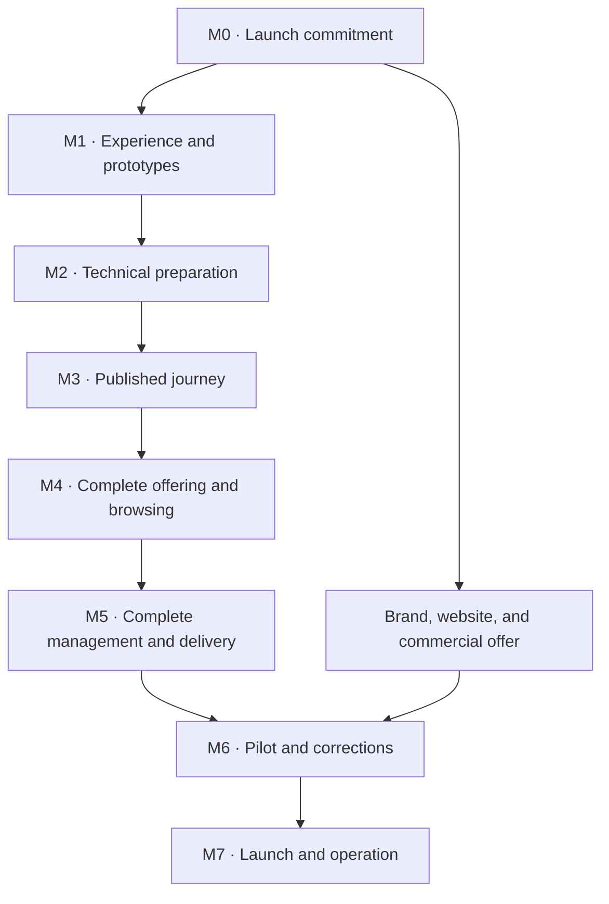

# Roadmap — Valiris Restaurants

Version 0.5 · 2 October 2026. Owner-adopted direction; capability scope accepted in [ADR-0008](../adr/0008-first-launch-capability-commitment.md) and supplemented by [ADR-0009](../adr/0009-studio-design-and-registered-diner-personalisation.md). M0 is integrated and closed; active design work is [M1 #5](https://github.com/yaboula/valiris-restaurants/issues/5). Later delivery dependencies remain open in the [closeout register](m0-closeout.md).

This roadmap replaces the seven-module, 17-week plan. It records execution direction, not committed dates, contracted capacity, or implemented capabilities. See [ADR-0007](../adr/0007-first-product-launch-roadmap.md) and the [historical roadmap](history/roadmap-2026-09-28.md).

## 1. First-launch objective

Deliver and commercialise **Storefront + Digital Menu**: the restaurant's public presence, an understandable offering before and during the visit, and tools to prepare, review, publish, and maintain it.

QR is an access route. The first commercial version includes the necessary Core and a viable onboarding, design, and support service. Prepare the Valiris brand and commercial website in parallel, with promises matching the deliverable product.

Bookings, reviews, loyalty, reactivation, and WhatsApp remain in the modular vision. Decide their implementation and order later according to demand, dependencies, and delivery capacity. Ordering, payments, POS, delivery, and invoicing are outside this first module.

**Complete** covers preparation, review, publication, consultation, updating, distribution, correction, and continuity. It does not automatically include every research opportunity. M0 defines the launch commitment with traceability to the [functional definition](../research/storefront-digital-menu/functional-definition/functional-definition.es.md).

The owner's subsequent D1/D2 decision accepts the 72 reference capability rows for launch: 36 common, 30 configurable and six connection capabilities with unresolved target/access dependencies. This includes personal comparison, video, declared nutrition, offline consultation, change comparison and in-venue displays. Only standalone audio and 3D media subparts are deferred. See the [current matrix](../product/m0-capability-matrix.md); scope acceptance does not demonstrate delivery, validation or M0 closure.

The supplementary D4/D5 decision keeps page design with Valiris and autonomous content updates with restaurants; a free-form restaurant page builder is excluded. Personalised recommendations for authenticated registered diners join the launch, with sufficient account/preferences responsibilities. Public consultation stays account-free. These two prose references are tracked separately from the 72-row count.

Design update, 2 October: [ADR-0010](../adr/0010-diner-account-and-display-recovery.md) records the owner's shared Valiris diner identity, venue-scoped tastes/diet, email/password and withdrawal of unconfirmed unattended-display prices/availability. [C1–C3](../design/m1-connected-journey.md) and [J10–J15](../design/m1-extended-journeys.md) supply descriptive Markdown states at the owner's direction. Technical/privacy/freshness contracts, interactive evidence, independent review and real inputs remain pending; the milestone exit criteria and launch scope below are unchanged.

## 2. Starting position

| State | Work |
| --- | --- |
| Available | Competitive research, synthesis, focused references, detailed functional definition |
| Available as an execution proposal | Six responsibility areas; actual capacity and ownership still need confirmation |
| Closed | General competitive exploration; new enquiries address specific decisions |
| Next | Resolve actual delivery dependencies and begin complete-scope no-code prototypes |
| Unproven | Real usability, maintenance effort, willingness to pay, service costs, margin |
| Not established as completed | Product prototypes, implementation, pilots, active integrations, commercial launch |

Vendor research establishes published offerings and patterns, not problem/product validation. Simulations prepare scenarios; they do not replace real conversations or tests.

## 3. Sequence and parallel work

These are major dependencies, not a requirement to finish every milestone before independent work on the next. Product, design, engineering, and quality collaborate from the start. Prototype journeys without code before implementing them; engineering assesses feasibility during design. Quality accompanies every milestone; M6 consolidates real evidence and corrections rather than concentrating all testing there.

### Responsibility areas

The supplied G1–G6 labels identify workstreams, not staffed teams. Yahya remains product owner and lead engineer, assigns capacity, and approves decisions and merges.

| Label | Responsibility |
| --- | --- |
| G1 | Combined Direction and Product: commitment, priorities, viability, evidence and consolidation |
| G2 | Product Designer leads journeys/interactions/content/prototype; Visual Designer joins early for UI/identity/templates/print |
| G3 | Engineering: feasibility, architecture, construction, technical operation |
| G4 | Quality: independent review, accessibility, verification, scenarios |
| G5 | Service: onboarding, training, support, pilot coordination |
| G6 | Commercial: positioning, brand, website, offer, communication |

## 4. First-product milestones

| Milestone | Principal outcome | Consolidating responsibility | Exit criterion |
| --- | --- | --- | --- |
| M0 · Align execution | Committed scope, open decisions, responsibilities, dependencies | Product with the owner | Every reference capability has explicit treatment; design briefs can start |
| M1 · Design and check | No-code public/management prototypes, content, visual direction | Design with Product | Critical journeys/states resolved; completed reviews/tests recorded with limits |
| M2 · Prepare construction | Rules, sufficient architecture, quality requirements, executable backlog | Engineering with Product and Quality | First delivery implementable; acceptance criteria and consequential technical decisions resolved |
| M3 · First complete journey | Operator prepares/reviews/publishes; diner browses presence/menu | Engineering | Connected test-environment journey; permissions, publication, tenant isolation checked |
| M4 · Complete offering and browsing | Launch-committed public/contextual capabilities | Engineering with Design and Product | Representative cases work, including relevant errors/context changes |
| M5 · Complete management and delivery | Maintenance, reviewed automation, outputs, measurement, operation | Engineering; Service consolidates delivery | Launch scope covered; another responsible person can onboard/maintain a restaurant with prepared materials |
| M6 · Pilot and correct | Real use, resolved incidents, service evidence | Service with Product | Critical tasks checked with real participants; blockers closed; commercial limits explicit |
| M7 · Launch and operate | Commercial version, Valiris website, operation | Owner with all workstreams | Verifiable release, manageable service, operational support/follow-up |

### M0 — Align execution

Reuse existing documents. Product turns the definition into a verifiable commitment; the owner specifies priorities, authority, resources.

Minimum deliveries:

- Launch objective, covered situations, boundaries.
- Capability matrix: included, configurable within launch, later, connection-dependent, or awaiting decision; with rationale and owner.
- Main journeys and initial success criteria for diners, operators, buyers.
- Briefs for Design, Engineering, Quality, Service, Commercial with real dependencies.
- Short list of execution-changing decisions and questions for research with people.

Functional-definition labels do not automatically become phases. Do not remove an accepted capability for technical convenience: present and record any material commitment change with its consequences.

**Exit:** design can proceed without reconstructing the vision. Sales proof is not required to prototype; documentation does not establish demand.

### M1 — Design and check the experience

Design venue-discovery and direct-menu entry; mobile consultation; prices, variants, conditions; food information; preparation/review; publication and service-time changes.

Use three contrasting cases: simple café; restaurant with variants/areas; restaurant with daily menu/languages. Use real content where available and explicitly label fictional examples.

Prepare information architecture, copy, empty/error states, interactive no-code prototypes, visual direction, necessary components, printable output. Templates and bespoke design must support the same autonomous everyday maintenance.

Include optional registered-diner access/preferences and personalised recommendation states, recovery/sign-out and ordinary anonymous consultation. Restaurants edit content rather than compose their own pages. Distinguish personalisation from venue-curated recommendations and local saved comparisons.

SEO participates in public structure, discoverable content, design-affecting requirements. Engineering reviews technical implications; Quality reviews clarity, accessibility, scenarios. Detailed future-module screens are unnecessary.

Check important usability questions with real diners/operators. If unavailable, record the limitation and use expert review/scenarios without calling them user validation. Product decides which uncertainties may proceed internally and which block the affected journey.

**Exit:** committed behaviours understood, coherent experience, pending risks treated. Continue design changes when tests justify them.

### M2 — Prepare construction and the necessary Core

Specify business rules, states, shared data, component responsibilities, interfaces, acceptance criteria. Select stack/structure from first-product needs and actual capacity.

Define necessary Core: establishments/data separation; team access/permissions; common business information; hours/exceptions; shared catalogue; languages; appropriate traceability/recovery. Implement it connected to M3–M5 journeys.

Registered-diner identity/session, preferences and authorised recommendation inputs are necessary Core for the accepted launch. Define guest versus staff access, account scope across venues, recovery/account controls and retention/deletion rules. Choose only what this use requires; registration alone neither creates a tenant's campaign customer nor authorises promotional messages.

Do not build campaign customers/consents, loyalty visits, bookable resources, booking notifications merely for future modules. Add them only for committed needs. Do not require extensive event catalogues or abstractions for hypothetical modules.

Engineering and Quality define measurable, proportional permissions/publication/accessibility/performance/recovery/operation checks. Standards are useful references, not certification or mandatory template sets.

Deliver the initial backlog, dependencies, review criteria, environment/deployment strategy. Record consequential decisions; avoid unused documentation or duplication of code.

**Exit:** M3 can be built and checked against clear criteria. Every engineering detail of the platform need not be predetermined.

### M3 — Build a published journey end to end

Connect operator access, venue content, representative menu, editing, review, publication, public consultation through link/stable QR. Include usable base presentation and access controls from this delivery.

Run it in a test environment to check data, interface, rules together. Drafts must not accidentally become public. Verify one business cannot operate on another's data.

**Exit:** connected functional demonstration with known scope; internal product construction, not the complete commercial offer or a pilot-ready product.

### M4 — Complete offering and consultation

Implement committed presence/identity; menus/categories; variants/formats/prices/conditions; composed menus; areas/services/validity; availability/exceptions; relevant search/filters; details/deep links; languages/food information.

Build each public behaviour with its required management. Do not publish information the restaurant cannot maintain. Some management is completed here rather than necessarily waiting for M5.

Critical cases: browsing before visiting while service is closed; terrace versus general menu; supplements; useful consultation without photos; pending information; clarity/navigation when changing language.

Complete accepted registered-diner recommendations with their required account/preference controls, current-item/context checks and empty/no-match/error fallback. Preserve anonymous browsing and private-state isolation.

**Exit:** assigned cases work with representative content, without promises about future stock or automatically inferred food safety.

### M5 — Complete maintenance, distribution, service

Complete committed importing/review; mobile/collaborative editing; drafts/contextual previews; independent urgent changes; scheduling; history/recovery; translations affected by changes; printable outputs; QR materials; export/continuity; maintenance signals and relevant digital measurement.

Keep human review where appropriate. Add external connections only if committed and supported by sufficient capability/data/access. Sharing a link is not automatic synchronisation.

Service prepares onboarding, customer materials, content confirmation, training, support, delegated changes, service exit. Check templates and bespoke-design processes with defined scope/revisions; offering both does not require every possible design to be completed.

Engineering prepares deployment, failure monitoring, backups/recovery; Quality checks full journeys. Commercial and the owner define offer/demonstration/conditions from real delivery effort.

**Exit:** launch scope covered, understandable service conditions, essential functions not omitted in favour of visually impressive ones.

### M6 — Pilot with restaurants and correct

Obtain participant authorisation/collaboration. Include restaurants covering priority situations; decide numbers by coverage/support capacity, without invented quotas.

Observe diner consultation and operator setup/review/publication/price changes/sold-out/correction/languages/printing. Record outcomes, errors, studio dependence; distinguish guided demos from autonomous use.

Measure onboarding, revisions, support, bespoke-design effort. Check offer understanding and willingness to pay; distinguish interest, quote acceptance, actual payment. Free pilots do not prove willingness to pay.

Resolve blockers and recheck affected behaviours. Missing participants block this evidence; simulations cannot replace them. Independent technical/commercial preparation may continue.

**Exit:** useful product/service evidence for tested situations with explicit limits. Small pilots do not establish market dominance or profitability at scale.

### M7 — Launch, operate, learn

Publish the first commercial product with coherent demonstration, Valiris website, offer, contracting, onboarding, support. Resolve domain/content/export/restaurant-responsibility conditions.

Track incidents, maintenance, updates, service costs. Review real results and prioritise first-product improvements before assuming growth requires another module.

**Exit:** a restaurant understands its purchase, joins, uses it, receives support, and has clear exit conditions. Commercial delivery matches the announced commitment, with relevant limits published.

## 5. Brand, website, commercialisation in parallel

| Timing | Parallel work | Dependency |
| --- | --- | --- |
| M0–M1 | Positioning, Valiris identity, website structure/prototype, SEO | Clear enough offer/objectives |
| M2–M4 | Content, visuals, website construction once design resolved | Committed capabilities; demos labelled |
| M4–M5 | Real demonstration, proposed packages/conditions, onboarding/design/support | Observable product, estimable delivery effort |
| M6 | Correct messaging/offer/conditions from pilot | Recorded experience/costs |
| M7 | Coordinated public launch | Product/website/operation ready for announced offer |

Valiris SEO differs from restaurant SEO. Start with content/structure; technical checks accompany construction. Do not promise rankings, traffic, generative-search appearances.

## 6. Quality and delivery closure

Each delivery includes relevant design/rules, implementation where applicable, author checks, proportional independent review, updated documentation, demonstrable results.

| Dimension | Priority check |
| --- | --- |
| Functional coherence | Price/format/context/language/validity match publication |
| Operator | Urgent action does not publish unrelated drafts; understandable, recoverable errors |
| Diner | Account-free access/reading; clear navigation/essential conditions |
| Accessibility | Reading, keyboard, focus, contrast, zoom, assistive technology for relevant journeys |
| Data/permissions | Tenant separation and effective authorised-action controls |
| Food information | Missing data/pending review distinct from absence/safety |
| Operation | Reproducible deployment, failure detection, verified recovery |
| Commercial | Promises, delivery, support responsibilities agree |

Choose manual/automated tests by risk/behaviour. Maintain stable critical-journey regressions, expand when they change; do not run everything indiscriminately for documentation edits.

Close milestones on outcomes/evidence, not document/ticket counts. Fix critical blockers before advancing affected deliveries. Record other limits with impact, owner, agreed treatment.

## 7. Deliveries, versions, calendar

- M0–M2 produce decisions/design/preparation; documentary Git references are not usable-app releases.
- From M3, integrate earlier software and check the appropriate environment. Deployed releases are identifiable with relevant notes; no tag is required per task.
- Pre-launch may use `v0.x.y`; internal deployment is not customer availability.
- `v1.0.0` is the first commercial Storefront + Digital Menu with necessary Core, not all future modules.
- Future modules join the same app and preserve delivered compatibility/quality.

Retire the 17-week estimate. M0 records real founder delivery/review capacity, tools, participant availability. At M2 exit estimate construction from backlog/dependencies; recalibrate after the first functional delivery. Communicate ranges/assumptions, not falsely precise dates. Role counts do not establish full-time staffing; founder review, real tests, dependencies constrain timing.

## 8. Subsequent modular evolution

| Possible module | Prioritisation condition | Dependency to examine |
| --- | --- | --- |
| Table Bookings | Real reservation-management need/usage commitment | Capacity, shifts, tables, manual entry, attendance |
| Reviews | Legitimate feedback/reputation-management need | Identifiable visits, permissions, policies |
| Loyalty | Demonstrable operational/commercial reward value | Eligible visits, redemption, disputes |
| Reactivation | Plausible recovery value/measurement | Confirmed visit history, consent, opt-outs |
| WhatsApp Assistant | Support volume/tasks justify assistance | Maintained sources, channel policies, human handover |

This is an opportunity portfolio, not a schedule or mandatory order. Other valid channels may satisfy dependencies; one module need not always be sold before another. Core grows from actually needed shared responsibilities.

Each new module gets scope/design/construction/tests/commercial delivery. Keep the existing platform operational; do not promise unchecked journeys.

## 9. Documentation and next action

- [Charter](charter.md): vision, philosophy, authority, evidence limits.
- [Functional definition](../research/storefront-digital-menu/functional-definition/functional-definition.es.md): reference capabilities/behaviours.
- [Master research](../research/storefront-digital-menu/README.md): evidence when a decision requires it.
- [Planning transition](planning-transition.md): tracker mapping and historical applicability.

Personal execution/coordination material stays outside Git. This roadmap establishes sequence without automatically approving every proposed capability or historical date. Record subsequent changes with rationale/impact; current owner decisions take precedence.

**Next action: G2 / M1 [#5](https://github.com/yaboula/valiris-restaurants/issues/5).** Execute the [public and management design briefs](../product/m1-design-briefs.md), with Product Designer first and Visual Designer involved from the initial journeys/content. M0 integration and closure are complete; do not request them again. [#4](https://github.com/yaboula/valiris-restaurants/issues/4) retains M2 preparation and [#15](https://github.com/yaboula/valiris-restaurants/issues/15) the parallel commercial line. Order design by tasks/risks within the full accepted scope, not one navigation item per capability or compulsory advanced setup for a simple café. No dates are committed; costs and final commercial conditions await concrete proposals/evidence.
