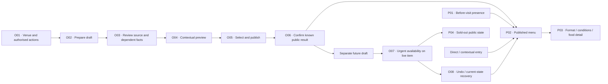

# M1 first connected journey — preparation to public consultation

Updated 2 October 2026 · G2 Product Design · Work under [#5](https://github.com/yaboula/valiris-restaurants/issues/5).

**Status: first reviewable design proposal, not M1 completion.** This package supplies annotated architecture, fictional content, transitions, copy and review tasks. It does not change the accepted launch commitment or the proposed M0 criteria. No real restaurant, participant, working integration or usability result is represented. Parallel external G1/G4 reports on immutable `60d76ad` identify G4-01 draft-save recovery; the author correction below is supplied, with focused G4/G1 recheck pending. That independent documentary review does not cover the new content-preparation block or J10–J15 overall.

**Current delivery method:** the owner selected descriptive Markdown on 2 October and removed Figma from active work. Section 9 contains the connected screen storyboard and recovery branches. Internal links navigate this document; they do not execute the described product actions. The dated C3 fixture remains 1–2 October even when this document is read later.

**Connected continuation:** [J10–J15 extended journeys](m1-extended-journeys.md) now describe comparison/video/offline, nutrition, in-venue display, observed-change comparison, six differentiated connection paths and diner accounts/preferences. [ADR-0010](../adr/0010-diner-account-and-display-recovery.md) records the owner's selected design directions with technical review pending. This is additional descriptive coverage, not independent review, interaction evidence or completion of the other launch paths.

**Content-preparation continuation:** [reviewed import, assistance/glossary, shared/copy and bulk maintenance](m1-content-preparation.md) expands O02–O05 and mobile/service/history boundaries into 27 CP states. [ADR-0011](../adr/0011-shared-menu-content-and-contextual-maintenance.md) records the owner's principal shared-content choice; per-context prices/conditions, common factual review, independent copies and result/recovery contracts remain proposed for technical/independent review. The extension maps six J3 criteria and eight affected cross-journey criteria; real source/asset/provider, interaction and review evidence remain open.

## 1. Authority and source check

The working branch started clean at `a52edc2`, equal to local `main` and fetched `origin/main`. GitHub #5 was inspected and is open. M0 is integrated and closed; #4 remains technical preparation and #15 the parallel commercial line. Reuse the [briefs](../product/m1-design-briefs.md), [criteria](../product/m0-journeys-and-criteria.md), [matrix](../product/m0-capability-matrix.md), [closeout](../project/m0-closeout.md), [roadmap](../project/roadmap.md), [charter](../project/charter.md), [executive brief](../project/m0-execution-brief.md), [functional definition](../research/storefront-digital-menu/functional-definition/functional-definition.es.md), [glossary](../glossary.md) and ADRs [0005](../adr/0005-repository-and-product-language.md), [0008](../adr/0008-first-launch-capability-commitment.md), [0009](../adr/0009-studio-design-and-registered-diner-personalisation.md).

Source discrepancies: the original definition's opportunity labels and the personal coordination documents' separate Direction/Product arrangement are superseded by ADR-0008/0009 and the executive brief. ADR-0008/0009 retain historical “integration pending” wording; the closeout and integrated Git state establish completion. None requires reopening M0. Keep the historical records intact.

The 72 parent capabilities remain 36 included, 30 configurable at launch and six connection-dependent; S1/S2 remain separate. Only standalone audio and 3D are later. This first path is an order of design work, not a scope cut. Source documents were read in full, completing truncated tool responses with bounded reads. Only targeted excerpts of master research were consulted; its complete reading is not claimed.

## 2. Architecture built around tasks

| Surface | Proposed structure | First-path responsibility |
| --- | --- | --- |
| Public venue presence | Venue identity and proposition → visit information → current/general/planned offering; optional editorial content | P01 introduces the venue and keeps the menu accessible when kitchen service is closed. |
| Direct menu | Identity → visible applicable context → sections and item summaries → detail → return to reading position | P02–P05 serve the QR/link intention without an editorial gateway. C1 has no mandatory search, filters or context chooser. |
| Personal choices | Optional saved comparisons; separate voluntary account entry for personalisation | Anonymous comparison and venue recommendations stay usable. Account, preference and recovery paths are described in the J10–J15 continuation; implementation/review remain pending. |
| Operator workspace | Correct venue/location and authorised actions → **Servicio**, **Contenido**, **Revisión**, **Salidas** | Service changes act on published content; content edits create drafts; review selects publication; outputs track generated versions. |
| Supporting destinations | Venue information/languages, team permissions, history/recovery, connections, use/maintenance, help and export | Contextual access from the task; not one navigation destination per capability. |

Provisional Spanish navigation labels are UX copy, not an approved information architecture. C1 may expose only its one venue and short menu; C2 adds applicable area/format controls; C3 adds service/date and translation review. Do not require advanced configuration to publish C1. Restaurant controls edit content; page composition remains the studio's responsibility.

Diagram nodes are annotated states, not completed screens or interactions.

## 3. Fictional C1–C3 content

All venue names, prices, hours, declarations, materials and review statuses below are **fictional fixtures**. “Reviewed” describes a simulated content state; it does not assert review by a restaurant or translator. Price examples use euros and show final fixture amounts; no commercial Valiris tariff is proposed. No real addresses, contact destinations, media rights or nutrition values are invented.

Amounts in section 3 are the initial fixture unless a transition explicitly changes them. A positive food declaration is not a complete record: retain every known declared fact and separately label remaining unknown/preparation information pending. The written walkthroughs use explicit operation permissions, not assumed job titles: content editing, editorial publication, live availability and history/status access are separate authorisations. Their final permission model is an M2 contract; restaurant staff and diner identities remain separate.

### C1 — Café Linde

One venue; ten items; no photos; Spanish content; fictional opening hours Monday–Saturday 08:00–17:00, breakfast until 12:00. No area setup, composed menu or filter configuration is required. Interface language can change independently of available content translations.

| Section | Item and final price | Fictional declared-food state |
| --- | --- | --- |
| Cafés | Espresso 1,60 €; café con leche 1,90 €; café con hielo 1,80 € | Milk declared for café con leche; remaining records pending. |
| Desayunos | Tostada de tomate 2,80 €; tostada de mantequilla 2,60 €; croissant 2,20 € | Wheat/gluten declared for both toasts; milk also declared for butter toast; croissant pending. |
| Bebidas | Zumo de naranja 3,00 €; té 1,80 €; agua 1,50 €; chocolate caliente 2,80 € | Milk declared for hot chocolate; remaining records pending. |

Allergy statements and preparation warnings have their own fields; a declared ingredient list does not establish absence of other allergens. First task: start with the published ten-item menu, edit café con leche from 1,90 € to 2,00 €, review and publish that change, then mark croissant sold out with an unrelated text draft open. The separate croissant draft proposes changing its description from “Croissant” to “Croissant de mantequilla”; its food record remains pending and the proposal remains private throughout the coffee publication and urgent action. The name is not evidence of ingredients; the operator must supply the facts before any corresponding declaration.

C1's walkthrough clock is **1 October 10:00 Europe/Madrid**. The three Desayunos items apply to the named **08:00–12:00 breakfast offering**; coffees/drinks remain in the ordinary venue offering. Croissant's urgent action identifies **“Desayunos de hoy · hasta las 12:00”** automatically from its published offering, without asking the café to configure additional areas/services. At 12:00, that breakfast offer is past; prices can remain readable as a labelled planned/general reference without promising current service/stock. Availability is explicitly reviewed at the next applicable breakfast; yesterday's sold-out history cannot be restored into a new service.

### C2 — Mesa del Patio

General and terrace contexts; shared item identity with explicit contextual amounts. Fixture source shows **“Tabla de quesos 24 / 34”** without portion labels. It remains unresolved until the fictional operator supplies “media tabla / tabla completa”. The confirmed price structure can then be reviewed independently of other drafts.

This is the first publication of that cheese item: until the labels/contexts are confirmed, it is a private proposal and cannot appear with guessed portions. Other published items remain consultable. For an edit to an existing item, preserve its last coherent published structure until authorised replacement; do not hide or overwrite unrelated current content.

| Item | General | Terrace | Essential condition / food state |
| --- | --- | --- | --- |
| Tabla de quesos artesanos de leche cruda, membrillo y pan de masa madre | Media tabla 24,00 €; completa 34,00 € | Media tabla 26,00 €; completa 36,00 € | Milk and wheat/gluten declared in fixture; description wraps naturally. Extra bread: +2,00 € general / +2,20 € terrace. |
| Arroz de verduras | 18,00 € / persona | 19,50 € / persona | Minimum two people; preparation/food record pending. Do not display 18,00 € as a complete two-person dish. |
| Pescado del mercado | 6,50 € / 100 g | 7,00 € / 100 g | Weight and total to be confirmed with staff; fish declared, remaining preparation information pending. |
| Vino de la casa | Copa 3,50 €; botella 19,00 € | Copa 3,80 €; botella 21,00 € | Sulphites declared in fixture; format stays beside price. |

The wine section includes these additional fictional bottle rows: **Blanco de parcela, fermentado y criado sobre lías** 24,00 € general / 26,00 € terrace; **Tinto de viñas viejas, crianza en roble** 28,00 € / 30,00 €; **Rosado de prensado directo, edición de primavera** 22,00 € / 24,00 €; **Espumoso de método tradicional, brut nature** 32,00 € / 34,00 €; **Vino dulce de vendimia tardía, botella de 375 ml** 25,00 € / 27,00 €. Each amount is per named bottle, not per glass; food records are pending. Together with the house-wine formats, these are concrete long-text navigation examples, not real producers or reviewed nutrition/allergen records.

Search and food-filter behavior is described in [X05](#x05-context-search-and-food-filter). Switching terrace → general preserves the selected item and format where applicable, announces the changed context/amount, and asks for reselection if that format is absent. A generic entry with no applicable area uses **“Elige la carta: General / Terraza”**, naming both contexts without assuming the diner's seat; an area-specific link can preselect its named context. Invalid context gives an explanation and the same chooser. C1's one context requires none of this setup.

### C3 — Casa del Mediodía

Fictional local timezone Europe/Madrid. Local open 12:30–17:00; kitchen 13:00–15:30. Published menu for **1 October 2026**, lunch, **16,50 € / persona**: choose one starter (crema de calabaza or ensalada), one main (pollo al horno or arroz de verduras), one dessert (flan or fruta); bread and water included; coffee +1,50 €. Food record for crema is pending; flan fixture declares milk and egg. ES content is the source; EN is a simulated reviewed version, with FR/DE interface missing-content examples rather than invented reviewed venue translations.

Run the first-publication branch before the service branch: prepare **E10**, a private draft for 1 October lunch at 16,50 €, while **D11** already exists for 2 October at 17,50 €. Review E10, preview, select it alone and publish; a confirmed result creates L10. Before confirmation, no 1 October daily menu is public and the public state says **“Todavía no hay menú del día publicado”** with any actually published general offering. E10's confirmed publication precedes the before-visit and urgent-action walkthroughs. D11 stays private in every branch unless explicitly published in the separate scheduling scenario below.

Representative simulated EN: **“Lunch menu · 1 October · €16.50 per person”**; **“One starter, one main and one dessert. Bread and water included. Coffee +€1.50.”**; **“Pumpkin soup”**, **“Salad”**, **“Roast chicken”**, **“Vegetable rice”**, **“Flan”**, **“Fruit”**. Shared amounts/date/availability come from the same fixture values. The flan notice says **“Declared: milk and egg. Remaining allergen information pending; ask staff before choosing.”** This is sample copy, not an actual translation review.

Missing FR/DE venue-description examples retain the current Spanish source with proposed interface notices **“Description disponible en espagnol. Traduction en cours de révision.”** and **“Beschreibung auf Spanisch verfügbar. Übersetzung wird überarbeitet.”** The language switch retains date/service/context and shared amounts. These sample notices are not proof of reviewed venue translations; pending food meaning still requires its explicit declared/remaining-pending notice in the selected interface language before final review.

| Version | Content and use | What the diner may see |
| --- | --- | --- |
| L10 | Published 1 October lunch menu, 16,50 €; flan available | Current published context during lunch; planned offering before service, without stock assurance. |
| D11 | Private future draft for 2 October, 17,50 €, changed flan description | Nothing from this draft. Tomorrow's unpublished menu is not available to public planning. |
| L10a | Urgent update: flan sold out for 1 October lunch | Same 16,50 €, dates, descriptions and food states; flan “Agotado en este servicio”; fruit remains a choice. |
| L10b | Reviewed undo of L10a if no newer conflicting change | Availability restored only for the selected current scope; D11 remains private. |

Availability has an explicit **review at next service** policy in this fixture. The item is not silently restocked; show past-service status separately from today's availability not yet confirmed. A future offer becomes publicly consultable only after authorised publication, labelled with its validity. Scheduling a draft is distinct from declaring it publicly visible; that precise timing policy remains a G1/G3 question.

Second C3 branch, reset to L10: change crema to “Crema de calabaza con yogur”; the fictional operator explicitly declares milk in the changed recipe. Review that Spanish fact, retain **“Contiene leche declarada”**, and mark the remaining food/preparation record and affected EN description pending. Never suppress a known positive declaration behind a generic pending label or retain old EN recipe/absence claims. Publish this coherent change as **L10c**, including the pending translation/food notices, independently of D11. Public EN shows the current Spanish description with **“Description available in Spanish. Translation being updated.”** and **“Declared: milk. Remaining allergen information pending; ask staff before choosing.”** If fallback would mislead, withhold the affected assertion/item for explicit review. Unrelated current items remain. Public, paper and staff views carry the same declared/pending distinction.

## 4. Annotated first state sequence and copy

| ID | Actor / action | Observable state, representative product copy and recovery |
| --- | --- | --- |
| O01 | Operator enters correct venue/location | Venue and permissions visible. Access error: “No tienes acceso a este local”; choose an authorised venue or request access without exposing its content. |
| O02 | Prepare manually or inspect imported proposal | “Borrador · no publicado”; original remains beside proposal. Empty: “Añade tu primer producto”. Partial/failed import keeps source and permits retry/manual entry. No unsupported import capability is simulated as proven. |
| O03 | Review prices and supplied facts | “Falta identificar los formatos de 24,00 € y 34,00 €”. Affected dependent fields and omissions remain visible. Food pending is an explicit state; it cannot be converted into an absence claim. |
| O04 | Preview context and language | “Vista previa · no pública”; venue, area, service/date and language selectors. Show missing EN/FR/DE content and exception conflicts. Return to edit preserves the draft. |
| O05 | Review selected publication | Summary names selected changes, contexts, dates and dependent facts. Unrelated drafts are listed as remaining private. CTA: “Publicar estos cambios”. Ambiguous prices or unresolved context conflicts block the affected selection. Permission denial explains who can publish. |
| O06 | Confirm result / inspect public menu | Success only on a known result: “Publicado: menú del 1 de octubre. El borrador del 2 de octubre sigue sin publicar”. Link “Ver carta publicada”. Failure preserves the last known publication without asserting it remains temporally valid; no prior publication has an explicit empty state. Unknown result: “No hemos podido confirmar la publicación. Comprueba su estado antes de reintentar”. |
| P01 | Diner before visiting | Identity, local/kitchen hours and public general/planned menu. “Cocina cerrada ahora · servicio de 13:00 a 15:30”. Reading remains available. No public route points into D11. |
| P02 | Diner opens direct menu | Venue and context appear above sections. C2: “Carta de terraza · Cambiar”. C3: “Menú del día · 1 octubre · comidas · 16,50 € por persona”, inclusions/supplements adjacent. No compulsory account or installation. |
| P03 | Inspect item and return | Format/amount/condition stay in the summary. Food pending: “Información de alérgenos pendiente. Consulta al personal antes de elegir”. Detail adds supplied information, then returns to reading position. Context/language change keeps intent and identifies changed values/fallback. |
| O07 | Staff marks live item sold out on mobile | Enter from **Servicio**, not from draft editor. “Flan · comidas de hoy · marcar agotado”; scope and next-service review policy shown. CTA “Marcar agotado”. C1 one item requires no bulk/context setup. For bulk action, preview every selected item/context. |
| P04 | Inspect urgent public effect | “Agotado en este servicio”. L10a keeps price 16,50 € and original descriptions; D11's 17,50 € does not appear. Historical scheduled future availability is not treated as known stock. |
| O08 | Undo / recover / handle concurrent change | “Flan marcado agotado. El borrador del 2 de octubre sigue sin publicar”. “Deshacer” checks the current state; newer changes cause current/proposed review instead of blind overwrite. History names field, scope and responsible action. |
| O09 | Inspect affected output | “La carta generada usa L10. Revisa si necesita una nueva versión”. After price/ingredient changes, prompt regeneration. “Archivo generado” never means paper replaced; physical replacement confirmation records an operator statement, not observation. |
| P05 | Recover public consultation | Expired/withdrawn deep link → explanation + current relevant menu. No results → revise search/reset filters. Offline → loaded version/time + stale warning; unloaded item unavailable; reconnect reconciles current publication. The full offline interaction belongs to J10 expansion. |

Prototype publication, permissions, failures, scheduling and network changes are simulated states; later implementation must enforce/check the actual behaviours. Any prototype “success” label must sit within the clearly labelled fictional scenario, never suggest a live restaurant was updated.

## 5. Decisions to test, not new approved commitments

| Proposal / source | Alternatives and recommendation | Cost, counterexample and check |
| --- | --- | --- |
| Separate live service actions from editorial review — R04/R05, J4/J5 | Recommend a **Servicio** route for urgent availability plus a separate selected-publication review. A single “Save and publish” path hides collateral publication; a full approval workflow on every sold-out action burdens C1. | Restaurant gains visible action scope but must recognise two tasks; diner gets an honest availability notice; Valiris maintains coherent draft/live states. Refute if users cannot tell which source they are editing, or D11 leaks after undo. No effort saving is claimed. |
| Context attached to choice — R02, J2.2 | Recommend explicit named formats and amounts in the applicable area, with adjacent essentials. “From” pricing alone and unexplained global multipliers conceal C2 conditions. | More reading space and deliberate context switching; less room for imagery. Refute with minimum-person/weight pricing or a retained comparison that silently uses an old terrace amount. |
| Item-level language fallback — R06/R07, J6.2 | Recommend current reviewed-language factual content with an explicit language notice; withhold unsafe-to-interpret assertions when fallback is insufficient. Keeping old text makes a factual contradiction; hiding the entire site removes useful unaffected content. | Mixed-language reading imposes effort; restaurant needs review queue; Valiris needs dependency tracking. Ask G4/G5 to evaluate whether the English reader can understand the pending-food state. This refines R06 without silently replacing it. |
| Preview selected publication — R03/R04, J4 | Recommend coherent selected change groups with dependencies, not independent checkboxes that permit price without its format or facts without their notice. | Selection is more constrained; restaurant must resolve dependencies. Refute with simultaneous manual exception, schedule edit and concurrent availability change. G3 defines the atomicity/conflict contract in M2. |

## 6. Early visual-design assignment

**Prepared for handover; no Visual Designer has been activated or credited with review.** Inputs: C1–C3 above, O04/O05/O07 and P01–P04, both template and bespoke routes, R01/R02/R07/R08/R10. Product Designer consolidates interaction; Visual Designer owns the proposed expression and output composition.

Produce a first direction with a no-photo C1 menu, C2 long format/condition row, C3 composed menu and mobile urgent-action/result states. Include a base-template example and a more distinctive studio-designed example with the same routine edit controls. Explore restaurant identity through type, hierarchy and restrained accents; management needs clear task/state hierarchy. These are provisional principles, not a brand identity approval. No fake food photo, placeholder-image requirement or invented logo is necessary to demonstrate reading.

Compose an A4 C3 daily-menu output and a staff food-information sheet from the same fixture: title, date/service, full price/inclusions/supplements, declared/pending distinctions, language notice, publication reference and deliberate page breaks. Add a stable-QR support layout once a real owned destination exists; a decorative/non-scannable square does not count as a QR. A screen-output example later needs its own distance/device assumptions.

Review the long C2 title and all amounts without truncation; text expansion and missing photos; readable pending notices; focus/target placement; page breaks that keep price/conditions together. Prototype-level reading/layout review is distinct from keyboard, assistive-technology, reflow and real print-device checks. The first visual assignment should return annotated alternatives with those limits, not a speculative complete design system.

## 7. Compact coverage and remaining work

**A** = annotated in this document or the linked J10–J15 continuation; **N** = further design path, still unresolved; **D** = real input/access dependency. None means an interactive or independently verified journey. The matrix remains the scope ledger; this table is the design handover map. Extended state IDs, all 20 J10–J15 criteria and counterexamples are in the [continuation](m1-extended-journeys.md#9-criteria-traceability-and-reader-led-walkthroughs).

| Capability group (72 parent rows once) | Journey / criterion and proposed location | State |
| --- | --- | --- |
| B1.01–B1.08 | J1/J8; P01/P02, O01/O02; template/bespoke handover, domain/exit expansion | A/N |
| B1.09 | J1.4/J14; J14-C01 booking exit, actual destination/result boundary | A/D |
| B2.01–B2.09 | J1–J5; C1–C3, O02–O08, P02–P04; schedule/exception expansion | A/N |
| B2.10 | J14-C02; authorised operational source, field mapping, stale/conflict | A/D |
| B3.01–B3.08, B3.10 | J2; P02/P03/P05; full search/filter/unknown-food/pairing expansion | A/N |
| B3.09, B3.11 | J10-P01–P05/O01; anonymous compare, changed choice, optional video/captions/failure; standalone audio/3D subparts remain later | A/D for video material |
| B4.01–B4.11 | J3–J6; O01–O08 and [individual B4 rows](m1-content-preparation.md#individual-affected-capability-record); CP-I01–I07/R01–R03, A01–A03, S01–S04, M01/B01–B04/X01–X03; import/assistance/mobile/bulk/shared-copy/menu-order annotated, existing X06 schedule preserved | A/D for real sources/assets, operation/technical and independent evidence |
| B4.12 | J14-C03/O02; actual authoritative incoming change source, ownership/revocation | A/D |
| B5.01–B5.08 | J1.4/J6/J7; C3/O03/P03/O09 and [CP-R02/G01/G02](m1-content-preparation.md#cp-g01-maintain-a-venue-glossary-proposal); translation/glossary/dependent facts annotated, full maintained staff/output evidence still required | A/N/D for full register/outputs and real reviewed content |
| B5.09 | J11-O01–O03/P01; source/portion/variant/declared and pending nutrition, recipe-change output review | A/D for actual source/values |
| B6.01–B6.06 | J1/J2/J7; direct entry, P02/O09, dedicated paper/staff/QR outputs | A/N/D for real owned QR target |
| B6.07–B6.08 | J14-C04/C05/O02; actual host/embed and channel delivery, access/failure | A/D |
| B6.09 | J12-O01/O02/P01/P02; dedicated display, published revision, unconfirmed-price withdrawal/reconnect | A/D for real device/context |
| B6.10 | J2.6/J10-P04/P05; loaded/unloaded snapshot, time/coverage, coherent reconnect; private personalisation excluded | A/D for freshness implementation |
| B6.11 | J8.4; export omissions/rights, domain and hosted-service exit | N/D for service conditions |
| B7.01–B7.05 | J9; digital period/source/unknown and unavailable collection; clicks distinct from outcomes | N |
| B7.06 | J14-C06/O02; actual confirmed-outcome source and attribution boundary | A/D |
| B7.07–B7.08 | J9/J13-O01–O03; change/period/exposure comparison and insufficient-data states annotated; full maintenance still pending | A/N/D for actual metrics |
| B7.09–B7.10 | J8; common content autonomy, content confirmation, delegated changes and exit | A/N/D for D3 terms |

Separate S1: excluded page builder, retained studio composition/content autonomy. Separate S2: J15/R17 account/sign-in/verification/recovery/preferences/no-match/error/sign-out/account-removal paths now annotated in the continuation. The owner selected one Valiris account, per-venue tastes/diet inputs and email/password; explicit matching and lifecycle UX are proposed, actual provider/security/access/retention/deletion contracts pending. Ordinary public browsing and local comparison are preserved. R01–R10 guide the first path; R11–R17 remain required and are traced through the extension, without implying all evidence is complete.

Import/assistance, mobile/bulk/shared-versus-copy/menu-order and glossary behaviour is now supplied in the [content-preparation descriptions](m1-content-preparation.md), with source/asset/provider, technical, independent and actual interaction evidence still required. Remaining design includes pairings, J8 buyer/service/delegation/export, full J9 maintenance/digital-use behaviour, full maintained staff/output detail where needed and visual direction/output rendering. Existing A/N/D statuses preserve these obligations; neither continuation closes them or establishes a percentage of completed capabilities.

## 8. Specialist questions and review tasks

Prepared, not sent or answered. G1 consolidates responses; absent specialists are pending contributions, not invented collaboration.

| Contribution | Specific input needed | Affected checkpoint |
| --- | --- | --- |
| G3 | Evaluate L10 + D11 + L10a + undo after a concurrent change; define selected-group publication, unknown-result retry and scheduled-target rebasing. Does scheduling keep content private until execution, or permit a separately authorised planned public version? | O05/O07/O08 and C3 schedule before their design closure; contracts under #4. |
| G4 independent | Attempt wrong-area price, unrelated draft publication, stale factual EN and false food assurance; review recovery on both surfaces. | First-path review before affected M1 closure. No independent result exists yet. |
| G5 | Who confirms format/recipe facts and factual translation, including the pending-food branch? Supply authorised existing menu material; later video rights/nutrition source/device. | Replace fictional content before claims of real delivery; intake/maintenance training. |
| G6 SEO | Validate public identity/location/hours, direct-menu discoverability, language URL expectations and withdrawn-target handling for P01/P02/P05. | Public structure before final design; technical specification later, Valiris website stays in #15. |
| G1 with G3/G4 | Owner-selected account scope/inputs/method are recorded in ADR-0010; review matching, permissions/session and recovery/removal/retention contracts, and identify actual six connection targets. | J14/J15 states supplied in continuation; actual targets and #4 contracts remain unresolved, never silently deferred. |

| Task for a future reviewer/participant | Counterexample / observable result to check |
| --- | --- |
| T1 C1: change the milk coffee price, publish, then open the menu as a diner | Same product at 2,00 € with its declared/pending distinctions; no advanced setup. |
| T2 C2: resolve `24 / 34`; open terrace, inspect half-table and extra-bread conditions, switch to general | Formats explicitly confirmed; terrace 26,00 € and extra +2,20 €; general 24,00 € and extra +2,00 €. Separate reading information; no add-to-order action, cart total or retained wrong-context amount. |
| T3 C3: leave D11 private; mark flan sold out | L10a retains 16,50 €, today's content and food states; D11 17,50 € remains private. |
| T4 C3: undo after another member changed live availability | Conflict/current-state review instead of overwritten action; unrelated drafts retained. |
| T5: fail/lose the publication response | Known old publication versus uncertain result distinguishable; retry follows status check. |
| T6 C3: change the crema ingredient while EN is unreviewed | Current Spanish fallback, retained declared milk and remaining-food pending notice; no old factual EN claim. |
| T7: open before lunch, then an expired daily-menu deep link | Planned published information usable without stock assurance; expired target returns to current menu. |
| T8: change a price after generating the daily menu | Old generated version flagged; no assertion that physical sheets changed. |

Real sessions require real authorised participants. Record reviewer identity, scenario/version, assistance, observations, errors, recovery and remaining question; do not treat these task instructions as completed sessions. Stop affected design closure for wrong price, draft leak, false food assurance or unrecoverable publication. Correct and repeat the affected public/operator scenario.

Accessibility design checks will use [WCAG 2.2](https://www.w3.org/TR/WCAG22/) as a verified primary reference (checked 1 October 2026): text/non-text contrast, visible/unobscured focus, target size, labels/errors, language changes, reading order, text enlargement/reflow and recovery. Assess only what the available fidelity exposes. Descriptions can specify intended labels, reading order and recovery; they cannot establish rendered contrast, keyboard/screen-reader operation, reflow, server permissions or full WCAG conformance.

## 9. Descriptive Markdown storyboard

The owner selected this medium on 2 October 2026. Continue with written screen composition, representative copy, actions, destinations and counterexamples in this same package. Figma is no longer the working environment or a dependency. Described screens are proposed product behavior; document links only support a reader-led walkthrough. No application code, state-changing prototype or participant result is supplied here. The original interactive-evidence criteria remain unproven; this medium change does not by itself close them or #5.

Historical evidence only: the 1 October tool check created a team/file and exercised two fictional states. That probe did not implement these journeys. Its team/file and screenshots remain unchanged; their access/entitlements are not active blockers for this Markdown work.

### O01: Venue and task entry

**Actor and goal:** an operator enters the venue they are authorised to maintain. Read the venue name first, then current service and role, then tasks. C1 exposes one venue without requiring a location/context wizard. Multiple venues require an explicit current selection.

**Composition:** a persistent venue header; task navigation **Servicio / Contenido / Revisión / Salidas**; a short current-service summary; a separate draft count. Management status uses text labels as well as any future visual accent. On mobile the same task names remain directly reachable; editing uses one column without hiding price or publication status.

**Actions:** [Contenido: prepare a draft](#o02-content-editor) or [Servicio: change current availability](#o07-urgent-availability). A member lacking venue access sees the O01 denial in section 4; no venue content is exposed. A member who can edit but cannot publish may prepare content and encounters [X01](#x01-publication-permission).

### O02: Content editor

**Actor and goal:** prepare content without changing the public menu. The top line says **“Borrador · no publicado”**, identifies item/menu and source language, and links to the last published version for comparison. The edit area follows reading order: name → description → formats/amounts → supplements/conditions → declared food facts and pending information → affected translations → applicable area/service/date.

**Case content:** C1 changes café con leche from **1,90 €** to **2,00 €**. C2 keeps **“24 / 34 · formatos sin identificar”** unresolved until the operator supplies media/completa and both area amounts. C3 prepares E10, **1 octubre · comidas · 16,50 €**, with supplied source/EN copy and declared/pending facts; D11, **2 octubre · comidas · 17,50 €**, is a separate future draft. After E10's selected publication creates L10, D11 remains private. Before then, there is no prior daily-menu version to compare; label the proposal as new content.

**Actions:** save the draft with a visible saved/unsaved result; [Revisar cambios](#o03-review-and-preview). Leaving with unsaved changes offers save or explicit discard; failed saving retains entered content for retry. The ordinary content editor offers no free-form page layout controls.

**Draft-save recovery — G4-01:** distinguish local entered values from the last confirmed saved draft revision. C1 starts with public coffee **1,90 €**, local proposal **2,00 €**, confirmed prior coffee draft **DR1 · 1,90 €**, and a separate croissant-description draft. Lost acknowledgement says **“No hemos podido confirmar el guardado. Tu propuesta local sigue pendiente de comprobar”** and enters [CP-X02](m1-content-preparation.md#cp-x02-result-register-and-unknown-operation) for the original save operation, not publication. If the original save is confirmed, identify **DR2 · café 2,00 €** and review that saved revision in O03; if confirmed not applied, keep local 2,00 € and compare/retry against the latest authorised draft base, not a blind whole-operation repeat. Neither changes public coffee 1,90 € or the croissant draft.

**Competing draft / revoked access:** another authorised editor's saved **DR3 · café 2,10 €** versus local 2,00 € enters [CP-X01](m1-content-preparation.md#cp-x01-conflicting-revisions), showing last confirmed DR1/DR2 as actually known, current DR3 and the local proposal; adopt current or deliberately revise/save a new confirmed draft before publication review. If edit permission is revoked, show the permitted current draft only if read access remains; do not resave/publish or assume retention rights. Revoked venue access hides private source/proposal content and leaves an uncheckable save unknown through CP-X03; return to authorised workspace/access recovery. Leaving after “save” does not silently discard an uncertain local proposal: remain in recovery or explicitly close with unresolved status and permitted retention/clearing. Optional local-proposal preview is labelled **“Propuesta local · guardado sin confirmar”**, not a saved/public revision; O05 must revalidate source/version/permission before any authorised publication. G3 defines correlation, retention and revision guarantees in M2.

**Invalid-input contrast:** an unreadable/negative price, missing required format/unit or inverted service/date interval keeps the entered proposal and explains the error beside the affected field. Copy: **“Revisa el importe y su formato antes de publicar”** or **“El fin del servicio debe ser posterior al inicio”**. No guessed amount, currency/unit or silent date correction is published. A zero amount requires an explicit intended free offer, not a blank field silently interpreted as zero. Correcting one field retains unrelated work; mobile reading order reaches field, explanation and action together. Specific parsing/validation and rendered focus checks remain implementation work.

### O03: Review and preview

**Actor and goal:** understand the change and resolve facts before publication. Show published versus proposed values together, grouped by item and applicable context. Put unresolved issues beside their affected fields rather than in a distant general warning. A saved draft stays private throughout review.

Identify the confirmed saved draft revision being reviewed, including after O02's uncertain/competing-save recovery. A separately labelled local proposal can be inspected but cannot be called confirmed saved; entering O05 requires fresh source/version reconciliation. A newer saved draft is compared before authorising the chosen revision, with unrelated drafts retained.

**Case content:** C1 shows **“Café con leche: 1,90 € → 2,00 €”**. C2 shows media/completa and general/terraza separately; an unnamed **24 / 34** blocks that affected group. Pending food data is represented explicitly, not converted into absence. C3 distinguishes source facts, pending food information and affected English copy; an old factual translation is never marked current merely because the interface has switched language.

**O04 preview area:** **“Vista previa · no pública”**, visible venue/context/date/language, then the intended public layout from [P02](#p02-menu-and-item-detail). Context choices appear only when applicable. Returning to [O02](#o02-content-editor) retains the draft. The next action is [Revisar publicación](#o05-selected-publication).

### O05: Selected publication

**Actor and goal:** authorise a coherent group of changes with explicit consequences. The order is selected changes → affected contexts/dates/languages → dependent facts/notices → drafts remaining private → primary action. Group dependent fields so selecting a new amount cannot omit its format or required condition.

**Representative copy:** **“Se publicará: Café con leche · 2,00 € · carta general.”** A separate block says **“Seguirá sin publicar: descripción del croissant.”** C3 says **“Se publicará: E10 · menú del 1 de octubre · comidas · 16,50 €. Seguirá sin publicar: D11 · 2 de octubre · 17,50 €.”** Conflicting scope or ambiguous amount prevents publication of the affected group and points back to [O03](#o03-review-and-preview). If the reviewed source has changed before confirmation, show current versus proposed values through [X03](#x03-concurrent-change); never silently publish against an obsolete review. Recheck permission at the action, including revocation since opening review. See [X06](#x06-scheduling-and-manual-exception) for explicit scheduling.

Publication identifies the chosen reconciled draft revision and reviewed current source; a lost draft-save response or a competing private draft must first return to O02/O03 recovery, not be interpreted as publication success. No public price change is claimed before the authorised action's known result.

**Actions:** [Publicar estos cambios](#o06-publication-result); return to review without losing the draft. An unauthorised member sees [X01](#x01-publication-permission). A failed/uncertain result follows [X02](#x02-failed-or-unknown-result), not this document's success route by assumption.

### O06: Publication result

**Actor and goal:** know whether the intended public result exists. A confirmed C1 result says **“Publicado: Café con leche · 2,00 €. La descripción del croissant sigue en borrador.”** Confirmed C3 says **“Publicado: L10 · menú del 1 de octubre · comidas · 16,50 €. D11 · 2 de octubre · 17,50 € sigue sin publicar.”** The editor recognises E10 as the source of L10; other drafts retain their identity. A success message never stands in for a missing response.

**Composition:** result and scope first; public version reference; private drafts summary; [Ver carta publicada](#p02-menu-and-item-detail); return to [Servicio](#o07-urgent-availability) or content. Failures retain the draft and route to [X02](#x02-failed-or-unknown-result). Actual version creation and permissions enforcement require later implementation.

### P01: Before-visit presence

**Actor and goal:** a diner understands the venue and its published offering before travelling. Lead with venue identity/proposition, a short description and **Ver carta**. Visit information distinguishes venue hours from kitchen hours; real address, contact and connection targets require supplied material and are not invented for this fixture.

**C3 before service:** at fixture time **1 October 12:30 Europe/Madrid**, after L10 exists, show **“Local abierto · cocina cerrada ahora · servicio de 13:00 a 15:30”** followed by the published lunch offer and validity. At 14:00 the service is current; at 15:30 it is over. The daily-menu service window is **13:00 inclusive to 15:30 exclusive**, distinct from venue opening. Before service show **“Oferta prevista para este servicio; disponibilidad por confirmar”**; do not carry an available-stock claim from a future offering. D11 does not appear. Reading remains possible with the appropriate time label; [X04](#x04-expired-target-and-language-recovery) handles expired targets. The primary destination is [P02](#p02-menu-and-item-detail); direct-menu/QR entry bypasses this page.

### P02: Menu and item detail

**Actor and goal:** a diner reads applicable prices and conditions without an account. Order: venue identity → current context/validity and language → menu sections → complete item summaries → declared/pending food detail. A mobile section jump returns to the same reading position; names and prices wrap rather than truncate. No photograph is required for C1.

**C1 composition:** compact text rows under Cafés, Desayunos and Bebidas. **“Café con leche · 2,00 €”** remains readable with its declared milk information; the croissant's pending food information is explicit. Search/context setup does not interrupt a ten-item menu.

**C2 composition:** **“Carta de terraza · Cambiar”** above sections. The long cheese title wraps; format and price remain adjacent: **“Media tabla · 26,00 € / Tabla completa · 36,00 €”**, then **“Pan extra +2,20 €”**. General uses **24,00 € / 34,00 €**, supplement **+2,00 €**. This first detail shows alternatives and conditions without an order/cart total. Rice displays its per-person amount and minimum two people; fish its per-100-g amount and unconfirmed weight/total. Switching context retains item/format only if still applicable and announces the new context/amount.

If the previous format is absent, say **“Este formato no está disponible en la carta general. Revisa las opciones”**, clear that inapplicable choice and retain the item/reading position when it exists; a withdrawn item uses the changed-target recovery. If the source is not loaded/current enough to determine the destination offering, show [X05](#x05-context-search-and-food-filter) or the snapshot warning, rather than assuming general prices. The generic entry chooser described in C2 precedes context-dependent rows. Language changes retain context; source-language fallback labels do not translate or duplicate shared amounts/status.

**C3 composition:** **“Menú del día · 1 octubre · comidas · 16,50 € por persona”**, then inclusions **“Un primero, un segundo y un postre. Pan y agua incluidos. Café +1,50 €.”**, then the choices from section 3. The future 17,50 € draft is absent.

**P03 detail:** opening an item expands supplied facts, preparation warnings and format/conditions. **“Información de alérgenos pendiente. Consulta al personal antes de elegir”** stays visible when information is missing; no safety badge is inferred. The pending EN branch uses the current source-language description with a translation notice, as specified in C3. Returning preserves position/context. To follow the service scenario, read [O07](#o07-urgent-availability); a diner has no operator control in the product.

### O07: Urgent availability

**Actor and goal:** authorised staff act on a live item during service, independently of editorial drafts. On mobile, lead with **“Servicio · Casa del Mediodía”**, current service/date and **“Publicado: L10 · 16,50 €”**. List published items and availability; a separate **“1 borrador pendiente”** summary is not a publication action.

**Selected action:** the sheet names **“Flan · comidas del 1 de octubre”** and current scope. Explain **“Solo cambia la disponibilidad en este servicio. El borrador del 2 de octubre seguirá sin publicar.”** Primary action **Marcar agotado**; secondary **Cancelar**. Do not hide scopes inside a generic confirm button. Review at next service remains the stated fixture policy; no silent automatic restock is implied.

**Destinations:** on confirmed result, read [P04](#p04-public-sold-out-state) and [O08](#o08-undo-and-current-state-review). Missing permission routes to [X01](#x01-publication-permission); a failed/unknown result to [X02](#x02-failed-or-unknown-result). A concurrent relevant change uses [X03](#x03-concurrent-change). Next-service review is [X07](#x07-next-service-availability-review). Bulk-action selection/review remains a separate expansion.

### P04: Public sold-out state

**Actor and goal:** the diner understands the remaining offer. L10a keeps **1 octubre · comidas · 16,50 €**, inclusions and all unrelated descriptions/food states. The flan stays in its dessert section with **“Agotado en este servicio”** adjacent to its name; fruit remains available as a stated fixture choice. Colour alone must not communicate availability. D11 and 17,50 € remain absent.

The same scope rule makes C1's croissant sold out without publishing its description draft. An already open or offline view needs reconciliation/freshness behavior under J10; this written state does not claim instantaneous refresh. A reader may follow [O08](#o08-undo-and-current-state-review), but the diner cannot undo in the product.

### O08: Undo and current-state review

**Actor and goal:** staff recover without overwriting another member's work. The confirmed notice says **“Flan marcado agotado para comidas del 1 de octubre. El borrador del 2 de octubre sigue sin publicar.”** Offer **Deshacer** and a persistent history entry naming item, scope, actor/action and version; the fixture does not invent a real staff identity.

**No relevant conflict and service still current:** review current item/context and restore only that availability scope as L10b; confirm and offer the published [P02](#p02-menu-and-item-detail) for inspection. Preserve any unrelated later price/text/translation changes. **Relevant conflict:** read [X03](#x03-concurrent-change); do not restore an old whole-menu snapshot. After service expiry or item removal, undo cannot reactivate that expired/withdrawn target: explain why, retain history and use [X07](#x07-next-service-availability-review) for a current scope if one exists. No price/description from D11 is included. Failed/uncertain undo uses [X02](#x02-failed-or-unknown-result).

### O09: Version-linked paper composition

**Actor and goal:** generate an understandable daily menu and recognise which publication it represents. In Salidas, list source version, language, generation time and output type separately from the staff statement that physical sheets were replaced.

**Proposed A4 reading order:** venue name **Casa del Mediodía**; **Menú del día · 1 octubre · comidas**; **16,50 € por persona**; full inclusions and coffee supplement; first courses, mains and desserts from C3; adjacent declared/pending notices; a legible **Referencia L10** footer. Use one text column and deliberate spacing; keep each item with its conditions and food notice across page breaks. Type size, margins, contrast and actual pagination remain visual/print checks, not measurements established by this description. Never imply that a general pending notice certifies the menu safe.

After L10a, offer a reviewed L10a composition labelling flan sold out. An existing L10 file remains unchanged and the staff decides whether replacement is useful. A changed amount/ingredient requires attention to the affected old output. Copy: **“Archivo generado: L10. Hay cambios posteriores; revisa si necesitas una nueva versión.”** Action **Generar versión actual** describes file generation only; **Registrar reposición** records an operator statement. No decorative QR or invented URL is included.

**C1 paper menu:** the same three sections and ten published items, with café con leche at 2,00 € after its confirmed change; the private croissant description is excluded. Use the current published availability/notices and source version/language, no photo requirement. **C2 paper menu:** deliberately choose General or Terraza; print that context prominently and use only its formats, amounts, supplements and conditions, including the named long wine rows. Page breaks keep each item with its price/essential conditions. A general sheet cannot borrow a terrace extra-bread price.

**C3 staff sheet:** one row per item/format with source language, declared positives, remaining pending/preparation information, affected translation status and source version/service. L10c's soup row retains declared milk and flags the remaining record/EN as pending; the flan row retains milk/egg. No recipe, cross-contact statement or safe-diet claim is invented. Public and staff outputs use the same fact states, while the staff review metadata is not presented as a diner-facing assurance.

### X01: Publication permission

**Editorial state with retained edit permission:** **“Puedes guardar este borrador, pero no publicar en este local.”** Preserve allowed work and offer return to [O02](#o02-content-editor). **Service-action denial:** **“No tienes permiso para cambiar la disponibilidad en este local”**; return to [O01](#o01-venue-and-task-entry) without assuming editorial edit access. A member authorised only for live availability can use O07 and cannot publish D11. Identify an authorised role/contact only if supplied. Revocation before an action denies it; a lost response followed by revocation remains an unknown result until an authorised check establishes it. Do not expose a restricted venue, falsely assert no change, or label an invitation as granted access.

### X02: Failed or unknown result

**Known editorial failure:** **“No se ha publicado este cambio. Conservamos el borrador y la última publicación conocida.”** Show that publication's actual validity; it may be expired, or absent on E10's first attempt. An expired L10 is never called the current menu. Retry the same selection only after current scope/permission checks; preserve entered content. **Unknown result:** **“No hemos podido confirmar la publicación. Comprueba su estado antes de reintentar.”** Primary action **Comprobar estado**. A matching result requires the recorded action/scope/version outcome, not merely coincidentally equal field values. Found success leads to [O06](#o06-publication-result); confirmed no-effect permits revalidated retry; a later change requires [X03](#x03-concurrent-change), retaining any known successful action in history. Remaining uncertainty offers an authorised status check/support, never an unconditional second publication.

**Urgent or undo variant:** use **“No hemos podido confirmar el cambio de disponibilidad de Flan · comidas del 1 de octubre”**. A found urgent success leads to [O08](#o08-undo-and-current-state-review) with [P04](#p04-public-sold-out-state) available for inspection; found undo success confirms the scoped restoration and offers [P02](#p02-menu-and-item-detail). These routes never open editorial publication or submit D11. A known failed urgent/undo operation shows unchanged last-known availability with its time/scope, not an invented draft. Action identity, reconciliation and retry guarantees need G3 specification/implementation verification.

### X03: Concurrent change

**Availability state:** another relevant authorised change occurred after the reviewed action. Show current availability/service/version and proposed restoration together. Copy: **“La disponibilidad cambió después de tu acción. Revisa el estado actual antes de continuar.”** Actions **Mantener estado actual** and **Revisar un nuevo cambio**. A fresh authorised choice returns to [O07](#o07-urgent-availability) with current scope and failure handling. An unrelated newer price/text change is retained; availability recovery never reverts it. Expired/withdrawn scopes cannot be revived.

**Editorial state:** current values changed after O03/O05 review, for example another authorised member changed the same price to 2,10 € while the proposal remains 2,00 €. Show both values and scope; **“Estos datos cambiaron después de tu revisión”**. Keep current publication and unrelated drafts; actions **Mantener publicación actual** or [Revisar mi propuesta](#o03-review-and-preview) with refreshed comparison. No automatic winner or silent overwrite is implied. D11 stays private in all unrelated branches.

### X04: Expired target and language recovery

**P05 expired menu:** **“Este menú ya no está vigente.”** Explain which dated offer was opened and link to the current published menu; do not redirect to private D11. If no current daily menu is published, offer the available general menu and supplied venue contact rather than inventing today's offer. The [P02](#p02-menu-and-item-detail) fixture is only a representation of that destination when its validity matches.

**Pending factual EN:** show the current supplied Spanish description with **“Description available in Spanish. Translation being updated.”**, retained declared milk and the remaining-food pending notice specified in C3. If that fallback is insufficient to understand an affected assertion, withhold it for review as described in C3. Keep unaffected content readable. Search-empty is described in [X05](#x05-context-search-and-food-filter); detailed saved/offline recovery remains J10 expansion work.

### X05: Context search and food filter

**C2 search:** from a confirmed terrace/ES context, search **“vino”**; match supplied visible reviewed names/descriptions and category **“Vinos”**, so the six named wine entries appear with their formats/terrace amounts. **“Merlot”** has no match in this fixture: show **“No encontramos resultados para «Merlot»”**, retain visible active query/filters, and offer **Cambiar búsqueda** or **Limpiar búsqueda y filtros**. Reset returns to this terrace menu, not an assumed general context. A language change reruns search against actually displayed reviewed/fallback content with its notice; never fabricate missing translated matches.

**Food exclusion contrast:** **“Excluir productos con leche declarada”** is not a suitability/safety filter. In C2 the cheese's declared milk excludes it from that result. Within the filtered view, a separately labelled **“Información incompleta: consulta al personal”** group shows items whose records are insufficient to interpret the exclusion; it is not mixed into a claimed safe group. **Ver carta completa** keeps them discoverable in the full menu. Items with positive declared milk are still excluded even if their remaining information is incomplete. Unknowns never join an asserted safe group. Active criteria and **Restablecer filtros** are visible. Preference/category filters stay distinct from food exclusion.

**Unavailable context data:** keep the requested context name but withhold unconfirmed contextual amounts; offer retry or another explicitly selected loaded/current menu with its provenance. A loaded offline snapshot retains its age and warning per P05/R14. Never reuse terrace supplements with general prices or erase pending food notices. The detailed saved/offline branch remains J10 work.

### X06: Scheduling and manual exception

**Separate fixture branch from L10/D11:** D11 remains private until an explicit future publication. To exercise scheduling, review its saved revision **D11r1 · 2 octubre · 17,50 €**, select **2 October 12:15 Europe/Madrid** as publication time and **13:00–15:30** as service validity. Proposed policy for this contrast: scheduling alone leaves the draft private until execution; publishing a future offer for advance planning is a separate explicit reviewed action. This makes the visible intention reviewable while G1/G3 settle the contract.

Show **“Programado · no publicado”**, target revision, local time/zone and validity. At 12:15, a confirmed execution creates **L11 · 2 octubre · 17,50 €**; at 12:30 it is a published planned offer with availability unconfirmed. At 13:00 it is current in time, but stock remains governed by [X07](#x07-next-service-availability-review). Pending execution, failure, cancellation and superseded schedule never claim L11 exists.

**Changed target:** editing to D11r2 flags **“El borrador cambió; revisa la programación”** with r1/r2 differences. The proposed safe route marks an unresolved changed-target schedule **“Bloqueado por revisión”** and requires reviewed rescheduling/re-authorisation or cancellation; it does not silently bind the old schedule to new content. Show the formerly authorised target and the actual known state; do not assert a pause succeeded if execution raced or the result is unknown. Exact execution/lock rules need G3. Cancellation has its own confirmed/unknown result; if execution already occurred, explain that cancelling cannot unpublish it and offer review of the actual published result.

**Manual exception contrast:** set the 2 October kitchen service to **13:30–15:30**, with named venue/date/service scope and explicit end at 15:30. Preview shows exception precedence over the normal 13:00 start and flags the conflict with the selected 13:00 validity. Resolve by reviewing 13:30 validity and rescheduling the matching revision, or explicitly cancelling/revising the exception. The coherent public branch says **“Horario especial · cocina de 13:30 a 15:30”**; at 13:15 it is a planned offer without stock assurance. Both changes remain private until their authorised publication. An unresolved schedule/exception conflict blocks the affected publication; next-day normal hours are not overwritten.

Failure retains known history and the actual validity of any prior publication: L10 is expired on 2 October and cannot fill in as a current daily menu. Use [X02](#x02-failed-or-unknown-result) for uncertain outcomes and an honest no-current-menu state. These are proposed scenario states, not tested time execution or approved implementation guarantees.

### X07: Next-service availability review

After 1 October lunch ends, the old sold-out state is labelled **“Servicio anterior · 1 octubre · comidas”** in history. It cannot be undone into the current service. On the next published applicable service, show **“Disponibilidad por confirmar”** for the carried item until the authorised operator reviews it; a future menu publication does not assert stock.

Actions are **Confirmar disponible para este servicio** or **Marcar agotado para este servicio**, each naming the current published date/service/item and using O07's permission/result/conflict recovery. If the item is absent or the current menu remains private, there is no live target: show that reason and return to content/review without publishing D11 as a side effect. Restoring availability needs a confirmed authorised action; unrelated draft prices and past-service overrides remain unchanged.

### Walkthrough entry points

| Reader-led case | Sequence and counterexample |
| --- | --- |
| C1 preparation to consultation | [O01](#o01-venue-and-task-entry) → [O02](#o02-content-editor) → [O03/O04](#o03-review-and-preview) → [O05](#o05-selected-publication) → [O06](#o06-publication-result) → [P02/P03](#p02-menu-and-item-detail). The coffee becomes 2,00 €; the croissant description draft stays private. Then follow O07–O08 for its urgent availability only. |
| C2 price and context | O02 → O03 until formats are supplied → O05/O06 → P02/P03 in terrace → general. Reject any described state showing a terrace supplement with a general price or a guessed portion. |
| C3 preparation and service | Operator O01 → O02 E10 → O03/O04 → O05 select E10 → O06 creates L10; [P01](#p01-before-visit-presence) → P02/P03; O07 → P04 → O08, or X01/X02/X03. L10a stays 16,50 € and D11 17,50 € stays private. Then inspect [O09](#o09-version-linked-paper-composition), [X04](#x04-expired-target-and-language-recovery) and [X07](#x07-next-service-availability-review). Reset to L10/D11 for separate X06 schedule/exception and L10c ingredient branches; do not merge their incompatible timelines. |

Walkthrough links never impersonate switching accounts, saving, publishing, network failure or permission enforcement. A reviewer records which described branch they assessed and why it passes/fails the section 8 task; no interaction or independent review is claimed by traversing links.

## 10. Delivery boundary and next action

Baseline author documentary verification before the J10–J15 continuation: all 12 then-listed local source links resolved; the coverage table enumerated exactly the matrix's 72 parent IDs once each, with S1/S2 separate; C1–C3, state identifiers, eight review tasks and the diagram fence were checked. A scenario consistency reading checked that L10a changes availability while D11's price remains private, C2 amounts and conditions stay attached to their area/format, and the language branch exposes pending facts. The extension rechecks this baseline and the added local/fragment links; its evidence is recorded in the continuation. These are document checks, not exercised interaction, independent review or participant evidence.

Earlier 2 October storyboard check at 302f144: all 37 then-existing internal action links resolved; the 12 local sources, 72-capability count, eight review tasks and code fences passed. A written walkthrough checked C1's private description, C2's format/area amounts, C3's L10/D11/urgent-undo branches and generated-versus-replaced paper. Section 11 records the subsequent deeper review and corrections. Layout, rendered accessibility and live behavior were not tested.

This document is a progressive descriptive delivery with fictional content, screen composition, linked action destinations, recovery branches, paper structure and a coverage/dependency map. New interaction choices remain proposed for review; the owner selected Markdown for current work. Accepted product scope and the remaining M1 evidence requirements are unchanged. Independent review, visual-direction execution, interactive evidence, real sessions, external targets and implementation verification remain pending. No issue or milestone closes on this document.

J10–J15 are now supplied in the [extended descriptive package](m1-extended-journeys.md), including state cards, all 20 criteria, linked destinations, actual-input dependencies and author counterexamples. Next checkpoint: G1 coordinates independent G4 and focused G3 review of critical transitions; Product Designer incorporates actual findings while continuing the remaining A/N design paths. Visual Designer, real source/device/connection inputs and interaction evidence remain pending. No return to Figma is required for this work.

The [content-preparation package](m1-content-preparation.md#9-traceability-and-author-verification) adds import/assistance/glossary/shared-copy/menu-order/bulk paths and rechecks all V01–V16 and Q01–Q20 against them. That record does not replace the dated checks below or count as independent review. G2 next continues J8/J9 and remaining paired/visual/interaction paths; G1 coordinates actual G3/G4/G5 contributions.

## 11. C1-C3 author review and correction record

**2 October 2026 · baseline 302f144 · accountable: Product Designer, author of this package.** The owner requested a rigorous C1–C3 review and responsibility for the delivery. This is a fresh documentary review against R01–R08 and J1–J7, using the current descriptions and source criteria. There is no rendered product to capture; no visual audit, independent G4 review, actual interaction or participant validation is claimed. The author owns identifying/correcting these defects, rechecking affected descriptions and reporting limits; that ownership does not replace G1 decisions, G3 contracts or independent quality evidence.

The review found the following deficiencies in the baseline. **All rows below were corrected and re-read as descriptions in this increment**; this status is not a claim that runtime behavior passed.

| Finding | Impact and baseline evidence | Correction / affected states |
| --- | --- | --- |
| F01 · High | C3 O02 opened future D11 while the walkthrough started at an already published L10; its prepare→review→publish path was missing. | Add E10 first-publication seed and explicit empty/prior-result states; E10 alone produces L10, D11 remains private. C3, O02–O06, entry points. |
| F02 · High | X02 routed every found success to editorial O06, including urgent/undo actions. | Route recovery by the original action/scope: availability to O08/P04, undo to its scoped confirmation/P02; no D11 publication. X02. |
| F03 · High | X02 said the prior menu “sigue vigente”, unsafe for an expired or absent daily menu. | Preserve known publication separately from current validity; expired/no-prior offer has an honest state. O06, X02/X04/X06. |
| F04 · High | Yogurt change was marked food pending without explicitly retaining the newly supplied positive milk declaration. | L10c carries declared milk plus remaining pending information and current-source EN fallback; same facts in public/paper/staff. C3, X04, O09. |
| F05 · High | C2 entry assumed a context; unavailable format was described abstractly without recovery copy. | Explicit generic/invalid-context chooser; retain intent, clear inapplicable format, withhold unconfirmed amounts. C2, P02, X05. |
| F06 · High | Editorial publication lacked a concrete changed-underfoot example; concurrency was framed only as availability undo. | 2,10 € current versus 2,00 € proposal, refreshed review and no silent winner; relevant availability conflict/expired undo distinguished. O05, X03/O08. |
| F07 · High | Service permission denial assumed permission to save an editorial draft and always returned to the editor. | Separate action permissions/destinations; revocation and unknown results retain honest boundaries. X01/O05. |
| F08 · High | C3 schedule/exception remained a question without inspectable states, local timing or a conflict example. | D11r1/r2 schedule, L11 confirmed execution, cancelled/failed/changed-target/unknown outcomes and 13:30 manual exception; label proposed contract. X06. |
| F09 · Medium | T2 said “add bread”, suggesting ordering; C2 long wine/search/filter examples were not concrete. | Inspect supplement as information; named fictional wine rows, current-context search/reset and separate incomplete-food group. C2, T2, X05. |
| F10 · High | Next-service review/no silent restock was a policy sentence without actions or no-target recovery. | X07 explicitly confirms availability for the new published scope or marks it sold out; private/absent target blocks live action. |
| F11 · Medium | Reviewable EN was a label without representative translated menu/notice content. | Supplied simulated EN headline, inclusions, choices and retained declared/pending notices; shared numbers/status remain one source. C3/P02/X04. |
| F12 · Medium | O09 described only the C3 public paper composition, leaving C1/C2/staff content implicit. | C1 ten-item composition, selected C2 area/conditions/wine and C3 staff sheet with L10c facts; print/render measurements stay pending. O09. |
| F13 · Medium | The editor did not specify invalid amount/unit/time input recovery. | Preserve proposal, field-linked errors, explicit free-offer intent and no guessed amount/date correction. O02. |
| F14 · High | C1 named breakfast hours but left the croissant's urgent scope/end and expired-service boundary implicit. | Explicit 10:00 walkthrough, 08:00–12:00 breakfast scope and next-breakfast review without advanced setup or old-state restoration. C1/O07/O08/X07. |

### Rechecked documentary counterexamples

Each row is an author reading of written inputs, branch destinations and expected information after the corrections. “Consistent” means the stated design keeps the invariant; no action was executed against a live menu.

| Scenario | Written input and branch checked | Recheck result and remaining proof |
| --- | --- | --- |
| V01 · C1 publication | Published coffee 1,90 €, private coffee 2,00 €, separate private croissant description; select coffee alone. | Consistent: 2,00 € public; original croissant description/food-pending state retained. Actual publication isolation still requires implementation. |
| V02 · C1 urgent mobile | After V01, mark croissant sold out with that description draft present. | Consistent: availability only; draft stays private; permission/failure routes do not enter editorial publication. Mobile discoverability/targets untested. |
| V03 · C2 ambiguous intake | New cheese proposal `24 / 34` has no portion labels. | Consistent: affected first publication blocked until labels/areas supplied; existing unrelated menu remains readable. Real material/format confirmation pending. |
| V04 · C2 coherent amounts | Inspect half-table and extra bread in terrace, then general. | Consistent: 26,00 € with extra +2,20 €; then 24,00 € with extra +2,00 €; rice/fish retain unit/minimum conditions; no cart total/order. Comprehension untested. |
| V05 · C2 missing context/format | Generic entry; invalid area; selected format absent in destination. | Consistent: named chooser, no guessed prices; explicit changed-format message and preserved item intent. Real navigation/reflow untested. |
| V06 · C2 search/filter | `vino`, `Merlot`, milk exclusion, reset in terrace. | Consistent: six wine entries through supplied Vinos category; no-result recovery; incomplete records separate and no safety inference; reset retains context. Actual search/filter implementation untested. |
| V07 · C3 first publication | Private E10 16,50 € plus D11 17,50 €; select E10. | Consistent: confirmed L10 only, D11 private; no prior daily menu has an empty state. Selected-group enforcement pending G3/implementation. |
| V08 · C3 time and entry | 1 October 12:30, 14:00, 15:30; 2 October old daily-menu link. | Consistent: planned/current/expired distinction, venue versus kitchen hours, no D11 exposure or future-stock assurance. Actual local-time transitions untested. |
| V09 · C3 urgency/undo | L10 → L10a; undo during current service, with relevant concurrent change, or after expiry. | Consistent: 16,50 € and D11 retained; relevant conflict reviewed, unrelated newer values preserved, expired target not revived. Atomicity/concurrency untested. |
| V10 · Ingredient and EN | Reset L10; operator declares milk in yogurt soup, leaves factual EN unreviewed, publishes L10c. | Consistent: known milk retained, remaining facts pending, source fallback visible, no old factual EN; same states in staff/paper. Food/translation review is fictional. |
| V11 · Permission and uncertainty | Denied editorial/service action; permission revoked after review; lost response then status check. | Consistent: deny only affected action, preserve authorised work, no assumed editor access, match action outcome before retry, keep unknown if access prevents checking. Security/runtime proof pending. |
| V12 · Schedule/exception | D11r1 at 2 October 12:15; changed r2; cancellation race; kitchen exception to 13:30. | Consistent under labelled proposal: no implicit draft publication, conflict review and coherent validity; failed schedule never presents expired L10 as current. G1/G3 policy and timed execution pending. |
| V13 · Next service | Prior flan sold out; new published scope, private target or removed item. | Consistent: explicit current-scope confirmation required; no target means no availability action/publication. Lifecycle implementation pending. |
| V14 · Outputs | L10 paper, then L10a or L10c; C1 price change; C2 area choice. | Consistent: version/fact/area changes flagged; old physical paper unchanged; replacement is an operator statement. Actual rendering, pagination and physical replacement unverified. |
| V15 · Input recovery | Negative/unreadable amount, missing unit, service end before start, failed save. | Consistent: entered work retained, affected field explained, no guessed value or success. Parsing, focus/error announcement and persistence untested. |
| V16 · C1 offering boundary | Breakfast at 10:00, boundary 12:00 and next breakfast. | Consistent: urgent croissant action names current breakfast, past breakfast has no live undo and next applicable breakfast needs explicit stock review; coffee price remains independent. Local-time/lifecycle enforcement untested. |

**Verdict:** the identified documentary defects are corrected and the bounded C1–C3 descriptions now support these contrast walkthroughs. They are ready for independent review as a proposal, not a declaration of perfection or M1 completion. Still missing: independent G4 review; rendered layout/keyboard/contrast/reflow and print checks; actual participant comprehension; G1/G3 agreement and implementation proof for publication, action permissions, scheduling and reconciliation; real venue facts/translations. J10–J15 and the other unresolved launch paths retain their existing coverage/dependencies. No accepted capability is removed.

Final structural check for this correction: 55 internal action links resolve, all 12 local sources resolve, all 72 parent capabilities remain present once, eight participant tasks remain and the diagram fences are balanced. The 14 finding IDs and 16 counterexample IDs are unique and complete. `git diff --check` passed. These checks verify document integrity, not the execution of V01–V16.

**Next checkpoint:** independent review of V03–V14's critical branches and G3 review of X02/X03/X06 contracts. Product Designer owns incorporating actual findings and rechecking affected C1–C3 descriptions; absent specialists are pending contributions, not invented approvals.
