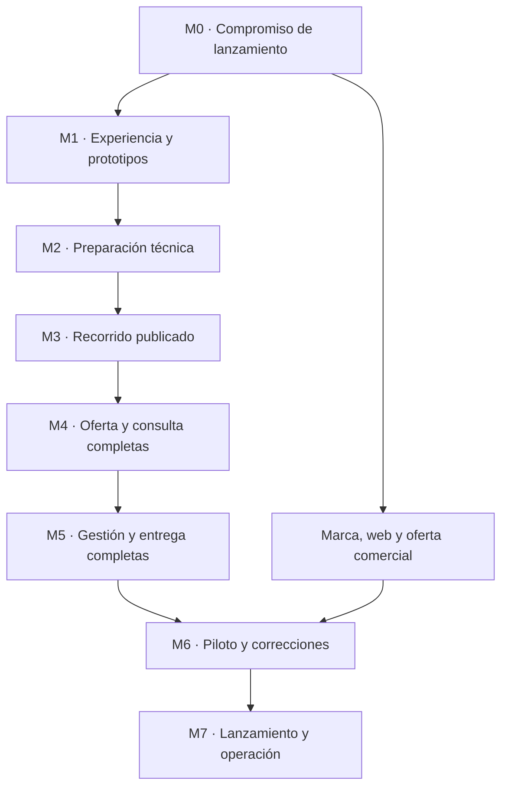

# Roadmap — Valiris Restaurants

Versión propuesta 0.1 · 1 de octubre de 2026.

Este roadmap sustituye la planificación histórica que situaba siete módulos y el lanzamiento de toda la plataforma dentro de 17 semanas. Es una propuesta ejecutiva basada en la dirección actual del proyecto; no acredita fechas, recursos contratados ni capacidades ya implementadas.

## 1. Objetivo del primer lanzamiento

Entregar y comercializar **Storefront + Digital Menu**: presencia pública del restaurante, oferta comprensible antes y durante la visita y herramientas para prepararla, revisarla, publicarla y mantenerla.

El QR es una vía de acceso. La primera versión comercial incluye el Core necesario para este producto y un servicio viable de alta, diseño y soporte. La marca y la web comercial de Valiris se preparan en paralelo, con promesas acordes al producto entregable.

Reservas, opiniones, fidelización, reactivación y WhatsApp permanecen en la visión modular. Su implementación y orden se decidirán después según demanda, dependencias y capacidad de entrega. Pedidos, pagos, TPV, reparto y facturación quedan fuera del alcance de este primer módulo.

**Completo** significa cubrir preparación, revisión, publicación, consulta, actualización, distribución, corrección y continuidad. No significa incorporar automáticamente cada oportunidad de la investigación. El compromiso de lanzamiento se concreta en M0 y conserva trazabilidad a la definición funcional.

## 2. Situación de partida

| Estado | Trabajo |
| --- | --- |
| Disponible | Investigación competitiva, síntesis, referencias enfocadas y definición funcional profunda |
| Disponible como propuesta operativa | Contexto de agentes, seis grupos y catorce perfiles reservables |
| Cerrado | Exploración competitiva general; consultas nuevas responden a una decisión específica |
| Siguiente trabajo | Concretar el alcance de lanzamiento y empezar los prototipos sin código |
| Pendiente de comprobar | Usabilidad real, trabajo de mantenimiento, disposición a pagar, costes de servicio y margen |
| No acreditado como realizado | Prototipos de producto, implementación, pilotos, integraciones activas y lanzamiento comercial |

La investigación de proveedores acredita oferta publicada y patrones competitivos, no validación del problema o del producto. Las simulaciones ayudan a preparar escenarios; no sustituyen conversaciones o pruebas con personas reales.

## 3. Secuencia y líneas paralelas

La secuencia marca dependencias principales; no exige terminar todo un hito antes de trabajar en una tarea independiente del siguiente. Producto, diseño, ingeniería y calidad colaboran desde el principio. Se prototipa sin código antes de implementar los recorridos; G3 puede revisar viabilidad durante ese diseño.

La calidad acompaña todos los hitos. M6 consolida evidencia real y correcciones, sin concentrar allí todas las pruebas o revisiones.

## 4. Hitos del primer producto

| Hito | Resultado principal | Responsable de consolidar | Criterio de salida |
| --- | --- | --- | --- |
| M0 · Alinear la ejecución | Alcance comprometido, decisiones pendientes, responsables y dependencias | G1 · Producto, con Dirección | Cada capacidad de referencia tiene tratamiento explícito y los encargos de diseño pueden empezar |
| M1 · Diseñar y comprobar | Prototipos públicos y de gestión sin código, contenido y dirección visual | G2, con Producto | Recorridos y estados críticos resueltos; revisiones y pruebas realizadas quedan registradas con sus límites |
| M2 · Preparar construcción | Reglas, arquitectura suficiente, requisitos de calidad y backlog inicial ejecutable | G3, con Producto y G4 | Primera entrega implementable con criterios de aceptación y decisiones técnicas que condicionan su construcción resueltas |
| M3 · Construir el recorrido completo inicial | Un operador prepara, revisa y publica; un comensal consulta la presencia y la carta | G3 | Recorrido conectado en entorno de prueba, con permisos, publicación y aislamiento del negocio comprobados |
| M4 · Completar oferta y consulta | Capacidades públicas y de contexto comprometidas para lanzamiento | G3, con G2 y Producto | Casos representativos funcionan, incluidos errores y cambios de contexto relevantes |
| M5 · Completar gestión y entrega | Mantenimiento, automatización revisada, salidas, medición y operación comprometidos | G3; G5 consolida el servicio | Alcance de lanzamiento cubierto; otro responsable puede dar de alta y mantener un restaurante con los materiales preparados |
| M6 · Pilotar y corregir | Uso real, incidencias resueltas y evidencia de entrega del servicio | G5, con Producto | Tareas críticas comprobadas con participantes reales, problemas bloqueantes cerrados y límites comerciales explícitos |
| M7 · Lanzar y operar | Primera versión comercial, web de Valiris y operación preparadas | Dirección, con los seis grupos | Release verificable, servicio asumible, soporte y seguimiento operativos |

### M0 — Alinear la ejecución

Reutilizar los documentos existentes. Producto transforma la definición en un compromiso verificable y Dirección concreta prioridades, autoridad y recursos disponibles.

Entregas mínimas:

- Objetivo del lanzamiento, situaciones cubiertas y límites.
- Matriz de capacidades: incluida, configurable dentro del lanzamiento, posterior, dependiente de conexión o pendiente de decisión; con motivo y responsable.
- Recorridos principales y criterios iniciales de éxito para comensal, operador y comprador.
- Encargos a G2, G3, G4, G5 y G6 con dependencias reales.
- Lista breve de decisiones que cambian la ejecución y preguntas para investigación con personas.

Las etiquetas de la definición funcional no se convierten automáticamente en fases. No se retira una capacidad aceptada por comodidad técnica: cualquier cambio material de compromiso se presenta con su consecuencia y se registra.

**Salida:** diseño puede trabajar sin reconstruir la visión. No se exige demostrar ventas para empezar a prototipar, ni se declara demanda validada por tener documentación.

### M1 — Diseñar y comprobar la experiencia

Diseñar entrada para conocer el local y entrada directa a la carta; consulta móvil; precio, variantes y condiciones; información alimentaria; preparación y revisión; publicación y cambios durante servicio.

Usar tres casos de contraste: cafetería sencilla; restaurante con variantes y zonas; restaurante con menú diario e idiomas. Incorporar contenido real cuando esté disponible; identificar expresamente cualquier ejemplo ficticio.

Preparar arquitectura de información, textos, estados vacíos y de error, prototipos interactivos sin código, dirección visual, componentes necesarios y salida imprimible. Las plantillas y el diseño propio deben permitir el mismo mantenimiento cotidiano autónomo.

SEO participa aquí en la estructura pública, contenido descubrible y requisitos que afecten al diseño. G3 revisa las decisiones con implicaciones técnicas; G4 revisa claridad, accesibilidad y escenarios. No es necesario diseñar pantallas detalladas de módulos futuros.

Comprobar con comensales y operadores reales las dudas de uso más importantes. Si no están disponibles, registrar la limitación y trabajar con revisión experta y escenarios, sin llamar a eso validación con usuarios. Producto decide qué incertidumbre puede pasar a un entorno interno y cuál impide la construcción del recorrido afectado.

**Salida:** el equipo entiende los comportamientos comprometidos, hay una experiencia coherente y los riesgos pendientes tienen tratamiento. Los cambios de diseño continúan después cuando las pruebas lo justifiquen.

### M2 — Preparar construcción y Core necesario

Concretar reglas de negocio, estados, datos compartidos, responsabilidades entre componentes, interfaces necesarias y criterios de aceptación. Elegir stack y estructura técnica por las necesidades del primer producto y la capacidad real del equipo.

Definir la parte de Core necesaria: establecimientos y separación de datos; acceso del equipo y permisos; información común del negocio; horarios y excepciones; catálogo compartido; soporte de idiomas; trazabilidad y recuperación pertinentes. Su implementación se realiza conectada a los recorridos de M3–M5.

No construir ahora clientes y consentimientos de campañas, visitas de fidelización, recursos reservables ni notificaciones de reservas simplemente porque un módulo futuro los necesitará. Se incorporan cuando una necesidad comprometida los justifique. Tampoco se exige un catálogo extensivo de eventos o abstracciones para todos los módulos hipotéticos.

G3 y G4 establecen requisitos medibles y verificaciones proporcionales de permisos, publicación, accesibilidad, rendimiento, recuperación y operación. Los estándares sirven como referencias cuando ayudan; no se presume certificación ni se exige producir todas sus plantillas.

Entregar backlog de las primeras entregas, dependencias, criterios de revisión, estrategia de entornos y despliegue. Registrar solo decisiones técnicas relevantes; evitar documentación que repita el código o que nadie utiliza.

**Salida:** se puede construir M3 con criterios claros y comprobar su resultado. No hace falta especificar por adelantado cada detalle de ingeniería de toda la plataforma.

### M3 — Construir un recorrido publicado de principio a fin

Conectar acceso del operador, contenido del local, carta representativa, edición, revisión, publicación y consulta pública mediante enlace y QR estable. Aplicar una presentación base utilizable y los controles de acceso necesarios desde esta entrega.

El resultado se ejecuta en un entorno de prueba y permite comprobar datos, interfaz y reglas juntas. Los borradores no quedan accesibles como contenido público por accidente. Se comprueba que los permisos y los datos de un negocio no permiten operar sobre otro.

**Salida:** una demostración funcional conectada, con alcance conocido. Es una entrega interna del producto en construcción; no equivale todavía a la oferta comercial completa ni a un piloto listo.

### M4 — Completar la oferta y la consulta

Incorporar las capacidades comprometidas de presencia e identidad; cartas y categorías; variantes, formatos, precios y condiciones; menús compuestos; zonas, servicios y vigencia; disponibilidad y excepciones; búsqueda y filtros pertinentes; detalles y enlaces directos; idiomas e información alimentaria.

Cada comportamiento público se construye con su gestión necesaria. No se implementa una pantalla pública cuya información el restaurante no puede mantener. Parte de la gestión se completará aquí y no espera obligatoriamente a M5.

Casos críticos: consultar antes de visitar aunque el servicio esté cerrado; distinguir terraza y carta general; comprender suplementos; ofrecer consulta útil sin fotografías; reconocer información pendiente; conservar claridad y navegación al cambiar idioma.

**Salida:** los casos y capacidades asignados al hito funcionan con contenido representativo, sin promesas de existencias futuras ni de seguridad alimentaria deducida automáticamente.

### M5 — Completar mantenimiento, distribución y servicio

Completar las capacidades comprometidas de importación y revisión; edición móvil y conjunta; borradores y previsualización contextual; cambios urgentes independientes; programación; historial y recuperación; traducciones afectadas por cambios; salidas imprimibles; materiales QR; exportación y continuidad; señales de mantenimiento y medición digital pertinente.

La automatización conserva revisión humana donde corresponde. Las conexiones externas solo se incorporan si están comprometidas y existen capacidad, datos y acceso suficientes. Compartir un enlace no se presenta como sincronización automática.

G5 prepara el alta, materiales requeridos al cliente, confirmación del contenido, formación, soporte, cambios delegados y salida del servicio. Comprueba tanto aplicación de plantilla como el proceso de diseño propio, con alcance y revisiones definidos. La disponibilidad de las dos vías no exige haber ejecutado ya todos los diseños posibles.

G3 prepara despliegue, supervisión de fallos, copias y recuperación; G4 comprueba los recorridos completos. G6 y Dirección concretan oferta, demostración y condiciones con el trabajo real necesario para entregarlas.

**Salida:** el alcance de lanzamiento está cubierto, las condiciones del servicio son comprensibles y no quedan funciones esenciales fuera por haber priorizado otras más vistosas.

### M6 — Pilotar con restaurantes y corregir

Obtener autorización y colaboración de los participantes. Incorporar restaurantes que permitan comprobar las situaciones prioritarias; el número se decide por cobertura y capacidad de acompañamiento, sin cuotas inventadas.

Observar consulta por comensales y tareas de operadores: alta, revisión, publicar, cambiar precio, marcar agotado, corregir, mantener idiomas y obtener una salida impresa. Registrar resultados, errores y dependencia del estudio; no confundir demostración guiada con uso autónomo.

Medir tiempo y trabajo de alta, revisiones, soporte y diseño propio. Contrastar comprensión de la oferta y disposición a pagar; distinguir declaración de interés, aceptación de presupuesto y pago real. Un piloto gratuito no demuestra disposición a pagar.

Resolver bloqueantes y volver a comprobar los comportamientos afectados. La ausencia de participantes es un bloqueo de esta evidencia, no un permiso para reemplazarlos por agentes simulados. Se puede continuar preparación técnica o comercial independiente.

**Salida:** evidencia útil para entregar el producto y el servicio en las situaciones probadas, con límites explícitos. Un piloto pequeño no demuestra dominio del mercado ni rentabilidad a escala.

### M7 — Lanzar, operar y aprender

Publicar la versión comercial del primer producto, con demostración, web de Valiris, oferta, proceso de contratación, alta y soporte coherentes. Resolver condiciones de dominio, contenido, exportación y responsabilidades del restaurante.

Conservar seguimiento de incidentes, mantenimiento, actualizaciones y costes de servicio. Revisar periódicamente resultados reales y decidir mejoras del primer producto antes de asumir que el crecimiento exige añadir otro módulo.

**Salida:** un restaurante puede entender qué compra, incorporarse, usarlo, recibir soporte y conservar claridad al terminar el servicio. La versión comercial corresponde al compromiso anunciado, con limitaciones publicadas donde sea pertinente.

## 5. Marca, web y comercialización en paralelo

| Momento | Trabajo paralelo | Dependencia |
| --- | --- | --- |
| M0–M1 | Posicionamiento, identidad Valiris, estructura y prototipo de web, requisitos SEO | Oferta y objetivos suficientemente claros |
| M2–M4 | Contenido, materiales visuales y construcción de web si su diseño está resuelto | Capacidades comprometidas; ejemplos identificados como demostración |
| M4–M5 | Demostración real, paquetes y condiciones propuestas; procesos de alta, diseño y soporte | Producto observable y carga de entrega estimable |
| M6 | Corregir mensajes, oferta y condiciones con evidencia del piloto | Experiencia y costes registrados |
| M7 | Lanzamiento público coordinado | Producto, web y operación listos para la oferta anunciada |

Los objetivos SEO de Valiris y del restaurante se distinguen. Su preparación empieza con contenido y estructura; la comprobación técnica acompaña la construcción. No se prometen posiciones, tráfico ni apariciones en motores generativos.

## 6. Calidad y cierre de las entregas

Cada entrega incluye diseño y reglas pertinentes, implementación cuando corresponda, comprobación del autor, revisión independiente proporcional, documentación actualizada y resultado demostrable.

| Dimensión | Comprobación prioritaria |
| --- | --- |
| Coherencia funcional | Precio, formato, contexto, idioma y vigencia corresponden a lo publicado |
| Operador | Acción urgente no publica borradores ajenos; errores se pueden comprender y recuperar |
| Comensal | Acceso y lectura sin cuenta; navegación y condiciones esenciales comprensibles |
| Accesibilidad | Lectura, teclado, foco, contraste, ampliación y tecnologías de asistencia según recorridos relevantes |
| Datos y permisos | Separación entre negocios y control efectivo de las acciones autorizadas |
| Información alimentaria | Falta de datos y revisión pendiente se distinguen de ausencia y de seguridad |
| Operación | Despliegue reproducible, detección de fallos y recuperación comprobada |
| Comercial | Promesas, capacidades entregadas y responsabilidades de soporte coinciden |

Pruebas automatizadas y manuales se eligen por riesgo y comportamiento. Mantener una regresión estable de recorridos críticos y ampliarla cuando cambien; no ejecutar indiscriminadamente todas las pruebas ante cualquier edición documental.

Un hito se cierra por resultados y evidencia, no por cantidad de documentos o tickets. Un bloqueo crítico se corrige antes de avanzar con la entrega afectada. Otras limitaciones se registran con impacto, responsable y tratamiento acordado.

## 7. Entregas, versiones y calendario

- M0–M2 producen decisiones, diseño y preparación. Pueden tener una referencia documental en Git; no se presentan como releases de una aplicación usable.
- Desde M3, cada entrega de software integra lo ya construido y se comprueba en el entorno apropiado. Cada release desplegada es identificable y tiene notas de cambios pertinentes; no se exige un tag por cada tarea.
- Las versiones previas al lanzamiento pueden usar `v0.x.y` según la convención del repositorio. Un despliegue interno no implica disponibilidad para clientes.
- `v1.0.0` identifica la primera versión comercial de Storefront + Digital Menu y su Core necesario. No significa que todos los módulos de la visión estén construidos.
- Los módulos futuros se añaden a la misma aplicación y preservan compatibilidad y calidad de lo ya entregado.

No se conserva la estimación antigua de 17 semanas. Durante M0 se registra capacidad real del fundador y de los agentes, acceso a herramientas y disponibilidad de participantes. Al cerrar M2 se estima el trabajo de construcción con el backlog inicial y dependencias; la primera entrega funcional permite recalibrar esa estimación. Se comunican rangos y supuestos, no fechas aparentes de precisión.

Reservar catorce perfiles no significa disponer de catorce trabajadores autónomos a tiempo completo. La revisión del fundador, las pruebas reales y las dependencias condicionan el calendario.

## 8. Evolución modular posterior

| Módulo posible | Condición para priorizarlo | Dependencia que debe examinarse |
| --- | --- | --- |
| Table Bookings | Necesidad real de gestionar reservas y compromiso de uso | Capacidad, turnos, mesas, entradas manuales y confirmación de asistencia |
| Reviews | Necesidad de gestionar feedback y reputación con un recorrido legítimo | Visita identificable, permisos y políticas aplicables |
| Loyalty | Recompensas con valor operativo y comercial comprobable | Reconocer visitas elegibles y gestionar utilización y disputas |
| Reactivation | Valor plausible de recuperar clientes y capacidad de medirlo | Historial suficiente de visitas confirmadas, consentimiento y bajas |
| WhatsApp Assistant | Volumen y tareas de atención que justifiquen la asistencia | Fuentes mantenidas, políticas del canal y derivación al personal |

Esta tabla es una cartera de posibilidades, no un calendario ni un orden obligatorio. Las dependencias se pueden resolver mediante otros canales válidos; no se presupone que un módulo requiere siempre haber vendido otro primero. Core evoluciona con las responsabilidades compartidas efectivamente necesarias.

Cada nuevo módulo tendrá su propio alcance, diseño, construcción, pruebas y entrega comercial. La plataforma existente continúa operativa; no se promete la nueva función antes de comprobar su recorrido.

## 9. Documentación y siguiente acción

Fuentes de trabajo:

- `Valiris_Contexto_Comun_Agentes.md`: visión, filosofía, decisiones y límites de evidencia.
- `Valiris_Organizacion_Protocolo_Agentes.md`: roles, colaboración y protocolo de entrega.
- `Valiris_Definicion_Funcional_Storefront_Digital_Menu.md`: capacidades y comportamientos de referencia.
- Investigación maestra y referencias enfocadas: trazabilidad y evidencia cuando una decisión lo requiera.

Este roadmap concreta la secuencia de referencia del protocolo. No cambia por sí solo las capacidades propuestas ni convierte las fechas históricas en compromisos. Los cambios posteriores se registran en el repositorio con motivo e impacto; las instrucciones y decisiones vigentes del fundador conservan precedencia.

**Siguiente acción: M0.** Dirección prepara el marco de ejecución y Producto prepara la matriz de lanzamiento y los encargos para el primer prototipo. Pueden trabajar en paralelo en lo independiente y consolidar un único alcance antes de comprometer fechas y construcción.
